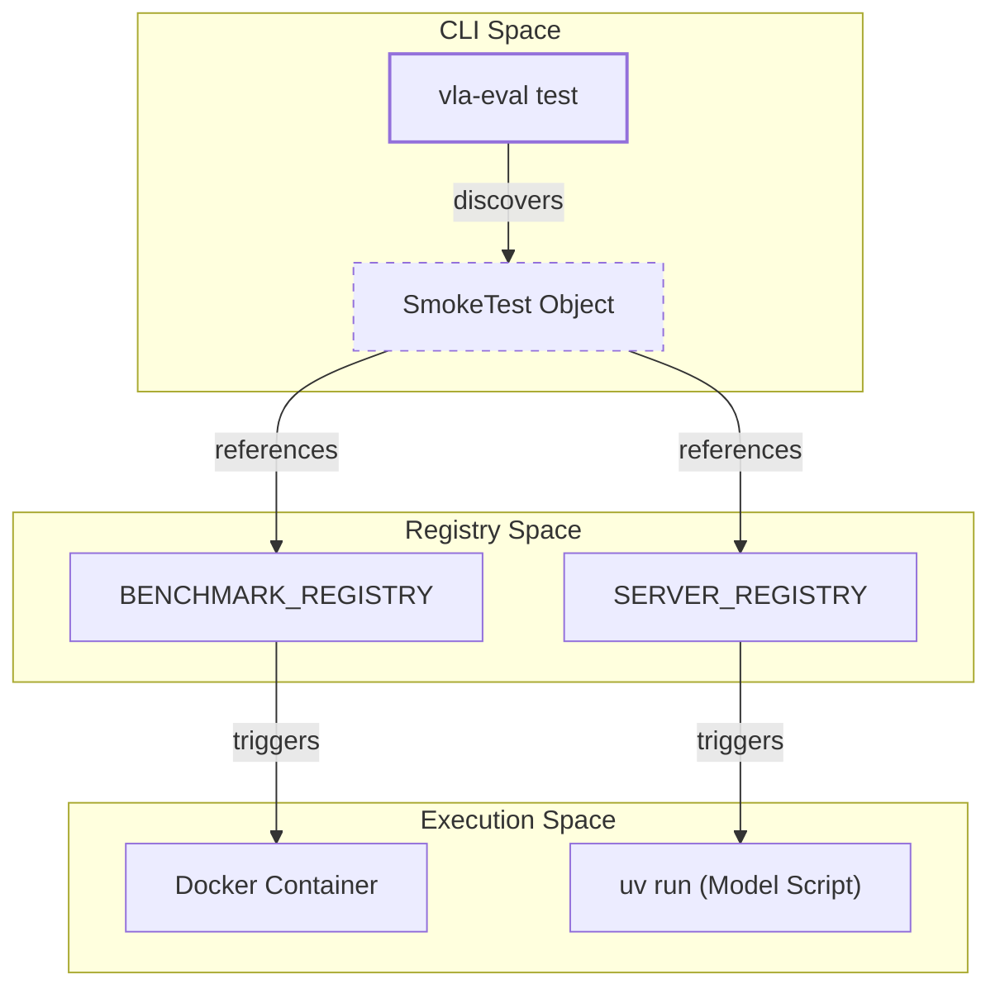
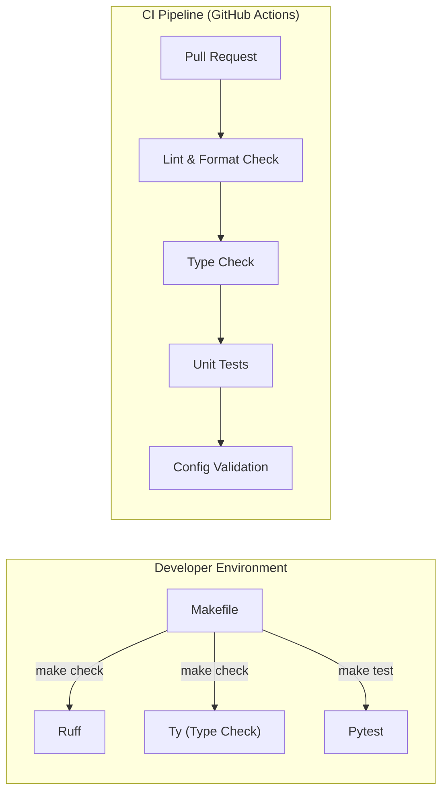

<!-- source: DeepWiki mcp.deepwiki.com · repo allenai/vla-evaluation-harness · page 7 Testing Infrastructure · fetched 2026-10-26 -->

# Testing Infrastructure

Relevant source files

The following files were used as context for generating this wiki page:

- [CLAUDE.md](CLAUDE.md)
- [Makefile](Makefile)
- [pyproject.toml](pyproject.toml)
- [src/vla_eval/cli/smoke.py](src/vla_eval/cli/smoke.py)
- [uv.lock](uv.lock)

The `vla-evaluation-harness` employs a multi-layered testing strategy to ensure the reliability of the evaluation pipeline, the integrity of communication protocols, and the validity of benchmark configurations. The infrastructure is built on `pytest` for unit/integration testing and a custom "Smoke Test" framework for validating the high-level execution of model servers and Dockerized benchmarks.

## Core Test Suite

The primary test suite utilizes `pytest` alongside `anyio` to handle asynchronous testing of WebSocket connections and concurrent episode execution [pyproject.toml:13-25](). These tests focus on the internal logic of the harness components.

### Test Categories
The suite is organized into several functional categories:
*   **Protocol & Connection**: Validates the `msgpack` serialization, `MessageType` handshakes, and `Connection` resilience (reconnection/backoff) [src/vla_eval/protocol.py:1-50]().
*   **Orchestration**: Tests the `Orchestrator`'s ability to isolate errors at the episode level and manage the lifecycle of `Benchmark` and `ModelServer` instances [src/vla_eval/orchestrator.py:10-40]().
*   **Runners & Chunking**: Verifies the `SyncEpisodeRunner` and `AsyncEpisodeRunner` logic, including action buffering and multi-step action chunking [src/vla_eval/runners/base.py:1-20]().
*   **Resource Management**: Tests the `docker_resources.py` logic for partitioning CPUs and GPUs across sharded containers.

### Common Fixtures
To facilitate testing without requiring live model weights or heavy simulation environments, the suite uses several test doubles:
*   `_EchoModelServer`: A stub server that returns received observations as actions, used to test the full network round-trip.
*   `_StubBenchmark`: A lightweight benchmark implementation that simulates episode transitions without a physics engine.

For details, see [Unit and Integration Tests](#7.1).

## Smoke Testing Framework

Beyond standard unit tests, the `vla-eval test` command provides a specialized smoke testing infrastructure [src/vla_eval/cli/smoke.py:1-6](). This system discovers and executes high-level integration tests based on the `BENCHMARK_REGISTRY` and `SERVER_REGISTRY` [src/vla_eval/cli/smoke.py:85-115]().

### Smoke Test Categories
| Category | Purpose | Code Entity |
| :--- | :--- | :--- |
| **Validate** | Ensures YAML configs match the expected schema. | `discover_validate_tests` |
| **Server** | Launches a model server and verifies it can accept a connection. | `discover_server_tests` |
| **Benchmark** | Pulls/Runs a benchmark Docker image and verifies one episode. | `discover_benchmark_tests` |

### Infrastructure Relationships
The following diagram illustrates how the smoke test infrastructure bridges high-level CLI commands to internal registry entities.

**Smoke Test Discovery Logic**

Sources: [src/vla_eval/cli/smoke.py:41-56](), [src/vla_eval/cli/smoke.py:85-115]().

## CI Quality Gates

The project enforces strict quality standards through GitHub Actions workflows and a `Makefile` that wraps the linting and type-checking tools [Makefile:1-25]().

### Static Analysis & Linting
*   **Ruff**: Used for both linting (`ruff check`) and formatting (`ruff format`). The project adheres to a 119-character line limit [pyproject.toml:39-40]().
*   **Ty**: A type-checking wrapper used to enforce PEP 484 type hints across the codebase [pyproject.toml:42-47]().

### Quality Gate Workflow

Sources: [Makefile:11-17](), [CLAUDE.md:17-20]().

For details on the automated enforcement of these gates, see [CI/CD Workflows](#7.2).

---

