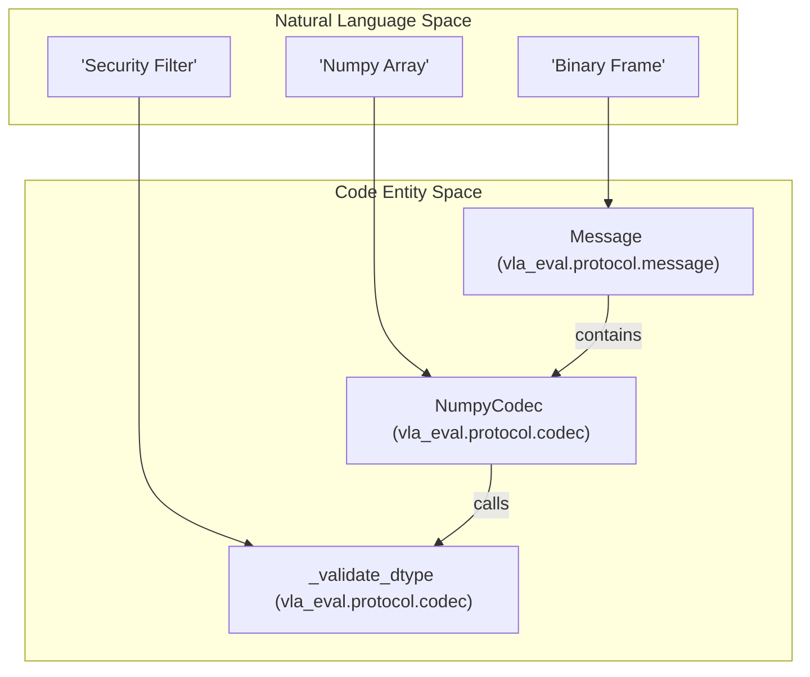
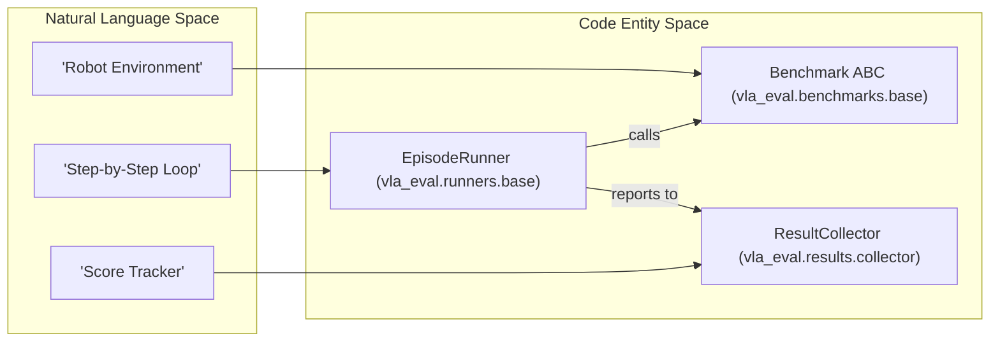

<!-- source: DeepWiki mcp.deepwiki.com · repo allenai/vla-evaluation-harness · page 7.1 Unit and Integration Tests · fetched 2026-10-26 -->

# Unit and Integration Tests

Relevant source files

The following files were used as context for generating this wiki page:

- [CLAUDE.md](CLAUDE.md)
- [Makefile](Makefile)
- [docs/architecture.md](docs/architecture.md)
- [docs/rfcs/0004-benchmark-and-episode-execution.md](docs/rfcs/0004-benchmark-and-episode-execution.md)
- [src/vla_eval/results/collector.py](src/vla_eval/results/collector.py)
- [src/vla_eval/results/merge.py](src/vla_eval/results/merge.py)

This page details the testing infrastructure of the `vla-evaluation-harness`. The suite is built on `pytest` and `anyio` to handle the asynchronous nature of the WebSocket protocol and episode execution loops. It covers everything from low-level binary serialization to high-level orchestration and Docker resource management.

## Test Suite Overview

The testing infrastructure is designed to validate the decoupled architecture of the harness. Because the system relies on a distributed topology (Orchestrator, Model Server, and Benchmark Container), the tests utilize "test doubles" (stubs and mocks) to isolate components.

| Test File | Focus Area | Key Entities Tested |
|:---|:---|:---|
| `test_protocol.py` | Binary Wire Format | `Message`, `NumpyCodec`, `ImageCodec` |
| `test_connection.py` | Communication | `Connection`, `reconnect_with_backoff` |
| `test_orchestrator.py` | Execution Flow | `Orchestrator`, `run_benchmark` |
| `test_runner.py` | Episode Loops | `SyncEpisodeRunner`, `AsyncEpisodeRunner` |
| `test_results.py` | Metrics & Sharding | `ResultCollector`, `merge_shards` |
| `test_chunking.py` | Temporal Control | `ActionChunkBuffer`, `ActionEnsemble` |
| `test_backpressure.py` | Flow Control | `BatchPredictModelServer`, `_BatchQueue` |
| `test_docker_resources.py`| Resource Allocation | `GPUAllocator`, `CPUAllocator` |
| `test_registry.py` | Dynamic Loading | `resolve_import_string` |
| `test_config_validation.py`| Schema Integrity | `EvalConfig`, `BenchmarkConfig` |

**Sources:** [CLAUDE.md:14-34](), [docs/architecture.md:25-36]()

---

## Protocol and Connection Testing

These tests ensure that the `msgpack`-based protocol correctly handles complex data types like `numpy` arrays and high-resolution images while maintaining sequence integrity.

### Data Flow: Natural Language to Code Entity Space (Protocol)

The following diagram maps the conceptual "Message" sent over the wire to the specific code implementations that handle serialization and safety.

**Sources:** [docs/architecture.md:72-96](), [src/vla_eval/protocol/codec.py](), [src/vla_eval/protocol/message.py]()

### Connection Reliability
`test_connection.py` validates the `Connection` client's ability to handle network instability. It tests:
*   **Handshake**: Ensuring `episode_start` and `episode_end` messages are acknowledged.
*   **Backoff**: Verifying that exponential backoff logic triggers correctly during connection failures.
*   **Sequence Tracking**: Ensuring the `seq` integer in the `Message` header increments monotonically [docs/architecture.md:82-82]().

---

## Execution and Orchestration Tests

The `Orchestrator` is the central authority. Tests in `test_orchestrator.py` and `test_runner.py` verify that the environment-agnostic loops correctly drive the simulation.

### Episode Loop Logic
The `SyncEpisodeRunner` is tested for lock-step execution where the environment waits for `conn.act(obs)` to return before calling `benchmark.apply_action()` [docs/rfcs/0004-benchmark-and-episode-execution.md:55-70](). 

`test_runner.py` simulates:
1.  **Success Path**: Episode completes within `max_steps`.
2.  **Timeout Path**: Episode exceeds `max_steps` and is terminated.
3.  **Error Path**: The model server returns an error, which must be isolated so it doesn't crash the entire benchmark run [CLAUDE.md:51-51]().

### Orchestrator Component Mapping

**Sources:** [docs/architecture.md:7-24](), [src/vla_eval/orchestrator.py](), [src/vla_eval/results/collector.py:41-51]()

---

## Results and Sharding Tests

`test_results.py` focuses on the `ResultCollector` and the `merge_shards` utility. These are critical for large-scale evaluations where benchmarks are split across multiple GPUs.

### Merging Logic
The `merge_shards` function is tested against several edge cases defined in [src/vla_eval/results/merge.py:3-9]():
*   **Consistency**: Ensuring all shards share the same `benchmark` name [src/vla_eval/results/merge.py:52-59]().
*   **Deduplication**: Implementing "last-write-wins" logic for duplicate `episode_id` entries [src/vla_eval/results/merge.py:82-86]().
*   **Partial Detection**: Marking the final result as `partial: True` if any shard IDs (0 to `total-1`) are missing [src/vla_eval/results/merge.py:108-125]().

---

## Specialized Infrastructure Tests

### Backpressure and Batching
`test_backpressure.py` validates the `BatchPredictModelServer`. It ensures that the `_BatchQueue` correctly groups incoming requests from multiple benchmark instances into a single forward pass, respecting `max_batch_size` and `max_wait_time`.

### Docker Resource Management
`test_docker_resources.py` verifies the allocation logic used in the CLI `run` command.
*   **GPU Partitioning**: Testing that `GPUAllocator` correctly assigns `CUDA_VISIBLE_DEVICES` to parallel benchmark containers.
*   **CPU Pinning**: Verifying that `CPUAllocator` calculates `cpuset-cpus` correctly to prevent thread contention between the simulation and the model server.

### Action Chunking and Rotation
`test_chunking.py` and `test_rotation.py` cover temporal aggregation:
*   **Ensembling**: Testing "average", "ema", and "newest" strategies for overlapping action chunks [docs/architecture.md:115-115]().
*   **Staleness**: Ensuring the `ActionChunkBuffer` correctly expires old actions in real-time (`realtime`) mode.

---

## Quality Gates and CI

Beyond functional tests, the repository enforces strict quality gates via `make check`:
*   **Linting**: `ruff` for code style and potential bugs [Makefile:3-6]().
*   **Type Checking**: `ty check` (a wrapper for `pyright` or `mypy`) to ensure type safety across the `TypedDict` results [Makefile:13-13]().
*   **Smoke Tests**: `vla-eval test --all` provides a high-level integration check that validates all registered configurations, model servers, and benchmarks [CLAUDE.md:26-33]().

**Sources:** [Makefile:1-25](), [CLAUDE.md:17-20]()

---

