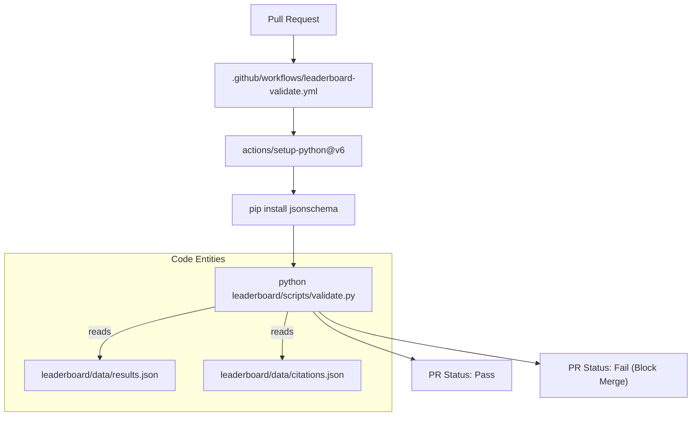
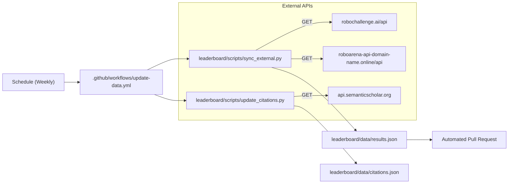

<!-- source: DeepWiki mcp.deepwiki.com · repo allenai/vla-evaluation-harness · page 7.2 CI/CD Workflows · fetched 2026-10-26 -->

# CI/CD Workflows

Relevant source files

The following files were used as context for generating this wiki page:

- [.github/PULL_REQUEST_TEMPLATE.md](.github/PULL_REQUEST_TEMPLATE.md)
- [.github/labeler.yml](.github/labeler.yml)
- [.github/workflows/labeler.yml](.github/workflows/labeler.yml)
- [.github/workflows/leaderboard-validate.yml](.github/workflows/leaderboard-validate.yml)
- [.github/workflows/update-data.yml](.github/workflows/update-data.yml)
- [leaderboard/scripts/sync_external.py](leaderboard/scripts/sync_external.py)

The `vla-evaluation-harness` utilizes GitHub Actions to maintain code quality, enforce data integrity for the leaderboard, and automate the synchronization of external evaluation results. These workflows ensure that contributions to both the core evaluation engine and the public-facing leaderboard remain consistent with defined schemas and quality standards.

### Workflow Architecture Overview

The CI/CD infrastructure is divided into two primary domains: **Core Engine Quality** (linting, testing) and **Leaderboard Maintenance** (validation, synchronization).

| Workflow | Trigger | Primary Function |
| :--- | :--- | :--- |
| `leaderboard-validate.yml` | PR to `leaderboard/data/` | Enforces JSON schema and data consistency. |
| `labeler.yml` | PR Opened/Sync | Automatically applies GitHub labels based on file paths. |
| `update-data.yml` | Weekly Schedule / Manual | Fetches external API data and updates citations. |
| `pages.yml` | Push to `main` | Deploys the static leaderboard frontend to GitHub Pages. |

---

### Leaderboard Validation and Schema Enforcement

The `leaderboard-validate.yml` workflow acts as a critical gatekeeper for data integrity. It is triggered whenever changes are detected in the leaderboard data directory or the validation logic itself [.github/workflows/leaderboard-validate.yml:2-7]().

#### Data Flow: PR Validation
1. **Trigger**: A contributor submits a PR modifying `leaderboard/data/results.json`.
2. **Environment**: The runner sets up Python 3.11 and installs `jsonschema` [.github/workflows/leaderboard-validate.yml:14-17]().
3. **Execution**: The workflow executes `leaderboard/scripts/validate.py` [.github/workflows/leaderboard-validate.yml:18-18]().
4. **Validation Logic**: `validate.py` checks for:
    * Compliance with the `results.json` schema (model names, benchmark keys, score ranges).
    * Proper formatting and alphabetical sorting of entries.
    * Valid provenance keys and citation links.

**Entity Interaction: Validation Workflow**

Sources: [.github/workflows/leaderboard-validate.yml:1-19](), [.github/PULL_REQUEST_TEMPLATE.md:20-22]()

---

### Automated Data Synchronization

The `update-data.yml` workflow automates the "ETL" (Extract, Transform, Load) process for the leaderboard. It runs weekly to ensure that the harness reflects the latest results from the robotics community [.github/workflows/update-data.yml:2-4]().

#### Implementation Detail: `sync_external.py`
The core logic for fetching external data resides in `leaderboard/scripts/sync_external.py`. It interacts with two primary external APIs:
* **RoboChallenge API**: Fetches success ratios and progress scores from `ROBOCHALLENGE_API` [leaderboard/scripts/sync_external.py:21-21]().
* **RoboArena API**: Fetches Elo ratings and evaluation counts from `ROBOARENA_API` [leaderboard/scripts/sync_external.py:22-22]().

The script maps external model names to internal keys using `ROBOCHALLENGE_MODEL_MAP` and `ROBOARENA_MODEL_MAP` [leaderboard/scripts/sync_external.py:25-42](). It then performs an upsert operation, updating existing scores or appending new entries to the `results` list [leaderboard/scripts/sync_external.py:113-122]().

#### Data Flow: Weekly Update
1. **Sync**: `sync_external.py --apply` fetches live competition results [leaderboard/scripts/update-data.yml:36-36]().
2. **Enrich**: `update_coverage.py` and `update_citations.py` (using `SEMANTIC_SCHOLAR_API_KEY`) update model metadata [.github/workflows/update-data.yml:41-45]().
3. **Validate**: The workflow runs `validate.py` to ensure the automated changes didn't break schema rules [.github/workflows/update-data.yml:48-48]().
4. **Publish**: If changes are detected, `peter-evans/create-pull-request` opens a new PR with a summary of updates [.github/workflows/update-data.yml:51-71]().

**Entity Interaction: Update Pipeline**

Sources: [.github/workflows/update-data.yml:1-71](), [leaderboard/scripts/sync_external.py:1-142]()

---

### Pull Request Management

To streamline the review process, the repository uses automated labeling and a standardized checklist.

#### Auto-Labeling
The `labeler.yml` workflow uses the `actions/labeler` action [.github/workflows/labeler.yml:14-16](). It references `.github/labeler.yml`, which assigns the `leaderboard` label to any PR that modifies files within the `leaderboard/` directory [.github/labeler.yml:1-4]().

#### PR Checklist Enforcement
The `.github/PULL_REQUEST_TEMPLATE.md` requires contributors to verify their changes manually before submission:
* **Code Changes**: Must pass `make check` (ruff/ty) and `make test` (pytest) [.github/PULL_REQUEST_TEMPLATE.md:10-11]().
* **Smoke Testing**: Contributors must provide the `vla-eval test` command used to verify their changes [.github/PULL_REQUEST_TEMPLATE.md:15-18]().
* **Data Changes**: Must pass the local `validate.py` script [.github/PULL_REQUEST_TEMPLATE.md:21-21]().

Sources: [.github/workflows/labeler.yml:1-17](), [.github/labeler.yml:1-4](), [.github/PULL_REQUEST_TEMPLATE.md:1-24]()

---

