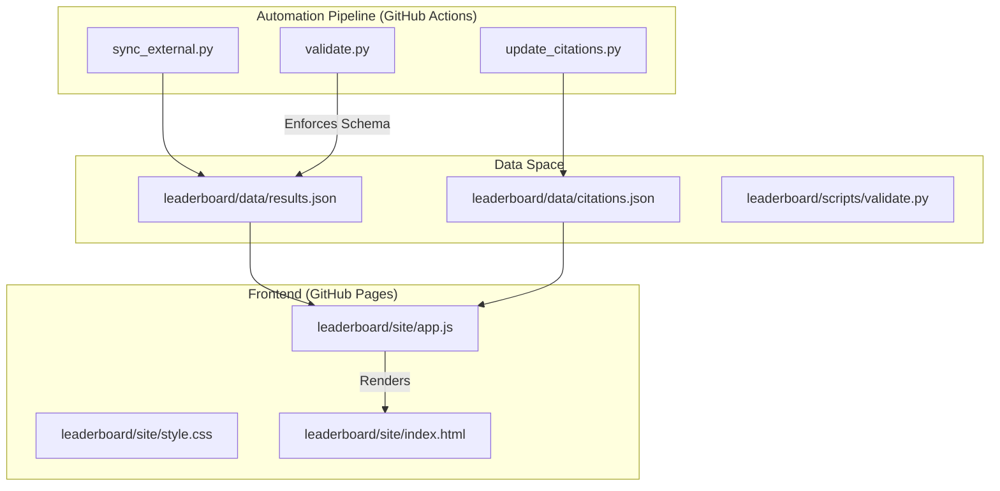
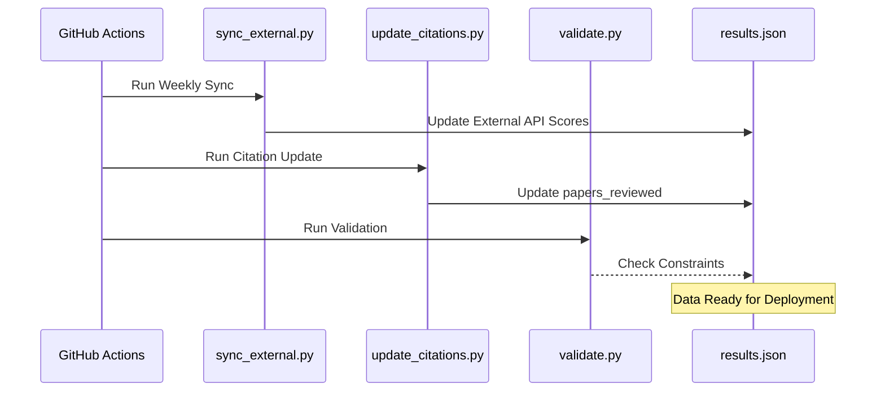

<!-- source: DeepWiki mcp.deepwiki.com · repo allenai/vla-evaluation-harness · page 8 Leaderboard · fetched 2026-10-26 -->

# Leaderboard

Relevant source files

The following files were used as context for generating this wiki page:

- [leaderboard/CONTRIBUTING.md](leaderboard/CONTRIBUTING.md)
- [leaderboard/data/results.json](leaderboard/data/results.json)
- [leaderboard/site/app.js](leaderboard/site/app.js)
- [leaderboard/site/index.html](leaderboard/site/index.html)
- [leaderboard/site/style.css](leaderboard/site/style.css)

The VLA Model Leaderboard provides a unified view of evaluation results for Vision-Language-Action (VLA) models across multiple robot simulation benchmarks. It serves as a central repository for tracking the state-of-the-art in the field, consolidating data from dozens of research papers into a single, searchable interface.

The leaderboard is designed as a static web application powered by a JSON-based data pipeline. This architecture ensures high performance, easy hosting via GitHub Pages, and a transparent contribution process where all data changes are tracked via Git.

### System Overview

The leaderboard infrastructure consists of three primary layers:
1.  **Data Storage**: A single source of truth in `leaderboard/data/results.json` containing model metadata, benchmark definitions, and scores.
2.  **Automation Pipeline**: Python scripts that validate data integrity, fetch citation counts from Semantic Scholar, and sync results from external APIs.
3.  **Frontend**: A vanilla JavaScript application that transforms the flat JSON data into an interactive, sortable heatmap and detail view.

Sources: [leaderboard/data/results.json:1-7](), [leaderboard/CONTRIBUTING.md:7-10](), [leaderboard/site/index.html:80-82]()

### Leaderboard Frontend
The frontend is a lightweight, dependency-free web application located in `leaderboard/site/`. It features two primary viewing modes:
*   **Overview Mode**: A compact heatmap grid that expands suite-only benchmarks (like SimplerEnv) into multiple columns to provide a high-level comparison across models.
*   **Detail Mode**: A focused view triggered by selecting a specific benchmark, showing per-task scores, curator metadata, and benchmark-specific caveats.

The application implements a custom tooltip system for displaying score provenance (e.g., who curated the data) and supports complex filtering by model name, publication date, and citation thresholds.

For details, see [Leaderboard Frontend](#8.1).

Sources: [leaderboard/site/app.js:9-15](), [leaderboard/site/app.js:148-151](), [leaderboard/site/index.html:38-53]()

### Data Schema and Contributing
The `results.json` file follows a strict schema where every result entry is self-contained. This means model metadata (params, paper URLs) is inlined with the scores to ensure data remains decodable even if the benchmark registry changes.

| Component | Role |
| :--- | :--- |
| `results.json` | The "Single Source of Truth" containing all model scores and benchmark metadata. |
| `validate.py` | Enforcement script that ensures sort order, required fields, and URL formats. |
| `weight_type` | Distinguishes between "shared" (generalist) and "finetuned" (specialist) model weights. |
| `curated_by` | Tracks provenance, identifying if data was human-verified or AI-extracted. |

For details, see [Leaderboard Data Schema and Contributing](#8.2).

Sources: [leaderboard/data/results.json:1-30](), [leaderboard/CONTRIBUTING.md:25-40](), [leaderboard/CONTRIBUTING.md:81-83]()

### Automated Data Pipeline
To keep pace with the rapid growth of VLA research, the leaderboard utilizes an automated ETL (Extract, Transform, Load) pipeline. This pipeline is executed via GitHub Actions and handles:
1.  **External Syncing**: Integrating scores from official benchmark APIs (e.g., RoboChallenge, RoboArena).
2.  **Citation Updates**: Fetching real-time citation counts from Semantic Scholar to help users filter for high-impact models.
3.  **Schema Validation**: Preventing malformed data from reaching the production site.

For details, see [Automated Data Pipeline](#8.3).

Sources: [leaderboard/CONTRIBUTING.md:95-97](), [leaderboard/data/results.json:23-100]()

---

