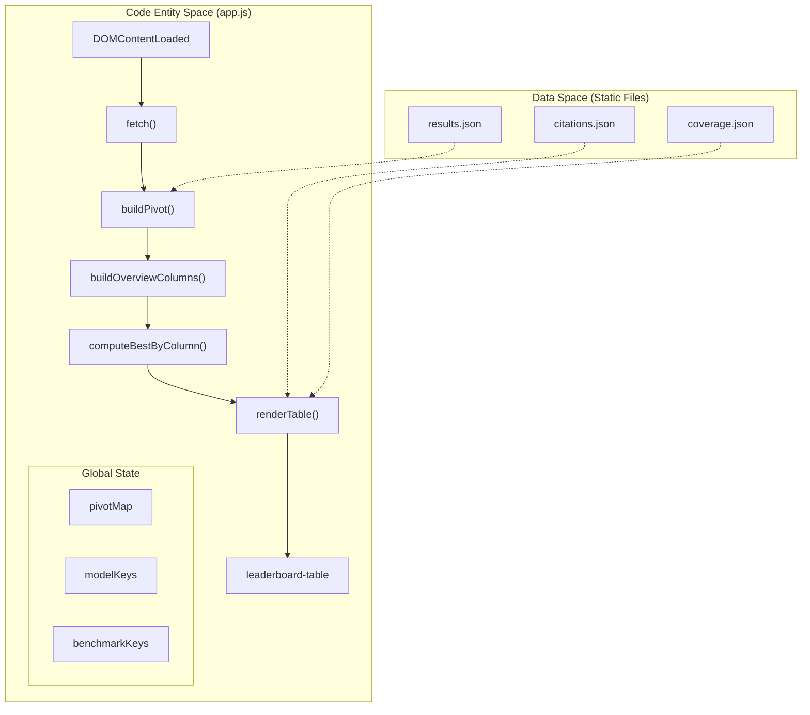
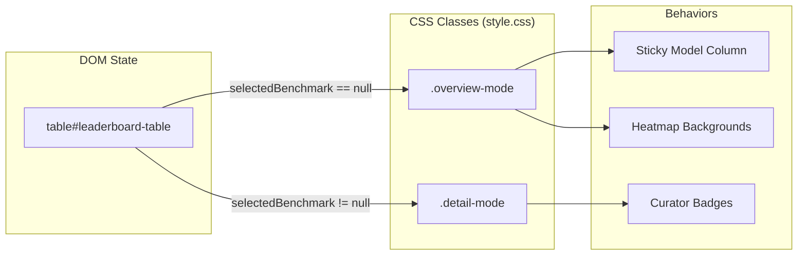

<!-- source: DeepWiki mcp.deepwiki.com · repo allenai/vla-evaluation-harness · page 8.1 Leaderboard Frontend · fetched 2026-10-26 -->

# Leaderboard Frontend

Relevant source files

The following files were used as context for generating this wiki page:

- [leaderboard/data/citations.json](leaderboard/data/citations.json)
- [leaderboard/data/coverage.json](leaderboard/data/coverage.json)
- [leaderboard/site/app.js](leaderboard/site/app.js)
- [leaderboard/site/index.html](leaderboard/site/index.html)
- [leaderboard/site/style.css](leaderboard/site/style.css)

The **Leaderboard Frontend** is a static, vanilla-JavaScript web application that serves as the primary visualization layer for Vision-Language-Action (VLA) model evaluation results. It is designed for high performance and zero-dependency deployment, consuming structured JSON data to provide interactive filtering, sorting, and multi-modal views of benchmark performance.

## System Architecture

The frontend follows a "data-driven" static site pattern. Upon loading, it fetches multiple JSON artifacts containing results, citation counts, and coverage statistics to build an in-memory pivot map for rendering.

### Data Flow and Component Interaction

The application initializes by bootstrapping a global state and then executing a sequence of data processing steps to prepare the UI.

Title: Frontend Initialization and Data Flow

Sources: `[leaderboard/site/app.js:48-98]()`, `[leaderboard/site/app.js:101-145]()`

## Core Implementation Details

### Pivot Map Construction
The frontend does not assume a specific order in the source JSON. The `buildPivot` function [leaderboard/site/app.js:101-145]() transforms the flat list of results into a nested map (`pivotMap[model][benchmark]`). This allows $O(1)$ access to specific scores during table row generation.

Key caches built during this phase include:
*   **`suiteOnlyCache`**: Identifies benchmarks that do not provide an aggregate score but only per-suite scores [leaderboard/site/app.js:125-131]().
*   **`bestByColumnCache`**: Pre-calculates the highest score for every column to apply "best-in-class" CSS highlighting [leaderboard/site/app.js:141-144]().

### View Modes
The application supports two distinct rendering modes governed by the `selectedBenchmark` state [leaderboard/site/app.js:13]().

| Mode | Trigger | Description |
| :--- | :--- | :--- |
| **Overview** | `selectedBenchmark == null` | A heatmap grid showing aggregate scores across all benchmarks. Suite-only benchmarks are expanded into multiple columns [leaderboard/site/app.js:148-179](). |
| **Detail** | `selectedBenchmark == ID` | Focuses on a single benchmark, showing individual task scores, suite breakdowns, and curator metadata [leaderboard/site/app.js:13]() |

Sources: `[leaderboard/site/app.js:7-13]()`, `[leaderboard/site/app.js:148-179]()`

## Filtering and Sorting System

The frontend implements a multi-criteria filtering pipeline that operates on the `modelKeys` array before rendering.

### Filter Pipeline
Filters are applied in `renderTable` before pagination:
1.  **Benchmark Filter**: Restricts rows to models having results for a specific benchmark [leaderboard/site/app.js:71]().
2.  **Model Search**: Case-insensitive substring match on model names [leaderboard/site/app.js:42]().
3.  **Date Range**: Filters by publication month/year using `date-from` and `date-to` inputs [leaderboard/site/app.js:45-47]().
4.  **Citation Threshold**: Filters models based on paper citations fetched from `citations.json` [leaderboard/site/app.js:50-52]().

### Sorting Logic
Sorting is handled via the `sortState` object [leaderboard/site/app.js:14](). The table supports:
*   **Numeric Sort**: Standard descending/ascending for scores.
*   **Date Sort**: Specialized handling for YYYY-MM strings.
*   **Heatmap Sorting**: In Overview mode, clicking a benchmark header re-sorts the entire leaderboard by that benchmark's performance.

Sources: `[leaderboard/site/app.js:14-31]()`, `[leaderboard/site/app.js:38-53]()`

## UI and Layout Modes

The interface uses a CSS-heavy approach to manage complex data tables. The layout transitions between "Overview" (compact) and "Detail" (expanded) using class toggles on the table element.

Title: CSS Layout State Management

Sources: `[leaderboard/site/style.css:338-343]()`, `[leaderboard/site/app.js:13]()`

### Tooltip System
To maintain a clean UI while providing provenance, a tooltip system is implemented via a single delegated event listener on `tbody` [leaderboard/site/app.js:80-89]().
*   **Trigger**: Hovering over a cell with the `data-tip-curator` attribute.
*   **Content**: Displays metadata such as the source paper, the specific curator (e.g., "Official", "Community"), and any benchmark-specific notes [leaderboard/site/app.js:82-83]().

## Data Schemas

The frontend expects three primary data files in the `leaderboard/data/` directory:

1.  **`results.json`**: The primary data source containing an array of result objects (model, benchmark, scores, etc.).
2.  **`citations.json`**: A map of ArXiv IDs to citation counts [leaderboard/data/citations.json:3-20]().
3.  **`coverage.json`**: Aggregated statistics used for the "Coverage Bar" visualization [leaderboard/data/coverage.json:1-5]().

Sources: `[leaderboard/data/citations.json:1-20]()`, `[leaderboard/data/coverage.json:1-127]()`

---

