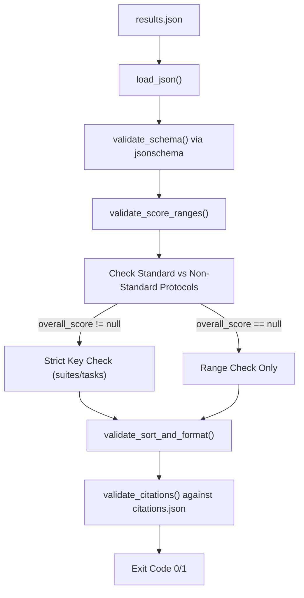

<!-- source: DeepWiki mcp.deepwiki.com · repo allenai/vla-evaluation-harness · page 8.2 Leaderboard Data Schema and Contributing · fetched 2026-10-26 -->

# Leaderboard Data Schema and Contributing

<details>
<summary>Relevant source files</summary>

The following files were used as context for generating this wiki page:

- [.github/ISSUE_TEMPLATE/config.yml](.github/ISSUE_TEMPLATE/config.yml)
- [.github/ISSUE_TEMPLATE/general.yml](.github/ISSUE_TEMPLATE/general.yml)
- [.github/ISSUE_TEMPLATE/leaderboard_data.yml](.github/ISSUE_TEMPLATE/leaderboard_data.yml)
- [leaderboard/CONTRIBUTING.md](leaderboard/CONTRIBUTING.md)
- [leaderboard/data/results.json](leaderboard/data/results.json)
- [leaderboard/scripts/validate.py](leaderboard/scripts/validate.py)

</details>


This page defines the data structures and validation rules for the VLA model leaderboard. The leaderboard is driven by a single JSON source of truth, `leaderboard/data/results.json`, which contains both the benchmark registry and the individual model evaluation results.

## Data Schema: results.json

The `results.json` file is structured into two primary sections: `benchmarks` (the registry of supported evaluation suites) and `results` (the collection of model scores).

### 1. Benchmarks Registry
Each benchmark entry defines the metadata required to render and validate scores for that suite.

| Field | Type | Description |
| :--- | :--- | :--- |
| `display_name` | `string` | Human-readable name shown in the UI. |
| `paper_url` | `string` | Link to the original benchmark paper. |
| `metric` | `object` | Contains `name`, `unit`, and `range` (e.g., `[0, 100]`). |
| `suites` | `string[]` | List of valid sub-suite keys (e.g., `libero_spatial`). |
| `tasks` | `string[]` | List of valid individual task keys. |
| `official_leaderboard`| `boolean`| If true, only API-synced entries are allowed. |

### 2. Result Entry Schema
Every result is self-contained, inlining model metadata to ensure the entry remains valid even if other entries for the same model are modified [leaderboard/CONTRIBUTING.md:25-26]().

```json
{
  "model": "openvla",
  "display_name": "OpenVLA",
  "params": "7B",
  "model_paper": "https://arxiv.org/abs/2406.09246",
  "benchmark": "libero",
  "weight_type": "finetuned",
  "overall_score": 85.7,
  "suite_scores": { "libero_spatial": 84.0 },
  "source_paper": "https://arxiv.org/abs/2406.09246",
  "curated_by": "opus 4.6",
  "date_added": "2026-03-02"
}
```

**Key Field Constraints:**
*   **`weight_type`**: Must be `"shared"` (one checkpoint for all benchmarks) or `"finetuned"` (specifically trained/tuned for this benchmark) [leaderboard/CONTRIBUTING.md:52-52]().
*   **`overall_score`**: Aggregate score used for ranking. Must be `null` if the evaluation uses a non-standard protocol or subset [leaderboard/CONTRIBUTING.md:55-55]().
*   **`curated_by`**: Set to the AI model name (e.g., `"opus 4.6"`) for automated extractions or a GitHub handle (e.g., `"@user"`) for human-verified entries [leaderboard/CONTRIBUTING.md:53-53]().

**Sources:** [leaderboard/data/results.json:1-150](), [leaderboard/CONTRIBUTING.md:23-57]()

---

## Validation and Enforcement

The `leaderboard/scripts/validate.py` script enforces strict schema and logical rules to maintain data integrity.

### Enforcement Rules
1.  **Score Range Check**: Validates that `overall_score`, `suite_scores`, and `task_scores` fall within the `[lo, hi]` range defined in the benchmark registry [leaderboard/scripts/validate.py:53-84]().
2.  **Key Validation**: For standard entries (`overall_score` is not `null`), keys in `suite_scores` and `task_scores` must exist in the benchmark's declared lists [leaderboard/scripts/validate.py:70-82]().
3.  **Official Leaderboard Policy**: If a benchmark has `official_leaderboard: true`, the `curated_by` field must end with `-api`. Manual paper extractions are blocked [leaderboard/scripts/validate.py:115-127]().
4.  **Canonical Formatting**: Enforces `indent=2`, sorted keys, and trailing newlines. The script provides a `--fix` flag to auto-sort entries by `(benchmark, model)` [leaderboard/scripts/validate.py:100-112]().

### Logical Data Flow of validate.py
The diagram below illustrates how `validate.py` processes the raw JSON against the registry and external citations.

**Validation Logic Pipeline**

**Sources:** [leaderboard/scripts/validate.py:20-170]()

---

## Benchmark-Specific Protocols

Certain benchmarks require specific data formats to ensure comparability across different papers.

### SimplerEnv Protocol
SimplerEnv results must never be averaged across its three dimensions. Instead, `overall_score` must be `null`, and scores must be placed in `suite_scores` using specific keys [leaderboard/CONTRIBUTING.md:101-103]().

*   **google_robot_vm**: Visual Matching (Standard 3-task average).
*   **google_robot_va**: Variant Aggregation.
*   **widowx_vm**: WidowX (Bridge) Visual Matching.
*   **Suffix Rule**: `validate.py` enforces that all SimplerEnv task keys must end with `_vm` or `_va` [leaderboard/scripts/validate.py:85-89]().

### LIBERO Protocol
*   **LIBERO-10/90**: Standardized success rates.
*   **LIBERO-4 Suite Average**: Often reported as the average of `spatial`, `object`, `goal`, and `10`. If a paper reports this, it is stored in `overall_score` [leaderboard/CONTRIBUTING.md:13-14]().

**Sources:** [leaderboard/CONTRIBUTING.md:101-110](), [leaderboard/scripts/validate.py:85-89]()

---

## Provenance and Reproductions

To prevent "score drift," the leaderboard distinguishes between original author results and third-party reproductions using **Provenance Keying**.

| Scenario | Model Key Strategy | Source Paper |
| :--- | :--- | :--- |
| **Original Authors** | `openvla` | Model's original paper |
| **Third-party Eval** | `openvla` (original key) | Reproducing paper |
| **Third-party Re-train**| `openvla_repro_by_B` | Reproducing paper |

**Rules for Reproductions:**
*   Third-party re-trainings (e.g., using a different recipe) must use a **separate model key** with a descriptive suffix [leaderboard/CONTRIBUTING.md:70-70]().
*   Baseline citations (copying a score from Paper A into Paper B) are only accepted if the original score is missing [leaderboard/CONTRIBUTING.md:71-71]().

**Sources:** [leaderboard/CONTRIBUTING.md:58-74]()

---

## How to Contribute

### Submitting New Results
1.  **Modify Data**: Add the entry to `leaderboard/data/results.json`.
2.  **Update Date**: Change the top-level `last_updated` field to the current date [leaderboard/CONTRIBUTING.md:79-79]().
3.  **Run Validation**:
    ```bash
    python leaderboard/scripts/validate.py --fix
    ```
4.  **Update Citations**: If the paper is new, run `python leaderboard/scripts/update_citations.py --fetch` to pull BibTeX data from Semantic Scholar [leaderboard/CONTRIBUTING.md:84-84]().
5.  **PR**: Open a Pull Request. The `leaderboard-validate.yml` CI workflow will automatically verify the schema [leaderboard/CONTRIBUTING.md:95-95]().

### Reporting Issues
For missing scores or protocol corrections without a PR, use the **Leaderboard Data** issue template [ .github/ISSUE_TEMPLATE/leaderboard_data.yml:1-16]().

**Sources:** [leaderboard/CONTRIBUTING.md:75-88](), [.github/ISSUE_TEMPLATE/leaderboard_data.yml:1-16]()

---

