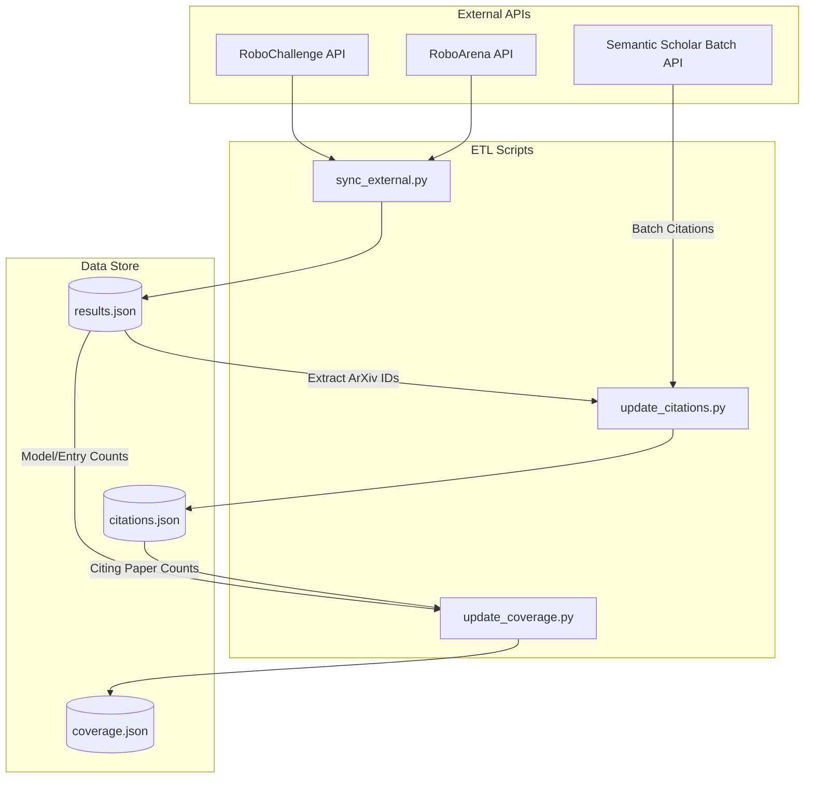
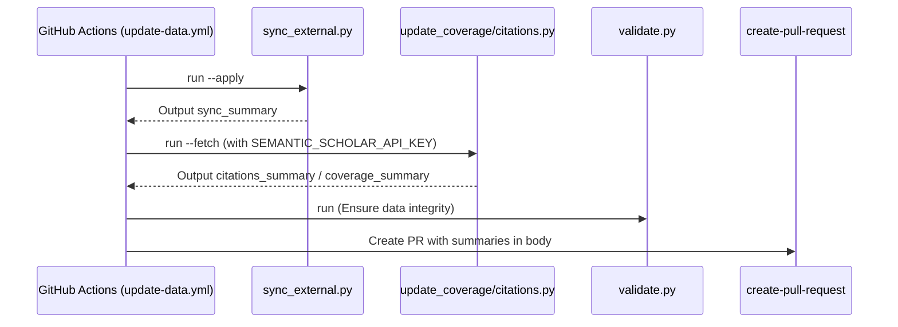

<!-- source: DeepWiki mcp.deepwiki.com · repo allenai/vla-evaluation-harness · page 8.3 Automated Data Pipeline · fetched 2026-10-26 -->

# Automated Data Pipeline

Relevant source files

The following files were used as context for generating this wiki page:

- [.github/workflows/update-data.yml](.github/workflows/update-data.yml)
- [leaderboard/data/citations.json](leaderboard/data/citations.json)
- [leaderboard/data/coverage.json](leaderboard/data/coverage.json)
- [leaderboard/scripts/sync_external.py](leaderboard/scripts/sync_external.py)
- [leaderboard/scripts/update_citations.py](leaderboard/scripts/update_citations.py)
- [leaderboard/scripts/update_coverage.py](leaderboard/scripts/update_coverage.py)

The Automated Data Pipeline is a set of ETL (Extract, Transform, Load) scripts and GitHub Actions workflows designed to maintain the VLA Leaderboard's data integrity and freshness. It automates the ingestion of results from external competition APIs, updates citation counts for research papers, and regenerates coverage statistics for the frontend.

## Pipeline Overview

The pipeline consists of three primary Python scripts executed weekly via GitHub Actions. These scripts interact with external APIs (RoboChallenge, RoboArena, Semantic Scholar) and update local JSON data stores.

### Data Flow Diagram

"Data Ingestion and Transformation Flow"

Sources: `leaderboard/scripts/sync_external.py` [1-22](), `leaderboard/scripts/update_citations.py` [1-23](), `leaderboard/scripts/update_coverage.py` [1-22]()

---

## External Leaderboard Synchronization

The `sync_external.py` script automates the process of pulling live results from external robotics competitions. It maps external model identifiers to internal keys and handles the upsert logic for `results.json`.

### Key Components

- **RoboChallenge Integration**: Fetches from `ROBOCHALLENGE_API` [leaderboard/scripts/sync_external.py:21](). It uses a mapping table `ROBOCHALLENGE_MODEL_MAP` [leaderboard/scripts/sync_external.py:25-34]() to translate `(display_name, is_multi_task_model)` tuples into canonical model keys.
- **RoboArena Integration**: Fetches from `ROBOARENA_API` [leaderboard/scripts/sync_external.py:22](). It maps external "policy" strings to internal keys via `ROBOARENA_MODEL_MAP` [leaderboard/scripts/sync_external.py:37-42]().
- **Stale Entry Removal**: To ensure the leaderboard reflects the current state of active competitions, the script identifies entries in `results.json` curated by `robochallenge-api` or `roboarena-api` that are no longer present in the API responses and removes them [leaderboard/scripts/sync_external.py:124-140]().

### Logic for `sync_robochallenge`
The function `sync_robochallenge(data)` [leaderboard/scripts/sync_external.py:68]() performs the following:
1. Fetches JSON via `fetch_json` [leaderboard/scripts/sync_external.py:57]().
2. Iterates through entries, calculating `overall_score` as a percentage [leaderboard/scripts/sync_external.py:85]().
3. Constructs a `result_entry` with metadata like `curated_by: "robochallenge-api"` [leaderboard/scripts/sync_external.py:108]().
4. Updates existing entries or appends new ones to the `results` list [leaderboard/scripts/sync_external.py:113-122]().

Sources: `leaderboard/scripts/sync_external.py` [21-142]()

---

## Citation and Coverage Tracking

The leaderboard tracks the impact of benchmarks and models through citation counts and cross-referenced paper reviews.

### `update_citations.py`
This script maintains `citations.json` [leaderboard/data/citations.json:1-301]().
- **Extraction**: It scans `results.json` for `model_paper` and `source_paper` fields, extracting ArXiv IDs using a regex [leaderboard/scripts/update_citations.py:32-34]().
- **Batch Processing**: It uses the Semantic Scholar Batch API [leaderboard/scripts/update_citations.py:25]() to fetch counts for up to 500 papers per request [leaderboard/scripts/update_citations.py:29]().
- **Rate Limiting**: Implements a 10-second sleep on 429 errors and a 1-second delay between batches [leaderboard/scripts/update_citations.py:59-79]().

### `update_coverage.py`
This script generates `coverage.json` [leaderboard/data/coverage.json:1-127](), which powers the "Coverage" section of the frontend.
- **Metrics Calculation**: It calculates `total_models`, `total_results`, and `total_papers_reviewed` [leaderboard/scripts/update_coverage.py:114-120]().
- **Benchmark Stats**: For each benchmark, it aggregates the number of leaderboard entries and the count of papers reviewed by the curators [leaderboard/scripts/update_coverage.py:131-137]().

Sources: `leaderboard/scripts/update_citations.py` [25-127](), `leaderboard/scripts/update_coverage.py` [83-142]()

---

## Automation Workflow

The pipeline is orchestrated by the `.github/workflows/update-data.yml` GitHub Action.

### Workflow Execution Steps

"update-data.yml Execution Logic"

- **Schedule**: Runs weekly on Mondays at 06:00 UTC via cron `'0 6 * * 1'` [.github/workflows/update-data.yml:4]().
- **Manual Trigger**: Supports `workflow_dispatch` with an optional `source` input to sync specific APIs [.github/workflows/update-data.yml:5-10]().
- **Validation**: Before committing any changes, the workflow runs `leaderboard/scripts/validate.py` to ensure the updated `results.json` adheres to the schema [.github/workflows/update-data.yml:48]().
- **PR Generation**: Changes are bundled into a Pull Request titled "data: update leaderboard data" using the `peter-evans/create-pull-request` action [.github/workflows/update-data.yml:51-68]().

Sources: `.github/workflows/update-data.yml` [1-71]()

---

