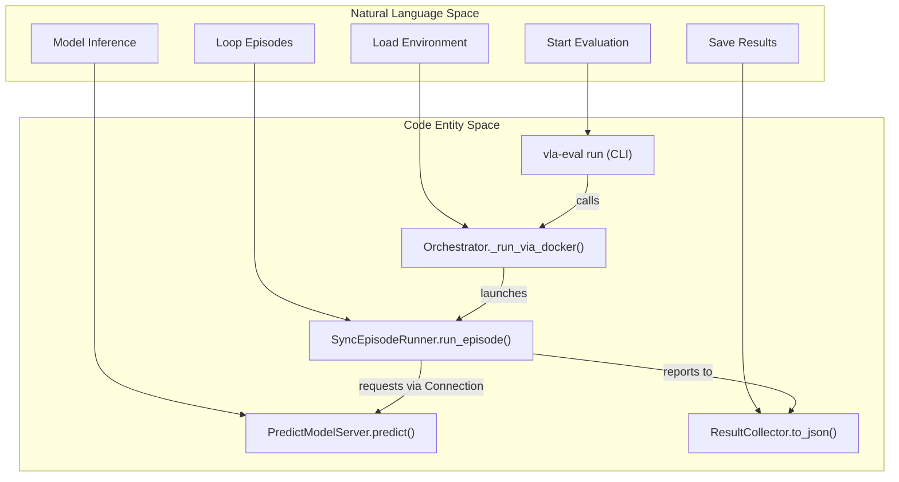
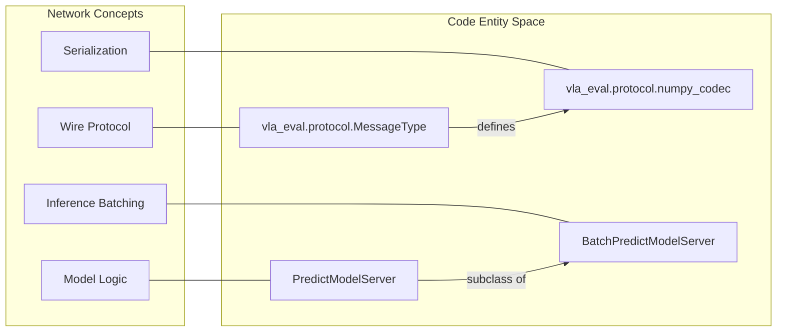

<!-- source: DeepWiki mcp.deepwiki.com · repo allenai/vla-evaluation-harness · page 9 Glossary · fetched 2026-10-26 -->

# Glossary

Relevant source files

The following files were used as context for generating this wiki page:

- [.dockerignore](.dockerignore)
- [README.md](README.md)
- [configs/model_servers/starvla_groot_simpler.yaml](configs/model_servers/starvla_groot_simpler.yaml)
- [docker/rlbench_entrypoint.sh](docker/rlbench_entrypoint.sh)
- [docs/architecture.md](docs/architecture.md)
- [docs/rfcs/0004-benchmark-and-episode-execution.md](docs/rfcs/0004-benchmark-and-episode-execution.md)
- [leaderboard/CONTRIBUTING.md](leaderboard/CONTRIBUTING.md)
- [leaderboard/README.md](leaderboard/README.md)
- [src/vla_eval/cli/main.py](src/vla_eval/cli/main.py)
- [src/vla_eval/cli/smoke.py](src/vla_eval/cli/smoke.py)
- [src/vla_eval/model_servers/starvla.py](src/vla_eval/model_servers/starvla.py)
- [src/vla_eval/results/collector.py](src/vla_eval/results/collector.py)
- [src/vla_eval/results/merge.py](src/vla_eval/results/merge.py)
- [src/vla_eval/types.py](src/vla_eval/types.py)

This page defines the core technical terms, domain concepts, and architectural components used throughout the `vla-evaluation-harness` codebase.

## Core Architectural Entities

### Orchestrator
The central control authority that manages the lifecycle of an evaluation run. It parses configurations, manages Docker container lifecycles for benchmarks, and iterates through tasks and episodes.
*   **Implementation**: `Orchestrator` class in [src/vla_eval/orchestrator.py:18-20]().
*   **Key Function**: `run()` [src/vla_eval/orchestrator.py:108-110]() handles the sequential execution of benchmarks defined in the `EvalConfig`.

### Benchmark
An abstraction layer representing a robot simulation environment. It decouples environment-specific APIs (like SimplerEnv or LIBERO) from the harness.
*   **Implementation**: `Benchmark` ABC in [docs/rfcs/0004-benchmark-and-episode-execution.md:28-37]().
*   **Key Methods**: `get_tasks()`, `start_episode()`, `apply_action()`, `get_observation()`, `is_done()`, and `get_result()`.

### EpisodeRunner
A strategy object that defines *how* an episode is executed by driving the interaction between a `Benchmark` and a `Connection`.
*   **SyncEpisodeRunner**: Executes in a lock-step "Observation -> Action -> Step" loop where the environment waits for the model [docs/rfcs/0004-benchmark-and-episode-execution.md:50-70]().
*   **AsyncEpisodeRunner**: Executes in real-time where the environment clock advances independently of model inference speed [docs/rfcs/0004-benchmark-and-episode-execution.md:72-81]().

### Model Server
A standalone process (usually running on a GPU-enabled host) that hosts the VLA model and responds to inference requests over WebSockets.
*   **Implementation**: `PredictModelServer` [src/vla_eval/model_servers/predict.py:51-51]() or `BatchPredictModelServer`.
*   **Execution**: Often wrapped as a **uv script** with PEP 723 inline dependencies [src/vla_eval/model_servers/starvla.py:1-29]().

### Connection
The communication client used by the `EpisodeRunner` to send observations to and receive actions from the `ModelServer`.
*   **Protocol**: Uses **WebSocket + msgpack** for low-latency binary serialization [docs/architecture.md:72-74]().

---

## Technical Terms & Concepts

| Term | Definition | Code Pointer |
| :--- | :--- | :--- |
| **Action Chunking** | The technique of predicting a sequence of future actions (a "chunk") in a single inference pass to improve temporal consistency. | `ActionChunkBuffer` in `vla_eval.model_servers.predict` |
| **Action Ensemble** | Strategies for blending overlapping action chunks, such as `newest`, `average`, or `ema`. | [src/vla_eval/model_servers/starvla.py:61-61]() |
| **Episode Sharding** | Splitting evaluation workloads across multiple processes/containers using `--shard-id` and `--num-shards`. | [src/vla_eval/cli/main.py:161-168]() |
| **Import String** | A string format (`module.path:ClassName`) used in YAML configs to dynamically resolve and load classes. | `resolve_import_string` in [docs/architecture.md:146-149]() |
| **Msgpack** | The binary serialization format used for the wire protocol, chosen for efficiency over JSON. | [docs/architecture.md:74-76]() |
| **Numpy Codec** | A custom encoder/decoder for transparently sending `numpy.ndarray` objects over the wire. | [docs/architecture.md:87-93]() |
| **uv Script** | A single-file Python script with metadata (PEP 723) defining its own dependencies, used to run Model Servers without manual environment setup. | [src/vla_eval/model_servers/starvla.py:1-29]() |

---

## System Mapping: Natural Language to Code Entities

The following diagrams bridge high-level system concepts to their specific implementations in the codebase.

### Evaluation Execution Flow
This diagram maps the conceptual "Run an Eval" process to the specific classes and methods that handle the data flow.

"Evaluation Execution Mapping"

Sources: [src/vla_eval/cli/main.py:161-170](), [src/vla_eval/orchestrator.py:108-115](), [docs/rfcs/0004-benchmark-and-episode-execution.md:55-70](), [src/vla_eval/results/collector.py:118-121]()

### Model Server Communication
This diagram associates the networking concepts with the specific protocol implementations and model abstractions.

"Communication Protocol Mapping"

Sources: [docs/architecture.md:72-96](), [docs/architecture.md:107-113](), [src/vla_eval/model_servers/predict.py:51-51]()

---

## Result Hierarchy

Results are collected and stored in a nested structure to allow for both granular episode analysis and high-level benchmark comparison.

| Level | Data Structure | Purpose |
| :--- | :--- | :--- |
| **Episode** | `EpisodeResult` | Success/failure, step count, and latency for a single run. [src/vla_eval/results/collector.py:15-22]() |
| **Task** | `TaskResult` | Aggregated success rate and average steps for a specific task (e.g., "pick_coke_can"). [src/vla_eval/results/collector.py:25-30]() |
| **Benchmark** | `BenchmarkResult` | The final JSON output containing all task results and the full `EvalConfig` snapshot. [src/vla_eval/results/collector.py:32-39]() |

Sources: [src/vla_eval/results/collector.py:1-40](), [src/vla_eval/results/merge.py:43-47]()