# Page: Overview

# Overview

<details>
<summary>Relevant source files</summary>

The following files were used as context for generating this wiki page:

- [CLAUDE.md](CLAUDE.md)
- [CONTRIBUTING.md](CONTRIBUTING.md)
- [Makefile](Makefile)
- [README.md](README.md)
- [docs/architecture.md](docs/architecture.md)
- [docs/rfcs/0004-benchmark-and-episode-execution.md](docs/rfcs/0004-benchmark-and-episode-execution.md)
- [leaderboard/README.md](leaderboard/README.md)

</details>


The **vla-evaluation-harness** (`vla-eval`) is a unified evaluation framework designed to benchmark Vision-Language-Action (VLA) models across a diverse set of robot simulation environments. It addresses the fragmentation in robotic AI research by providing a standardized abstraction layer that decouples model implementations from simulation dependencies.

By utilizing a client-server architecture, the harness allows researchers to integrate a model once and evaluate it across 14+ benchmarks—including LIBERO, CALVIN, and SimplerEnv—without managing conflicting library requirements or manual setup scripts.

### Core Capabilities

*   **Zero-Setup Environments**: All benchmarks are containerized via Docker, ensuring exact reproducibility and eliminating "dependency hell" [README.md:38-39]().
*   **High-Throughput Evaluation**: Supports episode sharding and batched GPU inference, achieving up to 47× speedup over sequential evaluation [README.md:23-23]().
*   **Real-Time Testing**: Includes an `AsyncEpisodeRunner` that simulates "Sim2Live" conditions where the environment advances during model inference [docs/rfcs/0004-benchmark-and-episode-execution.md:72-74]().
*   **Unified Leaderboard**: Provides a central repository of 500+ model results across 17 benchmarks [README.md:26-26]().

---

### System Topology

The framework operates on a three-component topology: the **Orchestrator**, the **Benchmark Client**, and the **Model Server**. These components communicate over a WebSocket protocol using `msgpack` for efficient binary serialization of images and tensors.

#### Component Interaction Diagram
This diagram maps the high-level components to their respective implementation classes and files.

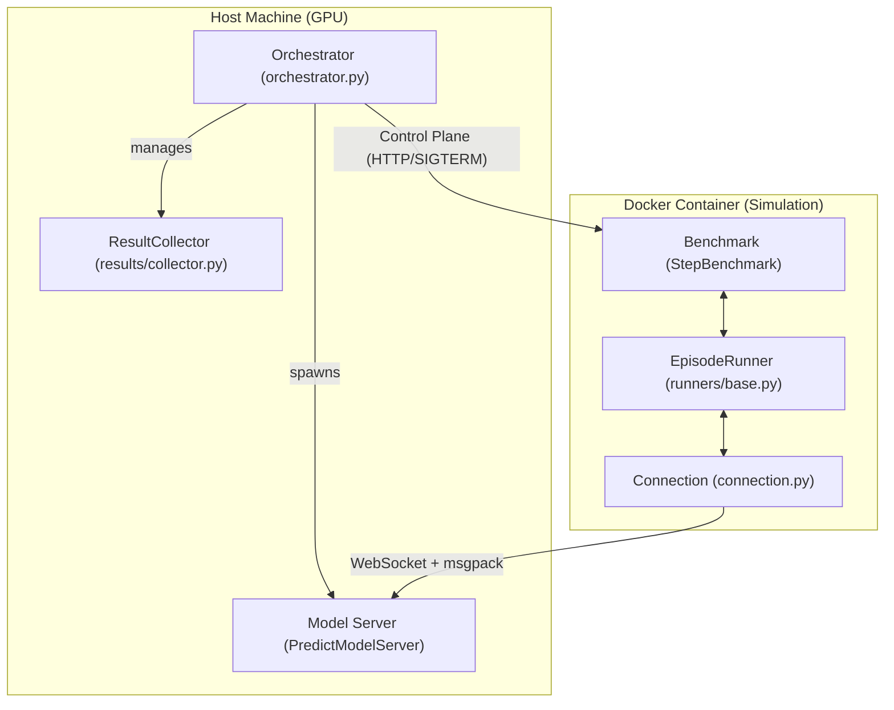
**Sources:** [docs/architecture.md:7-24](), [CLAUDE.md:40-47](), [docs/rfcs/0004-benchmark-and-episode-execution.md:98-111]()

---

### The Evaluation Pipeline

Evaluation is driven by a five-stage pipeline that ensures isolation between episodes and efficient resource utilization.

1.  **Orchestration**: The `Orchestrator` [src/vla_eval/orchestrator.py:1-5]() reads a `EvalConfig` [src/vla_eval/config.py:79-81](), launches the necessary Docker containers, and manages the lifecycle of the evaluation.
2.  **Benchmark Abstraction**: The `Benchmark` ABC [src/vla_eval/benchmarks/base.py:28-39]() provides a uniform interface for tasks, observations, and actions, regardless of the underlying simulator (e.g., MuJoCo, SAPIEN, or PyBullet).
3.  **Episode Execution**: The `EpisodeRunner` [src/vla_eval/runners/base.py:46-48]() handles the control loop. It can run in `Sync` mode (lock-step) or `Async` mode (wall-clock pacing).
4.  **Communication**: The `Connection` class [src/vla_eval/connection.py:78-80]() manages the WebSocket bridge, handling retries and binary encoding of `Observation` and `Action` types.
5.  **Inference**: The `ModelServer` [src/vla_eval/model_servers/base.py:110-113]() receives observations and returns actions. It often utilizes `BatchPredictModelServer` to process requests from multiple parallel benchmark shards simultaneously.

#### Pipeline Entity Map
This diagram associates natural language pipeline stages with specific code entities and data structures.

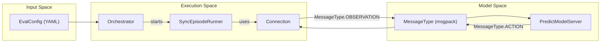
**Sources:** [docs/architecture.md:54-70](), [src/vla_eval/protocol/messages.py:1-20](), [docs/rfcs/0004-benchmark-and-episode-execution.md:124-135]()

---

### Navigation

For detailed technical information, please refer to the following sub-pages:

*   **[Getting Started](#1.1)**: Installation via `uv`, CLI commands (`run`, `serve`, `test`), and the zero-setup Docker workflow.
*   **[Design Philosophy](#1.2)**: The principles of freshness, convenience, and layered abstraction that guide the development of the harness.
*   **[Core Architecture](#2)**: Deep dive into the internal components, the communication protocol, and result collection.
*   **[Model Servers](#3)**: How to implement and deploy model servers using the `uv` script pattern.
*   **[Benchmark Integrations](#4)**: Details on the 14+ supported benchmarks and the Docker packaging system.
*   **[CLI and Execution Orchestration](#5)**: Advanced usage of the `vla-eval` command, including sharding and performance tuning.
*   **[Extending the Harness](#6)**: Step-by-step guides for adding new models or benchmarks using AI-assisted scaffolding.
*   **[Testing Infrastructure](#7)**: Overview of the unit, integration, and smoke testing suites.
*   **[Leaderboard](#8)**: The data pipeline and frontend architecture for the VLA comparison site.
*   **[Glossary](#9)**: Definitions of terms and code pointers for onboarding.

---

# Page: Getting Started

# Getting Started

<details>
<summary>Relevant source files</summary>

The following files were used as context for generating this wiki page:

- [CLAUDE.md](CLAUDE.md)
- [Makefile](Makefile)
- [README.md](README.md)
- [leaderboard/README.md](leaderboard/README.md)
- [pyproject.toml](pyproject.toml)
- [src/vla_eval/cli/main.py](src/vla_eval/cli/main.py)
- [uv.lock](uv.lock)

</details>


The `vla-evaluation-harness` is a unified framework designed to evaluate Vision-Language-Action (VLA) models across a diverse set of robot simulation benchmarks. It solves the "dependency hell" of robotics evaluation by decoupling model dependencies from benchmark environments using a client-server architecture over WebSockets and Docker containerization.

## Installation

The project uses `uv` for fast, reproducible dependency management and supports PEP 723 inline script dependencies for model servers.

### Prerequisites
- **Python 3.8+** (3.11 recommended) [pyproject.toml:10-10]()
- **Docker**: Required for running benchmarks [src/vla_eval/cli/main.py:172-177]()
- **NVIDIA Container Toolkit**: Required if GPU acceleration is needed inside Docker containers (e.g., for rendering) [src/vla_eval/docker_resources.py:22-35]()

### Setup via uv
To install the harness and its development dependencies:

```bash
git clone https://github.com/allenai/vla-evaluation-harness.git
cd vla-evaluation-harness
uv sync --python 3.11 --all-extras --dev
```
Sources: [README.md:53-57](), [CLAUDE.md:15-15]()

### Pip Install
For users who only need the CLI and core library:
```bash
pip install vla-eval
```
Sources: [README.md:48-48]()

---

## Project Layout

The codebase is structured to separate the orchestration logic from specific model and benchmark implementations.

| Directory | Purpose | Key Entities |
|:---|:---|:---|
| `src/vla_eval/` | Core library source | `Orchestrator`, `Connection` |
| `src/vla_eval/cli/` | Command-line interface logic | `main.py` (entry point) |
| `src/vla_eval/benchmarks/` | Benchmark adapter ABCs and implementations | `Benchmark`, `StepBenchmark` |
| `src/vla_eval/model_servers/` | Model server ABCs and utilities | `PredictModelServer`, `BatchPredictModelServer` |
| `src/vla_eval/runners/` | Episode execution logic | `SyncEpisodeRunner`, `AsyncEpisodeRunner` |
| `configs/` | YAML configuration files | `EvalConfig`, `ServerConfig` |

Sources: [CLAUDE.md:40-47](), [pyproject.toml:33-34]()

---

## Key CLI Commands

The `vla-eval` command is the primary entry point for all operations.

### `vla-eval serve`
Starts a model server on the host machine. This process loads the weights and listens for WebSocket connections from benchmark clients.
```bash
vla-eval serve --config configs/model_servers/openvla.yaml
```
Sources: [README.md:67-67](), [src/vla_eval/cli/main.py:440-458]()

### `vla-eval run`
Executes an evaluation suite. By default, it detects if it should run the benchmark inside a Docker container.
```bash
vla-eval run --config configs/libero_smoke_test.yaml
```
- **Sharding**: Use `--shard-id` and `--num-shards` to split tasks across multiple GPUs/machines [src/vla_eval/cli/main.py:263-264]().
- **Dev Mode**: Use `--dev` to bind-mount the local `src/` directory into the Docker container for rapid iteration [src/vla_eval/cli/main.py:220-223]().

### `vla-eval merge`
Combines multiple shard result files into a single unified JSON report.
```bash
vla-eval merge results/libero_spatial/shard_*.json --output results/libero_spatial_final.json
```
Sources: [src/vla_eval/cli/main.py:488-510]()

### `vla-eval test`
Runs smoke tests to validate configurations, model server connectivity, or benchmark environment integrity.
```bash
vla-eval test --all  # Validates configs, servers, and benchmarks
```
Sources: [CLAUDE.md:27-33](), [src/vla_eval/cli/main.py:339-380]()

---

## Configuration File Structure

The harness relies on YAML configurations to define the evaluation parameters. These map to typed dataclasses in `vla_eval.config`.

### Evaluation Config (`EvalConfig`)
Defines the benchmark to run and the connection details for the model server.
```yaml
benchmark:
  name: "libero"
  suite: "libero_spatial"
  max_steps: 600
server:
  host: "localhost"
  port: 8000
docker:
  image: "ghcr.io/allenai/vla-eval-libero:latest"
output_dir: "./results"
```
Sources: [src/vla_eval/config.py:155-188](), [src/vla_eval/cli/main.py:181-186]()

---

## Zero-Setup Docker Workflow

The "Zero-Setup" philosophy ensures that users can run complex benchmarks like LIBERO or CALVIN without manually installing their often-conflicting simulation dependencies.

### System Topology and Data Flow

The following diagram illustrates how the `Orchestrator` manages the lifecycle between the host and the Docker container.

**Evaluation Execution Flow**
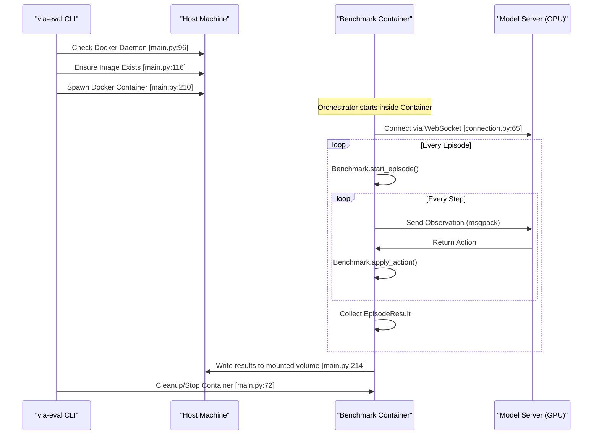
Sources: [src/vla_eval/cli/main.py:64-95](), [src/vla_eval/cli/main.py:161-240](), [src/vla_eval/orchestrator.py:44-95]()

### Code Entity Association

This diagram bridges the CLI commands to the underlying Python classes and execution contexts.

**CLI to Code Entity Mapping**
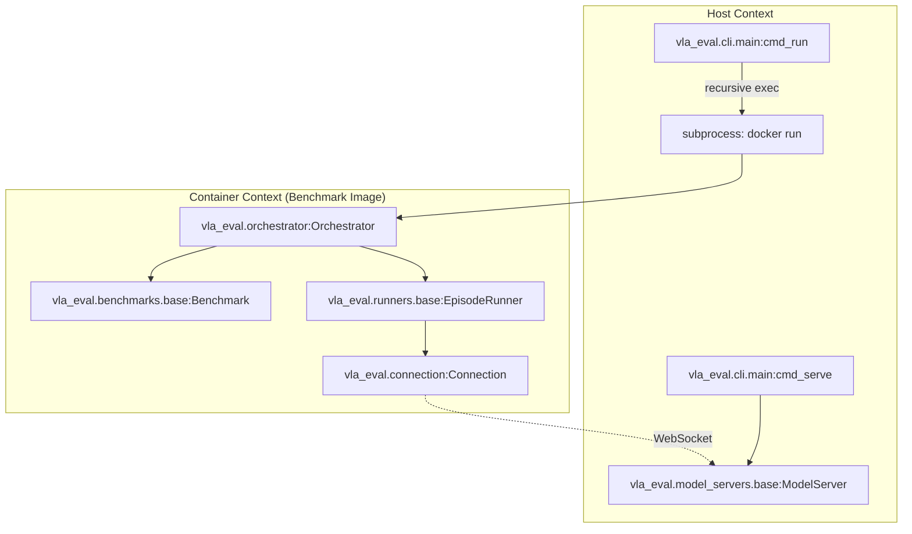
Sources: [src/vla_eval/cli/main.py:242-268](), [src/vla_eval/orchestrator.py:24-42](), [src/vla_eval/runners/sync_runner.py:15-30]()

### Key Implementation Details
1.  **Recursive Execution**: When `vla-eval run` is called on the host, it detects it is not in Docker [src/vla_eval/cli/main.py:45-47](), pulls the required image [src/vla_eval/cli/main.py:186](), and re-executes itself inside the container with the `--no-docker` flag [src/vla_eval/cli/main.py:228-230]().
2.  **Volume Mounting**: The host's results directory is mounted to `/workspace/results` inside the container so that JSON results persist after the container exits [src/vla_eval/cli/main.py:214]().
3.  **Signal Handling**: The CLI registers `atexit` and `signal` handlers to ensure that if the host process is killed, the Docker container is stopped gracefully, preventing "orphan" simulation processes [src/vla_eval/cli/main.py:64-95]().

Sources: [src/vla_eval/cli/main.py:64-240]()

---

# Page: Design Philosophy

# Design Philosophy

<details>
<summary>Relevant source files</summary>

The following files were used as context for generating this wiki page:

- [CONTRIBUTING.md](CONTRIBUTING.md)
- [README.md](README.md)
- [docs/architecture.md](docs/architecture.md)
- [docs/rfcs/0004-benchmark-and-episode-execution.md](docs/rfcs/0004-benchmark-and-episode-execution.md)
- [leaderboard/README.md](leaderboard/README.md)

</details>


The `vla-evaluation-harness` is built to solve the fragmentation and reproducibility crisis in Vision-Language-Action (VLA) model evaluation [README.md:30-34](). By decoupling the model's inference environment from the benchmark's simulation environment, the harness allows researchers to integrate a model once and evaluate it across a diverse matrix of benchmarks without manual setup or dependency conflicts [README.md:34-40]().

## 1. Guiding Principles

The architecture is governed by three core principles designed to maximize research velocity and result integrity.

### Freshness
The harness prioritizes "real-time" evaluation capabilities. Unlike traditional static evaluations where the environment waits for the model (Sync), the harness supports an `AsyncEpisodeRunner` [docs/rfcs/0004-benchmark-and-episode-execution.md:72-81]() that ties the simulation clock to wall-clock time. This ensures that models are tested under realistic conditions where the environment continues to advance during inference [README.md:32-33]().

### Convenience
Integration is designed to be "zero-setup." Benchmarks are packaged in **Docker** containers to eliminate "dependency hell" [README.md:38-39](). Model servers are implemented as standalone **uv scripts** [README.md:24-25]() using PEP 723 inline dependency metadata, allowing them to run with a single command without manual virtualenv management.

### Layered Abstraction
The system uses a five-component pipeline to separate concerns [docs/architecture.md:5-24]():
1.  **Orchestrator**: Manages the lifecycle of the evaluation [src/vla_eval/orchestrator.py:1-20]().
2.  **Benchmark**: Encapsulates environment-specific logic (e.g., LIBERO, CALVIN) [docs/rfcs/0004-benchmark-and-episode-execution.md:16-37]().
3.  **EpisodeRunner**: Defines the execution strategy (Sync vs. Async) [docs/rfcs/0004-benchmark-and-episode-execution.md:41-48]().
4.  **Connection**: Handles the WebSocket/msgpack wire protocol [docs/architecture.md:20-23]().
5.  **ModelServer**: Hosts the VLA model and provides inference [docs/architecture.md:107-113]().

**Sources:** [README.md:30-40](), [docs/rfcs/0004-benchmark-and-episode-execution.md:12-81](), [docs/architecture.md:5-24]()

---

## 2. Decoupling Rationale

The primary technical challenge in VLA evaluation is the conflict between simulation dependencies (e.g., MuJoCo, SAPIEN, various versions of `robosuite`) and model dependencies (e.g., specific PyTorch, CUDA, or Transformers versions).

### Docker for Benchmarks
By containerizing the `Benchmark` implementations [docs/rfcs/0004-benchmark-and-episode-execution.md:86-94](), the harness ensures that the complex system dependencies required for simulation do not leak into the host environment. The Orchestrator manages the container lifecycle, communicating with the internal benchmark logic via a control channel [docs/rfcs/0004-benchmark-and-episode-execution.md:97-111]().

### uv Scripts for Models
Model servers are treated as ephemeral services. Using `uv` scripts allows for "just-in-time" environment creation. This is critical for evaluating multiple models (e.g., OpenVLA vs. π₀) on the same machine without cross-contamination of Python site-packages [README.md:24-25]().

### Data Flow and System Decoupling
The following diagram illustrates how the `Orchestrator` bridges the gap between the isolated `Benchmark` (in Docker) and the `ModelServer` (on Host).

**VLA Evaluation Component Interaction**
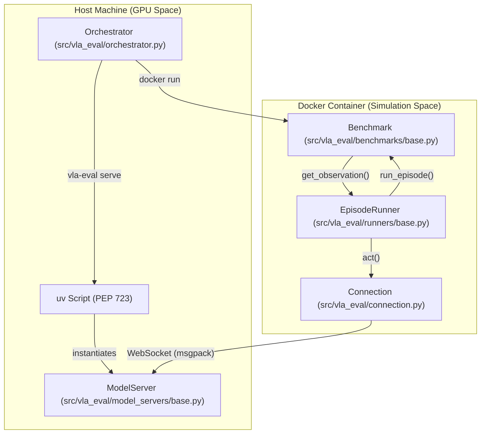
**Sources:** [README.md:34-40](), [docs/rfcs/0004-benchmark-and-episode-execution.md:86-111](), [docs/architecture.md:37-47]()

---

## 3. RFC-Driven Design Process

The harness follows a formal **Request for Comments (RFC)** process to ensure architectural consistency. Major features, such as the transition to batched inference or the implementation of episode sharding, are documented as RFCs before implementation.

| RFC ID | Title | Purpose |
| :--- | :--- | :--- |
| **RFC-0004** | Benchmark and Episode Execution | Defined the `Benchmark` ABC and `EpisodeRunner` strategy [docs/rfcs/0004-benchmark-and-episode-execution.md:1-12](). |
| **RFC-0006** | Episode Sharding | Enabled environment parallelism by splitting tasks across processes [README.md:99-100](). |
| **RFC-0007** | Batch Predict Model Server | Implemented `BatchPredictModelServer` to aggregate inference requests [README.md:97-98](). |

### From Specification to Code
The design process ensures that high-level principles like "Layered Abstraction" are reflected in the class hierarchy. For instance, the distinction between a `Benchmark` (the "what") and an `EpisodeRunner` (the "how") allows for modular testing and reuse [docs/rfcs/0004-benchmark-and-episode-execution.md:14-15]().

**Entity Mapping: Specification to Implementation**
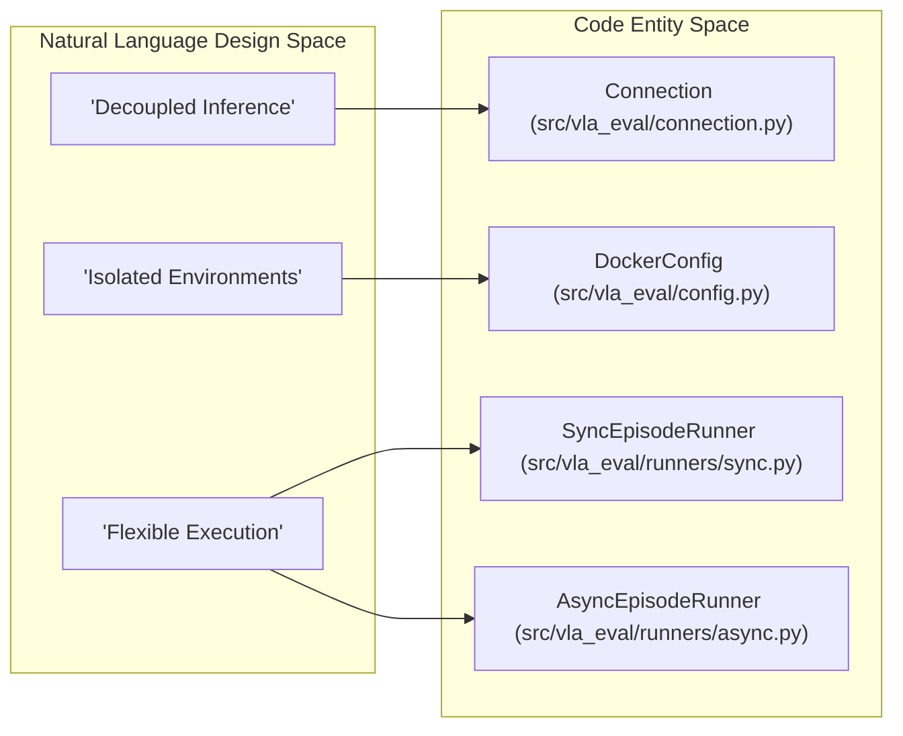
**Sources:** [docs/rfcs/0004-benchmark-and-episode-execution.md:1-15](), [README.md:97-100](), [docs/architecture.md:26-36]()

---

# Page: Core Architecture

# Core Architecture

<details>
<summary>Relevant source files</summary>

The following files were used as context for generating this wiki page:

- [.dockerignore](.dockerignore)
- [README.md](README.md)
- [docker/rlbench_entrypoint.sh](docker/rlbench_entrypoint.sh)
- [docs/architecture.md](docs/architecture.md)
- [docs/rfcs/0004-benchmark-and-episode-execution.md](docs/rfcs/0004-benchmark-and-episode-execution.md)
- [leaderboard/README.md](leaderboard/README.md)
- [src/vla_eval/types.py](src/vla_eval/types.py)

</details>


The `vla-evaluation-harness` is designed to fully decouple robotic simulation environments from the VLA models being evaluated. This is achieved through a five-component pipeline that abstracts environment logic, execution strategies, and communication.

## Pipeline Overview

The evaluation flow follows a linear dependency chain where the **Orchestrator** manages the lifecycle of the other components. The architecture ensures that a single model integration can be tested against any benchmark integration without dependency conflicts.

### Component Roles

| Component | Responsibility | Primary Code Entity |
| :--- | :--- | :--- |
| **Orchestrator** | Parses configs, manages Docker containers, and iterates through episodes. | `vla_eval.orchestrator.Orchestrator` |
| **Benchmark** | Encapsulates environment-specific logic (reset, step, success criteria). | `vla_eval.benchmarks.base.Benchmark` |
| **EpisodeRunner** | Defines the execution loop (e.g., synchronous lock-step vs. real-time wall-clock). | `vla_eval.runners.base.EpisodeRunner` |
| **Connection** | Handles the WebSocket/msgpack wire protocol between client and server. | `vla_eval.protocol.connection.Connection` |
| **ModelServer** | Hosts the VLA model and provides an interface for inference. | `vla_eval.server.base.ModelServer` |

### System Topology

The following diagram illustrates how high-level system components map to specific code entities and their interactions.

**Architecture: Natural Language to Code Entity Mapping**

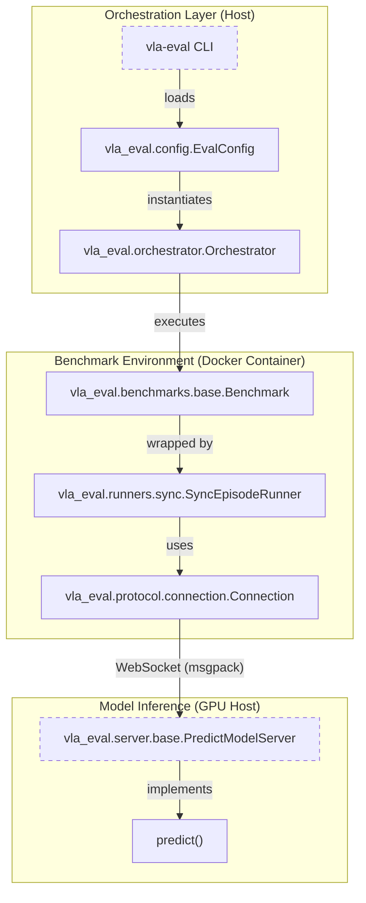
Sources: [docs/architecture.md:5-24](), [docs/rfcs/0004-benchmark-and-episode-execution.md:124-135](), [src/vla_eval/types.py:1-61]()

---

## 1. Orchestrator and Configuration
The **Orchestrator** is the central authority for an evaluation run. It is responsible for resolving import strings in the YAML configuration to actual Python classes, launching Docker containers for benchmarks, and managing the result collection lifecycle.

*   **Configuration**: Uses typed dataclasses (`EvalConfig`) to validate experiment parameters before execution.
*   **Isolation**: Automatically handles `docker run` and `docker stop` commands to ensure a clean environment for every benchmark suite.

For details, see [Orchestrator and Configuration](#2.1).

Sources: [docs/rfcs/0004-benchmark-and-episode-execution.md:124-135](), [docs/architecture.md:119-137]()

## 2. Communication Protocol
The harness uses a **WebSocket + msgpack** wire protocol to bridge the gap between the benchmark (often in a CPU-heavy Docker container) and the model (on a GPU-enabled host). 

*   **Serialization**: Custom codecs handle `numpy` arrays and compressed images (JPEG/PNG) efficiently.
*   **Schema**: A lightweight `Message` structure includes `type`, `payload`, `seq` (sequence number), and `timestamp`.

For details, see [Communication Protocol](#2.2).

Sources: [docs/architecture.md:72-96](), [src/vla_eval/types.py:11-44]()

## 3. Episode Runners
The **EpisodeRunner** determines *how* the `Benchmark` and `Connection` interact. This separation allows the same benchmark code to be used for different evaluation modes:

*   **SyncEpisodeRunner**: A standard lock-step loop where the environment waits for the model's action before proceeding to the next step.
*   **AsyncEpisodeRunner**: A real-time mode where the environment clock keeps ticking at a fixed frequency (Hz). If the model is slow, a "hold policy" (like repeating the last action) is applied.

For details, see [Episode Runners](#2.3).

Sources: [docs/rfcs/0004-benchmark-and-episode-execution.md:41-85](), [docs/architecture.md:51-70]()

## 4. Model Server
The **ModelServer** is the entry point for the VLA. It provides a standardized API (`on_observation`, `on_episode_start`) so that models from different frameworks (PyTorch, JAX, etc.) can be evaluated identically.

*   **Batching**: The `BatchPredictModelServer` can group requests from multiple parallel benchmark shards into a single GPU forward pass.
*   **Action Chunking**: Built-in support for models that predict multiple future timesteps, including temporal ensemble strategies.

For details, see [Model Servers](#3).

Sources: [docs/architecture.md:107-118](), [README.md:91-97]()

## 5. Results Collection and Merging
As episodes complete, the **ResultCollector** aggregates metrics (success rates, reward, episode length). Because evaluations are often sharded across multiple machines or GPUs, the harness provides utilities to merge these JSON shards into a single unified report.

For details, see [Results Collection and Merging](#2.4).

Sources: [docs/architecture.md:153-170](), [README.md:99-110]()

---

## Interaction Sequence

The following diagram shows the sequence of calls during a standard synchronous episode.

**Sequence: Episode Execution Flow**

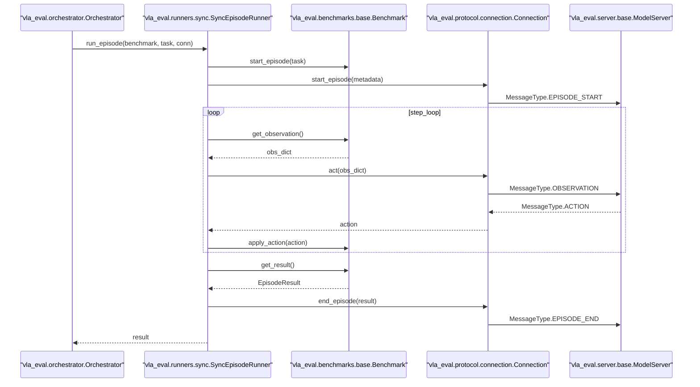
Sources: [docs/architecture.md:51-70](), [docs/rfcs/0004-benchmark-and-episode-execution.md:55-70]()

---

# Page: Orchestrator and Configuration

# Orchestrator and Configuration

<details>
<summary>Relevant source files</summary>

The following files were used as context for generating this wiki page:

- [.dockerignore](.dockerignore)
- [docker/rlbench_entrypoint.sh](docker/rlbench_entrypoint.sh)
- [src/vla_eval/cli/main.py](src/vla_eval/cli/main.py)
- [src/vla_eval/results/collector.py](src/vla_eval/results/collector.py)
- [src/vla_eval/results/merge.py](src/vla_eval/results/merge.py)
- [src/vla_eval/types.py](src/vla_eval/types.py)

</details>


The Orchestrator and Configuration layer forms the backbone of the `vla-evaluation-harness`, responsible for managing the lifecycle of an evaluation run, ensuring reproducible execution via typed configurations, and providing robust error isolation across thousands of robotic simulation episodes.

## Orchestrator (`orchestrator.py`)

The `Orchestrator` class is the central execution engine. It coordinates the interaction between the `Benchmark` (environment), the `Connection` (model server bridge), and the `EpisodeRunner` (control loop).

### Key Responsibilities
*   **Episode Iteration:** Iterates through tasks and episodes, managing the setup and teardown of each trial [src/vla_eval/orchestrator.py:72-118]().
*   **Error Isolation:** Wraps individual episode executions in `try...except` blocks to ensure that a single environment crash or network timeout does not terminate the entire evaluation suite [src/vla_eval/orchestrator.py:126-140]().
*   **Sharding Support:** Filters the global task list based on `shard_id` and `num_shards` to allow parallel execution across multiple machines or GPUs [src/vla_eval/orchestrator.py:80-95]().
*   **Result Persistence:** Utilizes the `ResultCollector` to aggregate metrics and write them to unique JSON files [src/vla_eval/orchestrator.py:155-175]().

### Result File Naming Convention
To prevent overwriting data in distributed settings, the Orchestrator generates filenames based on the following logic:
*   **Standard:** `{benchmark}_{mode}_{timestamp}.json` [src/vla_eval/results/collector.py:46-47]().
*   **Sharded:** `{benchmark}_shard{id}of{total}.json` [src/vla_eval/results/collector.py:48-48]().

### Logic Flow: Orchestration Loop
The following diagram illustrates how the `Orchestrator` manages the flow from a YAML configuration to individual episode execution.

**Orchestrator Execution Flow**
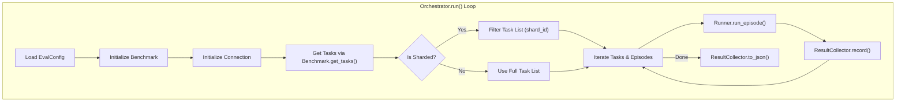
**Sources:** [src/vla_eval/orchestrator.py:53-153](), [src/vla_eval/results/collector.py:41-95]()

---

## Configuration System (`config.py`)

The harness uses a hierarchical configuration system built on Python dataclasses. This ensures type safety and provides a clear schema for YAML configuration files.

### Core Dataclasses
*   **`EvalConfig`**: The root configuration object. It contains references to the benchmark, server, and runner settings [src/vla_eval/config.py:124-142]().
*   **`ServerConfig`**: Defines how to connect to the model server (host, port) and specifies the `import_str` for the server implementation [src/vla_eval/config.py:45-56]().
*   **`DockerConfig`**: Contains metadata for containerized execution, including the image name and resource constraints [src/vla_eval/config.py:18-32]().

### Registry and Import Resolution
The `registry.py` module handles the mapping between string identifiers in YAML and actual Python classes. This allows users to specify components like `vla_eval.benchmarks.libero.LiberoBenchmark` as simple strings [src/vla_eval/registry.py:10-35]().

**Configuration Entity Mapping**
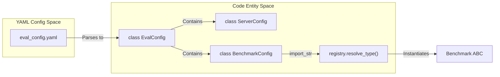
**Sources:** [src/vla_eval/config.py:124-142](), [src/vla_eval/registry.py:10-25]()

---

## YAML Configuration Schema

Users interact with the system primarily through YAML files located in `configs/`. A typical configuration defines the environment, the model server location, and the execution mode.

### Example Schema Breakdown
| Key | Type | Description |
| :--- | :--- | :--- |
| `benchmark` | `dict` | Configuration for the benchmark (e.g., `import_str`, `suite`, `num_episodes`). |
| `server` | `dict` | Connection details (`host`, `port`) and server-side settings. |
| `runner` | `dict` | Controls the episode loop (`type: sync` or `async`). |
| `docker` | `dict` | Specifies the `image` used when running via `vla-eval run`. |

**Sources:** [src/vla_eval/config.py:144-180](), [src/vla_eval/cli/main.py:181-186]()

---

## Sharding and Merging

For large-scale evaluations, the harness supports horizontal scaling via sharding.

### Sharding Logic
The `Orchestrator` uses a deterministic filtering mechanism:
1.  Collect all task/episode pairs into a flat list.
2.  If `num_shards > 1`, keep only items where `index % num_shards == shard_id` [src/vla_eval/orchestrator.py:87-95]().

### Merging Shards (`merge.py`)
After sharded runs complete, the `vla-eval merge` command combines the partial JSON files.
*   **Consistency Check:** Validates that all shards belong to the same benchmark and share the same total shard count [src/vla_eval/results/merge.py:52-59]().
*   **Deduplication:** Uses `episode_id` to ensure no duplicate results exist; in case of collisions, the last file processed wins [src/vla_eval/results/merge.py:82-86]().
*   **Partial Detection:** If shards are missing, the final result is marked with `"partial": true` [src/vla_eval/results/merge.py:108-125]().

**Shard Merging Process**
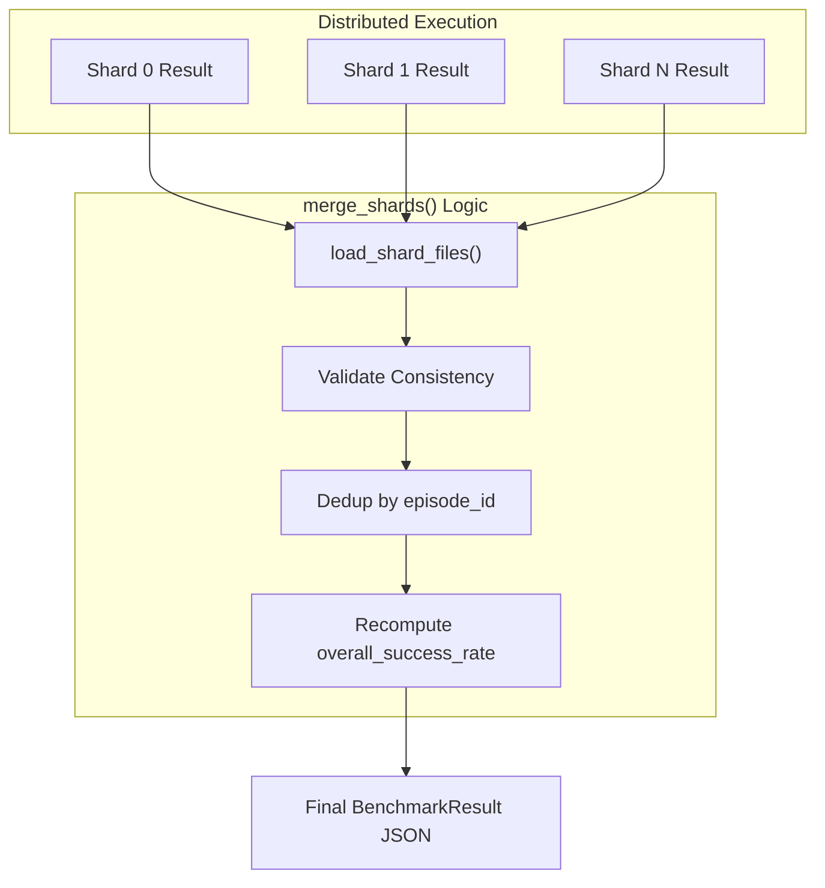
**Sources:** [src/vla_eval/results/merge.py:43-127](), [src/vla_eval/orchestrator.py:80-95]()

---

# Page: Communication Protocol

# Communication Protocol

<details>
<summary>Relevant source files</summary>

The following files were used as context for generating this wiki page:

- [.dockerignore](.dockerignore)
- [docker/rlbench_entrypoint.sh](docker/rlbench_entrypoint.sh)
- [docs/architecture.md](docs/architecture.md)
- [docs/rfcs/0004-benchmark-and-episode-execution.md](docs/rfcs/0004-benchmark-and-episode-execution.md)
- [src/vla_eval/types.py](src/vla_eval/types.py)

</details>


The `vla-evaluation-harness` employs a high-performance, asynchronous wire protocol designed to decouple simulation environments (benchmarks) from model inference servers. This protocol ensures that heavy simulation dependencies (e.g., MuJoCo, SAPIEN) do not conflict with model dependencies (e.g., specific PyTorch or JAX versions) by communicating over a network socket using binary serialization.

## Wire Protocol Overview

The protocol is built on **WebSocket** for bidirectional communication and **msgpack** for efficient binary serialization [docs/architecture.md:72-74](). Every message exchanged between a benchmark client and a model server follows a strict schema to ensure reliability and sequence tracking.

### Message Schema

All messages are msgpack binary frames containing four top-level keys:

| Key | Type | Description |
| :--- | :--- | :--- |
| `type` | `str` | The message category (see MessageType enum). |
| `payload` | `dict` | The actual data (observation, action, etc.). Benchmarks define their own schema here. |
| `seq` | `int` | Monotonically increasing sequence number for ordering. |
| `timestamp` | `float` | Wall-clock Unix epoch of message creation. |

Sources: [docs/architecture.md:78-85]()

### MessageType Enum

The `type` field in the message envelope must be one of the following:

*   `observation`: Sent by the benchmark to the model server containing sensor data.
*   `action`: Sent by the model server to the benchmark containing control signals.
*   `episode_start`: Signals the beginning of a new task/episode.
*   `episode_end`: Signals the completion of an episode, often including final metrics.
*   `error`: Used to propagate exceptions across the wire.

Sources: [docs/architecture.md:79-80]()

## Codecs and Serialization

To handle high-dimensional robotic data efficiently, the protocol includes specialized codecs for NumPy arrays and images.

### NumPy Codec

NumPy arrays are encoded inline within the msgpack payload. To prevent security vulnerabilities, the deserializer explicitly rejects `Void`, `Object`, and `Complex` dtypes [docs/architecture.md:91-95]().

**Serialized Format:**
```python
{
    "__ndarray__": True, 
    "data": bytes, 
    "dtype": str, 
    "shape": tuple
}
```
Sources: [docs/architecture.md:91-95]()

### Image and Observation Conventions

While the framework imposes no fixed schema on the `payload` [docs/architecture.md:81](), all built-in benchmarks follow a standard convention for `Observation` and `Action` types [src/vla_eval/types.py:14-44]().

**Recommended Observation Structure:**
*   `images`: A dictionary mapping camera names (e.g., `"agentview"`, `"wrist"`) to `[H, W, C]` uint8 NumPy arrays [src/vla_eval/types.py:22-24]().
*   `state`: A NumPy array containing proprioceptive data (joint positions, gripper state) [src/vla_eval/types.py:26-27]().
*   `task_description`: A string containing the natural language instruction [src/vla_eval/types.py:24-25]().

Sources: [src/vla_eval/types.py:14-44](), [docs/architecture.md:99-106]()

## Connection Management

The `Connection` class serves as the client-side library for benchmarks to communicate with the model server [docs/architecture.md:30](). It handles the underlying WebSocket lifecycle, including reconnection and error propagation.

### Connection Lifecycle and Flow

The `Orchestrator` manages the high-level lifecycle of the connection, while the `EpisodeRunner` uses the `Connection` to drive the loop.

**Protocol Entity Mapping:**
The following diagram bridges the high-level communication concepts to the specific classes and methods implemented in the codebase.

Title: Communication Entity Mapping
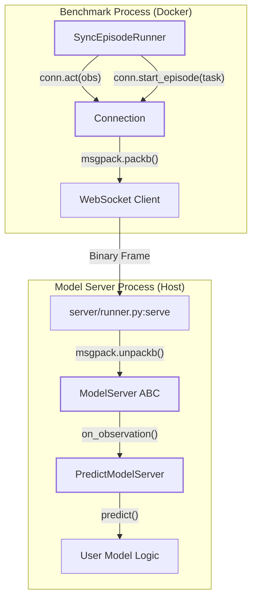
Sources: [docs/architecture.md:14-24](), [docs/architecture.md:53-70](), [docs/architecture.md:109-117]()

### Reconnection and Health Logic

The `Orchestrator` coordinates the startup sequence to ensure the model server is reachable before the benchmark begins execution:

1.  **Container Start**: Launches the benchmark Docker image [docs/rfcs/0004-benchmark-and-episode-execution.md:128]().
2.  **Health Check**: Polls the `/healthz` endpoint of the benchmark container until it returns 200 OK (up to 120s) [docs/rfcs/0004-benchmark-and-episode-execution.md:129]().
3.  **WebSocket Connect**: Establishes the connection to the model server with **exponential backoff** (max 5 retries) [docs/rfcs/0004-benchmark-and-episode-execution.md:130]().

### Interaction Sequence (Sync Mode)

In synchronous evaluation, the `Connection` blocks until the model server returns an action, effectively coupling simulation time to inference latency.

Title: Synchronous Interaction Flow
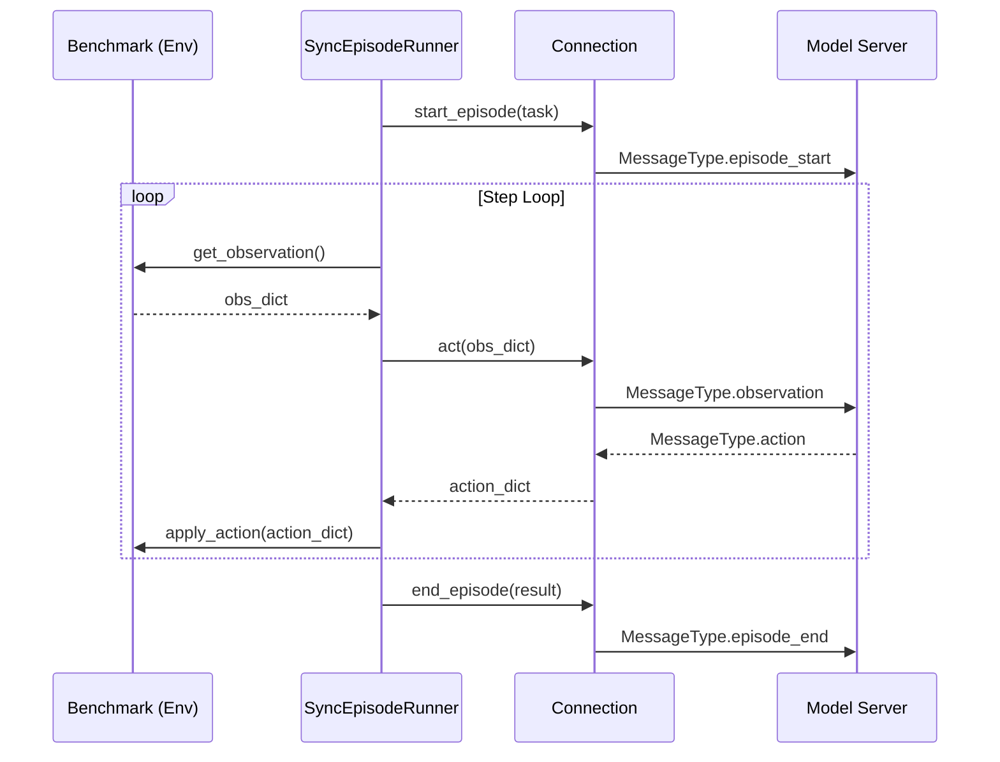
Sources: [docs/architecture.md:53-70](), [docs/rfcs/0004-benchmark-and-episode-execution.md:54-70]()

## Implementation Details

### Environment Isolation

Benchmarks are isolated in Docker containers, while the model server typically runs on the host machine to facilitate direct GPU access for inference [docs/architecture.md:37-47](). Benchmark containers include the `vla-eval` connection library and expose port 8080 for the orchestrator control channel [docs/rfcs/0004-benchmark-and-episode-execution.md:91-92]().

### Error Handling

If the model server encounters an exception during `predict()`, it wraps the traceback in a `MessageType.error` message. The `Connection` client on the benchmark side receives this and raises a corresponding local exception, allowing the `Orchestrator` to catch the error, log it, and move to the next episode or task without crashing the entire evaluation suite [docs/rfcs/0004-benchmark-and-episode-execution.md:12]().

Sources: [docs/rfcs/0004-benchmark-and-episode-execution.md:86-111](), [docs/architecture.md:37-47]()

---

# Page: Episode Runners

# Episode Runners

<details>
<summary>Relevant source files</summary>

The following files were used as context for generating this wiki page:

- [docs/architecture.md](docs/architecture.md)
- [docs/rfcs/0004-benchmark-and-episode-execution.md](docs/rfcs/0004-benchmark-and-episode-execution.md)
- [src/vla_eval/cli/main.py](src/vla_eval/cli/main.py)

</details>


Episode Runners define the execution strategy for an evaluation episode. They act as the "glue" between a `Benchmark` (the environment logic) and a `Connection` (the communication layer to the model server). By separating *what* the environment does from *how* the episode is stepped, the harness supports both traditional lock-step simulation and real-time wall-clock evaluation without modifying benchmark implementations [docs/rfcs/0004-benchmark-and-episode-execution.md:12-15]().

### The EpisodeRunner Hierarchy

All runners implement the `EpisodeRunner` abstract base class, which defines a single asynchronous entry point for executing a task [docs/rfcs/0004-benchmark-and-episode-execution.md:46-48]().

| Class | Mode | Pacing | Use Case |
| :--- | :--- | :--- | :--- |
| `SyncEpisodeRunner` | `sync` | Lock-step (wait for model) | Standard simulation benchmarks (LIBERO, CALVIN). |
| `AsyncEpisodeRunner` | `realtime` | Wall-clock (fixed HZ) | Sim-to-live testing, high-frequency control. |

#### Code Entity Map: Runner Orchestration
The following diagram shows how the `Orchestrator` selects and invokes an `EpisodeRunner` based on the `EvalConfig`.

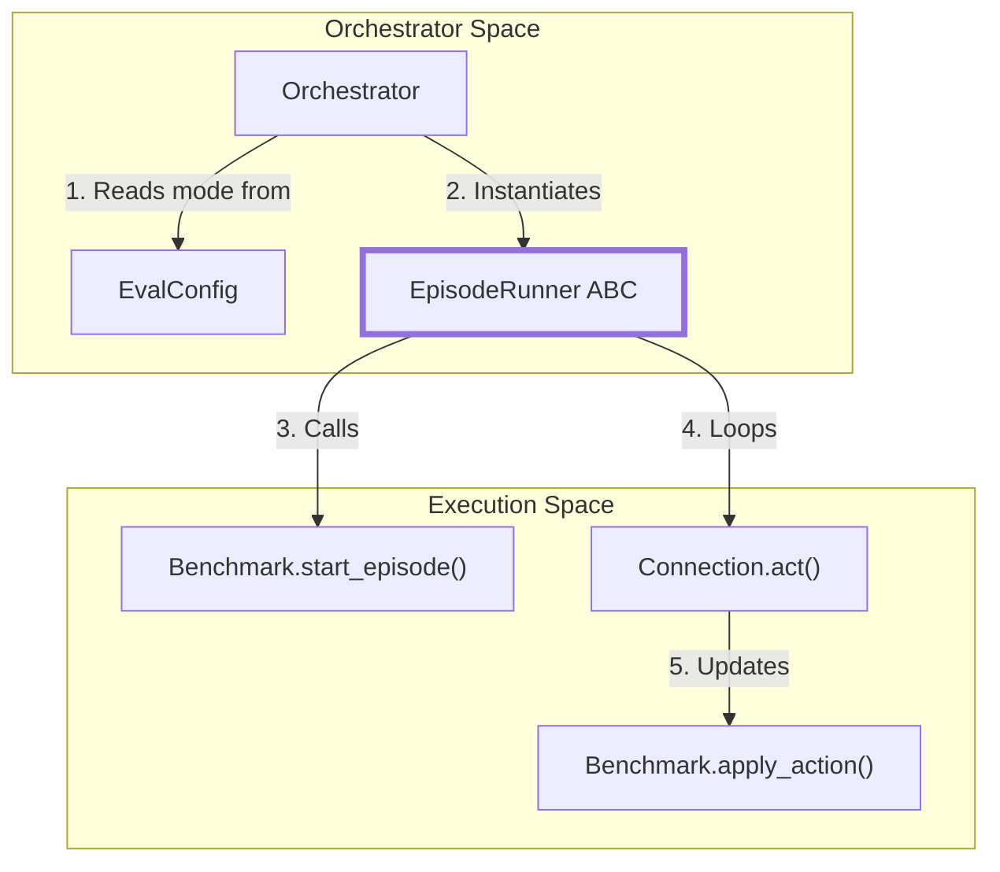
Sources: [docs/rfcs/0004-benchmark-and-episode-execution.md:124-135](), [docs/architecture.md:54-70]()

---

### SyncEpisodeRunner
The `SyncEpisodeRunner` implements a blocking observation-action loop. The environment's "time" is coupled to the model's inference speed; the runner waits for the `Connection` to return an action before calling `benchmark.apply_action()` [docs/rfcs/0004-benchmark-and-episode-execution.md:55-70]().

**Data Flow:**
1.  **Initialization**: Calls `benchmark.start_episode(task)` and `conn.start_episode()`.
2.  **Observation**: Retrieves the initial observation via `benchmark.get_observation()`.
3.  **Inference**: Calls `await conn.act(obs)`, which blocks until the Model Server responds.
4.  **Step**: Applies the action to the benchmark.
5.  **Termination**: Repeats until `benchmark.is_done()` is true or `max_steps` is reached.

Sources: [docs/rfcs/0004-benchmark-and-episode-execution.md:55-70](), [docs/architecture.md:51-70]()

---

### AsyncEpisodeRunner
The `AsyncEpisodeRunner` decouples environment stepping from model inference to simulate real-time performance. It uses a `Clock` to maintain a fixed frequency (e.g., 10Hz or 20Hz) regardless of how long the model takes to compute an action [docs/rfcs/0004-benchmark-and-episode-execution.md:72-81]().

#### Real-time Pacing with Clock
The runner uses an internal `Clock` (typically `asyncio.sleep(1/hz)`) to ensure that `benchmark.apply_action()` is called at precise intervals. If the model server has not returned a new action by the time the next tick occurs, the runner consults an **Action Buffer** [docs/rfcs/0004-benchmark-and-episode-execution.md:76-80]().

#### ActionBuffer and Hold Policies
The `ActionBuffer` manages the queue of incoming actions from the model. Because network latency and inference time vary, the runner must decide what to do when the buffer is empty at a clock tick. This is governed by a **Hold Policy**:

*   **`repeat_last`**: The default policy. If no new action is available, the runner re-applies the most recent action received from the model [docs/rfcs/0004-benchmark-and-episode-execution.md:79-80]().
*   **`zero`**: Applies a "zero" action (usually meaning no movement or delta) to the environment [docs/rfcs/0004-benchmark-and-episode-execution.md:79-80]().
*   **Custom Callable**: Users can provide a custom function to determine the fallback behavior.

#### Code Entity Map: Async Logic
This diagram associates the conceptual "Real-time Loop" with the specific classes and methods that implement the asynchronous behavior.

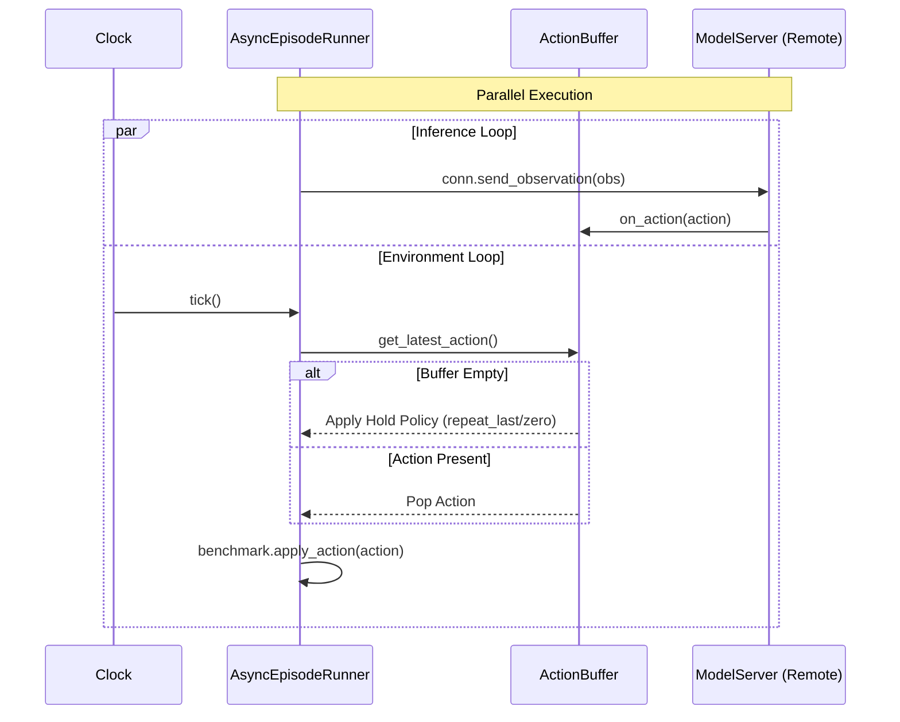
Sources: [docs/rfcs/0004-benchmark-and-episode-execution.md:72-81](), [docs/architecture.md:110-117]()

---

### Implementation Details

#### Task and Metadata Resolution
Runners do not hardcode limits like `max_steps`. Instead, they resolve these values dynamically:
1.  **Config Override**: If `max_steps` is provided in the YAML `benchmarks` section, it is used [docs/rfcs/0004-benchmark-and-episode-execution.md:142-152]().
2.  **Benchmark Metadata**: If not in config, the runner calls `benchmark.get_metadata()` to retrieve the benchmark's native step limit [docs/rfcs/0004-benchmark-and-episode-execution.md:35-39]().

#### Result Aggregation
At the end of an episode, the runner calls `benchmark.get_result()` to obtain an `EpisodeResult` object. This result is then passed back to the `Orchestrator`, which routes it to the `ResultCollector` for JSON serialization [docs/rfcs/0004-benchmark-and-episode-execution.md:67-69](), [docs/architecture.md:153-164]().

Sources: [docs/rfcs/0004-benchmark-and-episode-execution.md:35-39](), [docs/rfcs/0004-benchmark-and-episode-execution.md:142-152](), [docs/architecture.md:153-164]()

---

# Page: Results Collection and Merging

# Results Collection and Merging

<details>
<summary>Relevant source files</summary>

The following files were used as context for generating this wiki page:

- [src/vla_eval/cli/main.py](src/vla_eval/cli/main.py)
- [src/vla_eval/results/collector.py](src/vla_eval/results/collector.py)
- [src/vla_eval/results/merge.py](src/vla_eval/results/merge.py)

</details>


The `vla-evaluation-harness` employs a structured hierarchy for aggregating simulation outcomes, transitioning from individual step data to comprehensive benchmark summaries. This system supports both monolithic execution and distributed sharding, with robust logic for merging partial results and handling duplicates.

## ResultCollector Hierarchy

The `ResultCollector` class [src/vla_eval/results/collector.py:41-51]() manages the aggregation of results across three primary layers of abstraction: **Episode**, **Task**, and **Benchmark**.

### Data Structures
The hierarchy is implemented using `TypedDict` definitions to ensure schema consistency across the pipeline:

| Level | Entity | Description |
| :--- | :--- | :--- |
| **Episode** | `EpisodeResult` | The smallest unit of measurement, containing success status, step count, and timing for a single rollout [src/vla_eval/results/collector.py:15-23](). |
| **Task** | `TaskResult` | A collection of `EpisodeResult` objects for a specific task (e.g., "pick_up_cube"), including calculated success rates and average steps [src/vla_eval/results/collector.py:25-30](). |
| **Benchmark** | `BenchmarkResult` | The top-level summary containing all `TaskResult` objects, an overall success rate, and a snapshot of the `EvalConfig` used [src/vla_eval/results/collector.py:32-39](). |

### Logical Flow
1. **Record**: As episodes complete, the `Orchestrator` calls `record()` [src/vla_eval/results/collector.py:58-65]().
2. **Normalize**: The collector ensures data types (like numpy booleans) are converted to standard Python types for JSON serialization [src/vla_eval/results/collector.py:61-62]().
3. **Aggregate**: When requested via `get_benchmark_result()`, the collector iterates through all recorded tasks to compute global metrics [src/vla_eval/results/collector.py:80-95]().

### Result Hierarchy Mapping
The following diagram illustrates how code entities map to the logical results hierarchy.

"Results Data Flow"
```mermaid
graph TD
    subgraph "Natural Language Space"
        "Individual Rollout"
        "Task Performance"
        "Full Evaluation"
    end

    subgraph "Code Entity Space"
        ER["EpisodeResult (TypedDict)"]
        TR["TaskResult (TypedDict)"]
        BR["BenchmarkResult (TypedDict)"]
        RC["ResultCollector (Class)"]
    end

    "Individual Rollout" --- ER
    "Task Performance" --- TR
    "Full Evaluation" --- BR

    RC -- "record()" --> ER
    ER -- "aggregated into" --> TR
    TR -- "aggregated into" --> BR
    RC -- "get_benchmark_result()" --> BR
```
Sources: [src/vla_eval/results/collector.py:15-51](), [src/vla_eval/results/collector.py:58-95]()

## File Naming and Persistence

The `Orchestrator` handles the naming and writing of result files to the `output_dir` [src/vla_eval/results/collector.py:46-49]().

*   **Non-sharded runs**: Files are named using the pattern `{name}_{mode}_{timestamp}.json`.
*   **Sharded runs**: When using `--shard-id`, files follow the pattern `{name}_shard{id}of{total}.json`.

The final output is a JSON string generated by `ResultCollector.to_json()`, which includes the `harness_version` and the full `config` dict to ensure reproducibility [src/vla_eval/results/collector.py:118-120]().

Sources: [src/vla_eval/results/collector.py:46-51](), [src/vla_eval/results/collector.py:118-120]()

## Shard Merging Logic

When evaluations are split across multiple nodes or GPUs using the `--num-shards` flag, the `vla-eval merge` command (backed by `merge.py`) is used to combine the resulting shard files.

### The `merge_shards` Process
The `merge_shards` function [src/vla_eval/results/merge.py:43-127]() performs several validation and reconciliation steps:

1.  **Consistency Check**: Validates that all shards belong to the same benchmark and share the same `shard.total` value [src/vla_eval/results/merge.py:51-58]().
2.  **Missing Shard Detection**: Identifies which shard IDs (0 to `total-1`) are missing from the input set [src/vla_eval/results/merge.py:61-63]().
3.  **Duplicate Handling**: If the same `episode_id` appears in multiple shards, the **last file processed wins** (overwrites the previous entry), and a warning is logged [src/vla_eval/results/merge.py:82-86]().
4.  **Metric Recomputation**: Success rates and average steps are re-calculated from the complete set of unique episodes [src/vla_eval/results/merge.py:89-106]().
5.  **Partial Flagging**: If any shards are missing, the resulting JSON is marked with `"partial": true` [src/vla_eval/results/merge.py:108-125]().

### Merge Execution Architecture
"Merge Logic and Validation"
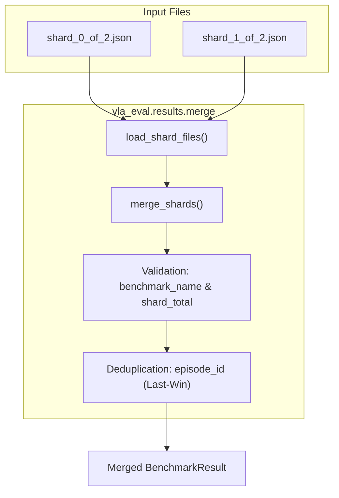
Sources: [src/vla_eval/results/merge.py:32-40](), [src/vla_eval/results/merge.py:43-127]()

## CLI Usage: `vla-eval merge`

The `merge` command provides a human-readable report via `print_merge_report` [src/vla_eval/results/merge.py:130-168](). This report highlights:
*   Total episodes collected across all shards.
*   Specific IDs of missing shards.
*   A command suggestion to complete the missing shards (e.g., `vla-eval run ... --shard-id X`) [src/vla_eval/results/merge.py:147-150]().

### Summary Table Generation
The `ResultCollector` and `merge` logic both utilize the `rich` library to print formatted tables to the console, showing per-task success rates and an overall benchmark score [src/vla_eval/results/collector.py:97-116](), [src/vla_eval/results/merge.py:156-167]().

Sources: [src/vla_eval/results/merge.py:130-168](), [src/vla_eval/results/collector.py:97-116]()

---

# Page: Model Servers

# Model Servers

<details>
<summary>Relevant source files</summary>

The following files were used as context for generating this wiki page:

- [README.md](README.md)
- [configs/model_servers/starvla_groot_simpler.yaml](configs/model_servers/starvla_groot_simpler.yaml)
- [leaderboard/README.md](leaderboard/README.md)
- [src/vla_eval/model_servers/starvla.py](src/vla_eval/model_servers/starvla.py)

</details>


The model server subsystem is a decoupled, high-performance inference layer designed to host Vision-Language-Action (VLA) models independently of the simulation benchmarks. By separating the model's heavy GPU dependencies from the benchmark's complex simulation environments, the harness avoids "dependency hell" and enables massive throughput via batched inference.

## Two-Tier Hierarchy

The subsystem is built on a two-tier Abstract Base Class (ABC) hierarchy that separates the low-level communication and session management from the high-level model prediction logic.

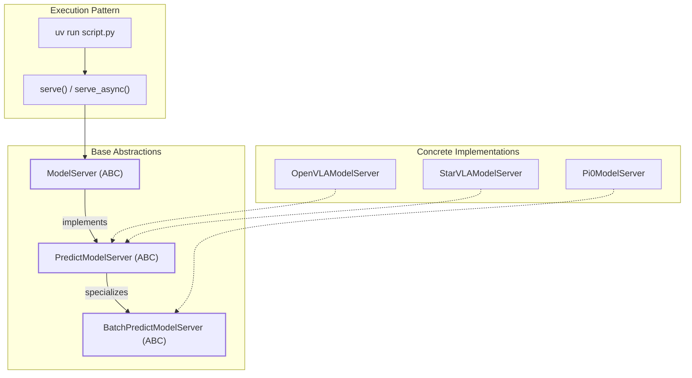
*Sources: [src/vla_eval/model_servers/base.py:15-35](), [src/vla_eval/model_servers/predict.py:22-45](), [src/vla_eval/model_servers/batch_predict.py:25-50]()*

### 1. ModelServer (The Protocol Layer)
The `ModelServer` base class defines the core lifecycle hooks for any model interaction. It handles raw `Observation` inputs and returns `Action` outputs, while managing session state via `SessionContext`.
*   **`on_episode_start`**: Called when a new episode begins.
*   **`on_observation`**: The primary entry point for generating actions.
*   **`on_episode_end`**: Called for cleanup or metric logging.

### 2. PredictModelServer (The Inference Layer)
Most implementations inherit from `PredictModelServer`. This class abstracts away the `SessionContext` and provides a simplified `predict()` method. It also includes built-in support for **Action Chunking**, allowing models to return multiple future steps that are buffered and played back by the client.

For details on the base API and session management, see **[Model Server API](#3.1)**.

---

## The uv Script Pattern (PEP 723)

To ensure "Zero Setup" portability, every built-in model server is implemented as a standalone Python script using the [PEP 723](https://peps.python.org/pep-0723/) inline metadata format. This allows the `uv` package manager to automatically create a virtual environment with the exact dependencies required by a specific model (e.g., specific versions of `torch`, `transformers`, or custom CUDA kernels) without affecting the host system or other models.

**Example Script Header:**
```python
# /// script
# requires-python = "~=3.11"
# dependencies = [
#     "vla-eval",
#     "starvla",
#     "torch>=2.0",
# ]
# [tool.uv.sources]
# vla-eval = { path = "../../.." }
# ///
```
*Sources: [src/vla_eval/model_servers/starvla.py:1-29](), [README.md:38-39]()*

---

## High-Throughput Batching

The `BatchPredictModelServer` is the engine behind the harness's **47x throughput** gains. It implements a producer-consumer pattern where multiple benchmark shards (clients) send observations to a shared `_BatchQueue`. A background `_dispatch_loop` aggregates these requests into a single tensor, performs a single GPU forward pass, and dispatches results back to the respective clients.

| Parameter | Description |
| :--- | :--- |
| `max_batch_size` | The maximum number of observations to aggregate before forcing a forward pass. |
| `max_wait_time` | The maximum time (in seconds) to wait for a batch to fill before processing a partial batch. |

For details on the batching loop and action blending strategies, see **[Batching and Action Chunking](#3.2)**.

---

## Built-in Implementations

The harness ships with a wide variety of pre-configured model servers in `src/vla_eval/model_servers/`. These are registered in the `SERVER_REGISTRY` and can be launched via the `vla-eval serve` command using YAML configurations found in `configs/model_servers/`.

**Key Implementations:**
*   **OpenVLA**: Standard VLA baseline.
*   **π₀ (Pi0)**: Flow-matching based VLA.
*   **StarVLA**: Support for Qwen-based frameworks (GR00T, OFT, PI, Fast).
*   **CogACT**: Action-chunking transformer.

For a full catalog and configuration reference, see **[Built-in Model Server Implementations](#3.3)**.

---

## Sub-Pages

| Page | Description |
| :--- | :--- |
| **[Model Server API](#3.1)** | Details on `ModelServer` hooks, `SessionContext`, and the WebSocket/HTTP control plane. |
| **[Batching and Action Chunking](#3.2)** | Internals of the `BatchPredictModelServer` and `ActionChunkBuffer` blending (EMA, Average). |
| **[Built-in Model Server Implementations](#3.3)** | Technical details and dependency requirements for all supported VLA models. |

*Sources: [README.md:13-15](), [README.md:97-98]()*

---

# Page: Model Server API

# Model Server API

<details>
<summary>Relevant source files</summary>

The following files were used as context for generating this wiki page:

- [configs/model_servers/starvla_groot_simpler.yaml](configs/model_servers/starvla_groot_simpler.yaml)
- [src/vla_eval/cli/smoke.py](src/vla_eval/cli/smoke.py)
- [src/vla_eval/model_servers/starvla.py](src/vla_eval/model_servers/starvla.py)

</details>


The Model Server API provides a standardized interface for wrapping Vision-Language-Action (VLA) models as remote inference services. It decouples the heavy model dependencies (often requiring specific CUDA versions or Python packages) from the benchmark environments. The API supports both simple request-response interaction and high-performance batched inference.

### Sources:
- [src/vla_eval/model_servers/base.py:1-10]()
- [src/vla_eval/model_servers/predict.py:1-15]()

---

## ModelServer ABC

The `ModelServer` abstract base class defines the lifecycle of a model during an evaluation session. It is designed to handle stateful interactions where a model might need to reset internal memory or history between episodes.

| Method | Description |
| :--- | :--- |
| `on_episode_start(ctx)` | Called when a new episode begins. Used to reset RNN states or KV caches. |
| `on_observation(ctx, obs)` | The primary entry point. Receives a `Observation` and must return an `Action`. |
| `on_episode_end(ctx)` | Called when an episode terminates (success, failure, or timeout). |

### SessionContext
Every method in the `ModelServer` receives a `SessionContext` object [src/vla_eval/model_servers/base.py:25-35](). This object provides metadata about the current execution:
- `session_id`: Unique ID for the connection.
- `episode_id`: Unique ID for the current trajectory.
- `step`: The current timestep index within the episode.
- `is_first`: Boolean indicating if this is the first observation of the episode.
- `send_action(action)`: A callback used by the server to return the computed action to the client.

### Sources:
- [src/vla_eval/model_servers/base.py:25-70]()

---

## PredictModelServer

`PredictModelServer` is a specialized subclass of `ModelServer` that simplifies the implementation for most VLA models. Instead of managing the `SessionContext` and manual action sending, developers implement a simplified `predict` or `predict_batch` method.

### Dispatch Logic
The class automatically dispatches incoming observations based on the server's configuration:
1. **Single Inference**: If `predict` is implemented, it processes one observation at a time.
2. **Batch Inference**: If `predict_batch` is implemented and the server is configured for batching, it aggregates requests from multiple concurrent episodes into a single forward pass.

### Implementation Pattern
A typical implementation like `StarVLAModelServer` [src/vla_eval/model_servers/starvla.py:57-62]() inherits from `PredictModelServer` and defines the model loading and inference logic.

**Natural Language Space to Code Entity Space: PredictModelServer**
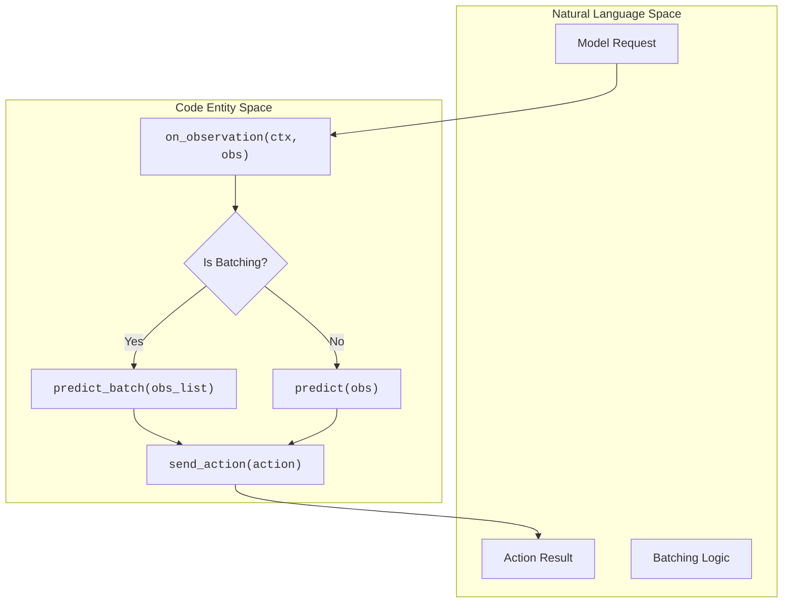

### Sources:
- [src/vla_eval/model_servers/predict.py:18-60]()
- [src/vla_eval/model_servers/starvla.py:57-104]()

---

## WebSocket Runner and Control Plane

The `serve` and `serve_async` functions act as the execution engine for a `ModelServer`. They wrap the model in a WebSocket server for high-throughput data transfer and an HTTP control plane for configuration.

### WebSocket Communication
The server uses a binary protocol (msgpack + numpy/image codecs) to communicate with `Connection` clients. 
- **Inbound**: Messages of type `OBSERVATION`, `EPISODE_START`, or `EPISODE_END`.
- **Outbound**: Messages of type `ACTION`.

### HTTP Control Plane
The server exposes a `/config` endpoint. This allows the Orchestrator to verify that the remote model server is running the expected configuration (e.g., correct checkpoint, unnormalization keys, or action chunk size) before starting a benchmark run [src/vla_eval/model_servers/serve.py:40-55]().

### Server Lifecycle
1. **Initialization**: The server starts and calls `_load_model()` (if implemented) to move weights to GPU.
2. **Listening**: It opens a WebSocket port (default `8000`).
3. **Session Management**: For every new connection, it creates a `SessionContext`.
4. **Cleanup**: On SIGTERM or keyboard interrupt, it shuts down gracefully, ensuring all pending actions are flushed.

**System Architecture: Server Runner**
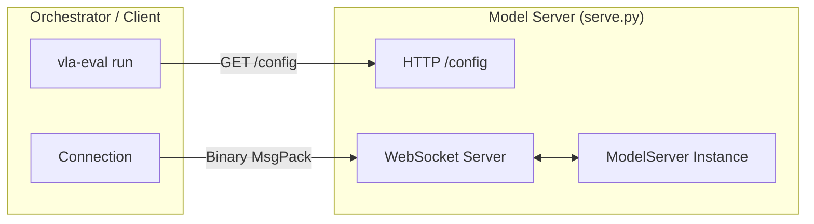

### Sources:
- [src/vla_eval/model_servers/serve.py:15-120]()
- [src/vla_eval/cli/smoke.py:102-115]()
- [configs/model_servers/starvla_groot_simpler.yaml:5-12]()

---

# Page: Batching and Action Chunking

# Batching and Action Chunking

<details>
<summary>Relevant source files</summary>

The following files were used as context for generating this wiki page:

- [README.md](README.md)
- [configs/model_servers/starvla_groot_simpler.yaml](configs/model_servers/starvla_groot_simpler.yaml)
- [leaderboard/README.md](leaderboard/README.md)
- [src/vla_eval/model_servers/starvla.py](src/vla_eval/model_servers/starvla.py)

</details>


This page details the internal mechanisms of the `BatchPredictModelServer` and the `ActionChunkBuffer`. These components are responsible for maximizing GPU throughput via request batching and managing multi-step model outputs through temporal ensembling.

## BatchPredictModelServer Internals

The `BatchPredictModelServer` (defined in `[src/vla_eval/model_servers/predict.py:84-210]()`) extends the base model server to support high-throughput evaluation. It decouples the incoming WebSocket request stream from the model inference loop using an internal queue and a dedicated dispatch thread.

### The Dispatch Loop and Queueing

When an observation arrives via `on_observation`, it is not processed immediately. Instead, it is wrapped in a `_BatchItem` and placed into a `_BatchQueue`.

1.  **`on_observation`**: Captures the `Observation` and `SessionContext`, creates a `Future` for the result, and pushes it to the queue `[src/vla_eval/model_servers/predict.py:145-159]()`.
2.  **`_dispatch_loop`**: A background thread that continuously monitors the queue. It waits until either `max_batch_size` items are collected or `max_wait_time` (seconds) has elapsed since the first item arrived `[src/vla_eval/model_servers/predict.py:168-210]()`.
3.  **`predict_batch`**: Once a batch is formed, the server calls the subclass-implemented `predict_batch()` method. The resulting actions are then used to set the results of the awaiting `Futures` `[src/vla_eval/model_servers/predict.py:199-206]()`.

### Data Flow: Request to Batched Inference

The following diagram illustrates how multiple benchmark clients (shards) have their individual requests coalesced into a single GPU forward pass.

**Model Server Batching Architecture**
```mermaid
graph TD
    subgraph "Benchmark Shards (Clients)"
        S1["Shard 1"]
        S2["Shard 2"]
        SN["Shard N"]
    end

    subgraph "BatchPredictModelServer (Server)"
        BQ["_BatchQueue (PriorityQueue)"]
        DL["_dispatch_loop (Thread)"]
        PB["predict_batch()"]
        
        S1 -- "on_observation" --> BQ
        S2 -- "on_observation" --> BQ
        SN -- "on_observation" --> BQ
        
        BQ -- "pop batch" --> DL
        DL -- "forward pass" --> PB
        PB -- "set Future result" --> S1
        PB -- "set Future result" --> S2
        PB -- "set Future result" --> SN
    end
```
**Sources:** `[src/vla_eval/model_servers/predict.py:84-210]()`

---

## Action Chunking and Ensembling

Many modern VLA models (e.g., π₀, OpenVLA, StarVLA) do not predict a single action; they predict a "chunk" of future actions (e.g., the next 8 or 16 steps). The `ActionChunkBuffer` (defined in `[src/vla_eval/model_servers/predict.py:11-81]()`) manages these temporal sequences.

### ActionChunkBuffer Implementation

The buffer maintains a mapping of `episode_id` to a list of predicted action chunks. When the orchestrator requests an action for a specific timestep, the buffer aggregates all overlapping chunks that cover that timestep.

Key parameters in `PredictModelServer` that control this behavior:
*   `chunk_size`: The number of steps the model predicts per forward pass `[src/vla_eval/model_servers/predict.py:218-219]()`.
*   `action_ensemble`: The strategy used to blend overlapping predictions `[src/vla_eval/model_servers/predict.py:221-222]()`.

### Blending Strategies

The `ActionChunkBuffer.get_action` method implements three primary strategies for resolving multiple predictions for the same timestep `[src/vla_eval/model_servers/predict.py:44-77]()`:

| Strategy | Logic | Use Case |
| :--- | :--- | :--- |
| `newest` | Returns the action from the most recently received chunk. | Models with high temporal drift where the latest info is best. |
| `average` | Computes the arithmetic mean of all available predictions for that step. | Reducing variance in stochastic models (e.g., Diffusion Policy). |
| `ema` | Applies an Exponential Moving Average across overlapping predictions. | Smoothing trajectories for jittery action heads. |

**Code to Logic Mapping**
```mermaid
graph LR
    subgraph "Action Generation"
        PM["PredictModelServer.predict()"]
        AC["ActionChunk (np.ndarray)"]
    end

    subgraph "Temporal Management"
        ACB["ActionChunkBuffer"]
        BUF["_buffer: dict[str, list]"]
    end

    subgraph "Resolution Strategies"
        S1["'newest'"]
        S2["'average'"]
        S3["'ema'"]
    end

    PM --> AC
    AC -- "add_chunk(episode_id, action, step)" --> ACB
    ACB --> BUF
    BUF -- "get_action(episode_id, step)" --> S1
    BUF -- "get_action(episode_id, step)" --> S2
    BUF -- "get_action(episode_id, step)" --> S3
```
**Sources:** `[src/vla_eval/model_servers/predict.py:11-81]()`, `[src/vla_eval/model_servers/predict.py:213-288]()`

---

## Integration in Model Implementations

Model servers like `StarVLAModelServer` leverage these features by setting class attributes. For example, a StarVLA variant might predict chunks of size 1 but allow for ensemble strategies if configured.

In `[src/vla_eval/model_servers/starvla.py:57-61]()`, the server defines:
*   `chunk_size = 1`
*   `action_ensemble = "newest"`

While in the configuration file `[configs/model_servers/starvla_groot_simpler.yaml:10]()`, these can be overridden to tune the execution behavior without changing the model code itself.

**Sources:** `[src/vla_eval/model_servers/starvla.py:57-61]()`, `[configs/model_servers/starvla_groot_simpler.yaml:1-13]()`

---

# Page: Built-in Model Server Implementations

# Built-in Model Server Implementations

<details>
<summary>Relevant source files</summary>

The following files were used as context for generating this wiki page:

- [README.md](README.md)
- [configs/model_servers/starvla_groot_simpler.yaml](configs/model_servers/starvla_groot_simpler.yaml)
- [leaderboard/README.md](leaderboard/README.md)
- [src/vla_eval/cli/smoke.py](src/vla_eval/cli/smoke.py)
- [src/vla_eval/model_servers/starvla.py](src/vla_eval/model_servers/starvla.py)

</details>


The `vla-evaluation-harness` includes a catalog of pre-integrated Vision-Language-Action (VLA) models. These implementations are designed for high-throughput evaluation, supporting both sequential and batched inference. Each model server is encapsulated as a standalone **uv script** utilizing PEP 723 inline dependency metadata, ensuring that complex, often conflicting model dependencies (e.g., specific versions of `transformers`, `torch`, or custom CUDA kernels) are isolated from the benchmark environments.

## Overview of Model Servers

Model servers in the harness follow a standardized structure defined by the `PredictModelServer` base class. They are typically invoked via the `vla-eval serve` command, which resolves the `script` path provided in a YAML configuration and executes it using `uv run`.

### Supported Models and Configs
The following table lists the built-in model servers and their corresponding configuration files located in `configs/model_servers/`.

| Model Name | Config File | Implementation Script | Key Features |
| :--- | :--- | :--- | :--- |
| **OpenVLA** | `openvla.yaml` | `openvla.py` | Prismatic-VLM based, discrete action tokens. |
| **π₀ (pi0)** | `pi0_libero.yaml` | `pi0.py` | Flow-matching DiT, continuous actions. |
| **CogACT** | `cogact.yaml` | `cogact.py` | Contrastive action learning. |
| **GR00T** | `groot.yaml` | `groot.py` | GR00T N1.6 official implementation. |
| **OFT** | `oft_libero.yaml` | `oft.py` | One-stage Flow-matching Transformer. |
| **X-VLA** | `xvla_libero.yaml` | `xvla.py` | Cross-modal VLA. |
| **RTC** | `rtc_kinetix.yaml` | `rtc.py` | Real-time control optimized. |
| **starVLA** | `starvla_groot_simpler.yaml` | `starvla.py` | Supports QwenGR00T, QwenOFT, QwenPI, QwenFast. |
| **DexBotic** | `dexbotic_cogact_libero.yaml` | `cogact.py` | DexBotic variants of CogACT. |

Sources: [README.md:12-15](), [src/vla_eval/cli/smoke.py:102-115]()

---

## Implementation Structure: The uv Script Pattern

All built-in model servers utilize the **PEP 723 script tag** to define their environment. This allows the `vla-eval` CLI to automatically provision the correct environment without user intervention.

### Anatomy of a Model Server Script
Taking `starvla.py` as an example, the script contains:
1.  **Metadata Block**: Defines Python version and PyPI dependencies.
2.  **Tool Sources**: Points to specific git revisions or local paths (e.g., `starvla` git repo).
3.  **Server Class**: Subclasses `PredictModelServer` and implements `predict` or `predict_batch`.
4.  **Entry Point**: A `main` block that calls `serve()` or `serve_async()`.

### StarVLA Implementation Example
The `StarVLAModelServer` demonstrates how the harness handles complex multi-framework models. It supports four different architectures (GR00T, OFT, π₀, and Fast) within a single script by auto-detecting the framework from the checkpoint config.

```mermaid
graph TD
    subgraph "Natural Language Space"
        A["'starVLA Model Server'"]
        B["'QwenGR00T'"]
        C["'QwenPI'"]
    end

    subgraph "Code Entity Space"
        A --> D["StarVLAModelServer class"]
        D -- "inherits" --> E["PredictModelServer"]
        D -- "uses" --> F["_resolve_checkpoint()"]
        D -- "calls" --> G["starVLA.model.framework.build_framework"]
        
        subgraph "Internal Logic"
            F -- "downloads" --> H["huggingface_hub.snapshot_download"]
            G -- "patches" --> I["transformers.Qwen2_5_VLForConditionalGeneration"]
        end
    end
```
Sources: [src/vla_eval/model_servers/starvla.py:1-37](), [src/vla_eval/model_servers/starvla.py:57-60](), [src/vla_eval/model_servers/starvla.py:104-136]()

---

## Configuration Reference

Model servers are configured via YAML files. These files bridge the CLI to the specific implementation script and its constructor arguments.

### Common YAML Fields
| Field | Description |
| :--- | :--- |
| `script` | Path to the `.py` model server script. |
| `args` | Dictionary passed as keyword arguments to the server class `__init__`. |
| `args.checkpoint` | Local path or HuggingFace ID for model weights. |
| `args.port` | Port for the WebSocket server (default: 8000). |
| `args.chunk_size` | Number of actions to predict per inference step. |

**Example: `configs/model_servers/starvla_groot_simpler.yaml`**
```yaml
script: "src/vla_eval/model_servers/starvla.py"
args:
  checkpoint: StarVLA/Qwen-GR00T-Bridge-RT-1
  unnorm_key: oxe_bridge
  use_bf16: true
  chunk_size: 1
  port: 8000
```
Sources: [configs/model_servers/starvla_groot_simpler.yaml:1-12](), [src/vla_eval/cli/smoke.py:124-130]()

---

## Data Flow: From Observation to Action

The model server sits at the end of the evaluation pipeline. It receives `Observation` objects via WebSockets and returns `Action` objects.

```mermaid
sequenceDiagram
    participant B as Benchmark (Docker)
    participant C as Connection (vla-eval)
    participant S as ModelServer (uv script)
    
    B->>C: get_observation()
    C->>S: Message(TYPE_OBSERVATION, payload=obs)
    Note over S: PredictModelServer.on_observation()
    S->>S: predict_batch([obs])
    S->>C: Message(TYPE_ACTION, payload=action)
    C->>B: apply_action(action)
```

### Key Functions and Classes
- **`PredictModelServer`**: The primary entry point for built-in models. It manages the dispatch of single observations to the underlying model. [src/vla_eval/model_servers/starvla.py:57-60]()
- **`_resolve_checkpoint`**: A utility frequently used in built-in scripts to handle HuggingFace Hub downloads and local path resolution. [src/vla_eval/model_servers/starvla.py:70-102]()
- **`serve`**: The runner function that starts the WebSocket server and hooks into the `ModelServer` lifecycle methods. [src/vla_eval/model_servers/starvla.py:52]()

Sources: [src/vla_eval/model_servers/starvla.py:48-52](), [src/vla_eval/cli/smoke.py:186-192]()

## Model-Specific Handling

Many built-in servers require complex "monkey-patching" to ensure compatibility across different environments or to fix upstream bugs without modifying the original model code.

### Case Study: StarVLA Patches
The `starvla.py` implementation performs several runtime modifications:
1.  **Flash Attention Redirection**: Redirects `flash_attention_2` to the `kernels-community/flash-attn2` package for better environment compatibility. [src/vla_eval/model_servers/starvla.py:120-136]()
2.  **Path Resolution**: Intercepts local training paths (e.g., `/home/user/weights`) embedded in checkpoint configs and maps them to HuggingFace IDs. [src/vla_eval/model_servers/starvla.py:162-171]()
3.  **Framework Aliasing**: Maps legacy framework names (like `QwenFM`) to current ones (`QwenGR00T`). [src/vla_eval/model_servers/starvla.py:151-160]()

Sources: [src/vla_eval/model_servers/starvla.py:104-180]()

---

# Page: Benchmark Integrations

# Benchmark Integrations

<details>
<summary>Relevant source files</summary>

The following files were used as context for generating this wiki page:

- [.dockerignore](.dockerignore)
- [README.md](README.md)
- [docker/rlbench_entrypoint.sh](docker/rlbench_entrypoint.sh)
- [leaderboard/README.md](leaderboard/README.md)
- [src/vla_eval/types.py](src/vla_eval/types.py)

</details>


The benchmark subsystem is a decoupled layer designed to execute robot simulation environments in isolation. By wrapping diverse benchmarks—each with conflicting dependencies and unique observation spaces—into a unified Python API and containerizing them via Docker, the harness allows any VLA model to be evaluated across the entire suite matrix without manual environment setup.

### Core Abstractions: Benchmark and StepBenchmark

All integrations are built upon the `Benchmark` Abstract Base Class (ABC). This interface defines the lifecycle of an evaluation episode, from task discovery to result reporting. For environments following the standard OpenAI Gym `reset`/`step` pattern, the `StepBenchmark` subclass provides a simplified template that handles observation formatting and termination logic.

The interaction between the orchestrator and the benchmark is governed by four primary data types defined in `src/vla_eval/types.py`: `Observation`, `Action`, `Task`, and `EpisodeResult`.

#### Benchmark Entity Relationship
The following diagram illustrates how the abstract classes in the codebase map to the conceptual flow of an evaluation.

**Diagram: Benchmark Class Hierarchy and Data Flow**
```mermaid
graph TD
    subgraph "Code Entity Space"
        ABC["Benchmark (ABC)"] -- "implements" --> SB["StepBenchmark (ABC)"]
        SB -- "specializes" --> LIBERO["LiberoBenchmark"]
        SB -- "specializes" --> SIMPLER["SimplerBenchmark"]
        
        TYPES["src/vla_eval/types.py"]
        OBS["Observation (TypeAlias)"]
        ACT["Action (TypeAlias)"]
        TSK["Task (TypeAlias)"]
    end

    subgraph "Natural Language Space"
        LIFECYCLE["Episode Lifecycle"]
        ENV["Simulation Environment"]
        PROTO["Wire Protocol"]
    end

    ABC -- "defines" --> LIFECYCLE
    SB -- "manages" --> ENV
    TYPES -- "serializes to" --> PROTO
    
    %% Associations
    ABC -.-> OBS
    ABC -.-> ACT
    ABC -.-> TSK
```
**Sources:** [src/vla_eval/benchmarks/base.py:1-120](), [src/vla_eval/types.py:1-61]()

For a deep dive into the method signatures and type definitions, see **[Benchmark API](#4.1)**.

---

### Built-in Benchmark Adapters

The harness includes 14 built-in adapters covering the majority of modern VLA research benchmarks. These adapters translate benchmark-specific states into the common `Observation` format (typically containing `images`, `state`, and `task_description`) and handle the conversion of model `Action` chunks back into simulator-specific control signals.

| Benchmark | Suite Examples | Observation Keys | Max Steps |
| :--- | :--- | :--- | :--- |
| **LIBERO** | Spatial, Object, Goal, Long | `agentview`, `robot0_eye_in_hand` | 600 |
| **CALVIN** | Task ABC/D | `rgb_static`, `rgb_gripper` | 360 |
| **SimplerEnv** | Google Robot, WidowX | `image` | 120-400 |
| **ManiSkill2** | PickCube, MoveBucket | `base_rgb`, `hand_rgb` | 200+ |
| **RoboCasa** | Kitchen tasks | `robot0_agentview_left`, `hand` | 500 |
| **RLBench** | Multi-task | `front_rgb`, `left_shoulder_rgb` | 500 |

For a complete catalog of all 14 adapters, including their YAML configuration schemas and specific observation dimensions, see **[Built-in Benchmark Adapters](#4.2)**.

**Sources:** [README.md:10-15](), [src/vla_eval/types.py:14-36]()

---

### Docker Packaging

To solve "dependency hell," every benchmark is packaged into a Docker image. These images use a standardized base (`nvidia/cuda:12.1.1-runtime-ubuntu22.04`) and include all necessary system dependencies (e.g., MuJoCo, EGL, Xvfb). 

The orchestration logic in `vla-eval` automatically detects if a benchmark should run in a container and manages the lifecycle of the `docker run` command, including GPU passthrough and volume mounting for results.

**Diagram: Containerized Execution Flow**
```mermaid
sequenceDiagram
    participant CLI as vla-eval (Host)
    participant DOCKER as Docker Engine
    participant ENTRY as entrypoint.sh (Container)
    participant BENCH as Benchmark Adapter

    CLI->>DOCKER: docker run --gpus all [image_name]
    DOCKER->>ENTRY: start Xvfb / setup GLX
    ENTRY->>BENCH: vla-eval run --no-docker ...
    BENCH->>CLI: Connect to Model Server (WebSocket)
    Note over BENCH, CLI: Episode Execution Loop
    BENCH->>DOCKER: exit(0)
    DOCKER->>CLI: cleanup container
```
**Sources:** [docker/rlbench_entrypoint.sh:1-20](), [.dockerignore:1-11](), [README.md:38-41]()

For details on the container specifications, entrypoint scripts, and how to build your own images, see **[Docker Packaging for Benchmarks](#4.3)**.

---

### Child Pages
- **[Benchmark API](#4.1)**: Technical documentation of the `Benchmark` and `StepBenchmark` classes and the `vla_eval.types` module.
- **[Built-in Benchmark Adapters](#4.2)**: Detailed breakdown of the 14 supported benchmarks, their task structures, and configuration options.
- **[Docker Packaging for Benchmarks](#4.3)**: Guide to the Dockerfile structures, image registry, and the containerized execution environment.

---

# Page: Benchmark API

# Benchmark API

<details>
<summary>Relevant source files</summary>

The following files were used as context for generating this wiki page:

- [.dockerignore](.dockerignore)
- [docker/rlbench_entrypoint.sh](docker/rlbench_entrypoint.sh)
- [docs/architecture.md](docs/architecture.md)
- [docs/rfcs/0004-benchmark-and-episode-execution.md](docs/rfcs/0004-benchmark-and-episode-execution.md)
- [src/vla_eval/types.py](src/vla_eval/types.py)

</details>


The Benchmark API defines the implementation contract for simulation environments and physical robot interfaces within the `vla-evaluation-harness`. It decouples environment-specific logic (physics, rendering, success criteria) from the execution strategy (synchronous vs. asynchronous loops) and communication protocols.

## Benchmark ABC

The `Benchmark` Abstract Base Class (ABC) is the primary interface for all environment integrations. Every supported benchmark, from LIBERO to RoboTwin, implements this interface to allow the `Orchestrator` and `EpisodeRunner` to drive evaluations uniformly [docs/rfcs/0004-benchmark-and-episode-execution.md:16-19]().

### Interface Definition
The interface consists of six mandatory abstract methods and two optional overrides [docs/rfcs/0004-benchmark-and-episode-execution.md:28-37]():

| Method | Type | Description |
|:---|:---|:---|
| `get_tasks()` | Synchronous | Returns a list of task descriptors to be evaluated. |
| `start_episode(task)` | Asynchronous | Resets the environment for a specific task. |
| `apply_action(action)` | Asynchronous | Executes the model's predicted action in the environment. |
| `get_observation()` | Asynchronous | Retrieves the current state/images from the environment. |
| `is_done()` | Asynchronous | Returns whether the episode has finished (success or failure). |
| `get_result()` | Asynchronous | Returns final metrics (e.g., success status) for the episode. |
| `get_metadata()` | Optional | Returns default parameters like `max_steps` or `fps`. |
| `render()` | Optional | Returns an RGB image for video recording/visualization. |

### Data Flow: Natural Language to Code Entities
The following diagram illustrates how high-level benchmark concepts map to specific code entities and data structures.

**Conceptual Mapping: Benchmark Space**
```mermaid
graph TD
    subgraph "Natural Language Space"
        TaskName["'Pick up the red block'"]
        EnvState["Current Camera Frames"]
        RobotMove["Move arm to (x, y, z)"]
        Outcome["Did the robot succeed?"]
    end

    subgraph "Code Entity Space (vla_eval.types)"
        T["Task (Dict)"]
        O["Observation (Dict)"]
        A["Action (Dict)"]
        ER["EpisodeResult (Dict)"]
    end

    TaskName -.-> T
    EnvState -.-> O
    RobotMove -.-> A
    Outcome -.-> ER

    T -- "passed to" --> Start["Benchmark.start_episode()"]
    O -- "returned by" --> Obs["Benchmark.get_observation()"]
    A -- "consumed by" --> Apply["Benchmark.apply_action()"]
    ER -- "returned by" --> Res["Benchmark.get_result()"]
```
Sources: [src/vla_eval/types.py:14-60](), [docs/rfcs/0004-benchmark-and-episode-execution.md:28-37]()

## StepBenchmark Convenience Subclass

To simplify integration for environments following the standard OpenAI Gym `reset`/`step` pattern, the harness provides a `StepBenchmark` subclass. This wrapper manages the internal environment handle (`self._env`) and translates the granular `Benchmark` ABC methods into standard Gym calls.

### Execution Flow (Sync Mode)
The `SyncEpisodeRunner` interacts with the `Benchmark` implementation in a lock-step loop [docs/rfcs/0004-benchmark-and-episode-execution.md:55-70]().

**Sequence: Episode Execution**
```mermaid
sequenceDiagram
    participant O as Orchestrator
    participant R as SyncEpisodeRunner
    participant B as Benchmark Implementation
    participant C as Connection (Model Client)

    O->>R: run_episode(benchmark, task)
    R->>B: start_episode(task)
    B-->>R: done
    R->>B: get_observation()
    B-->>R: Observation (images, state)
    
    loop Max Steps
        R->>C: act(observation)
        C-->>R: Action (np.ndarray)
        R->>B: apply_action(action)
        R->>B: is_done()
        B-->>R: False
        R->>B: get_observation()
        B-->>R: Observation
    end

    R->>B: get_result()
    B-->>R: EpisodeResult (success=True)
    R->>O: EpisodeResult
```
Sources: [docs/architecture.md:54-70](), [docs/rfcs/0004-benchmark-and-episode-execution.md:55-70]()

## Core Types

The `vla_eval.types` module defines the schemas for data exchanged between the benchmark and the model server. These are defined as `TypeAlias` for `Dict[str, Any]` to maintain flexibility across different simulation suites [src/vla_eval/types.py:1-12]().

### Observation
The `Observation` dict is passed from the benchmark to the model server. While the schema is open, built-in benchmarks follow a specific convention [src/vla_eval/types.py:14-36]():
*   **`images`**: A dictionary mapping camera names (e.g., "agentview", "wrist") to `[H, W, C]` uint8 `np.ndarray`.
*   **`task_description`**: A string containing the natural language instruction.
*   **`state`**: A `np.ndarray` containing proprioceptive data (joint positions, gripper state).

### Action
The `Action` dict is the response from the model server. It typically contains an `actions` key mapping to a `np.ndarray` of shape `(action_dim,)` or `(chunk_size, action_dim)` [src/vla_eval/types.py:38-44]().

### Task and EpisodeResult
*   **`Task`**: A descriptor returned by `get_tasks()`. It must contain enough information for `start_episode` to initialize the environment (e.g., `task_name`, `variation_id`) [src/vla_eval/types.py:46-53]().
*   **`EpisodeResult`**: Returned at the end of an episode. It must contain at least `{"success": bool}` [src/vla_eval/types.py:55-60]().

Sources: [src/vla_eval/types.py:14-60]()

## Environment Isolation and Entrypoints

Benchmarks are executed inside Docker containers to prevent dependency conflicts (e.g., differing versions of MuJoCo or SAPIEN) [docs/architecture.md:37-40]().

The `Orchestrator` launches these containers and communicates with them via a control channel. For benchmarks requiring a virtual display (like RLBench or RoboCasa), an entrypoint script initializes `Xvfb` before starting the `vla-eval` process [docker/rlbench_entrypoint.sh:1-19]().

### Import Resolution
Benchmarks are loaded dynamically using import strings (e.g., `"vla_eval.benchmarks.libero.benchmark:LIBEROBenchmark"`) [docs/rfcs/0004-benchmark-and-episode-execution.md:113-120](). This allows the harness to instantiate the benchmark class inside the container without requiring a central registry that would force all dependencies to be installed in the host environment [docs/architecture.md:141-152]().

Sources: [docs/architecture.md:37-49](), [docs/rfcs/0004-benchmark-and-episode-execution.md:86-94](), [docker/rlbench_entrypoint.sh:1-20]()

---

# Page: Built-in Benchmark Adapters

# Built-in Benchmark Adapters

<details>
<summary>Relevant source files</summary>

The following files were used as context for generating this wiki page:

- [README.md](README.md)
- [leaderboard/CONTRIBUTING.md](leaderboard/CONTRIBUTING.md)
- [leaderboard/README.md](leaderboard/README.md)
- [src/vla_eval/cli/smoke.py](src/vla_eval/cli/smoke.py)

</details>


The `vla-evaluation-harness` provides a suite of 14 built-in benchmark adapters that translate high-level evaluation requests into environment-specific API calls. These adapters are decoupled from model logic, allowing any supported VLA to be evaluated across any benchmark without code modification.

## Overview of Supported Benchmarks

The harness categorizes benchmarks by their simulation backend and observation requirements. Most adapters inherit from `StepBenchmark` [src/vla_eval/benchmarks/base.py:108-110](), which simplifies the `reset`/`step` loop common in `gym`-like environments.

| Benchmark | Suite Structure | Max Steps | Observation Format |
| :--- | :--- | :--- | :--- |
| **LIBERO** | Spatial, Object, Goal, Long | 600 | RGB (128x128) + Proprio |
| **LIBERO-Mem** | Memory-augmented tasks | 600 | RGB + Proprio |
| **LIBERO-Pro** | Procedural generation | 600 | RGB + Proprio |
| **CALVIN** | A, B, C, D (Split) | 360 | RGB (Static/Wrist) + Proprio |
| **SimplerEnv** | Google Robot, WidowX | 200-400 | RGB + Proprio |
| **ManiSkill2** | PickPlace, TurnFaucet, etc. | Varies | RGB + Depth + Segmentation |
| **RoboCasa** | Kitchen activities | 500-1000 | Multi-view RGB |
| **RLBench** | 100+ precision tasks | 500 | RGB + Pointcloud |
| **RoboTwin** | Dual-arm manipulation | 400 | Multi-view RGB |
| **VLABench** | Reasoning-heavy tasks | 600 | RGB + Instruction |
| **MIKASA-Robo** | Multi-modal interaction | 500 | RGB + State |
| **RoboCerebra** | Cognitive robotics | 600 | RGB |
| **Kinetix** | Physics-based puzzles | 1000 | RGB |

Sources: [README.md:12-15](), [leaderboard/CONTRIBUTING.md:11-16](), [src/vla_eval/cli/smoke.py:85-99]()

## Adapter Architecture and Data Flow

The benchmark adapters act as the bridge between the `Orchestrator` and the underlying simulation engine (running inside Docker). They implement the `Benchmark` abstract base class to provide a unified interface for task discovery and episode execution.

### Entity Mapping: Natural Language to Code

The following diagram maps conceptual benchmark entities to their specific Python implementations within the harness.

**Benchmark Entity Mapping**
```mermaid
graph TD
    subgraph "Natural Language Space"
        A["Benchmark Suite"]
        B["Environment Step"]
        C["Observation Data"]
        D["Success Criteria"]
    end

    subgraph "Code Entity Space"
        A1["Benchmark(ABC)"]
        B1["apply_action()"]
        C1["Observation(Dataclass)"]
        D1["get_result()"]
    end

    A --- A1
    B --- B1
    C --- C1
    D --- D1

    style A1 stroke-width:2px
    style B1 stroke-width:2px
    style C1 stroke-width:2px
    style D1 stroke-width:2px
```
Sources: [src/vla_eval/benchmarks/base.py:18-106]()

### Data Flow: Observation to Result
This diagram illustrates how data flows through a benchmark adapter during a single evaluation episode.

**Benchmark Data Flow**
```mermaid
sequenceDiagram
    participant O as Orchestrator
    participant A as BenchmarkAdapter
    participant E as SimEnvironment
    
    O->>A: start_episode(task)
    A->>E: reset()
    E-->>A: raw_obs
    A-->>O: Observation(image, proprio)
    
    loop Episode Steps
        O->>A: apply_action(action)
        A->>E: step(action)
        E-->>A: raw_obs, reward, done, info
        A->>A: check_success(info)
        A-->>O: Observation
    end
    
    O->>A: get_result()
    A-->>O: EpisodeResult(success_rate, etc.)
```
Sources: [src/vla_eval/benchmarks/base.py:30-100]()

## Detailed Adapter Catalog

### LIBERO Family (LIBERO, Mem, Pro)
The LIBERO adapters handle four main suites (Spatial, Object, Goal, Long). They are configured to use a standard 128x128 image resolution and a 7-DOF action space (6-DOF delta pose + 1-DOF gripper).

*   **Config Reference**: `configs/libero_all.yaml`, `configs/libero_mem.yaml`, `configs/libero_pro_eval.yaml` [src/vla_eval/cli/smoke.py:86-88]()
*   **Key Implementation**: These adapters often require specific `init_states` to be mounted into the Docker container to ensure reproducible starting configurations.

### CALVIN
The CALVIN adapter evaluates long-horizon manipulation. It supports "Chain" evaluation where the model must complete multiple subtasks in sequence.
*   **Metric**: Average length (number of subtasks completed in a row, 0–5) [leaderboard/CONTRIBUTING.md:15]().
*   **Config Reference**: `configs/calvin_eval.yaml` [src/vla_eval/cli/smoke.py:89]().

### SimplerEnv
SimplerEnv focuses on visual matching between simulation and real-world data. It is split into three primary evaluation dimensions: Google Robot Visual Matching (VM), Google Robot Variant Aggregation (VA), and WidowX VM.
*   **Protocol Note**: The harness enforces that these dimensions are never averaged together [leaderboard/CONTRIBUTING.md:101-105]().
*   **Config Reference**: `configs/simpler_all_tasks.yaml` [src/vla_eval/cli/smoke.py:91]().

### Specialized Benchmarks
*   **ManiSkill2**: Focuses on articulated object manipulation (e.g., turning faucets). Config: `configs/maniskill2_eval.yaml` [src/vla_eval/cli/smoke.py:90]().
*   **RoboCasa**: Large-scale kitchen environment evaluation. Config: `configs/robocasa_eval.yaml` [src/vla_eval/cli/smoke.py:92]().
*   **RLBench**: Provides 100+ tasks with high-precision requirements. Config: `configs/rlbench_eval.yaml` [src/vla_eval/cli/smoke.py:96]().
*   **Kinetix**: Physics-based puzzle solving where the model must manipulate objects to reach a goal state. Config: `configs/kinetix_eval.yaml` [src/vla_eval/cli/smoke.py:98]().

## Configuration and Registry

Benchmarks are registered in the `BENCHMARK_REGISTRY` within the smoke test infrastructure, which maps benchmark IDs to their default evaluation configurations.

| Registry Key | Config Path |
| :--- | :--- |
| `libero` | `configs/libero_smoke_test.yaml` |
| `robocasa` | `configs/robocasa_eval.yaml` |
| `vlabench` | `configs/vlabench_eval.yaml` |
| `robotwin` | `configs/robotwin_eval.yaml` |

Sources: [src/vla_eval/cli/smoke.py:85-99]()

### YAML Configuration Schema
Each benchmark config typically defines the Docker image to use and the specific tasks to be evaluated:

```yaml
# Example Benchmark Config
docker:
  image: "ghcr.io/allenai/vla-evaluation-harness-libero:latest"
  gpu: true
benchmarks:
  - name: "libero_spatial"
    tasks: ["pick_up_cup", "put_down_bowl"]
    max_steps: 600
```
Sources: [src/vla_eval/cli/smoke.py:158-161](), [README.md:38-39]()

---

# Page: Docker Packaging for Benchmarks

# Docker Packaging for Benchmarks

<details>
<summary>Relevant source files</summary>

The following files were used as context for generating this wiki page:

- [.dockerignore](.dockerignore)
- [docker/Dockerfile.calvin](docker/Dockerfile.calvin)
- [docker/Dockerfile.kinetix](docker/Dockerfile.kinetix)
- [docker/Dockerfile.libero](docker/Dockerfile.libero)
- [docker/Dockerfile.libero_mem](docker/Dockerfile.libero_mem)
- [docker/Dockerfile.libero_pro](docker/Dockerfile.libero_pro)
- [docker/Dockerfile.maniskill2](docker/Dockerfile.maniskill2)
- [docker/Dockerfile.mikasa_robo](docker/Dockerfile.mikasa_robo)
- [docker/Dockerfile.rlbench](docker/Dockerfile.rlbench)
- [docker/Dockerfile.robocasa](docker/Dockerfile.robocasa)
- [docker/Dockerfile.robocerebra](docker/Dockerfile.robocerebra)
- [docker/Dockerfile.robotwin](docker/Dockerfile.robotwin)
- [docker/Dockerfile.simpler](docker/Dockerfile.simpler)
- [docker/Dockerfile.vlabench](docker/Dockerfile.vlabench)
- [docker/rlbench_entrypoint.sh](docker/rlbench_entrypoint.sh)
- [src/vla_eval/types.py](src/vla_eval/types.py)

</details>


The `vla-evaluation-harness` uses a containerized approach to manage the diverse and often conflicting dependencies of robotics benchmarks. Each benchmark is isolated into its own Docker image, ensuring that legacy Python versions (e.g., 3.8 for RLBench/LIBERO), specific simulator binaries (CoppeliaSim, MuJoCo), and system-level drivers do not interfere with the model serving environment or other benchmarks.

### Container Architecture

All benchmark containers are built upon a unified base image and follow a standardized layout for the evaluation harness installation.

#### Base Image and Registry
The standard base image is `nvidia/cuda:12.1.1-runtime-ubuntu22.04` (aliased as `ghcr.io/allenai/vla-evaluation-harness/base:latest`). This provides the necessary CUDA runtime for benchmarks that utilize GPU acceleration for rendering (e.g., ManiSkill2, RoboCasa) or physics (e.g., Kinetix). Images are hosted on the GitHub Container Registry (`ghcr.io`).

#### Standard Container Layout
Each Dockerfile typically performs the following steps:
1.  **System Dependencies**: Installs required libraries via `apt-get` (e.g., `xvfb` for headless rendering, `libfftw3-dev` for CALVIN).
2.  **Conda Environment**: Creates a dedicated environment with the Python version required by the upstream benchmark [docker/Dockerfile.rlbench:32-33]().
3.  **Benchmark Installation**: Clones the benchmark source and installs it in editable mode [docker/Dockerfile.libero:22-24]().
4.  **Harness Integration**: Copies the `vla-eval` source code into `/workspace` and installs it using `uv pip` to provide the `vla-eval` entrypoint inside the container [docker/Dockerfile.calvin:50-55]().

**Benchmark Container Topology**

```mermaid
graph TD
    subgraph "Host System"
        ORCH["Orchestrator (vla-eval run)"]
    end

    subgraph "Docker Container (Benchmark)"
        EP["Entrypoint (vla-eval)"]
        ENV["Conda Env (Py3.8/3.10/3.11)"]
        SIM["Simulator (CoppeliaSim/MuJoCo/SAPIEN)"]
        BENCH["Benchmark Adapter (src/vla_eval/benchmarks/)"]
        
        EP --> BENCH
        BENCH --> SIM
        BENCH -.-> |"WebSocket"| MS["Model Server (External)"]
    end

    ORCH --> |"docker run"| EP
```
Sources: [docker/Dockerfile.rlbench:5-60](), [docker/Dockerfile.calvin:1-60](), [docker/Dockerfile.maniskill2:4-40]()

---

### Per-Benchmark Implementation Details

Different benchmarks require specific handling for assets, simulators, and display servers.

| Benchmark | Base Python | Simulator | Special Requirements |
| :--- | :--- | :--- | :--- |
| **RLBench** | 3.8 | CoppeliaSim 4.1.0 | Xvfb for headless GLX rendering, `tini` for process reaping. |
| **CALVIN** | 3.8 | PyBullet | Embedded validation data (17KB), `setuptools==57.5.0` for legacy builds. |
| **LIBERO** | 3.8 | MuJoCo | Pre-configured `.libero/config.yaml` to suppress interactive prompts. |
| **ManiSkill2** | 3.10 | SAPIEN | Embedded YCB/EGAD assets (~360MB) to avoid runtime downloads. |
| **RoboCasa** | 3.11 | MuJoCo | Automatic download of ~10GB kitchen assets during build. |
| **Kinetix** | 3.11 | JAX-based | Custom level files from the RTC repository. |

#### Headless Rendering with Xvfb
Benchmarks like RLBench require a functional X display even in headless mode. The `docker/rlbench_entrypoint.sh` script initializes a virtual framebuffer before launching the evaluation.

```mermaid
sequenceDiagram
    participant D as Docker Engine
    participant T as Tini (Init)
    participant S as rlbench_entrypoint.sh
    participant X as Xvfb (:99)
    participant V as vla-eval CLI

    D->>T: Start Container
    T->>S: Execute Script
    S->>X: Start in background
    loop Wait for X11 Socket
        S->>S: Check /tmp/.X11-unix/X99
    end
    S->>V: conda activate rlbench && vla-eval run ...
    V->>V: Execute Episodes
    V->>S: Exit
    S->>T: Exit
    T->>D: Reap orphaned processes
```
Sources: [docker/rlbench_entrypoint.sh:1-19](), [docker/Dockerfile.rlbench:54-59]()

---

### Data Handling and Initialization

To ensure reproducibility and speed up execution, certain benchmarks include pre-generated data or specific configuration files.

*   **Init States**: `LIBERO-Mem` requires initial state files that take ~43 minutes to generate. These are pre-generated and copied into the image at `docker/init_states/libero_mem/` [docker/Dockerfile.libero_mem:31-33]().
*   **Validation Data**: CALVIN's language-conditioned tasks rely on a specific validation dataset, which is embedded directly into the image at `/data/calvin/dataset/validation/` [docker/Dockerfile.calvin:46-47]().
*   **Build Optimization**: The `.dockerignore` file uses a "deny-all, whitelist-specific" strategy to keep image sizes small, only including necessary source code, configs, and initialization data [/.dockerignore:1-10]().

### Entrypoints and Execution

The `ENTRYPOINT` for most benchmark containers is configured to use `conda run --no-capture-output`. This ensures that logs from the `vla-eval` process are streamed directly to the host's stdout/stderr.

**Example Entrypoint Configuration:**
*   **Standard**: `ENTRYPOINT ["conda", "run", "--no-capture-output", "-n", "libero", "vla-eval"]` [docker/Dockerfile.libero:43]()
*   **RLBench (Special)**: Uses `tini` as the init process to handle signal forwarding and cleanup of CoppeliaSim child processes [docker/Dockerfile.rlbench:59]().

**Data Flow: Observation and Action Types**
The containerized benchmark communicates with the model server using the types defined in `src/vla_eval/types.py`.

| Entity | Code Symbol | Content |
| :--- | :--- | :--- |
| **Observation** | `Observation` | `dict` containing `images` (HWC arrays), `task_description` (str), and `state` (proprioception) [src/vla_eval/types.py:14-36](). |
| **Action** | `Action` | `dict` containing `actions` (np.ndarray) [src/vla_eval/types.py:38-44](). |
| **Task** | `Task` | `dict` with `name` and `suite` strings [src/vla_eval/types.py:46-53](). |
| **Result** | `EpisodeResult` | `dict` with at least a `"success": bool` key [src/vla_eval/types.py:55-60](). |

Sources: [src/vla_eval/types.py:1-61](), [docker/Dockerfile.libero:43-44](), [docker/Dockerfile.calvin:58-59]()

---

# Page: CLI and Execution Orchestration

# CLI and Execution Orchestration

<details>
<summary>Relevant source files</summary>

The following files were used as context for generating this wiki page:

- [README.md](README.md)
- [leaderboard/README.md](leaderboard/README.md)
- [src/vla_eval/cli/main.py](src/vla_eval/cli/main.py)

</details>


The `vla-eval` command-line interface is the primary entry point for managing the lifecycle of VLA evaluations. It orchestrates the interaction between model servers (typically running on host GPUs) and benchmark environments (typically isolated within Docker containers). The CLI handles configuration resolution, resource partitioning, and the recursive dispatching required for sharded execution.

### CLI Structure and Commands

The CLI is implemented in `src/vla_eval/cli/main.py` using `argparse` [src/vla_eval/cli/main.py:1-12](). It provides four primary sub-commands to handle different stages of the evaluation pipeline:

| Command | Purpose | Key Responsibilities |
| :--- | :--- | :--- |
| `run` | Execute Evaluation | Resolves configs, manages Docker lifecycle, and handles sharding. |
| `serve` | Start Model Server | Launches a model server (usually via `uv run`) to listen for benchmark requests. |
| `test` | Smoke Testing | Validates that models and benchmarks are correctly integrated and reachable. |
| `merge` | Result Aggregation | Combines JSON shards from parallel runs into a single final report. |

**Sources:** [src/vla_eval/cli/main.py:288-340]()

---

### Execution Flow and Orchestration

The orchestration logic bridges the gap between the user's high-level YAML configuration and the low-level system processes (Docker, Subprocesses, and WebSockets).

#### Command Dispatch Diagram
This diagram maps the CLI command entry points to the underlying execution logic and system entities.

```mermaid
graph TD
    User["User CLI"] -- "vla-eval run" --> cmd_run["cmd_run()"]
    User -- "vla-eval serve" --> cmd_serve["cmd_serve()"]
    
    subgraph "Orchestration Logic"
        cmd_run -- "docker=True" --> _run_via_docker["_run_via_docker()"]
        cmd_run -- "docker=False" --> Orchestrator["Orchestrator.run()"]
        _run_via_docker -- "spawn container" --> Container["Docker Container"]
        Container -- "vla-eval run --no-docker" --> Orchestrator
    end

    subgraph "Model Hosting"
        cmd_serve -- "uv run" --> ModelScript["Model Server Script"]
        ModelScript -- "WebSocket" --> Orchestrator
    end

    style cmd_run stroke-width:2px
    style cmd_serve stroke-width:2px
```
**Sources:** [src/vla_eval/cli/main.py:161-224](), [src/vla_eval/cli/main.py:263-286](), [src/vla_eval/orchestrator.py:38-50]()

---

### Key Orchestration Features

#### 1. Docker Lifecycle Management
By default, `vla-eval run` executes benchmarks inside Docker to ensure environment reproducibility [src/vla_eval/cli/main.py:161-169](). The CLI manages:
*   **Image Detection:** Checks for local images and prompts for pulls if missing [src/vla_eval/cli/main.py:116-143]().
*   **Recursive Execution:** The host process launches a container that calls `vla-eval run --no-docker` internally [src/vla_eval/cli/main.py:230-235]().
*   **Cleanup:** Uses `atexit` and signal handlers (`SIGTERM`, `SIGHUP`) to ensure containers are stopped if the host process is interrupted [src/vla_eval/cli/main.py:72-86]().

#### 2. Resource Partitioning and Sharding
To maximize throughput, the harness supports **Episode Sharding**. The CLI uses `--num-shards` and `--shard-id` flags to split the workload [src/vla_eval/cli/main.py:304-305]().
*   **GPU/CPU Assignment:** The `docker_resources.py` utility automatically partitions available GPUs and CPU cores among shards to prevent resource contention [src/vla_eval/cli/main.py:207-217]().
*   **Dev Mode:** The `--dev` flag allows mounting the local `src/` directory into the container for rapid iteration without rebuilding images [src/vla_eval/cli/main.py:220-223]().

#### 3. Smoke Testing (`vla-eval test`)
The `test` command provides a suite of "smoke tests" to verify integration before launching expensive full-scale runs. It validates three tiers:
*   **Validate:** Config schema and registry checks.
*   **Server:** Connection and inference checks using `_EchoModelServer`.
*   **Benchmark:** Environment stepping checks using `_StubBenchmark`.

For details, see [Smoke Testing (vla-eval test)](#5.2).

#### 4. Performance Tuning
The orchestration layer is designed to support high-concurrency batching. By combining episode sharding (multiple benchmark clients) with a `BatchPredictModelServer`, the system can achieve up to 47x speedups on benchmarks like LIBERO [README.md:93-97]().

For details, see [Performance Tuning: Sharding and Batching](#5.3).

---

### Sub-topic Detail Pages

*   **[run and serve Commands](#5.1)**: Deep dive into the `cmd_run` flow, Docker detection, container lifecycle management, and resource partitioning via `docker_resources.py`.
*   **[Smoke Testing (vla-eval test)](#5.2)**: Details on the `vla-eval test` suite, including the `SERVER_REGISTRY`, `BENCHMARK_REGISTRY`, and parallel test execution.
*   **[Performance Tuning: Sharding and Batching](#5.3)**: Technical methodology for optimizing `num_shards` and `max_batch_size` to maximize evaluation throughput.

**Sources:** [src/vla_eval/cli/main.py:161-286](), [README.md:89-102](), [src/vla_eval/docker_resources.py:1-20]()

---

# Page: run and serve Commands

# run and serve Commands

<details>
<summary>Relevant source files</summary>

The following files were used as context for generating this wiki page:

- [.dockerignore](.dockerignore)
- [docker/rlbench_entrypoint.sh](docker/rlbench_entrypoint.sh)
- [src/vla_eval/cli/main.py](src/vla_eval/cli/main.py)
- [src/vla_eval/types.py](src/vla_eval/types.py)

</details>


The `vla-eval` CLI provides two primary commands for executing evaluations: `run` for orchestrating full benchmark suites (often involving Docker) and `serve` for launching model servers as standalone processes. These commands handle the complexity of environment isolation, resource partitioning, and lifecycle management.

## cmd_run: Orchestration and Execution Flow

The `run` command is the entry point for executing an evaluation suite. It is responsible for resolving configurations, detecting the execution environment, and managing the lifecycle of benchmark containers.

### Configuration Resolution and Docker Detection
When `vla-eval run` is invoked, the system first loads the YAML configuration file [src/vla_eval/cli/main.py:29-32](). It then checks if it is already executing inside a Docker container by looking for the `/.dockerenv` file [src/vla_eval/cli/main.py:45-47]().

1.  **Outside Docker:** If the command is run on a host machine, it enters the `_run_via_docker` flow. This recursive execution pattern ensures that the benchmark environment (which often has complex system dependencies like MuJoCo or specific CUDA versions) is isolated [src/vla_eval/cli/main.py:161-168]().
2.  **Inside Docker:** If already inside a container (either via a manual `docker run` or the recursive call), it initializes the `Orchestrator` and begins the evaluation loop [src/vla_eval/cli/main.py:273-277]().

### The _run_via_docker Recursive Execution
The `_run_via_docker` function automates the setup of the evaluation container [src/vla_eval/cli/main.py:161-168](). It performs the following steps:
*   **Image Validation:** Verifies the Docker daemon is reachable and ensures the required benchmark image (specified in `docker.image` config) is available locally, pulling it if necessary [src/vla_eval/cli/main.py:179-186]().
*   **Config Rewriting:** It creates a temporary YAML config where `output_dir` is remapped to the internal container path `/workspace/results` [src/vla_eval/cli/main.py:193-200]().
*   **Volume Mounting:** It mounts the host's results directory and the temporary config into the container [src/vla_eval/cli/main.py:211-216]().
*   **Resource Flags:** It appends GPU and CPU/Sharding flags based on `docker_resources.py` logic [src/vla_eval/cli/main.py:207-210]().

### Container Lifecycle and Cleanup
To prevent "orphan" containers (containers that keep running after the host process crashes or is interrupted), the CLI implements a robust cleanup mechanism using `atexit` and signal handlers [src/vla_eval/cli/main.py:64-94]().

| Mechanism | Implementation | Role |
| :--- | :--- | :--- |
| `atexit.register` | `_stop_container` | Ensures `docker stop` is called when the Python process exits normally. |
| `signal.SIGHUP/SIGTERM` | `_handle_signal` | Catches termination signals to stop the container before exiting. |
| `subprocess.Popen` | `proc.wait()` | Monitors the container process and retrieves the exit code. |

**Sources:** [src/vla_eval/cli/main.py:45-105](), [src/vla_eval/cli/main.py:161-230]()

---

## cmd_serve: Model Server Delegation

The `serve` command is used to launch a model server. Unlike `run`, which manages containers, `serve` typically runs directly on the host (or inside a model-specific environment) using `uv`.

The command delegates execution to `uv run`, which parses the model's script (often a PEP 723 script with inline dependencies) and starts the WebSocket server [src/vla_eval/cli/main.py:306-318](). It passes arguments like `--port` and `--host` directly to the underlying model server implementation.

**Sources:** [src/vla_eval/cli/main.py:301-318]()

---

## Resource Partitioning and Sharding

The harness supports horizontal scaling via sharding, allowing a single benchmark suite to be split across multiple processes or GPUs.

### Sharding Flags
*   `--num-shards`: The total number of parallel instances to divide the task list into.
*   `--shard-id`: The index (0-indexed) of the current instance.

The `Orchestrator` uses these values to slice the task list, ensuring no two shards execute the same episode [src/vla_eval/orchestrator.py:115-121]().

### docker_resources.py Logic
The `docker_resources.py` module provides utility functions to translate sharding and GPU requirements into Docker CLI flags.

*   **GPU Partitioning:** `gpu_docker_flag` generates the `--gpus` string. If `DockerConfig.device_ids` is provided, it targets specific IDs; otherwise, it uses `all` [src/vla_eval/docker_resources.py:10-22]().
*   **CPU Sharding:** `shard_docker_flags` can be used to pin containers to specific CPU cores or memory nodes (using `--cpuset-cpus`), though the primary use case in `vla-eval` is ensuring each shard has access to the necessary hardware [src/vla_eval/docker_resources.py:25-30]().

**Sources:** [src/vla_eval/docker_resources.py:7-30](), [src/vla_eval/orchestrator.py:115-125]()

---

## Dev Mode and Bind-Mounts

The `--dev` flag is a critical feature for developers modifying the `vla_eval` source code. When enabled:
1.  **Source Resolution:** The CLI locates the `src/vla_eval` directory on the host, either from the CWD or via the path of an editable installation [src/vla_eval/cli/main.py:144-158]().
2.  **Bind Mount:** The host `src/` directory is mounted into the container at `/workspace/src` [src/vla_eval/cli/main.py:221-223]().
3.  **Code Override:** Because the Docker images are built with an editable install (`pip install -e .`), the container immediately uses the host's code changes without needing an image rebuild.

**Sources:** [src/vla_eval/cli/main.py:144-160](), [src/vla_eval/cli/main.py:220-225]()

---

## Execution Flow Diagrams

### Command Dispatch and Docker Recursion
This diagram illustrates how `cmd_run` handles the transition from the host machine into the isolated Docker environment.

```mermaid
graph TD
    subgraph "Host Process"
        A["vla-eval run --config cfg.yaml"] --> B{"_inside_docker()?"}
        B -- "No" --> C["_run_via_docker()"]
        C --> D["_ensure_docker_image()"]
        D --> E["_exec_docker()"]
        E --> F["docker run -v ... vla-eval run --config /tmp/cfg.yaml"]
    end

    subgraph "Container Process"
        F --> G{"_inside_docker()?"}
        G -- "Yes" --> H["Orchestrator.run()"]
        H --> I["Benchmark Execution"]
    end

    E -.->|"atexit / SIGTERM"| J["_stop_container()"]
```
**Sources:** [src/vla_eval/cli/main.py:45-94](), [src/vla_eval/cli/main.py:161-230](), [src/vla_eval/orchestrator.py:90-100]()

### Sharded Execution Resource Mapping
This diagram shows how CLI flags are transformed into Docker resource constraints via `docker_resources.py`.

```mermaid
graph LR
    subgraph "CLI Inputs"
        S["--num-shards 4"]
        I["--shard-id 0"]
        G["DockerConfig.device_ids=['0']"]
    end

    subgraph "vla_eval.docker_resources"
        F1["gpu_docker_flag()"]
        F2["shard_docker_flags()"]
    end

    subgraph "Docker Engine"
        D["docker run"]
        D1["--gpus device=0"]
        D2["--name vla-eval-shard-0"]
    end

    G --> F1
    S --> F2
    I --> F2
    F1 --> D1
    F2 --> D2
```
**Sources:** [src/vla_eval/docker_resources.py:7-30](), [src/vla_eval/cli/main.py:205-215]()

---

## Entrypoint Scripts

For benchmarks requiring graphical displays (like RLBench or RoboTwin), the Docker containers use entrypoint scripts to initialize a virtual framebuffer (`Xvfb`) before calling `vla-eval`.

**Example: `rlbench_entrypoint.sh`**
1.  Starts `Xvfb` on display `:99` [docker/rlbench_entrypoint.sh:3-4]().
2.  Waits for the X11 socket to become available [docker/rlbench_entrypoint.sh:7-14]().
3.  Activates the specific Conda environment for the benchmark [docker/rlbench_entrypoint.sh:17-18]().
4.  Executes `vla-eval "$@"` to pass through the original CLI command [docker/rlbench_entrypoint.sh:19]().

**Sources:** [docker/rlbench_entrypoint.sh:1-20]()

---

# Page: Smoke Testing (vla-eval test)

# Smoke Testing (vla-eval test)

<details>
<summary>Relevant source files</summary>

The following files were used as context for generating this wiki page:

- [src/vla_eval/cli/main.py](src/vla_eval/cli/main.py)
- [src/vla_eval/cli/smoke.py](src/vla_eval/cli/smoke.py)

</details>


The `vla-eval test` command provides a suite of smoke tests designed to verify the integrity of the evaluation harness, its configurations, model server scripts, and benchmark Docker images. Unlike the standard evaluation pipeline which orchestrates full runs, the smoke test infrastructure is self-contained and focuses on rapid validation of components using test doubles and resource checks.

## Overview of Smoke Test Categories

The smoke testing suite is divided into three primary categories, each targeting a different layer of the system:

| Category | Purpose | Implementation Detail |
| :--- | :--- | :--- |
| **Validate** | Verifies that YAML configurations are syntactically correct and can be parsed into `EvalConfig` objects. | Uses `Orchestrator.validate_config` [src/vla_eval/orchestrator.py:101-118](). |
| **Server** | Verifies that a model server's `uv` script can boot, load its model, and respond to a handshake. | Uses `_EchoModelServer` to simulate a client and checks for script exit codes. |
| **Benchmark** | Verifies that a benchmark Docker image can be pulled and that a single episode can run using a stub model. | Uses `_StubBenchmark` and `_EchoModelServer` to isolate the benchmark container. |

Sources: [src/vla_eval/cli/smoke.py:40-56](), [src/vla_eval/cli/smoke.py:133-141]()

## Data Structures and Registries

Smoke tests are driven by two central registries that map logical names (e.g., `openvla`, `libero`) to their canonical smoke test configuration files.

### Registries
- **`SERVER_REGISTRY`**: Maps model names to YAML files in `configs/model_servers/` [src/vla_eval/cli/smoke.py:102-115]().
- **`BENCHMARK_REGISTRY`**: Maps benchmark names to YAML files in `configs/` [src/vla_eval/cli/smoke.py:85-99]().

### Data Classes
The infrastructure uses two primary dataclasses to manage test execution and reporting:
- **`SmokeTest`**: Defines the test metadata, including category, name, config path, and required Docker image [src/vla_eval/cli/smoke.py:40-47]().
- **`SmokeResult`**: Captures the outcome of a test, including status (`pass`, `fail`, `skip`), duration, and `stderr` logs for debugging [src/vla_eval/cli/smoke.py:49-56]().

Sources: [src/vla_eval/cli/smoke.py:32-56](), [src/vla_eval/cli/smoke.py:80-117]()

## Test Doubles and Isolation

To test components in isolation without requiring massive GPU resources or complex environment setups, the smoke test suite employs two internal test doubles.

### `_EchoModelServer`
This is a minimal implementation of the `ModelServer` protocol. It is used during **Benchmark** smoke tests to act as a model that simply returns zero-actions, allowing the test to verify that the benchmark container can communicate over the network and complete an episode [src/vla_eval/cli/smoke.py:537-561]().

### `_StubBenchmark`
This is a minimal implementation of the `Benchmark` ABC. It is used during **Server** smoke tests to verify that a model server script can receive observations and produce actions without needing a heavy simulator (like MuJoCo or Unity) running [src/vla_eval/cli/smoke.py:445-484]().

### Component Interaction Diagram
The following diagram illustrates how smoke tests use these doubles to isolate the Model Server and Benchmark components.

"Smoke Test Component Isolation"
```mermaid
graph TD
    subgraph "Server Smoke Test"
        A["SmokeTest Runner"] --> B["uv run (Model Script)"]
        B <--> C["_StubBenchmark"]
        style C stroke-dasharray: 5 5
    end

    subgraph "Benchmark Smoke Test"
        D["SmokeTest Runner"] --> E["Docker Run (Benchmark)"]
        E <--> F["_EchoModelServer"]
        style F stroke-dasharray: 5 5
    end

    B -- "WebSocket" --> C
    E -- "WebSocket" --> F
```
Sources: [src/vla_eval/cli/smoke.py:445-484](), [src/vla_eval/cli/smoke.py:537-561]()

## Execution Flow and Parallelism

The `vla-eval test` command performs several prerequisite checks before execution:
1. **Tool Check**: Verifies `uv` and `docker` are installed [src/vla_eval/cli/smoke.py:756-764]().
2. **Image Check**: For benchmark tests, it verifies the existence of the required Docker image [src/vla_eval/cli/main.py:108-114]().

### Parallel Execution
To speed up validation, tests are executed in parallel using a `ThreadPoolExecutor`. The number of workers is determined by the `--workers` flag (defaulting to the number of CPU cores) [src/vla_eval/cli/smoke.py:795-802]().

### Resource Awareness
When running **Server** tests, the harness attempts to assign GPUs to different workers to avoid OOM (Out of Memory) errors. It uses a simple `threading.Lock` to manage a pool of available GPU indices [src/vla_eval/cli/smoke.py:378-384]().

### Execution Logic Diagram
This diagram maps the CLI command to the internal function calls and classes.

"vla-eval test Execution Flow"
```mermaid
sequenceDiagram
    participant CLI as "cmd_test (main.py)"
    participant SM as "smoke.py"
    participant TPE as "ThreadPoolExecutor"
    participant V as "validate_config"
    participant S as "run_server_test"
    participant B as "run_benchmark_test"

    CLI->>SM: run_smoke_tests(args)
    SM->>SM: discover_tests()
    SM->>TPE: submit(test_tasks)
    
    par Validate
        TPE->>V: Orchestrator.validate_config()
    and Server
        TPE->>S: _run_server_test_impl()
        S->>SM: _StubBenchmark.start()
    and Benchmark
        TPE->>B: _run_benchmark_test_impl()
        B->>SM: _EchoModelServer.start()
    end

    TPE-->>SM: SmokeResult
    SM->>CLI: print_summary_table()
```
Sources: [src/vla_eval/cli/main.py:270-302](), [src/vla_eval/cli/smoke.py:734-825](), [src/vla_eval/orchestrator.py:101-118]()

## Key Functions and Classes

| Entity | Location | Description |
| :--- | :--- | :--- |
| `run_smoke_tests` | [src/vla_eval/cli/smoke.py:734]() | Entry point for the test command; manages discovery and the thread pool. |
| `_run_server_test_impl` | [src/vla_eval/cli/smoke.py:487]() | Executes a model server script using `uv run` and connects it to a `_StubBenchmark`. |
| `_run_benchmark_test_impl` | [src/vla_eval/cli/smoke.py:564]() | Spawns a benchmark Docker container and connects it to an `_EchoModelServer`. |
| `_check_uv_installed` | [src/vla_eval/cli/smoke.py:246]() | Ensures the `uv` package manager is available for server tests. |
| `_check_docker_daemon` | [src/vla_eval/cli/main.py:96]() | Ensures the Docker daemon is reachable for benchmark tests. |

Sources: [src/vla_eval/cli/smoke.py:734-825](), [src/vla_eval/cli/smoke.py:487-534](), [src/vla_eval/cli/smoke.py:564-625](), [src/vla_eval/cli/smoke.py:246-253](), [src/vla_eval/cli/main.py:96-106]()

---

# Page: Performance Tuning: Sharding and Batching

# Performance Tuning: Sharding and Batching

<details>
<summary>Relevant source files</summary>

The following files were used as context for generating this wiki page:

- [.dockerignore](.dockerignore)
- [README.md](README.md)
- [docker/rlbench_entrypoint.sh](docker/rlbench_entrypoint.sh)
- [leaderboard/README.md](leaderboard/README.md)
- [src/vla_eval/cli/main.py](src/vla_eval/cli/main.py)
- [src/vla_eval/types.py](src/vla_eval/types.py)

</details>


This page details the methodology and implementation for optimizing evaluation throughput in the `vla-evaluation-harness`. By decoupling environment simulation from model inference, the harness enables massive speedups through horizontal scaling (sharding) and vertical GPU utilization (batching).

## Overview: The Demand/Supply Methodology

Performance tuning in the harness is treated as a balancing act between the **Demand** (benchmark clients requesting actions) and the **Supply** (the model server processing those requests). 

- **Demand $\lambda(N)$**: The rate at which $N$ parallel benchmark shards can generate observation requests.
- **Supply $\mu(B)$**: The rate at which a model server can process batches of size $B$.

Optimal performance is achieved when $N$ is large enough to keep the GPU saturated at its most efficient batch size $B$, without exceeding the memory limits of the hardware.

### System Topology for Tuning
The following diagram bridges the high-level tuning concepts to the specific code entities responsible for execution.

**Tuning Entity Map**
```mermaid
graph TD
    subgraph "Demand Side (CPU/Docker)"
        A["vla-eval run"] -- "spawns" --> B["Orchestrator"]
        B -- "shards" --> C["Benchmark Shard 1"]
        B -- "shards" --> D["Benchmark Shard N"]
        C -- "requests" --> E["Connection"]
        D -- "requests" --> E
    end

    subgraph "Supply Side (GPU/Host)"
        F["vla-eval serve"] -- "runs" --> G["BatchPredictModelServer"]
        G -- "manages" --> H["_BatchQueue"]
        G -- "loops" --> I["_dispatch_loop"]
        I -- "calls" --> J["predict_batch()"]
    end

    E -- "WebSocket (msgpack)" --> G
```
Sources: [src/vla_eval/orchestrator.py:1-50](), [README.md:89-110]()

---

## Sharding: Environment Parallelism

Episode sharding splits the total workload (e.g., 500 episodes) across $N$ independent processes. This is controlled via the `--num-shards` and `--shard-id` flags [src/vla_eval/cli/main.py:210-230]().

### Resource Allocation and Thread Pinning
When running multiple shards on a single machine, resource contention can degrade performance. The harness provides flags to partition CPU and GPU resources:

- **GPU Partitioning**: The `gpu_docker_flag` function in `docker_resources.py` manages how many GPUs are visible to each Docker container [src/vla_eval/docker_resources.py:1-30]().
- **CPU Pinning**: The `shard_docker_flags` function calculates CPU sets to ensure shards do not thrash on the same physical cores [src/vla_eval/docker_resources.py:31-60]().
- **OMP_NUM_THREADS**: For benchmarks with heavy internal physics (like RLBench or ManiSkill2), setting `OMP_NUM_THREADS=1` is often necessary to prevent over-subscription of CPU threads within a single shard [docker/rlbench_entrypoint.sh:1-20]().

### Sharding Logic
The `Orchestrator` filters the task list based on the provided shard configuration, ensuring that each instance of the harness processes a unique subset of `(task, episode_index)` pairs [src/vla_eval/orchestrator.py:80-120]().

---

## Batching: Inference Parallelism

The `BatchPredictModelServer` (and its underlying `_BatchQueue`) allows a single GPU process to aggregate requests from multiple remote shards into a single Tensor batch.

### Key Parameters
1.  **`max_batch_size`**: The maximum number of observations to group together. Increasing this improves GPU utilization but increases latency per request.
2.  **`max_wait_time`**: The maximum time (in seconds) the `_dispatch_loop` will wait for the queue to fill to `max_batch_size` before processing a partial batch. This prevents "starvation" when demand is low.

**Batch Dispatch Flow**
```mermaid
sequenceDiagram
    participant S1 as Shard 1 (Client)
    participant S2 as Shard 2 (Client)
    participant Q as _BatchQueue
    participant DL as _dispatch_loop
    participant M as predict_batch()

    S1->>Q: put(obs_1)
    Note over Q: Queue size: 1
    S2->>Q: put(obs_2)
    Note over Q: Queue size: 2
    DL->>Q: get_batch(max_wait_time)
    Q-->>DL: [obs_1, obs_2]
    DL->>M: Execute GPU Forward Pass
    M-->>DL: [act_1, act_2]
    DL->>S1: Send act_1
    DL->>S2: Send act_2
```
Sources: [README.md:93-98](), [src/vla_eval/types.py:14-44]()

---

## Experiment Scripts: bench_demand.py and bench_supply.py

To find the "sweet spot" for a specific hardware/model/benchmark combination, the harness includes two benchmarking scripts (located in `scripts/tuning/`).

### 1. bench_demand.py
This script measures the maximum request rate $\lambda$ a benchmark can sustain. It runs a `_StubModelServer` that returns actions instantly, measuring how fast the environment can produce observations.
- **Output**: A curve of `FPS vs. Num Shards`.
- **Goal**: Identify the point of diminishing returns where CPU/IO saturation occurs.

### 2. bench_supply.py
This script measures the inference throughput $\mu$ of the model server. It bypasses the network by feeding synthetic observations directly into `predict_batch()`.
- **Output**: A curve of `Inference FPS vs. Batch Size`.
- **Goal**: Identify the `max_batch_size` that maximizes throughput without causing Out-of-Memory (OOM) errors.

---

## Optimal Configuration Selection

The goal of tuning is to select $N$ (shards) and $B$ (batch size) such that:
$$\lambda(N) \approx \mu(B)$$

### Example Tuning Profile (LIBERO on H100)
| Metric | Sequential | Batched (N=50, B=64) | Speedup |
| :--- | :--- | :--- | :--- |
| **Throughput** | ~2.5 FPS | ~118 FPS | **47x** |
| **2000 Episodes** | ~14 hours | ~18 minutes | - |

### Recommended Settings
- **For Low-VRAM GPUs (8-16GB)**: Keep `max_batch_size` small (4-8) and `num_shards` around 8-12.
- **For High-VRAM GPUs (40-80GB)**: Use `max_batch_size` of 64-128 and `num_shards` of 40-60.
- **Max Wait Time**: Typically set to `0.01` to `0.05` seconds. If your benchmark is very slow (e.g., RoboCasa), increase this to allow larger batches to form.

Sources: [README.md:23-26](), [README.md:89-110]()

---

# Page: Extending the Harness

# Extending the Harness

<details>
<summary>Relevant source files</summary>

The following files were used as context for generating this wiki page:

- [.claude/skills/add-benchmark/SKILL.md](.claude/skills/add-benchmark/SKILL.md)
- [.claude/skills/add-model-server/SKILL.md](.claude/skills/add-model-server/SKILL.md)
- [CONTRIBUTING.md](CONTRIBUTING.md)
- [docs/architecture.md](docs/architecture.md)
- [docs/rfcs/0004-benchmark-and-episode-execution.md](docs/rfcs/0004-benchmark-and-episode-execution.md)

</details>


The `vla-evaluation-harness` is designed to be modular, allowing researchers to integrate new simulation environments and VLA models with minimal friction. This page provides a high-level overview of the extension points for benchmarks and model servers, referencing the standardized RFC process and automated scaffolding tools.

## Extension Philosophy

The harness follows a decoupled architecture where benchmarks and models communicate over a language-agnostic WebSocket protocol [src/vla_eval/protocol/message.py:1-40](). This separation ensures that:
- **Benchmarks** can run in isolated Docker containers to avoid dependency conflicts (e.g., different MuJoCo or SAPIEN versions) [docs/architecture.md:37-49]().
- **Model Servers** can run in their own optimized environments using `uv` scripts with inline dependency declarations [CONTRIBUTING.md:97-106]().

### The RFC Process
Major architectural changes or complex integrations should follow the RFC (Request for Comments) process. Existing standards like RFC-0004 define the core interfaces for benchmarks and episode execution [docs/rfcs/0004-benchmark-and-episode-execution.md:1-15]().

---

## Adding a New Benchmark

Integrating a new benchmark involves implementing the `Benchmark` abstract base class (ABC) and packaging the environment in a Docker container.

### Implementation Flow
1.  **Module Creation**: Create a new directory in `src/vla_eval/benchmarks/<name>/` [CONTRIBUTING.md:85]().
2.  **Subclassing**: Implement the `Benchmark` or `StepBenchmark` ABC [src/vla_eval/benchmarks/base.py:1-50](). You must implement 6 core methods: `get_tasks`, `start_episode`, `apply_action`, `get_observation`, `is_done`, and `get_result` [docs/rfcs/0004-benchmark-and-episode-execution.md:20-37]().
3.  **Dockerization**: Create a `docker/Dockerfile.<name>` that installs the harness and the simulation's specific dependencies [CONTRIBUTING.md:91]().
4.  **Configuration**: Define a YAML config in `configs/` that points to your benchmark class via an import string (e.g., `vla_eval.benchmarks.my_bench.benchmark:MyBenchmark`) [CONTRIBUTING.md:89]().

For a step-by-step guide, see **[Adding a New Benchmark](#6.1)**.

**Sources:** [CONTRIBUTING.md:83-95](), [docs/rfcs/0004-benchmark-and-episode-execution.md:16-40](), [.claude/skills/add-benchmark/SKILL.md:1-80]().

---

## Adding a New Model Server

Model servers are standalone Python scripts managed by `uv`. They wrap VLA models and expose them to the benchmark clients.

### Implementation Flow
1.  **Script Creation**: Create `src/vla_eval/model_servers/<name>.py` with a PEP 723 metadata block for inline dependencies [CONTRIBUTING.md:99](), [.claude/skills/add-model-server/SKILL.md:23-43]().
2.  **Subclassing**: Most models should subclass `PredictModelServer`, which provides built-in support for action chunking and ensembling [src/vla_eval/model_servers/predict.py:1-30]().
3.  **Inference Logic**: Implement the `predict()` method to handle observations and return actions [CONTRIBUTING.md:101]().
4.  **Serving**: Use the `serve()` utility to launch the WebSocket server [src/vla_eval/model_servers/serve.py:1-20]().

For a step-by-step guide, see **[Adding a New Model Server](#6.2)**.

**Sources:** [CONTRIBUTING.md:97-106](), [docs/architecture.md:107-118](), [.claude/skills/add-model-server/SKILL.md:45-85]().

---

## Technical Mapping: From Concept to Code

The following diagrams illustrate how natural language extension concepts map to specific code entities within the harness.

### Benchmark Extension Mapping
This diagram shows how the requirement for a "New Benchmark" translates into the specific class hierarchy and registration points.

```mermaid
graph TD
    subgraph "Natural Language Concepts"
        A["'Add ManiSkill3 Benchmark'"]
        B["'Define Observation Space'"]
        C["'Set Success Criteria'"]
    end

    subgraph "Code Entity Space (vla_eval.benchmarks)"
        A --> D["Benchmark (ABC)"]
        D --> E["StepBenchmark (Subclass)"]
        B --> F["make_obs()"]
        C --> G["get_result()"]
        E --> H["vla_eval.benchmarks.maniskill3.benchmark:ManiSkill3"]
    end

    subgraph "Registration & Config"
        H --> I["configs/maniskill3.yaml"]
        I --> J["vla_eval.registry:resolve_import_string"]
    end
```
**Sources:** [CONTRIBUTING.md:83-95](), [src/vla_eval/registry.py:1-20](), [docs/rfcs/0004-benchmark-and-episode-execution.md:113-123]().

### Model Server Extension Mapping
This diagram shows how adding a "New Model" relates to the server hierarchy and the `uv` execution model.

```mermaid
graph TD
    subgraph "Natural Language Concepts"
        K["'Integrate OpenVLA'"]
        L["'Enable Action Chunking'"]
        M["'Manage Dependencies'"]
    end

    subgraph "Code Entity Space (vla_eval.model_servers)"
        K --> N["PredictModelServer (ABC)"]
        N --> O["openvla.py (uv script)"]
        L --> P["ActionChunkBuffer"]
        M --> Q["PEP 723 Metadata Block"]
        O --> R["serve() function"]
    end

    subgraph "Execution"
        R --> S["vla-eval serve --config configs/model_servers/openvla.yaml"]
    end
```
**Sources:** [CONTRIBUTING.md:97-106](), [src/vla_eval/model_servers/predict.py:1-30](), [.claude/skills/add-model-server/SKILL.md:25-43]().

---

## Verification and Testing

After extending the harness, use the built-in smoke testing suite to verify your implementation:

| Command | Purpose | Requirement |
| :--- | :--- | :--- |
| `vla-eval test --validate` | Checks if all benchmark import strings in configs are resolvable. | None |
| `vla-eval test --benchmark` | Runs 1 episode of each benchmark using an `EchoModelServer`. | Docker + Image |
| `vla-eval test --server` | Launches model servers and sends dummy observations via `StubBenchmark`. | `uv` + GPU + Weights |
| `vla-eval test -c <config>` | Runs a targeted smoke test for a specific configuration file. | Varies |

**Sources:** [CONTRIBUTING.md:37-51](), [docs/architecture.md:138-140]().

---

# Page: Adding a New Benchmark

# Adding a New Benchmark

<details>
<summary>Relevant source files</summary>

The following files were used as context for generating this wiki page:

- [.claude/skills/add-benchmark/SKILL.md](.claude/skills/add-benchmark/SKILL.md)
- [.claude/skills/add-model-server/SKILL.md](.claude/skills/add-model-server/SKILL.md)
- [docker/Dockerfile.libero](docker/Dockerfile.libero)
- [src/vla_eval/cli/smoke.py](src/vla_eval/cli/smoke.py)

</details>


This guide provides a step-by-step technical walkthrough for integrating a new simulation benchmark into the VLA evaluation harness. The process involves creating a benchmark adapter, containerizing the environment, and registering it for orchestration.

## Overview of the Integration Process

Integrating a benchmark requires bridging the gap between the universal `vla-eval` protocol and the specific simulation framework (e.g., MuJoCo, SAPIEN, PyBullet). The harness uses a decoupled architecture where benchmarks run inside Docker containers and communicate with model servers via WebSockets.

### Data Flow and Entity Mapping

The following diagram illustrates how natural language concepts map to specific code entities during a benchmark execution cycle.

**Figure 1: Conceptual to Code Entity Mapping**
```mermaid
graph TD
    subgraph "Natural Language Space"
        Task["'Pick up the red cube'"]
        Sim["Physics Simulator"]
        Obs["Camera Image"]
        Act["Robot Movement"]
    end

    subgraph "Code Entity Space (vla_eval)"
        T_Dict["dict[str, Any] with 'name' key"]
        B_Class["Benchmark Subclass"]
        O_Dict["Observation Dict"]
        A_Arr["np.ndarray (Actions)"]
    end

    Task -.-> T_Dict
    Sim -.-> B_Class
    Obs -.-> O_Dict
    Act -.-> A_Arr

    B_Class -- "get_tasks()" --> T_Dict
    B_Class -- "reset(task)" --> O_Dict
    B_Class -- "step(env, action)" --> O_Dict
```
**Sources:** [.claude/skills/add-benchmark/SKILL.md:44-67](), [src/vla_eval/benchmarks/base.py]() (implied by skill).

---

## 1. Create the Benchmark Module

All benchmark adapters reside in `src/vla_eval/benchmarks/<name>/`. You must implement a class that subclasses `Benchmark` and provides the core simulation logic.

### Required Methods
The `Benchmark` abstract base class requires the implementation of 6 core methods:

1.  **`__init__(self, **kwargs)`**: Receives parameters from the YAML configuration `params:` section. **Critical:** Heavy simulation dependencies (e.g., `import mujoco`) must be imported lazily inside methods to prevent registry import errors [.claude/skills/add-benchmark/SKILL.md:39-42]().
2.  **`get_tasks(self)`**: Returns a list of dictionaries. Each must contain a `name` key and optionally a `suite` key for filtering [.claude/skills/add-benchmark/SKILL.md:44-47]().
3.  **`reset(self, task)`**: Initializes the environment for a specific task. Returns an opaque environment handle and the initial observation dictionary [.claude/skills/add-benchmark/SKILL.md:49-54]().
4.  **`step(self, env, action)`**: Executes the action (provided as a `dict` with an `actions` key) and returns a `StepResult` [.claude/skills/add-benchmark/SKILL.md:56-59]().
5.  **`make_obs(self, raw_obs, task)`**: Standardizes raw simulator output into the harness format: `{"images": {"cam_name": np.ndarray}, "task_description": str}` [.claude/skills/add-benchmark/SKILL.md:61-66]().
6.  **`get_result(self, step_result)`**: Evaluates success. Must return a dictionary containing at least `{"success": bool}` [.claude/skills/add-benchmark/SKILL.md:72-74]().

**Sources:** [.claude/skills/add-benchmark/SKILL.md:24-79]()

---

## 2. Docker Containerization

Every benchmark must be containerized to ensure environment isolation and reproducibility.

### Dockerfile Structure
The Dockerfile typically follows these stages:
1.  **Base Image**: Use a standard CUDA runtime or the internal `vla-evaluation-harness/base` image [docker/Dockerfile.libero:1-2]().
2.  **Environment Setup**: Install system dependencies (OpenGL, X11, etc.) and create a Python environment (Conda or Venv) [docker/Dockerfile.libero:5-17]().
3.  **Simulator Installation**: Install the specific simulator (e.g., LIBERO, SimplerEnv) [docker/Dockerfile.libero:22-24]().
4.  **Harness Installation**: Copy the `vla-eval` source code and install it in editable mode to allow the container to run the orchestrator [docker/Dockerfile.libero:35-40]().

### Entrypoint Configuration
The `ENTRYPOINT` should call `vla-eval` and the `CMD` should point to the benchmark's default evaluation config [docker/Dockerfile.libero:43-44]().

**Sources:** [docker/Dockerfile.libero:1-45](), [.claude/skills/add-benchmark/SKILL.md:118-137]()

---

## 3. Configuration and Registration

Benchmarks are defined in YAML files located in `configs/`.

### Config YAML Schema
```yaml
server:
  url: "ws://localhost:8000"
docker:
  image: "my-benchmark-image"
benchmarks:
  - benchmark: "vla_eval.benchmarks.my_bench.benchmark:MyBenchmark"
    mode: sync
    episodes_per_task: 50
    params:
      suite: "visual_manipulation"
```
The `benchmark` string uses the format `package.module:ClassName` which is resolved by the `vla-eval` registry [.claude/skills/add-benchmark/SKILL.md:91-116]().

### Smoke Test Registration
To ensure the benchmark remains functional, add it to the `BENCHMARK_REGISTRY` in `src/vla_eval/cli/smoke.py`:

```python
BENCHMARK_REGISTRY: dict[str, str] = {
    "my_bench": "configs/my_bench_eval.yaml",
    # ...
}
```
**Sources:** [src/vla_eval/cli/smoke.py:85-99](), [.claude/skills/add-benchmark/SKILL.md:91-116]()

---

## 4. Execution Flow

The following diagram details the interaction between the `Orchestrator`, the `Benchmark` adapter, and the `ModelServer`.

**Figure 2: Benchmark Execution Pipeline**
```mermaid
sequenceDiagram
    participant O as Orchestrator
    participant B as Benchmark Adapter
    participant S as Simulator
    participant M as Model Server (WebSocket)

    O->>B: get_tasks()
    B-->>O: List[Task]
    
    loop Every Episode
        O->>B: reset(task)
        B->>S: env.reset()
        S-->>B: raw_obs
        B->>B: make_obs(raw_obs)
        B-->>O: initial_obs
        
        loop Until is_done()
            O->>M: send(obs)
            M-->>O: receive(action)
            O->>B: step(env, action)
            B->>S: env.step(action)
            S-->>B: next_raw_obs
            B->>B: make_obs(next_raw_obs)
            B-->>O: StepResult
        end
        O->>B: get_result(final_step)
        B-->>O: {"success": True}
    end
```
**Sources:** [.claude/skills/add-benchmark/SKILL.md:33-79](), [src/vla_eval/cli/smoke.py:186-200]() (implied orchestration logic).

---

## 5. Verification Checklist

After implementation, verify the integration using the following commands:

1.  **Validation**: `vla-eval test --validate` checks if all config import strings are resolvable [src/vla_eval/cli/smoke.py:133-141]().
2.  **Smoke Test**: `vla-eval test -n <benchmark_name>` runs a single episode of the benchmark using an `EchoModelServer` to verify the simulation loop and Docker container without requiring a real GPU or VLA model [src/vla_eval/cli/smoke.py:176-183]().
3.  **Linting**: Run `make check` to ensure code style compliance [.claude/skills/add-benchmark/SKILL.md:150]().

**Sources:** [src/vla_eval/cli/smoke.py:133-183](), [.claude/skills/add-benchmark/SKILL.md:148-154]()

---

# Page: Adding a New Model Server

# Adding a New Model Server

<details>
<summary>Relevant source files</summary>

The following files were used as context for generating this wiki page:

- [.claude/skills/add-benchmark/SKILL.md](.claude/skills/add-benchmark/SKILL.md)
- [.claude/skills/add-model-server/SKILL.md](.claude/skills/add-model-server/SKILL.md)
- [configs/model_servers/starvla_groot_simpler.yaml](configs/model_servers/starvla_groot_simpler.yaml)
- [src/vla_eval/cli/smoke.py](src/vla_eval/cli/smoke.py)
- [src/vla_eval/model_servers/starvla.py](src/vla_eval/model_servers/starvla.py)

</details>


This guide provides a step-by-step technical walkthrough for integrating a new Vision-Language-Action (VLA) model into the `vla-evaluation-harness`. The harness uses a decoupled architecture where model servers run as standalone processes, often managed via `uv` scripts with inline dependency specifications.

## Architectural Overview

Model servers in this repository are designed to be independent of the simulation environments. They communicate over a WebSocket protocol using `msgpack` for serialization. To add a model, you typically implement a subclass of `PredictModelServer`, which handles the complexities of session management, action chunking, and optional batching.

### Class Hierarchy and Data Flow

The following diagram illustrates how a new model server fits into the system's execution flow.

**Model Server Integration Topology**
```mermaid
graph TD
    subgraph "Orchestration Space"
        A["vla-eval CLI"] -- "executes" --> B["uv run <script>.py"]
    end

    subgraph "Code Entity Space (Model Server)"
        B -- "instantiates" --> C["PredictModelServer Subclass"]
        C -- "calls" --> D["_load_model()"]
        
        subgraph "Inference Loop"
            E["serve() / serve_async()"] -- "receives Obs" --> F["predict()"]
            F -- "returns" --> G["Action Chunk"]
            G -- "buffered by" --> H["ActionChunkBuffer"]
        end
    end

    subgraph "Network Space"
        I["Benchmark Client"] -- "WebSocket (msgpack)" --> E
    end
```
Sources: [.claude/skills/add-model-server/SKILL.md:171-181](), [src/vla_eval/model_servers/predict.py:1-50]()

---

## Step 1: Create the uv Script

Create a new Python file in `src/vla_eval/model_servers/<name>.py`. This script must use PEP 723 inline script metadata to ensure all model-specific dependencies (e.g., specific `torch` versions or custom research repositories) are isolated.

### Dependency Specification
The script header defines the environment. Use the `[tool.uv.sources]` section to link the local `vla-eval` package.

```python
# /// script
# requires-python = "~=3.11"
# dependencies = [
#     "vla-eval",
#     "torch>=2.0",
#     "transformers>=4.40",
#     "numpy",
# ]
#
# [tool.uv.sources]
# vla-eval = { path = "../../.." }
# ///
```
Sources: [src/vla_eval/model_servers/starvla.py:1-29](), [.claude/skills/add-model-server/SKILL.md:21-43]()

---

## Step 2: Implement the Model Server Class

Subclass `vla_eval.model_servers.predict.PredictModelServer`. This class provides high-level abstractions for common VLA patterns.

### Key Implementation Requirements

1.  **Lazy Loading**: Implement `_load_model()` to prevent heavy GPU memory allocation during class instantiation. Call this inside `predict()`.
2.  **Observation Parsing**: Extract images and text from the `obs` dictionary.
3.  **Action Formatting**: Return a dictionary containing an `"actions"` key as a `numpy.ndarray`.

| Method | Purpose | Data Format |
| :--- | :--- | :--- |
| `__init__` | Store config (checkpoints, hyperparameters). | `checkpoint: str`, `chunk_size: int` |
| `_load_model` | Initialize weights and move to device. | N/A |
| `predict` | Perform inference on a single observation. | In: `dict[str, Any]`, Out: `{"actions": np.ndarray}` |

**Internal Logic Association**
```mermaid
graph LR
    subgraph "Natural Language Requirement"
        R1["Handle Multi-Step Actions"]
        R2["Merge Overlapping Actions"]
        R3["Handle Batched Requests"]
    end

    subgraph "Code Entity Space"
        R1 --> C1["PredictModelServer.chunk_size"]
        R2 --> C2["PredictModelServer.action_ensemble"]
        R3 --> C3["PredictModelServer.predict_batch()"]
    end
```
Sources: [.claude/skills/add-model-server/SKILL.md:53-84](), [src/vla_eval/model_servers/starvla.py:57-104]()

---

## Step 3: Define the Entry Point

The script must include a `main` block that parses CLI arguments and starts the server using `vla_eval.model_servers.serve.serve`.

```python
if __name__ == "__main__":
    parser = argparse.ArgumentParser()
    parser.add_argument("--checkpoint", required=True)
    parser.add_argument("--port", type=int, default=8000)
    args = parser.parse_args()

    server = MyModelServer(args.checkpoint)
    # Optional: pre-load to catch errors early
    server._load_model() 
    serve(server, port=args.port)
```
Sources: [.claude/skills/add-model-server/SKILL.md:110-138](), [src/vla_eval/model_servers/starvla.py:270-300]()

---

## Step 4: Configuration and Registration

### YAML Configuration
Create a configuration file in `configs/model_servers/<name>.yaml`. The `args` mapping in the YAML is passed directly as CLI flags to the `uv` script.

```yaml
script: "src/vla_eval/model_servers/my_model.py"
args:
  checkpoint: "org/my-vla-weights"
  chunk_size: 1
  port: 8000
```
Sources: [configs/model_servers/starvla_groot_simpler.yaml:1-11](), [.claude/skills/add-model-server/SKILL.md:140-158]()

### Smoke Test Registration
To enable automated testing via `vla-eval test`, add the new config path to the `SERVER_REGISTRY` in `src/vla_eval/cli/smoke.py`.

```python
SERVER_REGISTRY: dict[str, str] = {
    "my_model": "configs/model_servers/my_model.yaml",
    # ...
}
```
Sources: [src/vla_eval/cli/smoke.py:101-116]()

---

## Step 5: Verification

Use the built-in smoke testing infrastructure to verify the implementation. This command starts the model server, instantiates a stub benchmark that sends dummy observations, and validates that the model returns correctly shaped action arrays.

```bash
vla-eval test --server my_model
```

This test checks:
1.  **Environment**: `uv` can resolve all inline dependencies.
2.  **Weights**: The model can successfully load (e.g., from HuggingFace Hub).
3.  **Protocol**: The server responds to `MessageType.OBSERVATION` with a valid `MessageType.ACTION` payload.

Sources: [src/vla_eval/cli/smoke.py:164-173](), [.claude/skills/add-model-server/SKILL.md:159-164]()

---

# Page: Testing Infrastructure

# Testing Infrastructure

<details>
<summary>Relevant source files</summary>

The following files were used as context for generating this wiki page:

- [CLAUDE.md](CLAUDE.md)
- [Makefile](Makefile)
- [pyproject.toml](pyproject.toml)
- [src/vla_eval/cli/smoke.py](src/vla_eval/cli/smoke.py)
- [uv.lock](uv.lock)

</details>


The `vla-evaluation-harness` employs a multi-layered testing strategy to ensure the reliability of the evaluation pipeline, the integrity of communication protocols, and the validity of benchmark configurations. The infrastructure is built on `pytest` for unit/integration testing and a custom "Smoke Test" framework for validating the high-level execution of model servers and Dockerized benchmarks.

## Core Test Suite

The primary test suite utilizes `pytest` alongside `anyio` to handle asynchronous testing of WebSocket connections and concurrent episode execution [pyproject.toml:13-25](). These tests focus on the internal logic of the harness components.

### Test Categories
The suite is organized into several functional categories:
*   **Protocol & Connection**: Validates the `msgpack` serialization, `MessageType` handshakes, and `Connection` resilience (reconnection/backoff) [src/vla_eval/protocol.py:1-50]().
*   **Orchestration**: Tests the `Orchestrator`'s ability to isolate errors at the episode level and manage the lifecycle of `Benchmark` and `ModelServer` instances [src/vla_eval/orchestrator.py:10-40]().
*   **Runners & Chunking**: Verifies the `SyncEpisodeRunner` and `AsyncEpisodeRunner` logic, including action buffering and multi-step action chunking [src/vla_eval/runners/base.py:1-20]().
*   **Resource Management**: Tests the `docker_resources.py` logic for partitioning CPUs and GPUs across sharded containers.

### Common Fixtures
To facilitate testing without requiring live model weights or heavy simulation environments, the suite uses several test doubles:
*   `_EchoModelServer`: A stub server that returns received observations as actions, used to test the full network round-trip.
*   `_StubBenchmark`: A lightweight benchmark implementation that simulates episode transitions without a physics engine.

For details, see [Unit and Integration Tests](#7.1).

## Smoke Testing Framework

Beyond standard unit tests, the `vla-eval test` command provides a specialized smoke testing infrastructure [src/vla_eval/cli/smoke.py:1-6](). This system discovers and executes high-level integration tests based on the `BENCHMARK_REGISTRY` and `SERVER_REGISTRY` [src/vla_eval/cli/smoke.py:85-115]().

### Smoke Test Categories
| Category | Purpose | Code Entity |
| :--- | :--- | :--- |
| **Validate** | Ensures YAML configs match the expected schema. | `discover_validate_tests` |
| **Server** | Launches a model server and verifies it can accept a connection. | `discover_server_tests` |
| **Benchmark** | Pulls/Runs a benchmark Docker image and verifies one episode. | `discover_benchmark_tests` |

### Infrastructure Relationships
The following diagram illustrates how the smoke test infrastructure bridges high-level CLI commands to internal registry entities.

**Smoke Test Discovery Logic**
```mermaid
graph TD
    subgraph "CLI Space"
        CMD["vla-eval test"] -- "discovers" --> ST["SmokeTest Object"]
    end

    subgraph "Registry Space"
        ST -- "references" --> BR["BENCHMARK_REGISTRY"]
        ST -- "references" --> SR["SERVER_REGISTRY"]
    end

    subgraph "Execution Space"
        BR -- "triggers" --> DK["Docker Container"]
        SR -- "triggers" --> UV["uv run (Model Script)"]
    end

    style CMD stroke-width:2px
    style ST stroke-dasharray: 5 5
```
Sources: [src/vla_eval/cli/smoke.py:41-56](), [src/vla_eval/cli/smoke.py:85-115]().

## CI Quality Gates

The project enforces strict quality standards through GitHub Actions workflows and a `Makefile` that wraps the linting and type-checking tools [Makefile:1-25]().

### Static Analysis & Linting
*   **Ruff**: Used for both linting (`ruff check`) and formatting (`ruff format`). The project adheres to a 119-character line limit [pyproject.toml:39-40]().
*   **Ty**: A type-checking wrapper used to enforce PEP 484 type hints across the codebase [pyproject.toml:42-47]().

### Quality Gate Workflow
```mermaid
graph LR
    subgraph "Developer Environment"
        MF["Makefile"] -- "make check" --> R["Ruff"]
        MF -- "make check" --> T["Ty (Type Check)"]
        MF -- "make test" --> P["Pytest"]
    end

    subgraph "CI Pipeline (GitHub Actions)"
        PR["Pull Request"] --> LINT["Lint & Format Check"]
        LINT --> TYPE["Type Check"]
        TYPE --> UNIT["Unit Tests"]
        UNIT --> VAL["Config Validation"]
    end
```
Sources: [Makefile:11-17](), [CLAUDE.md:17-20]().

For details on the automated enforcement of these gates, see [CI/CD Workflows](#7.2).

---

# Page: Unit and Integration Tests

# Unit and Integration Tests

<details>
<summary>Relevant source files</summary>

The following files were used as context for generating this wiki page:

- [CLAUDE.md](CLAUDE.md)
- [Makefile](Makefile)
- [docs/architecture.md](docs/architecture.md)
- [docs/rfcs/0004-benchmark-and-episode-execution.md](docs/rfcs/0004-benchmark-and-episode-execution.md)
- [src/vla_eval/results/collector.py](src/vla_eval/results/collector.py)
- [src/vla_eval/results/merge.py](src/vla_eval/results/merge.py)

</details>


This page details the testing infrastructure of the `vla-evaluation-harness`. The suite is built on `pytest` and `anyio` to handle the asynchronous nature of the WebSocket protocol and episode execution loops. It covers everything from low-level binary serialization to high-level orchestration and Docker resource management.

## Test Suite Overview

The testing infrastructure is designed to validate the decoupled architecture of the harness. Because the system relies on a distributed topology (Orchestrator, Model Server, and Benchmark Container), the tests utilize "test doubles" (stubs and mocks) to isolate components.

| Test File | Focus Area | Key Entities Tested |
|:---|:---|:---|
| `test_protocol.py` | Binary Wire Format | `Message`, `NumpyCodec`, `ImageCodec` |
| `test_connection.py` | Communication | `Connection`, `reconnect_with_backoff` |
| `test_orchestrator.py` | Execution Flow | `Orchestrator`, `run_benchmark` |
| `test_runner.py` | Episode Loops | `SyncEpisodeRunner`, `AsyncEpisodeRunner` |
| `test_results.py` | Metrics & Sharding | `ResultCollector`, `merge_shards` |
| `test_chunking.py` | Temporal Control | `ActionChunkBuffer`, `ActionEnsemble` |
| `test_backpressure.py` | Flow Control | `BatchPredictModelServer`, `_BatchQueue` |
| `test_docker_resources.py`| Resource Allocation | `GPUAllocator`, `CPUAllocator` |
| `test_registry.py` | Dynamic Loading | `resolve_import_string` |
| `test_config_validation.py`| Schema Integrity | `EvalConfig`, `BenchmarkConfig` |

**Sources:** [CLAUDE.md:14-34](), [docs/architecture.md:25-36]()

---

## Protocol and Connection Testing

These tests ensure that the `msgpack`-based protocol correctly handles complex data types like `numpy` arrays and high-resolution images while maintaining sequence integrity.

### Data Flow: Natural Language to Code Entity Space (Protocol)

The following diagram maps the conceptual "Message" sent over the wire to the specific code implementations that handle serialization and safety.

```mermaid
graph TD
    subgraph "Natural Language Space"
        A["'Binary Frame'"]
        B["'Numpy Array'"]
        C["'Security Filter'"]
    end

    subgraph "Code Entity Space"
        A --> MSG["Message (vla_eval.protocol.message)"]
        B --> CODEC["NumpyCodec (vla_eval.protocol.codec)"]
        C --> VALID["_validate_dtype (vla_eval.protocol.codec)"]
    end

    MSG -->|contains| CODEC
    CODEC -->|calls| VALID
```
**Sources:** [docs/architecture.md:72-96](), [src/vla_eval/protocol/codec.py](), [src/vla_eval/protocol/message.py]()

### Connection Reliability
`test_connection.py` validates the `Connection` client's ability to handle network instability. It tests:
*   **Handshake**: Ensuring `episode_start` and `episode_end` messages are acknowledged.
*   **Backoff**: Verifying that exponential backoff logic triggers correctly during connection failures.
*   **Sequence Tracking**: Ensuring the `seq` integer in the `Message` header increments monotonically [docs/architecture.md:82-82]().

---

## Execution and Orchestration Tests

The `Orchestrator` is the central authority. Tests in `test_orchestrator.py` and `test_runner.py` verify that the environment-agnostic loops correctly drive the simulation.

### Episode Loop Logic
The `SyncEpisodeRunner` is tested for lock-step execution where the environment waits for `conn.act(obs)` to return before calling `benchmark.apply_action()` [docs/rfcs/0004-benchmark-and-episode-execution.md:55-70](). 

`test_runner.py` simulates:
1.  **Success Path**: Episode completes within `max_steps`.
2.  **Timeout Path**: Episode exceeds `max_steps` and is terminated.
3.  **Error Path**: The model server returns an error, which must be isolated so it doesn't crash the entire benchmark run [CLAUDE.md:51-51]().

### Orchestrator Component Mapping

```mermaid
graph LR
    subgraph "Natural Language Space"
        ENV["'Robot Environment'"]
        LOOP["'Step-by-Step Loop'"]
        COLL["'Score Tracker'"]
    end

    subgraph "Code Entity Space"
        ENV --> BENCH["Benchmark ABC (vla_eval.benchmarks.base)"]
        LOOP --> RUNNER["EpisodeRunner (vla_eval.runners.base)"]
        COLL --> RC["ResultCollector (vla_eval.results.collector)"]
    end

    RUNNER -->|calls| BENCH
    RUNNER -->|reports to| RC
```
**Sources:** [docs/architecture.md:7-24](), [src/vla_eval/orchestrator.py](), [src/vla_eval/results/collector.py:41-51]()

---

## Results and Sharding Tests

`test_results.py` focuses on the `ResultCollector` and the `merge_shards` utility. These are critical for large-scale evaluations where benchmarks are split across multiple GPUs.

### Merging Logic
The `merge_shards` function is tested against several edge cases defined in [src/vla_eval/results/merge.py:3-9]():
*   **Consistency**: Ensuring all shards share the same `benchmark` name [src/vla_eval/results/merge.py:52-59]().
*   **Deduplication**: Implementing "last-write-wins" logic for duplicate `episode_id` entries [src/vla_eval/results/merge.py:82-86]().
*   **Partial Detection**: Marking the final result as `partial: True` if any shard IDs (0 to `total-1`) are missing [src/vla_eval/results/merge.py:108-125]().

---

## Specialized Infrastructure Tests

### Backpressure and Batching
`test_backpressure.py` validates the `BatchPredictModelServer`. It ensures that the `_BatchQueue` correctly groups incoming requests from multiple benchmark instances into a single forward pass, respecting `max_batch_size` and `max_wait_time`.

### Docker Resource Management
`test_docker_resources.py` verifies the allocation logic used in the CLI `run` command.
*   **GPU Partitioning**: Testing that `GPUAllocator` correctly assigns `CUDA_VISIBLE_DEVICES` to parallel benchmark containers.
*   **CPU Pinning**: Verifying that `CPUAllocator` calculates `cpuset-cpus` correctly to prevent thread contention between the simulation and the model server.

### Action Chunking and Rotation
`test_chunking.py` and `test_rotation.py` cover temporal aggregation:
*   **Ensembling**: Testing "average", "ema", and "newest" strategies for overlapping action chunks [docs/architecture.md:115-115]().
*   **Staleness**: Ensuring the `ActionChunkBuffer` correctly expires old actions in real-time (`realtime`) mode.

---

## Quality Gates and CI

Beyond functional tests, the repository enforces strict quality gates via `make check`:
*   **Linting**: `ruff` for code style and potential bugs [Makefile:3-6]().
*   **Type Checking**: `ty check` (a wrapper for `pyright` or `mypy`) to ensure type safety across the `TypedDict` results [Makefile:13-13]().
*   **Smoke Tests**: `vla-eval test --all` provides a high-level integration check that validates all registered configurations, model servers, and benchmarks [CLAUDE.md:26-33]().

**Sources:** [Makefile:1-25](), [CLAUDE.md:17-20]()

---

# Page: CI/CD Workflows

# CI/CD Workflows

<details>
<summary>Relevant source files</summary>

The following files were used as context for generating this wiki page:

- [.github/PULL_REQUEST_TEMPLATE.md](.github/PULL_REQUEST_TEMPLATE.md)
- [.github/labeler.yml](.github/labeler.yml)
- [.github/workflows/labeler.yml](.github/workflows/labeler.yml)
- [.github/workflows/leaderboard-validate.yml](.github/workflows/leaderboard-validate.yml)
- [.github/workflows/update-data.yml](.github/workflows/update-data.yml)
- [leaderboard/scripts/sync_external.py](leaderboard/scripts/sync_external.py)

</details>


The `vla-evaluation-harness` utilizes GitHub Actions to maintain code quality, enforce data integrity for the leaderboard, and automate the synchronization of external evaluation results. These workflows ensure that contributions to both the core evaluation engine and the public-facing leaderboard remain consistent with defined schemas and quality standards.

### Workflow Architecture Overview

The CI/CD infrastructure is divided into two primary domains: **Core Engine Quality** (linting, testing) and **Leaderboard Maintenance** (validation, synchronization).

| Workflow | Trigger | Primary Function |
| :--- | :--- | :--- |
| `leaderboard-validate.yml` | PR to `leaderboard/data/` | Enforces JSON schema and data consistency. |
| `labeler.yml` | PR Opened/Sync | Automatically applies GitHub labels based on file paths. |
| `update-data.yml` | Weekly Schedule / Manual | Fetches external API data and updates citations. |
| `pages.yml` | Push to `main` | Deploys the static leaderboard frontend to GitHub Pages. |

---

### Leaderboard Validation and Schema Enforcement

The `leaderboard-validate.yml` workflow acts as a critical gatekeeper for data integrity. It is triggered whenever changes are detected in the leaderboard data directory or the validation logic itself [.github/workflows/leaderboard-validate.yml:2-7]().

#### Data Flow: PR Validation
1. **Trigger**: A contributor submits a PR modifying `leaderboard/data/results.json`.
2. **Environment**: The runner sets up Python 3.11 and installs `jsonschema` [.github/workflows/leaderboard-validate.yml:14-17]().
3. **Execution**: The workflow executes `leaderboard/scripts/validate.py` [.github/workflows/leaderboard-validate.yml:18-18]().
4. **Validation Logic**: `validate.py` checks for:
    * Compliance with the `results.json` schema (model names, benchmark keys, score ranges).
    * Proper formatting and alphabetical sorting of entries.
    * Valid provenance keys and citation links.

**Entity Interaction: Validation Workflow**
```mermaid
graph TD
    PR["Pull Request"] --> Trigger[".github/workflows/leaderboard-validate.yml"]
    Trigger --> Setup["actions/setup-python@v6"]
    Setup --> Install["pip install jsonschema"]
    Install --> RunVal["python leaderboard/scripts/validate.py"]
    RunVal --> Success["PR Status: Pass"]
    RunVal --> Failure["PR Status: Fail (Block Merge)"]

    subgraph "Code Entities"
        RunVal -- reads --> Results["leaderboard/data/results.json"]
        RunVal -- reads --> Citations["leaderboard/data/citations.json"]
    end
```
Sources: [.github/workflows/leaderboard-validate.yml:1-19](), [.github/PULL_REQUEST_TEMPLATE.md:20-22]()

---

### Automated Data Synchronization

The `update-data.yml` workflow automates the "ETL" (Extract, Transform, Load) process for the leaderboard. It runs weekly to ensure that the harness reflects the latest results from the robotics community [.github/workflows/update-data.yml:2-4]().

#### Implementation Detail: `sync_external.py`
The core logic for fetching external data resides in `leaderboard/scripts/sync_external.py`. It interacts with two primary external APIs:
* **RoboChallenge API**: Fetches success ratios and progress scores from `ROBOCHALLENGE_API` [leaderboard/scripts/sync_external.py:21-21]().
* **RoboArena API**: Fetches Elo ratings and evaluation counts from `ROBOARENA_API` [leaderboard/scripts/sync_external.py:22-22]().

The script maps external model names to internal keys using `ROBOCHALLENGE_MODEL_MAP` and `ROBOARENA_MODEL_MAP` [leaderboard/scripts/sync_external.py:25-42](). It then performs an upsert operation, updating existing scores or appending new entries to the `results` list [leaderboard/scripts/sync_external.py:113-122]().

#### Data Flow: Weekly Update
1. **Sync**: `sync_external.py --apply` fetches live competition results [leaderboard/scripts/update-data.yml:36-36]().
2. **Enrich**: `update_coverage.py` and `update_citations.py` (using `SEMANTIC_SCHOLAR_API_KEY`) update model metadata [.github/workflows/update-data.yml:41-45]().
3. **Validate**: The workflow runs `validate.py` to ensure the automated changes didn't break schema rules [.github/workflows/update-data.yml:48-48]().
4. **Publish**: If changes are detected, `peter-evans/create-pull-request` opens a new PR with a summary of updates [.github/workflows/update-data.yml:51-71]().

**Entity Interaction: Update Pipeline**
```mermaid
graph LR
    Cron["Schedule (Weekly)"] --> UpdateJob[".github/workflows/update-data.yml"]
    UpdateJob --> Sync["leaderboard/scripts/sync_external.py"]
    UpdateJob --> Stats["leaderboard/scripts/update_citations.py"]
    
    subgraph "External APIs"
        Sync -- GET --> RC["robochallenge.ai/api"]
        Sync -- GET --> RA["roboarena-api-domain-name.online/api"]
        Stats -- GET --> SS["api.semanticscholar.org"]
    end

    Sync --> LocalData["leaderboard/data/results.json"]
    Stats --> LocalCitations["leaderboard/data/citations.json"]
    
    LocalData --> PR["Automated Pull Request"]
```
Sources: [.github/workflows/update-data.yml:1-71](), [leaderboard/scripts/sync_external.py:1-142]()

---

### Pull Request Management

To streamline the review process, the repository uses automated labeling and a standardized checklist.

#### Auto-Labeling
The `labeler.yml` workflow uses the `actions/labeler` action [.github/workflows/labeler.yml:14-16](). It references `.github/labeler.yml`, which assigns the `leaderboard` label to any PR that modifies files within the `leaderboard/` directory [.github/labeler.yml:1-4]().

#### PR Checklist Enforcement
The `.github/PULL_REQUEST_TEMPLATE.md` requires contributors to verify their changes manually before submission:
* **Code Changes**: Must pass `make check` (ruff/ty) and `make test` (pytest) [.github/PULL_REQUEST_TEMPLATE.md:10-11]().
* **Smoke Testing**: Contributors must provide the `vla-eval test` command used to verify their changes [.github/PULL_REQUEST_TEMPLATE.md:15-18]().
* **Data Changes**: Must pass the local `validate.py` script [.github/PULL_REQUEST_TEMPLATE.md:21-21]().

Sources: [.github/workflows/labeler.yml:1-17](), [.github/labeler.yml:1-4](), [.github/PULL_REQUEST_TEMPLATE.md:1-24]()

---

# Page: Leaderboard

# Leaderboard

<details>
<summary>Relevant source files</summary>

The following files were used as context for generating this wiki page:

- [leaderboard/CONTRIBUTING.md](leaderboard/CONTRIBUTING.md)
- [leaderboard/data/results.json](leaderboard/data/results.json)
- [leaderboard/site/app.js](leaderboard/site/app.js)
- [leaderboard/site/index.html](leaderboard/site/index.html)
- [leaderboard/site/style.css](leaderboard/site/style.css)

</details>


The VLA Model Leaderboard provides a unified view of evaluation results for Vision-Language-Action (VLA) models across multiple robot simulation benchmarks. It serves as a central repository for tracking the state-of-the-art in the field, consolidating data from dozens of research papers into a single, searchable interface.

The leaderboard is designed as a static web application powered by a JSON-based data pipeline. This architecture ensures high performance, easy hosting via GitHub Pages, and a transparent contribution process where all data changes are tracked via Git.

### System Overview

The leaderboard infrastructure consists of three primary layers:
1.  **Data Storage**: A single source of truth in `leaderboard/data/results.json` containing model metadata, benchmark definitions, and scores.
2.  **Automation Pipeline**: Python scripts that validate data integrity, fetch citation counts from Semantic Scholar, and sync results from external APIs.
3.  **Frontend**: A vanilla JavaScript application that transforms the flat JSON data into an interactive, sortable heatmap and detail view.

```mermaid
graph TD
    subgraph "Data Space"
        R["leaderboard/data/results.json"]
        C["leaderboard/data/citations.json"]
        V["leaderboard/scripts/validate.py"]
    end

    subgraph "Automation Pipeline (GitHub Actions)"
        S["sync_external.py"] --> R
        UC["update_citations.py"] --> C
        UV["validate.py"] -- "Enforces Schema" --> R
    end

    subgraph "Frontend (GitHub Pages)"
        APP["leaderboard/site/app.js"]
        CSS["leaderboard/site/style.css"]
        HTML["leaderboard/site/index.html"]
    end

    R --> APP
    C --> APP
    APP -- "Renders" --> HTML
```
Sources: [leaderboard/data/results.json:1-7](), [leaderboard/CONTRIBUTING.md:7-10](), [leaderboard/site/index.html:80-82]()

### Leaderboard Frontend
The frontend is a lightweight, dependency-free web application located in `leaderboard/site/`. It features two primary viewing modes:
*   **Overview Mode**: A compact heatmap grid that expands suite-only benchmarks (like SimplerEnv) into multiple columns to provide a high-level comparison across models.
*   **Detail Mode**: A focused view triggered by selecting a specific benchmark, showing per-task scores, curator metadata, and benchmark-specific caveats.

The application implements a custom tooltip system for displaying score provenance (e.g., who curated the data) and supports complex filtering by model name, publication date, and citation thresholds.

For details, see [Leaderboard Frontend](#8.1).

Sources: [leaderboard/site/app.js:9-15](), [leaderboard/site/app.js:148-151](), [leaderboard/site/index.html:38-53]()

### Data Schema and Contributing
The `results.json` file follows a strict schema where every result entry is self-contained. This means model metadata (params, paper URLs) is inlined with the scores to ensure data remains decodable even if the benchmark registry changes.

| Component | Role |
| :--- | :--- |
| `results.json` | The "Single Source of Truth" containing all model scores and benchmark metadata. |
| `validate.py` | Enforcement script that ensures sort order, required fields, and URL formats. |
| `weight_type` | Distinguishes between "shared" (generalist) and "finetuned" (specialist) model weights. |
| `curated_by` | Tracks provenance, identifying if data was human-verified or AI-extracted. |

For details, see [Leaderboard Data Schema and Contributing](#8.2).

Sources: [leaderboard/data/results.json:1-30](), [leaderboard/CONTRIBUTING.md:25-40](), [leaderboard/CONTRIBUTING.md:81-83]()

### Automated Data Pipeline
To keep pace with the rapid growth of VLA research, the leaderboard utilizes an automated ETL (Extract, Transform, Load) pipeline. This pipeline is executed via GitHub Actions and handles:
1.  **External Syncing**: Integrating scores from official benchmark APIs (e.g., RoboChallenge, RoboArena).
2.  **Citation Updates**: Fetching real-time citation counts from Semantic Scholar to help users filter for high-impact models.
3.  **Schema Validation**: Preventing malformed data from reaching the production site.

```mermaid
sequenceDiagram
    participant G as GitHub Actions
    participant S as sync_external.py
    participant U as update_citations.py
    participant V as validate.py
    participant R as results.json

    G->>S: Run Weekly Sync
    S->>R: Update External API Scores
    G->>U: Run Citation Update
    U->>R: Update papers_reviewed
    G->>V: Run Validation
    V-->>R: Check Constraints
    Note over R: Data Ready for Deployment
```

For details, see [Automated Data Pipeline](#8.3).

Sources: [leaderboard/CONTRIBUTING.md:95-97](), [leaderboard/data/results.json:23-100]()

---

# Page: Leaderboard Frontend

# Leaderboard Frontend

<details>
<summary>Relevant source files</summary>

The following files were used as context for generating this wiki page:

- [leaderboard/data/citations.json](leaderboard/data/citations.json)
- [leaderboard/data/coverage.json](leaderboard/data/coverage.json)
- [leaderboard/site/app.js](leaderboard/site/app.js)
- [leaderboard/site/index.html](leaderboard/site/index.html)
- [leaderboard/site/style.css](leaderboard/site/style.css)

</details>


The **Leaderboard Frontend** is a static, vanilla-JavaScript web application that serves as the primary visualization layer for Vision-Language-Action (VLA) model evaluation results. It is designed for high performance and zero-dependency deployment, consuming structured JSON data to provide interactive filtering, sorting, and multi-modal views of benchmark performance.

## System Architecture

The frontend follows a "data-driven" static site pattern. Upon loading, it fetches multiple JSON artifacts containing results, citation counts, and coverage statistics to build an in-memory pivot map for rendering.

### Data Flow and Component Interaction

The application initializes by bootstrapping a global state and then executing a sequence of data processing steps to prepare the UI.

Title: Frontend Initialization and Data Flow
```mermaid
graph TD
    subgraph "Data Space (Static Files)"
        R["results.json"]
        C["citations.json"]
        V["coverage.json"]
    end

    subgraph "Code Entity Space (app.js)"
        Init["DOMContentLoaded"] --> Fetch["fetch()"]
        Fetch --> BP["buildPivot()"]
        BP --> BOC["buildOverviewColumns()"]
        BOC --> CBC["computeBestByColumn()"]
        
        subgraph "Global State"
            PM["pivotMap"]
            MK["modelKeys"]
            BK["benchmarkKeys"]
        end
        
        CBC --> RT["renderTable()"]
        RT --> DOM["leaderboard-table"]
    end

    R -.-> BP
    C -.-> RT
    V -.-> RT
```
Sources: `[leaderboard/site/app.js:48-98]()`, `[leaderboard/site/app.js:101-145]()`

## Core Implementation Details

### Pivot Map Construction
The frontend does not assume a specific order in the source JSON. The `buildPivot` function [leaderboard/site/app.js:101-145]() transforms the flat list of results into a nested map (`pivotMap[model][benchmark]`). This allows $O(1)$ access to specific scores during table row generation.

Key caches built during this phase include:
*   **`suiteOnlyCache`**: Identifies benchmarks that do not provide an aggregate score but only per-suite scores [leaderboard/site/app.js:125-131]().
*   **`bestByColumnCache`**: Pre-calculates the highest score for every column to apply "best-in-class" CSS highlighting [leaderboard/site/app.js:141-144]().

### View Modes
The application supports two distinct rendering modes governed by the `selectedBenchmark` state [leaderboard/site/app.js:13]().

| Mode | Trigger | Description |
| :--- | :--- | :--- |
| **Overview** | `selectedBenchmark == null` | A heatmap grid showing aggregate scores across all benchmarks. Suite-only benchmarks are expanded into multiple columns [leaderboard/site/app.js:148-179](). |
| **Detail** | `selectedBenchmark == ID` | Focuses on a single benchmark, showing individual task scores, suite breakdowns, and curator metadata [leaderboard/site/app.js:13]() |

Sources: `[leaderboard/site/app.js:7-13]()`, `[leaderboard/site/app.js:148-179]()`

## Filtering and Sorting System

The frontend implements a multi-criteria filtering pipeline that operates on the `modelKeys` array before rendering.

### Filter Pipeline
Filters are applied in `renderTable` before pagination:
1.  **Benchmark Filter**: Restricts rows to models having results for a specific benchmark [leaderboard/site/app.js:71]().
2.  **Model Search**: Case-insensitive substring match on model names [leaderboard/site/app.js:42]().
3.  **Date Range**: Filters by publication month/year using `date-from` and `date-to` inputs [leaderboard/site/app.js:45-47]().
4.  **Citation Threshold**: Filters models based on paper citations fetched from `citations.json` [leaderboard/site/app.js:50-52]().

### Sorting Logic
Sorting is handled via the `sortState` object [leaderboard/site/app.js:14](). The table supports:
*   **Numeric Sort**: Standard descending/ascending for scores.
*   **Date Sort**: Specialized handling for YYYY-MM strings.
*   **Heatmap Sorting**: In Overview mode, clicking a benchmark header re-sorts the entire leaderboard by that benchmark's performance.

Sources: `[leaderboard/site/app.js:14-31]()`, `[leaderboard/site/app.js:38-53]()`

## UI and Layout Modes

The interface uses a CSS-heavy approach to manage complex data tables. The layout transitions between "Overview" (compact) and "Detail" (expanded) using class toggles on the table element.

Title: CSS Layout State Management
```mermaid
graph LR
    subgraph "DOM State"
        T["table#leaderboard-table"]
    end

    subgraph "CSS Classes (style.css)"
        OM[".overview-mode"]
        DM[".detail-mode"]
    end

    subgraph "Behaviors"
        Sticky["Sticky Model Column"]
        Heatmap["Heatmap Backgrounds"]
        Curator["Curator Badges"]
    end

    T -- "selectedBenchmark == null" --> OM
    T -- "selectedBenchmark != null" --> DM

    OM --> Sticky
    OM --> Heatmap
    DM --> Curator
```
Sources: `[leaderboard/site/style.css:338-343]()`, `[leaderboard/site/app.js:13]()`

### Tooltip System
To maintain a clean UI while providing provenance, a tooltip system is implemented via a single delegated event listener on `tbody` [leaderboard/site/app.js:80-89]().
*   **Trigger**: Hovering over a cell with the `data-tip-curator` attribute.
*   **Content**: Displays metadata such as the source paper, the specific curator (e.g., "Official", "Community"), and any benchmark-specific notes [leaderboard/site/app.js:82-83]().

## Data Schemas

The frontend expects three primary data files in the `leaderboard/data/` directory:

1.  **`results.json`**: The primary data source containing an array of result objects (model, benchmark, scores, etc.).
2.  **`citations.json`**: A map of ArXiv IDs to citation counts [leaderboard/data/citations.json:3-20]().
3.  **`coverage.json`**: Aggregated statistics used for the "Coverage Bar" visualization [leaderboard/data/coverage.json:1-5]().

Sources: `[leaderboard/data/citations.json:1-20]()`, `[leaderboard/data/coverage.json:1-127]()`

---

# Page: Leaderboard Data Schema and Contributing

# Leaderboard Data Schema and Contributing

<details>
<summary>Relevant source files</summary>

The following files were used as context for generating this wiki page:

- [.github/ISSUE_TEMPLATE/config.yml](.github/ISSUE_TEMPLATE/config.yml)
- [.github/ISSUE_TEMPLATE/general.yml](.github/ISSUE_TEMPLATE/general.yml)
- [.github/ISSUE_TEMPLATE/leaderboard_data.yml](.github/ISSUE_TEMPLATE/leaderboard_data.yml)
- [leaderboard/CONTRIBUTING.md](leaderboard/CONTRIBUTING.md)
- [leaderboard/data/results.json](leaderboard/data/results.json)
- [leaderboard/scripts/validate.py](leaderboard/scripts/validate.py)

</details>


This page defines the data structures and validation rules for the VLA model leaderboard. The leaderboard is driven by a single JSON source of truth, `leaderboard/data/results.json`, which contains both the benchmark registry and the individual model evaluation results.

## Data Schema: results.json

The `results.json` file is structured into two primary sections: `benchmarks` (the registry of supported evaluation suites) and `results` (the collection of model scores).

### 1. Benchmarks Registry
Each benchmark entry defines the metadata required to render and validate scores for that suite.

| Field | Type | Description |
| :--- | :--- | :--- |
| `display_name` | `string` | Human-readable name shown in the UI. |
| `paper_url` | `string` | Link to the original benchmark paper. |
| `metric` | `object` | Contains `name`, `unit`, and `range` (e.g., `[0, 100]`). |
| `suites` | `string[]` | List of valid sub-suite keys (e.g., `libero_spatial`). |
| `tasks` | `string[]` | List of valid individual task keys. |
| `official_leaderboard`| `boolean`| If true, only API-synced entries are allowed. |

### 2. Result Entry Schema
Every result is self-contained, inlining model metadata to ensure the entry remains valid even if other entries for the same model are modified [leaderboard/CONTRIBUTING.md:25-26]().

```json
{
  "model": "openvla",
  "display_name": "OpenVLA",
  "params": "7B",
  "model_paper": "https://arxiv.org/abs/2406.09246",
  "benchmark": "libero",
  "weight_type": "finetuned",
  "overall_score": 85.7,
  "suite_scores": { "libero_spatial": 84.0 },
  "source_paper": "https://arxiv.org/abs/2406.09246",
  "curated_by": "opus 4.6",
  "date_added": "2026-03-02"
}
```

**Key Field Constraints:**
*   **`weight_type`**: Must be `"shared"` (one checkpoint for all benchmarks) or `"finetuned"` (specifically trained/tuned for this benchmark) [leaderboard/CONTRIBUTING.md:52-52]().
*   **`overall_score`**: Aggregate score used for ranking. Must be `null` if the evaluation uses a non-standard protocol or subset [leaderboard/CONTRIBUTING.md:55-55]().
*   **`curated_by`**: Set to the AI model name (e.g., `"opus 4.6"`) for automated extractions or a GitHub handle (e.g., `"@user"`) for human-verified entries [leaderboard/CONTRIBUTING.md:53-53]().

**Sources:** [leaderboard/data/results.json:1-150](), [leaderboard/CONTRIBUTING.md:23-57]()

---

## Validation and Enforcement

The `leaderboard/scripts/validate.py` script enforces strict schema and logical rules to maintain data integrity.

### Enforcement Rules
1.  **Score Range Check**: Validates that `overall_score`, `suite_scores`, and `task_scores` fall within the `[lo, hi]` range defined in the benchmark registry [leaderboard/scripts/validate.py:53-84]().
2.  **Key Validation**: For standard entries (`overall_score` is not `null`), keys in `suite_scores` and `task_scores` must exist in the benchmark's declared lists [leaderboard/scripts/validate.py:70-82]().
3.  **Official Leaderboard Policy**: If a benchmark has `official_leaderboard: true`, the `curated_by` field must end with `-api`. Manual paper extractions are blocked [leaderboard/scripts/validate.py:115-127]().
4.  **Canonical Formatting**: Enforces `indent=2`, sorted keys, and trailing newlines. The script provides a `--fix` flag to auto-sort entries by `(benchmark, model)` [leaderboard/scripts/validate.py:100-112]().

### Logical Data Flow of validate.py
The diagram below illustrates how `validate.py` processes the raw JSON against the registry and external citations.

**Validation Logic Pipeline**
```mermaid
graph TD
    JSON["results.json"] --> Load["load_json()"]
    Load --> Schema["validate_schema() via jsonschema"]
    Schema --> Range["validate_score_ranges()"]
    Range --> Protocol["Check Standard vs Non-Standard Protocols"]
    Protocol --> |"overall_score != null"| Strict["Strict Key Check (suites/tasks)"]
    Protocol --> |"overall_score == null"| Loose["Range Check Only"]
    Strict --> Sort["validate_sort_and_format()"]
    Loose --> Sort
    Sort --> Citations["validate_citations() against citations.json"]
    Citations --> Final["Exit Code 0/1"]
```
**Sources:** [leaderboard/scripts/validate.py:20-170]()

---

## Benchmark-Specific Protocols

Certain benchmarks require specific data formats to ensure comparability across different papers.

### SimplerEnv Protocol
SimplerEnv results must never be averaged across its three dimensions. Instead, `overall_score` must be `null`, and scores must be placed in `suite_scores` using specific keys [leaderboard/CONTRIBUTING.md:101-103]().

*   **google_robot_vm**: Visual Matching (Standard 3-task average).
*   **google_robot_va**: Variant Aggregation.
*   **widowx_vm**: WidowX (Bridge) Visual Matching.
*   **Suffix Rule**: `validate.py` enforces that all SimplerEnv task keys must end with `_vm` or `_va` [leaderboard/scripts/validate.py:85-89]().

### LIBERO Protocol
*   **LIBERO-10/90**: Standardized success rates.
*   **LIBERO-4 Suite Average**: Often reported as the average of `spatial`, `object`, `goal`, and `10`. If a paper reports this, it is stored in `overall_score` [leaderboard/CONTRIBUTING.md:13-14]().

**Sources:** [leaderboard/CONTRIBUTING.md:101-110](), [leaderboard/scripts/validate.py:85-89]()

---

## Provenance and Reproductions

To prevent "score drift," the leaderboard distinguishes between original author results and third-party reproductions using **Provenance Keying**.

| Scenario | Model Key Strategy | Source Paper |
| :--- | :--- | :--- |
| **Original Authors** | `openvla` | Model's original paper |
| **Third-party Eval** | `openvla` (original key) | Reproducing paper |
| **Third-party Re-train**| `openvla_repro_by_B` | Reproducing paper |

**Rules for Reproductions:**
*   Third-party re-trainings (e.g., using a different recipe) must use a **separate model key** with a descriptive suffix [leaderboard/CONTRIBUTING.md:70-70]().
*   Baseline citations (copying a score from Paper A into Paper B) are only accepted if the original score is missing [leaderboard/CONTRIBUTING.md:71-71]().

**Sources:** [leaderboard/CONTRIBUTING.md:58-74]()

---

## How to Contribute

### Submitting New Results
1.  **Modify Data**: Add the entry to `leaderboard/data/results.json`.
2.  **Update Date**: Change the top-level `last_updated` field to the current date [leaderboard/CONTRIBUTING.md:79-79]().
3.  **Run Validation**:
    ```bash
    python leaderboard/scripts/validate.py --fix
    ```
4.  **Update Citations**: If the paper is new, run `python leaderboard/scripts/update_citations.py --fetch` to pull BibTeX data from Semantic Scholar [leaderboard/CONTRIBUTING.md:84-84]().
5.  **PR**: Open a Pull Request. The `leaderboard-validate.yml` CI workflow will automatically verify the schema [leaderboard/CONTRIBUTING.md:95-95]().

### Reporting Issues
For missing scores or protocol corrections without a PR, use the **Leaderboard Data** issue template [ .github/ISSUE_TEMPLATE/leaderboard_data.yml:1-16]().

**Sources:** [leaderboard/CONTRIBUTING.md:75-88](), [.github/ISSUE_TEMPLATE/leaderboard_data.yml:1-16]()

---

# Page: Automated Data Pipeline

# Automated Data Pipeline

<details>
<summary>Relevant source files</summary>

The following files were used as context for generating this wiki page:

- [.github/workflows/update-data.yml](.github/workflows/update-data.yml)
- [leaderboard/data/citations.json](leaderboard/data/citations.json)
- [leaderboard/data/coverage.json](leaderboard/data/coverage.json)
- [leaderboard/scripts/sync_external.py](leaderboard/scripts/sync_external.py)
- [leaderboard/scripts/update_citations.py](leaderboard/scripts/update_citations.py)
- [leaderboard/scripts/update_coverage.py](leaderboard/scripts/update_coverage.py)

</details>


The Automated Data Pipeline is a set of ETL (Extract, Transform, Load) scripts and GitHub Actions workflows designed to maintain the VLA Leaderboard's data integrity and freshness. It automates the ingestion of results from external competition APIs, updates citation counts for research papers, and regenerates coverage statistics for the frontend.

## Pipeline Overview

The pipeline consists of three primary Python scripts executed weekly via GitHub Actions. These scripts interact with external APIs (RoboChallenge, RoboArena, Semantic Scholar) and update local JSON data stores.

### Data Flow Diagram

"Data Ingestion and Transformation Flow"
```mermaid
graph TD
    subgraph "External APIs"
        RC_API["RoboChallenge API"]
        RA_API["RoboArena API"]
        S2_API["Semantic Scholar Batch API"]
    end

    subgraph "ETL Scripts"
        SYNC["sync_external.py"]
        CIT["update_citations.py"]
        COV["update_coverage.py"]
    end

    subgraph "Data Store"
        RES_JSON[("results.json")]
        CIT_JSON[("citations.json")]
        COV_JSON[("coverage.json")]
    end

    RC_API --> SYNC
    RA_API --> SYNC
    SYNC --> RES_JSON
    
    RES_JSON -- "Extract ArXiv IDs" --> CIT
    S2_API -- "Batch Citations" --> CIT
    CIT --> CIT_JSON

    RES_JSON -- "Model/Entry Counts" --> COV
    CIT_JSON -- "Citing Paper Counts" --> COV
    COV --> COV_JSON
```
Sources: `leaderboard/scripts/sync_external.py` [1-22](), `leaderboard/scripts/update_citations.py` [1-23](), `leaderboard/scripts/update_coverage.py` [1-22]()

---

## External Leaderboard Synchronization

The `sync_external.py` script automates the process of pulling live results from external robotics competitions. It maps external model identifiers to internal keys and handles the upsert logic for `results.json`.

### Key Components

- **RoboChallenge Integration**: Fetches from `ROBOCHALLENGE_API` [leaderboard/scripts/sync_external.py:21](). It uses a mapping table `ROBOCHALLENGE_MODEL_MAP` [leaderboard/scripts/sync_external.py:25-34]() to translate `(display_name, is_multi_task_model)` tuples into canonical model keys.
- **RoboArena Integration**: Fetches from `ROBOARENA_API` [leaderboard/scripts/sync_external.py:22](). It maps external "policy" strings to internal keys via `ROBOARENA_MODEL_MAP` [leaderboard/scripts/sync_external.py:37-42]().
- **Stale Entry Removal**: To ensure the leaderboard reflects the current state of active competitions, the script identifies entries in `results.json` curated by `robochallenge-api` or `roboarena-api` that are no longer present in the API responses and removes them [leaderboard/scripts/sync_external.py:124-140]().

### Logic for `sync_robochallenge`
The function `sync_robochallenge(data)` [leaderboard/scripts/sync_external.py:68]() performs the following:
1. Fetches JSON via `fetch_json` [leaderboard/scripts/sync_external.py:57]().
2. Iterates through entries, calculating `overall_score` as a percentage [leaderboard/scripts/sync_external.py:85]().
3. Constructs a `result_entry` with metadata like `curated_by: "robochallenge-api"` [leaderboard/scripts/sync_external.py:108]().
4. Updates existing entries or appends new ones to the `results` list [leaderboard/scripts/sync_external.py:113-122]().

Sources: `leaderboard/scripts/sync_external.py` [21-142]()

---

## Citation and Coverage Tracking

The leaderboard tracks the impact of benchmarks and models through citation counts and cross-referenced paper reviews.

### `update_citations.py`
This script maintains `citations.json` [leaderboard/data/citations.json:1-301]().
- **Extraction**: It scans `results.json` for `model_paper` and `source_paper` fields, extracting ArXiv IDs using a regex [leaderboard/scripts/update_citations.py:32-34]().
- **Batch Processing**: It uses the Semantic Scholar Batch API [leaderboard/scripts/update_citations.py:25]() to fetch counts for up to 500 papers per request [leaderboard/scripts/update_citations.py:29]().
- **Rate Limiting**: Implements a 10-second sleep on 429 errors and a 1-second delay between batches [leaderboard/scripts/update_citations.py:59-79]().

### `update_coverage.py`
This script generates `coverage.json` [leaderboard/data/coverage.json:1-127](), which powers the "Coverage" section of the frontend.
- **Metrics Calculation**: It calculates `total_models`, `total_results`, and `total_papers_reviewed` [leaderboard/scripts/update_coverage.py:114-120]().
- **Benchmark Stats**: For each benchmark, it aggregates the number of leaderboard entries and the count of papers reviewed by the curators [leaderboard/scripts/update_coverage.py:131-137]().

Sources: `leaderboard/scripts/update_citations.py` [25-127](), `leaderboard/scripts/update_coverage.py` [83-142]()

---

## Automation Workflow

The pipeline is orchestrated by the `.github/workflows/update-data.yml` GitHub Action.

### Workflow Execution Steps

"update-data.yml Execution Logic"
```mermaid
sequenceDiagram
    participant GHA as GitHub Actions (update-data.yml)
    participant SYNC as sync_external.py
    participant STATS as update_coverage/citations.py
    participant VAL as validate.py
    participant PR as create-pull-request

    GHA->>SYNC: run --apply
    SYNC-->>GHA: Output sync_summary
    GHA->>STATS: run --fetch (with SEMANTIC_SCHOLAR_API_KEY)
    STATS-->>GHA: Output citations_summary / coverage_summary
    GHA->>VAL: run (Ensure data integrity)
    GHA->>PR: Create PR with summaries in body
```

- **Schedule**: Runs weekly on Mondays at 06:00 UTC via cron `'0 6 * * 1'` [.github/workflows/update-data.yml:4]().
- **Manual Trigger**: Supports `workflow_dispatch` with an optional `source` input to sync specific APIs [.github/workflows/update-data.yml:5-10]().
- **Validation**: Before committing any changes, the workflow runs `leaderboard/scripts/validate.py` to ensure the updated `results.json` adheres to the schema [.github/workflows/update-data.yml:48]().
- **PR Generation**: Changes are bundled into a Pull Request titled "data: update leaderboard data" using the `peter-evans/create-pull-request` action [.github/workflows/update-data.yml:51-68]().

Sources: `.github/workflows/update-data.yml` [1-71]()

---

# Page: Glossary

# Glossary

<details>
<summary>Relevant source files</summary>

The following files were used as context for generating this wiki page:

- [.dockerignore](.dockerignore)
- [README.md](README.md)
- [configs/model_servers/starvla_groot_simpler.yaml](configs/model_servers/starvla_groot_simpler.yaml)
- [docker/rlbench_entrypoint.sh](docker/rlbench_entrypoint.sh)
- [docs/architecture.md](docs/architecture.md)
- [docs/rfcs/0004-benchmark-and-episode-execution.md](docs/rfcs/0004-benchmark-and-episode-execution.md)
- [leaderboard/CONTRIBUTING.md](leaderboard/CONTRIBUTING.md)
- [leaderboard/README.md](leaderboard/README.md)
- [src/vla_eval/cli/main.py](src/vla_eval/cli/main.py)
- [src/vla_eval/cli/smoke.py](src/vla_eval/cli/smoke.py)
- [src/vla_eval/model_servers/starvla.py](src/vla_eval/model_servers/starvla.py)
- [src/vla_eval/results/collector.py](src/vla_eval/results/collector.py)
- [src/vla_eval/results/merge.py](src/vla_eval/results/merge.py)
- [src/vla_eval/types.py](src/vla_eval/types.py)

</details>


This page defines the core technical terms, domain concepts, and architectural components used throughout the `vla-evaluation-harness` codebase.

## Core Architectural Entities

### Orchestrator
The central control authority that manages the lifecycle of an evaluation run. It parses configurations, manages Docker container lifecycles for benchmarks, and iterates through tasks and episodes.
*   **Implementation**: `Orchestrator` class in [src/vla_eval/orchestrator.py:18-20]().
*   **Key Function**: `run()` [src/vla_eval/orchestrator.py:108-110]() handles the sequential execution of benchmarks defined in the `EvalConfig`.

### Benchmark
An abstraction layer representing a robot simulation environment. It decouples environment-specific APIs (like SimplerEnv or LIBERO) from the harness.
*   **Implementation**: `Benchmark` ABC in [docs/rfcs/0004-benchmark-and-episode-execution.md:28-37]().
*   **Key Methods**: `get_tasks()`, `start_episode()`, `apply_action()`, `get_observation()`, `is_done()`, and `get_result()`.

### EpisodeRunner
A strategy object that defines *how* an episode is executed by driving the interaction between a `Benchmark` and a `Connection`.
*   **SyncEpisodeRunner**: Executes in a lock-step "Observation -> Action -> Step" loop where the environment waits for the model [docs/rfcs/0004-benchmark-and-episode-execution.md:50-70]().
*   **AsyncEpisodeRunner**: Executes in real-time where the environment clock advances independently of model inference speed [docs/rfcs/0004-benchmark-and-episode-execution.md:72-81]().

### Model Server
A standalone process (usually running on a GPU-enabled host) that hosts the VLA model and responds to inference requests over WebSockets.
*   **Implementation**: `PredictModelServer` [src/vla_eval/model_servers/predict.py:51-51]() or `BatchPredictModelServer`.
*   **Execution**: Often wrapped as a **uv script** with PEP 723 inline dependencies [src/vla_eval/model_servers/starvla.py:1-29]().

### Connection
The communication client used by the `EpisodeRunner` to send observations to and receive actions from the `ModelServer`.
*   **Protocol**: Uses **WebSocket + msgpack** for low-latency binary serialization [docs/architecture.md:72-74]().

---

## Technical Terms & Concepts

| Term | Definition | Code Pointer |
| :--- | :--- | :--- |
| **Action Chunking** | The technique of predicting a sequence of future actions (a "chunk") in a single inference pass to improve temporal consistency. | `ActionChunkBuffer` in `vla_eval.model_servers.predict` |
| **Action Ensemble** | Strategies for blending overlapping action chunks, such as `newest`, `average`, or `ema`. | [src/vla_eval/model_servers/starvla.py:61-61]() |
| **Episode Sharding** | Splitting evaluation workloads across multiple processes/containers using `--shard-id` and `--num-shards`. | [src/vla_eval/cli/main.py:161-168]() |
| **Import String** | A string format (`module.path:ClassName`) used in YAML configs to dynamically resolve and load classes. | `resolve_import_string` in [docs/architecture.md:146-149]() |
| **Msgpack** | The binary serialization format used for the wire protocol, chosen for efficiency over JSON. | [docs/architecture.md:74-76]() |
| **Numpy Codec** | A custom encoder/decoder for transparently sending `numpy.ndarray` objects over the wire. | [docs/architecture.md:87-93]() |
| **uv Script** | A single-file Python script with metadata (PEP 723) defining its own dependencies, used to run Model Servers without manual environment setup. | [src/vla_eval/model_servers/starvla.py:1-29]() |

---

## System Mapping: Natural Language to Code Entities

The following diagrams bridge high-level system concepts to their specific implementations in the codebase.

### Evaluation Execution Flow
This diagram maps the conceptual "Run an Eval" process to the specific classes and methods that handle the data flow.

"Evaluation Execution Mapping"
```mermaid
graph TD
    subgraph "Natural Language Space"
        A["Start Evaluation"]
        B["Load Environment"]
        C["Loop Episodes"]
        D["Model Inference"]
        E["Save Results"]
    end

    subgraph "Code Entity Space"
        A1["vla-eval run (CLI)"]
        B1["Orchestrator._run_via_docker()"]
        C1["SyncEpisodeRunner.run_episode()"]
        D1["PredictModelServer.predict()"]
        E1["ResultCollector.to_json()"]
    end

    A --> A1
    B --> B1
    C --> C1
    D --> D1
    E --> E1

    A1 -- "calls" --> B1
    B1 -- "launches" --> C1
    C1 -- "requests via Connection" --> D1
    C1 -- "reports to" --> E1
```
Sources: [src/vla_eval/cli/main.py:161-170](), [src/vla_eval/orchestrator.py:108-115](), [docs/rfcs/0004-benchmark-and-episode-execution.md:55-70](), [src/vla_eval/results/collector.py:118-121]()

### Model Server Communication
This diagram associates the networking concepts with the specific protocol implementations and model abstractions.

"Communication Protocol Mapping"
```mermaid
graph LR
    subgraph "Network Concepts"
        P["Wire Protocol"]
        S["Serialization"]
        M["Model Logic"]
        B["Inference Batching"]
    end

    subgraph "Code Entity Space"
        P1["vla_eval.protocol.MessageType"]
        S1["vla_eval.protocol.numpy_codec"]
        M1["PredictModelServer"]
        B1["BatchPredictModelServer"]
    end

    P --- P1
    S --- S1
    M --- M1
    B --- B1

    M1 -- "subclass of" --> B1
    P1 -- "defines" --> S1
```
Sources: [docs/architecture.md:72-96](), [docs/architecture.md:107-113](), [src/vla_eval/model_servers/predict.py:51-51]()

---

## Result Hierarchy

Results are collected and stored in a nested structure to allow for both granular episode analysis and high-level benchmark comparison.

| Level | Data Structure | Purpose |
| :--- | :--- | :--- |
| **Episode** | `EpisodeResult` | Success/failure, step count, and latency for a single run. [src/vla_eval/results/collector.py:15-22]() |
| **Task** | `TaskResult` | Aggregated success rate and average steps for a specific task (e.g., "pick_coke_can"). [src/vla_eval/results/collector.py:25-30]() |
| **Benchmark** | `BenchmarkResult` | The final JSON output containing all task results and the full `EvalConfig` snapshot. [src/vla_eval/results/collector.py:32-39]() |

Sources: [src/vla_eval/results/collector.py:1-40](), [src/vla_eval/results/merge.py:43-47]()