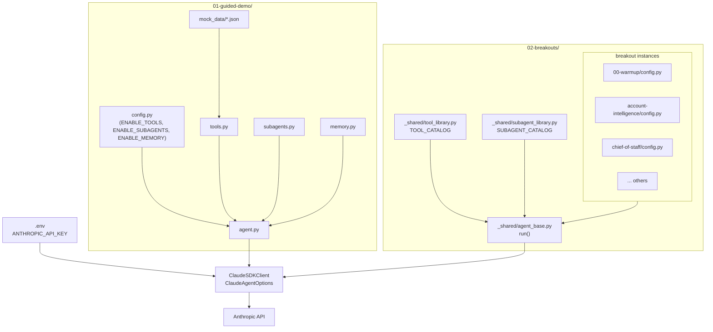
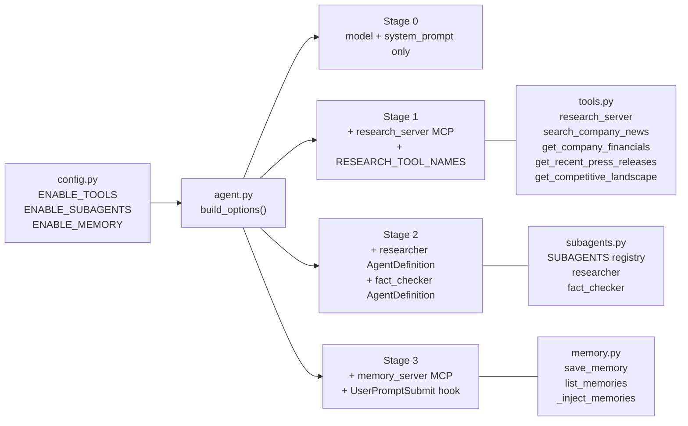
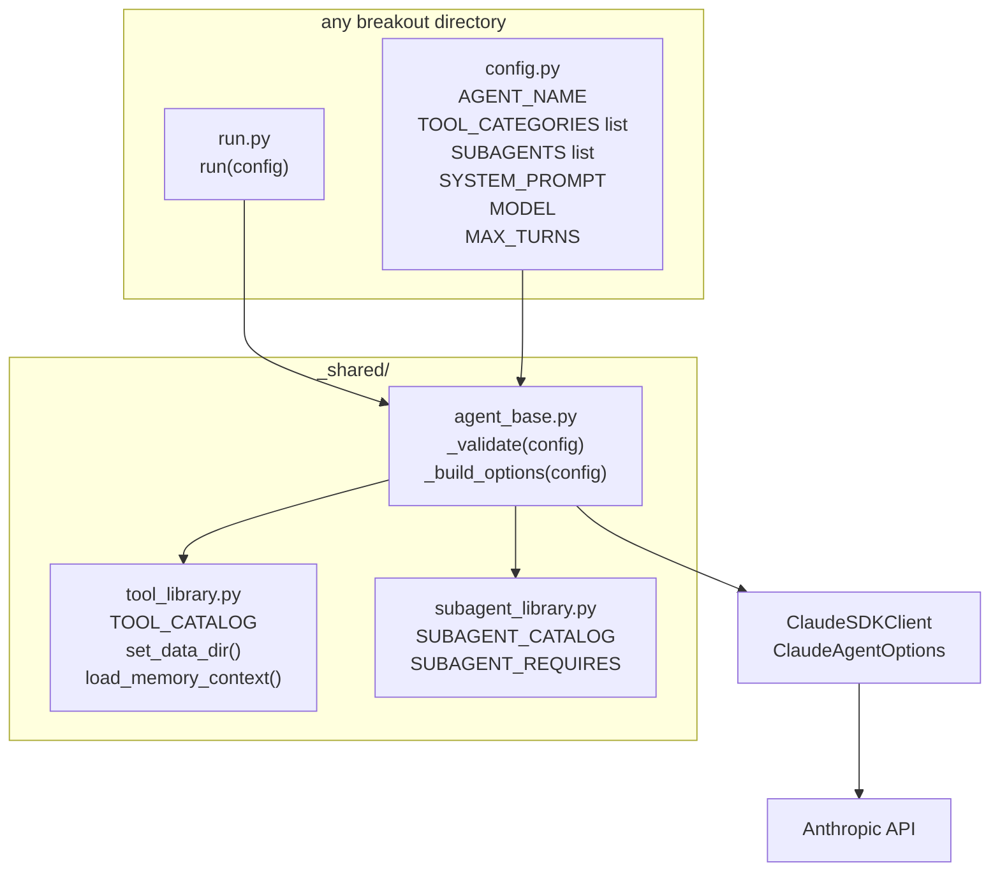

<!-- source: DeepWiki mcp.deepwiki.com · repo anthropics/agent-sdk-workshop · page 1 Overview · fetched 2026-10-26 -->

# Overview

Relevant source files

The following files were used as context for generating this wiki page:

- [.env.example](.env.example)
- [01-guided-demo/README.md](01-guided-demo/README.md)
- [02-breakouts/README.md](02-breakouts/README.md)

This page describes the purpose and high-level structure of the `agent-sdk-workshop` repository. It covers what the workshop teaches, the two independent but related sections it contains, and how those sections share common infrastructure. For setup instructions, see [Getting Started](#1.1). For section-specific details, see [01-guided-demo](#2) and [02-breakouts](#3).

---

## Purpose

The repository is a hands-on workshop for learning to build AI agents using the Claude Agent SDK (`claude_agent_sdk`). It is organized around a single central concept: progressively assembling agent capabilities by combining tools, sub-agents, and memory — without writing new application logic.

The two sections approach this from different angles:

| Section | Style | Participant action |
|---|---|---|
| `01-guided-demo/` | Guided walkthrough | Flip boolean flags in `config.py`, observe behavior changes |
| `02-breakouts/` | Self-directed assembly | Select tool categories and sub-agents in `config.py`, tune system prompts |

---

## Repository Structure

**Diagram: Top-Level Layout and Entry Points**

Sources: [01-guided-demo/README.md:1-55](), [02-breakouts/README.md:1-73](), [.env.example:1-3]()

---

## 01-guided-demo

The guided demo teaches agent SDK concepts through four progressive stages. All behavior is controlled by three boolean flags in `01-guided-demo/config.py`. The participant flips one flag per run and observes how the agent changes.

**Diagram: Stage Progression and Code Files**

Sources: [01-guided-demo/README.md:20-28]()

The scenario throughout all four stages is the same: preparing a company briefing using fictional companies in `mock_data/`. The three mock companies (`Tinplate Merchant Systems`, `Bucklefern Commerce Holdings`, `Ironvane Freight Systems`) are interlinked — the same people and events appear across company records, giving the fact-checker sub-agent something real to cross-reference.

---

## 02-breakouts

The breakouts section provides a menu of pre-built components. Each breakout is a directory containing a `run.py` (do not edit), a `config.py` (edit this), and a `data/` directory of mock JSON. All breakouts delegate execution to `_shared/agent_base.py`.

**Diagram: Breakout Config-to-SDK Translation**

Sources: [02-breakouts/README.md:24-38]()

Available breakouts:

| Directory | Scenario |
|---|---|
| `00-warmup/` | Company briefing — mirrors the guided demo, eases the transition |
| `chief-of-staff/` | Meeting prep, email drafting, exec briefings |
| `customer-support/` | Ticket triage, KB-grounded responses, escalation |
| `sre-agent/` | Incident investigation, runbook execution |
| `account-intelligence/` | Pre-renewal account review, churn risk detection |
| `freeform/` | Blank canvas with the full component library |

The selectable components in any breakout's `config.py` come from two catalogs:

| Catalog | Variable | Options |
|---|---|---|
| `tool_library.py` | `TOOL_CATALOG` | `schedule`, `knowledge`, `support`, `ops`, `code`, `memory` |
| `subagent_library.py` | `SUBAGENT_CATALOG` | `researcher`, `summarizer`, `classifier`, `verifier`, `writer`, `procedure_runner` |

Sources: [02-breakouts/README.md:44-52]()

---

## How the Two Sections Relate

Both sections use the same underlying SDK types (`ClaudeSDKClient`, `ClaudeAgentOptions`) and the same pattern for wiring configuration into an agent. The guided demo expresses this pattern in `01-guided-demo/agent.py:build_options()`. The breakouts system expresses the same pattern in `02-breakouts/_shared/agent_base.py:_build_options()`. Comparing these two functions is the most direct way to understand what the SDK wiring looks like at different levels of abstraction.

The intended path through the workshop is: complete all four stages of the guided demo, then move to a breakout.

Sources: [01-guided-demo/README.md:54-55](), [02-breakouts/README.md:72-73]()

---

