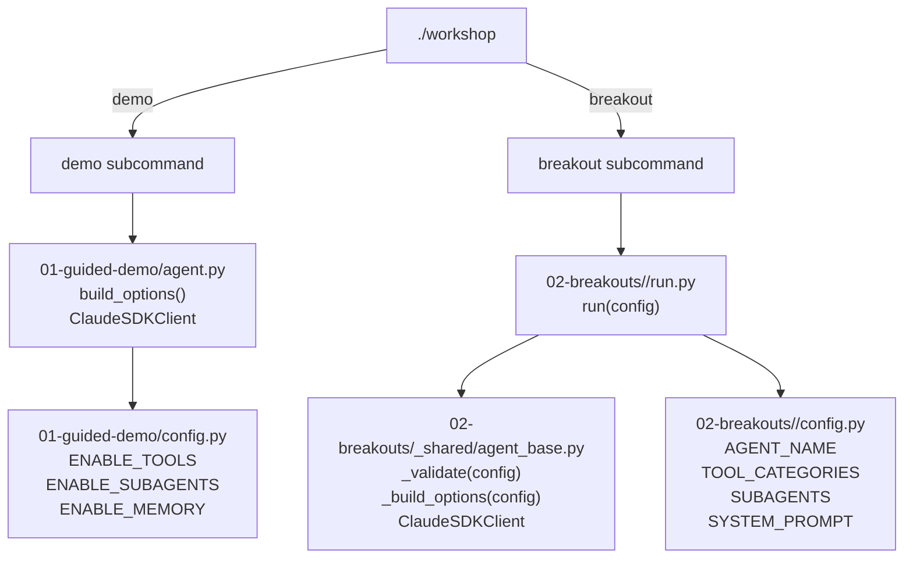
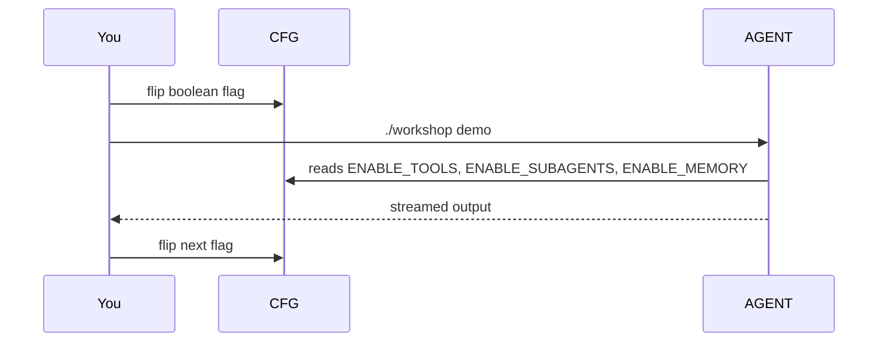
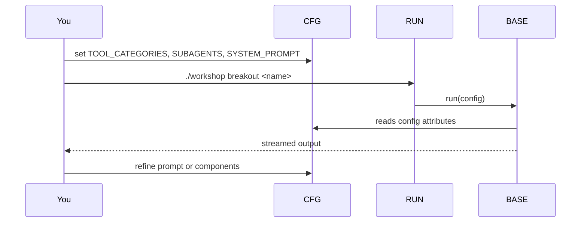

<!-- source: DeepWiki mcp.deepwiki.com · repo anthropics/agent-sdk-workshop · page 1.1 Getting Started · fetched 2026-10-26 -->

# Getting Started

<details>
<summary>Relevant source files</summary>

The following files were used as context for generating this wiki page:

- [.env.example](.env.example)
- [.gitignore](.gitignore)
- [01-guided-demo/README.md](01-guided-demo/README.md)
- [02-breakouts/README.md](02-breakouts/README.md)

</details>


This page covers environment setup, the `.env` configuration, what the `.gitignore` excludes and why, and how to invoke the two main entry points. For a conceptual overview of the repository's two sections and how they relate, see [Overview](#1). For the guided demo in detail, see [01-guided-demo](#2). For the breakouts system, see [02-breakouts](#3).

---

## Prerequisites

| Requirement | Notes |
|---|---|
| Python 3.x | With a working virtual environment |
| Anthropic API key | Obtainable from the Anthropic console |

---

## API Key Configuration

The SDK reads your Anthropic API key from the environment. The repository ships with a template file at [`.env.example`](.env.example:1-3)().

Copy it and fill in your key:

```
cp .env.example .env
```

Then edit `.env`:

```
ANTHROPIC_API_KEY=sk-ant-...
```

Both `01-guided-demo/agent.py` and `02-breakouts/_shared/agent_base.py` pass through to `ClaudeSDKClient`, which reads `ANTHROPIC_API_KEY` from the environment at runtime. Neither file hard-codes credentials.

Sources: [`.env.example:1-3`](.env.example:1-3)()

---

## What `.gitignore` Excludes

[`.gitignore`](.gitignore:1-32)() excludes three categories of files that workshop participants should never commit:

| Category | Pattern(s) | Reason |
|---|---|---|
| Python build artifacts | `__pycache__/`, `*.py[cod]`, `*.egg-info/`, `dist/`, `build/` | Not part of source |
| Virtual environments | `.env`, `.venv`, `env/`, `venv/` | Per-machine; also hides the `.env` secrets file |
| Editor settings | `.vscode/`, `.idea/`, `*.swp`, `*.swo`, `.DS_Store` | Local preferences |
| Claude Code local settings | `.claude/settings.local.json` | Per-user Claude Code configuration |
| Workshop runtime state | `**/memory_store.json` | Each attendee's memory store is personal and accumulates across runs |

The `**/memory_store.json` glob is the most workshop-specific exclusion. The memory system (used in Stage 3 of the guided demo and the `memory` tool category in breakouts) writes persistent state to a `memory_store.json` file. Each participant accumulates their own memories; sharing them across machines would contaminate results.

Sources: [`.gitignore:1-32`](.gitignore:1-32)()

---

## Entry Points

There are two commands, both invoked from the repository root via the `./workshop` script.

**Entry Point to Code Entity Mapping**



Sources: [`01-guided-demo/README.md:9`](01-guided-demo/README.md:9)(), [`02-breakouts/README.md:38`](02-breakouts/README.md:38)()

### `./workshop demo`

Runs the guided demo. This executes `01-guided-demo/agent.py`, which reads its behavior from `01-guided-demo/config.py`.

The only file you edit between runs is `config.py`. Three boolean flags gate each stage:

| Flag | Effect when `True` |
|---|---|
| `ENABLE_TOOLS` | Attaches the research MCP server; the SDK runs an agentic loop |
| `ENABLE_SUBAGENTS` | Adds `researcher` and `fact_checker` sub-agents via `AgentDefinition` |
| `ENABLE_MEMORY` | Attaches the memory MCP server and registers the `UserPromptSubmit` hook |

For full stage-by-stage documentation, see [Progressive Stages & Configuration](#2.1).

### `./workshop breakout <name>`

Runs a specific breakout by name (e.g., `./workshop breakout account-intelligence`). This executes the corresponding `02-breakouts/<name>/run.py`, which calls the shared runner `_shared/agent_base.py` with the breakout's `config.py` module.

Available breakout names:

| Name | Use case |
|---|---|
| `00-warmup` | Company briefing — transition from the guided demo |
| `chief-of-staff` | Meeting prep, email drafting, exec briefings |
| `customer-support` | Ticket triage, KB-grounded responses |
| `sre-agent` | Incident investigation, runbook execution |
| `account-intelligence` | Pre-renewal account review, churn risk detection |
| `freeform` | Blank canvas with the full component library |

Sources: [`02-breakouts/README.md:13-21`](02-breakouts/README.md:13-21)()

---

## The Edit-Run Cycle

**Guided Demo cycle:**



**Breakout cycle:**



Sources: [`01-guided-demo/README.md:8-13`](01-guided-demo/README.md:8-13)(), [`02-breakouts/README.md:56-63`](02-breakouts/README.md:56-63)()

---

## Quick-Start Checklist

1. Copy `.env.example` to `.env` and set `ANTHROPIC_API_KEY`.
2. Activate your Python virtual environment.
3. Run `./workshop demo` to execute Stage 0 of the guided demo.
4. Open `01-guided-demo/config.py`, set `ENABLE_TOOLS = True`, re-run.
5. Continue through all four stages.
6. When done, run `./workshop breakout 00-warmup` to begin the breakouts.

Sources: [`01-guided-demo/README.md:8-13`](01-guided-demo/README.md:8-13)(), [`02-breakouts/README.md:55-63`](02-breakouts/README.md:55-63)(), [`.env.example:1-3`](.env.example:1-3)()

---

