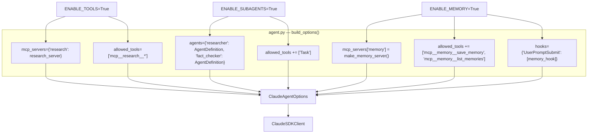
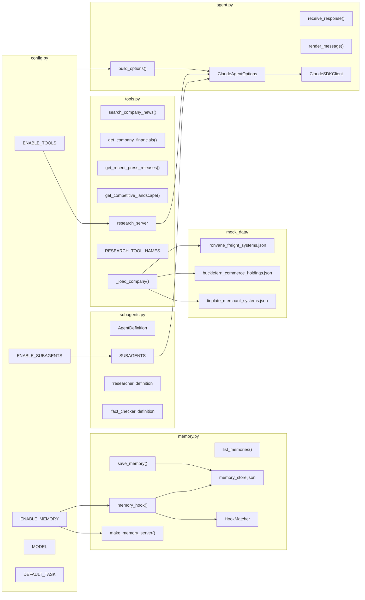

<!-- source: DeepWiki mcp.deepwiki.com · repo anthropics/agent-sdk-workshop · page 2 01-guided-demo · fetched 2026-10-26 -->

# 01-guided-demo

<details>
<summary>Relevant source files</summary>

The following files were used as context for generating this wiki page:

- [01-guided-demo/GUIDE.md](01-guided-demo/GUIDE.md)
- [01-guided-demo/README.md](01-guided-demo/README.md)
- [01-guided-demo/config.py](01-guided-demo/config.py)

</details>


This section documents the **guided demo** portion of the workshop (`01-guided-demo/`). Its purpose is to teach Claude SDK concepts progressively by running the same company-briefing agent four times, adding one SDK primitive per run. The only file participants edit is `config.py`.

For documentation of the self-directed assembly environment, see [02-breakouts](#3). For repository setup and invocation commands, see [Getting Started](#1.1).

---

## Scenario

The demo uses a single recurring task: prepare a company briefing before a meeting. Three fictional companies are available as targets:

| Company | Profile |
|---|---|
| **Tinplate Merchant Systems** | Mid-market fintech, high growth, not yet profitable |
| **Bucklefern Commerce Holdings** | Mature public company, growth slowing |
| **Ironvane Freight Systems** | Supply chain software, recent leadership change |

The mock data is intentionally interlinked — for example, Ironvane's departing CPO appears in Tinplate's hiring news — giving the fact-checker sub-agent something meaningful to verify across sources.

Sources: [01-guided-demo/README.md:33-38](), [01-guided-demo/GUIDE.md:1-6]()

---

## How to Run

```
./workshop demo
```

Run this command from the repo root at each stage. The default task is defined in `DEFAULT_TASK` in `config.py` and targets Tinplate Merchant Systems, but you can override it at the prompt.

To inspect the full assembled system context sent to the model at any stage:

```
./workshop demo --show-prompt
```

Sources: [01-guided-demo/README.md:8-11](), [01-guided-demo/GUIDE.md:283-284]()

---

## The Four-Stage Progression

Participants flip one boolean flag at a time in `config.py`. Each flag is additive — earlier stages stay enabled.

| Stage | Flag(s) Active | SDK Primitive Introduced | Capability Gained |
|---|---|---|---|
| 0 | *(all `False`)* | `ClaudeSDKClient` + `system_prompt` | Baseline chat only |
| 1 | `ENABLE_TOOLS` | `@tool` + `create_sdk_mcp_server` | Agent can look up company data |
| 2 | `ENABLE_SUBAGENTS` | `AgentDefinition` + `Task` tool | Agent delegates to specialist sub-agents |
| 3 | `ENABLE_MEMORY` | `hooks` + persistence tool | Agent remembers preferences across runs |

Sources: [01-guided-demo/config.py:12-62](), [01-guided-demo/README.md:22-27](), [01-guided-demo/GUIDE.md:15-274]()

---

## File Structure

| File | Role | Participants edit? |
|---|---|---|
| `config.py` | Three boolean toggles + `MODEL`, `VERBOSITY`, `DEFAULT_TASK` | **Yes** |
| `agent.py` | Entry point; `build_options()` assembles `ClaudeAgentOptions` | No (read it) |
| `tools.py` | `@tool`-decorated research functions + `create_sdk_mcp_server()` | Peek at Stage 1 |
| `subagents.py` | `AgentDefinition` specs for researcher and fact_checker | Peek at Stage 2 |
| `memory.py` | `save_memory` tool + `UserPromptSubmit` hook | Peek at Stage 3 |
| `mock_data/*.json` | Fictional company data (Tinplate, Bucklefern, Ironvane) | No |
| `GUIDE.md` | Stage-by-stage walkthrough with expected console output | No (read it) |

Sources: [01-guided-demo/README.md:42-52]()

---

## Configuration Parameters

All configuration lives in [01-guided-demo/config.py]().

| Parameter | Type | Default | Description |
|---|---|---|---|
| `ENABLE_TOOLS` | `bool` | `False` | Adds `research_server` and research tool allowlist |
| `ENABLE_SUBAGENTS` | `bool` | `False` | Adds `researcher` and `fact_checker` agent definitions |
| `ENABLE_MEMORY` | `bool` | `False` | Adds `memory_server` and `UserPromptSubmit` hook |
| `MODEL` | `str` | `"claude-sonnet-4-6"` | Claude model identifier passed to `ClaudeAgentOptions` |
| `VERBOSITY` | `str` | `"verbose"` | Controls tool call and cost display in console |
| `DEFAULT_TASK` | `str` | Tinplate briefing request | Pre-filled prompt; can be overridden at runtime |

Sources: [01-guided-demo/config.py:12-84]()

---

## Stage Diagram: Flags to SDK Options

**Diagram: How config.py flags map to ClaudeAgentOptions fields**



Sources: [01-guided-demo/GUIDE.md:36-48](), [01-guided-demo/GUIDE.md:81-99](), [01-guided-demo/GUIDE.md:152-166](), [01-guided-demo/GUIDE.md:229-258]()

---

## Stage 0 — Basic Chat

All flags are `False`. `build_options()` returns a `ClaudeAgentOptions` with only `model` and `system_prompt` set. `mcp_servers` is empty, `allowed_tools` is empty, `agents` is `None`, `hooks` is `None`.

The SDK handles connection and streaming, but there is no agentic loop because there are no tools to call. The model responds once from training knowledge. Responses are often hedged with phrases like "as of my training data."

**What to observe:** Ask for specific Q4 revenue figures — the agent cannot answer with confidence.

Sources: [01-guided-demo/GUIDE.md:15-50]()

---

## Stage 1 — Tools

**Flag:** `ENABLE_TOOLS = True`

`build_options()` adds:
- `mcp_servers={"research": research_server}` — the MCP server bundling research tools from `tools.py`
- `allowed_tools` populated with `RESEARCH_TOOL_NAMES` (four `mcp__research__*` entries)

The SDK now runs a real agentic loop: the model receives tool schemas, decides which tools to call, the SDK executes them locally (in-process, reading from `mock_data/*.json`), results return to the model, and the loop continues until the model produces a final response.

Console output shows yellow `→ calling ...` lines for each tool invocation.

**What to observe:** Same briefing request as Stage 0. Tool calls are visible; the output contains specific dates and dollar figures from mock data.

Sources: [01-guided-demo/GUIDE.md:52-119]()

---

## Stage 2 — Sub-agents

**Flag:** `ENABLE_SUBAGENTS = True` (requires `ENABLE_TOOLS = True`)

`build_options()` adds:
- `agents={"researcher": AgentDefinition(...), "fact_checker": AgentDefinition(...)}` from `subagents.py`
- `"Task"` appended to `allowed_tools`

When the main agent calls `Task(subagent_type="researcher", prompt="...")`, the SDK:
1. Starts an isolated conversation with the sub-agent's system prompt
2. The sub-agent runs its own tool calls in its own context window
3. Only the sub-agent's final answer is returned to the main agent

The main agent's context window does not accumulate the sub-agent's intermediate steps.

**What to observe:** `Task` tool calls appear in the console. The benefit is clearest on comparison requests (e.g., Tinplate vs. Bucklefern), where the main agent can delegate parallel research tasks.

**Main agent vs. sub-agent comparison:**

| Dimension | Main agent | Sub-agent |
|---|---|---|
| Defined by | `ClaudeAgentOptions` in `agent.py` | `AgentDefinition` in `subagents.py` |
| Invoked by | Caller via `client.query()` | Main agent via `Task(...)` |
| Context window | Shared across turns | Isolated per invocation |
| Sees conversation history | Yes | No — only the `Task` prompt |
| Return value | Streams to caller | Single message to main agent |

Sources: [01-guided-demo/GUIDE.md:122-191]()

---

## Stage 3 — Memory

**Flag:** `ENABLE_MEMORY = True`

`build_options()` adds two complementary pieces:

**Write path (tool):** `make_memory_server()` from `memory.py` is added to `mcp_servers["memory"]`. The agent can call `mcp__memory__save_memory(category, note)` to persist a note to `memory_store.json`.

**Read path (hook):** `hooks={"UserPromptSubmit": [memory_hook]}`. This hook fires automatically before each user message is sent to the model. It reads `memory_store.json` and injects entries as `additionalContext` into the system context. The model sees stored memories as if they had been stated in the current session.

**Tool vs. hook comparison:**

| Dimension | Tool | Hook |
|---|---|---|
| Who triggers it | The model, mid-turn | The SDK, on lifecycle events |
| Model aware of it | Yes — listed in tool schemas | No — invisible to the model |
| When it fires | When the model decides | Fixed events: `UserPromptSubmit`, `PreToolUse`, `PostToolUse`, `Stop`, etc. |
| Use cases | Capabilities the agent needs | Guardrails, context injection, audit logging |

`memory_store.json` persists across terminal restarts. Run `./workshop reset` to clear it.

Sources: [01-guided-demo/GUIDE.md:193-273]()

---

## Code Entity Map

**Diagram: Source files and their primary code entities**



Sources: [01-guided-demo/agent.py](), [01-guided-demo/tools.py](), [01-guided-demo/subagents.py](), [01-guided-demo/memory.py](), [01-guided-demo/config.py]()

---

## Stretch Goals (from `config.py`)

The bottom of `config.py` documents several experiments participants can try between stages:

[01-guided-demo/config.py:88-115]()

Notable suggestions:
- Ask about a company not in `mock_data/` (e.g., "Apple") to observe how the agent handles missing data
- Compare two companies to trigger parallel sub-agent spawning
- Set `VERBOSITY = "normal"` to see how much information is suppressed
- Swap `MODEL` to `"claude-opus-4-6"` and compare output quality
- Use `./workshop demo --show-prompt` at each stage to inspect the growing system context
- Run `./workshop reset` to clear `memory_store.json` and observe the agent's behavior on next run

---

