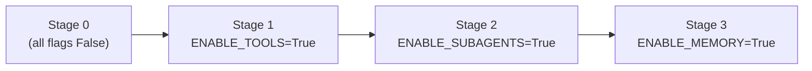
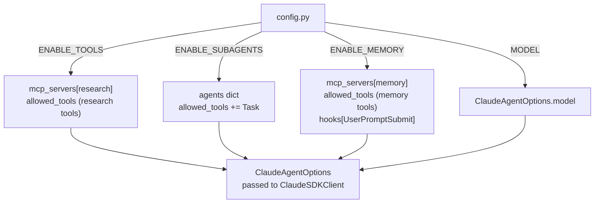
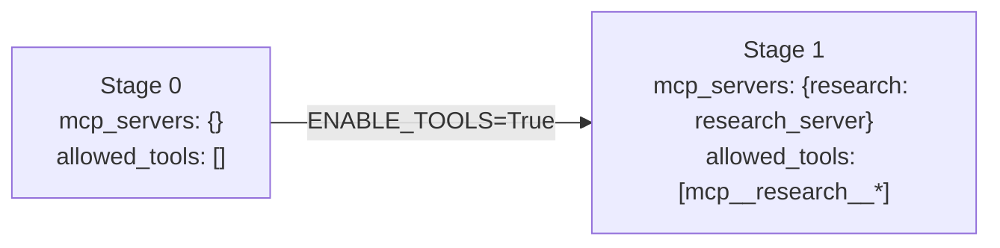
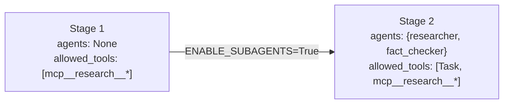
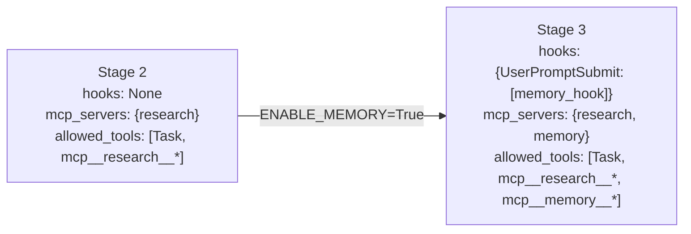
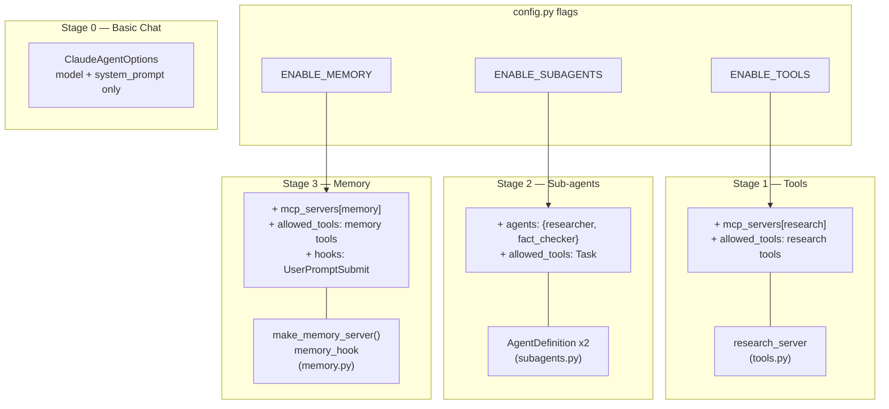

<!-- source: DeepWiki mcp.deepwiki.com · repo anthropics/agent-sdk-workshop · page 2.1 Progressive Stages & Configuration · fetched 2026-10-26 -->

# Progressive Stages & Configuration

Relevant source files

The following files were used as context for generating this wiki page:

- [01-guided-demo/GUIDE.md](01-guided-demo/GUIDE.md)
- [01-guided-demo/README.md](01-guided-demo/README.md)
- [01-guided-demo/config.py](01-guided-demo/config.py)

This page documents the four-stage progression in `01-guided-demo`, explaining what each stage enables, how the three boolean flags in `config.py` gate each stage, and the full set of configuration parameters available. The stage system exists to teach SDK primitives incrementally — each run uses the same task and the same entry point, but a different capability set.

For the implementation of `build_options()` that reads these flags and assembles `ClaudeAgentOptions`, see [Agent Entry Point](#2.2). For the tools, sub-agents, and memory modules that each stage activates, see [Research Tools](#2.3), [Sub-agents](#2.4), and [Memory System](#2.5).

---

## Configuration File

`config.py` is the **only file participants edit** during the guided demo. It contains three stage-gating boolean flags and three secondary parameters.

[01-guided-demo/config.py:1-85]()

| Parameter | Type | Default | Purpose |
|---|---|---|---|
| `ENABLE_TOOLS` | `bool` | `False` | Gates Stage 1 — wires research MCP server into agent options |
| `ENABLE_SUBAGENTS` | `bool` | `False` | Gates Stage 2 — adds `AgentDefinition` entries and `Task` tool |
| `ENABLE_MEMORY` | `bool` | `False` | Gates Stage 3 — adds memory MCP server and `UserPromptSubmit` hook |
| `MODEL` | `str` | `"claude-sonnet-4-6"` | Claude model identifier passed to `ClaudeAgentOptions` |
| `VERBOSITY` | `str` | `"verbose"` | Controls console output: `"normal"` or `"verbose"` |
| `DEFAULT_TASK` | `str` | Tinplate briefing request | Pre-filled task prompt used when the user presses Enter at the prompt |

Sources: [01-guided-demo/config.py:13-84]()

---

## Stage Overview

The four stages are additive. Each stage keeps everything from the prior stages and adds exactly one new SDK primitive. The same `./workshop demo` command is run each time; only `config.py` changes.

**Stage progression diagram:**

**Mapping flags to SDK options populated in `build_options()`:**

Sources: [01-guided-demo/config.py:13-62](), [01-guided-demo/GUIDE.md:1-50]()

---

## Stage 0 — Basic Chat

**Flags:** all `False`

**SDK primitive:** `ClaudeSDKClient` + `system_prompt`

With all flags off, `build_options()` in `agent.py` returns a `ClaudeAgentOptions` with only `model` and `system_prompt` set. `mcp_servers` is an empty dict, `allowed_tools` is an empty list, `agents` is `None`, and `hooks` is `None`.

There is no agentic loop at this stage — the model has no tools to call, so it responds once and terminates. Output is drawn entirely from training data, which means it may be vague or hedged when asked about specific recent events.

**`ClaudeAgentOptions` at Stage 0:**

| Field | Value |
|---|---|
| `model` | `config.MODEL` |
| `system_prompt` | `BASE_SYSTEM_PROMPT` |
| `mcp_servers` | `{}` |
| `allowed_tools` | `[]` |
| `agents` | `None` |
| `hooks` | `None` |

Sources: [01-guided-demo/GUIDE.md:15-50]()

---

## Stage 1 — Tools

**Flags:** `ENABLE_TOOLS = True`

**SDK primitive:** `@tool` decorator + `create_sdk_mcp_server()`

Setting `ENABLE_TOOLS = True` causes `build_options()` to populate two new fields in `ClaudeAgentOptions`:

- `mcp_servers={"research": research_server}` — the MCP server built from `tools.py`
- `allowed_tools` — a list of the four research tool names using the `mcp__research__<name>` convention

The SDK now runs a real agentic loop: the model sees the tool schemas, decides which tools to call, the SDK executes them locally (in-process, no subprocess), results return to the model, and the loop continues until the model has what it needs.

**Tools added at Stage 1:**

| Tool name (in `allowed_tools`) | Function in `tools.py` |
|---|---|
| `mcp__research__search_company_news` | `search_company_news` |
| `mcp__research__get_company_financials` | `get_company_financials` |
| `mcp__research__get_recent_press_releases` | `get_recent_press_releases` |
| `mcp__research__get_competitive_landscape` | `get_competitive_landscape` |

**`ClaudeAgentOptions` delta at Stage 1:**

Sources: [01-guided-demo/GUIDE.md:53-101](), [01-guided-demo/config.py:13-26]()

---

## Stage 2 — Sub-agents

**Flags:** `ENABLE_TOOLS = True`, `ENABLE_SUBAGENTS = True`

**SDK primitive:** `AgentDefinition` + `Task` tool

> Requires `ENABLE_TOOLS = True` — sub-agents need tools to be useful. [01-guided-demo/config.py:44]()

Setting `ENABLE_SUBAGENTS = True` adds `agents` to `ClaudeAgentOptions` and appends `"Task"` to `allowed_tools`. Two `AgentDefinition` instances are registered: `researcher` and `fact_checker`.

When the main agent calls `Task(subagent_type="researcher", prompt="...")`, the SDK:
1. Spins up an isolated conversation using the sub-agent's `prompt` (system prompt)
2. Runs the sub-agent with its own `tools` allowlist and optional `model` override
3. Returns only the final answer to the main agent's context

This keeps the main agent's context window clean — it sees summarized findings, not all intermediate tool calls.

**Sub-agents added at Stage 2:**

| Sub-agent key | Defined in | Model | Purpose |
|---|---|---|---|
| `researcher` | `subagents.py` | `haiku` | Deep information gathering using research tools |
| `fact_checker` | `subagents.py` | `haiku` | Cross-references claims before they appear in the briefing |

**`ClaudeAgentOptions` delta at Stage 2:**

Sources: [01-guided-demo/GUIDE.md:122-190](), [01-guided-demo/config.py:29-45]()

---

## Stage 3 — Memory

**Flags:** `ENABLE_TOOLS = True`, `ENABLE_SUBAGENTS = True`, `ENABLE_MEMORY = True`

**SDK primitive:** `hooks` + memory persistence tool

Setting `ENABLE_MEMORY = True` adds two complementary pieces:

**Write path (tool):** `make_memory_server()` from `memory.py` is added to `mcp_servers["memory"]`. Two tool names are appended to `allowed_tools`: `mcp__memory__save_memory` and `mcp__memory__list_memories`. The model calls `save_memory` when it decides something is worth persisting.

**Read path (hook):** A `UserPromptSubmit` hook is registered via `hooks={"UserPromptSubmit": [memory_hook]}`. This hook fires automatically before every user message is sent to the model. It reads `memory_store.json` and returns `additionalContext` that the SDK injects into the system context. The model never sees the hook itself — it just sees the memory text as if it were part of the prompt.

**Comparison of tools vs. hooks:**

| | Tool | Hook |
|---|---|---|
| **Who triggers it** | The model, mid-turn | The SDK, on lifecycle events |
| **Model aware of it?** | Yes — it appears in the tool list | No — invisible to the model |
| **When it fires** | Whenever the model calls it | Fixed event: `UserPromptSubmit`, `PreToolUse`, etc. |
| **Memory role** | Model *writes* memories via `save_memory` | SDK *reads* and injects memories before each turn |

**`ClaudeAgentOptions` delta at Stage 3:**

**Full accumulated `ClaudeAgentOptions` at Stage 3:**

| Field | Value |
|---|---|
| `model` | `config.MODEL` |
| `system_prompt` | `BASE_SYSTEM_PROMPT` |
| `mcp_servers` | `{"research": research_server, "memory": memory_server}` |
| `allowed_tools` | `["Task", "mcp__research__*", "mcp__memory__save_memory", "mcp__memory__list_memories"]` |
| `agents` | `{"researcher": AgentDefinition(...), "fact_checker": AgentDefinition(...)}` |
| `hooks` | `{"UserPromptSubmit": [memory_hook]}` |

Sources: [01-guided-demo/GUIDE.md:193-275](), [01-guided-demo/config.py:49-62]()

---

## Full Stage Comparison

Sources: [01-guided-demo/config.py:1-85](), [01-guided-demo/GUIDE.md:1-291](), [01-guided-demo/README.md:1-55]()

---

## Secondary Configuration Parameters

### `MODEL`

[01-guided-demo/config.py:72]()

Passed directly to `ClaudeAgentOptions(model=...)`. The default `"claude-sonnet-4-6"` balances speed and cost for workshop use. Swap to `"claude-opus-4-6"` to compare output quality at any stage.

### `VERBOSITY`

[01-guided-demo/config.py:77]()

Consumed by `agent.py`'s `render_message()` function. Two values:

| Value | Output |
|---|---|
| `"verbose"` | Agent text + tool call/result lines + cost breakdown |
| `"normal"` | Agent text responses only |

### `DEFAULT_TASK`

[01-guided-demo/config.py:81-84]()

The prompt pre-filled when the user presses Enter at the interactive prompt. Defaults to a briefing request for Tinplate Merchant Systems. Can be overridden at runtime without editing `config.py`.

Sources: [01-guided-demo/config.py:65-84](), [01-guided-demo/GUIDE.md:284-290]()

---

