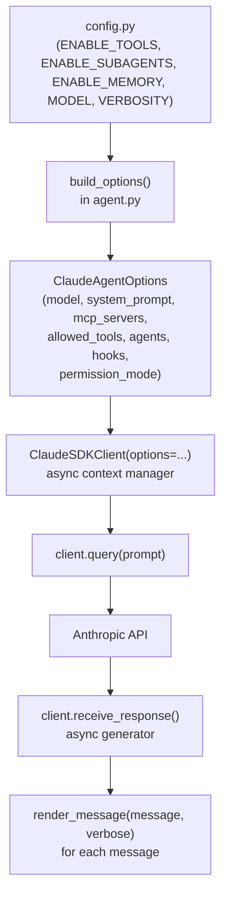
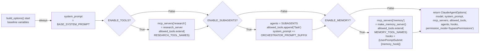
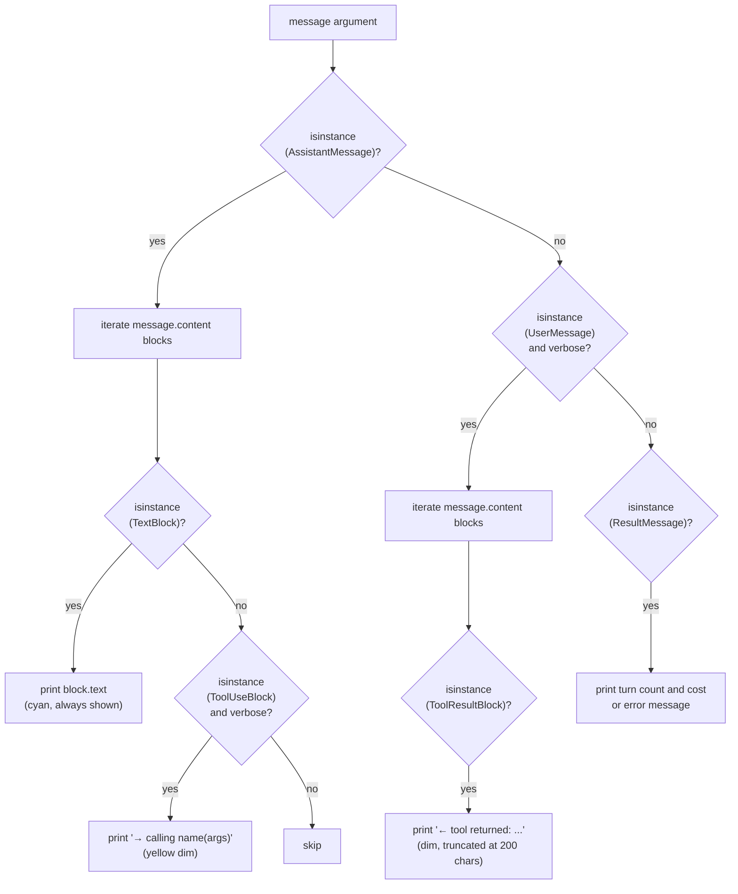

<!-- source: DeepWiki mcp.deepwiki.com · repo anthropics/agent-sdk-workshop · page 2.2 Agent Entry Point · fetched 2026-10-26 -->

# Agent Entry Point

<details>
<summary>Relevant source files</summary>

The following files were used as context for generating this wiki page:

- [01-guided-demo/GUIDE.md](01-guided-demo/GUIDE.md)
- [01-guided-demo/agent.py](01-guided-demo/agent.py)
- [01-guided-demo/config.py](01-guided-demo/config.py)

</details>


This page documents `01-guided-demo/agent.py` — the single entry point for all four demo stages. It covers the `build_options()` function, the `ClaudeSDKClient` lifecycle, the `receive_response()` streaming loop, the `--show-prompt` debug flag, and the `render_message()` console rendering logic.

For the boolean flags that control which stage is active, see the [Progressive Stages & Configuration](#2.1) page. For the tools wired in at Stage 1, see [Research Tools](#2.3). For sub-agent definitions, see [Sub-agents](#2.4). For the memory hook, see [Memory System](#2.5).

---

## Role in the Demo

`agent.py` is intentionally not edited by workshop participants. Its job is to read the three boolean flags from `config.py` and translate them into a fully assembled `ClaudeAgentOptions` object, then hand it to `ClaudeSDKClient` and render the resulting event stream. Every stage change in `config.py` is expressed as a different `ClaudeAgentOptions` value — `agent.py` is the function that computes that mapping.

**Diagram: Data flow from config flags to the running agent**



Sources: [01-guided-demo/agent.py:200-415]()

---

## `build_options()`

[01-guided-demo/agent.py:200-286]()

`build_options()` is the pedagogical core of the demo. It starts from a fixed baseline and conditionally mutates four variables — `mcp_servers`, `allowed_tools`, `agents`, and `hooks` — before constructing and returning a `ClaudeAgentOptions`.

### Baseline (always present)

```
system_prompt = BASE_SYSTEM_PROMPT
allowed_tools = []
mcp_servers   = {}
agents        = None
hooks         = None
```

`BASE_SYSTEM_PROMPT` [01-guided-demo/agent.py:45-56]() is a static string that instructs the model to act as a company briefing assistant. It never changes between stages.

### Stage 1 — `ENABLE_TOOLS`

[01-guided-demo/agent.py:226-228]()

```
mcp_servers["research"] = research_server
allowed_tools.extend(RESEARCH_TOOL_NAMES)
```

`research_server` is an MCP server object imported from `tools.py`. `RESEARCH_TOOL_NAMES` is a list of fully-qualified tool name strings (e.g. `"mcp__research__search_company_news"`). Both steps are required: registering the server makes the tool logic available, but listing the names in `allowed_tools` is what authorizes the model to call them.

### Stage 2 — `ENABLE_SUBAGENTS`

[01-guided-demo/agent.py:239-251]()

```
agents = SUBAGENTS
allowed_tools.append("Task")
system_prompt += ORCHESTRATOR_PROMPT_SUFFIX
```

`SUBAGENTS` is a `dict[str, AgentDefinition]` imported from `subagents.py`. Adding `"Task"` to `allowed_tools` gives the main agent the built-in SDK tool that spawns sub-agents. `ORCHESTRATOR_PROMPT_SUFFIX` nudges the system prompt toward delegation behavior.

There is a soft dependency guard: if `ENABLE_SUBAGENTS` is `True` but `ENABLE_TOOLS` is `False`, a warning is printed because the sub-agents themselves have no tools to use.

### Stage 3 — `ENABLE_MEMORY`

[01-guided-demo/agent.py:262-272]()

```
mcp_servers["memory"] = make_memory_server()
allowed_tools.extend(MEMORY_TOOL_NAMES)
hooks = {"UserPromptSubmit": [memory_hook]}
system_prompt += "..."   # instructions to use save_memory
```

`make_memory_server()` is called fresh each time to create the MCP server object containing the `save_memory` and `list_memories` tools. `memory_hook` is a `HookMatcher` that fires on every `UserPromptSubmit` event and injects persisted memories as additional context.

### Final construction

[01-guided-demo/agent.py:274-286]()

All four variables are passed to `ClaudeAgentOptions`. `permission_mode="bypassPermissions"` is always set so the agent can invoke tools without per-call approval prompts during the workshop.

**Diagram: `build_options()` conditional assembly**



Sources: [01-guided-demo/agent.py:200-286]()

---

## `ClaudeSDKClient` Lifecycle

[01-guided-demo/agent.py:383-407]()

`ClaudeSDKClient` is used as an `async with` context manager. Opening the context establishes the persistent connection; closing it tears it down cleanly. Using a client object (rather than a one-shot `query()` function) enables:

- **Multi-turn conversations** — the same client retains conversation history across calls to `client.query()`.
- **Hook reliability** — hooks require a client context to fire correctly.

The follow-up loop [01-guided-demo/agent.py:396-407]() reuses the same open client, so each follow-up question accumulates context from prior turns. This is "within-session" memory and works at every stage, regardless of `ENABLE_MEMORY`.

| Behavior | Mechanism |
|---|---|
| Single request | `await client.query(user_prompt)` |
| Multi-turn follow-up | Re-call `await client.query(follow)` on the same open client |
| Conversation context | Maintained by the SDK inside `ClaudeSDKClient` |
| Cross-session persistence | Only when `ENABLE_MEMORY=True` (memory hook + file) |

Sources: [01-guided-demo/agent.py:383-407]()

---

## `receive_response()` Streaming Loop

[01-guided-demo/agent.py:390-407]()

After each call to `client.query()`, the response is consumed by iterating `client.receive_response()`:

```python
async for message in client.receive_response():
    render_message(message, verbose)
```

`receive_response()` is an async generator. It yields messages until the agent's full turn is complete (signaled by a `ResultMessage`). While iterating, the SDK is internally running the agentic loop: deciding tool calls, executing them, feeding results back to the model, and repeating. From `agent.py`'s perspective, the loop is opaque — it only sees the resulting message objects.

**Message types yielded:**

| Type | Content | Displayed when |
|---|---|---|
| `AssistantMessage` | Text blocks and tool-use blocks | Always (text); verbose only (tool calls) |
| `UserMessage` | Tool result blocks | Verbose only |
| `ResultMessage` | Turn summary (turns, cost, error flag) | Always |

Sources: [01-guided-demo/agent.py:390-341]()

---

## `render_message()`

[01-guided-demo/agent.py:294-340]()

`render_message(message, verbose)` handles all console output. It dispatches on the message type using `isinstance` checks.

**Diagram: `render_message()` dispatch logic**



The `verbose` flag is derived from `config.VERBOSITY == "verbose"` [01-guided-demo/agent.py:378](). At `"normal"` verbosity, tool calls and tool results are suppressed, and only the final assistant text and turn summary are printed.

Long tool results are truncated at 200 characters [01-guided-demo/agent.py:326-327]() to keep the console readable.

Sources: [01-guided-demo/agent.py:294-340]()

---

## `--show-prompt` Debug Flag

[01-guided-demo/agent.py:374-376](), [01-guided-demo/agent.py:128-188]()

If `--show-prompt` is passed as a command-line argument, `main()` calls `show_assembled_prompt(options)` and returns before creating a `ClaudeSDKClient`. No API call is made.

`show_assembled_prompt()` prints:

| Section | Source field | Notes |
|---|---|---|
| System prompt | `options.system_prompt` | Full text, dimmed |
| Allowed tools | `options.allowed_tools` | Each on its own line |
| Sub-agents | `options.agents` | Name, description, model, tool count, prompt prefix |
| Hooks | `options.hooks` | Event name and handler count only; injected context is runtime-only |
| Model and permission mode | `options.model`, `options.permission_mode` | Scalar fields |
| MCP server names | `options.mcp_servers.keys()` | Assumes dict (always true in this demo) |

This flag is documented in `GUIDE.md` [01-guided-demo/GUIDE.md:283]() as a way to compare what the SDK assembles at each stage.

Sources: [01-guided-demo/agent.py:128-188](), [01-guided-demo/agent.py:374-376](), [01-guided-demo/GUIDE.md:283-284]()

---

## Supporting Utilities

### `_current_stage()`

[01-guided-demo/agent.py:86-101]()

Derives the current stage number (0–3) from the three config flags and returns a human-readable label and a "next step" hint. Used only by `print_config()` to display orientation information at startup.

| `ENABLE_TOOLS` | `ENABLE_SUBAGENTS` | `ENABLE_MEMORY` | Stage |
|---|---|---|---|
| False | False | False | 0 — Basic Chat |
| True | False | False | 1 — Tools |
| True | True | False | 2 — Sub-agents |
| True | True | True | 3 — Memory & Context |
| (other) | — | — | -1 — Custom |

### `print_config()`

[01-guided-demo/agent.py:104-125]()

Printed at startup. Shows current flag values, derived stage, and the next step hint. Uses the `C` class for ANSI color codes.

### `C` class

[01-guided-demo/agent.py:64-77]()

Holds ANSI escape sequences for terminal coloring. All codes are blanked to empty strings when the environment variable `NO_COLOR=1` is set.

### `banner()`

[01-guided-demo/agent.py:80-83]()

Prints a 70-character cyan horizontal rule with centered text, used as a section header in the terminal output.

Sources: [01-guided-demo/agent.py:64-125]()

---

## `main()` Entry Point

[01-guided-demo/agent.py:348-415]()

`main()` is an `async` function driven by `asyncio.run()`. Its execution order:

1. Print banner and current config via `print_config()`
2. If `ENABLE_MEMORY` is on, load and display the memory summary from `memory_store.json`
3. Prompt the user for input; fall back to `config.DEFAULT_TASK` on empty input
4. Call `build_options()` to assemble `ClaudeAgentOptions`
5. If `--show-prompt` is in `sys.argv`, call `show_assembled_prompt()` and return
6. Open `ClaudeSDKClient` as an async context manager
7. Send the initial prompt via `client.query()`
8. Iterate `client.receive_response()`, passing each message to `render_message()`
9. Enter the follow-up loop, repeating steps 7–8 until the user submits empty input or sends EOF

`KeyboardInterrupt` is caught at the top level [01-guided-demo/agent.py:411-414]() and exits cleanly with a short message.

Sources: [01-guided-demo/agent.py:348-415]()

---

