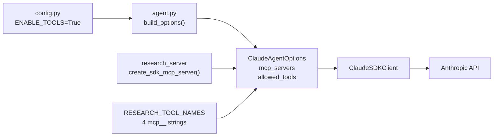
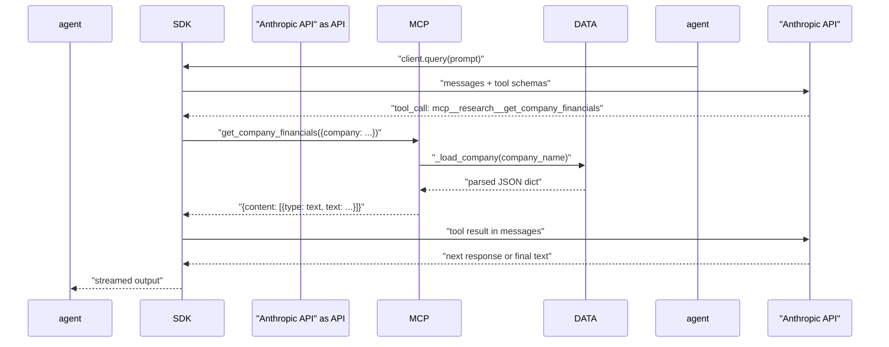

<!-- source: DeepWiki mcp.deepwiki.com · repo anthropics/agent-sdk-workshop · page 2.3 Research Tools · fetched 2026-10-26 -->

# Research Tools

<details>
<summary>Relevant source files</summary>

The following files were used as context for generating this wiki page:

- [01-guided-demo/GUIDE.md](01-guided-demo/GUIDE.md)
- [01-guided-demo/tools.py](01-guided-demo/tools.py)

</details>


This page documents `01-guided-demo/tools.py`: the four research tool functions, how they load mock company data, how they are packaged into an in-process MCP server, and the naming convention that makes tools visible to the model.

This page covers Stage 1 of the guided demo only. For the stage progression and how `ENABLE_TOOLS` activates these tools, see [Progressive Stages & Configuration](#2.1). For the sub-agents that use these tools as part of their allowlist, see [Sub-agents](#2.4). For the mock JSON data these tools read, see [Mock Company Data](#2.6).

---

## Role in the Agent

When `ENABLE_TOOLS = True` in `config.py`, `agent.py` adds `research_server` to `mcp_servers` and populates `allowed_tools` from `RESEARCH_TOOL_NAMES`. The SDK then runs an agentic loop: the model can call these tools mid-conversation, receive results, and continue reasoning before producing a final response.

**Tool activation flow**



Sources: [01-guided-demo/tools.py:231-249](), [01-guided-demo/GUIDE.md:82-99]()

---

## Mock Data Loading

All tools read from static JSON files in `01-guided-demo/mock_data/`. No network calls are made.

### `_load_company()`

[01-guided-demo/tools.py:24-32]()

Performs case-insensitive, punctuation-stripped fuzzy matching against the `"company"` key in every `.json` file in `_DATA_DIR`. The matching normalizes spaces, hyphens, and underscores before comparing. It returns the full parsed dict for the first match, or `None` if no file matches.

```
needle = company_name.lower().strip(spaces/hyphens/underscores)
for each *.json in mock_data/:
    hay = data["company"].lower().strip(spaces)
    match if needle in hay OR hay in needle
```

### `_known_companies()`

[01-guided-demo/tools.py:35-42]()

Returns a sorted list of `"company"` strings from all files in `_DATA_DIR`. Used only in error responses when `_load_company()` returns `None`, to tell the model which companies are available.

Sources: [01-guided-demo/tools.py:17-42]()

---

## Tool Definitions

Each tool is decorated with `@tool` from `claude_agent_sdk`. The decorator takes three positional arguments:

| Argument | Purpose |
|---|---|
| `name` (str) | The tool name the model sees (without the `mcp__research__` prefix) |
| `description` (str) | Tells the model when and why to call this tool |
| `schema` (dict) | `{param_name: python_type}` — SDK converts to JSON Schema |

Every handler is `async`, receives a `dict` of arguments, and must return `{"content": [{"type": "text", "text": "..."}]}`.

**Tool function to data field mapping**

```mermaid
flowchart LR
    subgraph "tools.py — @tool decorated functions"
        T1["search_company_news\nargs: company, topic"]
        T2["get_company_financials\nargs: company"]
        T3["get_recent_press_releases\nargs: company"]
        T4["get_competitive_landscape\nargs: company"]
    end

    LC["_load_company(company_name)\nmock_data/*.json"]

    T1 --> LC
    T2 --> LC
    T3 --> LC
    T4 --> LC

    subgraph "JSON data fields"
        F1["data[\"news\"]\nfiltered by topic if provided"]
        F2["data[\"financials\"]\ndata[\"industry\"]\ndata[\"employees\"]"]
        F3["data[\"press_releases\"]"]
        F4["data[\"competitive_landscape\"]"]
    end

    LC --> F1
    LC --> F2
    LC --> F3
    LC --> F4
```

Sources: [01-guided-demo/tools.py:59-211]()

### `search_company_news`

[01-guided-demo/tools.py:59-103]()

- Parameters: `company` (str), `topic` (str)
- Loads company data, then filters `data["news"]` by matching `topic` against each item's `topics` list (case-insensitive).
- If `topic` is empty, returns all news items.
- Each result includes the item's `date`, `headline`, and `summary`.
- Returns an error string listing known companies if the company is not found.

### `get_company_financials`

[01-guided-demo/tools.py:106-141]()

- Parameter: `company` (str)
- Returns `data["financials"]`, `data["industry"]`, and `data["employees"]` as a JSON-serialized payload.
- The raw JSON is passed back so the model handles formatting — no custom string assembly.

### `get_recent_press_releases`

[01-guided-demo/tools.py:144-181]()

- Parameter: `company` (str)
- Returns all entries from `data["press_releases"]`, formatted with a separator line showing `date` and `title`, followed by the `body` text of each release.

### `get_competitive_landscape`

[01-guided-demo/tools.py:184-211]()

- Parameter: `company` (str)
- Returns `data["competitive_landscape"]` as a JSON-serialized payload alongside the company name.

---

## MCP Server and Naming Convention

[01-guided-demo/tools.py:214-249]()

The four tool functions are bundled into a single in-process MCP server via `create_sdk_mcp_server()`:

```python
research_server = create_sdk_mcp_server(
    name="research",
    version="1.0.0",
    tools=[
        search_company_news,
        get_company_financials,
        get_recent_press_releases,
        get_competitive_landscape,
    ],
)
```

The server runs in the same Python process as the agent — no subprocess, no IPC. Tool functions have direct access to module-level state.

### Naming Convention

When registered in `ClaudeAgentOptions` as `mcp_servers={"research": research_server}`, each tool's model-visible name follows the pattern:

```
mcp__<server_key>__<tool_name>
```

| Tool function | Model-visible name |
|---|---|
| `search_company_news` | `mcp__research__search_company_news` |
| `get_company_financials` | `mcp__research__get_company_financials` |
| `get_recent_press_releases` | `mcp__research__get_recent_press_releases` |
| `get_competitive_landscape` | `mcp__research__get_competitive_landscape` |

### `RESEARCH_TOOL_NAMES`

[01-guided-demo/tools.py:244-249]()

A module-level list of the four fully-qualified tool name strings. Exported so `agent.py` can import it directly rather than hardcoding the names:

```python
RESEARCH_TOOL_NAMES = [
    "mcp__research__search_company_news",
    "mcp__research__get_company_financials",
    "mcp__research__get_recent_press_releases",
    "mcp__research__get_competitive_landscape",
]
```

`agent.py` adds these to `ClaudeAgentOptions.allowed_tools` when `ENABLE_TOOLS` is `True`.

Sources: [01-guided-demo/tools.py:214-249](), [01-guided-demo/GUIDE.md:82-101]()

---

## End-to-End Tool Call Sequence

**Single tool call execution (Stage 1)**



Sources: [01-guided-demo/tools.py:1-249](), [01-guided-demo/GUIDE.md:56-101]()

---

## Error Handling

All four tools follow the same pattern when a company cannot be found: they call `_known_companies()` and return an explanatory string that names the available options. This allows the model to self-correct by retrying with a different company name.

| Condition | Response |
|---|---|
| `_load_company()` returns `None` | Error string: `"No [data type] for '<name>'. Known companies: ..."` |
| Company found but no news for given `topic` | Error string: `"No news matching topic '<topic>' for <company>."` |
| Company found but `press_releases` list is empty | Error string: `"No press releases found for <company>."` |

Sources: [01-guided-demo/tools.py:72-96](), [01-guided-demo/tools.py:115-128](), [01-guided-demo/tools.py:168-175]()

---

