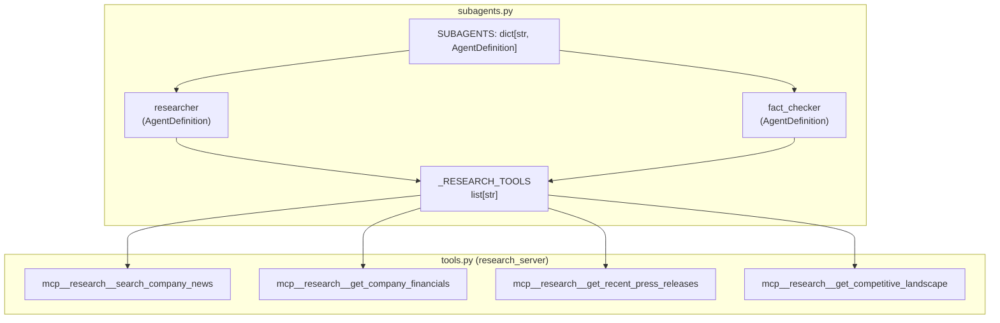
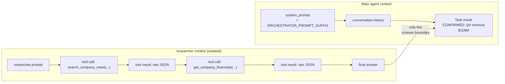
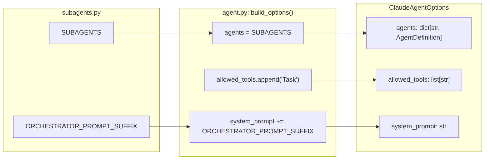

<!-- source: DeepWiki mcp.deepwiki.com · repo anthropics/agent-sdk-workshop · page 2.4 Sub-agents · fetched 2026-10-26 -->

# Sub-agents

<details>
<summary>Relevant source files</summary>

The following files were used as context for generating this wiki page:

- [01-guided-demo/GUIDE.md](01-guided-demo/GUIDE.md)
- [01-guided-demo/agent.py](01-guided-demo/agent.py)
- [01-guided-demo/subagents.py](01-guided-demo/subagents.py)

</details>


This page documents `01-guided-demo/subagents.py`, which defines the two sub-agents used in Stage 2 of the guided demo. It covers the `AgentDefinition` structure, the `SUBAGENTS` registry, the `_RESEARCH_TOOLS` allowlist, the `ORCHESTRATOR_PROMPT_SUFFIX`, and the architectural rationale for context isolation.

For the research tools that sub-agents use, see [Research Tools](#2.3). For how sub-agents are wired into `ClaudeAgentOptions` in `agent.py`, see [Agent Entry Point](#2.2). For the breakouts equivalent — a catalog of reusable sub-agents — see [Sub-agent Library](#3.1.3).

---

## The Sub-agent Model

The Claude SDK enables sub-agents through the built-in `Task` tool. When the main agent calls `Task(subagent_type="researcher", prompt="...")`, the SDK:

1. Spins up a **fresh, isolated conversation** using the named `AgentDefinition`
2. Runs that sub-agent to completion (its own tool calls, its own agentic loop)
3. Returns only the sub-agent's final answer to the main agent's context

The main agent's context window never sees the sub-agent's intermediate steps.

**Diagram: Task Tool Execution Flow**

```mermaid
sequenceDiagram
    participant "Main Agent" as main
    participant "SDK" as sdk
    participant "Sub-agent (researcher)" as sub
    participant "Research Tools" as tools

    main->>"SDK": "Task(subagent_type='researcher', prompt='...')"
    "SDK"->>"Sub-agent (researcher)": "new isolated conversation\n+ sub-agent system prompt\n+ sub-agent tool allowlist"
    loop "Sub-agent agentic loop"
        "Sub-agent (researcher)">>"Research Tools": "tool calls (search_company_news, etc.)"
        "Research Tools">>"Sub-agent (researcher)": "tool results"
    end
    "Sub-agent (researcher)">>"SDK": "final answer only"
    "SDK"->>"Main Agent": "single result message"
```

Sources: [01-guided-demo/subagents.py:1-21](), [01-guided-demo/GUIDE.md:166-184]()

---

## AgentDefinition Structure

Each sub-agent is an instance of `AgentDefinition` from `claude_agent_sdk`. The fields that matter:

| Field | Type | Purpose |
|---|---|---|
| `description` | `str` | Shown to the main agent — tells it *when* to use this sub-agent |
| `prompt` | `str` | The sub-agent's system prompt — defines its role and behavior |
| `tools` | `list[str]` | Tool allowlist — the sub-agent can only call tools listed here |
| `model` | `str \| None` | Optional model override; if `None`, inherits the main agent's model |

Sources: [01-guided-demo/subagents.py:43-83](), [01-guided-demo/GUIDE.md:188-190]()

---

## Tool Allowlist: `_RESEARCH_TOOLS`

[01-guided-demo/subagents.py:31-36]() defines the shared list of tools both sub-agents may call. These are the full `mcp__<server>__<tool>` names produced by the `research_server` MCP server (see [Research Tools](#2.3)):

```
_RESEARCH_TOOLS = [
    "mcp__research__search_company_news",
    "mcp__research__get_company_financials",
    "mcp__research__get_recent_press_releases",
    "mcp__research__get_competitive_landscape",
]
```

Both `researcher` and `fact_checker` receive identical tool access. The difference between them is entirely in their `prompt` and `description` fields — same capabilities, different mandate.

Sources: [01-guided-demo/subagents.py:31-36]()

---

## The SUBAGENTS Registry

`SUBAGENTS` is a `dict[str, AgentDefinition]` defined in [01-guided-demo/subagents.py:43-83](). Its keys become valid values for `subagent_type` in `Task(...)` calls.

**Diagram: SUBAGENTS Registry — Code Entities**



Sources: [01-guided-demo/subagents.py:31-83]()

### `researcher`

[01-guided-demo/subagents.py:48-62]()

| Field | Value |
|---|---|
| `description` | "Gathers raw information about a company. Use for initial research before writing a briefing..." |
| `prompt` | Instructs exhaustive data gathering; return structured findings with dates and sources; no editorializing |
| `tools` | `_RESEARCH_TOOLS` (all four) |
| `model` | `"haiku"` |

The `model="haiku"` override keeps sub-agent spawns cheap. The main orchestrator uses a larger model for synthesis; the researcher only needs speed and thoroughness for data retrieval.

### `fact_checker`

[01-guided-demo/subagents.py:65-82]()

| Field | Value |
|---|---|
| `description` | "Verifies specific factual claims before they go into a briefing..." |
| `prompt` | Given specific claims, respond with CONFIRMED (source), REFUTED (correction), or UNVERIFIABLE. Strict matching required. |
| `tools` | `_RESEARCH_TOOLS` (all four) |
| `model` | `"haiku"` |

The fact-checker's prompt enforces strict numerical verification — if a claim states "$120M" and the data says "$118M", the correct verdict is REFUTED, not CONFIRMED.

Sources: [01-guided-demo/subagents.py:43-83]()

---

## Context Isolation: The Architectural Rationale

[01-guided-demo/subagents.py:9-20]() states the two reasons sub-agents are used:

**1. Context isolation.** Raw search results, intermediate tool calls, and dead ends accumulate inside the sub-agent's context window and are discarded when it finishes. The main agent receives only the distilled answer. This prevents the orchestrator's context from growing unbounded during research-heavy tasks.

**2. Role specialization.** Each sub-agent has its own system prompt, tool allowlist, and optionally its own model. The `researcher` and `fact_checker` have the same tools but completely different behavioral mandates.

**Diagram: Context Boundary — What Each Agent Sees**



Sources: [01-guided-demo/subagents.py:9-20](), [01-guided-demo/GUIDE.md:170-173]()

---

## `ORCHESTRATOR_PROMPT_SUFFIX`

[01-guided-demo/subagents.py:92-104]() defines a string that is **appended to the main agent's system prompt** when sub-agents are enabled. Without it, the main agent tends to perform research directly rather than delegating.

The suffix:
- Names the two available sub-agents and their purposes
- Provides example `Task` invocations
- Explicitly instructs the main agent to prefer delegation over self-research

In `agent.py`, [01-guided-demo/agent.py:251-252]() handles this:

```python
system_prompt += ORCHESTRATOR_PROMPT_SUFFIX
```

This appending happens inside `build_options()` only when `config.ENABLE_SUBAGENTS` is `True`.

Sources: [01-guided-demo/subagents.py:87-104](), [01-guided-demo/agent.py:239-252]()

---

## Wiring into `ClaudeAgentOptions`

`SUBAGENTS` and `ORCHESTRATOR_PROMPT_SUFFIX` are imported by `agent.py` and used in `build_options()`. The complete Stage 2 block in `agent.py` is at [01-guided-demo/agent.py:230-252]():

```
if config.ENABLE_SUBAGENTS:
    agents = SUBAGENTS                          # dict[str, AgentDefinition]
    allowed_tools.append("Task")                # built-in Task tool for delegation
    system_prompt += ORCHESTRATOR_PROMPT_SUFFIX # nudges main agent to delegate
```

The `"Task"` string added to `allowed_tools` is the SDK's built-in delegation tool — it does not correspond to any function in `tools.py`. It is only present when `agents` is non-empty.

**Diagram: How subagents.py Feeds into ClaudeAgentOptions**



Sources: [01-guided-demo/agent.py:230-252](), [01-guided-demo/subagents.py:43-104]()

---

## Main Agent vs. Sub-agent: Comparison

| | Main agent | Sub-agent |
|---|---|---|
| **Defined by** | `ClaudeAgentOptions` in `build_options()` | `AgentDefinition` in `SUBAGENTS` dict |
| **Invoked by** | Caller via `client.query()` | Main agent via `Task(subagent_type=..., prompt=...)` |
| **Context window** | Accumulates full conversation history | Fresh, isolated per invocation |
| **Sees history?** | Yes — all prior turns | No — only the `prompt` passed to `Task` |
| **Return value** | Streamed to caller | Single message back to main agent |
| **Model** | `config.MODEL` (e.g. `claude-sonnet-4-6`) | `"haiku"` (overridden per sub-agent) |
| **System prompt source** | `BASE_SYSTEM_PROMPT` + `ORCHESTRATOR_PROMPT_SUFFIX` | `AgentDefinition.prompt` |

Sources: [01-guided-demo/GUIDE.md:176-185](), [01-guided-demo/subagents.py:43-83](), [01-guided-demo/agent.py:200-286]()

---

