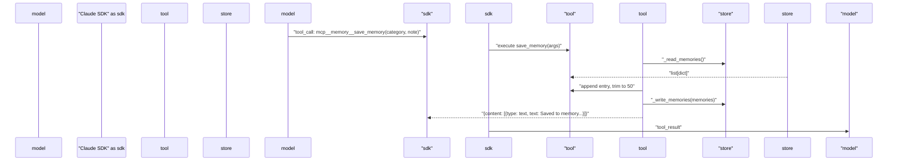
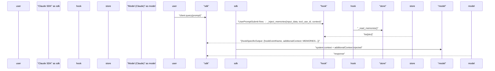
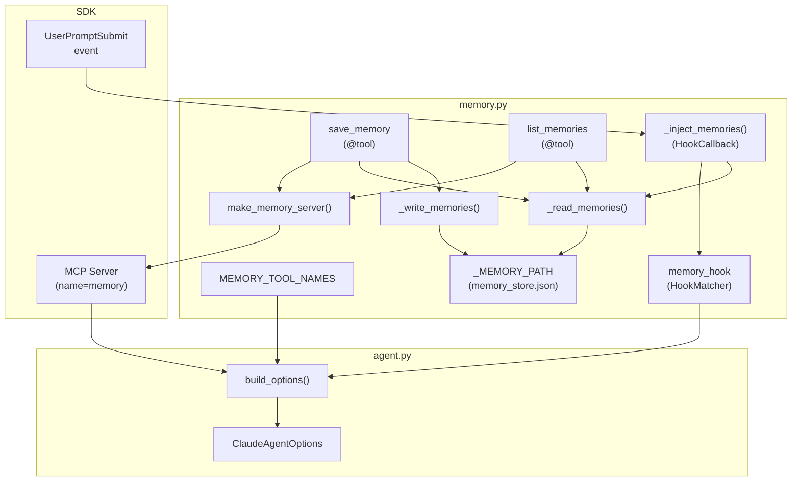

<!-- source: DeepWiki mcp.deepwiki.com · repo anthropics/agent-sdk-workshop · page 2.5 Memory System · fetched 2026-10-26 -->

# Memory System

<details>
<summary>Relevant source files</summary>

The following files were used as context for generating this wiki page:

- [01-guided-demo/GUIDE.md](01-guided-demo/GUIDE.md)
- [01-guided-demo/agent.py](01-guided-demo/agent.py)
- [01-guided-demo/memory.py](01-guided-demo/memory.py)

</details>


This page documents the persistent memory implementation in `01-guided-demo/memory.py`, which is activated at Stage 3 of the guided demo (when `ENABLE_MEMORY = True` in `config.py`). It covers the two-part design: a write-side tool the model calls explicitly, and a read-side hook that injects stored memories automatically before each turn.

For the broader stage progression and how `ENABLE_MEMORY` fits alongside `ENABLE_TOOLS` and `ENABLE_SUBAGENTS`, see the [Progressive Stages & Configuration](#2.1) page. For how the memory system is wired into `ClaudeAgentOptions` inside `build_options()`, see the [Agent Entry Point](#2.2) page.

---

## Purpose

The memory system solves cross-session persistence: preferences or facts the agent learns in one run should be available in the next, without the user repeating themselves. This requires two orthogonal mechanisms:

| Concern | Mechanism | Who triggers it |
|---|---|---|
| **Writing** memories | `save_memory` tool | The model, mid-turn |
| **Reading** memories | `_inject_memories` hook | The SDK, on `UserPromptSubmit` |

The division is intentional. The model decides *what* is worth remembering. The hook ensures memories are *always* present, without the model needing to ask for them.

Sources: [01-guided-demo/memory.py:1-30]()

---

## Storage: `memory_store.json`

All memories are stored in a plain JSON file at [01-guided-demo/memory.py:43]():

```
01-guided-demo/memory_store.json
```

The path is computed relative to `memory.py` using `Path(__file__).parent`, so it stays adjacent to the module regardless of where the script is launched from.

The file contains a JSON array of entry objects. Each entry has three fields:

| Field | Type | Example |
|---|---|---|
| `timestamp` | `str` | `"2026-03-05 14:32"` |
| `category` | `str` | `"preferences"` |
| `note` | `str` | `"User prefers bullet points over prose paragraphs"` |

The file is absent until the first `save_memory` call. If the file is corrupted (invalid JSON), `_read_memories()` returns an empty list rather than crashing [01-guided-demo/memory.py:46-53]().

**Entry cap:** The store is trimmed to the most recent 50 entries after every write. Entries beyond that limit are dropped from the front of the list [01-guided-demo/memory.py:111-112]().

Sources: [01-guided-demo/memory.py:43-57]()

---

## Part 1: Write-Side Tools

**Diagram: Write-Side Tool Execution Flow**



Sources: [01-guided-demo/memory.py:82-148]()

### `save_memory`

Defined at [01-guided-demo/memory.py:84-119]() using the `@tool` decorator. The model calls this to persist a note.

- **Arguments:** `category` (str), `note` (str)
- **Behavior:** Reads the current store, appends a new entry with a formatted timestamp, trims to 50 entries, writes back to disk
- **Returns:** Confirmation text to the model: `"Saved to memory under '<category>'."`
- **Empty note guard:** If `note` is blank after stripping, the function returns early without writing

The tool description instructs the model to use it for durable information (preferences, recurring facts, briefing summaries) and to avoid transient details.

### `list_memories`

Defined at [01-guided-demo/memory.py:122-137]() alongside `save_memory`. The model calls this to inspect the current store before saving, avoiding duplicates.

- **Arguments:** none
- **Returns:** All entries formatted as `[category] note  (saved timestamp)`, or `"Memory is empty."` if the store is empty

### `make_memory_server()`

[01-guided-demo/memory.py:140-148]() wraps both tools into an MCP server using `create_sdk_mcp_server`. It is a function (not a module-level constant) so that importing `memory.py` does not construct an MCP server as a side effect when memory is disabled.

```
make_memory_server() → create_sdk_mcp_server(name="memory", tools=[save_memory, list_memories])
```

The returned server is passed into `ClaudeAgentOptions(mcp_servers={"memory": ...})`.

### `MEMORY_TOOL_NAMES`

[01-guided-demo/memory.py:151-154]() exports the list of fully-qualified tool names that must appear in `allowed_tools` for the model to use these tools:

```
mcp__memory__save_memory
mcp__memory__list_memories
```

Sources: [01-guided-demo/memory.py:82-154]()

---

## Part 2: Read-Side Hook

**Diagram: Hook Injection Flow**



Sources: [01-guided-demo/memory.py:157-204]()

### `_inject_memories`

The hook callback, defined at [01-guided-demo/memory.py:170-198](). Its signature matches the `HookCallback` interface required by the SDK:

```
async def _inject_memories(input_data: HookInput, tool_use_id: str | None, context: HookContext) -> HookJSONOutput
```

All three parameters are required by the signature but unused — the hook only needs the memory file, not anything from the current turn.

**Behavior:**

1. Calls `_read_memories()` to load the store
2. If empty, returns `{}` (a valid no-op `HookJSONOutput`)
3. Formats entries as `- [category] note`
4. Returns a dict with the `hookSpecificOutput` structure:

```
{
  "hookSpecificOutput": {
    "hookEventName": "UserPromptSubmit",
    "additionalContext": "MEMORIES FROM PREVIOUS SESSIONS:\n- [preferences] ..."
  }
}
```

The SDK merges `additionalContext` into the system context before sending the request to the model. The model sees the memories as part of its context without any explicit tool call.

### `HookMatcher` and `memory_hook`

[01-guided-demo/memory.py:201-204]() wraps `_inject_memories` in a `HookMatcher`:

```python
memory_hook = HookMatcher(matcher=None, hooks=[_inject_memories])
```

`matcher=None` means the hook fires for every `UserPromptSubmit` event with no filtering. In `agent.py`, this is registered as:

```python
hooks = {"UserPromptSubmit": [memory_hook]}
```

Sources: [01-guided-demo/memory.py:157-204](), [01-guided-demo/agent.py:264-265]()

---

## Wiring into the Agent

**Diagram: Code Entities and Their Roles**



Sources: [01-guided-demo/memory.py:1-204](), [01-guided-demo/agent.py:253-286]()

In `build_options()`, the memory stage adds three things to `ClaudeAgentOptions` [01-guided-demo/agent.py:262-273]():

| Option | Value |
|---|---|
| `mcp_servers["memory"]` | `make_memory_server()` |
| `allowed_tools` extension | `MEMORY_TOOL_NAMES` |
| `hooks["UserPromptSubmit"]` | `[memory_hook]` |

A system prompt addendum also instructs the model to use `save_memory` proactively when the user expresses preferences or when briefings are produced that may be referenced later.

---

## Startup Display

`load_memory_summary()` [01-guided-demo/memory.py:60-72]() is a display-only helper called from `agent.py`'s `main()` function [01-guided-demo/agent.py:352-357](). It reads the store and formats entries for console output so the user can see what the agent remembers before the session starts:

```
Loaded memories from previous sessions:
  • [preferences] User prefers bullet points over prose paragraphs  (2026-03-05 14:32)
```

This is separate from the hook — `load_memory_summary()` is for human visibility only, while `_inject_memories` is what actually makes the memories available to the model.

Sources: [01-guided-demo/memory.py:60-72](), [01-guided-demo/agent.py:352-357]()

---

## Tools vs. Hooks: Summary

| Attribute | `save_memory` (tool) | `_inject_memories` (hook) |
|---|---|---|
| **Who triggers it** | The model, mid-turn | The SDK, on `UserPromptSubmit` |
| **Model awareness** | Yes — listed in `allowed_tools` | No — invisible to the model |
| **Direction** | Writes to `memory_store.json` | Reads from `memory_store.json` |
| **Registration** | Via `mcp_servers` + `allowed_tools` | Via `hooks["UserPromptSubmit"]` |
| **SDK type** | `@tool` + `create_sdk_mcp_server` | `HookMatcher(matcher=None, hooks=[...])` |
| **Return format** | `{content: [{type: text, text: ...}]}` | `{hookSpecificOutput: {additionalContext: ...}}` |

Sources: [01-guided-demo/memory.py:1-204](), [01-guided-demo/GUIDE.md:227-269]()

---

