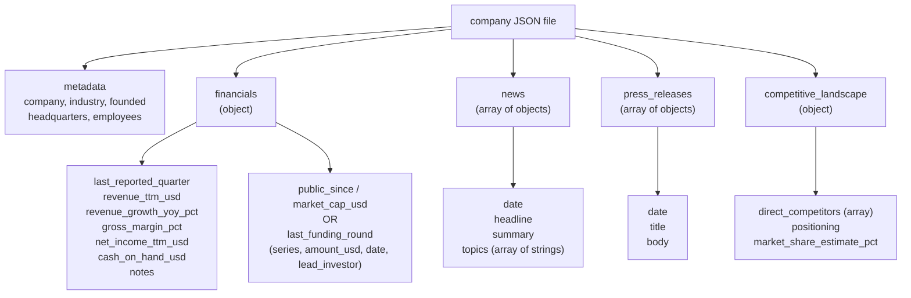
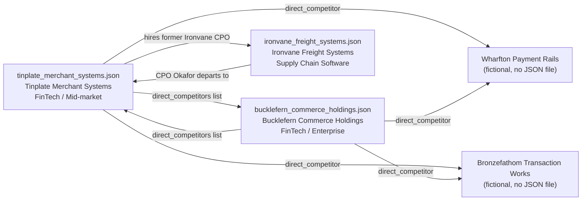
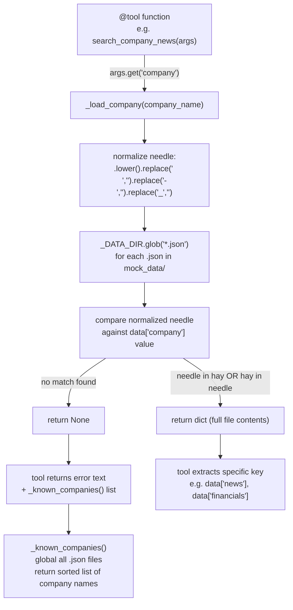

<!-- source: DeepWiki mcp.deepwiki.com · repo anthropics/agent-sdk-workshop · page 2.6 Mock Company Data · fetched 2026-10-26 -->

# Mock Company Data

Relevant source files

The following files were used as context for generating this wiki page:

- [01-guided-demo/mock_data/bucklefern_commerce_holdings.json](01-guided-demo/mock_data/bucklefern_commerce_holdings.json)
- [01-guided-demo/mock_data/ironvane_freight_systems.json](01-guided-demo/mock_data/ironvane_freight_systems.json)
- [01-guided-demo/mock_data/tinplate_merchant_systems.json](01-guided-demo/mock_data/tinplate_merchant_systems.json)
- [01-guided-demo/tools.py](01-guided-demo/tools.py)

This page describes the `mock_data/` directory inside `01-guided-demo/`: its contents, the shared JSON schema, the fictional competitive relationships between the three companies, and how `tools.py` loads and serves the data to the agent. For documentation of the tool functions that read this data, see [Research Tools](#2.3). For the broader demo stage progression, see [Progressive Stages & Configuration](#2.1).

---

## Directory Layout

All mock data lives under `01-guided-demo/mock_data/`. Each file represents one fictional company:

| File | Company | Industry |
|---|---|---|
| `tinplate_merchant_systems.json` | Tinplate Merchant Systems | Financial Technology |
| `bucklefern_commerce_holdings.json` | Bucklefern Commerce Holdings | Financial Technology / E-commerce Infrastructure |
| `ironvane_freight_systems.json` | Ironvane Freight Systems | Supply Chain Software |

Every file carries the top-level field `"_note": "FICTIONAL COMPANY — all data is synthetic workshop demo content"` as a safeguard against the content being mistaken for real data.

Sources: [01-guided-demo/mock_data/tinplate_merchant_systems.json:1-3](), [01-guided-demo/mock_data/bucklefern_commerce_holdings.json:1-3](), [01-guided-demo/mock_data/ironvane_freight_systems.json:1-3]()

---

## Shared JSON Schema

All three files share an identical top-level structure. The schema is deliberately consistent so that `_load_company()` in `tools.py` can access any field uniformly regardless of which company was matched.

**Top-level structure diagram:**

Sources: [01-guided-demo/mock_data/tinplate_merchant_systems.json:1-81](), [01-guided-demo/mock_data/bucklefern_commerce_holdings.json:1-72](), [01-guided-demo/mock_data/ironvane_freight_systems.json:1-70]()

### Field-by-field reference

| Top-level key | Type | Description |
|---|---|---|
| `company` | string | Full company name; used as the match key by `_load_company()` |
| `industry` | string | Industry label |
| `founded` | integer | Year founded |
| `headquarters` | string | City, State |
| `employees` | integer | Approximate headcount |
| `financials` | object | Latest reported quarter snapshot (see below) |
| `news` | array | Recent third-party news items with `date`, `headline`, `summary`, `topics` |
| `press_releases` | array | Official company press releases with `date`, `title`, `body` |
| `competitive_landscape` | object | Competitor list, positioning statement, market share estimate |

#### `financials` sub-fields

| Field | Notes |
|---|---|
| `last_reported_quarter` | e.g. `"Q4 2025"` |
| `revenue_ttm_usd` | Trailing twelve months revenue |
| `revenue_growth_yoy_pct` | Year-over-year growth percentage |
| `gross_margin_pct` | Gross margin as a percentage |
| `net_income_ttm_usd` | Negative values indicate a loss |
| `cash_on_hand_usd` | Current cash / equivalents |
| `public_since` / `market_cap_usd` | Present for public companies (Bucklefern only) |
| `last_funding_round` | Present for private companies; contains `series`, `amount_usd`, `date`, `lead_investor` |
| `notes` | Free-text analyst commentary embedded in the data |

Sources: [01-guided-demo/mock_data/tinplate_merchant_systems.json:9-22](), [01-guided-demo/mock_data/bucklefern_commerce_holdings.json:9-19](), [01-guided-demo/mock_data/ironvane_freight_systems.json:9-23]()

---

## Company Profiles

### Tinplate Merchant Systems

[01-guided-demo/mock_data/tinplate_merchant_systems.json:1-81]()

- **Stage:** Private (Series D, $180M raised in 2024 from Shalemark Venture Partners)
- **Revenue TTM:** $412M, growing 34% YoY
- **Net income:** -$28M (path to breakeven projected H2 2026)
- **Focus:** Mid-market merchants ($500k–$50M annual volume); developer experience; embedded financial products
- **Key story threads in the data:**
  - Launched `Tinplate Capital`, an embedded lending product
  - Beat Q4 estimates (34% growth); stock up 9%
  - Hired Ironvane's departing CPO as Head of Platform
  - Expanded to Canada and UK
  - Had a 47-minute checkout outage in January 2026

### Bucklefern Commerce Holdings

[01-guided-demo/mock_data/bucklefern_commerce_holdings.json:1-72]()

- **Stage:** Public (IPO June 2022; market cap $18.5B)
- **Revenue TTM:** $1.84B, growing 19% YoY (decelerating)
- **Net income:** $142M (profitable since 2023)
- **Focus:** Broadest platform (payments + storefront + back-office); highest take rate; "safe enterprise choice"
- **Key story threads in the data:**
  - Acquiring Shelfcrane Inventory Systems for $340M (third acquisition in 18 months)
  - Growth deceleration to 19%, stock down 6% on earnings
  - Rolled out AI fraud detection to all merchant tiers
  - Activist investor (Perthwick Capital Advisors, 3.1% stake) pushing for buybacks
  - Launched in-person POS hardware ("Bucklefern Terminal")

### Ironvane Freight Systems

[01-guided-demo/mock_data/ironvane_freight_systems.json:1-70]()

- **Stage:** Private (Series C, $95M raised August 2025 from Brayworth Growth Partners)
- **Revenue TTM:** $89M, growing 67% YoY
- **Net income:** -$41M (~21 months runway)
- **Focus:** API-first, developer-friendly TMS alternative; strongest with mid-market shippers
- **Key story threads in the data:**
  - Won three-year contract with national grocery chain (largest customer to date)
  - CPO Dana Okafor departed to Tinplate — raises leadership continuity concern
  - Opened European HQ in Amsterdam
  - Released open API for carrier self-onboarding

---

## Interlinked Competitive Relationships

The three companies are not independent — Tinplate and Bucklefern are direct competitors, and Ironvane provides a cross-company narrative thread via the CPO departure. This creates multi-hop research scenarios where the agent must look up multiple companies to form a complete picture.

**Cross-company relationship diagram:**

Sources: [01-guided-demo/mock_data/tinplate_merchant_systems.json:76-80](), [01-guided-demo/mock_data/bucklefern_commerce_holdings.json:67-71](), [01-guided-demo/mock_data/tinplate_merchant_systems.json:39-44](), [01-guided-demo/mock_data/ironvane_freight_systems.json:35-38]()

Note: Wharfton Payment Rails and Bronzefathom Transaction Works appear in competitor lists but have no corresponding JSON files. Queries for those companies will return the "not found" error path in `_load_company()`.

---

## How tools.py Loads the Data

`tools.py` uses two private helpers to access the `mock_data/` directory:

**Data loading flow diagram:**

Sources: [01-guided-demo/tools.py:21-42](), [01-guided-demo/tools.py:66-103]()

### Key implementation details

- `_DATA_DIR` is set at module load time as a `Path` relative to `tools.py` itself: [01-guided-demo/tools.py:21-21]()
- `_load_company()` normalizes both the search needle and the stored company name by lowercasing and stripping spaces, hyphens, and underscores. Matching is bidirectional (`needle in hay or hay in needle`), which means partial names like `"tinplate"` match `"Tinplate Merchant Systems"`. [01-guided-demo/tools.py:24-32]()
- `_known_companies()` scans `mock_data/*.json` at query time and returns a sorted list. This list is included in all "not found" error responses so the model can self-correct. [01-guided-demo/tools.py:35-42]()
- `get_company_financials()` and `get_competitive_landscape()` return their data as `json.dumps(..., indent=2)` rather than formatted text, relying on the model to interpret JSON directly. [01-guided-demo/tools.py:130-141](), [01-guided-demo/tools.py:207-211]()
- `search_company_news()` supports an optional `topic` filter that matches against the `topics` array on each news item (lowercase comparison). [01-guided-demo/tools.py:84-86]()

### Tool-to-data-field mapping

| Tool (via `mcp__research__*`) | JSON field accessed | Returns |
|---|---|---|
| `search_company_news` | `data["news"]` | Formatted text (headline + summary per item) |
| `get_company_financials` | `data["financials"]`, `data["industry"]`, `data["employees"]` | JSON string |
| `get_recent_press_releases` | `data["press_releases"]` | Formatted text (title + body per release) |
| `get_competitive_landscape` | `data["competitive_landscape"]` | JSON string |

Sources: [01-guided-demo/tools.py:59-211]()

---

