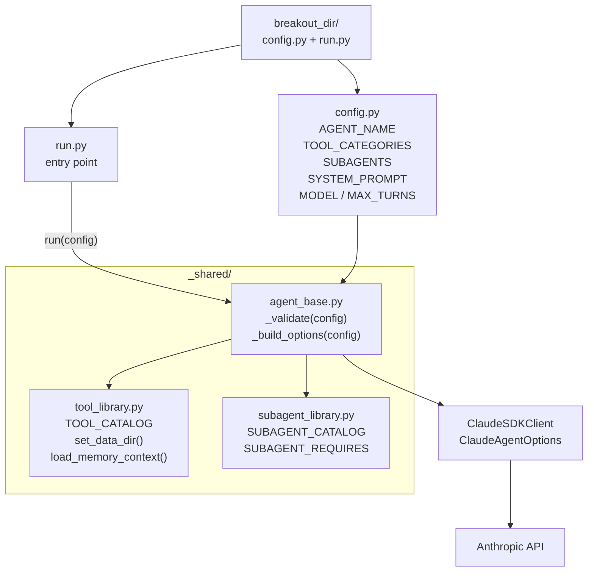

<!-- source: DeepWiki mcp.deepwiki.com · repo anthropics/agent-sdk-workshop · page 3 02-breakouts · fetched 2026-10-26 -->

# 02-breakouts

<details>
<summary>Relevant source files</summary>

The following files were used as context for generating this wiki page:

- [02-breakouts/COMPONENTS.md](02-breakouts/COMPONENTS.md)
- [02-breakouts/README.md](02-breakouts/README.md)

</details>


This page describes the purpose, structure, and workflow of the `02-breakouts` section of the workshop. It covers the overall directory layout, the available breakout scenarios, the shared framework that powers all of them, and the editing cycle participants follow.

For detailed documentation of the shared runner and libraries, see [Shared Framework](#3.1). For per-tool and per-subagent reference tables, see [Available Components Reference](#3.2). For individual breakout walkthroughs, see [00-warmup](#3.3), [Account Intelligence](#3.4), and [Chief of Staff](#3.5).

---

## Purpose

Where `01-guided-demo` is a linear walkthrough with boolean flags, `02-breakouts` is a component-assembly environment. Participants select pre-built tools and sub-agents from a catalog, write a system prompt, and iterate. No new Python code is written — all iteration happens in `config.py`.

> "Where the guided demo was a tour (flip a switch, watch what happens), the breakouts are Lego assembly."

Sources: [02-breakouts/README.md:1-8]()

---

## Directory Structure

Every breakout follows the same four-file layout:

```
02-breakouts/
├── _shared/
│   ├── agent_base.py       ← shared runner: validates config, builds SDK options, runs loop
│   ├── tool_library.py     ← TOOL_CATALOG: all tool categories and their implementations
│   └── subagent_library.py ← SUBAGENT_CATALOG: all sub-agent definitions
│
├── COMPONENTS.md           ← human-readable catalog reference
├── README.md               ← breakout picker and iteration guide
│
├── 00-warmup/
│   ├── config.py           ← EDIT THIS
│   ├── run.py              ← entry point, do not touch
│   ├── README.md
│   └── data/
│
├── account-intelligence/
│   ├── config.py
│   ├── run.py
│   └── data/
│
├── chief-of-staff/
│   ├── config.py
│   ├── run.py
│   └── data/
│
├── customer-support/       ← (same shape)
├── sre-agent/              ← (same shape)
└── freeform/               ← blank canvas
```

Sources: [02-breakouts/README.md:28-36]()

---

## Available Breakouts

| Breakout | Scenario | Primary tool categories |
|---|---|---|
| `00-warmup` | Company briefing — bridges from guided demo | `knowledge` |
| `chief-of-staff` | Meeting prep, email drafting, exec briefings | `schedule`, `knowledge` |
| `customer-support` | Ticket triage, KB-grounded responses, escalation | `support`, `knowledge` |
| `sre-agent` | Incident investigation, runbook execution | `ops` |
| `account-intelligence` | Pre-renewal review, churn risk detection | `support`, `knowledge` |
| `freeform` | Blank canvas with the full component library | *(any)* |

Sources: [02-breakouts/README.md:13-21]()

---

## How It Fits Into the Repository

**Diagram: Breakout Runtime — config.py to Anthropic API**



Sources: [02-breakouts/README.md:36-38](), [02-breakouts/COMPONENTS.md:59-61]()

---

## The config.py Contract

Every breakout's `config.py` exposes the same set of fields. The shared `agent_base.py` reads these fields directly; participants do not call any functions manually.

| Field | Type | Description |
|---|---|---|
| `AGENT_NAME` | `str` | Display name, used in console output |
| `TOOL_CATEGORIES` | `list[str]` | Selects tool groups from `TOOL_CATALOG` |
| `SUBAGENTS` | `list[str]` | Selects sub-agents from `SUBAGENT_CATALOG` |
| `SYSTEM_PROMPT` | `str` | Main agent instructions — primary iteration surface |
| `DEFAULT_TASK` | `str` | Pre-filled task shown when user presses Enter |
| `MODEL` | `str` | Claude model string, e.g. `"claude-sonnet-4-6"` |
| `VERBOSITY` | `str` | `"verbose"` shows tool calls; `"normal"` hides them |
| `MAX_TURNS` | `int` | Cap on the agentic loop, default `30` |

The key contrast with `01-guided-demo` is that `config.py` uses **string lists** (`TOOL_CATEGORIES`, `SUBAGENTS`) rather than boolean flags (`ENABLE_TOOLS`, `ENABLE_SUBAGENTS`, `ENABLE_MEMORY`). The breakout config is selecting from a catalog; the demo config is toggling stages.

Sources: [02-breakouts/COMPONENTS.md:45-54](), [02-breakouts/README.md:28-38]()

---

## Component Catalog at a Glance

**Diagram: Tool Categories and Sub-agents in the Catalog**

```mermaid
graph LR
    subgraph TOOL_CATALOG["TOOL_CATALOG — tool_library.py"]
        schedule["\"schedule\"\nget_calendar\nfind_meeting_slot\ndraft_email"]
        knowledge["\"knowledge\"\nsearch_knowledge_base\nread_document"]
        support["\"support\"\nlookup_customer\nget_ticket\nlist_open_tickets\nadd_ticket_note"]
        ops["\"ops\"\nget_service_status\nquery_metrics\nget_recent_alerts\nsearch_runbooks\nread_runbook"]
        code["\"code\"\nlist_files\nread_file\nsearch_code"]
        memory["\"memory\"\nsave_memory\nlist_memories"]
    end

    subgraph SUBAGENT_CATALOG["SUBAGENT_CATALOG — subagent_library.py"]
        researcher["\"researcher\"\nrequires: knowledge"]
        summarizer["\"summarizer\""]
        classifier["\"classifier\""]
        verifier["\"verifier\"\nrequires: knowledge"]
        writer["\"writer\""]
        procedure_runner["\"procedure_runner\"\nrequires: ops"]
    end
```

Sources: [02-breakouts/COMPONENTS.md:8-41]()

### Tool Categories

| Category | Tools | Data files read |
|---|---|---|
| `schedule` | `get_calendar`, `find_meeting_slot`, `draft_email` | `calendar.json` |
| `knowledge` | `search_knowledge_base`, `read_document` | `knowledge_base.json`, `documents.json` |
| `support` | `lookup_customer`, `get_ticket`, `list_open_tickets`, `add_ticket_note` | `customers.json`, `tickets.json` |
| `ops` | `get_service_status`, `query_metrics`, `get_recent_alerts`, `search_runbooks`, `read_runbook` | `services.json`, `alerts.json`, `runbooks.json` |
| `code` | `list_files`, `read_file`, `search_code` | *(any directory)* |
| `memory` | `save_memory`, `list_memories` | `memory_store.json` |

Tool names are exposed to the model using the `mcp__<category>__<tool>` naming convention — e.g., `mcp__support__lookup_customer`.

### Sub-agents

| Name | Role | Required tool categories |
|---|---|---|
| `researcher` | Gathers info on a focused question | `knowledge` |
| `summarizer` | Condenses long content into key points | *(none)* |
| `classifier` | Categorizes / routes items | *(none)* |
| `verifier` | Fact-checks specific claims | `knowledge` |
| `writer` | Polishes rough notes into clean prose | *(none)* |
| `procedure_runner` | Walks through checklists step by step | `ops` |

When a sub-agent is listed in `SUBAGENTS` without its required tool category in `TOOL_CATEGORIES`, `_validate()` in `agent_base.py` prints a warning. The sub-agent still runs but has no tools to call.

Sources: [02-breakouts/COMPONENTS.md:8-41]()

---

## The Iteration Cycle

The intended workflow for each breakout session:

1. **Read the breakout's `README.md`** — understand the scenario and the mock data in `data/`
2. **Run with the starting config** — `./workshop breakout <name>` — observe baseline behavior
3. **Change one thing in `config.py`** — add a sub-agent, adjust the system prompt, add or remove a tool category
4. **Re-run** — observe the change
5. **Repeat** — most time is spent on steps 3–4

Component selection (which entries go in `TOOL_CATEGORIES` and `SUBAGENTS`) typically stabilizes within the first few iterations. Prompt tuning — the content of `SYSTEM_PROMPT` — is where the majority of iteration happens.

Sources: [02-breakouts/README.md:56-63]()

---

## Relationship to 01-guided-demo

Both sections use the same SDK primitives (`ClaudeSDKClient`, `ClaudeAgentOptions`), but they differ in how configuration is expressed:

| Aspect | `01-guided-demo` | `02-breakouts` |
|---|---|---|
| Configuration style | Boolean flags in `config.py` | String lists in `config.py` |
| Entry point | `agent.py` + `build_options()` | `run.py` → `agent_base.py:run()` |
| Tool setup | Inline in `agent.py` | `tool_library.py:TOOL_CATALOG` |
| Sub-agent setup | Inline in `subagents.py` | `subagent_library.py:SUBAGENT_CATALOG` |
| Iteration surface | Enable/disable stages | Mix and match from catalog |
| Primary skill practiced | Reading SDK behavior | Prompt engineering |

The `_build_options()` function in `agent_base.py` is the direct generalization of `build_options()` in `01-guided-demo/agent.py`. Comparing them shows how the flip-a-switch pattern scales into a catalog-selection pattern.

Sources: [02-breakouts/COMPONENTS.md:57-61](), [02-breakouts/README.md:72-73]()

---

