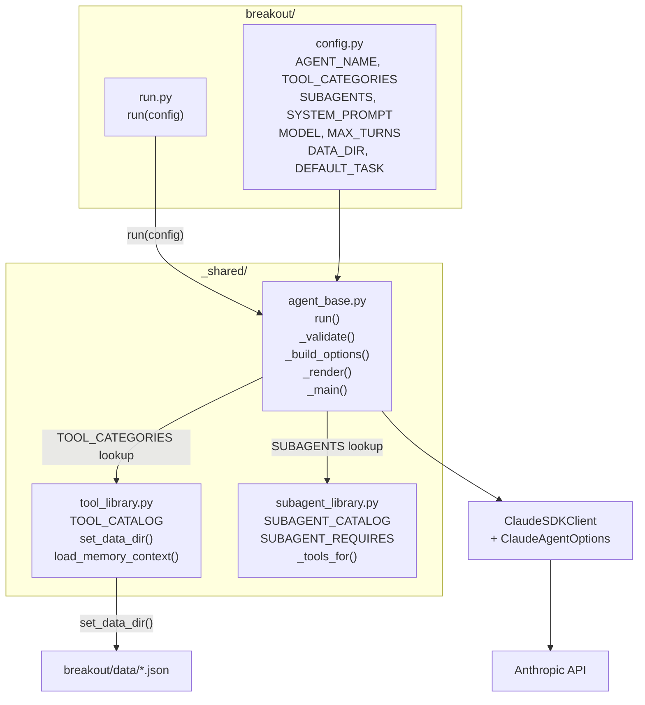
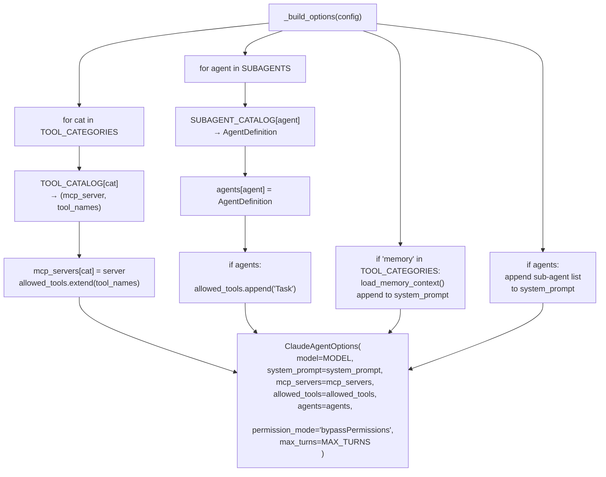
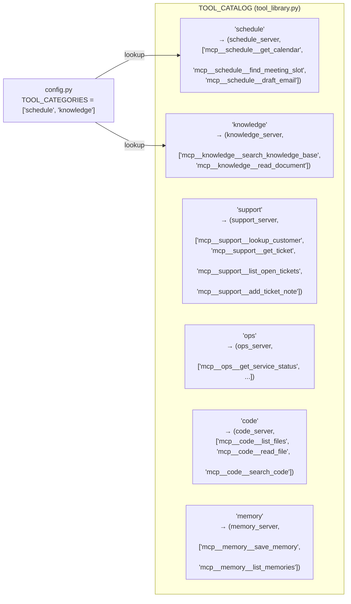
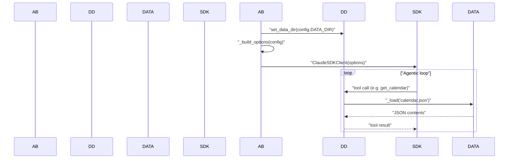
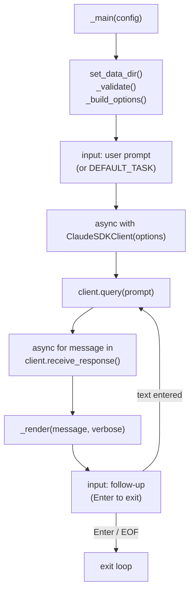

<!-- source: DeepWiki mcp.deepwiki.com · repo anthropics/agent-sdk-workshop · page 3.1 Shared Framework · fetched 2026-10-26 -->

# Shared Framework

<details>
<summary>Relevant source files</summary>

The following files were used as context for generating this wiki page:

- [02-breakouts/README.md](02-breakouts/README.md)
- [02-breakouts/_shared/__init__.py](02-breakouts/_shared/__init__.py)
- [02-breakouts/_shared/agent_base.py](02-breakouts/_shared/agent_base.py)
- [02-breakouts/_shared/subagent_library.py](02-breakouts/_shared/subagent_library.py)
- [02-breakouts/_shared/tool_library.py](02-breakouts/_shared/tool_library.py)

</details>


This page documents the `_shared/` directory in `02-breakouts/`, which provides the common runner infrastructure used by every breakout. It describes how `agent_base.py`, `tool_library.py`, and `subagent_library.py` cooperate to translate a breakout's `config.py` into a fully wired `ClaudeSDKClient` session.

For the full reference of which tool categories and sub-agents are available to select in `config.py`, see [Available Components Reference](#3.2). For documentation of individual breakout scenarios (their `config.py` starting points and data), see [00-warmup Breakout](#3.3), [Account Intelligence Breakout](#3.4), and [Chief of Staff Breakout](#3.5).

---

## Overview

The `_shared/` directory contains three modules:

| File | Role |
|---|---|
| `_shared/agent_base.py` | Validates config, assembles `ClaudeAgentOptions`, runs the conversation loop |
| `_shared/tool_library.py` | Defines all tool functions and `TOOL_CATALOG` |
| `_shared/subagent_library.py` | Defines all `AgentDefinition` instances and `SUBAGENT_CATALOG` |

Every breakout's `run.py` consists of exactly:

```python
from _shared.agent_base import run
import config
run(config)
```

All agent wiring happens inside `_shared/`. Workshop participants only edit `config.py`.

Sources: [02-breakouts/_shared/agent_base.py:1-17](), [02-breakouts/README.md:24-38]()

---

## How the Three Modules Fit Together

**Structural overview: config → shared modules → SDK**



Sources: [02-breakouts/_shared/agent_base.py:38-39](), [02-breakouts/_shared/agent_base.py:107-179]()

---

## Config Module Contract

`agent_base.py` reads the following attributes from whatever `config` module is passed to `run()`. All attributes are optional with defaults.

| Attribute | Type | Default | Purpose |
|---|---|---|---|
| `AGENT_NAME` | `str` | `"Agent"` | Displayed in the startup banner |
| `TOOL_CATEGORIES` | `list[str]` | `[]` | Which tool groups to enable |
| `SUBAGENTS` | `list[str]` | `[]` | Which sub-agent definitions to enable |
| `SYSTEM_PROMPT` | `str` | `""` | Orchestrator system prompt |
| `MODEL` | `str` | `"claude-sonnet-4-6"` | Claude model identifier |
| `MAX_TURNS` | `int \| None` | `None` | Turn limit passed to SDK |
| `VERBOSITY` | `str` | `"verbose"` | `"verbose"` shows tool calls; anything else hides them |
| `DEFAULT_TASK` | `str` | `"How can I help?"` | Pre-filled prompt if user presses Enter |
| `DATA_DIR` | `str \| None` | `None` | Path to breakout's `data/` directory |

Sources: [02-breakouts/_shared/agent_base.py:251-278](), [02-breakouts/_shared/agent_base.py:107-179]()

---

## `_validate()`: Configuration Warnings

[02-breakouts/_shared/agent_base.py:73-104]()

`_validate(config)` runs before any SDK calls and returns a list of warning strings (non-fatal). Three checks are performed:

1. **Unknown tool category** — each item in `TOOL_CATEGORIES` is checked against `TOOL_CATALOG.keys()`. If an item is absent, the user is shown the valid options.
2. **Unknown sub-agent** — each item in `SUBAGENTS` is checked against `SUBAGENT_CATALOG.keys()`.
3. **Missing tool dependency** — for each valid sub-agent, its entries in `SUBAGENT_REQUIRES` are verified against the enabled `TOOL_CATEGORIES`. A warning is printed if a required category is absent (e.g., enabling `researcher` without `knowledge`).
4. **Empty system prompt** — a warning is emitted if `SYSTEM_PROMPT` is blank.

Warnings are printed at startup via `_print_config()` but do not halt execution.

---

## `_build_options()`: From Config to SDK Options

[02-breakouts/_shared/agent_base.py:107-179]()

This is the core translation step. It produces a `ClaudeAgentOptions` object from the config module.

**`_build_options()` assembly logic**



Key behaviors:
- Each `TOOL_CATEGORIES` entry contributes one MCP server entry and extends `allowed_tools` with that category's tool name strings.
- If any sub-agents are enabled, `"Task"` is appended to `allowed_tools` (required for the orchestrator to invoke them).
- If `"memory"` is in `TOOL_CATEGORIES`, `load_memory_context()` reads `memory_store.json` and prepends its contents to `system_prompt` at startup. This is a simpler pattern than the hook-based approach in `01-guided-demo/memory.py` — memories from mid-session saves only appear on the next run.
- If sub-agents are enabled, a description of available agents is appended to `system_prompt` to encourage delegation.

Sources: [02-breakouts/_shared/agent_base.py:107-179]()

---

## `TOOL_CATALOG`: Category-to-Server Mapping

[02-breakouts/_shared/tool_library.py:641-691]()

`TOOL_CATALOG` is a `dict[str, tuple[MCP_server, list[str]]]`. Each key is a category name; the value is a tuple of the MCP server object and a list of fully-qualified tool names.

**How TOOL_CATALOG maps config strings to server objects and tool names**



All tool names follow the convention `mcp__<category>__<function_name>`. This prefix is generated by `create_sdk_mcp_server()` from the SDK.

Sources: [02-breakouts/_shared/tool_library.py:641-691](), [02-breakouts/_shared/tool_library.py:1-22]()

---

## `SUBAGENT_CATALOG` and `SUBAGENT_REQUIRES`

[02-breakouts/_shared/subagent_library.py:39-163]()

`SUBAGENT_CATALOG` maps string names to `AgentDefinition` instances. `SUBAGENT_REQUIRES` maps the same names to the tool categories that sub-agent depends on.

| Sub-agent key | Model | Tool categories accessed | Required by `SUBAGENT_REQUIRES` |
|---|---|---|---|
| `researcher` | haiku | `knowledge`, `support`, `ops`, `schedule` | `knowledge` |
| `summarizer` | haiku | *(none)* | *(none)* |
| `classifier` | haiku | *(none)* | *(none)* |
| `verifier` | haiku | `knowledge`, `support`, `ops` | `knowledge` |
| `writer` | haiku | *(none)* | *(none)* |
| `procedure_runner` | haiku | `ops`, `support` | `ops` |

The `_tools_for(*categories)` helper [02-breakouts/_shared/subagent_library.py:24-32]() flattens tool name lists from `TOOL_CATALOG` into a single list for each sub-agent's `tools=` field. This means sub-agents inherit the exact same tool name strings from `TOOL_CATALOG` — there is no separate registration.

> **Important**: A sub-agent's tool access is limited to what its parent config has registered as MCP servers. If a sub-agent lists `mcp__knowledge__search_knowledge_base` in its `tools=` but the config does not include `"knowledge"` in `TOOL_CATEGORIES`, the MCP server is not registered and the tool is unavailable.

Sources: [02-breakouts/_shared/subagent_library.py:1-32](), [02-breakouts/_shared/subagent_library.py:154-163]()

---

## `set_data_dir()` and Per-Breakout Data Isolation

[02-breakouts/_shared/tool_library.py:37-56]()

All tools in `tool_library.py` read from a module-level `_DATA_DIR` variable. Before any tool is called, `agent_base.py` calls `set_data_dir(Path(config.DATA_DIR))` to point this variable at the current breakout's `data/` directory.

The internal `_load(filename)` function then resolves all JSON paths relative to `_DATA_DIR`. If a file is absent, it returns `{}` or `[]` silently, allowing breakouts to omit data files for categories they do not need.

**Data isolation flow**



Sources: [02-breakouts/_shared/tool_library.py:37-56](), [02-breakouts/_shared/agent_base.py:258-260]()

---

## Memory Injection at Startup

[02-breakouts/_shared/agent_base.py:138-153](), [02-breakouts/_shared/tool_library.py:622-630]()

When `"memory"` is included in `TOOL_CATEGORIES`, `_build_options()` calls `load_memory_context()` before constructing `ClaudeAgentOptions`. `load_memory_context()` reads `memory_store.json` from `_DATA_DIR` and formats its entries into a string block that is appended to the system prompt.

This differs from the `01-guided-demo` memory approach, which uses a `UserPromptSubmit` hook to re-read the file on every turn. The breakouts approach injects once at startup — simpler for workshop iteration, but means mid-session saves only appear on the next `run()` invocation.

The `memory_store.json` file is capped at 50 entries by `save_memory()` [02-breakouts/_shared/tool_library.py:594-596]().

---

## Conversation Loop

[02-breakouts/_shared/agent_base.py:251-305]()

After calling `_build_options()`, `_main()` runs a multi-turn loop:



The `_render()` function [02-breakouts/_shared/agent_base.py:213-243]() handles three message types from the SDK:

| Message type | Verbose=True | Verbose=False |
|---|---|---|
| `AssistantMessage` + `TextBlock` | Print text | Print text |
| `AssistantMessage` + `ToolUseBlock` | Print `→ tool(args)` | Suppress |
| `UserMessage` + `ToolResultBlock` | Print `← result` (truncated at 200 chars) | Suppress |
| `ResultMessage` | Print turn count + cost | Print turn count + cost |

Sources: [02-breakouts/_shared/agent_base.py:213-305]()

---

