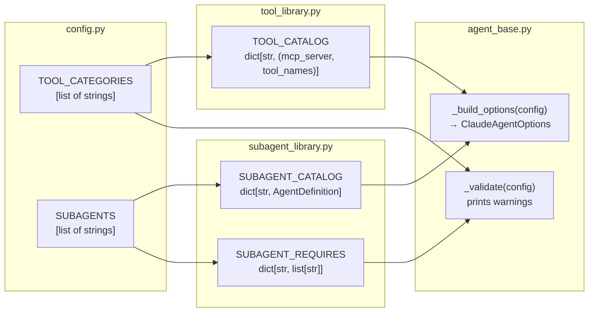
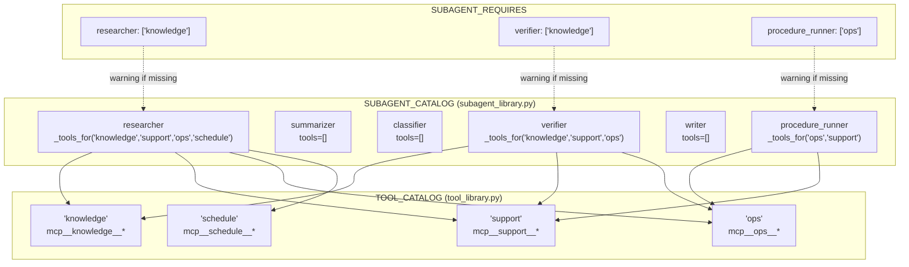
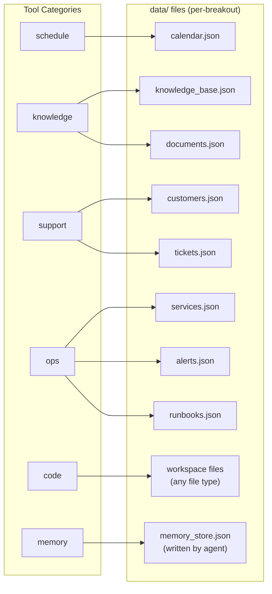

<!-- source: DeepWiki mcp.deepwiki.com · repo anthropics/agent-sdk-workshop · page 3.2 Available Components Reference · fetched 2026-10-26 -->

# Available Components Reference

<details>
<summary>Relevant source files</summary>

The following files were used as context for generating this wiki page:

- [02-breakouts/COMPONENTS.md](02-breakouts/COMPONENTS.md)
- [02-breakouts/_shared/subagent_library.py](02-breakouts/_shared/subagent_library.py)
- [02-breakouts/_shared/tool_library.py](02-breakouts/_shared/tool_library.py)

</details>


This page is a concise reference for every `TOOL_CATEGORY` and `SUBAGENT` string you can place in a breakout's `config.py`. It covers tool names, parameter signatures, data file dependencies, sub-agent roles, and the `mcp__<category>__<tool>` naming convention used at runtime.

For how the framework loads and wires these components, see the Shared Framework page ([3.1]()) and the Agent Base Runner ([3.1.1]()), Tool Library ([3.1.2]()), and Sub-agent Library ([3.1.3()]) detail pages. For how individual breakouts configure themselves, see the breakout-specific pages ([3.3](), [3.4](), [3.5]()).

---

## How Selection Works

A breakout's `config.py` declares which components it wants:

```python
TOOL_CATEGORIES = ["knowledge", "support", "memory"]
SUBAGENTS       = ["researcher", "verifier"]
```

`agent_base.py`'s `_build_options()` function reads these lists, looks up entries in `TOOL_CATALOG` and `SUBAGENT_CATALOG`, and assembles a `ClaudeAgentOptions` object. The agent is then given only the tools and sub-agents listed.

**Diagram: Config → Runtime Wiring**



Sources: [02-breakouts/_shared/tool_library.py:641-691](), [02-breakouts/_shared/subagent_library.py:156-163]()

---

## Tool Categories

Each category is a string key in `TOOL_CATALOG`. When enabled, `agent_base.py` registers its MCP server and adds its tools to the agent's allowed-tools list.

**Naming convention:** Every tool's runtime name follows the pattern `mcp__<category>__<tool_function_name>`. For example, enabling `"support"` gives the agent access to `mcp__support__lookup_customer`, `mcp__support__get_ticket`, etc.

### Summary Table

| `TOOL_CATEGORIES` entry | Tools (MCP name suffix) | Data file(s) read | Typical use case |
|---|---|---|---|
| `"schedule"` | `get_calendar`, `find_meeting_slot`, `draft_email` | `calendar.json` | Executive assistants, scheduling |
| `"knowledge"` | `search_knowledge_base`, `read_document` | `knowledge_base.json`, `documents.json` | Document lookup, policy reference |
| `"support"` | `lookup_customer`, `get_ticket`, `list_open_tickets`, `add_ticket_note` | `customers.json`, `tickets.json` | Customer support, account management |
| `"ops"` | `get_service_status`, `query_metrics`, `get_recent_alerts`, `search_runbooks`, `read_runbook` | `services.json`, `alerts.json`, `runbooks.json` | SRE, incident response |
| `"code"` | `list_files`, `read_file`, `search_code` | *(any directory)* | Codebase exploration |
| `"memory"` | `save_memory`, `list_memories` | `memory_store.json` (written) | Cross-session persistence |

Sources: [02-breakouts/COMPONENTS.md:11-19](), [02-breakouts/_shared/tool_library.py:641-691]()

---

### `schedule`

MCP server object: `schedule_server` ([02-breakouts/_shared/tool_library.py:141-144]())

| Full tool name | Parameters | Behavior |
|---|---|---|
| `mcp__schedule__get_calendar` | `start_date: str`, `end_date: str` | Returns events from `calendar.json` in the date range. |
| `mcp__schedule__find_meeting_slot` | `duration_minutes: int`, `start_date: str`, `end_date: str` | Returns a mock available slot (does not check conflicts in data). |
| `mcp__schedule__draft_email` | `to: str`, `subject: str`, `body: str` | Returns a formatted draft. **Does not send.** Always returns for human review. |

Sources: [02-breakouts/_shared/tool_library.py:70-144]()

---

### `knowledge`

MCP server object: `knowledge_server` ([02-breakouts/_shared/tool_library.py:204-207]())

| Full tool name | Parameters | Behavior |
|---|---|---|
| `mcp__knowledge__search_knowledge_base` | `query: str` | Case-insensitive match against `title`, `body`, and `tags` fields in `knowledge_base.json`. Returns titles and 150-character snippets. |
| `mcp__knowledge__read_document` | `document_id: str` | Looks up a document by `id` field in both `knowledge_base.json` and `documents.json`. Returns full body. |

Sources: [02-breakouts/_shared/tool_library.py:152-207]()

---

### `support`

MCP server object: `support_server` ([02-breakouts/_shared/tool_library.py:305-308]())

| Full tool name | Parameters | Behavior |
|---|---|---|
| `mcp__support__lookup_customer` | `customer_identifier: str` | Matches by `id` or `email` in `customers.json`. Returns full account JSON. |
| `mcp__support__get_ticket` | `ticket_id: str` | Returns single ticket record from `tickets.json` including conversation history. |
| `mcp__support__list_open_tickets` | `priority: str` *(optional)* | Returns all tickets where `status == "open"`, optionally filtered by `priority`. |
| `mcp__support__add_ticket_note` | `ticket_id: str`, `note: str` | Confirms the note (mock — does not persist in the workshop environment). |

Sources: [02-breakouts/_shared/tool_library.py:215-308]()

---

### `ops`

MCP server object: `ops_server` ([02-breakouts/_shared/tool_library.py:458-464]())

| Full tool name | Parameters | Behavior |
|---|---|---|
| `mcp__ops__get_service_status` | `service: str` | Returns service health record from `services.json`. |
| `mcp__ops__query_metrics` | `service: str`, `metric: str`, `last_minutes: int` | Returns time-series mock data. Metrics: `error_rate`, `latency_p99`, `requests_per_second`, `cpu_utilization`. Injects a spike anomaly for the `checkout` service's `error_rate` to give the SRE scenario something to find. |
| `mcp__ops__get_recent_alerts` | `service: str` *(optional)*, `last_hours: int` | Loads from `alerts.json`, optionally filtered by service name. |
| `mcp__ops__search_runbooks` | `query: str` | Matches against `title` and `summary` fields in `runbooks.json`. |
| `mcp__ops__read_runbook` | `runbook_id: str` | Returns full steps list for a runbook by `id`. |

Sources: [02-breakouts/_shared/tool_library.py:317-464]()

---

### `code`

MCP server object: `code_server` ([02-breakouts/_shared/tool_library.py:546-549]())

Unlike other categories, `code` tools operate on actual files in the `_DATA_DIR` directory rather than parsing JSON records.

| Full tool name | Parameters | Behavior |
|---|---|---|
| `mcp__code__list_files` | `pattern: str` *(optional)* | Recursively lists files in `_DATA_DIR`, filtered by substring. |
| `mcp__code__read_file` | `path: str` | Reads a file relative to `_DATA_DIR`. Includes a path-traversal guard to stay inside the workspace. |
| `mcp__code__search_code` | `query: str` | Grep-style search across all files, returning `file:line: content` matches (capped at 50 results). |

Sources: [02-breakouts/_shared/tool_library.py:467-549]()

---

### `memory`

MCP server object: `memory_server` ([02-breakouts/_shared/tool_library.py:616-619]())

Each breakout stores its own `memory_store.json` inside its `data/` directory. The `load_memory_context()` function ([02-breakouts/_shared/tool_library.py:622-630]()) is called by `agent_base.py` at startup to inject previous memories into the system prompt.

| Full tool name | Parameters | Behavior |
|---|---|---|
| `mcp__memory__save_memory` | `category: str`, `note: str` | Appends an entry to `memory_store.json`. Enforces a 50-entry cap (oldest entries removed). |
| `mcp__memory__list_memories` | *(none)* | Returns all entries currently in `memory_store.json`. |

Sources: [02-breakouts/_shared/tool_library.py:552-630]()

---

## Sub-agents

Sub-agents are listed in `SUBAGENT_CATALOG` in `subagent_library.py`. Each is an `AgentDefinition` with its own system prompt, model, and tool allowlist. All sub-agents use `"haiku"` as their model.

The main agent delegates to them via the `Task` tool. The sub-agent's tool allowlist is built at catalog-definition time using `_tools_for()`, which flattens the relevant `TOOL_CATALOG` entries. A sub-agent can only execute a tool if its parent agent has the corresponding MCP server registered — i.e., the tool's category must appear in `TOOL_CATEGORIES`.

**Diagram: Sub-agent Tool Access**



Sources: [02-breakouts/_shared/subagent_library.py:24-163]()

### Summary Table

| `SUBAGENTS` entry | Role | Required `TOOL_CATEGORIES` | Warning if missing? |
|---|---|---|---|
| `"researcher"` | Gathers info on a focused question using available tools; returns structured findings with gaps flagged | `knowledge` (minimum) | Yes |
| `"summarizer"` | Condenses input to ≤150-word digest; preserves numbers, dates, names | *(none)* | No |
| `"classifier"` | Assigns one category from a provided set; refuses to force a bad fit | *(none)* | No |
| `"verifier"` | Fact-checks specific claims; responds `CONFIRMED`, `REFUTED`, or `UNVERIFIABLE` per claim | `knowledge` | Yes |
| `"writer"` | Converts rough notes/bullets to polished prose; matches requested tone | *(none)* | No |
| `"procedure_runner"` | Executes a checklist step-by-step using ops tools; stops and reports on any blocker | `ops` | Yes |

Sources: [02-breakouts/_shared/subagent_library.py:39-163](), [02-breakouts/COMPONENTS.md:29-41]()

---

## Other `config.py` Knobs

These settings apply to the main agent, not to individual tools or sub-agents.

| Config key | Default | Description |
|---|---|---|
| `SYSTEM_PROMPT` | *(varies per breakout)* | Main agent instructions. Primary target for prompt iteration. |
| `DEFAULT_TASK` | *(varies per breakout)* | Task shown when the user presses Enter without input. |
| `MODEL` | `"claude-sonnet-4-6"` | Main agent model. Use `"claude-opus-4-6"` for quality, `"claude-haiku-4-5"` for speed. |
| `VERBOSITY` | `"verbose"` | `"verbose"` shows tool calls in output; `"normal"` hides them. |
| `MAX_TURNS` | `30` | Hard cap on the agentic loop iteration count. |

Sources: [02-breakouts/COMPONENTS.md:46-54]()

---

## Data File Dependency Map

**Diagram: Tool Categories → Data Files**



Sources: [02-breakouts/_shared/tool_library.py:64-691](), [02-breakouts/COMPONENTS.md:11-19]()

A breakout that doesn't include a given data file simply gets an empty result from tools that would read it — `_load()` returns `{}` for missing files rather than raising an error ([02-breakouts/_shared/tool_library.py:47-56]()). This means it is safe to enable a tool category even if its backing data file hasn't been created yet.

---

