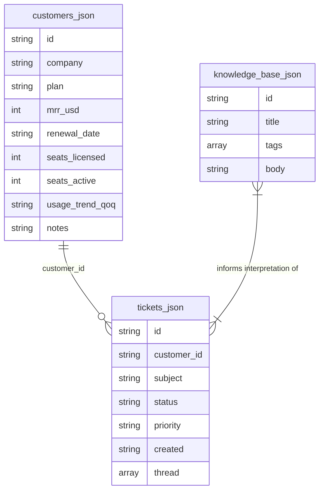
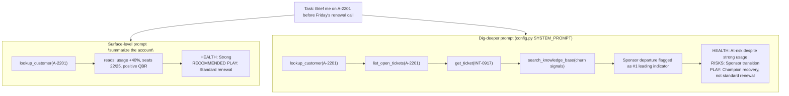

<!-- source: DeepWiki mcp.deepwiki.com · repo anthropics/agent-sdk-workshop · page 3.4 Account Intelligence Breakout · fetched 2026-10-26 -->

# Account Intelligence Breakout

<details>
<summary>Relevant source files</summary>

The following files were used as context for generating this wiki page:

- [02-breakouts/account-intelligence/GOLD.md](02-breakouts/account-intelligence/GOLD.md)
- [02-breakouts/account-intelligence/README.md](02-breakouts/account-intelligence/README.md)
- [02-breakouts/account-intelligence/config.py](02-breakouts/account-intelligence/config.py)
- [02-breakouts/account-intelligence/data/customers.json](02-breakouts/account-intelligence/data/customers.json)
- [02-breakouts/account-intelligence/data/knowledge_base.json](02-breakouts/account-intelligence/data/knowledge_base.json)
- [02-breakouts/account-intelligence/data/tickets.json](02-breakouts/account-intelligence/data/tickets.json)
- [02-breakouts/account-intelligence/run.py](02-breakouts/account-intelligence/run.py)

</details>


This page documents the `account-intelligence` breakout: its scenario, data model, configuration, and the prompt engineering principles that determine whether the agent produces surface-level summaries or genuine account intelligence. For information about the shared runner that executes this breakout, see [3.1](#3.1). For a full reference of available components, see [3.2](#3.2). For the simpler warmup breakout that precedes this one, see [3.3](#3.3).

---

## Purpose

The account intelligence breakout builds a **pre-renewal briefing agent**. Before an account executive walks into a renewal call, the agent reviews account details, support history, and sales playbooks to produce a structured briefing. The core challenge the breakout is designed to illustrate: **accounts that look healthy on usage metrics can still be at risk**, and finding those risks requires checking interaction history and playbooks — not just reading the dashboard.

Sources: [02-breakouts/account-intelligence/README.md:1-18]()

---

## Entry Point and Configuration

The breakout follows the standard breakout pattern: `run.py` is a thin entry point that delegates to the shared runner.

[02-breakouts/account-intelligence/run.py:1-12]()

The file participants edit is `config.py`. It defines:

- `AGENT_NAME` — display name
- `TOOL_CATEGORIES` — list of tool categories to enable
- `SUBAGENTS` — list of sub-agents to attach
- `SYSTEM_PROMPT` — the core prompt that determines agent behavior
- `DEFAULT_TASK` — the task used when no prompt is supplied at runtime
- `MODEL`, `VERBOSITY`, `MAX_TURNS` — execution knobs
- `DATA_DIR` — resolved to `data/` in the breakout directory

[02-breakouts/account-intelligence/config.py:1-88]()

Sources: [02-breakouts/account-intelligence/run.py:1-12](), [02-breakouts/account-intelligence/config.py:1-88]()

---

## Default Component Configuration

The starting `config.py` selects the following components:

**Diagram: Default Component Configuration**

```mermaid
flowchart TD
    cfg["config.py"]

    subgraph TOOL_CATEGORIES["TOOL_CATEGORIES"]
        support["\"support\"\nlookup_customer\nget_ticket\nlist_open_tickets\nadd_ticket_note"]
        knowledge["\"knowledge\"\nsearch_knowledge_base\nread_document"]
        memory["\"memory\"\nsave_memory\nlist_memories"]
    end

    subgraph SUBAGENTS["SUBAGENTS"]
        researcher["\"researcher\"\n(requires: knowledge)"]
        classifier["\"classifier\""]
    end

    cfg --> support
    cfg --> knowledge
    cfg --> memory
    cfg --> researcher
    cfg --> classifier

    support --> customers["data/customers.json"]
    support --> tickets["data/tickets.json"]
    knowledge --> kb["data/knowledge_base.json"]
    memory --> mem["data/memory_store.json"]
```

Sources: [02-breakouts/account-intelligence/config.py:23-33]()

| Component | Type | Purpose |
|---|---|---|
| `support` | Tool category | Account lookup (`lookup_customer`), interaction history (`get_ticket`, `list_open_tickets`) |
| `knowledge` | Tool category | Sales playbooks and churn signal rules |
| `memory` | Tool category | Persist account notes across sessions |
| `researcher` | Sub-agent | Gather full account context; requires `knowledge` |
| `classifier` | Sub-agent | Categorize account as healthy / at-risk / upsell-opportunity |

Sources: [02-breakouts/account-intelligence/config.py:23-33](), [02-breakouts/account-intelligence/README.md:34-36]()

---

## The Four Account Archetypes

The `data/` directory contains four accounts, each representing a different renewal scenario:

| Account ID | Company | Plan | MRR | Renewal Date | Archetype |
|---|---|---|---|---|---|
| A-2201 | Pelledryn Data Sciences | Growth | $3,200 | April 5 | Looks healthy; hidden risk |
| A-3340 | Azurite Clinical Networks | Growth | $2,800 | March 28 | Obvious at-risk |
| A-1908 | Glasswick Content Works | Enterprise | $8,500 | May 15 | Expansion opportunity |
| A-4477 | Wireflint Data Systems | Starter | $450 | April 12 | Ambiguous / low-signal |

Sources: [02-breakouts/account-intelligence/data/customers.json:1-62]()

The default `DEFAULT_TASK` targets A-2201 specifically because it is the edge case — strong metrics hiding a critical risk signal.

[02-breakouts/account-intelligence/config.py:71-74]()

---

## Data Model

**Diagram: Data Files and Their Relationships to Accounts**



Sources: [02-breakouts/account-intelligence/data/customers.json:1-62](), [02-breakouts/account-intelligence/data/tickets.json:1-117](), [02-breakouts/account-intelligence/data/knowledge_base.json:1-32]()

### `customers.json`

Each entry represents one account record as seen by `lookup_customer`. Key fields: `id`, `company`, `plan`, `mrr_usd`, `seats_licensed`, `seats_active`, `usage_trend_qoq`, `notes`, `renewal_date`.

[02-breakouts/account-intelligence/data/customers.json:1-62]()

### `tickets.json`

Stores both support tickets and internal CSM interaction notes under the same schema. Each entry has a `customer_id` foreign key and a `thread` array of timestamped messages. The interaction log for A-2201 includes the critical sponsor-departure notification in `INT-0917`.

[02-breakouts/account-intelligence/data/tickets.json:1-117]()

### `knowledge_base.json`

Five playbook documents, retrieved by `search_knowledge_base` and `read_document`:

| KB ID | Title | Key Content |
|---|---|---|
| `kb-churn-signals` | Churn Risk Signals — Leading Indicators | Ranked list; executive sponsor departure is #1 |
| `kb-upsell-triggers` | Expansion & Upsell Triggers | Seat saturation, new BU, tier-limit requests |
| `kb-renewal-playbook` | Standard Renewal Playbook | T-90 / T-60 / T-30 / T-0 process |
| `kb-competitive-displacement` | Competitive Displacement Signals | Signals a competitor is being evaluated |
| `kb-account-health-rubric` | Account Health Classification Rubric | Defines healthy / at-risk / upsell-opportunity |

[02-breakouts/account-intelligence/data/knowledge_base.json:1-32]()

The `kb-churn-signals` document contains the rule that distinguishes the two output tiers: "Usage is a lagging indicator. Sponsor departure is a leading one."

[02-breakouts/account-intelligence/data/knowledge_base.json:6]()

---

## The HEALTH / SIGNALS / RISKS / PLAY Output Format

The `SYSTEM_PROMPT` in `config.py` prescribes a structured four-section briefing format:

```
HEALTH       — overall assessment with confidence level
SIGNALS      — specific positive and negative indicators from the data
RISKS        — threats to renewal, even when usage looks fine
RECOMMENDED PLAY — what the AE should do in the next conversation
```

This structure is one of the tinkerable dimensions: removing it from the prompt is listed as an experiment to test whether output becomes less structured.

[02-breakouts/account-intelligence/config.py:49-68]()

---

## The Edge Case: A-2201 (Pelledryn Data Sciences)

This is the central test case and the reason the breakout exists. The account record shows:

- Usage up 40% QoQ
- 22 of 25 seats active (88% utilization)
- Positive December QBR — platform called "essential"
- Zero open support tickets

None of those fields are false. The risk is in `tickets.json`, interaction `INT-0917`, logged February 4:

> "David Oyelaran announced yesterday that he's leaving Pelledryn Data at the end of the month. He's been our exec sponsor for the platform since we brought it in."

[02-breakouts/account-intelligence/data/tickets.json:18-35]()

The `kb-churn-signals` playbook classifies executive sponsor departure as the **#1 leading indicator of churn**, and explicitly states it supersedes usage metrics.

[02-breakouts/account-intelligence/data/knowledge_base.json:6]()

---

## GOLD.md: Surface-Level vs. Dig-Deeper Outputs

`GOLD.md` provides a reference comparison showing exactly what the two prompt approaches produce on account A-2201.

[02-breakouts/account-intelligence/GOLD.md:1-99]()

**Diagram: What Determines Output Quality**



Sources: [02-breakouts/account-intelligence/GOLD.md:29-74]()

The difference is not in the model's capability — it is in what the prompt instructs the agent to check:

| Prompt Element | Effect |
|---|---|
| "Review interaction history" | Agent calls `get_ticket` / `list_open_tickets` and finds `INT-0917` |
| "Check the sales playbooks for relevant signals" | Agent calls `search_knowledge_base` and retrieves `kb-churn-signals` |
| "Don't just summarize — interpret it" | Agent weighs sponsor departure (leading indicator) against usage growth (lagging indicator) |

Sources: [02-breakouts/account-intelligence/GOLD.md:80-86]()

---

## Suggested Experiments

The README lists four categories of tinkering:

### Component Selection

- **Add `verifier`** sub-agent — fact-checks claims against interaction history before they appear in the briefing
- **Remove `knowledge`** — agent loses access to playbooks; tests whether it can still identify the A-2201 risk or reverts to reading raw usage numbers

[02-breakouts/account-intelligence/README.md:34-36]()

### System Prompt Tuning

| Dimension | Options |
|---|---|
| Evidence threshold | "Flag any risk signal" vs. "only flag risks with multiple confirming data points" |
| Playbook adherence | Explicit instruction to always check `kb-churn-signals` before health assessment |
| Output format | With vs. without the HEALTH / SIGNALS / RISKS / PLAY template |

[02-breakouts/account-intelligence/README.md:38-43]()

### Test Prompts

| Prompt | Expected Result |
|---|---|
| `"Brief me on Pelledryn Data Sciences (A-2201) before Friday's renewal call"` | Flags sponsor departure risk |
| `"Review all four accounts with upcoming renewals. Which needs attention first?"` | Ranks A-2201 highest despite strong metrics |
| `"Is Azurite Clinical Networks (A-3340) salvageable or should we expect churn?"` | Cites usage decline + integration issues + silent champion |
| `"What's the upsell play for Glasswick Content Works (A-1908)?"` | Surfaces INT-0876 (new business unit, 25-30 additional seats) |

Sources: [02-breakouts/account-intelligence/README.md:46-51](), [02-breakouts/account-intelligence/GOLD.md:92-98]()

---

## Validation Checklist

From `GOLD.md`:

- A-2201 with default `config.py` prompt → should flag the sponsor risk
- A-2201 with prompt stripped to "summarize the account" → should demonstrate the miss
- A-3340 (Azurite Clinical Networks) → obvious at-risk, should be easy to surface
- A-1908 (Glasswick Content Works) → should identify expansion opportunity from `INT-0876`
- "Review all four accounts" → should rank A-2201 highest despite its strong metrics

[02-breakouts/account-intelligence/GOLD.md:90-98]()

---

