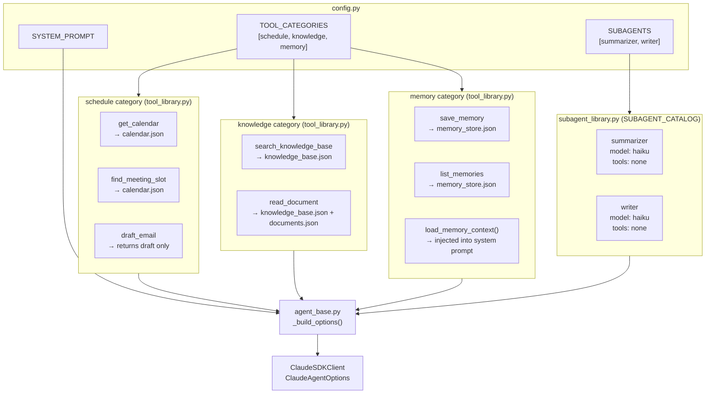
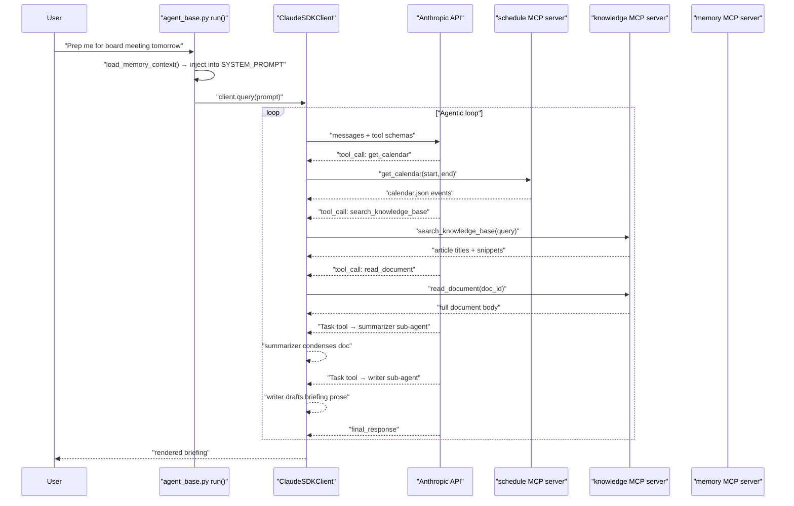

<!-- source: DeepWiki mcp.deepwiki.com · repo anthropics/agent-sdk-workshop · page 3.5 Chief of Staff Breakout · fetched 2026-10-26 -->

# Chief of Staff Breakout

<details>
<summary>Relevant source files</summary>

The following files were used as context for generating this wiki page:

- [02-breakouts/COMPONENTS.md](02-breakouts/COMPONENTS.md)
- [02-breakouts/_shared/subagent_library.py](02-breakouts/_shared/subagent_library.py)
- [02-breakouts/_shared/tool_library.py](02-breakouts/_shared/tool_library.py)
- [02-breakouts/chief-of-staff/README.md](02-breakouts/chief-of-staff/README.md)

</details>


This page documents the `chief-of-staff` breakout in `02-breakouts/chief-of-staff/`. It covers the scenario, mock data layout, default component configuration, and prompt engineering guidance. For the shared framework that all breakouts run on top of, see [Shared Framework](#3.1). For a reference listing every available tool category and sub-agent, see [Available Components Reference](#3.2).

---

## Scenario

The chief-of-staff breakout simulates executive workflow automation. The agent acts as an AI chief of staff for a startup CEO facing a board meeting the next day. The job is to pull together the right context from calendars, documents, and institutional knowledge and produce something the CEO can use in 90 seconds of reading.

The scenario exercises three recurring executive workflows:

| Workflow | What the agent does |
|---|---|
| **Calendar management** | Retrieves upcoming meetings, finds open scheduling slots |
| **Meeting briefing prep** | Reads relevant docs and synthesizes context for a specific meeting |
| **Communication drafting** | Produces follow-up emails, board correspondence drafts |

Sources: [02-breakouts/chief-of-staff/README.md:1-16]()

---

## Mock Data

The breakout's `data/` directory contains three JSON files. The `schedule` and `knowledge` tool categories read from them directly.

| File | Tool category that reads it | Contents |
|---|---|---|
| `calendar.json` | `schedule` | Next few days of meetings, with per-event `notes` containing attendee context |
| `documents.json` | `knowledge` | Board pre-read questions, Q1 priorities draft, account notes for customer calls |
| `knowledge_base.json` | `knowledge` | Executive communication preferences, board protocol, email templates |
| `memory_store.json` | `memory` | Persisted preferences/notes from prior sessions (written at runtime) |

The `knowledge` category's `read_document` tool merges both `knowledge_base.json` and `documents.json` into a single search space [02-breakouts/_shared/tool_library.py:191-201]().

Sources: [02-breakouts/chief-of-staff/README.md:9-14](), [02-breakouts/_shared/tool_library.py:154-207]()

---

## Default Configuration

The starting `config.py` enables the following components:

```
TOOL_CATEGORIES = ["schedule", "knowledge", "memory"]
SUBAGENTS       = ["summarizer", "writer"]
```

**What each component contributes:**

| Component | Type | Role in this agent |
|---|---|---|
| `schedule` | Tool category | `get_calendar`, `find_meeting_slot`, `draft_email` |
| `knowledge` | Tool category | `search_knowledge_base`, `read_document` |
| `memory` | Tool category | `save_memory`, `list_memories` |
| `summarizer` | Sub-agent | Condenses long documents into digests |
| `writer` | Sub-agent | Converts rough bullets into polished prose (emails, briefings) |

Sources: [02-breakouts/chief-of-staff/README.md:37-38](), [02-breakouts/COMPONENTS.md:11-19](), [02-breakouts/COMPONENTS.md:30-38]()

---

## Component Wiring Diagram

The following diagram maps the natural-language workflows to the specific code entities that implement them.

**Diagram: Chief of Staff — Config to Code Entity Mapping**



Sources: [02-breakouts/_shared/tool_library.py:641-691](), [02-breakouts/_shared/subagent_library.py:61-131](), [02-breakouts/chief-of-staff/README.md:37-38]()

---

## Tool Behavior Details

### `schedule` Tools

| Tool (MCP name) | Input | Behavior |
|---|---|---|
| `mcp__schedule__get_calendar` | `start_date`, `end_date` | Filters `calendar.json` by date range; emits per-event `notes` field |
| `mcp__schedule__find_meeting_slot` | `duration_minutes`, `start_date`, `end_date` | Returns a mock open slot (no real conflict checking) |
| `mcp__schedule__draft_email` | `to`, `subject`, `body` | Returns a clearly marked draft — **does not send** |

The `draft_email` tool explicitly labels output as `═══ EMAIL DRAFT (not sent — awaiting approval) ═══` [02-breakouts/_shared/tool_library.py:130-138](). This is intentional: the agent should never claim an email was sent.

### `knowledge` Tools

| Tool (MCP name) | Input | Searches |
|---|---|---|
| `mcp__knowledge__search_knowledge_base` | `query` | Title, body, and tags in `knowledge_base.json` |
| `mcp__knowledge__read_document` | `document_id` | Both `knowledge_base.json` and `documents.json` by ID |

The `search_knowledge_base` tool returns 150-character snippets with article IDs; `read_document` returns the full body. The typical pattern is: search first, then fetch full content by ID [02-breakouts/_shared/tool_library.py:154-201]().

### `memory` Tools

| Tool (MCP name) | Purpose |
|---|---|
| `mcp__memory__save_memory` | Writes a `{category, note, timestamp}` entry to `memory_store.json` |
| `mcp__memory__list_memories` | Returns all stored entries |

At startup, `agent_base.py` calls `load_memory_context()` and injects previously saved memories into the system prompt. This means exec preferences noted in one session (e.g., "prefers one-line bullets") are automatically available the next time the agent runs [02-breakouts/_shared/tool_library.py:622-630]().

Sources: [02-breakouts/_shared/tool_library.py:70-144](), [02-breakouts/_shared/tool_library.py:154-207](), [02-breakouts/_shared/tool_library.py:575-630]()

---

## Sub-agent Behavior Details

Neither `summarizer` nor `writer` requires tool categories — they operate entirely on the content passed to them in their prompt.

| Sub-agent | System prompt role | Output constraint | Typical use |
|---|---|---|---|
| `summarizer` | Summarization specialist | Under 150 words; preserves numbers, dates, names | Digesting a long board doc before synthesis |
| `writer` | Professional writer | Match requested tone exactly | Turning bullets into a board briefing or email draft |

The `writer` sub-agent is explicitly instructed to match tone: `"formal for executives, warm for customers, precise for engineers"` [02-breakouts/_shared/subagent_library.py:126-130](). For a chief-of-staff scenario the relevant tone is formal/executive.

Sources: [02-breakouts/_shared/subagent_library.py:61-131]()

---

## Execution Flow

**Diagram: Chief of Staff — End-to-End Request Flow**



Sources: [02-breakouts/chief-of-staff/README.md:1-68](), [02-breakouts/_shared/tool_library.py:76-100](), [02-breakouts/_shared/tool_library.py:161-201]()

---

## Prompt Engineering

The `SYSTEM_PROMPT` in `config.py` is the primary lever for improving output quality. The README identifies three specific improvements:

### Output Structure

Add explicit section requirements to the system prompt:

> "Briefings must have three sections: Context (what's happening), Ask (what decision is needed), Recommendation (your take)."

Without this, the agent will produce unstructured prose. Defining a fixed schema makes the output consistently scannable.

### Guardrails

Add routing constraints:

> "Never draft an email to a board member directly — all board comms go through the GC's assistant. If asked to email the board, draft it but flag the routing."

The `draft_email` tool already enforces that nothing is sent without approval. The system prompt adds a second layer: policy-level constraints the tool itself cannot enforce.

### Prioritization

Add ordering instructions:

> "When multiple docs are relevant, lead with the one the exec hasn't seen yet."

This interacts with the `memory` category: if the agent has saved notes about which docs have been reviewed, it can apply this rule.

Sources: [02-breakouts/chief-of-staff/README.md:43-51]()

---

## Suggested Experiments

The following experiments isolate the contribution of each component.

| Experiment | What to change | Expected observation |
|---|---|---|
| Add `verifier` sub-agent | `SUBAGENTS = ["summarizer", "writer", "verifier"]` | Agent cross-checks claims in the briefing against source docs before finalizing |
| Remove `memory` | `TOOL_CATEGORIES = ["schedule", "knowledge"]` | Agent loses stated preferences between runs; no cross-session continuity |
| Remove sub-agents | `SUBAGENTS = []` | Main agent drafts prose directly; quality and structure typically degrade |
| Upgrade model | `MODEL = "claude-opus-4-6"` | Stronger reasoning on "hardest board question" prompts |

The `verifier` sub-agent requires `knowledge` in `TOOL_CATEGORIES` (already enabled) and checks claims with `CONFIRMED`, `REFUTED`, or `UNVERIFIABLE` responses [02-breakouts/_shared/subagent_library.py:97-111]().

Sources: [02-breakouts/chief-of-staff/README.md:39-45](), [02-breakouts/_shared/subagent_library.py:97-111](), [02-breakouts/COMPONENTS.md:44-54]()

---

## Reference Test Prompts

| Prompt | Primary tools invoked | Sub-agents likely used |
|---|---|---|
| *(default)* Board meeting prep | `get_calendar`, `search_knowledge_base`, `read_document` | `summarizer`, `writer` |
| `"Prep me for the Ironvane Freight Systems call on Thursday."` | `get_calendar`, `read_document` (account notes) | `summarizer`, `writer` |
| `"Draft a follow-up email to Morgan Lee after the Ironvane call."` | `read_document`, `draft_email` | `writer` |
| `"What's the hardest board question I'll get tomorrow?"` | `search_knowledge_base`, `read_document` | `summarizer` |
| `"I prefer one-line bullets, not full sentences. Remember that."` | `save_memory` | *(none)* |

The last prompt exercises the memory loop: after running it, the saved preference appears in `memory_store.json` and is injected via `load_memory_context()` on the next run [02-breakouts/_shared/tool_library.py:622-630]().

Sources: [02-breakouts/chief-of-staff/README.md:55-63]()