# Page: Overview

# Overview

<details>
<summary>Relevant source files</summary>

The following files were used as context for generating this wiki page:

- [.env.example](.env.example)
- [01-guided-demo/README.md](01-guided-demo/README.md)
- [02-breakouts/README.md](02-breakouts/README.md)

</details>


This page describes the purpose and high-level structure of the `agent-sdk-workshop` repository. It covers what the workshop teaches, the two independent but related sections it contains, and how those sections share common infrastructure. For setup instructions, see [Getting Started](#1.1). For section-specific details, see [01-guided-demo](#2) and [02-breakouts](#3).

---

## Purpose

The repository is a hands-on workshop for learning to build AI agents using the Claude Agent SDK (`claude_agent_sdk`). It is organized around a single central concept: progressively assembling agent capabilities by combining tools, sub-agents, and memory — without writing new application logic.

The two sections approach this from different angles:

| Section | Style | Participant action |
|---|---|---|
| `01-guided-demo/` | Guided walkthrough | Flip boolean flags in `config.py`, observe behavior changes |
| `02-breakouts/` | Self-directed assembly | Select tool categories and sub-agents in `config.py`, tune system prompts |

---

## Repository Structure

**Diagram: Top-Level Layout and Entry Points**

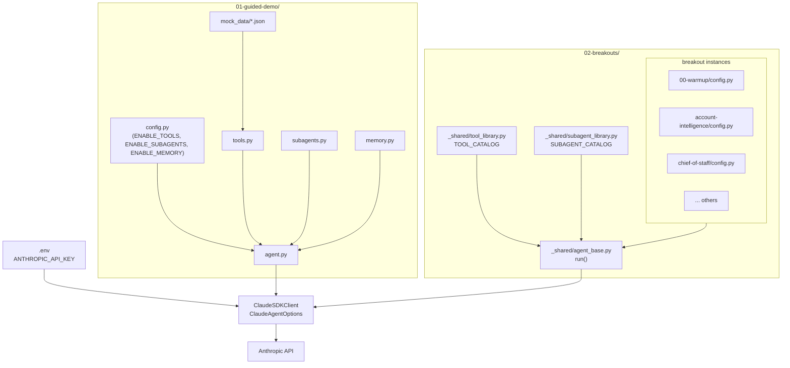

Sources: [01-guided-demo/README.md:1-55](), [02-breakouts/README.md:1-73](), [.env.example:1-3]()

---

## 01-guided-demo

The guided demo teaches agent SDK concepts through four progressive stages. All behavior is controlled by three boolean flags in `01-guided-demo/config.py`. The participant flips one flag per run and observes how the agent changes.

**Diagram: Stage Progression and Code Files**

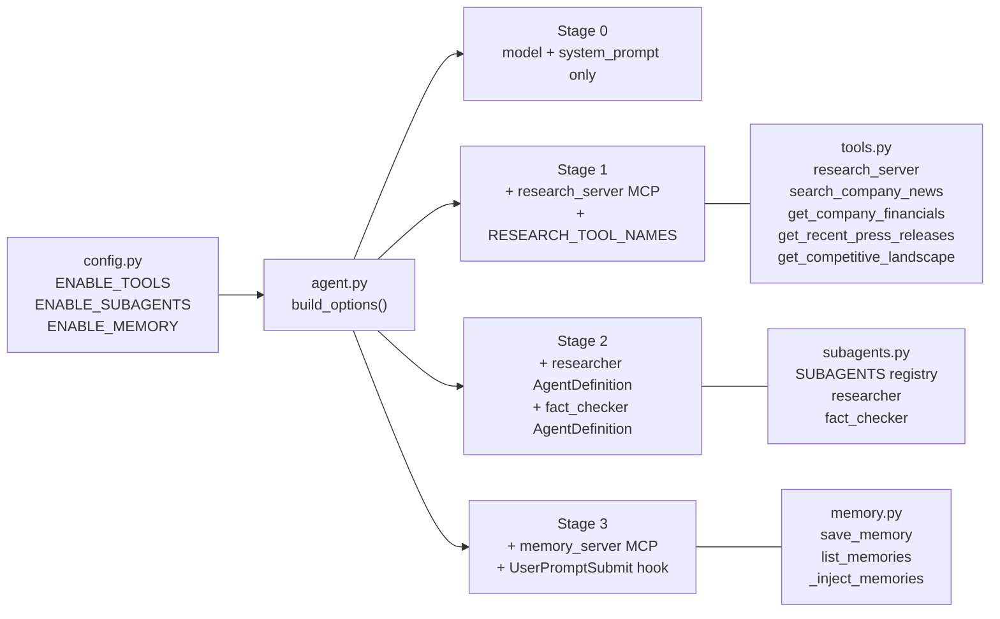

Sources: [01-guided-demo/README.md:20-28]()

The scenario throughout all four stages is the same: preparing a company briefing using fictional companies in `mock_data/`. The three mock companies (`Tinplate Merchant Systems`, `Bucklefern Commerce Holdings`, `Ironvane Freight Systems`) are interlinked — the same people and events appear across company records, giving the fact-checker sub-agent something real to cross-reference.

---

## 02-breakouts

The breakouts section provides a menu of pre-built components. Each breakout is a directory containing a `run.py` (do not edit), a `config.py` (edit this), and a `data/` directory of mock JSON. All breakouts delegate execution to `_shared/agent_base.py`.

**Diagram: Breakout Config-to-SDK Translation**

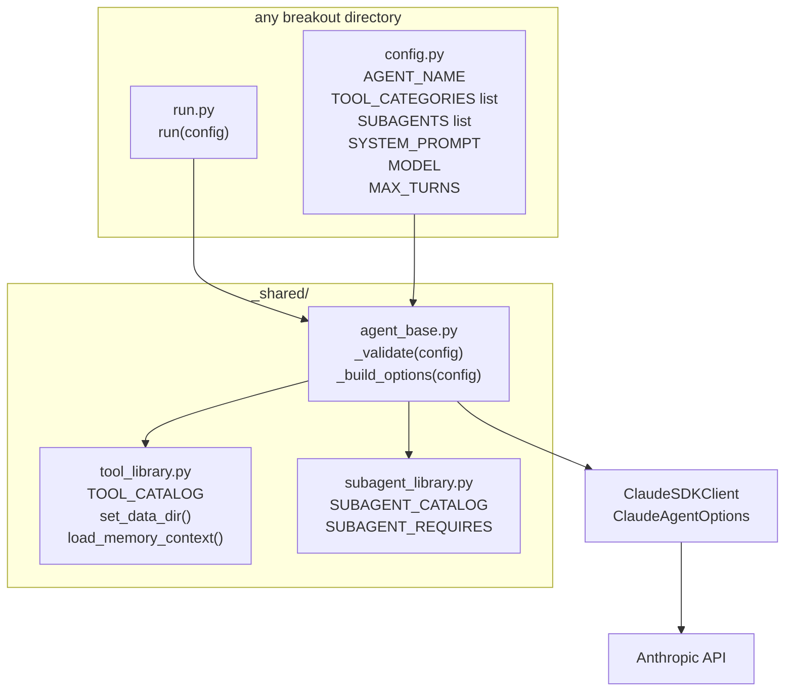

Sources: [02-breakouts/README.md:24-38]()

Available breakouts:

| Directory | Scenario |
|---|---|
| `00-warmup/` | Company briefing — mirrors the guided demo, eases the transition |
| `chief-of-staff/` | Meeting prep, email drafting, exec briefings |
| `customer-support/` | Ticket triage, KB-grounded responses, escalation |
| `sre-agent/` | Incident investigation, runbook execution |
| `account-intelligence/` | Pre-renewal account review, churn risk detection |
| `freeform/` | Blank canvas with the full component library |

The selectable components in any breakout's `config.py` come from two catalogs:

| Catalog | Variable | Options |
|---|---|---|
| `tool_library.py` | `TOOL_CATALOG` | `schedule`, `knowledge`, `support`, `ops`, `code`, `memory` |
| `subagent_library.py` | `SUBAGENT_CATALOG` | `researcher`, `summarizer`, `classifier`, `verifier`, `writer`, `procedure_runner` |

Sources: [02-breakouts/README.md:44-52]()

---

## How the Two Sections Relate

Both sections use the same underlying SDK types (`ClaudeSDKClient`, `ClaudeAgentOptions`) and the same pattern for wiring configuration into an agent. The guided demo expresses this pattern in `01-guided-demo/agent.py:build_options()`. The breakouts system expresses the same pattern in `02-breakouts/_shared/agent_base.py:_build_options()`. Comparing these two functions is the most direct way to understand what the SDK wiring looks like at different levels of abstraction.

The intended path through the workshop is: complete all four stages of the guided demo, then move to a breakout.

Sources: [01-guided-demo/README.md:54-55](), [02-breakouts/README.md:72-73]()

---

# Page: Getting Started

# Getting Started

<details>
<summary>Relevant source files</summary>

The following files were used as context for generating this wiki page:

- [.env.example](.env.example)
- [.gitignore](.gitignore)
- [01-guided-demo/README.md](01-guided-demo/README.md)
- [02-breakouts/README.md](02-breakouts/README.md)

</details>


This page covers environment setup, the `.env` configuration, what the `.gitignore` excludes and why, and how to invoke the two main entry points. For a conceptual overview of the repository's two sections and how they relate, see [Overview](#1). For the guided demo in detail, see [01-guided-demo](#2). For the breakouts system, see [02-breakouts](#3).

---

## Prerequisites

| Requirement | Notes |
|---|---|
| Python 3.x | With a working virtual environment |
| Anthropic API key | Obtainable from the Anthropic console |

---

## API Key Configuration

The SDK reads your Anthropic API key from the environment. The repository ships with a template file at [`.env.example`](.env.example:1-3)().

Copy it and fill in your key:

```
cp .env.example .env
```

Then edit `.env`:

```
ANTHROPIC_API_KEY=sk-ant-...
```

Both `01-guided-demo/agent.py` and `02-breakouts/_shared/agent_base.py` pass through to `ClaudeSDKClient`, which reads `ANTHROPIC_API_KEY` from the environment at runtime. Neither file hard-codes credentials.

Sources: [`.env.example:1-3`](.env.example:1-3)()

---

## What `.gitignore` Excludes

[`.gitignore`](.gitignore:1-32)() excludes three categories of files that workshop participants should never commit:

| Category | Pattern(s) | Reason |
|---|---|---|
| Python build artifacts | `__pycache__/`, `*.py[cod]`, `*.egg-info/`, `dist/`, `build/` | Not part of source |
| Virtual environments | `.env`, `.venv`, `env/`, `venv/` | Per-machine; also hides the `.env` secrets file |
| Editor settings | `.vscode/`, `.idea/`, `*.swp`, `*.swo`, `.DS_Store` | Local preferences |
| Claude Code local settings | `.claude/settings.local.json` | Per-user Claude Code configuration |
| Workshop runtime state | `**/memory_store.json` | Each attendee's memory store is personal and accumulates across runs |

The `**/memory_store.json` glob is the most workshop-specific exclusion. The memory system (used in Stage 3 of the guided demo and the `memory` tool category in breakouts) writes persistent state to a `memory_store.json` file. Each participant accumulates their own memories; sharing them across machines would contaminate results.

Sources: [`.gitignore:1-32`](.gitignore:1-32)()

---

## Entry Points

There are two commands, both invoked from the repository root via the `./workshop` script.

**Entry Point to Code Entity Mapping**

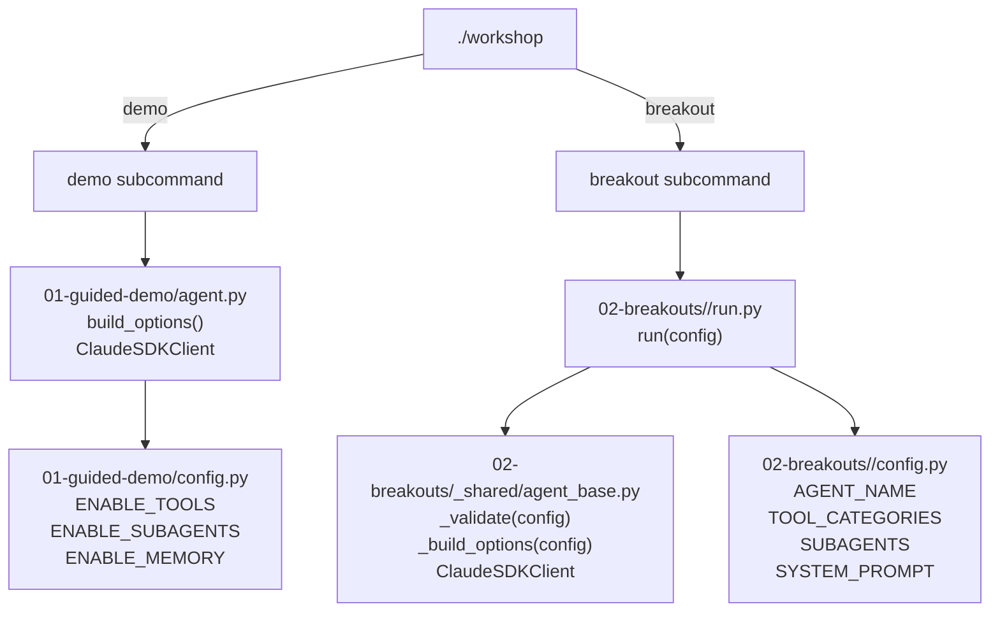

Sources: [`01-guided-demo/README.md:9`](01-guided-demo/README.md:9)(), [`02-breakouts/README.md:38`](02-breakouts/README.md:38)()

### `./workshop demo`

Runs the guided demo. This executes `01-guided-demo/agent.py`, which reads its behavior from `01-guided-demo/config.py`.

The only file you edit between runs is `config.py`. Three boolean flags gate each stage:

| Flag | Effect when `True` |
|---|---|
| `ENABLE_TOOLS` | Attaches the research MCP server; the SDK runs an agentic loop |
| `ENABLE_SUBAGENTS` | Adds `researcher` and `fact_checker` sub-agents via `AgentDefinition` |
| `ENABLE_MEMORY` | Attaches the memory MCP server and registers the `UserPromptSubmit` hook |

For full stage-by-stage documentation, see [Progressive Stages & Configuration](#2.1).

### `./workshop breakout <name>`

Runs a specific breakout by name (e.g., `./workshop breakout account-intelligence`). This executes the corresponding `02-breakouts/<name>/run.py`, which calls the shared runner `_shared/agent_base.py` with the breakout's `config.py` module.

Available breakout names:

| Name | Use case |
|---|---|
| `00-warmup` | Company briefing — transition from the guided demo |
| `chief-of-staff` | Meeting prep, email drafting, exec briefings |
| `customer-support` | Ticket triage, KB-grounded responses |
| `sre-agent` | Incident investigation, runbook execution |
| `account-intelligence` | Pre-renewal account review, churn risk detection |
| `freeform` | Blank canvas with the full component library |

Sources: [`02-breakouts/README.md:13-21`](02-breakouts/README.md:13-21)()

---

## The Edit-Run Cycle

**Guided Demo cycle:**

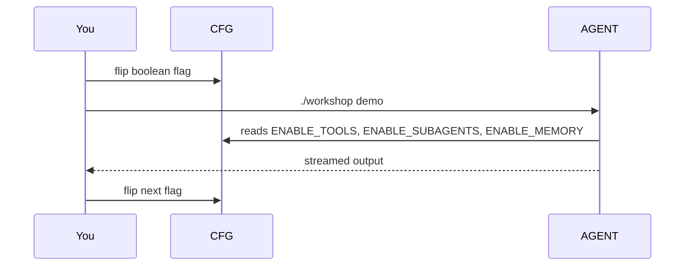

**Breakout cycle:**

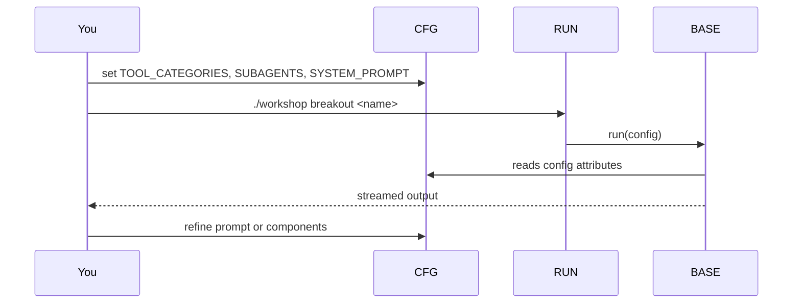

Sources: [`01-guided-demo/README.md:8-13`](01-guided-demo/README.md:8-13)(), [`02-breakouts/README.md:56-63`](02-breakouts/README.md:56-63)()

---

## Quick-Start Checklist

1. Copy `.env.example` to `.env` and set `ANTHROPIC_API_KEY`.
2. Activate your Python virtual environment.
3. Run `./workshop demo` to execute Stage 0 of the guided demo.
4. Open `01-guided-demo/config.py`, set `ENABLE_TOOLS = True`, re-run.
5. Continue through all four stages.
6. When done, run `./workshop breakout 00-warmup` to begin the breakouts.

Sources: [`01-guided-demo/README.md:8-13`](01-guided-demo/README.md:8-13)(), [`02-breakouts/README.md:55-63`](02-breakouts/README.md:55-63)(), [`.env.example:1-3`](.env.example:1-3)()

---

# Page: 01-guided-demo

# 01-guided-demo

<details>
<summary>Relevant source files</summary>

The following files were used as context for generating this wiki page:

- [01-guided-demo/GUIDE.md](01-guided-demo/GUIDE.md)
- [01-guided-demo/README.md](01-guided-demo/README.md)
- [01-guided-demo/config.py](01-guided-demo/config.py)

</details>


This section documents the **guided demo** portion of the workshop (`01-guided-demo/`). Its purpose is to teach Claude SDK concepts progressively by running the same company-briefing agent four times, adding one SDK primitive per run. The only file participants edit is `config.py`.

For documentation of the self-directed assembly environment, see [02-breakouts](#3). For repository setup and invocation commands, see [Getting Started](#1.1).

---

## Scenario

The demo uses a single recurring task: prepare a company briefing before a meeting. Three fictional companies are available as targets:

| Company | Profile |
|---|---|
| **Tinplate Merchant Systems** | Mid-market fintech, high growth, not yet profitable |
| **Bucklefern Commerce Holdings** | Mature public company, growth slowing |
| **Ironvane Freight Systems** | Supply chain software, recent leadership change |

The mock data is intentionally interlinked — for example, Ironvane's departing CPO appears in Tinplate's hiring news — giving the fact-checker sub-agent something meaningful to verify across sources.

Sources: [01-guided-demo/README.md:33-38](), [01-guided-demo/GUIDE.md:1-6]()

---

## How to Run

```
./workshop demo
```

Run this command from the repo root at each stage. The default task is defined in `DEFAULT_TASK` in `config.py` and targets Tinplate Merchant Systems, but you can override it at the prompt.

To inspect the full assembled system context sent to the model at any stage:

```
./workshop demo --show-prompt
```

Sources: [01-guided-demo/README.md:8-11](), [01-guided-demo/GUIDE.md:283-284]()

---

## The Four-Stage Progression

Participants flip one boolean flag at a time in `config.py`. Each flag is additive — earlier stages stay enabled.

| Stage | Flag(s) Active | SDK Primitive Introduced | Capability Gained |
|---|---|---|---|
| 0 | *(all `False`)* | `ClaudeSDKClient` + `system_prompt` | Baseline chat only |
| 1 | `ENABLE_TOOLS` | `@tool` + `create_sdk_mcp_server` | Agent can look up company data |
| 2 | `ENABLE_SUBAGENTS` | `AgentDefinition` + `Task` tool | Agent delegates to specialist sub-agents |
| 3 | `ENABLE_MEMORY` | `hooks` + persistence tool | Agent remembers preferences across runs |

Sources: [01-guided-demo/config.py:12-62](), [01-guided-demo/README.md:22-27](), [01-guided-demo/GUIDE.md:15-274]()

---

## File Structure

| File | Role | Participants edit? |
|---|---|---|
| `config.py` | Three boolean toggles + `MODEL`, `VERBOSITY`, `DEFAULT_TASK` | **Yes** |
| `agent.py` | Entry point; `build_options()` assembles `ClaudeAgentOptions` | No (read it) |
| `tools.py` | `@tool`-decorated research functions + `create_sdk_mcp_server()` | Peek at Stage 1 |
| `subagents.py` | `AgentDefinition` specs for researcher and fact_checker | Peek at Stage 2 |
| `memory.py` | `save_memory` tool + `UserPromptSubmit` hook | Peek at Stage 3 |
| `mock_data/*.json` | Fictional company data (Tinplate, Bucklefern, Ironvane) | No |
| `GUIDE.md` | Stage-by-stage walkthrough with expected console output | No (read it) |

Sources: [01-guided-demo/README.md:42-52]()

---

## Configuration Parameters

All configuration lives in [01-guided-demo/config.py]().

| Parameter | Type | Default | Description |
|---|---|---|---|
| `ENABLE_TOOLS` | `bool` | `False` | Adds `research_server` and research tool allowlist |
| `ENABLE_SUBAGENTS` | `bool` | `False` | Adds `researcher` and `fact_checker` agent definitions |
| `ENABLE_MEMORY` | `bool` | `False` | Adds `memory_server` and `UserPromptSubmit` hook |
| `MODEL` | `str` | `"claude-sonnet-4-6"` | Claude model identifier passed to `ClaudeAgentOptions` |
| `VERBOSITY` | `str` | `"verbose"` | Controls tool call and cost display in console |
| `DEFAULT_TASK` | `str` | Tinplate briefing request | Pre-filled prompt; can be overridden at runtime |

Sources: [01-guided-demo/config.py:12-84]()

---

## Stage Diagram: Flags to SDK Options

**Diagram: How config.py flags map to ClaudeAgentOptions fields**

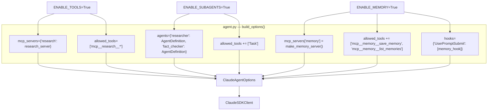

Sources: [01-guided-demo/GUIDE.md:36-48](), [01-guided-demo/GUIDE.md:81-99](), [01-guided-demo/GUIDE.md:152-166](), [01-guided-demo/GUIDE.md:229-258]()

---

## Stage 0 — Basic Chat

All flags are `False`. `build_options()` returns a `ClaudeAgentOptions` with only `model` and `system_prompt` set. `mcp_servers` is empty, `allowed_tools` is empty, `agents` is `None`, `hooks` is `None`.

The SDK handles connection and streaming, but there is no agentic loop because there are no tools to call. The model responds once from training knowledge. Responses are often hedged with phrases like "as of my training data."

**What to observe:** Ask for specific Q4 revenue figures — the agent cannot answer with confidence.

Sources: [01-guided-demo/GUIDE.md:15-50]()

---

## Stage 1 — Tools

**Flag:** `ENABLE_TOOLS = True`

`build_options()` adds:
- `mcp_servers={"research": research_server}` — the MCP server bundling research tools from `tools.py`
- `allowed_tools` populated with `RESEARCH_TOOL_NAMES` (four `mcp__research__*` entries)

The SDK now runs a real agentic loop: the model receives tool schemas, decides which tools to call, the SDK executes them locally (in-process, reading from `mock_data/*.json`), results return to the model, and the loop continues until the model produces a final response.

Console output shows yellow `→ calling ...` lines for each tool invocation.

**What to observe:** Same briefing request as Stage 0. Tool calls are visible; the output contains specific dates and dollar figures from mock data.

Sources: [01-guided-demo/GUIDE.md:52-119]()

---

## Stage 2 — Sub-agents

**Flag:** `ENABLE_SUBAGENTS = True` (requires `ENABLE_TOOLS = True`)

`build_options()` adds:
- `agents={"researcher": AgentDefinition(...), "fact_checker": AgentDefinition(...)}` from `subagents.py`
- `"Task"` appended to `allowed_tools`

When the main agent calls `Task(subagent_type="researcher", prompt="...")`, the SDK:
1. Starts an isolated conversation with the sub-agent's system prompt
2. The sub-agent runs its own tool calls in its own context window
3. Only the sub-agent's final answer is returned to the main agent

The main agent's context window does not accumulate the sub-agent's intermediate steps.

**What to observe:** `Task` tool calls appear in the console. The benefit is clearest on comparison requests (e.g., Tinplate vs. Bucklefern), where the main agent can delegate parallel research tasks.

**Main agent vs. sub-agent comparison:**

| Dimension | Main agent | Sub-agent |
|---|---|---|
| Defined by | `ClaudeAgentOptions` in `agent.py` | `AgentDefinition` in `subagents.py` |
| Invoked by | Caller via `client.query()` | Main agent via `Task(...)` |
| Context window | Shared across turns | Isolated per invocation |
| Sees conversation history | Yes | No — only the `Task` prompt |
| Return value | Streams to caller | Single message to main agent |

Sources: [01-guided-demo/GUIDE.md:122-191]()

---

## Stage 3 — Memory

**Flag:** `ENABLE_MEMORY = True`

`build_options()` adds two complementary pieces:

**Write path (tool):** `make_memory_server()` from `memory.py` is added to `mcp_servers["memory"]`. The agent can call `mcp__memory__save_memory(category, note)` to persist a note to `memory_store.json`.

**Read path (hook):** `hooks={"UserPromptSubmit": [memory_hook]}`. This hook fires automatically before each user message is sent to the model. It reads `memory_store.json` and injects entries as `additionalContext` into the system context. The model sees stored memories as if they had been stated in the current session.

**Tool vs. hook comparison:**

| Dimension | Tool | Hook |
|---|---|---|
| Who triggers it | The model, mid-turn | The SDK, on lifecycle events |
| Model aware of it | Yes — listed in tool schemas | No — invisible to the model |
| When it fires | When the model decides | Fixed events: `UserPromptSubmit`, `PreToolUse`, `PostToolUse`, `Stop`, etc. |
| Use cases | Capabilities the agent needs | Guardrails, context injection, audit logging |

`memory_store.json` persists across terminal restarts. Run `./workshop reset` to clear it.

Sources: [01-guided-demo/GUIDE.md:193-273]()

---

## Code Entity Map

**Diagram: Source files and their primary code entities**

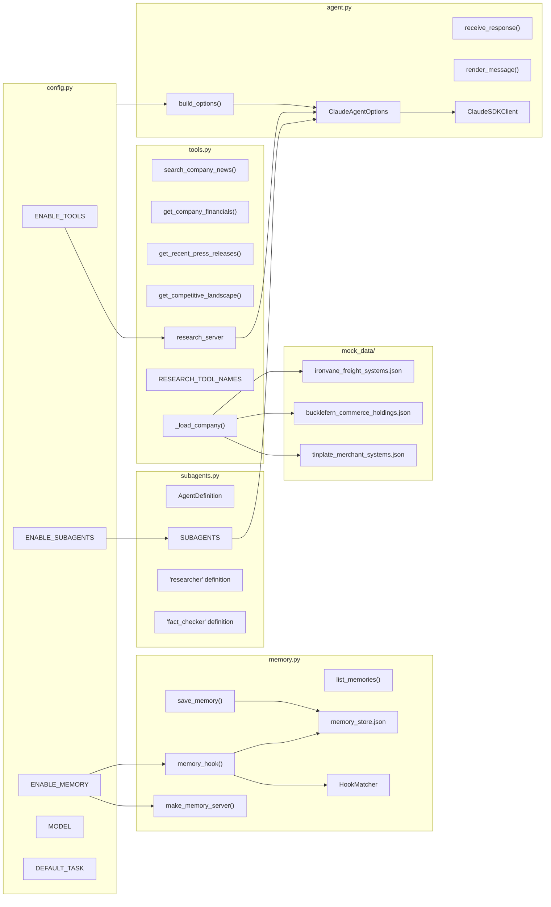

Sources: [01-guided-demo/agent.py](), [01-guided-demo/tools.py](), [01-guided-demo/subagents.py](), [01-guided-demo/memory.py](), [01-guided-demo/config.py]()

---

## Stretch Goals (from `config.py`)

The bottom of `config.py` documents several experiments participants can try between stages:

[01-guided-demo/config.py:88-115]()

Notable suggestions:
- Ask about a company not in `mock_data/` (e.g., "Apple") to observe how the agent handles missing data
- Compare two companies to trigger parallel sub-agent spawning
- Set `VERBOSITY = "normal"` to see how much information is suppressed
- Swap `MODEL` to `"claude-opus-4-6"` and compare output quality
- Use `./workshop demo --show-prompt` at each stage to inspect the growing system context
- Run `./workshop reset` to clear `memory_store.json` and observe the agent's behavior on next run

---

# Page: Progressive Stages & Configuration

# Progressive Stages & Configuration

<details>
<summary>Relevant source files</summary>

The following files were used as context for generating this wiki page:

- [01-guided-demo/GUIDE.md](01-guided-demo/GUIDE.md)
- [01-guided-demo/README.md](01-guided-demo/README.md)
- [01-guided-demo/config.py](01-guided-demo/config.py)

</details>


This page documents the four-stage progression in `01-guided-demo`, explaining what each stage enables, how the three boolean flags in `config.py` gate each stage, and the full set of configuration parameters available. The stage system exists to teach SDK primitives incrementally — each run uses the same task and the same entry point, but a different capability set.

For the implementation of `build_options()` that reads these flags and assembles `ClaudeAgentOptions`, see [Agent Entry Point](#2.2). For the tools, sub-agents, and memory modules that each stage activates, see [Research Tools](#2.3), [Sub-agents](#2.4), and [Memory System](#2.5).

---

## Configuration File

`config.py` is the **only file participants edit** during the guided demo. It contains three stage-gating boolean flags and three secondary parameters.

[01-guided-demo/config.py:1-85]()

| Parameter | Type | Default | Purpose |
|---|---|---|---|
| `ENABLE_TOOLS` | `bool` | `False` | Gates Stage 1 — wires research MCP server into agent options |
| `ENABLE_SUBAGENTS` | `bool` | `False` | Gates Stage 2 — adds `AgentDefinition` entries and `Task` tool |
| `ENABLE_MEMORY` | `bool` | `False` | Gates Stage 3 — adds memory MCP server and `UserPromptSubmit` hook |
| `MODEL` | `str` | `"claude-sonnet-4-6"` | Claude model identifier passed to `ClaudeAgentOptions` |
| `VERBOSITY` | `str` | `"verbose"` | Controls console output: `"normal"` or `"verbose"` |
| `DEFAULT_TASK` | `str` | Tinplate briefing request | Pre-filled task prompt used when the user presses Enter at the prompt |

Sources: [01-guided-demo/config.py:13-84]()

---

## Stage Overview

The four stages are additive. Each stage keeps everything from the prior stages and adds exactly one new SDK primitive. The same `./workshop demo` command is run each time; only `config.py` changes.

**Stage progression diagram:**

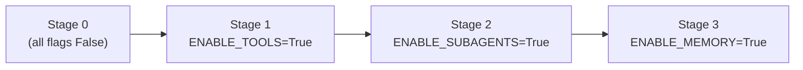

**Mapping flags to SDK options populated in `build_options()`:**

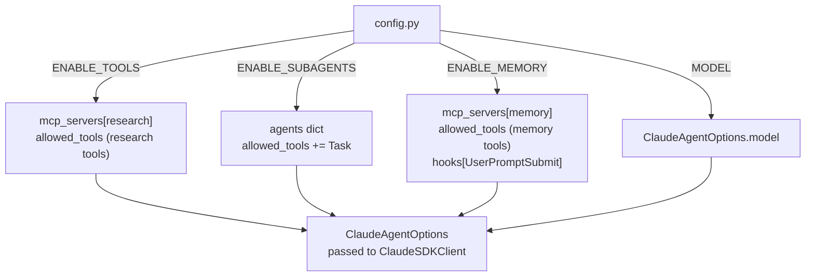

Sources: [01-guided-demo/config.py:13-62](), [01-guided-demo/GUIDE.md:1-50]()

---

## Stage 0 — Basic Chat

**Flags:** all `False`

**SDK primitive:** `ClaudeSDKClient` + `system_prompt`

With all flags off, `build_options()` in `agent.py` returns a `ClaudeAgentOptions` with only `model` and `system_prompt` set. `mcp_servers` is an empty dict, `allowed_tools` is an empty list, `agents` is `None`, and `hooks` is `None`.

There is no agentic loop at this stage — the model has no tools to call, so it responds once and terminates. Output is drawn entirely from training data, which means it may be vague or hedged when asked about specific recent events.

**`ClaudeAgentOptions` at Stage 0:**

| Field | Value |
|---|---|
| `model` | `config.MODEL` |
| `system_prompt` | `BASE_SYSTEM_PROMPT` |
| `mcp_servers` | `{}` |
| `allowed_tools` | `[]` |
| `agents` | `None` |
| `hooks` | `None` |

Sources: [01-guided-demo/GUIDE.md:15-50]()

---

## Stage 1 — Tools

**Flags:** `ENABLE_TOOLS = True`

**SDK primitive:** `@tool` decorator + `create_sdk_mcp_server()`

Setting `ENABLE_TOOLS = True` causes `build_options()` to populate two new fields in `ClaudeAgentOptions`:

- `mcp_servers={"research": research_server}` — the MCP server built from `tools.py`
- `allowed_tools` — a list of the four research tool names using the `mcp__research__<name>` convention

The SDK now runs a real agentic loop: the model sees the tool schemas, decides which tools to call, the SDK executes them locally (in-process, no subprocess), results return to the model, and the loop continues until the model has what it needs.

**Tools added at Stage 1:**

| Tool name (in `allowed_tools`) | Function in `tools.py` |
|---|---|
| `mcp__research__search_company_news` | `search_company_news` |
| `mcp__research__get_company_financials` | `get_company_financials` |
| `mcp__research__get_recent_press_releases` | `get_recent_press_releases` |
| `mcp__research__get_competitive_landscape` | `get_competitive_landscape` |

**`ClaudeAgentOptions` delta at Stage 1:**

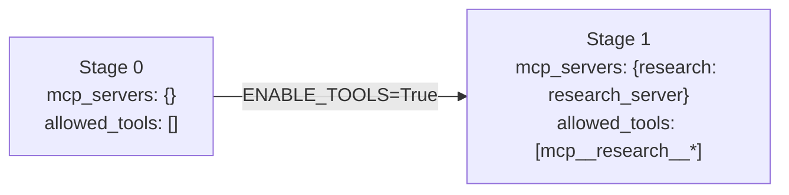

Sources: [01-guided-demo/GUIDE.md:53-101](), [01-guided-demo/config.py:13-26]()

---

## Stage 2 — Sub-agents

**Flags:** `ENABLE_TOOLS = True`, `ENABLE_SUBAGENTS = True`

**SDK primitive:** `AgentDefinition` + `Task` tool

> Requires `ENABLE_TOOLS = True` — sub-agents need tools to be useful. [01-guided-demo/config.py:44]()

Setting `ENABLE_SUBAGENTS = True` adds `agents` to `ClaudeAgentOptions` and appends `"Task"` to `allowed_tools`. Two `AgentDefinition` instances are registered: `researcher` and `fact_checker`.

When the main agent calls `Task(subagent_type="researcher", prompt="...")`, the SDK:
1. Spins up an isolated conversation using the sub-agent's `prompt` (system prompt)
2. Runs the sub-agent with its own `tools` allowlist and optional `model` override
3. Returns only the final answer to the main agent's context

This keeps the main agent's context window clean — it sees summarized findings, not all intermediate tool calls.

**Sub-agents added at Stage 2:**

| Sub-agent key | Defined in | Model | Purpose |
|---|---|---|---|
| `researcher` | `subagents.py` | `haiku` | Deep information gathering using research tools |
| `fact_checker` | `subagents.py` | `haiku` | Cross-references claims before they appear in the briefing |

**`ClaudeAgentOptions` delta at Stage 2:**

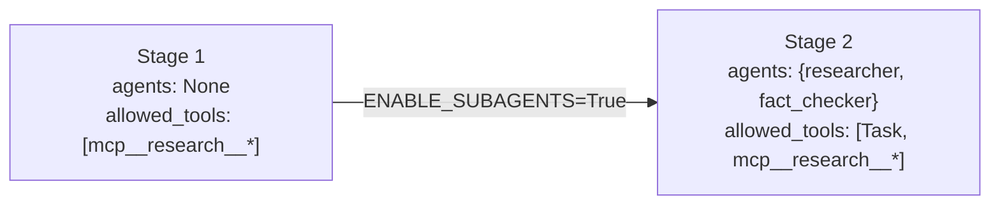

Sources: [01-guided-demo/GUIDE.md:122-190](), [01-guided-demo/config.py:29-45]()

---

## Stage 3 — Memory

**Flags:** `ENABLE_TOOLS = True`, `ENABLE_SUBAGENTS = True`, `ENABLE_MEMORY = True`

**SDK primitive:** `hooks` + memory persistence tool

Setting `ENABLE_MEMORY = True` adds two complementary pieces:

**Write path (tool):** `make_memory_server()` from `memory.py` is added to `mcp_servers["memory"]`. Two tool names are appended to `allowed_tools`: `mcp__memory__save_memory` and `mcp__memory__list_memories`. The model calls `save_memory` when it decides something is worth persisting.

**Read path (hook):** A `UserPromptSubmit` hook is registered via `hooks={"UserPromptSubmit": [memory_hook]}`. This hook fires automatically before every user message is sent to the model. It reads `memory_store.json` and returns `additionalContext` that the SDK injects into the system context. The model never sees the hook itself — it just sees the memory text as if it were part of the prompt.

**Comparison of tools vs. hooks:**

| | Tool | Hook |
|---|---|---|
| **Who triggers it** | The model, mid-turn | The SDK, on lifecycle events |
| **Model aware of it?** | Yes — it appears in the tool list | No — invisible to the model |
| **When it fires** | Whenever the model calls it | Fixed event: `UserPromptSubmit`, `PreToolUse`, etc. |
| **Memory role** | Model *writes* memories via `save_memory` | SDK *reads* and injects memories before each turn |

**`ClaudeAgentOptions` delta at Stage 3:**

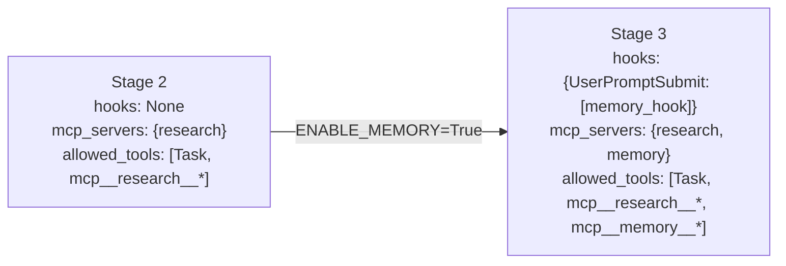

**Full accumulated `ClaudeAgentOptions` at Stage 3:**

| Field | Value |
|---|---|
| `model` | `config.MODEL` |
| `system_prompt` | `BASE_SYSTEM_PROMPT` |
| `mcp_servers` | `{"research": research_server, "memory": memory_server}` |
| `allowed_tools` | `["Task", "mcp__research__*", "mcp__memory__save_memory", "mcp__memory__list_memories"]` |
| `agents` | `{"researcher": AgentDefinition(...), "fact_checker": AgentDefinition(...)}` |
| `hooks` | `{"UserPromptSubmit": [memory_hook]}` |

Sources: [01-guided-demo/GUIDE.md:193-275](), [01-guided-demo/config.py:49-62]()

---

## Full Stage Comparison

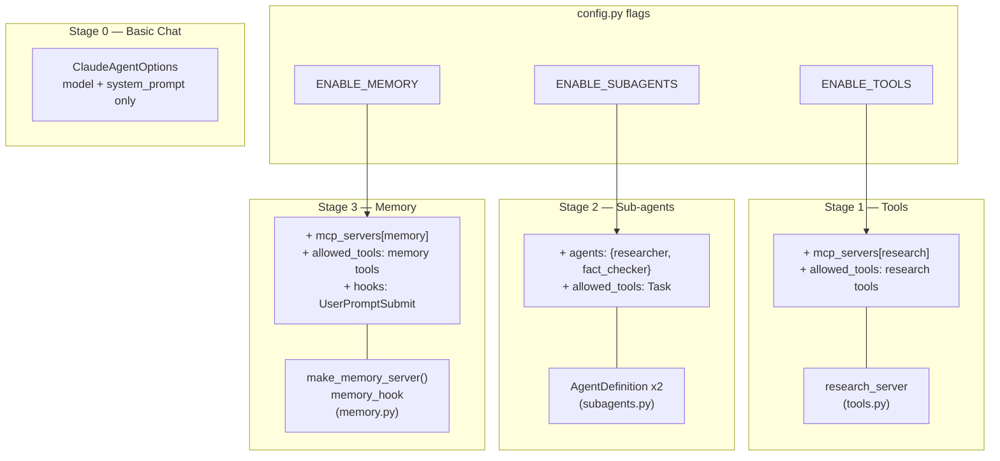

Sources: [01-guided-demo/config.py:1-85](), [01-guided-demo/GUIDE.md:1-291](), [01-guided-demo/README.md:1-55]()

---

## Secondary Configuration Parameters

### `MODEL`

[01-guided-demo/config.py:72]()

Passed directly to `ClaudeAgentOptions(model=...)`. The default `"claude-sonnet-4-6"` balances speed and cost for workshop use. Swap to `"claude-opus-4-6"` to compare output quality at any stage.

### `VERBOSITY`

[01-guided-demo/config.py:77]()

Consumed by `agent.py`'s `render_message()` function. Two values:

| Value | Output |
|---|---|
| `"verbose"` | Agent text + tool call/result lines + cost breakdown |
| `"normal"` | Agent text responses only |

### `DEFAULT_TASK`

[01-guided-demo/config.py:81-84]()

The prompt pre-filled when the user presses Enter at the interactive prompt. Defaults to a briefing request for Tinplate Merchant Systems. Can be overridden at runtime without editing `config.py`.

Sources: [01-guided-demo/config.py:65-84](), [01-guided-demo/GUIDE.md:284-290]()

---

# Page: Agent Entry Point

# Agent Entry Point

<details>
<summary>Relevant source files</summary>

The following files were used as context for generating this wiki page:

- [01-guided-demo/GUIDE.md](01-guided-demo/GUIDE.md)
- [01-guided-demo/agent.py](01-guided-demo/agent.py)
- [01-guided-demo/config.py](01-guided-demo/config.py)

</details>


This page documents `01-guided-demo/agent.py` — the single entry point for all four demo stages. It covers the `build_options()` function, the `ClaudeSDKClient` lifecycle, the `receive_response()` streaming loop, the `--show-prompt` debug flag, and the `render_message()` console rendering logic.

For the boolean flags that control which stage is active, see the [Progressive Stages & Configuration](#2.1) page. For the tools wired in at Stage 1, see [Research Tools](#2.3). For sub-agent definitions, see [Sub-agents](#2.4). For the memory hook, see [Memory System](#2.5).

---

## Role in the Demo

`agent.py` is intentionally not edited by workshop participants. Its job is to read the three boolean flags from `config.py` and translate them into a fully assembled `ClaudeAgentOptions` object, then hand it to `ClaudeSDKClient` and render the resulting event stream. Every stage change in `config.py` is expressed as a different `ClaudeAgentOptions` value — `agent.py` is the function that computes that mapping.

**Diagram: Data flow from config flags to the running agent**

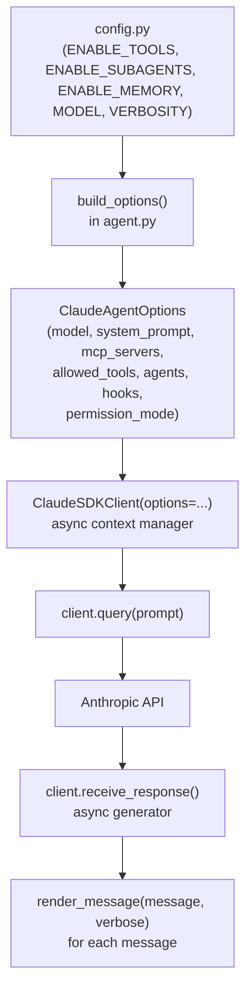

Sources: [01-guided-demo/agent.py:200-415]()

---

## `build_options()`

[01-guided-demo/agent.py:200-286]()

`build_options()` is the pedagogical core of the demo. It starts from a fixed baseline and conditionally mutates four variables — `mcp_servers`, `allowed_tools`, `agents`, and `hooks` — before constructing and returning a `ClaudeAgentOptions`.

### Baseline (always present)

```
system_prompt = BASE_SYSTEM_PROMPT
allowed_tools = []
mcp_servers   = {}
agents        = None
hooks         = None
```

`BASE_SYSTEM_PROMPT` [01-guided-demo/agent.py:45-56]() is a static string that instructs the model to act as a company briefing assistant. It never changes between stages.

### Stage 1 — `ENABLE_TOOLS`

[01-guided-demo/agent.py:226-228]()

```
mcp_servers["research"] = research_server
allowed_tools.extend(RESEARCH_TOOL_NAMES)
```

`research_server` is an MCP server object imported from `tools.py`. `RESEARCH_TOOL_NAMES` is a list of fully-qualified tool name strings (e.g. `"mcp__research__search_company_news"`). Both steps are required: registering the server makes the tool logic available, but listing the names in `allowed_tools` is what authorizes the model to call them.

### Stage 2 — `ENABLE_SUBAGENTS`

[01-guided-demo/agent.py:239-251]()

```
agents = SUBAGENTS
allowed_tools.append("Task")
system_prompt += ORCHESTRATOR_PROMPT_SUFFIX
```

`SUBAGENTS` is a `dict[str, AgentDefinition]` imported from `subagents.py`. Adding `"Task"` to `allowed_tools` gives the main agent the built-in SDK tool that spawns sub-agents. `ORCHESTRATOR_PROMPT_SUFFIX` nudges the system prompt toward delegation behavior.

There is a soft dependency guard: if `ENABLE_SUBAGENTS` is `True` but `ENABLE_TOOLS` is `False`, a warning is printed because the sub-agents themselves have no tools to use.

### Stage 3 — `ENABLE_MEMORY`

[01-guided-demo/agent.py:262-272]()

```
mcp_servers["memory"] = make_memory_server()
allowed_tools.extend(MEMORY_TOOL_NAMES)
hooks = {"UserPromptSubmit": [memory_hook]}
system_prompt += "..."   # instructions to use save_memory
```

`make_memory_server()` is called fresh each time to create the MCP server object containing the `save_memory` and `list_memories` tools. `memory_hook` is a `HookMatcher` that fires on every `UserPromptSubmit` event and injects persisted memories as additional context.

### Final construction

[01-guided-demo/agent.py:274-286]()

All four variables are passed to `ClaudeAgentOptions`. `permission_mode="bypassPermissions"` is always set so the agent can invoke tools without per-call approval prompts during the workshop.

**Diagram: `build_options()` conditional assembly**

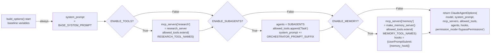

Sources: [01-guided-demo/agent.py:200-286]()

---

## `ClaudeSDKClient` Lifecycle

[01-guided-demo/agent.py:383-407]()

`ClaudeSDKClient` is used as an `async with` context manager. Opening the context establishes the persistent connection; closing it tears it down cleanly. Using a client object (rather than a one-shot `query()` function) enables:

- **Multi-turn conversations** — the same client retains conversation history across calls to `client.query()`.
- **Hook reliability** — hooks require a client context to fire correctly.

The follow-up loop [01-guided-demo/agent.py:396-407]() reuses the same open client, so each follow-up question accumulates context from prior turns. This is "within-session" memory and works at every stage, regardless of `ENABLE_MEMORY`.

| Behavior | Mechanism |
|---|---|
| Single request | `await client.query(user_prompt)` |
| Multi-turn follow-up | Re-call `await client.query(follow)` on the same open client |
| Conversation context | Maintained by the SDK inside `ClaudeSDKClient` |
| Cross-session persistence | Only when `ENABLE_MEMORY=True` (memory hook + file) |

Sources: [01-guided-demo/agent.py:383-407]()

---

## `receive_response()` Streaming Loop

[01-guided-demo/agent.py:390-407]()

After each call to `client.query()`, the response is consumed by iterating `client.receive_response()`:

```python
async for message in client.receive_response():
    render_message(message, verbose)
```

`receive_response()` is an async generator. It yields messages until the agent's full turn is complete (signaled by a `ResultMessage`). While iterating, the SDK is internally running the agentic loop: deciding tool calls, executing them, feeding results back to the model, and repeating. From `agent.py`'s perspective, the loop is opaque — it only sees the resulting message objects.

**Message types yielded:**

| Type | Content | Displayed when |
|---|---|---|
| `AssistantMessage` | Text blocks and tool-use blocks | Always (text); verbose only (tool calls) |
| `UserMessage` | Tool result blocks | Verbose only |
| `ResultMessage` | Turn summary (turns, cost, error flag) | Always |

Sources: [01-guided-demo/agent.py:390-341]()

---

## `render_message()`

[01-guided-demo/agent.py:294-340]()

`render_message(message, verbose)` handles all console output. It dispatches on the message type using `isinstance` checks.

**Diagram: `render_message()` dispatch logic**

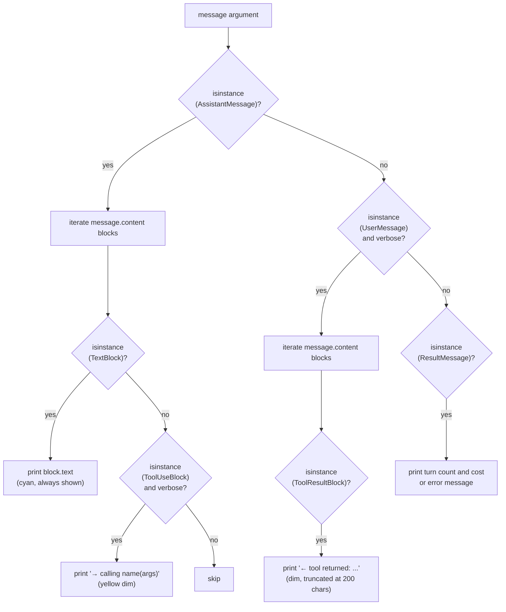

The `verbose` flag is derived from `config.VERBOSITY == "verbose"` [01-guided-demo/agent.py:378](). At `"normal"` verbosity, tool calls and tool results are suppressed, and only the final assistant text and turn summary are printed.

Long tool results are truncated at 200 characters [01-guided-demo/agent.py:326-327]() to keep the console readable.

Sources: [01-guided-demo/agent.py:294-340]()

---

## `--show-prompt` Debug Flag

[01-guided-demo/agent.py:374-376](), [01-guided-demo/agent.py:128-188]()

If `--show-prompt` is passed as a command-line argument, `main()` calls `show_assembled_prompt(options)` and returns before creating a `ClaudeSDKClient`. No API call is made.

`show_assembled_prompt()` prints:

| Section | Source field | Notes |
|---|---|---|
| System prompt | `options.system_prompt` | Full text, dimmed |
| Allowed tools | `options.allowed_tools` | Each on its own line |
| Sub-agents | `options.agents` | Name, description, model, tool count, prompt prefix |
| Hooks | `options.hooks` | Event name and handler count only; injected context is runtime-only |
| Model and permission mode | `options.model`, `options.permission_mode` | Scalar fields |
| MCP server names | `options.mcp_servers.keys()` | Assumes dict (always true in this demo) |

This flag is documented in `GUIDE.md` [01-guided-demo/GUIDE.md:283]() as a way to compare what the SDK assembles at each stage.

Sources: [01-guided-demo/agent.py:128-188](), [01-guided-demo/agent.py:374-376](), [01-guided-demo/GUIDE.md:283-284]()

---

## Supporting Utilities

### `_current_stage()`

[01-guided-demo/agent.py:86-101]()

Derives the current stage number (0–3) from the three config flags and returns a human-readable label and a "next step" hint. Used only by `print_config()` to display orientation information at startup.

| `ENABLE_TOOLS` | `ENABLE_SUBAGENTS` | `ENABLE_MEMORY` | Stage |
|---|---|---|---|
| False | False | False | 0 — Basic Chat |
| True | False | False | 1 — Tools |
| True | True | False | 2 — Sub-agents |
| True | True | True | 3 — Memory & Context |
| (other) | — | — | -1 — Custom |

### `print_config()`

[01-guided-demo/agent.py:104-125]()

Printed at startup. Shows current flag values, derived stage, and the next step hint. Uses the `C` class for ANSI color codes.

### `C` class

[01-guided-demo/agent.py:64-77]()

Holds ANSI escape sequences for terminal coloring. All codes are blanked to empty strings when the environment variable `NO_COLOR=1` is set.

### `banner()`

[01-guided-demo/agent.py:80-83]()

Prints a 70-character cyan horizontal rule with centered text, used as a section header in the terminal output.

Sources: [01-guided-demo/agent.py:64-125]()

---

## `main()` Entry Point

[01-guided-demo/agent.py:348-415]()

`main()` is an `async` function driven by `asyncio.run()`. Its execution order:

1. Print banner and current config via `print_config()`
2. If `ENABLE_MEMORY` is on, load and display the memory summary from `memory_store.json`
3. Prompt the user for input; fall back to `config.DEFAULT_TASK` on empty input
4. Call `build_options()` to assemble `ClaudeAgentOptions`
5. If `--show-prompt` is in `sys.argv`, call `show_assembled_prompt()` and return
6. Open `ClaudeSDKClient` as an async context manager
7. Send the initial prompt via `client.query()`
8. Iterate `client.receive_response()`, passing each message to `render_message()`
9. Enter the follow-up loop, repeating steps 7–8 until the user submits empty input or sends EOF

`KeyboardInterrupt` is caught at the top level [01-guided-demo/agent.py:411-414]() and exits cleanly with a short message.

Sources: [01-guided-demo/agent.py:348-415]()

---

# Page: Research Tools

# Research Tools

<details>
<summary>Relevant source files</summary>

The following files were used as context for generating this wiki page:

- [01-guided-demo/GUIDE.md](01-guided-demo/GUIDE.md)
- [01-guided-demo/tools.py](01-guided-demo/tools.py)

</details>


This page documents `01-guided-demo/tools.py`: the four research tool functions, how they load mock company data, how they are packaged into an in-process MCP server, and the naming convention that makes tools visible to the model.

This page covers Stage 1 of the guided demo only. For the stage progression and how `ENABLE_TOOLS` activates these tools, see [Progressive Stages & Configuration](#2.1). For the sub-agents that use these tools as part of their allowlist, see [Sub-agents](#2.4). For the mock JSON data these tools read, see [Mock Company Data](#2.6).

---

## Role in the Agent

When `ENABLE_TOOLS = True` in `config.py`, `agent.py` adds `research_server` to `mcp_servers` and populates `allowed_tools` from `RESEARCH_TOOL_NAMES`. The SDK then runs an agentic loop: the model can call these tools mid-conversation, receive results, and continue reasoning before producing a final response.

**Tool activation flow**

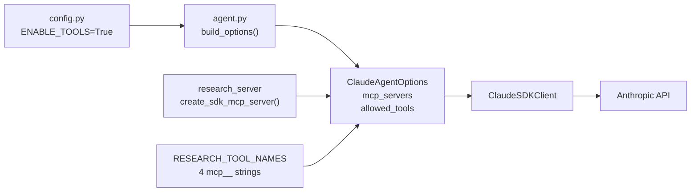

Sources: [01-guided-demo/tools.py:231-249](), [01-guided-demo/GUIDE.md:82-99]()

---

## Mock Data Loading

All tools read from static JSON files in `01-guided-demo/mock_data/`. No network calls are made.

### `_load_company()`

[01-guided-demo/tools.py:24-32]()

Performs case-insensitive, punctuation-stripped fuzzy matching against the `"company"` key in every `.json` file in `_DATA_DIR`. The matching normalizes spaces, hyphens, and underscores before comparing. It returns the full parsed dict for the first match, or `None` if no file matches.

```
needle = company_name.lower().strip(spaces/hyphens/underscores)
for each *.json in mock_data/:
    hay = data["company"].lower().strip(spaces)
    match if needle in hay OR hay in needle
```

### `_known_companies()`

[01-guided-demo/tools.py:35-42]()

Returns a sorted list of `"company"` strings from all files in `_DATA_DIR`. Used only in error responses when `_load_company()` returns `None`, to tell the model which companies are available.

Sources: [01-guided-demo/tools.py:17-42]()

---

## Tool Definitions

Each tool is decorated with `@tool` from `claude_agent_sdk`. The decorator takes three positional arguments:

| Argument | Purpose |
|---|---|
| `name` (str) | The tool name the model sees (without the `mcp__research__` prefix) |
| `description` (str) | Tells the model when and why to call this tool |
| `schema` (dict) | `{param_name: python_type}` — SDK converts to JSON Schema |

Every handler is `async`, receives a `dict` of arguments, and must return `{"content": [{"type": "text", "text": "..."}]}`.

**Tool function to data field mapping**

```mermaid
flowchart LR
    subgraph "tools.py — @tool decorated functions"
        T1["search_company_news\nargs: company, topic"]
        T2["get_company_financials\nargs: company"]
        T3["get_recent_press_releases\nargs: company"]
        T4["get_competitive_landscape\nargs: company"]
    end

    LC["_load_company(company_name)\nmock_data/*.json"]

    T1 --> LC
    T2 --> LC
    T3 --> LC
    T4 --> LC

    subgraph "JSON data fields"
        F1["data[\"news\"]\nfiltered by topic if provided"]
        F2["data[\"financials\"]\ndata[\"industry\"]\ndata[\"employees\"]"]
        F3["data[\"press_releases\"]"]
        F4["data[\"competitive_landscape\"]"]
    end

    LC --> F1
    LC --> F2
    LC --> F3
    LC --> F4
```

Sources: [01-guided-demo/tools.py:59-211]()

### `search_company_news`

[01-guided-demo/tools.py:59-103]()

- Parameters: `company` (str), `topic` (str)
- Loads company data, then filters `data["news"]` by matching `topic` against each item's `topics` list (case-insensitive).
- If `topic` is empty, returns all news items.
- Each result includes the item's `date`, `headline`, and `summary`.
- Returns an error string listing known companies if the company is not found.

### `get_company_financials`

[01-guided-demo/tools.py:106-141]()

- Parameter: `company` (str)
- Returns `data["financials"]`, `data["industry"]`, and `data["employees"]` as a JSON-serialized payload.
- The raw JSON is passed back so the model handles formatting — no custom string assembly.

### `get_recent_press_releases`

[01-guided-demo/tools.py:144-181]()

- Parameter: `company` (str)
- Returns all entries from `data["press_releases"]`, formatted with a separator line showing `date` and `title`, followed by the `body` text of each release.

### `get_competitive_landscape`

[01-guided-demo/tools.py:184-211]()

- Parameter: `company` (str)
- Returns `data["competitive_landscape"]` as a JSON-serialized payload alongside the company name.

---

## MCP Server and Naming Convention

[01-guided-demo/tools.py:214-249]()

The four tool functions are bundled into a single in-process MCP server via `create_sdk_mcp_server()`:

```python
research_server = create_sdk_mcp_server(
    name="research",
    version="1.0.0",
    tools=[
        search_company_news,
        get_company_financials,
        get_recent_press_releases,
        get_competitive_landscape,
    ],
)
```

The server runs in the same Python process as the agent — no subprocess, no IPC. Tool functions have direct access to module-level state.

### Naming Convention

When registered in `ClaudeAgentOptions` as `mcp_servers={"research": research_server}`, each tool's model-visible name follows the pattern:

```
mcp__<server_key>__<tool_name>
```

| Tool function | Model-visible name |
|---|---|
| `search_company_news` | `mcp__research__search_company_news` |
| `get_company_financials` | `mcp__research__get_company_financials` |
| `get_recent_press_releases` | `mcp__research__get_recent_press_releases` |
| `get_competitive_landscape` | `mcp__research__get_competitive_landscape` |

### `RESEARCH_TOOL_NAMES`

[01-guided-demo/tools.py:244-249]()

A module-level list of the four fully-qualified tool name strings. Exported so `agent.py` can import it directly rather than hardcoding the names:

```python
RESEARCH_TOOL_NAMES = [
    "mcp__research__search_company_news",
    "mcp__research__get_company_financials",
    "mcp__research__get_recent_press_releases",
    "mcp__research__get_competitive_landscape",
]
```

`agent.py` adds these to `ClaudeAgentOptions.allowed_tools` when `ENABLE_TOOLS` is `True`.

Sources: [01-guided-demo/tools.py:214-249](), [01-guided-demo/GUIDE.md:82-101]()

---

## End-to-End Tool Call Sequence

**Single tool call execution (Stage 1)**

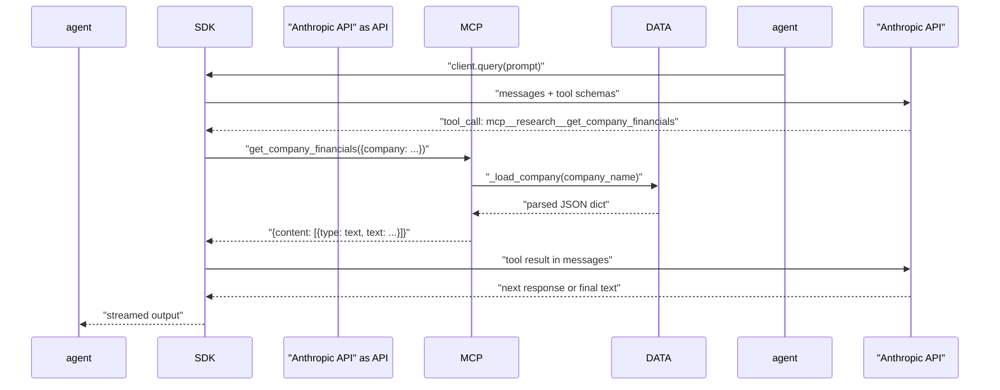

Sources: [01-guided-demo/tools.py:1-249](), [01-guided-demo/GUIDE.md:56-101]()

---

## Error Handling

All four tools follow the same pattern when a company cannot be found: they call `_known_companies()` and return an explanatory string that names the available options. This allows the model to self-correct by retrying with a different company name.

| Condition | Response |
|---|---|
| `_load_company()` returns `None` | Error string: `"No [data type] for '<name>'. Known companies: ..."` |
| Company found but no news for given `topic` | Error string: `"No news matching topic '<topic>' for <company>."` |
| Company found but `press_releases` list is empty | Error string: `"No press releases found for <company>."` |

Sources: [01-guided-demo/tools.py:72-96](), [01-guided-demo/tools.py:115-128](), [01-guided-demo/tools.py:168-175]()

---

# Page: Sub-agents

# Sub-agents

<details>
<summary>Relevant source files</summary>

The following files were used as context for generating this wiki page:

- [01-guided-demo/GUIDE.md](01-guided-demo/GUIDE.md)
- [01-guided-demo/agent.py](01-guided-demo/agent.py)
- [01-guided-demo/subagents.py](01-guided-demo/subagents.py)

</details>


This page documents `01-guided-demo/subagents.py`, which defines the two sub-agents used in Stage 2 of the guided demo. It covers the `AgentDefinition` structure, the `SUBAGENTS` registry, the `_RESEARCH_TOOLS` allowlist, the `ORCHESTRATOR_PROMPT_SUFFIX`, and the architectural rationale for context isolation.

For the research tools that sub-agents use, see [Research Tools](#2.3). For how sub-agents are wired into `ClaudeAgentOptions` in `agent.py`, see [Agent Entry Point](#2.2). For the breakouts equivalent — a catalog of reusable sub-agents — see [Sub-agent Library](#3.1.3).

---

## The Sub-agent Model

The Claude SDK enables sub-agents through the built-in `Task` tool. When the main agent calls `Task(subagent_type="researcher", prompt="...")`, the SDK:

1. Spins up a **fresh, isolated conversation** using the named `AgentDefinition`
2. Runs that sub-agent to completion (its own tool calls, its own agentic loop)
3. Returns only the sub-agent's final answer to the main agent's context

The main agent's context window never sees the sub-agent's intermediate steps.

**Diagram: Task Tool Execution Flow**

```mermaid
sequenceDiagram
    participant "Main Agent" as main
    participant "SDK" as sdk
    participant "Sub-agent (researcher)" as sub
    participant "Research Tools" as tools

    main->>"SDK": "Task(subagent_type='researcher', prompt='...')"
    "SDK"->>"Sub-agent (researcher)": "new isolated conversation\n+ sub-agent system prompt\n+ sub-agent tool allowlist"
    loop "Sub-agent agentic loop"
        "Sub-agent (researcher)">>"Research Tools": "tool calls (search_company_news, etc.)"
        "Research Tools">>"Sub-agent (researcher)": "tool results"
    end
    "Sub-agent (researcher)">>"SDK": "final answer only"
    "SDK"->>"Main Agent": "single result message"
```

Sources: [01-guided-demo/subagents.py:1-21](), [01-guided-demo/GUIDE.md:166-184]()

---

## AgentDefinition Structure

Each sub-agent is an instance of `AgentDefinition` from `claude_agent_sdk`. The fields that matter:

| Field | Type | Purpose |
|---|---|---|
| `description` | `str` | Shown to the main agent — tells it *when* to use this sub-agent |
| `prompt` | `str` | The sub-agent's system prompt — defines its role and behavior |
| `tools` | `list[str]` | Tool allowlist — the sub-agent can only call tools listed here |
| `model` | `str \| None` | Optional model override; if `None`, inherits the main agent's model |

Sources: [01-guided-demo/subagents.py:43-83](), [01-guided-demo/GUIDE.md:188-190]()

---

## Tool Allowlist: `_RESEARCH_TOOLS`

[01-guided-demo/subagents.py:31-36]() defines the shared list of tools both sub-agents may call. These are the full `mcp__<server>__<tool>` names produced by the `research_server` MCP server (see [Research Tools](#2.3)):

```
_RESEARCH_TOOLS = [
    "mcp__research__search_company_news",
    "mcp__research__get_company_financials",
    "mcp__research__get_recent_press_releases",
    "mcp__research__get_competitive_landscape",
]
```

Both `researcher` and `fact_checker` receive identical tool access. The difference between them is entirely in their `prompt` and `description` fields — same capabilities, different mandate.

Sources: [01-guided-demo/subagents.py:31-36]()

---

## The SUBAGENTS Registry

`SUBAGENTS` is a `dict[str, AgentDefinition]` defined in [01-guided-demo/subagents.py:43-83](). Its keys become valid values for `subagent_type` in `Task(...)` calls.

**Diagram: SUBAGENTS Registry — Code Entities**

```mermaid
graph TD
    subgraph "subagents.py"
        SUBAGENTS["SUBAGENTS: dict[str, AgentDefinition]"]
        researcher["researcher\n(AgentDefinition)"]
        fact_checker["fact_checker\n(AgentDefinition)"]
        _RESEARCH_TOOLS["_RESEARCH_TOOLS\nlist[str]"]
    end

    subgraph "tools.py (research_server)"
        t1["mcp__research__search_company_news"]
        t2["mcp__research__get_company_financials"]
        t3["mcp__research__get_recent_press_releases"]
        t4["mcp__research__get_competitive_landscape"]
    end

    SUBAGENTS --> researcher
    SUBAGENTS --> fact_checker
    researcher --> _RESEARCH_TOOLS
    fact_checker --> _RESEARCH_TOOLS
    _RESEARCH_TOOLS --> t1
    _RESEARCH_TOOLS --> t2
    _RESEARCH_TOOLS --> t3
    _RESEARCH_TOOLS --> t4
```

Sources: [01-guided-demo/subagents.py:31-83]()

### `researcher`

[01-guided-demo/subagents.py:48-62]()

| Field | Value |
|---|---|
| `description` | "Gathers raw information about a company. Use for initial research before writing a briefing..." |
| `prompt` | Instructs exhaustive data gathering; return structured findings with dates and sources; no editorializing |
| `tools` | `_RESEARCH_TOOLS` (all four) |
| `model` | `"haiku"` |

The `model="haiku"` override keeps sub-agent spawns cheap. The main orchestrator uses a larger model for synthesis; the researcher only needs speed and thoroughness for data retrieval.

### `fact_checker`

[01-guided-demo/subagents.py:65-82]()

| Field | Value |
|---|---|
| `description` | "Verifies specific factual claims before they go into a briefing..." |
| `prompt` | Given specific claims, respond with CONFIRMED (source), REFUTED (correction), or UNVERIFIABLE. Strict matching required. |
| `tools` | `_RESEARCH_TOOLS` (all four) |
| `model` | `"haiku"` |

The fact-checker's prompt enforces strict numerical verification — if a claim states "$120M" and the data says "$118M", the correct verdict is REFUTED, not CONFIRMED.

Sources: [01-guided-demo/subagents.py:43-83]()

---

## Context Isolation: The Architectural Rationale

[01-guided-demo/subagents.py:9-20]() states the two reasons sub-agents are used:

**1. Context isolation.** Raw search results, intermediate tool calls, and dead ends accumulate inside the sub-agent's context window and are discarded when it finishes. The main agent receives only the distilled answer. This prevents the orchestrator's context from growing unbounded during research-heavy tasks.

**2. Role specialization.** Each sub-agent has its own system prompt, tool allowlist, and optionally its own model. The `researcher` and `fact_checker` have the same tools but completely different behavioral mandates.

**Diagram: Context Boundary — What Each Agent Sees**

```mermaid
graph LR
    subgraph "Main agent context"
        mp["system_prompt\n+ ORCHESTRATOR_PROMPT_SUFFIX"]
        mh["conversation history"]
        tr["Task result:\n'CONFIRMED: Q4 revenue $118M'"]
    end

    subgraph "researcher context (isolated)"
        rp["researcher.prompt"]
        rc1["tool call: search_company_news(...)"]
        rr1["tool result: raw JSON"]
        rc2["tool call: get_company_financials(...)"]
        rr2["tool result: raw JSON"]
        rf["final answer"]
    end

    mp --> mh
    mh --> tr
    rp --> rc1 --> rr1 --> rc2 --> rr2 --> rf
    rf -->|"only this\ncrosses boundary"| tr
```

Sources: [01-guided-demo/subagents.py:9-20](), [01-guided-demo/GUIDE.md:170-173]()

---

## `ORCHESTRATOR_PROMPT_SUFFIX`

[01-guided-demo/subagents.py:92-104]() defines a string that is **appended to the main agent's system prompt** when sub-agents are enabled. Without it, the main agent tends to perform research directly rather than delegating.

The suffix:
- Names the two available sub-agents and their purposes
- Provides example `Task` invocations
- Explicitly instructs the main agent to prefer delegation over self-research

In `agent.py`, [01-guided-demo/agent.py:251-252]() handles this:

```python
system_prompt += ORCHESTRATOR_PROMPT_SUFFIX
```

This appending happens inside `build_options()` only when `config.ENABLE_SUBAGENTS` is `True`.

Sources: [01-guided-demo/subagents.py:87-104](), [01-guided-demo/agent.py:239-252]()

---

## Wiring into `ClaudeAgentOptions`

`SUBAGENTS` and `ORCHESTRATOR_PROMPT_SUFFIX` are imported by `agent.py` and used in `build_options()`. The complete Stage 2 block in `agent.py` is at [01-guided-demo/agent.py:230-252]():

```
if config.ENABLE_SUBAGENTS:
    agents = SUBAGENTS                          # dict[str, AgentDefinition]
    allowed_tools.append("Task")                # built-in Task tool for delegation
    system_prompt += ORCHESTRATOR_PROMPT_SUFFIX # nudges main agent to delegate
```

The `"Task"` string added to `allowed_tools` is the SDK's built-in delegation tool — it does not correspond to any function in `tools.py`. It is only present when `agents` is non-empty.

**Diagram: How subagents.py Feeds into ClaudeAgentOptions**

```mermaid
graph LR
    subgraph "subagents.py"
        SUBAGENTS["SUBAGENTS"]
        OPS["ORCHESTRATOR_PROMPT_SUFFIX"]
    end

    subgraph "agent.py: build_options()"
        BA["agents = SUBAGENTS"]
        AT["allowed_tools.append('Task')"]
        SP["system_prompt += ORCHESTRATOR_PROMPT_SUFFIX"]
    end

    subgraph "ClaudeAgentOptions"
        AO_agents["agents: dict[str, AgentDefinition]"]
        AO_tools["allowed_tools: list[str]"]
        AO_prompt["system_prompt: str"]
    end

    SUBAGENTS --> BA --> AO_agents
    OPS --> SP --> AO_prompt
    AT --> AO_tools
```

Sources: [01-guided-demo/agent.py:230-252](), [01-guided-demo/subagents.py:43-104]()

---

## Main Agent vs. Sub-agent: Comparison

| | Main agent | Sub-agent |
|---|---|---|
| **Defined by** | `ClaudeAgentOptions` in `build_options()` | `AgentDefinition` in `SUBAGENTS` dict |
| **Invoked by** | Caller via `client.query()` | Main agent via `Task(subagent_type=..., prompt=...)` |
| **Context window** | Accumulates full conversation history | Fresh, isolated per invocation |
| **Sees history?** | Yes — all prior turns | No — only the `prompt` passed to `Task` |
| **Return value** | Streamed to caller | Single message back to main agent |
| **Model** | `config.MODEL` (e.g. `claude-sonnet-4-6`) | `"haiku"` (overridden per sub-agent) |
| **System prompt source** | `BASE_SYSTEM_PROMPT` + `ORCHESTRATOR_PROMPT_SUFFIX` | `AgentDefinition.prompt` |

Sources: [01-guided-demo/GUIDE.md:176-185](), [01-guided-demo/subagents.py:43-83](), [01-guided-demo/agent.py:200-286]()

---

# Page: Memory System

# Memory System

<details>
<summary>Relevant source files</summary>

The following files were used as context for generating this wiki page:

- [01-guided-demo/GUIDE.md](01-guided-demo/GUIDE.md)
- [01-guided-demo/agent.py](01-guided-demo/agent.py)
- [01-guided-demo/memory.py](01-guided-demo/memory.py)

</details>


This page documents the persistent memory implementation in `01-guided-demo/memory.py`, which is activated at Stage 3 of the guided demo (when `ENABLE_MEMORY = True` in `config.py`). It covers the two-part design: a write-side tool the model calls explicitly, and a read-side hook that injects stored memories automatically before each turn.

For the broader stage progression and how `ENABLE_MEMORY` fits alongside `ENABLE_TOOLS` and `ENABLE_SUBAGENTS`, see the [Progressive Stages & Configuration](#2.1) page. For how the memory system is wired into `ClaudeAgentOptions` inside `build_options()`, see the [Agent Entry Point](#2.2) page.

---

## Purpose

The memory system solves cross-session persistence: preferences or facts the agent learns in one run should be available in the next, without the user repeating themselves. This requires two orthogonal mechanisms:

| Concern | Mechanism | Who triggers it |
|---|---|---|
| **Writing** memories | `save_memory` tool | The model, mid-turn |
| **Reading** memories | `_inject_memories` hook | The SDK, on `UserPromptSubmit` |

The division is intentional. The model decides *what* is worth remembering. The hook ensures memories are *always* present, without the model needing to ask for them.

Sources: [01-guided-demo/memory.py:1-30]()

---

## Storage: `memory_store.json`

All memories are stored in a plain JSON file at [01-guided-demo/memory.py:43]():

```
01-guided-demo/memory_store.json
```

The path is computed relative to `memory.py` using `Path(__file__).parent`, so it stays adjacent to the module regardless of where the script is launched from.

The file contains a JSON array of entry objects. Each entry has three fields:

| Field | Type | Example |
|---|---|---|
| `timestamp` | `str` | `"2026-03-05 14:32"` |
| `category` | `str` | `"preferences"` |
| `note` | `str` | `"User prefers bullet points over prose paragraphs"` |

The file is absent until the first `save_memory` call. If the file is corrupted (invalid JSON), `_read_memories()` returns an empty list rather than crashing [01-guided-demo/memory.py:46-53]().

**Entry cap:** The store is trimmed to the most recent 50 entries after every write. Entries beyond that limit are dropped from the front of the list [01-guided-demo/memory.py:111-112]().

Sources: [01-guided-demo/memory.py:43-57]()

---

## Part 1: Write-Side Tools

**Diagram: Write-Side Tool Execution Flow**

```mermaid
sequenceDiagram
    participant "Model" as model
    participant "Claude SDK" as sdk
    participant "save_memory()" as tool
    participant "memory_store.json" as store

    model->>"sdk": "tool_call: mcp__memory__save_memory(category, note)"
    sdk->>"tool": "execute save_memory(args)"
    tool->>"store": "_read_memories()"
    store-->>"tool": "list[dict]"
    tool->>"tool": "append entry, trim to 50"
    tool->>"store": "_write_memories(memories)"
    tool-->>"sdk": "{content: [{type: text, text: Saved to memory...}]}"
    sdk->>"model": "tool_result"
```

Sources: [01-guided-demo/memory.py:82-148]()

### `save_memory`

Defined at [01-guided-demo/memory.py:84-119]() using the `@tool` decorator. The model calls this to persist a note.

- **Arguments:** `category` (str), `note` (str)
- **Behavior:** Reads the current store, appends a new entry with a formatted timestamp, trims to 50 entries, writes back to disk
- **Returns:** Confirmation text to the model: `"Saved to memory under '<category>'."`
- **Empty note guard:** If `note` is blank after stripping, the function returns early without writing

The tool description instructs the model to use it for durable information (preferences, recurring facts, briefing summaries) and to avoid transient details.

### `list_memories`

Defined at [01-guided-demo/memory.py:122-137]() alongside `save_memory`. The model calls this to inspect the current store before saving, avoiding duplicates.

- **Arguments:** none
- **Returns:** All entries formatted as `[category] note  (saved timestamp)`, or `"Memory is empty."` if the store is empty

### `make_memory_server()`

[01-guided-demo/memory.py:140-148]() wraps both tools into an MCP server using `create_sdk_mcp_server`. It is a function (not a module-level constant) so that importing `memory.py` does not construct an MCP server as a side effect when memory is disabled.

```
make_memory_server() → create_sdk_mcp_server(name="memory", tools=[save_memory, list_memories])
```

The returned server is passed into `ClaudeAgentOptions(mcp_servers={"memory": ...})`.

### `MEMORY_TOOL_NAMES`

[01-guided-demo/memory.py:151-154]() exports the list of fully-qualified tool names that must appear in `allowed_tools` for the model to use these tools:

```
mcp__memory__save_memory
mcp__memory__list_memories
```

Sources: [01-guided-demo/memory.py:82-154]()

---

## Part 2: Read-Side Hook

**Diagram: Hook Injection Flow**

```mermaid
sequenceDiagram
    participant "User" as user
    participant "Claude SDK" as sdk
    participant "_inject_memories()" as hook
    participant "memory_store.json" as store
    participant "Model (Claude)" as model

    user->>"sdk": "client.query(prompt)"
    sdk->>"hook": "UserPromptSubmit fires → _inject_memories(input_data, tool_use_id, context)"
    hook->>"store": "_read_memories()"
    store-->>"hook": "list[dict]"
    hook-->>"sdk": "{hookSpecificOutput: {hookEventName, additionalContext: MEMORIES...}}"
    sdk->>"model": "system context + additionalContext injected"
    model-->>"sdk": "response"
```

Sources: [01-guided-demo/memory.py:157-204]()

### `_inject_memories`

The hook callback, defined at [01-guided-demo/memory.py:170-198](). Its signature matches the `HookCallback` interface required by the SDK:

```
async def _inject_memories(input_data: HookInput, tool_use_id: str | None, context: HookContext) -> HookJSONOutput
```

All three parameters are required by the signature but unused — the hook only needs the memory file, not anything from the current turn.

**Behavior:**

1. Calls `_read_memories()` to load the store
2. If empty, returns `{}` (a valid no-op `HookJSONOutput`)
3. Formats entries as `- [category] note`
4. Returns a dict with the `hookSpecificOutput` structure:

```
{
  "hookSpecificOutput": {
    "hookEventName": "UserPromptSubmit",
    "additionalContext": "MEMORIES FROM PREVIOUS SESSIONS:\n- [preferences] ..."
  }
}
```

The SDK merges `additionalContext` into the system context before sending the request to the model. The model sees the memories as part of its context without any explicit tool call.

### `HookMatcher` and `memory_hook`

[01-guided-demo/memory.py:201-204]() wraps `_inject_memories` in a `HookMatcher`:

```python
memory_hook = HookMatcher(matcher=None, hooks=[_inject_memories])
```

`matcher=None` means the hook fires for every `UserPromptSubmit` event with no filtering. In `agent.py`, this is registered as:

```python
hooks = {"UserPromptSubmit": [memory_hook]}
```

Sources: [01-guided-demo/memory.py:157-204](), [01-guided-demo/agent.py:264-265]()

---

## Wiring into the Agent

**Diagram: Code Entities and Their Roles**

```mermaid
graph TD
    subgraph "memory.py"
        saveMemory["save_memory\n(@tool)"]
        listMemories["list_memories\n(@tool)"]
        makeMemoryServer["make_memory_server()"]
        MEMORY_TOOL_NAMES["MEMORY_TOOL_NAMES"]
        injectMemories["_inject_memories()\n(HookCallback)"]
        memoryHook["memory_hook\n(HookMatcher)"]
        readMemories["_read_memories()"]
        writeMemories["_write_memories()"]
        memoryPath["_MEMORY_PATH\n(memory_store.json)"]
    end

    subgraph "agent.py"
        buildOptions["build_options()"]
        opts["ClaudeAgentOptions"]
    end

    subgraph "SDK"
        mcpServer["MCP Server\n(name=memory)"]
        UserPromptSubmit["UserPromptSubmit\nevent"]
    end

    saveMemory --> makeMemoryServer
    listMemories --> makeMemoryServer
    makeMemoryServer --> mcpServer
    injectMemories --> memoryHook
    memoryHook --> buildOptions
    mcpServer --> buildOptions
    MEMORY_TOOL_NAMES --> buildOptions
    buildOptions --> opts

    saveMemory --> readMemories
    saveMemory --> writeMemories
    listMemories --> readMemories
    injectMemories --> readMemories
    readMemories --> memoryPath
    writeMemories --> memoryPath

    UserPromptSubmit --> injectMemories
```

Sources: [01-guided-demo/memory.py:1-204](), [01-guided-demo/agent.py:253-286]()

In `build_options()`, the memory stage adds three things to `ClaudeAgentOptions` [01-guided-demo/agent.py:262-273]():

| Option | Value |
|---|---|
| `mcp_servers["memory"]` | `make_memory_server()` |
| `allowed_tools` extension | `MEMORY_TOOL_NAMES` |
| `hooks["UserPromptSubmit"]` | `[memory_hook]` |

A system prompt addendum also instructs the model to use `save_memory` proactively when the user expresses preferences or when briefings are produced that may be referenced later.

---

## Startup Display

`load_memory_summary()` [01-guided-demo/memory.py:60-72]() is a display-only helper called from `agent.py`'s `main()` function [01-guided-demo/agent.py:352-357](). It reads the store and formats entries for console output so the user can see what the agent remembers before the session starts:

```
Loaded memories from previous sessions:
  • [preferences] User prefers bullet points over prose paragraphs  (2026-03-05 14:32)
```

This is separate from the hook — `load_memory_summary()` is for human visibility only, while `_inject_memories` is what actually makes the memories available to the model.

Sources: [01-guided-demo/memory.py:60-72](), [01-guided-demo/agent.py:352-357]()

---

## Tools vs. Hooks: Summary

| Attribute | `save_memory` (tool) | `_inject_memories` (hook) |
|---|---|---|
| **Who triggers it** | The model, mid-turn | The SDK, on `UserPromptSubmit` |
| **Model awareness** | Yes — listed in `allowed_tools` | No — invisible to the model |
| **Direction** | Writes to `memory_store.json` | Reads from `memory_store.json` |
| **Registration** | Via `mcp_servers` + `allowed_tools` | Via `hooks["UserPromptSubmit"]` |
| **SDK type** | `@tool` + `create_sdk_mcp_server` | `HookMatcher(matcher=None, hooks=[...])` |
| **Return format** | `{content: [{type: text, text: ...}]}` | `{hookSpecificOutput: {additionalContext: ...}}` |

Sources: [01-guided-demo/memory.py:1-204](), [01-guided-demo/GUIDE.md:227-269]()

---

# Page: Mock Company Data

# Mock Company Data

<details>
<summary>Relevant source files</summary>

The following files were used as context for generating this wiki page:

- [01-guided-demo/mock_data/bucklefern_commerce_holdings.json](01-guided-demo/mock_data/bucklefern_commerce_holdings.json)
- [01-guided-demo/mock_data/ironvane_freight_systems.json](01-guided-demo/mock_data/ironvane_freight_systems.json)
- [01-guided-demo/mock_data/tinplate_merchant_systems.json](01-guided-demo/mock_data/tinplate_merchant_systems.json)
- [01-guided-demo/tools.py](01-guided-demo/tools.py)

</details>


This page describes the `mock_data/` directory inside `01-guided-demo/`: its contents, the shared JSON schema, the fictional competitive relationships between the three companies, and how `tools.py` loads and serves the data to the agent. For documentation of the tool functions that read this data, see [Research Tools](#2.3). For the broader demo stage progression, see [Progressive Stages & Configuration](#2.1).

---

## Directory Layout

All mock data lives under `01-guided-demo/mock_data/`. Each file represents one fictional company:

| File | Company | Industry |
|---|---|---|
| `tinplate_merchant_systems.json` | Tinplate Merchant Systems | Financial Technology |
| `bucklefern_commerce_holdings.json` | Bucklefern Commerce Holdings | Financial Technology / E-commerce Infrastructure |
| `ironvane_freight_systems.json` | Ironvane Freight Systems | Supply Chain Software |

Every file carries the top-level field `"_note": "FICTIONAL COMPANY — all data is synthetic workshop demo content"` as a safeguard against the content being mistaken for real data.

Sources: [01-guided-demo/mock_data/tinplate_merchant_systems.json:1-3](), [01-guided-demo/mock_data/bucklefern_commerce_holdings.json:1-3](), [01-guided-demo/mock_data/ironvane_freight_systems.json:1-3]()

---

## Shared JSON Schema

All three files share an identical top-level structure. The schema is deliberately consistent so that `_load_company()` in `tools.py` can access any field uniformly regardless of which company was matched.

**Top-level structure diagram:**

```mermaid
graph TD
    ROOT["company JSON file"]
    ROOT --> META["metadata\ncompany, industry, founded\nheadquarters, employees"]
    ROOT --> FIN["financials\n(object)"]
    ROOT --> NEWS["news\n(array of objects)"]
    ROOT --> PR["press_releases\n(array of objects)"]
    ROOT --> COMP["competitive_landscape\n(object)"]

    FIN --> FIN1["last_reported_quarter\nrevenue_ttm_usd\nrevenue_growth_yoy_pct\ngross_margin_pct\nnet_income_ttm_usd\ncash_on_hand_usd\nnotes"]
    FIN --> FIN2["public_since / market_cap_usd\nOR\nlast_funding_round\n(series, amount_usd, date, lead_investor)"]

    NEWS --> N1["date\nheadline\nsummary\ntopics (array of strings)"]
    PR --> P1["date\ntitle\nbody"]
    COMP --> C1["direct_competitors (array)\npositioning\nmarket_share_estimate_pct"]
```

Sources: [01-guided-demo/mock_data/tinplate_merchant_systems.json:1-81](), [01-guided-demo/mock_data/bucklefern_commerce_holdings.json:1-72](), [01-guided-demo/mock_data/ironvane_freight_systems.json:1-70]()

### Field-by-field reference

| Top-level key | Type | Description |
|---|---|---|
| `company` | string | Full company name; used as the match key by `_load_company()` |
| `industry` | string | Industry label |
| `founded` | integer | Year founded |
| `headquarters` | string | City, State |
| `employees` | integer | Approximate headcount |
| `financials` | object | Latest reported quarter snapshot (see below) |
| `news` | array | Recent third-party news items with `date`, `headline`, `summary`, `topics` |
| `press_releases` | array | Official company press releases with `date`, `title`, `body` |
| `competitive_landscape` | object | Competitor list, positioning statement, market share estimate |

#### `financials` sub-fields

| Field | Notes |
|---|---|
| `last_reported_quarter` | e.g. `"Q4 2025"` |
| `revenue_ttm_usd` | Trailing twelve months revenue |
| `revenue_growth_yoy_pct` | Year-over-year growth percentage |
| `gross_margin_pct` | Gross margin as a percentage |
| `net_income_ttm_usd` | Negative values indicate a loss |
| `cash_on_hand_usd` | Current cash / equivalents |
| `public_since` / `market_cap_usd` | Present for public companies (Bucklefern only) |
| `last_funding_round` | Present for private companies; contains `series`, `amount_usd`, `date`, `lead_investor` |
| `notes` | Free-text analyst commentary embedded in the data |

Sources: [01-guided-demo/mock_data/tinplate_merchant_systems.json:9-22](), [01-guided-demo/mock_data/bucklefern_commerce_holdings.json:9-19](), [01-guided-demo/mock_data/ironvane_freight_systems.json:9-23]()

---

## Company Profiles

### Tinplate Merchant Systems

[01-guided-demo/mock_data/tinplate_merchant_systems.json:1-81]()

- **Stage:** Private (Series D, $180M raised in 2024 from Shalemark Venture Partners)
- **Revenue TTM:** $412M, growing 34% YoY
- **Net income:** -$28M (path to breakeven projected H2 2026)
- **Focus:** Mid-market merchants ($500k–$50M annual volume); developer experience; embedded financial products
- **Key story threads in the data:**
  - Launched `Tinplate Capital`, an embedded lending product
  - Beat Q4 estimates (34% growth); stock up 9%
  - Hired Ironvane's departing CPO as Head of Platform
  - Expanded to Canada and UK
  - Had a 47-minute checkout outage in January 2026

### Bucklefern Commerce Holdings

[01-guided-demo/mock_data/bucklefern_commerce_holdings.json:1-72]()

- **Stage:** Public (IPO June 2022; market cap $18.5B)
- **Revenue TTM:** $1.84B, growing 19% YoY (decelerating)
- **Net income:** $142M (profitable since 2023)
- **Focus:** Broadest platform (payments + storefront + back-office); highest take rate; "safe enterprise choice"
- **Key story threads in the data:**
  - Acquiring Shelfcrane Inventory Systems for $340M (third acquisition in 18 months)
  - Growth deceleration to 19%, stock down 6% on earnings
  - Rolled out AI fraud detection to all merchant tiers
  - Activist investor (Perthwick Capital Advisors, 3.1% stake) pushing for buybacks
  - Launched in-person POS hardware ("Bucklefern Terminal")

### Ironvane Freight Systems

[01-guided-demo/mock_data/ironvane_freight_systems.json:1-70]()

- **Stage:** Private (Series C, $95M raised August 2025 from Brayworth Growth Partners)
- **Revenue TTM:** $89M, growing 67% YoY
- **Net income:** -$41M (~21 months runway)
- **Focus:** API-first, developer-friendly TMS alternative; strongest with mid-market shippers
- **Key story threads in the data:**
  - Won three-year contract with national grocery chain (largest customer to date)
  - CPO Dana Okafor departed to Tinplate — raises leadership continuity concern
  - Opened European HQ in Amsterdam
  - Released open API for carrier self-onboarding

---

## Interlinked Competitive Relationships

The three companies are not independent — Tinplate and Bucklefern are direct competitors, and Ironvane provides a cross-company narrative thread via the CPO departure. This creates multi-hop research scenarios where the agent must look up multiple companies to form a complete picture.

**Cross-company relationship diagram:**

```mermaid
graph LR
    TMS["tinplate_merchant_systems.json\nTinplate Merchant Systems\nFinTech / Mid-market"]
    BCH["bucklefern_commerce_holdings.json\nBucklefern Commerce Holdings\nFinTech / Enterprise"]
    IFS["ironvane_freight_systems.json\nIronvane Freight Systems\nSupply Chain Software"]

    TMS -- "direct_competitors list" --> BCH
    BCH -- "direct_competitors list" --> TMS
    IFS -- "CPO Okafor departs to" --> TMS
    TMS -- "hires former Ironvane CPO" --> IFS

    SHARED1["Wharfton Payment Rails\n(fictional, no JSON file)"]
    SHARED2["Bronzefathom Transaction Works\n(fictional, no JSON file)"]

    TMS -- "direct_competitor" --> SHARED1
    TMS -- "direct_competitor" --> SHARED2
    BCH -- "direct_competitor" --> SHARED1
    BCH -- "direct_competitor" --> SHARED2
```

Sources: [01-guided-demo/mock_data/tinplate_merchant_systems.json:76-80](), [01-guided-demo/mock_data/bucklefern_commerce_holdings.json:67-71](), [01-guided-demo/mock_data/tinplate_merchant_systems.json:39-44](), [01-guided-demo/mock_data/ironvane_freight_systems.json:35-38]()

Note: Wharfton Payment Rails and Bronzefathom Transaction Works appear in competitor lists but have no corresponding JSON files. Queries for those companies will return the "not found" error path in `_load_company()`.

---

## How tools.py Loads the Data

`tools.py` uses two private helpers to access the `mock_data/` directory:

**Data loading flow diagram:**

```mermaid
flowchart TD
    TOOL["@tool function\ne.g. search_company_news(args)"]
    TOOL -->|"args.get('company')"| LOAD["_load_company(company_name)"]

    LOAD --> NORM["normalize needle:\n.lower().replace(' ','').replace('-','').replace('_','')"]
    NORM --> GLOB["_DATA_DIR.glob('*.json')\nfor each .json in mock_data/"]
    GLOB --> MATCH["compare normalized needle\nagainst data['company'] value"]
    MATCH -->|"needle in hay OR hay in needle"| RETURN_DATA["return dict (full file contents)"]
    MATCH -->|"no match found"| RETURN_NONE["return None"]

    RETURN_NONE --> ERROR["tool returns error text\n+ _known_companies() list"]
    RETURN_DATA --> EXTRACT["tool extracts specific key\ne.g. data['news'], data['financials']"]

    KNOWN["_known_companies()\nglobal all .json files\nreturn sorted list of company names"]
    ERROR --> KNOWN
```

Sources: [01-guided-demo/tools.py:21-42](), [01-guided-demo/tools.py:66-103]()

### Key implementation details

- `_DATA_DIR` is set at module load time as a `Path` relative to `tools.py` itself: [01-guided-demo/tools.py:21-21]()
- `_load_company()` normalizes both the search needle and the stored company name by lowercasing and stripping spaces, hyphens, and underscores. Matching is bidirectional (`needle in hay or hay in needle`), which means partial names like `"tinplate"` match `"Tinplate Merchant Systems"`. [01-guided-demo/tools.py:24-32]()
- `_known_companies()` scans `mock_data/*.json` at query time and returns a sorted list. This list is included in all "not found" error responses so the model can self-correct. [01-guided-demo/tools.py:35-42]()
- `get_company_financials()` and `get_competitive_landscape()` return their data as `json.dumps(..., indent=2)` rather than formatted text, relying on the model to interpret JSON directly. [01-guided-demo/tools.py:130-141](), [01-guided-demo/tools.py:207-211]()
- `search_company_news()` supports an optional `topic` filter that matches against the `topics` array on each news item (lowercase comparison). [01-guided-demo/tools.py:84-86]()

### Tool-to-data-field mapping

| Tool (via `mcp__research__*`) | JSON field accessed | Returns |
|---|---|---|
| `search_company_news` | `data["news"]` | Formatted text (headline + summary per item) |
| `get_company_financials` | `data["financials"]`, `data["industry"]`, `data["employees"]` | JSON string |
| `get_recent_press_releases` | `data["press_releases"]` | Formatted text (title + body per release) |
| `get_competitive_landscape` | `data["competitive_landscape"]` | JSON string |

Sources: [01-guided-demo/tools.py:59-211]()

---

# Page: 02-breakouts

# 02-breakouts

<details>
<summary>Relevant source files</summary>

The following files were used as context for generating this wiki page:

- [02-breakouts/COMPONENTS.md](02-breakouts/COMPONENTS.md)
- [02-breakouts/README.md](02-breakouts/README.md)

</details>


This page describes the purpose, structure, and workflow of the `02-breakouts` section of the workshop. It covers the overall directory layout, the available breakout scenarios, the shared framework that powers all of them, and the editing cycle participants follow.

For detailed documentation of the shared runner and libraries, see [Shared Framework](#3.1). For per-tool and per-subagent reference tables, see [Available Components Reference](#3.2). For individual breakout walkthroughs, see [00-warmup](#3.3), [Account Intelligence](#3.4), and [Chief of Staff](#3.5).

---

## Purpose

Where `01-guided-demo` is a linear walkthrough with boolean flags, `02-breakouts` is a component-assembly environment. Participants select pre-built tools and sub-agents from a catalog, write a system prompt, and iterate. No new Python code is written — all iteration happens in `config.py`.

> "Where the guided demo was a tour (flip a switch, watch what happens), the breakouts are Lego assembly."

Sources: [02-breakouts/README.md:1-8]()

---

## Directory Structure

Every breakout follows the same four-file layout:

```
02-breakouts/
├── _shared/
│   ├── agent_base.py       ← shared runner: validates config, builds SDK options, runs loop
│   ├── tool_library.py     ← TOOL_CATALOG: all tool categories and their implementations
│   └── subagent_library.py ← SUBAGENT_CATALOG: all sub-agent definitions
│
├── COMPONENTS.md           ← human-readable catalog reference
├── README.md               ← breakout picker and iteration guide
│
├── 00-warmup/
│   ├── config.py           ← EDIT THIS
│   ├── run.py              ← entry point, do not touch
│   ├── README.md
│   └── data/
│
├── account-intelligence/
│   ├── config.py
│   ├── run.py
│   └── data/
│
├── chief-of-staff/
│   ├── config.py
│   ├── run.py
│   └── data/
│
├── customer-support/       ← (same shape)
├── sre-agent/              ← (same shape)
└── freeform/               ← blank canvas
```

Sources: [02-breakouts/README.md:28-36]()

---

## Available Breakouts

| Breakout | Scenario | Primary tool categories |
|---|---|---|
| `00-warmup` | Company briefing — bridges from guided demo | `knowledge` |
| `chief-of-staff` | Meeting prep, email drafting, exec briefings | `schedule`, `knowledge` |
| `customer-support` | Ticket triage, KB-grounded responses, escalation | `support`, `knowledge` |
| `sre-agent` | Incident investigation, runbook execution | `ops` |
| `account-intelligence` | Pre-renewal review, churn risk detection | `support`, `knowledge` |
| `freeform` | Blank canvas with the full component library | *(any)* |

Sources: [02-breakouts/README.md:13-21]()

---

## How It Fits Into the Repository

**Diagram: Breakout Runtime — config.py to Anthropic API**

```mermaid
flowchart TD
    breakout_dir["breakout_dir/\nconfig.py + run.py"]
    run["run.py\nentry point"]
    cfg["config.py\nAGENT_NAME\nTOOL_CATEGORIES\nSUBAGENTS\nSYSTEM_PROMPT\nMODEL / MAX_TURNS"]

    run -->|"run(config)"| agent_base
    cfg --> agent_base

    subgraph shared["_shared/"]
        agent_base["agent_base.py\n_validate(config)\n_build_options(config)"]
        tool_library["tool_library.py\nTOOL_CATALOG\nset_data_dir()\nload_memory_context()"]
        subagent_library["subagent_library.py\nSUBAGENT_CATALOG\nSUBAGENT_REQUIRES"]
    end

    agent_base --> tool_library
    agent_base --> subagent_library

    agent_base --> sdk["ClaudeSDKClient\nClaudeAgentOptions"]
    sdk --> api["Anthropic API"]

    breakout_dir --> run
    breakout_dir --> cfg
```

Sources: [02-breakouts/README.md:36-38](), [02-breakouts/COMPONENTS.md:59-61]()

---

## The config.py Contract

Every breakout's `config.py` exposes the same set of fields. The shared `agent_base.py` reads these fields directly; participants do not call any functions manually.

| Field | Type | Description |
|---|---|---|
| `AGENT_NAME` | `str` | Display name, used in console output |
| `TOOL_CATEGORIES` | `list[str]` | Selects tool groups from `TOOL_CATALOG` |
| `SUBAGENTS` | `list[str]` | Selects sub-agents from `SUBAGENT_CATALOG` |
| `SYSTEM_PROMPT` | `str` | Main agent instructions — primary iteration surface |
| `DEFAULT_TASK` | `str` | Pre-filled task shown when user presses Enter |
| `MODEL` | `str` | Claude model string, e.g. `"claude-sonnet-4-6"` |
| `VERBOSITY` | `str` | `"verbose"` shows tool calls; `"normal"` hides them |
| `MAX_TURNS` | `int` | Cap on the agentic loop, default `30` |

The key contrast with `01-guided-demo` is that `config.py` uses **string lists** (`TOOL_CATEGORIES`, `SUBAGENTS`) rather than boolean flags (`ENABLE_TOOLS`, `ENABLE_SUBAGENTS`, `ENABLE_MEMORY`). The breakout config is selecting from a catalog; the demo config is toggling stages.

Sources: [02-breakouts/COMPONENTS.md:45-54](), [02-breakouts/README.md:28-38]()

---

## Component Catalog at a Glance

**Diagram: Tool Categories and Sub-agents in the Catalog**

```mermaid
graph LR
    subgraph TOOL_CATALOG["TOOL_CATALOG — tool_library.py"]
        schedule["\"schedule\"\nget_calendar\nfind_meeting_slot\ndraft_email"]
        knowledge["\"knowledge\"\nsearch_knowledge_base\nread_document"]
        support["\"support\"\nlookup_customer\nget_ticket\nlist_open_tickets\nadd_ticket_note"]
        ops["\"ops\"\nget_service_status\nquery_metrics\nget_recent_alerts\nsearch_runbooks\nread_runbook"]
        code["\"code\"\nlist_files\nread_file\nsearch_code"]
        memory["\"memory\"\nsave_memory\nlist_memories"]
    end

    subgraph SUBAGENT_CATALOG["SUBAGENT_CATALOG — subagent_library.py"]
        researcher["\"researcher\"\nrequires: knowledge"]
        summarizer["\"summarizer\""]
        classifier["\"classifier\""]
        verifier["\"verifier\"\nrequires: knowledge"]
        writer["\"writer\""]
        procedure_runner["\"procedure_runner\"\nrequires: ops"]
    end
```

Sources: [02-breakouts/COMPONENTS.md:8-41]()

### Tool Categories

| Category | Tools | Data files read |
|---|---|---|
| `schedule` | `get_calendar`, `find_meeting_slot`, `draft_email` | `calendar.json` |
| `knowledge` | `search_knowledge_base`, `read_document` | `knowledge_base.json`, `documents.json` |
| `support` | `lookup_customer`, `get_ticket`, `list_open_tickets`, `add_ticket_note` | `customers.json`, `tickets.json` |
| `ops` | `get_service_status`, `query_metrics`, `get_recent_alerts`, `search_runbooks`, `read_runbook` | `services.json`, `alerts.json`, `runbooks.json` |
| `code` | `list_files`, `read_file`, `search_code` | *(any directory)* |
| `memory` | `save_memory`, `list_memories` | `memory_store.json` |

Tool names are exposed to the model using the `mcp__<category>__<tool>` naming convention — e.g., `mcp__support__lookup_customer`.

### Sub-agents

| Name | Role | Required tool categories |
|---|---|---|
| `researcher` | Gathers info on a focused question | `knowledge` |
| `summarizer` | Condenses long content into key points | *(none)* |
| `classifier` | Categorizes / routes items | *(none)* |
| `verifier` | Fact-checks specific claims | `knowledge` |
| `writer` | Polishes rough notes into clean prose | *(none)* |
| `procedure_runner` | Walks through checklists step by step | `ops` |

When a sub-agent is listed in `SUBAGENTS` without its required tool category in `TOOL_CATEGORIES`, `_validate()` in `agent_base.py` prints a warning. The sub-agent still runs but has no tools to call.

Sources: [02-breakouts/COMPONENTS.md:8-41]()

---

## The Iteration Cycle

The intended workflow for each breakout session:

1. **Read the breakout's `README.md`** — understand the scenario and the mock data in `data/`
2. **Run with the starting config** — `./workshop breakout <name>` — observe baseline behavior
3. **Change one thing in `config.py`** — add a sub-agent, adjust the system prompt, add or remove a tool category
4. **Re-run** — observe the change
5. **Repeat** — most time is spent on steps 3–4

Component selection (which entries go in `TOOL_CATEGORIES` and `SUBAGENTS`) typically stabilizes within the first few iterations. Prompt tuning — the content of `SYSTEM_PROMPT` — is where the majority of iteration happens.

Sources: [02-breakouts/README.md:56-63]()

---

## Relationship to 01-guided-demo

Both sections use the same SDK primitives (`ClaudeSDKClient`, `ClaudeAgentOptions`), but they differ in how configuration is expressed:

| Aspect | `01-guided-demo` | `02-breakouts` |
|---|---|---|
| Configuration style | Boolean flags in `config.py` | String lists in `config.py` |
| Entry point | `agent.py` + `build_options()` | `run.py` → `agent_base.py:run()` |
| Tool setup | Inline in `agent.py` | `tool_library.py:TOOL_CATALOG` |
| Sub-agent setup | Inline in `subagents.py` | `subagent_library.py:SUBAGENT_CATALOG` |
| Iteration surface | Enable/disable stages | Mix and match from catalog |
| Primary skill practiced | Reading SDK behavior | Prompt engineering |

The `_build_options()` function in `agent_base.py` is the direct generalization of `build_options()` in `01-guided-demo/agent.py`. Comparing them shows how the flip-a-switch pattern scales into a catalog-selection pattern.

Sources: [02-breakouts/COMPONENTS.md:57-61](), [02-breakouts/README.md:72-73]()

---

# Page: Shared Framework

# Shared Framework

<details>
<summary>Relevant source files</summary>

The following files were used as context for generating this wiki page:

- [02-breakouts/README.md](02-breakouts/README.md)
- [02-breakouts/_shared/__init__.py](02-breakouts/_shared/__init__.py)
- [02-breakouts/_shared/agent_base.py](02-breakouts/_shared/agent_base.py)
- [02-breakouts/_shared/subagent_library.py](02-breakouts/_shared/subagent_library.py)
- [02-breakouts/_shared/tool_library.py](02-breakouts/_shared/tool_library.py)

</details>


This page documents the `_shared/` directory in `02-breakouts/`, which provides the common runner infrastructure used by every breakout. It describes how `agent_base.py`, `tool_library.py`, and `subagent_library.py` cooperate to translate a breakout's `config.py` into a fully wired `ClaudeSDKClient` session.

For the full reference of which tool categories and sub-agents are available to select in `config.py`, see [Available Components Reference](#3.2). For documentation of individual breakout scenarios (their `config.py` starting points and data), see [00-warmup Breakout](#3.3), [Account Intelligence Breakout](#3.4), and [Chief of Staff Breakout](#3.5).

---

## Overview

The `_shared/` directory contains three modules:

| File | Role |
|---|---|
| `_shared/agent_base.py` | Validates config, assembles `ClaudeAgentOptions`, runs the conversation loop |
| `_shared/tool_library.py` | Defines all tool functions and `TOOL_CATALOG` |
| `_shared/subagent_library.py` | Defines all `AgentDefinition` instances and `SUBAGENT_CATALOG` |

Every breakout's `run.py` consists of exactly:

```python
from _shared.agent_base import run
import config
run(config)
```

All agent wiring happens inside `_shared/`. Workshop participants only edit `config.py`.

Sources: [02-breakouts/_shared/agent_base.py:1-17](), [02-breakouts/README.md:24-38]()

---

## How the Three Modules Fit Together

**Structural overview: config → shared modules → SDK**

```mermaid
flowchart TD
    subgraph "breakout/"
        CFG["config.py\nAGENT_NAME, TOOL_CATEGORIES\nSUBAGENTS, SYSTEM_PROMPT\nMODEL, MAX_TURNS\nDATA_DIR, DEFAULT_TASK"]
        RUN["run.py\nrun(config)"]
    end

    subgraph "_shared/"
        AB["agent_base.py\nrun()\n_validate()\n_build_options()\n_render()\n_main()"]
        TL["tool_library.py\nTOOL_CATALOG\nset_data_dir()\nload_memory_context()"]
        SL["subagent_library.py\nSUBAGENT_CATALOG\nSUBAGENT_REQUIRES\n_tools_for()"]
    end

    SDK["ClaudeSDKClient\n+ ClaudeAgentOptions"]
    API["Anthropic API"]
    DATA["breakout/data/*.json"]

    RUN -->|"run(config)"| AB
    CFG --> AB
    AB -->|"TOOL_CATEGORIES lookup"| TL
    AB -->|"SUBAGENTS lookup"| SL
    TL -->|"set_data_dir()"| DATA
    AB --> SDK
    SDK --> API
```

Sources: [02-breakouts/_shared/agent_base.py:38-39](), [02-breakouts/_shared/agent_base.py:107-179]()

---

## Config Module Contract

`agent_base.py` reads the following attributes from whatever `config` module is passed to `run()`. All attributes are optional with defaults.

| Attribute | Type | Default | Purpose |
|---|---|---|---|
| `AGENT_NAME` | `str` | `"Agent"` | Displayed in the startup banner |
| `TOOL_CATEGORIES` | `list[str]` | `[]` | Which tool groups to enable |
| `SUBAGENTS` | `list[str]` | `[]` | Which sub-agent definitions to enable |
| `SYSTEM_PROMPT` | `str` | `""` | Orchestrator system prompt |
| `MODEL` | `str` | `"claude-sonnet-4-6"` | Claude model identifier |
| `MAX_TURNS` | `int \| None` | `None` | Turn limit passed to SDK |
| `VERBOSITY` | `str` | `"verbose"` | `"verbose"` shows tool calls; anything else hides them |
| `DEFAULT_TASK` | `str` | `"How can I help?"` | Pre-filled prompt if user presses Enter |
| `DATA_DIR` | `str \| None` | `None` | Path to breakout's `data/` directory |

Sources: [02-breakouts/_shared/agent_base.py:251-278](), [02-breakouts/_shared/agent_base.py:107-179]()

---

## `_validate()`: Configuration Warnings

[02-breakouts/_shared/agent_base.py:73-104]()

`_validate(config)` runs before any SDK calls and returns a list of warning strings (non-fatal). Three checks are performed:

1. **Unknown tool category** — each item in `TOOL_CATEGORIES` is checked against `TOOL_CATALOG.keys()`. If an item is absent, the user is shown the valid options.
2. **Unknown sub-agent** — each item in `SUBAGENTS` is checked against `SUBAGENT_CATALOG.keys()`.
3. **Missing tool dependency** — for each valid sub-agent, its entries in `SUBAGENT_REQUIRES` are verified against the enabled `TOOL_CATEGORIES`. A warning is printed if a required category is absent (e.g., enabling `researcher` without `knowledge`).
4. **Empty system prompt** — a warning is emitted if `SYSTEM_PROMPT` is blank.

Warnings are printed at startup via `_print_config()` but do not halt execution.

---

## `_build_options()`: From Config to SDK Options

[02-breakouts/_shared/agent_base.py:107-179]()

This is the core translation step. It produces a `ClaudeAgentOptions` object from the config module.

**`_build_options()` assembly logic**

```mermaid
flowchart TD
    START["_build_options(config)"]

    TC["for cat in TOOL_CATEGORIES"]
    LOOKUP["TOOL_CATALOG[cat]\n→ (mcp_server, tool_names)"]
    MCPS["mcp_servers[cat] = server\nallowed_tools.extend(tool_names)"]

    SA["for agent in SUBAGENTS"]
    SALOOKUP["SUBAGENT_CATALOG[agent]\n→ AgentDefinition"]
    AGENTS["agents[agent] = AgentDefinition"]
    TASK["if agents:\n  allowed_tools.append('Task')"]

    MEM["if 'memory' in TOOL_CATEGORIES:\n  load_memory_context()\n  append to system_prompt"]
    NUDGE["if agents:\n  append sub-agent list\n  to system_prompt"]

    OUT["ClaudeAgentOptions(\n  model=MODEL,\n  system_prompt=system_prompt,\n  mcp_servers=mcp_servers,\n  allowed_tools=allowed_tools,\n  agents=agents,\n  permission_mode='bypassPermissions',\n  max_turns=MAX_TURNS\n)"]

    START --> TC --> LOOKUP --> MCPS
    START --> SA --> SALOOKUP --> AGENTS --> TASK
    START --> MEM
    START --> NUDGE
    MCPS --> OUT
    TASK --> OUT
    MEM --> OUT
    NUDGE --> OUT
```

Key behaviors:
- Each `TOOL_CATEGORIES` entry contributes one MCP server entry and extends `allowed_tools` with that category's tool name strings.
- If any sub-agents are enabled, `"Task"` is appended to `allowed_tools` (required for the orchestrator to invoke them).
- If `"memory"` is in `TOOL_CATEGORIES`, `load_memory_context()` reads `memory_store.json` and prepends its contents to `system_prompt` at startup. This is a simpler pattern than the hook-based approach in `01-guided-demo/memory.py` — memories from mid-session saves only appear on the next run.
- If sub-agents are enabled, a description of available agents is appended to `system_prompt` to encourage delegation.

Sources: [02-breakouts/_shared/agent_base.py:107-179]()

---

## `TOOL_CATALOG`: Category-to-Server Mapping

[02-breakouts/_shared/tool_library.py:641-691]()

`TOOL_CATALOG` is a `dict[str, tuple[MCP_server, list[str]]]`. Each key is a category name; the value is a tuple of the MCP server object and a list of fully-qualified tool names.

**How TOOL_CATALOG maps config strings to server objects and tool names**

```mermaid
flowchart LR
    CFG["config.py\nTOOL_CATEGORIES = ['schedule', 'knowledge']"]

    subgraph "TOOL_CATALOG (tool_library.py)"
        SCH["'schedule'\n→ (schedule_server,\n   ['mcp__schedule__get_calendar',\n    'mcp__schedule__find_meeting_slot',\n    'mcp__schedule__draft_email'])"]
        KNW["'knowledge'\n→ (knowledge_server,\n   ['mcp__knowledge__search_knowledge_base',\n    'mcp__knowledge__read_document'])"]
        SUP["'support'\n→ (support_server,\n   ['mcp__support__lookup_customer',\n    'mcp__support__get_ticket',\n    'mcp__support__list_open_tickets',\n    'mcp__support__add_ticket_note'])"]
        OPS["'ops'\n→ (ops_server,\n   ['mcp__ops__get_service_status', ...])"]
        CODE["'code'\n→ (code_server,\n   ['mcp__code__list_files',\n    'mcp__code__read_file',\n    'mcp__code__search_code'])"]
        MEM["'memory'\n→ (memory_server,\n   ['mcp__memory__save_memory',\n    'mcp__memory__list_memories'])"]
    end

    CFG -->|"lookup"| SCH
    CFG -->|"lookup"| KNW
```

All tool names follow the convention `mcp__<category>__<function_name>`. This prefix is generated by `create_sdk_mcp_server()` from the SDK.

Sources: [02-breakouts/_shared/tool_library.py:641-691](), [02-breakouts/_shared/tool_library.py:1-22]()

---

## `SUBAGENT_CATALOG` and `SUBAGENT_REQUIRES`

[02-breakouts/_shared/subagent_library.py:39-163]()

`SUBAGENT_CATALOG` maps string names to `AgentDefinition` instances. `SUBAGENT_REQUIRES` maps the same names to the tool categories that sub-agent depends on.

| Sub-agent key | Model | Tool categories accessed | Required by `SUBAGENT_REQUIRES` |
|---|---|---|---|
| `researcher` | haiku | `knowledge`, `support`, `ops`, `schedule` | `knowledge` |
| `summarizer` | haiku | *(none)* | *(none)* |
| `classifier` | haiku | *(none)* | *(none)* |
| `verifier` | haiku | `knowledge`, `support`, `ops` | `knowledge` |
| `writer` | haiku | *(none)* | *(none)* |
| `procedure_runner` | haiku | `ops`, `support` | `ops` |

The `_tools_for(*categories)` helper [02-breakouts/_shared/subagent_library.py:24-32]() flattens tool name lists from `TOOL_CATALOG` into a single list for each sub-agent's `tools=` field. This means sub-agents inherit the exact same tool name strings from `TOOL_CATALOG` — there is no separate registration.

> **Important**: A sub-agent's tool access is limited to what its parent config has registered as MCP servers. If a sub-agent lists `mcp__knowledge__search_knowledge_base` in its `tools=` but the config does not include `"knowledge"` in `TOOL_CATEGORIES`, the MCP server is not registered and the tool is unavailable.

Sources: [02-breakouts/_shared/subagent_library.py:1-32](), [02-breakouts/_shared/subagent_library.py:154-163]()

---

## `set_data_dir()` and Per-Breakout Data Isolation

[02-breakouts/_shared/tool_library.py:37-56]()

All tools in `tool_library.py` read from a module-level `_DATA_DIR` variable. Before any tool is called, `agent_base.py` calls `set_data_dir(Path(config.DATA_DIR))` to point this variable at the current breakout's `data/` directory.

The internal `_load(filename)` function then resolves all JSON paths relative to `_DATA_DIR`. If a file is absent, it returns `{}` or `[]` silently, allowing breakouts to omit data files for categories they do not need.

**Data isolation flow**

```mermaid
sequenceDiagram
    participant "agent_base.py" as AB
    participant "tool_library._DATA_DIR" as DD
    participant "breakout/data/" as DATA
    participant "ClaudeSDKClient" as SDK

    AB->>DD: "set_data_dir(config.DATA_DIR)"
    AB->>AB: "_build_options(config)"
    AB->>SDK: "ClaudeSDKClient(options)"

    loop "Agentic loop"
        SDK->>DD: "tool call (e.g. get_calendar)"
        DD->>DATA: "_load('calendar.json')"
        DATA-->>DD: "JSON contents"
        DD-->>SDK: "tool result"
    end
```

Sources: [02-breakouts/_shared/tool_library.py:37-56](), [02-breakouts/_shared/agent_base.py:258-260]()

---

## Memory Injection at Startup

[02-breakouts/_shared/agent_base.py:138-153](), [02-breakouts/_shared/tool_library.py:622-630]()

When `"memory"` is included in `TOOL_CATEGORIES`, `_build_options()` calls `load_memory_context()` before constructing `ClaudeAgentOptions`. `load_memory_context()` reads `memory_store.json` from `_DATA_DIR` and formats its entries into a string block that is appended to the system prompt.

This differs from the `01-guided-demo` memory approach, which uses a `UserPromptSubmit` hook to re-read the file on every turn. The breakouts approach injects once at startup — simpler for workshop iteration, but means mid-session saves only appear on the next `run()` invocation.

The `memory_store.json` file is capped at 50 entries by `save_memory()` [02-breakouts/_shared/tool_library.py:594-596]().

---

## Conversation Loop

[02-breakouts/_shared/agent_base.py:251-305]()

After calling `_build_options()`, `_main()` runs a multi-turn loop:

```mermaid
flowchart TD
    START["_main(config)"]
    SETUP["set_data_dir()\n_validate()\n_build_options()"]
    PROMPT["input: user prompt\n(or DEFAULT_TASK)"]
    CTX["async with ClaudeSDKClient(options)"]
    QUERY["client.query(prompt)"]
    RECV["async for message in\nclient.receive_response()"]
    RENDER["_render(message, verbose)"]
    FOLLOWUP["input: follow-up\n(Enter to exit)"]
    EXIT["exit loop"]

    START --> SETUP --> PROMPT --> CTX --> QUERY --> RECV --> RENDER
    RENDER --> FOLLOWUP
    FOLLOWUP -->|"text entered"| QUERY
    FOLLOWUP -->|"Enter / EOF"| EXIT
```

The `_render()` function [02-breakouts/_shared/agent_base.py:213-243]() handles three message types from the SDK:

| Message type | Verbose=True | Verbose=False |
|---|---|---|
| `AssistantMessage` + `TextBlock` | Print text | Print text |
| `AssistantMessage` + `ToolUseBlock` | Print `→ tool(args)` | Suppress |
| `UserMessage` + `ToolResultBlock` | Print `← result` (truncated at 200 chars) | Suppress |
| `ResultMessage` | Print turn count + cost | Print turn count + cost |

Sources: [02-breakouts/_shared/agent_base.py:213-305]()

---

# Page: Agent Base Runner

# Agent Base Runner

<details>
<summary>Relevant source files</summary>

The following files were used as context for generating this wiki page:

- [02-breakouts/COMPONENTS.md](02-breakouts/COMPONENTS.md)
- [02-breakouts/README.md](02-breakouts/README.md)
- [02-breakouts/_shared/agent_base.py](02-breakouts/_shared/agent_base.py)

</details>


`agent_base.py` is the shared execution engine for all breakouts in `02-breakouts/`. Its sole job is to translate a breakout's `config.py` module into a running `ClaudeSDKClient` session. Every breakout's `run.py` delegates entirely to this file; participants never edit it.

This page covers the internal mechanics of `02-breakouts/_shared/agent_base.py`. For the catalog of tools and sub-agents this runner can assemble, see [Tool Library (3.1.2)](#3.1.2) and [Sub-agent Library (3.1.3)](#3.1.3). For the config fields a breakout author controls, see [Available Components Reference (3.2)](#3.2). For the analogous entry point in the guided demo, see [Agent Entry Point (2.2)](#2.2).

---

## Role in the Breakout System

**Execution flow diagram: `run.py` to SDK**

```mermaid
flowchart TD
    RUN["run.py\nimport config\nrun(config)"]
    ENTRY["run(config)\n[agent_base.py:299-305]"]
    MAIN["_main(config)\n[agent_base.py:251-296]"]

    SETDIR["set_data_dir(Path(data_dir))\n[tool_library.py]"]
    VALIDATE["_validate(config)\n[agent_base.py:73-104]"]
    PRINT["_print_config(config, warnings)\n[agent_base.py:182-205]"]
    BUILDOPTS["_build_options(config)\n[agent_base.py:107-179]"]

    CLIENT["ClaudeSDKClient(options)\n[claude_agent_sdk]"]
    QUERY["client.query(prompt)"]
    RECEIVE["client.receive_response()"]
    RENDER["_render(message, verbose)\n[agent_base.py:213-243]"]

    RUN --> ENTRY
    ENTRY -->|"asyncio.run"| MAIN
    MAIN --> SETDIR
    MAIN --> VALIDATE
    MAIN --> PRINT
    MAIN --> BUILDOPTS
    BUILDOPTS -->|"ClaudeAgentOptions"| CLIENT
    CLIENT --> QUERY
    QUERY --> RECEIVE
    RECEIVE --> RENDER
    RENDER -->|"multi-turn loop"| QUERY
```

Sources: [02-breakouts/_shared/agent_base.py:251-305]()

---

## Public Entry Point: `run()`

[02-breakouts/_shared/agent_base.py:299-305]()

`run(config)` is the only symbol imported by breakout `run.py` files. It wraps `_main(config)` in `asyncio.run()` and catches `KeyboardInterrupt` for a clean exit.

```
from _shared.agent_base import run
import config
run(config)
```

`_main(config)` reads three fields from the config module before doing anything else:

| Config field | Fallback | Used for |
|---|---|---|
| `AGENT_NAME` | `"Agent"` | Banner display |
| `DATA_DIR` | `None` | Passed to `set_data_dir()` |
| `VERBOSITY` | `"verbose"` | Controls tool call rendering |

Sources: [02-breakouts/_shared/agent_base.py:251-260]()

---

## Configuration Validation: `_validate()`

[02-breakouts/_shared/agent_base.py:73-104]()

`_validate(config)` performs non-fatal checks and returns a list of warning strings. Warnings are printed to the console but do not stop execution.

**What it checks:**

| Check | Source of truth | Warning text pattern |
|---|---|---|
| Each entry in `TOOL_CATEGORIES` is a known key | `TOOL_CATALOG` from `tool_library.py` | `"Unknown tool category '{cat}'"` |
| Each entry in `SUBAGENTS` is a known key | `SUBAGENT_CATALOG` from `subagent_library.py` | `"Unknown sub-agent '{agent}'"` |
| Sub-agent's required categories are enabled | `SUBAGENT_REQUIRES` from `subagent_library.py` | `"Sub-agent '{agent}' works best with the '{req}' tool category"` |
| `SYSTEM_PROMPT` is non-empty | — | `"SYSTEM_PROMPT is empty"` |

The dependency check iterates `SUBAGENT_REQUIRES.get(agent, [])` for each enabled sub-agent and compares against `config.TOOL_CATEGORIES`. A missing dependency is a warning, not an error; the sub-agent still runs, it just has no tools to call.

Sources: [02-breakouts/_shared/agent_base.py:73-104](), [02-breakouts/COMPONENTS.md:39]()

---

## Options Assembly: `_build_options()`

[02-breakouts/_shared/agent_base.py:107-179]()

`_build_options(config)` is the core translation step. It produces a `ClaudeAgentOptions` object from the config module's fields.

**Options assembly diagram**

```mermaid
flowchart LR
    subgraph "config.py fields"
        TC["TOOL_CATEGORIES\n(list of strings)"]
        SA["SUBAGENTS\n(list of strings)"]
        SP["SYSTEM_PROMPT\n(string)"]
        MD["MODEL\nMAX_TURNS"]
    end

    subgraph "_build_options() internals"
        TOOLCAT["TOOL_CATALOG[cat]\n→ (mcp_server, tool_names)"]
        SUBCAT["SUBAGENT_CATALOG[agent]\n→ AgentDefinition"]
        MEMCTX["load_memory_context()\n→ injected into system_prompt"]
        TASKTOOL["allowed_tools.append('Task')\nif agents non-empty"]
        AGENTLIST["agent_list string\nappended to system_prompt"]
    end

    subgraph "ClaudeAgentOptions fields"
        OPT_MODEL["model"]
        OPT_SYS["system_prompt"]
        OPT_MCP["mcp_servers (dict)"]
        OPT_TOOLS["allowed_tools (list)"]
        OPT_AGENTS["agents (dict)"]
        OPT_TURNS["max_turns"]
        OPT_PERM["permission_mode = 'bypassPermissions'"]
    end

    TC --> TOOLCAT
    TOOLCAT --> OPT_MCP
    TOOLCAT --> OPT_TOOLS

    SA --> SUBCAT
    SUBCAT --> OPT_AGENTS
    SUBCAT --> TASKTOOL
    TASKTOOL --> OPT_TOOLS

    SP --> MEMCTX
    MEMCTX --> OPT_SYS
    SA --> AGENTLIST
    AGENTLIST --> OPT_SYS

    MD --> OPT_MODEL
    MD --> OPT_TURNS
```

Sources: [02-breakouts/_shared/agent_base.py:107-179]()

### Tool wiring

For each category in `TOOL_CATEGORIES`, `_build_options()` looks up `TOOL_CATALOG[cat]`, which returns a `(mcp_server, tool_names)` tuple. The server is added to `mcp_servers` keyed by category name; the tool names are appended to `allowed_tools`.

### Sub-agent wiring

For each entry in `SUBAGENTS`, the corresponding `AgentDefinition` from `SUBAGENT_CATALOG` is added to `agents`. If `agents` is non-empty after this loop, `"Task"` is appended to `allowed_tools` so the orchestrator can invoke sub-agents.

### System prompt construction

The base system prompt is `config.SYSTEM_PROMPT`. Two optional additions are appended:

1. **Memory injection** — if `"memory"` is in `TOOL_CATEGORIES`: `load_memory_context()` is called. If it returns content, that content is appended to the system prompt. A standing instruction to call `save_memory` is always appended in this case.

2. **Sub-agent nudge** — if any sub-agents are enabled: a formatted list of sub-agent names and descriptions is appended with the instruction `"Prefer delegation for specialized work."`

> **Note on memory approach:** The breakout runner injects memory once at startup (into the system prompt), unlike the guided demo which re-reads the memory file on every turn via a `UserPromptSubmit` hook. This means saves made during a session only appear on the *next* run. The tradeoff is simplicity over freshness, which suits the run → edit → re-run iteration cycle of breakouts.

Sources: [02-breakouts/_shared/agent_base.py:134-179]()

---

## Multi-Turn Conversation Loop

[02-breakouts/_shared/agent_base.py:279-296]()

After `ClaudeAgentOptions` is built, `_main()` prompts the user for an initial task. If the user presses Enter without typing, `DEFAULT_TASK` from the config is used as the fallback.

The conversation loop pattern:

1. `client.query(prompt)` — sends the prompt to the SDK
2. `async for message in client.receive_response()` — streams back messages
3. Each message is passed to `_render(message, verbose)`
4. After the first response, the loop prompts for follow-ups
5. An empty follow-up or `EOFError` exits the loop

```mermaid
sequenceDiagram
    participant "User (stdin)"
    participant "_main()"
    participant "ClaudeSDKClient"
    participant "Anthropic API"

    "_main()" -->> "User (stdin)": "What would you like to do? (default shown)"
    "User (stdin)" -->> "_main()": "task string"
    "_main()" ->> "ClaudeSDKClient": "client.query(prompt)"
    loop "agentic loop (up to MAX_TURNS)"
        "ClaudeSDKClient" ->> "Anthropic API": "messages + tool schemas"
        "Anthropic API" -->> "ClaudeSDKClient": "tool_call or response"
        "ClaudeSDKClient" -->> "_main()": "AssistantMessage / UserMessage / ResultMessage"
        "_main()" -->> "User (stdin)": "_render(message, verbose)"
    end
    "_main()" -->> "User (stdin)": "(follow-up, or Enter to exit)"
    "User (stdin)" -->> "_main()": "follow-up or empty"
```

Sources: [02-breakouts/_shared/agent_base.py:267-296]()

---

## Console Rendering: `_render()`

[02-breakouts/_shared/agent_base.py:213-243]()

`_render(message, verbose)` handles three SDK message types:

| Message type | Always shown | Shown only if `verbose=True` |
|---|---|---|
| `AssistantMessage` | `TextBlock` content (cyan) | `ToolUseBlock` — tool name and inputs (yellow, dimmed) |
| `UserMessage` | *(nothing)* | `ToolResultBlock` — result text, truncated to 200 chars (dimmed) |
| `ResultMessage` | Turn count + cost (gray), or error text (red) | — |

`verbose` is `True` when `config.VERBOSITY == "verbose"`. The default value of `VERBOSITY` in every breakout config is `"verbose"`, so tool calls are shown by default.

The color constants are defined in the `C` class [02-breakouts/_shared/agent_base.py:47-59](). Colors are suppressed entirely when the `NO_COLOR` environment variable is set to `"1"`.

Sources: [02-breakouts/_shared/agent_base.py:213-243](), [02-breakouts/_shared/agent_base.py:47-59]()

---

## Configuration Field Reference

All fields `agent_base.py` reads from a config module, with their fallbacks:

| Field | Type | Fallback | Consumed by |
|---|---|---|---|
| `AGENT_NAME` | `str` | `"Agent"` | `_main()` — banner |
| `DATA_DIR` | `str` or `None` | `None` | `_main()` → `set_data_dir()` |
| `VERBOSITY` | `"verbose"` \| `"normal"` | `"verbose"` | `_main()` → `_render()` |
| `TOOL_CATEGORIES` | `list[str]` | `[]` | `_validate()`, `_build_options()` |
| `SUBAGENTS` | `list[str]` | `[]` | `_validate()`, `_build_options()` |
| `SYSTEM_PROMPT` | `str` | `""` | `_validate()`, `_build_options()` |
| `MODEL` | `str` | `"claude-sonnet-4-6"` | `_build_options()` → `ClaudeAgentOptions.model` |
| `MAX_TURNS` | `int` or `None` | `None` | `_build_options()` → `ClaudeAgentOptions.max_turns` |
| `DEFAULT_TASK` | `str` | `"How can I help?"` | `_main()` — prompt fallback |

Sources: [02-breakouts/_shared/agent_base.py:251-296](), [02-breakouts/_shared/agent_base.py:107-179](), [02-breakouts/COMPONENTS.md:46-54]()

---

# Page: Tool Library

# Tool Library

<details>
<summary>Relevant source files</summary>

The following files were used as context for generating this wiki page:

- [02-breakouts/COMPONENTS.md](02-breakouts/COMPONENTS.md)
- [02-breakouts/_shared/tool_library.py](02-breakouts/_shared/tool_library.py)

</details>


`02-breakouts/_shared/tool_library.py` defines every pre-built tool available to breakout agents. It is the exclusive source of tool implementations in the breakouts system — no breakout contains its own tool code. Each breakout's `config.py` selects tools by listing category names in `TOOL_CATEGORIES`; the shared runner (`agent_base.py`) reads `TOOL_CATALOG` to wire those categories into the agent's `ClaudeAgentOptions`.

This page covers the tool library only. For how `agent_base.py` consumes `TOOL_CATALOG`, see [3.1.1](#3.1.1). For the full reference table of categories and sub-agents available in `config.py`, see [3.2](#3.2).

---

## Architecture Overview

**Diagram: tool_library.py within the breakouts runtime**

```mermaid
flowchart TD
    CFG["config.py\nTOOL_CATEGORIES list"]
    AB["agent_base.py\n_build_options()"]
    TL["tool_library.py\nTOOL_CATALOG"]
    SC["schedule_server\ncreate_sdk_mcp_server()"]
    KC["knowledge_server\ncreate_sdk_mcp_server()"]
    SPC["support_server\ncreate_sdk_mcp_server()"]
    OC["ops_server\ncreate_sdk_mcp_server()"]
    CC["code_server\ncreate_sdk_mcp_server()"]
    MC["memory_server\ncreate_sdk_mcp_server()"]
    DATA["data/\nper-breakout JSON files"]
    SDK["ClaudeAgentOptions\nmcp_servers\nallowed_tools"]

    CFG -->|"TOOL_CATEGORIES"| AB
    AB -->|"lookup category"| TL
    TL --> SC & KC & SPC & OC & CC & MC
    SC & KC & SPC & OC & CC & MC --> DATA
    AB --> SDK
```

Sources: [02-breakouts/_shared/tool_library.py:641-691](), [02-breakouts/COMPONENTS.md:1-22]()

---

## Data Directory Isolation

All tools read from a single module-level variable `_DATA_DIR` ([02-breakouts/_shared/tool_library.py:37]()). Before any tool is called, `agent_base.py` calls `set_data_dir()` to point this variable at the current breakout's `data/` subdirectory.

The private `_load(filename)` helper ([02-breakouts/_shared/tool_library.py:47-56]()) wraps every JSON read:

- Resolves `_DATA_DIR / filename`
- Returns `{}` silently if the file does not exist, so breakouts can omit data files for categories they do not use
- No network calls are made; all data is local JSON

This design means the same tool functions serve every breakout without modification. Swapping mock data for a real API would only require changing the body of the relevant `@tool` function.

Sources: [02-breakouts/_shared/tool_library.py:37-56]()

---

## Tool Categories

Each category is implemented as a group of `@tool`-decorated async functions, bundled into a `create_sdk_mcp_server()` instance. `TOOL_CATALOG` maps category name strings to `(server_instance, list_of_full_tool_names)` tuples.

**Diagram: category names → MCP servers → tool functions → data files**

```mermaid
graph LR
    subgraph TOOL_CATALOG["TOOL_CATALOG"]
        S["\"schedule\"\nschedule_server"]
        K["\"knowledge\"\nknowledge_server"]
        SP["\"support\"\nsupport_server"]
        O["\"ops\"\nops_server"]
        C["\"code\"\ncode_server"]
        M["\"memory\"\nmemory_server"]
    end

    subgraph ScheduleTools["schedule tools"]
        S1["get_calendar"]
        S2["find_meeting_slot"]
        S3["draft_email"]
    end

    subgraph KnowledgeTools["knowledge tools"]
        K1["search_knowledge_base"]
        K2["read_document"]
    end

    subgraph SupportTools["support tools"]
        SP1["lookup_customer"]
        SP2["get_ticket"]
        SP3["list_open_tickets"]
        SP4["add_ticket_note"]
    end

    subgraph OpsTools["ops tools"]
        O1["get_service_status"]
        O2["query_metrics"]
        O3["get_recent_alerts"]
        O4["search_runbooks"]
        O5["read_runbook"]
    end

    subgraph CodeTools["code tools"]
        C1["list_files"]
        C2["read_file"]
        C3["search_code"]
    end

    subgraph MemoryTools["memory tools"]
        M1["save_memory"]
        M2["list_memories"]
    end

    subgraph DataFiles["data/ files"]
        D1["calendar.json"]
        D2["knowledge_base.json\ndocuments.json"]
        D3["customers.json\ntickets.json"]
        D4["services.json\nalerts.json\nrunbooks.json"]
        D5["_DATA_DIR\n(any files)"]
        D6["memory_store.json"]
    end

    S --> S1 & S2 & S3
    K --> K1 & K2
    SP --> SP1 & SP2 & SP3 & SP4
    O --> O1 & O2 & O3 & O4 & O5
    C --> C1 & C2 & C3
    M --> M1 & M2

    S1 --> D1
    S2 --> D1
    K1 --> D2
    K2 --> D2
    SP1 --> D3
    SP2 --> D3
    SP3 --> D3
    O1 --> D4
    O2 --> D4
    O3 --> D4
    O4 --> D4
    O5 --> D4
    C1 --> D5
    C2 --> D5
    C3 --> D5
    M1 --> D6
    M2 --> D6
```

Sources: [02-breakouts/_shared/tool_library.py:641-691]()

---

### `schedule` — Calendar and Scheduling

MCP server: `schedule_server` ([02-breakouts/_shared/tool_library.py:141-144]())

Reads: `calendar.json`

| Full tool name | Function | Parameters | Description |
|---|---|---|---|
| `mcp__schedule__get_calendar` | `get_calendar` | `start_date: str`, `end_date: str` | Returns calendar events in a date range. Filters the `calendar.json` list by the `date` field. |
| `mcp__schedule__find_meeting_slot` | `find_meeting_slot` | `duration_minutes: int`, `start_date: str`, `end_date: str` | Returns the earliest available slot. The mock always returns a fixed 14:00 slot; a real implementation would check for conflicts. |
| `mcp__schedule__draft_email` | `draft_email` | `to: str`, `subject: str`, `body: str` | Formats and returns an email draft. Explicitly does **not** send the email; the draft is returned for human review. |

Sources: [02-breakouts/_shared/tool_library.py:70-144]()

---

### `knowledge` — Document and Knowledge Base Search

MCP server: `knowledge_server` ([02-breakouts/_shared/tool_library.py:204-207]())

Reads: `knowledge_base.json`, `documents.json`

| Full tool name | Function | Parameters | Description |
|---|---|---|---|
| `mcp__knowledge__search_knowledge_base` | `search_knowledge_base` | `query: str` | Case-insensitive substring match against article `title`, `body`, and `tags`. Returns titles and 150-character snippets. |
| `mcp__knowledge__read_document` | `read_document` | `document_id: str` | Merges `knowledge_base.json` and `documents.json` into a single list, then returns the full `body` of the matching `id`. |

Sources: [02-breakouts/_shared/tool_library.py:154-207]()

---

### `support` — Customer and Ticket Management

MCP server: `support_server` ([02-breakouts/_shared/tool_library.py:305-308]())

Reads: `customers.json`, `tickets.json`

| Full tool name | Function | Parameters | Description |
|---|---|---|---|
| `mcp__support__lookup_customer` | `lookup_customer` | `customer_identifier: str` | Matches by `id` or `email` (case-insensitive). Returns the full customer record as JSON. |
| `mcp__support__get_ticket` | `get_ticket` | `ticket_id: str` | Returns the full ticket record including conversation history. |
| `mcp__support__list_open_tickets` | `list_open_tickets` | `priority: str` | Filters `tickets.json` to `status == "open"`, optionally further filtered by `priority`. |
| `mcp__support__add_ticket_note` | `add_ticket_note` | `ticket_id: str`, `note: str` | Confirms an internal note was recorded. In the workshop, this is a no-op write; in production it would write to a ticketing system. |

Sources: [02-breakouts/_shared/tool_library.py:216-308]()

---

### `ops` — Observability and Incident Management

MCP server: `ops_server` ([02-breakouts/_shared/tool_library.py:458-464]())

Reads: `services.json`, `alerts.json`, `runbooks.json`

| Full tool name | Function | Parameters | Description |
|---|---|---|---|
| `mcp__ops__get_service_status` | `get_service_status` | `service: str` | Returns the matching service record from `services.json`. Lists known services if not found. |
| `mcp__ops__query_metrics` | `query_metrics` | `service: str`, `metric: str`, `last_minutes: int` | Generates mock time-series data seeded by `service:metric` for stable results. Injects a visible error-rate spike for the `checkout` service to give agents something to find. |
| `mcp__ops__get_recent_alerts` | `get_recent_alerts` | `service: str`, `last_hours: int` | Returns records from `alerts.json`, optionally filtered by service name. |
| `mcp__ops__search_runbooks` | `search_runbooks` | `query: str` | Substring match against runbook `title` and `summary`. Returns IDs and summaries. |
| `mcp__ops__read_runbook` | `read_runbook` | `runbook_id: str` | Returns the full runbook including numbered step list. |

Sources: [02-breakouts/_shared/tool_library.py:317-464]()

---

### `code` — Repository Inspection

MCP server: `code_server` ([02-breakouts/_shared/tool_library.py:546-549]())

Reads: the `_DATA_DIR` directory itself, treated as a workspace of real files rather than JSON data.

| Full tool name | Function | Parameters | Description |
|---|---|---|---|
| `mcp__code__list_files` | `list_files` | `pattern: str` | Recursively lists all files under `_DATA_DIR`, optionally filtered by filename substring. |
| `mcp__code__read_file` | `read_file` | `path: str` | Reads a file at `_DATA_DIR / path`. Includes a path-traversal guard: any path resolving outside `_DATA_DIR` is rejected. |
| `mcp__code__search_code` | `search_code` | `query: str` | Searches every file under `_DATA_DIR` for the query string. Returns up to 50 matching lines with `file:line: content` format. Skips binary files (`UnicodeDecodeError`). |

Sources: [02-breakouts/_shared/tool_library.py:472-549]()

---

### `memory` — Persistent Memory

MCP server: `memory_server` ([02-breakouts/_shared/tool_library.py:616-619]())

Reads/writes: `memory_store.json` inside `_DATA_DIR` (one file per breakout).

| Full tool name | Function | Parameters | Description |
|---|---|---|---|
| `mcp__memory__save_memory` | `save_memory` | `category: str`, `note: str` | Appends `{timestamp, category, note}` to `memory_store.json`. Caps the list at 50 entries (oldest dropped). |
| `mcp__memory__list_memories` | `list_memories` | *(none)* | Reads and formats all entries in `memory_store.json`. |

The `memory` category also provides `load_memory_context()` — a module-level function (not a `@tool`) used by `agent_base.py` to inject prior memories into the system prompt at session startup. See [3.1.1](#3.1.1) for how this injection works.

Sources: [02-breakouts/_shared/tool_library.py:558-631]()

---

## `TOOL_CATALOG`

`TOOL_CATALOG` is the single dict that `agent_base.py` consults when building `ClaudeAgentOptions`. Each key is the category string that appears in a breakout's `TOOL_CATEGORIES` list.

```
TOOL_CATALOG = {
    "schedule":  (schedule_server,  ["mcp__schedule__get_calendar", ...]),
    "knowledge": (knowledge_server, ["mcp__knowledge__search_knowledge_base", ...]),
    "support":   (support_server,   ["mcp__support__lookup_customer", ...]),
    "ops":       (ops_server,       ["mcp__ops__get_service_status", ...]),
    "code":      (code_server,      ["mcp__code__list_files", ...]),
    "memory":    (memory_server,    ["mcp__memory__save_memory", ...]),
}
```

Each value is a two-tuple:

- `[0]` — the `create_sdk_mcp_server()` instance, added to `ClaudeAgentOptions.mcp_servers`
- `[1]` — the list of fully-qualified tool names, added to `ClaudeAgentOptions.allowed_tools`

Sources: [02-breakouts/_shared/tool_library.py:641-691]()

---

## Tool Naming Convention

Every tool name follows the pattern `mcp__<category>__<tool_name>`. The double-underscore separators reflect the MCP server namespace: the category string becomes the server name, and the tool function's registered name becomes the tool name.

**Diagram: naming convention decomposition**

```mermaid
flowchart LR
    subgraph Example["Example: mcp__support__lookup_customer"]
        P["\"mcp\"\nprotocol prefix"]
        CAT["\"support\"\ncategory / server name"]
        T["\"lookup_customer\"\n@tool registered name"]
    end

    P -->|"__"| CAT -->|"__"| T
```

Sources: [02-breakouts/_shared/tool_library.py:13-21](), [02-breakouts/COMPONENTS.md:20]()

---

## Summary Table

| Category | Server variable | Tools | Data file(s) | Primary use case |
|---|---|---|---|---|
| `schedule` | `schedule_server` | 3 | `calendar.json` | Chief-of-staff, exec assistant |
| `knowledge` | `knowledge_server` | 2 | `knowledge_base.json`, `documents.json` | Any agent citing internal docs |
| `support` | `support_server` | 4 | `customers.json`, `tickets.json` | Customer support, account management |
| `ops` | `ops_server` | 5 | `services.json`, `alerts.json`, `runbooks.json` | SRE, incident response |
| `code` | `code_server` | 3 | *(workspace directory)* | Codebase exploration |
| `memory` | `memory_server` | 2 | `memory_store.json` | Cross-session persistence |

Sources: [02-breakouts/_shared/tool_library.py:1-691](), [02-breakouts/COMPONENTS.md:11-18]()

---

# Page: Sub-agent Library

# Sub-agent Library

<details>
<summary>Relevant source files</summary>

The following files were used as context for generating this wiki page:

- [02-breakouts/COMPONENTS.md](02-breakouts/COMPONENTS.md)
- [02-breakouts/_shared/subagent_library.py](02-breakouts/_shared/subagent_library.py)

</details>


This page documents `02-breakouts/_shared/subagent_library.py`: the pre-built `AgentDefinition` objects available to any breakout, the `SUBAGENT_REQUIRES` dependency map, and the `_tools_for()` helper that builds per-sub-agent tool allowlists. For how the shared runner picks these up and wires them into `ClaudeAgentOptions`, see the Agent Base Runner page ([3.1.1](#3.1.1)). For the full list of selectable components including tool categories, see the Available Components Reference ([3.2](#3.2)).

---

## Overview

`subagent_library.py` defines a single catalog of named `AgentDefinition` objects. Each breakout's `config.py` declares a `SUBAGENTS` list of names; `agent_base.py` looks those names up in `SUBAGENT_CATALOG` and adds the definitions to `ClaudeAgentOptions`. This pattern is the generalized version of the `researcher` and `fact_checker` definitions from the guided demo (see [2.4](#2.4)).

The file has three exports:

| Symbol | Type | Purpose |
|---|---|---|
| `_tools_for(*categories)` | helper function | Builds a flat tool allowlist from one or more tool category names |
| `SUBAGENT_CATALOG` | `dict[str, AgentDefinition]` | All six sub-agent definitions, keyed by name |
| `SUBAGENT_REQUIRES` | `dict[str, list[str]]` | Minimum tool categories each sub-agent needs to function usefully |

Sources: [02-breakouts/_shared/subagent_library.py:1-17]()

---

## `_tools_for()` Helper

[02-breakouts/_shared/subagent_library.py:24-32]()

`_tools_for(*categories)` takes one or more category name strings and returns a flat list of fully-qualified MCP tool names by reading from `TOOL_CATALOG` (imported from `tool_library.py`). Categories not found in `TOOL_CATALOG` are silently skipped — validation and user warnings happen in `agent_base.py`, not here.

Each entry in `TOOL_CATALOG` is a tuple of `(mcp_server_object, [tool_name_strings])`. `_tools_for()` extracts the second element (index `1`) and extends the result list with it.

**Diagram: `_tools_for()` data flow**

```mermaid
flowchart LR
    subgraph "subagent_library.py"
        TF["_tools_for(*categories)"]
    end
    subgraph "tool_library.py"
        TC["TOOL_CATALOG\ndict[str, tuple[server, list[str]]]"]
    end
    TF -->|"TOOL_CATALOG[cat][1]"| TC
    TC -->|"flat list of tool names"| TF
    TF -->|"tools=..."| AD["AgentDefinition(tools=[...])"]
```

Sources: [02-breakouts/_shared/subagent_library.py:24-32](), [02-breakouts/_shared/tool_library.py]()

---

## `SUBAGENT_CATALOG`

[02-breakouts/_shared/subagent_library.py:39-151]()

`SUBAGENT_CATALOG` is a `dict[str, AgentDefinition]`. All six sub-agents use `model="haiku"` — they are specialized, focused workers called by the main (typically Sonnet) orchestrator via the `Task` tool.

### Sub-agent Reference Table

| Key | Role | Tool categories used | Tools empty? |
|---|---|---|---|
| `researcher` | Gathers info on a focused question from available data sources | `knowledge`, `support`, `ops`, `schedule` | No |
| `summarizer` | Condenses long content to ≤150 words, preserving numbers/dates/names | *(none)* | Yes |
| `classifier` | Routes an item into exactly one category with a one-sentence justification | *(none)* | Yes |
| `verifier` | Fact-checks specific claims; returns CONFIRMED / REFUTED / UNVERIFIABLE | `knowledge`, `support`, `ops` | No |
| `writer` | Turns rough notes or bullets into polished prose at a specified tone | *(none)* | Yes |
| `procedure_runner` | Executes a step-by-step procedure in order, stops and reports on blockers | `ops`, `support` | No |

Sources: [02-breakouts/_shared/subagent_library.py:39-151](), [02-breakouts/COMPONENTS.md:26-41]()

---

### Individual Definitions

**`researcher`** — [02-breakouts/_shared/subagent_library.py:43-57]()

Calls `_tools_for("knowledge", "support", "ops", "schedule")`. Has access to the widest tool set of any sub-agent. Its prompt instructs it to report findings with sources and flag data gaps rather than editorialize.

**`summarizer`** — [02-breakouts/_shared/subagent_library.py:61-75]()

`tools=[]`. Works entirely from the content passed in its task prompt. No external data access. Imposes a 150-word cap and explicitly preserves specific numbers, dates, and names.

**`classifier`** — [02-breakouts/_shared/subagent_library.py:79-93]()

`tools=[]`. Prompted to return exactly one category and refuse to force a bad fit. Useful for ticket routing (`billing` vs. `technical`) or incident triage (`capacity` vs. `code regression`).

**`verifier`** — [02-breakouts/_shared/subagent_library.py:97-111]()

Calls `_tools_for("knowledge", "support", "ops")`. Equivalent role to `fact_checker` in the guided demo. Uses three strict verdict labels: `CONFIRMED`, `REFUTED`, `UNVERIFIABLE`. Small discrepancies still count as `REFUTED`.

**`writer`** — [02-breakouts/_shared/subagent_library.py:116-131]()

`tools=[]`. Prompted to match tone exactly per audience (formal for executives, warm for customers, precise for engineers). Takes rough notes or bullets and produces clean prose.

**`procedure_runner`** — [02-breakouts/_shared/subagent_library.py:135-150]()

Calls `_tools_for("ops", "support")`. Intended for runbook execution. Prompted to work through steps in order, report the result of each step, and halt with a blocker report rather than skip ahead.

---

## `SUBAGENT_REQUIRES`

[02-breakouts/_shared/subagent_library.py:156-163]()

`SUBAGENT_REQUIRES` is a plain `dict[str, list[str]]` used exclusively by `agent_base.py` during validation. It encodes the *minimum* tool categories a sub-agent needs to be useful. A sub-agent enabled without its required categories will still run but will have no data to work with.

```
SUBAGENT_REQUIRES = {
    "researcher":       ["knowledge"],   # at minimum; can use more
    "summarizer":       [],
    "classifier":       [],
    "verifier":         ["knowledge"],
    "writer":           [],
    "procedure_runner": ["ops"],
}
```

`agent_base.py`'s `_validate()` function cross-references the `SUBAGENTS` list in `config.py` against the active `TOOL_CATEGORIES` list and prints a warning for each missing required category. It does not prevent execution.

Sources: [02-breakouts/_shared/subagent_library.py:154-163](), [02-breakouts/COMPONENTS.md:39-41]()

---

## Relationship to Tool Categories

**Diagram: Sub-agent tool access via `_tools_for()`**

```mermaid
graph TD
    subgraph "SUBAGENT_CATALOG"
        R["researcher"]
        S["summarizer\ntools=[]"]
        C["classifier\ntools=[]"]
        V["verifier"]
        W["writer\ntools=[]"]
        P["procedure_runner"]
    end

    subgraph "TOOL_CATALOG categories"
        KN["knowledge\nsearch_knowledge_base, read_document"]
        SU["support\nlookup_customer, get_ticket, ..."]
        OP["ops\nget_service_status, query_metrics, ..."]
        SC["schedule\nget_calendar, find_meeting_slot, draft_email"]
    end

    R -->|"_tools_for(knowledge,support,ops,schedule)"| KN
    R --> SU
    R --> OP
    R --> SC

    V -->|"_tools_for(knowledge,support,ops)"| KN
    V --> SU
    V --> OP

    P -->|"_tools_for(ops,support)"| OP
    P --> SU
```

Sources: [02-breakouts/_shared/subagent_library.py:24-32](), [02-breakouts/_shared/subagent_library.py:55](), [02-breakouts/_shared/subagent_library.py:109](), [02-breakouts/_shared/subagent_library.py:148]()

---

## Integration with `agent_base.py`

**Diagram: Config → Catalog lookup → `ClaudeAgentOptions`**

```mermaid
sequenceDiagram
    participant CFG as "config.py\nSUBAGENTS=[...]"
    participant AB as "agent_base.py\n_validate()\n_build_options()"
    participant SL as "subagent_library.py\nSUBAGENT_CATALOG\nSUBAGENT_REQUIRES"
    participant SDK as "ClaudeAgentOptions\n(agents=[...])"

    CFG->>AB: "SUBAGENTS list of name strings"
    AB->>SL: "SUBAGENT_REQUIRES[name] for each name"
    SL-->>AB: "required category list"
    AB->>AB: "_validate(): warn if required categories missing"
    AB->>SL: "SUBAGENT_CATALOG[name] for each name"
    SL-->>AB: "AgentDefinition objects"
    AB->>SDK: "ClaudeAgentOptions(agents=[AgentDefinition, ...])"
```

Sources: [02-breakouts/_shared/subagent_library.py:156-163](), [02-breakouts/COMPONENTS.md:57-62]()

---

## Usage in a Breakout `config.py`

To enable sub-agents in any breakout, set the `SUBAGENTS` list in `config.py` to one or more keys from `SUBAGENT_CATALOG`:

```python
SUBAGENTS = ["researcher", "verifier"]
TOOL_CATEGORIES = ["knowledge", "support"]
```

If `verifier` is listed but `knowledge` is not in `TOOL_CATEGORIES`, `agent_base.py` prints a warning at startup. The sub-agent is still registered; it simply has no tools to query.

Tool names passed to `AgentDefinition.tools` follow the `mcp__<category>__<tool>` naming convention — e.g., `mcp__knowledge__search_knowledge_base`. `_tools_for()` produces names in this format by reading them directly from `TOOL_CATALOG`, which stores them pre-formatted.

Sources: [02-breakouts/COMPONENTS.md:26-41](), [02-breakouts/_shared/subagent_library.py:24-32]()

---

# Page: Available Components Reference

# Available Components Reference

<details>
<summary>Relevant source files</summary>

The following files were used as context for generating this wiki page:

- [02-breakouts/COMPONENTS.md](02-breakouts/COMPONENTS.md)
- [02-breakouts/_shared/subagent_library.py](02-breakouts/_shared/subagent_library.py)
- [02-breakouts/_shared/tool_library.py](02-breakouts/_shared/tool_library.py)

</details>


This page is a concise reference for every `TOOL_CATEGORY` and `SUBAGENT` string you can place in a breakout's `config.py`. It covers tool names, parameter signatures, data file dependencies, sub-agent roles, and the `mcp__<category>__<tool>` naming convention used at runtime.

For how the framework loads and wires these components, see the Shared Framework page ([3.1]()) and the Agent Base Runner ([3.1.1]()), Tool Library ([3.1.2]()), and Sub-agent Library ([3.1.3()]) detail pages. For how individual breakouts configure themselves, see the breakout-specific pages ([3.3](), [3.4](), [3.5]()).

---

## How Selection Works

A breakout's `config.py` declares which components it wants:

```python
TOOL_CATEGORIES = ["knowledge", "support", "memory"]
SUBAGENTS       = ["researcher", "verifier"]
```

`agent_base.py`'s `_build_options()` function reads these lists, looks up entries in `TOOL_CATALOG` and `SUBAGENT_CATALOG`, and assembles a `ClaudeAgentOptions` object. The agent is then given only the tools and sub-agents listed.

**Diagram: Config → Runtime Wiring**

```mermaid
flowchart LR
    subgraph "config.py"
        TC["TOOL_CATEGORIES\n[list of strings]"]
        SA["SUBAGENTS\n[list of strings]"]
    end

    subgraph "tool_library.py"
        CAT["TOOL_CATALOG\ndict[str, (mcp_server, tool_names)]"]
    end

    subgraph "subagent_library.py"
        SCAT["SUBAGENT_CATALOG\ndict[str, AgentDefinition]"]
        REQ["SUBAGENT_REQUIRES\ndict[str, list[str]]"]
    end

    subgraph "agent_base.py"
        BO["_build_options(config)\n→ ClaudeAgentOptions"]
        VAL["_validate(config)\nprints warnings"]
    end

    TC --> CAT --> BO
    SA --> SCAT --> BO
    SA --> REQ --> VAL
    TC --> VAL
```

Sources: [02-breakouts/_shared/tool_library.py:641-691](), [02-breakouts/_shared/subagent_library.py:156-163]()

---

## Tool Categories

Each category is a string key in `TOOL_CATALOG`. When enabled, `agent_base.py` registers its MCP server and adds its tools to the agent's allowed-tools list.

**Naming convention:** Every tool's runtime name follows the pattern `mcp__<category>__<tool_function_name>`. For example, enabling `"support"` gives the agent access to `mcp__support__lookup_customer`, `mcp__support__get_ticket`, etc.

### Summary Table

| `TOOL_CATEGORIES` entry | Tools (MCP name suffix) | Data file(s) read | Typical use case |
|---|---|---|---|
| `"schedule"` | `get_calendar`, `find_meeting_slot`, `draft_email` | `calendar.json` | Executive assistants, scheduling |
| `"knowledge"` | `search_knowledge_base`, `read_document` | `knowledge_base.json`, `documents.json` | Document lookup, policy reference |
| `"support"` | `lookup_customer`, `get_ticket`, `list_open_tickets`, `add_ticket_note` | `customers.json`, `tickets.json` | Customer support, account management |
| `"ops"` | `get_service_status`, `query_metrics`, `get_recent_alerts`, `search_runbooks`, `read_runbook` | `services.json`, `alerts.json`, `runbooks.json` | SRE, incident response |
| `"code"` | `list_files`, `read_file`, `search_code` | *(any directory)* | Codebase exploration |
| `"memory"` | `save_memory`, `list_memories` | `memory_store.json` (written) | Cross-session persistence |

Sources: [02-breakouts/COMPONENTS.md:11-19](), [02-breakouts/_shared/tool_library.py:641-691]()

---

### `schedule`

MCP server object: `schedule_server` ([02-breakouts/_shared/tool_library.py:141-144]())

| Full tool name | Parameters | Behavior |
|---|---|---|
| `mcp__schedule__get_calendar` | `start_date: str`, `end_date: str` | Returns events from `calendar.json` in the date range. |
| `mcp__schedule__find_meeting_slot` | `duration_minutes: int`, `start_date: str`, `end_date: str` | Returns a mock available slot (does not check conflicts in data). |
| `mcp__schedule__draft_email` | `to: str`, `subject: str`, `body: str` | Returns a formatted draft. **Does not send.** Always returns for human review. |

Sources: [02-breakouts/_shared/tool_library.py:70-144]()

---

### `knowledge`

MCP server object: `knowledge_server` ([02-breakouts/_shared/tool_library.py:204-207]())

| Full tool name | Parameters | Behavior |
|---|---|---|
| `mcp__knowledge__search_knowledge_base` | `query: str` | Case-insensitive match against `title`, `body`, and `tags` fields in `knowledge_base.json`. Returns titles and 150-character snippets. |
| `mcp__knowledge__read_document` | `document_id: str` | Looks up a document by `id` field in both `knowledge_base.json` and `documents.json`. Returns full body. |

Sources: [02-breakouts/_shared/tool_library.py:152-207]()

---

### `support`

MCP server object: `support_server` ([02-breakouts/_shared/tool_library.py:305-308]())

| Full tool name | Parameters | Behavior |
|---|---|---|
| `mcp__support__lookup_customer` | `customer_identifier: str` | Matches by `id` or `email` in `customers.json`. Returns full account JSON. |
| `mcp__support__get_ticket` | `ticket_id: str` | Returns single ticket record from `tickets.json` including conversation history. |
| `mcp__support__list_open_tickets` | `priority: str` *(optional)* | Returns all tickets where `status == "open"`, optionally filtered by `priority`. |
| `mcp__support__add_ticket_note` | `ticket_id: str`, `note: str` | Confirms the note (mock — does not persist in the workshop environment). |

Sources: [02-breakouts/_shared/tool_library.py:215-308]()

---

### `ops`

MCP server object: `ops_server` ([02-breakouts/_shared/tool_library.py:458-464]())

| Full tool name | Parameters | Behavior |
|---|---|---|
| `mcp__ops__get_service_status` | `service: str` | Returns service health record from `services.json`. |
| `mcp__ops__query_metrics` | `service: str`, `metric: str`, `last_minutes: int` | Returns time-series mock data. Metrics: `error_rate`, `latency_p99`, `requests_per_second`, `cpu_utilization`. Injects a spike anomaly for the `checkout` service's `error_rate` to give the SRE scenario something to find. |
| `mcp__ops__get_recent_alerts` | `service: str` *(optional)*, `last_hours: int` | Loads from `alerts.json`, optionally filtered by service name. |
| `mcp__ops__search_runbooks` | `query: str` | Matches against `title` and `summary` fields in `runbooks.json`. |
| `mcp__ops__read_runbook` | `runbook_id: str` | Returns full steps list for a runbook by `id`. |

Sources: [02-breakouts/_shared/tool_library.py:317-464]()

---

### `code`

MCP server object: `code_server` ([02-breakouts/_shared/tool_library.py:546-549]())

Unlike other categories, `code` tools operate on actual files in the `_DATA_DIR` directory rather than parsing JSON records.

| Full tool name | Parameters | Behavior |
|---|---|---|
| `mcp__code__list_files` | `pattern: str` *(optional)* | Recursively lists files in `_DATA_DIR`, filtered by substring. |
| `mcp__code__read_file` | `path: str` | Reads a file relative to `_DATA_DIR`. Includes a path-traversal guard to stay inside the workspace. |
| `mcp__code__search_code` | `query: str` | Grep-style search across all files, returning `file:line: content` matches (capped at 50 results). |

Sources: [02-breakouts/_shared/tool_library.py:467-549]()

---

### `memory`

MCP server object: `memory_server` ([02-breakouts/_shared/tool_library.py:616-619]())

Each breakout stores its own `memory_store.json` inside its `data/` directory. The `load_memory_context()` function ([02-breakouts/_shared/tool_library.py:622-630]()) is called by `agent_base.py` at startup to inject previous memories into the system prompt.

| Full tool name | Parameters | Behavior |
|---|---|---|
| `mcp__memory__save_memory` | `category: str`, `note: str` | Appends an entry to `memory_store.json`. Enforces a 50-entry cap (oldest entries removed). |
| `mcp__memory__list_memories` | *(none)* | Returns all entries currently in `memory_store.json`. |

Sources: [02-breakouts/_shared/tool_library.py:552-630]()

---

## Sub-agents

Sub-agents are listed in `SUBAGENT_CATALOG` in `subagent_library.py`. Each is an `AgentDefinition` with its own system prompt, model, and tool allowlist. All sub-agents use `"haiku"` as their model.

The main agent delegates to them via the `Task` tool. The sub-agent's tool allowlist is built at catalog-definition time using `_tools_for()`, which flattens the relevant `TOOL_CATALOG` entries. A sub-agent can only execute a tool if its parent agent has the corresponding MCP server registered — i.e., the tool's category must appear in `TOOL_CATEGORIES`.

**Diagram: Sub-agent Tool Access**

```mermaid
flowchart TD
    subgraph "SUBAGENT_CATALOG (subagent_library.py)"
        RES["researcher\n_tools_for('knowledge','support','ops','schedule')"]
        SUM["summarizer\ntools=[]"]
        CLS["classifier\ntools=[]"]
        VER["verifier\n_tools_for('knowledge','support','ops')"]
        WRI["writer\ntools=[]"]
        PRO["procedure_runner\n_tools_for('ops','support')"]
    end

    subgraph "TOOL_CATALOG (tool_library.py)"
        K["'knowledge'\nmcp__knowledge__*"]
        S["'support'\nmcp__support__*"]
        O["'ops'\nmcp__ops__*"]
        SC["'schedule'\nmcp__schedule__*"]
    end

    subgraph "SUBAGENT_REQUIRES"
        RR["researcher: ['knowledge']"]
        VR["verifier: ['knowledge']"]
        PR["procedure_runner: ['ops']"]
    end

    RES --> K
    RES --> S
    RES --> O
    RES --> SC
    VER --> K
    VER --> S
    VER --> O
    PRO --> O
    PRO --> S

    RR -.->|"warning if missing"| RES
    VR -.->|"warning if missing"| VER
    PR -.->|"warning if missing"| PRO
```

Sources: [02-breakouts/_shared/subagent_library.py:24-163]()

### Summary Table

| `SUBAGENTS` entry | Role | Required `TOOL_CATEGORIES` | Warning if missing? |
|---|---|---|---|
| `"researcher"` | Gathers info on a focused question using available tools; returns structured findings with gaps flagged | `knowledge` (minimum) | Yes |
| `"summarizer"` | Condenses input to ≤150-word digest; preserves numbers, dates, names | *(none)* | No |
| `"classifier"` | Assigns one category from a provided set; refuses to force a bad fit | *(none)* | No |
| `"verifier"` | Fact-checks specific claims; responds `CONFIRMED`, `REFUTED`, or `UNVERIFIABLE` per claim | `knowledge` | Yes |
| `"writer"` | Converts rough notes/bullets to polished prose; matches requested tone | *(none)* | No |
| `"procedure_runner"` | Executes a checklist step-by-step using ops tools; stops and reports on any blocker | `ops` | Yes |

Sources: [02-breakouts/_shared/subagent_library.py:39-163](), [02-breakouts/COMPONENTS.md:29-41]()

---

## Other `config.py` Knobs

These settings apply to the main agent, not to individual tools or sub-agents.

| Config key | Default | Description |
|---|---|---|
| `SYSTEM_PROMPT` | *(varies per breakout)* | Main agent instructions. Primary target for prompt iteration. |
| `DEFAULT_TASK` | *(varies per breakout)* | Task shown when the user presses Enter without input. |
| `MODEL` | `"claude-sonnet-4-6"` | Main agent model. Use `"claude-opus-4-6"` for quality, `"claude-haiku-4-5"` for speed. |
| `VERBOSITY` | `"verbose"` | `"verbose"` shows tool calls in output; `"normal"` hides them. |
| `MAX_TURNS` | `30` | Hard cap on the agentic loop iteration count. |

Sources: [02-breakouts/COMPONENTS.md:46-54]()

---

## Data File Dependency Map

**Diagram: Tool Categories → Data Files**

```mermaid
graph LR
    subgraph "Tool Categories"
        SCH["schedule"]
        KNO["knowledge"]
        SUP["support"]
        OPS["ops"]
        COD["code"]
        MEM["memory"]
    end

    subgraph "data/ files (per-breakout)"
        CAL["calendar.json"]
        KB["knowledge_base.json"]
        DOC["documents.json"]
        CUS["customers.json"]
        TIK["tickets.json"]
        SVC["services.json"]
        ALT["alerts.json"]
        RUN["runbooks.json"]
        WRK["workspace files\n(any file type)"]
        MST["memory_store.json\n(written by agent)"]
    end

    SCH --> CAL
    KNO --> KB
    KNO --> DOC
    SUP --> CUS
    SUP --> TIK
    OPS --> SVC
    OPS --> ALT
    OPS --> RUN
    COD --> WRK
    MEM --> MST
```

Sources: [02-breakouts/_shared/tool_library.py:64-691](), [02-breakouts/COMPONENTS.md:11-19]()

A breakout that doesn't include a given data file simply gets an empty result from tools that would read it — `_load()` returns `{}` for missing files rather than raising an error ([02-breakouts/_shared/tool_library.py:47-56]()). This means it is safe to enable a tool category even if its backing data file hasn't been created yet.

---

# Page: 00-warmup Breakout

# 00-warmup Breakout

<details>
<summary>Relevant source files</summary>

The following files were used as context for generating this wiki page:

- [02-breakouts/00-warmup/README.md](02-breakouts/00-warmup/README.md)
- [02-breakouts/00-warmup/config.py](02-breakouts/00-warmup/config.py)
- [02-breakouts/00-warmup/data/knowledge_base.json](02-breakouts/00-warmup/data/knowledge_base.json)
- [02-breakouts/00-warmup/run.py](02-breakouts/00-warmup/run.py)

</details>


This page documents the `00-warmup` breakout: its pedagogical role, directory structure, configuration options, and the data it ships with. The warmup is intentionally designed around the same company-briefing scenario used in the guided demo, so that the only new thing is the *assembly interface*, not the problem domain.

For background on the shared `agent_base.py`, `tool_library.py`, and `subagent_library.py` that power all breakouts, see [Shared Framework](#3.1). For the full menu of selectable tool categories and sub-agents, see [Available Components Reference](#3.2).

---

## Purpose

The warmup is a conceptual bridge. It presents exactly the same company-briefing task as `01-guided-demo`, but wired through the breakouts mechanism. Instead of flipping three boolean flags (`ENABLE_TOOLS`, `ENABLE_SUBAGENTS`, `ENABLE_MEMORY`), the participant edits string lists (`TOOL_CATEGORIES`, `SUBAGENTS`) and a free-text `SYSTEM_PROMPT`.

The goal is to make clear that both approaches produce identical `ClaudeAgentOptions` objects — the guided demo's `build_options()` in `01-guided-demo/agent.py` and the breakouts' `_build_options()` in `02-breakouts/_shared/agent_base.py` are structurally the same pattern.

Once that equivalence is understood, the participant is ready to apply the breakout interface to a new domain.

---

## Directory Structure

```
02-breakouts/00-warmup/
├── run.py            # entry point — do not edit
├── config.py         # participant-editable configuration
└── data/
    └── knowledge_base.json   # company profiles + briefing format guidelines
```

Sources: [02-breakouts/00-warmup/run.py:1-12](), [02-breakouts/00-warmup/config.py:1-81](), [02-breakouts/00-warmup/data/knowledge_base.json:1-26]()

---

## How to Run

```bash
./workshop breakout 00-warmup
```

`run.py` does nothing except import `config` and hand it to `_shared/agent_base.run()`:

[02-breakouts/00-warmup/run.py:1-12]()

Participants edit `config.py`; `run.py` is never modified.

Sources: [02-breakouts/00-warmup/run.py:1-12](), [02-breakouts/00-warmup/README.md:13-16]()

---

## Configuration

**Diagram: config.py → agent_base._build_options() mapping**

```mermaid
flowchart TD
    subgraph "00-warmup/config.py"
        AN["AGENT_NAME\n= \"Company Briefing Agent (Warmup)\""]
        TC["TOOL_CATEGORIES\n= [\"knowledge\", \"memory\"]"]
        SA["SUBAGENTS\n= [\"researcher\", \"verifier\"]"]
        SP["SYSTEM_PROMPT\n(free-text, editable)"]
        DT["DEFAULT_TASK\n(Tinplate briefing prompt)"]
        KN["MODEL / VERBOSITY / MAX_TURNS"]
        DD["DATA_DIR\n= Path(__file__).parent / \"data\""]
    end

    subgraph "_shared/agent_base.py"
        VAL["_validate(config)\nwarnings for missing deps"]
        BUILD["_build_options(config)\n→ ClaudeAgentOptions"]
    end

    TC -->|"resolves via TOOL_CATALOG"| BUILD
    SA -->|"resolves via SUBAGENT_CATALOG"| BUILD
    SP --> BUILD
    KN --> BUILD
    DD -->|"set_data_dir()"| BUILD
    AN --> BUILD
    BUILD --> VAL
```

Sources: [02-breakouts/00-warmup/config.py:31-81](), [02-breakouts/_shared/agent_base.py]()

### Configuration Fields

| Field | Default Value | Role |
|---|---|---|
| `AGENT_NAME` | `"Company Briefing Agent (Warmup)"` | Display name shown in the console header |
| `TOOL_CATEGORIES` | `["knowledge", "memory"]` | Selects tool sets from `TOOL_CATALOG` |
| `SUBAGENTS` | `["researcher", "verifier"]` | Selects sub-agents from `SUBAGENT_CATALOG` |
| `SYSTEM_PROMPT` | Company briefing instructions | Passed directly to `ClaudeAgentOptions` |
| `DEFAULT_TASK` | Tinplate briefing request | Used if no prompt is entered at runtime |
| `MODEL` | `"claude-sonnet-4-6"` | Claude model identifier |
| `VERBOSITY` | `"verbose"` | Controls SDK output streaming detail |
| `MAX_TURNS` | `30` | Agentic loop turn cap |
| `DATA_DIR` | `Path(__file__).parent / "data"` | Passed to `set_data_dir()` in `tool_library.py` |

Sources: [02-breakouts/00-warmup/config.py:17-81]()

---

## Equivalence to Guided Demo Stages

The starting `config.py` is deliberately calibrated to reproduce "all three flags on" from the guided demo.

**Diagram: Boolean flags vs. string lists — equivalent capability mapping**

```mermaid
flowchart LR
    subgraph "01-guided-demo/config.py"
        ET["ENABLE_TOOLS = True"]
        ES["ENABLE_SUBAGENTS = True"]
        EM["ENABLE_MEMORY = True"]
    end

    subgraph "00-warmup/config.py"
        TC["TOOL_CATEGORIES =\n[\"knowledge\", \"memory\"]"]
        SA["SUBAGENTS =\n[\"researcher\", \"verifier\"]"]
    end

    subgraph "ClaudeAgentOptions (produced by both)"
        MCP["mcp_servers\n(knowledge tools + memory tools)"]
        AG["agents\n(researcher + verifier)"]
        SP["system_prompt"]
    end

    ET -->|"enables research_server"| MCP
    EM -->|"enables memory_server"| MCP
    ES -->|"adds researcher + fact_checker"| AG

    TC -->|"\"knowledge\" → knowledge MCP tools"| MCP
    TC -->|"\"memory\" → memory MCP tools"| MCP
    SA -->|"\"researcher\" → researcher sub-agent"| AG
    SA -->|"\"verifier\" → verifier sub-agent"| AG
```

Sources: [02-breakouts/00-warmup/config.py:20-39](), [02-breakouts/00-warmup/README.md:21-24](), [01-guided-demo/config.py](), [01-guided-demo/agent.py]()

### Staged Equivalences for Experimentation

The README prescribes a specific exploration sequence to make this mapping concrete:

| Action in `config.py` | Equivalent guided demo stage |
|---|---|
| Starting config (as shipped) | Stage 3: tools + sub-agents + memory all on |
| Remove `"memory"` from `TOOL_CATEGORIES` | Stage 2: tools + sub-agents, no persistence |
| Also empty `SUBAGENTS = []` | Stage 1: tools only, agentic loop without delegation |
| Rewrite `SYSTEM_PROMPT` | (Not possible in guided demo — was locked in `agent.py`) |

Sources: [02-breakouts/00-warmup/README.md:19-24](), [02-breakouts/00-warmup/config.py:20-34]()

---

## Tool Categories Selected

The warmup uses two categories from `TOOL_CATALOG`:

| Category | Tools Provided | Data File Read |
|---|---|---|
| `"knowledge"` | `search_knowledge_base`, `read_document` | `data/knowledge_base.json` |
| `"memory"` | `save_memory`, `list_memories` | `data/memory_store.json` (auto-created) |

The `"knowledge"` category replaces the guided demo's `research_server` (which read from `01-guided-demo/mock_data/*.json`). Both serve the same logical function: giving the agent access to company profile data.

Sources: [02-breakouts/00-warmup/config.py:31-34](), [02-breakouts/_shared/tool_library.py]()

---

## Sub-agents Selected

| Sub-agent | Role | Required Tool Category |
|---|---|---|
| `"researcher"` | Gathers information from the knowledge base | `"knowledge"` |
| `"verifier"` | Fact-checks claims before they reach the final output | `"knowledge"` |

Both require `"knowledge"`, which is satisfied by the default `TOOL_CATEGORIES`. If `"knowledge"` were removed, `_validate()` in `agent_base.py` would emit a warning.

The analogues in the guided demo are: `researcher` → `researcher` AgentDefinition in `subagents.py`; `verifier` → `fact_checker` AgentDefinition.

Sources: [02-breakouts/00-warmup/config.py:36-39](), [02-breakouts/_shared/subagent_library.py](), [02-breakouts/00-warmup/README.md:33-36]()

---

## Knowledge Base Data

`data/knowledge_base.json` contains four documents. All company entries are explicitly labeled `FICTIONAL COMPANY`.

**Diagram: knowledge_base.json document structure**

```mermaid
graph TD
    KB["data/knowledge_base.json\n(JSON array)"]

    KB --> D1["id: \"kb-tinplate-profile\"\ntags: tinplate, fintech, payments, profile\nCovers: financials, recent moves, competitive"]
    KB --> D2["id: \"kb-bucklefern-profile\"\ntags: bucklefern, payments, public, profile\nCovers: financials, recent moves, competitive"]
    KB --> D3["id: \"kb-ironvane-profile\"\ntags: ironvane, logistics, supply-chain, profile\nCovers: financials, recent moves, competitive"]
    KB --> D4["id: \"kb-briefing-format\"\ntags: briefing, format, style\nCovers: output structure guidelines"]
```

Sources: [02-breakouts/00-warmup/data/knowledge_base.json:1-26]()

### Company Profiles

| Company | Sector | Size | Key Data Points |
|---|---|---|---|
| Tinplate Merchant Systems | Fintech / payments | ~1,840 employees | TTM revenue $412M (+34% YoY), net loss -$28M, Series D $180M (Nov 2024), launched embedded lending (Feb 2026) |
| Bucklefern Commerce Holdings | Payments (public) | ~4,200 employees | TTM revenue $1.8B (+11% YoY), profitable ($210M net income), acquired Graphlock Terminal Systems $340M (Feb 2026), CFO departed |
| Ironvane Freight Systems | Supply chain software | ~620 employees | TTM revenue $78M (+41% YoY), high burn ($8M/month), CPO departed → joined Tinplate (Jan 2026) |

These are the same three fictional companies used in `01-guided-demo/mock_data/`. The warmup consolidates their data into a flat knowledge base rather than separate JSON files, reflecting the `"knowledge"` tool category's `search_knowledge_base` / `read_document` interface rather than the demo's company-specific tool functions.

Sources: [02-breakouts/00-warmup/data/knowledge_base.json:3-19](), [02-breakouts/00-warmup/README.md:1-5]()

### Briefing Format Document

The fourth document (`kb-briefing-format`) encodes a structured output format the agent can retrieve and apply:

1. **Lead with the hook** — single most important fact
2. **Numbers** — 3–4 data points (revenue, growth, profitability, cash)
3. **Recent moves** — last 90 days
4. **Competitive context** — positioning vs. rivals
5. **Talking points** — 2–3 items for the meeting

Target length: under 200 words. This document is discoverable via `search_knowledge_base` with tags like `"briefing"` or `"format"`.

Sources: [02-breakouts/00-warmup/data/knowledge_base.json:20-26]()

---

## Default Task

[02-breakouts/00-warmup/config.py:64-67]()

The default task asks for a Tinplate briefing covering recent product moves and financial position — directly exercising the `"knowledge"` tools and the researcher/verifier delegation chain. It is used when the participant presses Enter without typing a prompt.

---

## System Prompt

[02-breakouts/00-warmup/config.py:50-61]()

The starting system prompt instructs the agent to:
- Search the knowledge base for current information
- Lead with meeting-critical information
- Be specific with dates, numbers, and sources
- Stay brief (90-second read)
- Delegate research to `researcher` and verification to `verifier`

Unlike the guided demo where this text was hardcoded inside `agent.py`, the breakout exposes it directly in `config.py`. Editing it and re-running is one of the four recommended exercises.

Sources: [02-breakouts/00-warmup/config.py:43-61](), [02-breakouts/00-warmup/README.md:24]()

---

## Execution Flow

**Diagram: 00-warmup end-to-end execution**

```mermaid
sequenceDiagram
    participant "run.py" as RUN
    participant "agent_base.run()" as BASE
    participant "tool_library.set_data_dir()" as TLIB
    participant "agent_base._validate()" as VAL
    participant "agent_base._build_options()" as BUILD
    participant "ClaudeSDKClient" as SDK
    participant "Anthropic API" as API

    RUN->>"agent_base.run()": "run(config)"
    "agent_base.run()">>"tool_library.set_data_dir()": "set_data_dir(DATA_DIR)"
    Note over "tool_library.set_data_dir()": "points tools at 00-warmup/data/"
    "agent_base.run()">>"agent_base._validate()": "_validate(config)"
    Note over "agent_base._validate()": "checks researcher/verifier require knowledge"
    "agent_base.run()">>"agent_base._build_options()": "_build_options(config)"
    Note over "agent_base._build_options()": "TOOL_CATEGORIES → MCP servers\nSUBAGENTS → AgentDefinition list"
    "agent_base._build_options()">>"ClaudeSDKClient": "ClaudeSDKClient(ClaudeAgentOptions)"
    "agent_base.run()">>"ClaudeSDKClient": "client.query(prompt)"
    loop "Agentic loop (up to MAX_TURNS=30)"
        "ClaudeSDKClient">>"Anthropic API": "messages + tool schemas"
        "Anthropic API">>"ClaudeSDKClient": "tool_call or response"
        Note over "ClaudeSDKClient": "executes search_knowledge_base,\nread_document, save_memory, etc."
        "ClaudeSDKClient">>"agent_base.run()": "streamed output"
    end
```

Sources: [02-breakouts/00-warmup/run.py:1-12](), [02-breakouts/00-warmup/config.py:31-81](), [02-breakouts/_shared/agent_base.py]()

---

# Page: Account Intelligence Breakout

# Account Intelligence Breakout

<details>
<summary>Relevant source files</summary>

The following files were used as context for generating this wiki page:

- [02-breakouts/account-intelligence/GOLD.md](02-breakouts/account-intelligence/GOLD.md)
- [02-breakouts/account-intelligence/README.md](02-breakouts/account-intelligence/README.md)
- [02-breakouts/account-intelligence/config.py](02-breakouts/account-intelligence/config.py)
- [02-breakouts/account-intelligence/data/customers.json](02-breakouts/account-intelligence/data/customers.json)
- [02-breakouts/account-intelligence/data/knowledge_base.json](02-breakouts/account-intelligence/data/knowledge_base.json)
- [02-breakouts/account-intelligence/data/tickets.json](02-breakouts/account-intelligence/data/tickets.json)
- [02-breakouts/account-intelligence/run.py](02-breakouts/account-intelligence/run.py)

</details>


This page documents the `account-intelligence` breakout: its scenario, data model, configuration, and the prompt engineering principles that determine whether the agent produces surface-level summaries or genuine account intelligence. For information about the shared runner that executes this breakout, see [3.1](#3.1). For a full reference of available components, see [3.2](#3.2). For the simpler warmup breakout that precedes this one, see [3.3](#3.3).

---

## Purpose

The account intelligence breakout builds a **pre-renewal briefing agent**. Before an account executive walks into a renewal call, the agent reviews account details, support history, and sales playbooks to produce a structured briefing. The core challenge the breakout is designed to illustrate: **accounts that look healthy on usage metrics can still be at risk**, and finding those risks requires checking interaction history and playbooks — not just reading the dashboard.

Sources: [02-breakouts/account-intelligence/README.md:1-18]()

---

## Entry Point and Configuration

The breakout follows the standard breakout pattern: `run.py` is a thin entry point that delegates to the shared runner.

[02-breakouts/account-intelligence/run.py:1-12]()

The file participants edit is `config.py`. It defines:

- `AGENT_NAME` — display name
- `TOOL_CATEGORIES` — list of tool categories to enable
- `SUBAGENTS` — list of sub-agents to attach
- `SYSTEM_PROMPT` — the core prompt that determines agent behavior
- `DEFAULT_TASK` — the task used when no prompt is supplied at runtime
- `MODEL`, `VERBOSITY`, `MAX_TURNS` — execution knobs
- `DATA_DIR` — resolved to `data/` in the breakout directory

[02-breakouts/account-intelligence/config.py:1-88]()

Sources: [02-breakouts/account-intelligence/run.py:1-12](), [02-breakouts/account-intelligence/config.py:1-88]()

---

## Default Component Configuration

The starting `config.py` selects the following components:

**Diagram: Default Component Configuration**

```mermaid
flowchart TD
    cfg["config.py"]

    subgraph TOOL_CATEGORIES["TOOL_CATEGORIES"]
        support["\"support\"\nlookup_customer\nget_ticket\nlist_open_tickets\nadd_ticket_note"]
        knowledge["\"knowledge\"\nsearch_knowledge_base\nread_document"]
        memory["\"memory\"\nsave_memory\nlist_memories"]
    end

    subgraph SUBAGENTS["SUBAGENTS"]
        researcher["\"researcher\"\n(requires: knowledge)"]
        classifier["\"classifier\""]
    end

    cfg --> support
    cfg --> knowledge
    cfg --> memory
    cfg --> researcher
    cfg --> classifier

    support --> customers["data/customers.json"]
    support --> tickets["data/tickets.json"]
    knowledge --> kb["data/knowledge_base.json"]
    memory --> mem["data/memory_store.json"]
```

Sources: [02-breakouts/account-intelligence/config.py:23-33]()

| Component | Type | Purpose |
|---|---|---|
| `support` | Tool category | Account lookup (`lookup_customer`), interaction history (`get_ticket`, `list_open_tickets`) |
| `knowledge` | Tool category | Sales playbooks and churn signal rules |
| `memory` | Tool category | Persist account notes across sessions |
| `researcher` | Sub-agent | Gather full account context; requires `knowledge` |
| `classifier` | Sub-agent | Categorize account as healthy / at-risk / upsell-opportunity |

Sources: [02-breakouts/account-intelligence/config.py:23-33](), [02-breakouts/account-intelligence/README.md:34-36]()

---

## The Four Account Archetypes

The `data/` directory contains four accounts, each representing a different renewal scenario:

| Account ID | Company | Plan | MRR | Renewal Date | Archetype |
|---|---|---|---|---|---|
| A-2201 | Pelledryn Data Sciences | Growth | $3,200 | April 5 | Looks healthy; hidden risk |
| A-3340 | Azurite Clinical Networks | Growth | $2,800 | March 28 | Obvious at-risk |
| A-1908 | Glasswick Content Works | Enterprise | $8,500 | May 15 | Expansion opportunity |
| A-4477 | Wireflint Data Systems | Starter | $450 | April 12 | Ambiguous / low-signal |

Sources: [02-breakouts/account-intelligence/data/customers.json:1-62]()

The default `DEFAULT_TASK` targets A-2201 specifically because it is the edge case — strong metrics hiding a critical risk signal.

[02-breakouts/account-intelligence/config.py:71-74]()

---

## Data Model

**Diagram: Data Files and Their Relationships to Accounts**

```mermaid
erDiagram
    customers_json {
        string id
        string company
        string plan
        int mrr_usd
        string renewal_date
        int seats_licensed
        int seats_active
        string usage_trend_qoq
        string notes
    }

    tickets_json {
        string id
        string customer_id
        string subject
        string status
        string priority
        string created
        array thread
    }

    knowledge_base_json {
        string id
        string title
        array tags
        string body
    }

    customers_json ||--o{ tickets_json : "customer_id"
    knowledge_base_json }|--|{ tickets_json : "informs interpretation of"
```

Sources: [02-breakouts/account-intelligence/data/customers.json:1-62](), [02-breakouts/account-intelligence/data/tickets.json:1-117](), [02-breakouts/account-intelligence/data/knowledge_base.json:1-32]()

### `customers.json`

Each entry represents one account record as seen by `lookup_customer`. Key fields: `id`, `company`, `plan`, `mrr_usd`, `seats_licensed`, `seats_active`, `usage_trend_qoq`, `notes`, `renewal_date`.

[02-breakouts/account-intelligence/data/customers.json:1-62]()

### `tickets.json`

Stores both support tickets and internal CSM interaction notes under the same schema. Each entry has a `customer_id` foreign key and a `thread` array of timestamped messages. The interaction log for A-2201 includes the critical sponsor-departure notification in `INT-0917`.

[02-breakouts/account-intelligence/data/tickets.json:1-117]()

### `knowledge_base.json`

Five playbook documents, retrieved by `search_knowledge_base` and `read_document`:

| KB ID | Title | Key Content |
|---|---|---|
| `kb-churn-signals` | Churn Risk Signals — Leading Indicators | Ranked list; executive sponsor departure is #1 |
| `kb-upsell-triggers` | Expansion & Upsell Triggers | Seat saturation, new BU, tier-limit requests |
| `kb-renewal-playbook` | Standard Renewal Playbook | T-90 / T-60 / T-30 / T-0 process |
| `kb-competitive-displacement` | Competitive Displacement Signals | Signals a competitor is being evaluated |
| `kb-account-health-rubric` | Account Health Classification Rubric | Defines healthy / at-risk / upsell-opportunity |

[02-breakouts/account-intelligence/data/knowledge_base.json:1-32]()

The `kb-churn-signals` document contains the rule that distinguishes the two output tiers: "Usage is a lagging indicator. Sponsor departure is a leading one."

[02-breakouts/account-intelligence/data/knowledge_base.json:6]()

---

## The HEALTH / SIGNALS / RISKS / PLAY Output Format

The `SYSTEM_PROMPT` in `config.py` prescribes a structured four-section briefing format:

```
HEALTH       — overall assessment with confidence level
SIGNALS      — specific positive and negative indicators from the data
RISKS        — threats to renewal, even when usage looks fine
RECOMMENDED PLAY — what the AE should do in the next conversation
```

This structure is one of the tinkerable dimensions: removing it from the prompt is listed as an experiment to test whether output becomes less structured.

[02-breakouts/account-intelligence/config.py:49-68]()

---

## The Edge Case: A-2201 (Pelledryn Data Sciences)

This is the central test case and the reason the breakout exists. The account record shows:

- Usage up 40% QoQ
- 22 of 25 seats active (88% utilization)
- Positive December QBR — platform called "essential"
- Zero open support tickets

None of those fields are false. The risk is in `tickets.json`, interaction `INT-0917`, logged February 4:

> "David Oyelaran announced yesterday that he's leaving Pelledryn Data at the end of the month. He's been our exec sponsor for the platform since we brought it in."

[02-breakouts/account-intelligence/data/tickets.json:18-35]()

The `kb-churn-signals` playbook classifies executive sponsor departure as the **#1 leading indicator of churn**, and explicitly states it supersedes usage metrics.

[02-breakouts/account-intelligence/data/knowledge_base.json:6]()

---

## GOLD.md: Surface-Level vs. Dig-Deeper Outputs

`GOLD.md` provides a reference comparison showing exactly what the two prompt approaches produce on account A-2201.

[02-breakouts/account-intelligence/GOLD.md:1-99]()

**Diagram: What Determines Output Quality**

```mermaid
flowchart TD
    task["Task: Brief me on A-2201 before Friday's renewal call"]

    subgraph surface["Surface-level prompt\n\"summarize the account\""]
        s1["lookup_customer(A-2201)"]
        s2["reads: usage +40%, seats 22/25, positive QBR"]
        s3["HEALTH: Strong\nRECOMMENDED PLAY: Standard renewal"]
    end

    subgraph deep["Dig-deeper prompt (config.py SYSTEM_PROMPT)"]
        d1["lookup_customer(A-2201)"]
        d2["list_open_tickets(A-2201)"]
        d3["get_ticket(INT-0917)"]
        d4["search_knowledge_base(churn signals)"]
        d5["Sponsor departure flagged as #1 leading indicator"]
        d6["HEALTH: At-risk despite strong usage\nRISKS: Sponsor transition\nPLAY: Champion recovery, not standard renewal"]
    end

    task --> surface
    task --> deep

    s1 --> s2 --> s3
    d1 --> d2 --> d3 --> d4 --> d5 --> d6
```

Sources: [02-breakouts/account-intelligence/GOLD.md:29-74]()

The difference is not in the model's capability — it is in what the prompt instructs the agent to check:

| Prompt Element | Effect |
|---|---|
| "Review interaction history" | Agent calls `get_ticket` / `list_open_tickets` and finds `INT-0917` |
| "Check the sales playbooks for relevant signals" | Agent calls `search_knowledge_base` and retrieves `kb-churn-signals` |
| "Don't just summarize — interpret it" | Agent weighs sponsor departure (leading indicator) against usage growth (lagging indicator) |

Sources: [02-breakouts/account-intelligence/GOLD.md:80-86]()

---

## Suggested Experiments

The README lists four categories of tinkering:

### Component Selection

- **Add `verifier`** sub-agent — fact-checks claims against interaction history before they appear in the briefing
- **Remove `knowledge`** — agent loses access to playbooks; tests whether it can still identify the A-2201 risk or reverts to reading raw usage numbers

[02-breakouts/account-intelligence/README.md:34-36]()

### System Prompt Tuning

| Dimension | Options |
|---|---|
| Evidence threshold | "Flag any risk signal" vs. "only flag risks with multiple confirming data points" |
| Playbook adherence | Explicit instruction to always check `kb-churn-signals` before health assessment |
| Output format | With vs. without the HEALTH / SIGNALS / RISKS / PLAY template |

[02-breakouts/account-intelligence/README.md:38-43]()

### Test Prompts

| Prompt | Expected Result |
|---|---|
| `"Brief me on Pelledryn Data Sciences (A-2201) before Friday's renewal call"` | Flags sponsor departure risk |
| `"Review all four accounts with upcoming renewals. Which needs attention first?"` | Ranks A-2201 highest despite strong metrics |
| `"Is Azurite Clinical Networks (A-3340) salvageable or should we expect churn?"` | Cites usage decline + integration issues + silent champion |
| `"What's the upsell play for Glasswick Content Works (A-1908)?"` | Surfaces INT-0876 (new business unit, 25-30 additional seats) |

Sources: [02-breakouts/account-intelligence/README.md:46-51](), [02-breakouts/account-intelligence/GOLD.md:92-98]()

---

## Validation Checklist

From `GOLD.md`:

- A-2201 with default `config.py` prompt → should flag the sponsor risk
- A-2201 with prompt stripped to "summarize the account" → should demonstrate the miss
- A-3340 (Azurite Clinical Networks) → obvious at-risk, should be easy to surface
- A-1908 (Glasswick Content Works) → should identify expansion opportunity from `INT-0876`
- "Review all four accounts" → should rank A-2201 highest despite its strong metrics

[02-breakouts/account-intelligence/GOLD.md:90-98]()

---

# Page: Chief of Staff Breakout

# Chief of Staff Breakout

<details>
<summary>Relevant source files</summary>

The following files were used as context for generating this wiki page:

- [02-breakouts/COMPONENTS.md](02-breakouts/COMPONENTS.md)
- [02-breakouts/_shared/subagent_library.py](02-breakouts/_shared/subagent_library.py)
- [02-breakouts/_shared/tool_library.py](02-breakouts/_shared/tool_library.py)
- [02-breakouts/chief-of-staff/README.md](02-breakouts/chief-of-staff/README.md)

</details>


This page documents the `chief-of-staff` breakout in `02-breakouts/chief-of-staff/`. It covers the scenario, mock data layout, default component configuration, and prompt engineering guidance. For the shared framework that all breakouts run on top of, see [Shared Framework](#3.1). For a reference listing every available tool category and sub-agent, see [Available Components Reference](#3.2).

---

## Scenario

The chief-of-staff breakout simulates executive workflow automation. The agent acts as an AI chief of staff for a startup CEO facing a board meeting the next day. The job is to pull together the right context from calendars, documents, and institutional knowledge and produce something the CEO can use in 90 seconds of reading.

The scenario exercises three recurring executive workflows:

| Workflow | What the agent does |
|---|---|
| **Calendar management** | Retrieves upcoming meetings, finds open scheduling slots |
| **Meeting briefing prep** | Reads relevant docs and synthesizes context for a specific meeting |
| **Communication drafting** | Produces follow-up emails, board correspondence drafts |

Sources: [02-breakouts/chief-of-staff/README.md:1-16]()

---

## Mock Data

The breakout's `data/` directory contains three JSON files. The `schedule` and `knowledge` tool categories read from them directly.

| File | Tool category that reads it | Contents |
|---|---|---|
| `calendar.json` | `schedule` | Next few days of meetings, with per-event `notes` containing attendee context |
| `documents.json` | `knowledge` | Board pre-read questions, Q1 priorities draft, account notes for customer calls |
| `knowledge_base.json` | `knowledge` | Executive communication preferences, board protocol, email templates |
| `memory_store.json` | `memory` | Persisted preferences/notes from prior sessions (written at runtime) |

The `knowledge` category's `read_document` tool merges both `knowledge_base.json` and `documents.json` into a single search space [02-breakouts/_shared/tool_library.py:191-201]().

Sources: [02-breakouts/chief-of-staff/README.md:9-14](), [02-breakouts/_shared/tool_library.py:154-207]()

---

## Default Configuration

The starting `config.py` enables the following components:

```
TOOL_CATEGORIES = ["schedule", "knowledge", "memory"]
SUBAGENTS       = ["summarizer", "writer"]
```

**What each component contributes:**

| Component | Type | Role in this agent |
|---|---|---|
| `schedule` | Tool category | `get_calendar`, `find_meeting_slot`, `draft_email` |
| `knowledge` | Tool category | `search_knowledge_base`, `read_document` |
| `memory` | Tool category | `save_memory`, `list_memories` |
| `summarizer` | Sub-agent | Condenses long documents into digests |
| `writer` | Sub-agent | Converts rough bullets into polished prose (emails, briefings) |

Sources: [02-breakouts/chief-of-staff/README.md:37-38](), [02-breakouts/COMPONENTS.md:11-19](), [02-breakouts/COMPONENTS.md:30-38]()

---

## Component Wiring Diagram

The following diagram maps the natural-language workflows to the specific code entities that implement them.

**Diagram: Chief of Staff — Config to Code Entity Mapping**

```mermaid
flowchart TD
    subgraph config["config.py"]
        TC["TOOL_CATEGORIES\n[schedule, knowledge, memory]"]
        SA["SUBAGENTS\n[summarizer, writer]"]
        SP["SYSTEM_PROMPT"]
    end

    subgraph schedule_cat["schedule category (tool_library.py)"]
        GC["get_calendar\n→ calendar.json"]
        FMS["find_meeting_slot\n→ calendar.json"]
        DE["draft_email\n→ returns draft only"]
    end

    subgraph knowledge_cat["knowledge category (tool_library.py)"]
        SKB["search_knowledge_base\n→ knowledge_base.json"]
        RD["read_document\n→ knowledge_base.json + documents.json"]
    end

    subgraph memory_cat["memory category (tool_library.py)"]
        SM["save_memory\n→ memory_store.json"]
        LM["list_memories\n→ memory_store.json"]
        LC["load_memory_context()\n→ injected into system prompt"]
    end

    subgraph subagents["subagent_library.py (SUBAGENT_CATALOG)"]
        SUM["summarizer\nmodel: haiku\ntools: none"]
        WRT["writer\nmodel: haiku\ntools: none"]
    end

    TC --> schedule_cat
    TC --> knowledge_cat
    TC --> memory_cat
    SA --> subagents

    schedule_cat --> AB["agent_base.py\n_build_options()"]
    knowledge_cat --> AB
    memory_cat --> AB
    subagents --> AB
    SP --> AB

    AB --> SDK["ClaudeSDKClient\nClaudeAgentOptions"]
```

Sources: [02-breakouts/_shared/tool_library.py:641-691](), [02-breakouts/_shared/subagent_library.py:61-131](), [02-breakouts/chief-of-staff/README.md:37-38]()

---

## Tool Behavior Details

### `schedule` Tools

| Tool (MCP name) | Input | Behavior |
|---|---|---|
| `mcp__schedule__get_calendar` | `start_date`, `end_date` | Filters `calendar.json` by date range; emits per-event `notes` field |
| `mcp__schedule__find_meeting_slot` | `duration_minutes`, `start_date`, `end_date` | Returns a mock open slot (no real conflict checking) |
| `mcp__schedule__draft_email` | `to`, `subject`, `body` | Returns a clearly marked draft — **does not send** |

The `draft_email` tool explicitly labels output as `═══ EMAIL DRAFT (not sent — awaiting approval) ═══` [02-breakouts/_shared/tool_library.py:130-138](). This is intentional: the agent should never claim an email was sent.

### `knowledge` Tools

| Tool (MCP name) | Input | Searches |
|---|---|---|
| `mcp__knowledge__search_knowledge_base` | `query` | Title, body, and tags in `knowledge_base.json` |
| `mcp__knowledge__read_document` | `document_id` | Both `knowledge_base.json` and `documents.json` by ID |

The `search_knowledge_base` tool returns 150-character snippets with article IDs; `read_document` returns the full body. The typical pattern is: search first, then fetch full content by ID [02-breakouts/_shared/tool_library.py:154-201]().

### `memory` Tools

| Tool (MCP name) | Purpose |
|---|---|
| `mcp__memory__save_memory` | Writes a `{category, note, timestamp}` entry to `memory_store.json` |
| `mcp__memory__list_memories` | Returns all stored entries |

At startup, `agent_base.py` calls `load_memory_context()` and injects previously saved memories into the system prompt. This means exec preferences noted in one session (e.g., "prefers one-line bullets") are automatically available the next time the agent runs [02-breakouts/_shared/tool_library.py:622-630]().

Sources: [02-breakouts/_shared/tool_library.py:70-144](), [02-breakouts/_shared/tool_library.py:154-207](), [02-breakouts/_shared/tool_library.py:575-630]()

---

## Sub-agent Behavior Details

Neither `summarizer` nor `writer` requires tool categories — they operate entirely on the content passed to them in their prompt.

| Sub-agent | System prompt role | Output constraint | Typical use |
|---|---|---|---|
| `summarizer` | Summarization specialist | Under 150 words; preserves numbers, dates, names | Digesting a long board doc before synthesis |
| `writer` | Professional writer | Match requested tone exactly | Turning bullets into a board briefing or email draft |

The `writer` sub-agent is explicitly instructed to match tone: `"formal for executives, warm for customers, precise for engineers"` [02-breakouts/_shared/subagent_library.py:126-130](). For a chief-of-staff scenario the relevant tone is formal/executive.

Sources: [02-breakouts/_shared/subagent_library.py:61-131]()

---

## Execution Flow

**Diagram: Chief of Staff — End-to-End Request Flow**

```mermaid
sequenceDiagram
    participant User
    participant agent_base as "agent_base.py run()"
    participant SDK as "ClaudeSDKClient"
    participant API as "Anthropic API"
    participant schedule_server as "schedule MCP server"
    participant knowledge_server as "knowledge MCP server"
    participant memory_server as "memory MCP server"

    User->>agent_base: "Prep me for board meeting tomorrow"
    agent_base->>agent_base: "load_memory_context() → inject into SYSTEM_PROMPT"
    agent_base->>SDK: "client.query(prompt)"

    loop "Agentic loop"
        SDK->>API: "messages + tool schemas"
        API-->>SDK: "tool_call: get_calendar"
        SDK->>schedule_server: "get_calendar(start, end)"
        schedule_server-->>SDK: "calendar.json events"

        API-->>SDK: "tool_call: search_knowledge_base"
        SDK->>knowledge_server: "search_knowledge_base(query)"
        knowledge_server-->>SDK: "article titles + snippets"

        API-->>SDK: "tool_call: read_document"
        SDK->>knowledge_server: "read_document(doc_id)"
        knowledge_server-->>SDK: "full document body"

        API-->>SDK: "Task tool → summarizer sub-agent"
        SDK-->>SDK: "summarizer condenses doc"

        API-->>SDK: "Task tool → writer sub-agent"
        SDK-->>SDK: "writer drafts briefing prose"

        API-->>SDK: "final_response"
    end

    SDK-->>User: "rendered briefing"
```

Sources: [02-breakouts/chief-of-staff/README.md:1-68](), [02-breakouts/_shared/tool_library.py:76-100](), [02-breakouts/_shared/tool_library.py:161-201]()

---

## Prompt Engineering

The `SYSTEM_PROMPT` in `config.py` is the primary lever for improving output quality. The README identifies three specific improvements:

### Output Structure

Add explicit section requirements to the system prompt:

> "Briefings must have three sections: Context (what's happening), Ask (what decision is needed), Recommendation (your take)."

Without this, the agent will produce unstructured prose. Defining a fixed schema makes the output consistently scannable.

### Guardrails

Add routing constraints:

> "Never draft an email to a board member directly — all board comms go through the GC's assistant. If asked to email the board, draft it but flag the routing."

The `draft_email` tool already enforces that nothing is sent without approval. The system prompt adds a second layer: policy-level constraints the tool itself cannot enforce.

### Prioritization

Add ordering instructions:

> "When multiple docs are relevant, lead with the one the exec hasn't seen yet."

This interacts with the `memory` category: if the agent has saved notes about which docs have been reviewed, it can apply this rule.

Sources: [02-breakouts/chief-of-staff/README.md:43-51]()

---

## Suggested Experiments

The following experiments isolate the contribution of each component.

| Experiment | What to change | Expected observation |
|---|---|---|
| Add `verifier` sub-agent | `SUBAGENTS = ["summarizer", "writer", "verifier"]` | Agent cross-checks claims in the briefing against source docs before finalizing |
| Remove `memory` | `TOOL_CATEGORIES = ["schedule", "knowledge"]` | Agent loses stated preferences between runs; no cross-session continuity |
| Remove sub-agents | `SUBAGENTS = []` | Main agent drafts prose directly; quality and structure typically degrade |
| Upgrade model | `MODEL = "claude-opus-4-6"` | Stronger reasoning on "hardest board question" prompts |

The `verifier` sub-agent requires `knowledge` in `TOOL_CATEGORIES` (already enabled) and checks claims with `CONFIRMED`, `REFUTED`, or `UNVERIFIABLE` responses [02-breakouts/_shared/subagent_library.py:97-111]().

Sources: [02-breakouts/chief-of-staff/README.md:39-45](), [02-breakouts/_shared/subagent_library.py:97-111](), [02-breakouts/COMPONENTS.md:44-54]()

---

## Reference Test Prompts

| Prompt | Primary tools invoked | Sub-agents likely used |
|---|---|---|
| *(default)* Board meeting prep | `get_calendar`, `search_knowledge_base`, `read_document` | `summarizer`, `writer` |
| `"Prep me for the Ironvane Freight Systems call on Thursday."` | `get_calendar`, `read_document` (account notes) | `summarizer`, `writer` |
| `"Draft a follow-up email to Morgan Lee after the Ironvane call."` | `read_document`, `draft_email` | `writer` |
| `"What's the hardest board question I'll get tomorrow?"` | `search_knowledge_base`, `read_document` | `summarizer` |
| `"I prefer one-line bullets, not full sentences. Remember that."` | `save_memory` | *(none)* |

The last prompt exercises the memory loop: after running it, the saved preference appears in `memory_store.json` and is injected via `load_memory_context()` on the next run [02-breakouts/_shared/tool_library.py:622-630]().

Sources: [02-breakouts/chief-of-staff/README.md:55-63]()