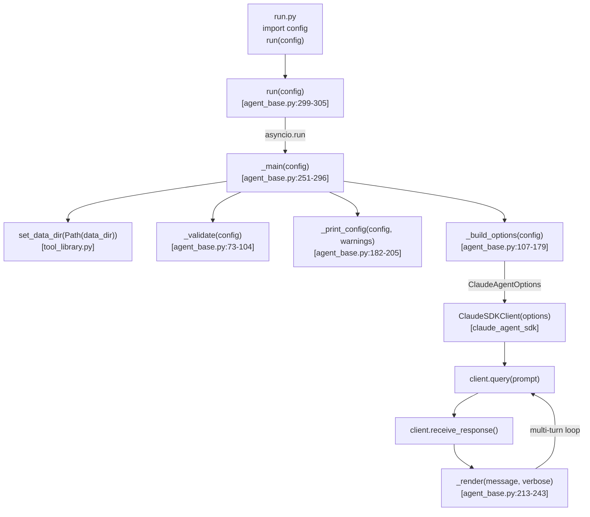
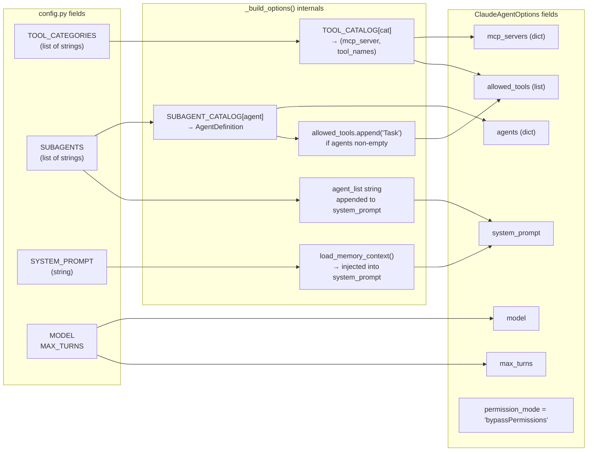

<!-- source: DeepWiki mcp.deepwiki.com · repo anthropics/agent-sdk-workshop · extra page Agent Base Runner · fetched 2026-10-26 -->

# Agent Base Runner

<details>
<summary>Relevant source files</summary>

The following files were used as context for generating this wiki page:

- [02-breakouts/COMPONENTS.md](02-breakouts/COMPONENTS.md)
- [02-breakouts/README.md](02-breakouts/README.md)
- [02-breakouts/_shared/agent_base.py](02-breakouts/_shared/agent_base.py)

</details>


`agent_base.py` is the shared execution engine for all breakouts in `02-breakouts/`. Its sole job is to translate a breakout's `config.py` module into a running `ClaudeSDKClient` session. Every breakout's `run.py` delegates entirely to this file; participants never edit it.

This page covers the internal mechanics of `02-breakouts/_shared/agent_base.py`. For the catalog of tools and sub-agents this runner can assemble, see [Tool Library (3.1.2)](#3.1.2) and [Sub-agent Library (3.1.3)](#3.1.3). For the config fields a breakout author controls, see [Available Components Reference (3.2)](#3.2). For the analogous entry point in the guided demo, see [Agent Entry Point (2.2)](#2.2).

---

## Role in the Breakout System

**Execution flow diagram: `run.py` to SDK**



Sources: [02-breakouts/_shared/agent_base.py:251-305]()

---

## Public Entry Point: `run()`

[02-breakouts/_shared/agent_base.py:299-305]()

`run(config)` is the only symbol imported by breakout `run.py` files. It wraps `_main(config)` in `asyncio.run()` and catches `KeyboardInterrupt` for a clean exit.

```
from _shared.agent_base import run
import config
run(config)
```

`_main(config)` reads three fields from the config module before doing anything else:

| Config field | Fallback | Used for |
|---|---|---|
| `AGENT_NAME` | `"Agent"` | Banner display |
| `DATA_DIR` | `None` | Passed to `set_data_dir()` |
| `VERBOSITY` | `"verbose"` | Controls tool call rendering |

Sources: [02-breakouts/_shared/agent_base.py:251-260]()

---

## Configuration Validation: `_validate()`

[02-breakouts/_shared/agent_base.py:73-104]()

`_validate(config)` performs non-fatal checks and returns a list of warning strings. Warnings are printed to the console but do not stop execution.

**What it checks:**

| Check | Source of truth | Warning text pattern |
|---|---|---|
| Each entry in `TOOL_CATEGORIES` is a known key | `TOOL_CATALOG` from `tool_library.py` | `"Unknown tool category '{cat}'"` |
| Each entry in `SUBAGENTS` is a known key | `SUBAGENT_CATALOG` from `subagent_library.py` | `"Unknown sub-agent '{agent}'"` |
| Sub-agent's required categories are enabled | `SUBAGENT_REQUIRES` from `subagent_library.py` | `"Sub-agent '{agent}' works best with the '{req}' tool category"` |
| `SYSTEM_PROMPT` is non-empty | — | `"SYSTEM_PROMPT is empty"` |

The dependency check iterates `SUBAGENT_REQUIRES.get(agent, [])` for each enabled sub-agent and compares against `config.TOOL_CATEGORIES`. A missing dependency is a warning, not an error; the sub-agent still runs, it just has no tools to call.

Sources: [02-breakouts/_shared/agent_base.py:73-104](), [02-breakouts/COMPONENTS.md:39]()

---

## Options Assembly: `_build_options()`

[02-breakouts/_shared/agent_base.py:107-179]()

`_build_options(config)` is the core translation step. It produces a `ClaudeAgentOptions` object from the config module's fields.

**Options assembly diagram**



Sources: [02-breakouts/_shared/agent_base.py:107-179]()

### Tool wiring

For each category in `TOOL_CATEGORIES`, `_build_options()` looks up `TOOL_CATALOG[cat]`, which returns a `(mcp_server, tool_names)` tuple. The server is added to `mcp_servers` keyed by category name; the tool names are appended to `allowed_tools`.

### Sub-agent wiring

For each entry in `SUBAGENTS`, the corresponding `AgentDefinition` from `SUBAGENT_CATALOG` is added to `agents`. If `agents` is non-empty after this loop, `"Task"` is appended to `allowed_tools` so the orchestrator can invoke sub-agents.

### System prompt construction

The base system prompt is `config.SYSTEM_PROMPT`. Two optional additions are appended:

1. **Memory injection** — if `"memory"` is in `TOOL_CATEGORIES`: `load_memory_context()` is called. If it returns content, that content is appended to the system prompt. A standing instruction to call `save_memory` is always appended in this case.

2. **Sub-agent nudge** — if any sub-agents are enabled: a formatted list of sub-agent names and descriptions is appended with the instruction `"Prefer delegation for specialized work."`

> **Note on memory approach:** The breakout runner injects memory once at startup (into the system prompt), unlike the guided demo which re-reads the memory file on every turn via a `UserPromptSubmit` hook. This means saves made during a session only appear on the *next* run. The tradeoff is simplicity over freshness, which suits the run → edit → re-run iteration cycle of breakouts.

Sources: [02-breakouts/_shared/agent_base.py:134-179]()

---

## Multi-Turn Conversation Loop

[02-breakouts/_shared/agent_base.py:279-296]()

After `ClaudeAgentOptions` is built, `_main()` prompts the user for an initial task. If the user presses Enter without typing, `DEFAULT_TASK` from the config is used as the fallback.

The conversation loop pattern:

1. `client.query(prompt)` — sends the prompt to the SDK
2. `async for message in client.receive_response()` — streams back messages
3. Each message is passed to `_render(message, verbose)`
4. After the first response, the loop prompts for follow-ups
5. An empty follow-up or `EOFError` exits the loop

```mermaid
sequenceDiagram
    participant "User (stdin)"
    participant "_main()"
    participant "ClaudeSDKClient"
    participant "Anthropic API"

    "_main()" -->> "User (stdin)": "What would you like to do? (default shown)"
    "User (stdin)" -->> "_main()": "task string"
    "_main()" ->> "ClaudeSDKClient": "client.query(prompt)"
    loop "agentic loop (up to MAX_TURNS)"
        "ClaudeSDKClient" ->> "Anthropic API": "messages + tool schemas"
        "Anthropic API" -->> "ClaudeSDKClient": "tool_call or response"
        "ClaudeSDKClient" -->> "_main()": "AssistantMessage / UserMessage / ResultMessage"
        "_main()" -->> "User (stdin)": "_render(message, verbose)"
    end
    "_main()" -->> "User (stdin)": "(follow-up, or Enter to exit)"
    "User (stdin)" -->> "_main()": "follow-up or empty"
```

Sources: [02-breakouts/_shared/agent_base.py:267-296]()

---

## Console Rendering: `_render()`

[02-breakouts/_shared/agent_base.py:213-243]()

`_render(message, verbose)` handles three SDK message types:

| Message type | Always shown | Shown only if `verbose=True` |
|---|---|---|
| `AssistantMessage` | `TextBlock` content (cyan) | `ToolUseBlock` — tool name and inputs (yellow, dimmed) |
| `UserMessage` | *(nothing)* | `ToolResultBlock` — result text, truncated to 200 chars (dimmed) |
| `ResultMessage` | Turn count + cost (gray), or error text (red) | — |

`verbose` is `True` when `config.VERBOSITY == "verbose"`. The default value of `VERBOSITY` in every breakout config is `"verbose"`, so tool calls are shown by default.

The color constants are defined in the `C` class [02-breakouts/_shared/agent_base.py:47-59](). Colors are suppressed entirely when the `NO_COLOR` environment variable is set to `"1"`.

Sources: [02-breakouts/_shared/agent_base.py:213-243](), [02-breakouts/_shared/agent_base.py:47-59]()

---

## Configuration Field Reference

All fields `agent_base.py` reads from a config module, with their fallbacks:

| Field | Type | Fallback | Consumed by |
|---|---|---|---|
| `AGENT_NAME` | `str` | `"Agent"` | `_main()` — banner |
| `DATA_DIR` | `str` or `None` | `None` | `_main()` → `set_data_dir()` |
| `VERBOSITY` | `"verbose"` \| `"normal"` | `"verbose"` | `_main()` → `_render()` |
| `TOOL_CATEGORIES` | `list[str]` | `[]` | `_validate()`, `_build_options()` |
| `SUBAGENTS` | `list[str]` | `[]` | `_validate()`, `_build_options()` |
| `SYSTEM_PROMPT` | `str` | `""` | `_validate()`, `_build_options()` |
| `MODEL` | `str` | `"claude-sonnet-4-6"` | `_build_options()` → `ClaudeAgentOptions.model` |
| `MAX_TURNS` | `int` or `None` | `None` | `_build_options()` → `ClaudeAgentOptions.max_turns` |
| `DEFAULT_TASK` | `str` | `"How can I help?"` | `_main()` — prompt fallback |

Sources: [02-breakouts/_shared/agent_base.py:251-296](), [02-breakouts/_shared/agent_base.py:107-179](), [02-breakouts/COMPONENTS.md:46-54]()

---

