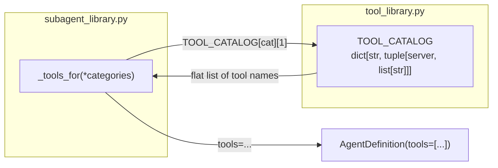
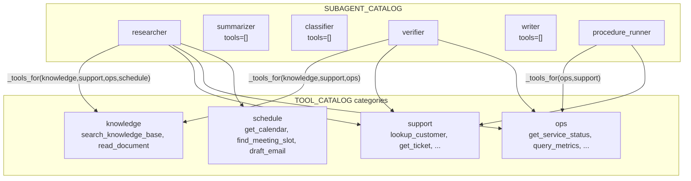
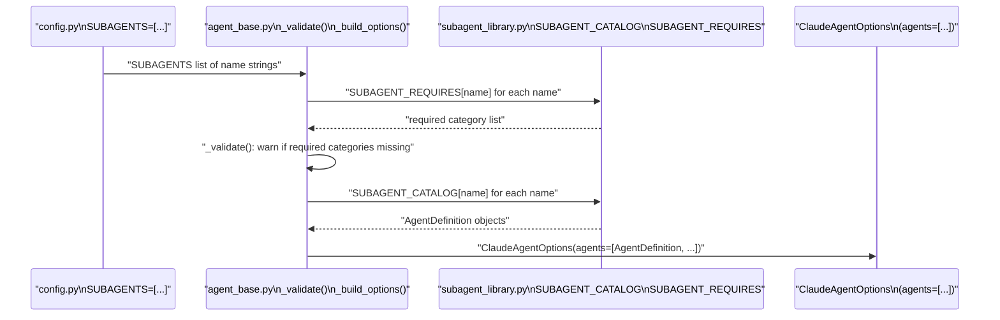

<!-- source: DeepWiki mcp.deepwiki.com · repo anthropics/agent-sdk-workshop · extra page Sub-agent Library · fetched 2026-10-26 -->

# Sub-agent Library

<details>
<summary>Relevant source files</summary>

The following files were used as context for generating this wiki page:

- [02-breakouts/COMPONENTS.md](02-breakouts/COMPONENTS.md)
- [02-breakouts/_shared/subagent_library.py](02-breakouts/_shared/subagent_library.py)

</details>


This page documents `02-breakouts/_shared/subagent_library.py`: the pre-built `AgentDefinition` objects available to any breakout, the `SUBAGENT_REQUIRES` dependency map, and the `_tools_for()` helper that builds per-sub-agent tool allowlists. For how the shared runner picks these up and wires them into `ClaudeAgentOptions`, see the Agent Base Runner page ([3.1.1](#3.1.1)). For the full list of selectable components including tool categories, see the Available Components Reference ([3.2](#3.2)).

---

## Overview

`subagent_library.py` defines a single catalog of named `AgentDefinition` objects. Each breakout's `config.py` declares a `SUBAGENTS` list of names; `agent_base.py` looks those names up in `SUBAGENT_CATALOG` and adds the definitions to `ClaudeAgentOptions`. This pattern is the generalized version of the `researcher` and `fact_checker` definitions from the guided demo (see [2.4](#2.4)).

The file has three exports:

| Symbol | Type | Purpose |
|---|---|---|
| `_tools_for(*categories)` | helper function | Builds a flat tool allowlist from one or more tool category names |
| `SUBAGENT_CATALOG` | `dict[str, AgentDefinition]` | All six sub-agent definitions, keyed by name |
| `SUBAGENT_REQUIRES` | `dict[str, list[str]]` | Minimum tool categories each sub-agent needs to function usefully |

Sources: [02-breakouts/_shared/subagent_library.py:1-17]()

---

## `_tools_for()` Helper

[02-breakouts/_shared/subagent_library.py:24-32]()

`_tools_for(*categories)` takes one or more category name strings and returns a flat list of fully-qualified MCP tool names by reading from `TOOL_CATALOG` (imported from `tool_library.py`). Categories not found in `TOOL_CATALOG` are silently skipped — validation and user warnings happen in `agent_base.py`, not here.

Each entry in `TOOL_CATALOG` is a tuple of `(mcp_server_object, [tool_name_strings])`. `_tools_for()` extracts the second element (index `1`) and extends the result list with it.

**Diagram: `_tools_for()` data flow**



Sources: [02-breakouts/_shared/subagent_library.py:24-32](), [02-breakouts/_shared/tool_library.py]()

---

## `SUBAGENT_CATALOG`

[02-breakouts/_shared/subagent_library.py:39-151]()

`SUBAGENT_CATALOG` is a `dict[str, AgentDefinition]`. All six sub-agents use `model="haiku"` — they are specialized, focused workers called by the main (typically Sonnet) orchestrator via the `Task` tool.

### Sub-agent Reference Table

| Key | Role | Tool categories used | Tools empty? |
|---|---|---|---|
| `researcher` | Gathers info on a focused question from available data sources | `knowledge`, `support`, `ops`, `schedule` | No |
| `summarizer` | Condenses long content to ≤150 words, preserving numbers/dates/names | *(none)* | Yes |
| `classifier` | Routes an item into exactly one category with a one-sentence justification | *(none)* | Yes |
| `verifier` | Fact-checks specific claims; returns CONFIRMED / REFUTED / UNVERIFIABLE | `knowledge`, `support`, `ops` | No |
| `writer` | Turns rough notes or bullets into polished prose at a specified tone | *(none)* | Yes |
| `procedure_runner` | Executes a step-by-step procedure in order, stops and reports on blockers | `ops`, `support` | No |

Sources: [02-breakouts/_shared/subagent_library.py:39-151](), [02-breakouts/COMPONENTS.md:26-41]()

---

### Individual Definitions

**`researcher`** — [02-breakouts/_shared/subagent_library.py:43-57]()

Calls `_tools_for("knowledge", "support", "ops", "schedule")`. Has access to the widest tool set of any sub-agent. Its prompt instructs it to report findings with sources and flag data gaps rather than editorialize.

**`summarizer`** — [02-breakouts/_shared/subagent_library.py:61-75]()

`tools=[]`. Works entirely from the content passed in its task prompt. No external data access. Imposes a 150-word cap and explicitly preserves specific numbers, dates, and names.

**`classifier`** — [02-breakouts/_shared/subagent_library.py:79-93]()

`tools=[]`. Prompted to return exactly one category and refuse to force a bad fit. Useful for ticket routing (`billing` vs. `technical`) or incident triage (`capacity` vs. `code regression`).

**`verifier`** — [02-breakouts/_shared/subagent_library.py:97-111]()

Calls `_tools_for("knowledge", "support", "ops")`. Equivalent role to `fact_checker` in the guided demo. Uses three strict verdict labels: `CONFIRMED`, `REFUTED`, `UNVERIFIABLE`. Small discrepancies still count as `REFUTED`.

**`writer`** — [02-breakouts/_shared/subagent_library.py:116-131]()

`tools=[]`. Prompted to match tone exactly per audience (formal for executives, warm for customers, precise for engineers). Takes rough notes or bullets and produces clean prose.

**`procedure_runner`** — [02-breakouts/_shared/subagent_library.py:135-150]()

Calls `_tools_for("ops", "support")`. Intended for runbook execution. Prompted to work through steps in order, report the result of each step, and halt with a blocker report rather than skip ahead.

---

## `SUBAGENT_REQUIRES`

[02-breakouts/_shared/subagent_library.py:156-163]()

`SUBAGENT_REQUIRES` is a plain `dict[str, list[str]]` used exclusively by `agent_base.py` during validation. It encodes the *minimum* tool categories a sub-agent needs to be useful. A sub-agent enabled without its required categories will still run but will have no data to work with.

```
SUBAGENT_REQUIRES = {
    "researcher":       ["knowledge"],   # at minimum; can use more
    "summarizer":       [],
    "classifier":       [],
    "verifier":         ["knowledge"],
    "writer":           [],
    "procedure_runner": ["ops"],
}
```

`agent_base.py`'s `_validate()` function cross-references the `SUBAGENTS` list in `config.py` against the active `TOOL_CATEGORIES` list and prints a warning for each missing required category. It does not prevent execution.

Sources: [02-breakouts/_shared/subagent_library.py:154-163](), [02-breakouts/COMPONENTS.md:39-41]()

---

## Relationship to Tool Categories

**Diagram: Sub-agent tool access via `_tools_for()`**



Sources: [02-breakouts/_shared/subagent_library.py:24-32](), [02-breakouts/_shared/subagent_library.py:55](), [02-breakouts/_shared/subagent_library.py:109](), [02-breakouts/_shared/subagent_library.py:148]()

---

## Integration with `agent_base.py`

**Diagram: Config → Catalog lookup → `ClaudeAgentOptions`**



Sources: [02-breakouts/_shared/subagent_library.py:156-163](), [02-breakouts/COMPONENTS.md:57-62]()

---

## Usage in a Breakout `config.py`

To enable sub-agents in any breakout, set the `SUBAGENTS` list in `config.py` to one or more keys from `SUBAGENT_CATALOG`:

```python
SUBAGENTS = ["researcher", "verifier"]
TOOL_CATEGORIES = ["knowledge", "support"]
```

If `verifier` is listed but `knowledge` is not in `TOOL_CATEGORIES`, `agent_base.py` prints a warning at startup. The sub-agent is still registered; it simply has no tools to query.

Tool names passed to `AgentDefinition.tools` follow the `mcp__<category>__<tool>` naming convention — e.g., `mcp__knowledge__search_knowledge_base`. `_tools_for()` produces names in this format by reading them directly from `TOOL_CATALOG`, which stores them pre-formatted.

Sources: [02-breakouts/COMPONENTS.md:26-41](), [02-breakouts/_shared/subagent_library.py:24-32]()

---

