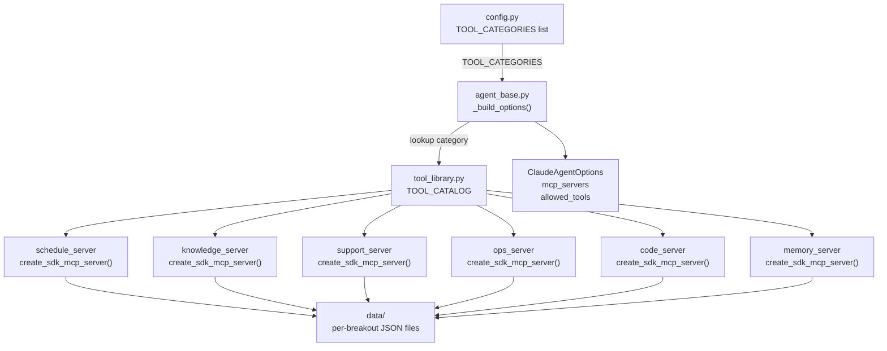

<!-- source: DeepWiki mcp.deepwiki.com · repo anthropics/agent-sdk-workshop · extra page Tool Library · fetched 2026-10-26 -->

# Tool Library

<details>
<summary>Relevant source files</summary>

The following files were used as context for generating this wiki page:

- [02-breakouts/COMPONENTS.md](02-breakouts/COMPONENTS.md)
- [02-breakouts/_shared/tool_library.py](02-breakouts/_shared/tool_library.py)

</details>


`02-breakouts/_shared/tool_library.py` defines every pre-built tool available to breakout agents. It is the exclusive source of tool implementations in the breakouts system — no breakout contains its own tool code. Each breakout's `config.py` selects tools by listing category names in `TOOL_CATEGORIES`; the shared runner (`agent_base.py`) reads `TOOL_CATALOG` to wire those categories into the agent's `ClaudeAgentOptions`.

This page covers the tool library only. For how `agent_base.py` consumes `TOOL_CATALOG`, see [3.1.1](#3.1.1). For the full reference table of categories and sub-agents available in `config.py`, see [3.2](#3.2).

---

## Architecture Overview

**Diagram: tool_library.py within the breakouts runtime**



Sources: [02-breakouts/_shared/tool_library.py:641-691](), [02-breakouts/COMPONENTS.md:1-22]()

---

## Data Directory Isolation

All tools read from a single module-level variable `_DATA_DIR` ([02-breakouts/_shared/tool_library.py:37]()). Before any tool is called, `agent_base.py` calls `set_data_dir()` to point this variable at the current breakout's `data/` subdirectory.

The private `_load(filename)` helper ([02-breakouts/_shared/tool_library.py:47-56]()) wraps every JSON read:

- Resolves `_DATA_DIR / filename`
- Returns `{}` silently if the file does not exist, so breakouts can omit data files for categories they do not use
- No network calls are made; all data is local JSON

This design means the same tool functions serve every breakout without modification. Swapping mock data for a real API would only require changing the body of the relevant `@tool` function.

Sources: [02-breakouts/_shared/tool_library.py:37-56]()

---

## Tool Categories

Each category is implemented as a group of `@tool`-decorated async functions, bundled into a `create_sdk_mcp_server()` instance. `TOOL_CATALOG` maps category name strings to `(server_instance, list_of_full_tool_names)` tuples.

**Diagram: category names → MCP servers → tool functions → data files**

```mermaid
graph LR
    subgraph TOOL_CATALOG["TOOL_CATALOG"]
        S["\"schedule\"\nschedule_server"]
        K["\"knowledge\"\nknowledge_server"]
        SP["\"support\"\nsupport_server"]
        O["\"ops\"\nops_server"]
        C["\"code\"\ncode_server"]
        M["\"memory\"\nmemory_server"]
    end

    subgraph ScheduleTools["schedule tools"]
        S1["get_calendar"]
        S2["find_meeting_slot"]
        S3["draft_email"]
    end

    subgraph KnowledgeTools["knowledge tools"]
        K1["search_knowledge_base"]
        K2["read_document"]
    end

    subgraph SupportTools["support tools"]
        SP1["lookup_customer"]
        SP2["get_ticket"]
        SP3["list_open_tickets"]
        SP4["add_ticket_note"]
    end

    subgraph OpsTools["ops tools"]
        O1["get_service_status"]
        O2["query_metrics"]
        O3["get_recent_alerts"]
        O4["search_runbooks"]
        O5["read_runbook"]
    end

    subgraph CodeTools["code tools"]
        C1["list_files"]
        C2["read_file"]
        C3["search_code"]
    end

    subgraph MemoryTools["memory tools"]
        M1["save_memory"]
        M2["list_memories"]
    end

    subgraph DataFiles["data/ files"]
        D1["calendar.json"]
        D2["knowledge_base.json\ndocuments.json"]
        D3["customers.json\ntickets.json"]
        D4["services.json\nalerts.json\nrunbooks.json"]
        D5["_DATA_DIR\n(any files)"]
        D6["memory_store.json"]
    end

    S --> S1 & S2 & S3
    K --> K1 & K2
    SP --> SP1 & SP2 & SP3 & SP4
    O --> O1 & O2 & O3 & O4 & O5
    C --> C1 & C2 & C3
    M --> M1 & M2

    S1 --> D1
    S2 --> D1
    K1 --> D2
    K2 --> D2
    SP1 --> D3
    SP2 --> D3
    SP3 --> D3
    O1 --> D4
    O2 --> D4
    O3 --> D4
    O4 --> D4
    O5 --> D4
    C1 --> D5
    C2 --> D5
    C3 --> D5
    M1 --> D6
    M2 --> D6
```

Sources: [02-breakouts/_shared/tool_library.py:641-691]()

---

### `schedule` — Calendar and Scheduling

MCP server: `schedule_server` ([02-breakouts/_shared/tool_library.py:141-144]())

Reads: `calendar.json`

| Full tool name | Function | Parameters | Description |
|---|---|---|---|
| `mcp__schedule__get_calendar` | `get_calendar` | `start_date: str`, `end_date: str` | Returns calendar events in a date range. Filters the `calendar.json` list by the `date` field. |
| `mcp__schedule__find_meeting_slot` | `find_meeting_slot` | `duration_minutes: int`, `start_date: str`, `end_date: str` | Returns the earliest available slot. The mock always returns a fixed 14:00 slot; a real implementation would check for conflicts. |
| `mcp__schedule__draft_email` | `draft_email` | `to: str`, `subject: str`, `body: str` | Formats and returns an email draft. Explicitly does **not** send the email; the draft is returned for human review. |

Sources: [02-breakouts/_shared/tool_library.py:70-144]()

---

### `knowledge` — Document and Knowledge Base Search

MCP server: `knowledge_server` ([02-breakouts/_shared/tool_library.py:204-207]())

Reads: `knowledge_base.json`, `documents.json`

| Full tool name | Function | Parameters | Description |
|---|---|---|---|
| `mcp__knowledge__search_knowledge_base` | `search_knowledge_base` | `query: str` | Case-insensitive substring match against article `title`, `body`, and `tags`. Returns titles and 150-character snippets. |
| `mcp__knowledge__read_document` | `read_document` | `document_id: str` | Merges `knowledge_base.json` and `documents.json` into a single list, then returns the full `body` of the matching `id`. |

Sources: [02-breakouts/_shared/tool_library.py:154-207]()

---

### `support` — Customer and Ticket Management

MCP server: `support_server` ([02-breakouts/_shared/tool_library.py:305-308]())

Reads: `customers.json`, `tickets.json`

| Full tool name | Function | Parameters | Description |
|---|---|---|---|
| `mcp__support__lookup_customer` | `lookup_customer` | `customer_identifier: str` | Matches by `id` or `email` (case-insensitive). Returns the full customer record as JSON. |
| `mcp__support__get_ticket` | `get_ticket` | `ticket_id: str` | Returns the full ticket record including conversation history. |
| `mcp__support__list_open_tickets` | `list_open_tickets` | `priority: str` | Filters `tickets.json` to `status == "open"`, optionally further filtered by `priority`. |
| `mcp__support__add_ticket_note` | `add_ticket_note` | `ticket_id: str`, `note: str` | Confirms an internal note was recorded. In the workshop, this is a no-op write; in production it would write to a ticketing system. |

Sources: [02-breakouts/_shared/tool_library.py:216-308]()

---

### `ops` — Observability and Incident Management

MCP server: `ops_server` ([02-breakouts/_shared/tool_library.py:458-464]())

Reads: `services.json`, `alerts.json`, `runbooks.json`

| Full tool name | Function | Parameters | Description |
|---|---|---|---|
| `mcp__ops__get_service_status` | `get_service_status` | `service: str` | Returns the matching service record from `services.json`. Lists known services if not found. |
| `mcp__ops__query_metrics` | `query_metrics` | `service: str`, `metric: str`, `last_minutes: int` | Generates mock time-series data seeded by `service:metric` for stable results. Injects a visible error-rate spike for the `checkout` service to give agents something to find. |
| `mcp__ops__get_recent_alerts` | `get_recent_alerts` | `service: str`, `last_hours: int` | Returns records from `alerts.json`, optionally filtered by service name. |
| `mcp__ops__search_runbooks` | `search_runbooks` | `query: str` | Substring match against runbook `title` and `summary`. Returns IDs and summaries. |
| `mcp__ops__read_runbook` | `read_runbook` | `runbook_id: str` | Returns the full runbook including numbered step list. |

Sources: [02-breakouts/_shared/tool_library.py:317-464]()

---

### `code` — Repository Inspection

MCP server: `code_server` ([02-breakouts/_shared/tool_library.py:546-549]())

Reads: the `_DATA_DIR` directory itself, treated as a workspace of real files rather than JSON data.

| Full tool name | Function | Parameters | Description |
|---|---|---|---|
| `mcp__code__list_files` | `list_files` | `pattern: str` | Recursively lists all files under `_DATA_DIR`, optionally filtered by filename substring. |
| `mcp__code__read_file` | `read_file` | `path: str` | Reads a file at `_DATA_DIR / path`. Includes a path-traversal guard: any path resolving outside `_DATA_DIR` is rejected. |
| `mcp__code__search_code` | `search_code` | `query: str` | Searches every file under `_DATA_DIR` for the query string. Returns up to 50 matching lines with `file:line: content` format. Skips binary files (`UnicodeDecodeError`). |

Sources: [02-breakouts/_shared/tool_library.py:472-549]()

---

### `memory` — Persistent Memory

MCP server: `memory_server` ([02-breakouts/_shared/tool_library.py:616-619]())

Reads/writes: `memory_store.json` inside `_DATA_DIR` (one file per breakout).

| Full tool name | Function | Parameters | Description |
|---|---|---|---|
| `mcp__memory__save_memory` | `save_memory` | `category: str`, `note: str` | Appends `{timestamp, category, note}` to `memory_store.json`. Caps the list at 50 entries (oldest dropped). |
| `mcp__memory__list_memories` | `list_memories` | *(none)* | Reads and formats all entries in `memory_store.json`. |

The `memory` category also provides `load_memory_context()` — a module-level function (not a `@tool`) used by `agent_base.py` to inject prior memories into the system prompt at session startup. See [3.1.1](#3.1.1) for how this injection works.

Sources: [02-breakouts/_shared/tool_library.py:558-631]()

---

## `TOOL_CATALOG`

`TOOL_CATALOG` is the single dict that `agent_base.py` consults when building `ClaudeAgentOptions`. Each key is the category string that appears in a breakout's `TOOL_CATEGORIES` list.

```
TOOL_CATALOG = {
    "schedule":  (schedule_server,  ["mcp__schedule__get_calendar", ...]),
    "knowledge": (knowledge_server, ["mcp__knowledge__search_knowledge_base", ...]),
    "support":   (support_server,   ["mcp__support__lookup_customer", ...]),
    "ops":       (ops_server,       ["mcp__ops__get_service_status", ...]),
    "code":      (code_server,      ["mcp__code__list_files", ...]),
    "memory":    (memory_server,    ["mcp__memory__save_memory", ...]),
}
```

Each value is a two-tuple:

- `[0]` — the `create_sdk_mcp_server()` instance, added to `ClaudeAgentOptions.mcp_servers`
- `[1]` — the list of fully-qualified tool names, added to `ClaudeAgentOptions.allowed_tools`

Sources: [02-breakouts/_shared/tool_library.py:641-691]()

---

## Tool Naming Convention

Every tool name follows the pattern `mcp__<category>__<tool_name>`. The double-underscore separators reflect the MCP server namespace: the category string becomes the server name, and the tool function's registered name becomes the tool name.

**Diagram: naming convention decomposition**

```mermaid
flowchart LR
    subgraph Example["Example: mcp__support__lookup_customer"]
        P["\"mcp\"\nprotocol prefix"]
        CAT["\"support\"\ncategory / server name"]
        T["\"lookup_customer\"\n@tool registered name"]
    end

    P -->|"__"| CAT -->|"__"| T
```

Sources: [02-breakouts/_shared/tool_library.py:13-21](), [02-breakouts/COMPONENTS.md:20]()

---

## Summary Table

| Category | Server variable | Tools | Data file(s) | Primary use case |
|---|---|---|---|---|
| `schedule` | `schedule_server` | 3 | `calendar.json` | Chief-of-staff, exec assistant |
| `knowledge` | `knowledge_server` | 2 | `knowledge_base.json`, `documents.json` | Any agent citing internal docs |
| `support` | `support_server` | 4 | `customers.json`, `tickets.json` | Customer support, account management |
| `ops` | `ops_server` | 5 | `services.json`, `alerts.json`, `runbooks.json` | SRE, incident response |
| `code` | `code_server` | 3 | *(workspace directory)* | Codebase exploration |
| `memory` | `memory_server` | 2 | `memory_store.json` | Cross-session persistence |

Sources: [02-breakouts/_shared/tool_library.py:1-691](), [02-breakouts/COMPONENTS.md:11-18]()

---

