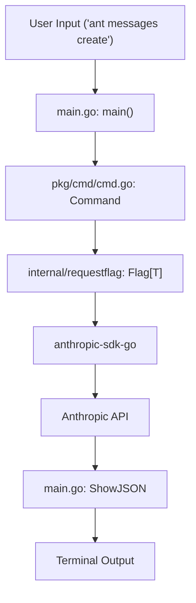

<!-- source: DeepWiki mcp.deepwiki.com · repo anthropics/anthropic-cli · page 1 Overview · fetched 2026-10-26 -->

# Overview

Relevant source files

The following files were used as context for generating this wiki page:

- [.goreleaser.yml](.goreleaser.yml)
- [.release-please-manifest.json](.release-please-manifest.json)
- [CHANGELOG.md](CHANGELOG.md)
- [README.md](README.md)
- [cmd/ant/main.go](cmd/ant/main.go)
- [go.mod](go.mod)
- [pkg/cmd/cmd.go](pkg/cmd/cmd.go)
- [pkg/cmd/version.go](pkg/cmd/version.go)

The Anthropic CLI (`ant`) is the official command-line interface for the [Claude Developer Platform](https://platform.claude.com/docs/en/api). It provides a resource-based interface to interact with Anthropic's LLM services, including message creation, model management, and beta features like Agents and Sessions [README.md:1-5]().

The CLI is built in Go and leverages the `urfave/cli/v3` framework for command routing and `anthropic-sdk-go` for API communication [go.mod:6-18]().

### High-Level Architecture

The application is structured as a tree of commands where each "resource" (e.g., `messages`, `models`) is a sub-command containing specific actions (e.g., `create`, `list`) [pkg/cmd/cmd.go:85-132]().

**System Component Mapping**

The following diagram maps high-level CLI concepts to their corresponding implementation entities in the codebase.

| Concept | Code Entity | File Path |
| :--- | :--- | :--- |
| **Entrypoint** | `func main()` | [cmd/ant/main.go:19-60]() |
| **Command Tree** | `var Command` | [pkg/cmd/cmd.go:27-84]() |
| **API Client** | `anthropic-sdk-go` | [go.mod:6]() |
| **Output Handler** | `func ShowJSON` | [cmd/ant/main.go:46]() |
| **Version Info** | `const Version` | [pkg/cmd/version.go:5]() |

**Request Execution Flow**

This diagram illustrates how a command like `ant messages create` flows from the user's terminal through the system entities.

Sources: [cmd/ant/main.go:19-60](), [pkg/cmd/cmd.go:21-33](), [pkg/cmd/cmd.go:76-84](), [go.mod:6-18]()

### Key Concepts

#### Resource-Based Commands
The CLI organizes functionality by API resource. Commands follow the pattern `ant [resource] <command> [flags...]` [README.md:48-52]().
*   **Stable Resources:** `messages`, `models`, `completions` [pkg/cmd/cmd.go:86-124]().
*   **Beta Resources:** Prefixed with `beta:`, such as `beta:agents`, `beta:sessions`, and `beta:vaults` [pkg/cmd/cmd.go:126-272]().

#### Data Transformation and Formatting
The CLI supports multiple output formats (JSON, YAML, Table, etc.) via the `--format` flag [pkg/cmd/cmd.go:46-56](). It also integrates `gjson` to allow users to filter or transform API responses directly from the command line using the `--transform` flag [pkg/cmd/cmd.go:68-71]().

#### File Embedding
A powerful feature of `ant` is the ability to reference local files using the `@` symbol. This allows passing images or large text blocks into JSON payloads without manual encoding [README.md:84-109]().

### Wiki Navigation

This wiki is organized to help you understand the CLI from installation to deep internal mechanics.

*   **[Getting Started](#1.1)**: Quick-start guide covering installation via Homebrew or Go, and configuring the `ANTHROPIC_API_KEY` [README.md:7-35]().
*   **[Project Layout](#1.2)**: A guide to the repository structure, distinguishing between the `cmd/` entrypoints and the `pkg/cmd/` implementation logic.
*   **Command Reference**: Detailed documentation of every available command, including required flags and example usage.
*   **Core Architecture**: Deep dives into the request pipeline, flag system, and the TUI-based JSON explorer.
*   **Developer Tooling**: Documentation on the `scripts/` directory used for local development and the CI/CD release pipeline [README.md:37-45](), [.goreleaser.yml:1-11]().

Sources: [README.md:46-83](), [pkg/cmd/cmd.go:46-71](), [pkg/cmd/cmd.go:85-155](), [go.mod:15-18]()

---

