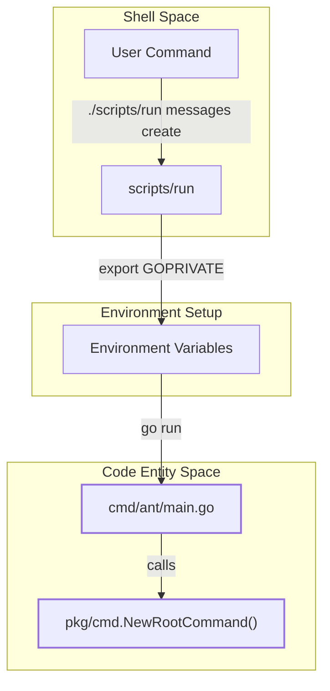
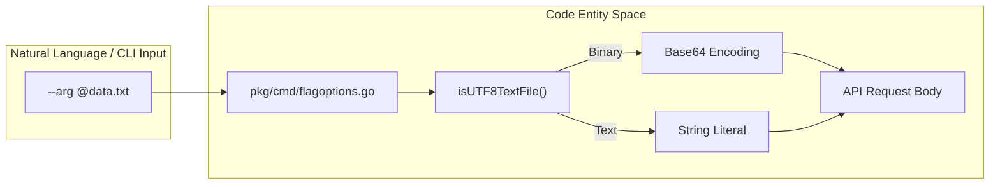

<!-- source: DeepWiki mcp.deepwiki.com · repo anthropics/anthropic-cli · page 1.1 Getting Started · fetched 2026-10-26 -->

# Getting Started

<details>
<summary>Relevant source files</summary>

The following files were used as context for generating this wiki page:

- [.github/actions/setup-go/action.yml](.github/actions/setup-go/action.yml)
- [.goreleaser.yml](.goreleaser.yml)
- [.release-please-manifest.json](.release-please-manifest.json)
- [CHANGELOG.md](CHANGELOG.md)
- [README.md](README.md)
- [pkg/cmd/version.go](pkg/cmd/version.go)
- [scripts/bootstrap](scripts/bootstrap)
- [scripts/build](scripts/build)
- [scripts/lint](scripts/lint)
- [scripts/run](scripts/run)

</details>


This page provides a technical overview of how to install, configure, and begin developing with the Anthropic CLI (`ant`). The CLI is a Go-based tool designed to interface with the Claude Developer Platform API.

## Installation Methods

The CLI is distributed as a compiled binary named `ant`. It can be installed via package managers or built from source using the Go toolchain.

### Homebrew (macOS/Linux)
The CLI is available via a custom Homebrew tap. The formula is managed through the `.goreleaser.yml` configuration, which handles the creation of the Homebrew cask and associated completion scripts [[.goreleaser.yml:81-97]]().

```sh
brew install anthropics/tap/ant
```

### Go Install
For developers with a Go environment (version 1.22 or later), the CLI can be installed directly from the repository [[README.md:15-20]]().

```sh
go install 'github.com/anthropics/anthropic-cli/cmd/ant@latest'
```

After installation, ensure your `GOPATH/bin` is in your system `PATH` to execute the `ant` binary [[README.md:28-33]]().

## Environment Variables and Configuration

The CLI relies on environment variables for authentication and behavior modification. These variables are mapped to global flags during command execution.

| Environment Variable | Description | Default |
| :--- | :--- | :--- |
| `ANTHROPIC_API_KEY` | The primary API key for authenticating requests [[README.md:68]](). | `null` |
| `ANTHROPIC_AUTH_TOKEN` | An alternative authentication token [[README.md:69]](). | `null` |
| `GOPRIVATE` | Used during development to bypass the public Go proxy for internal SDKs [[scripts/run:8]](). | - |

## Global Flags

The following flags are available globally across all `ant` commands [[README.md:71-83]]():

*   `--api-key`: Sets the API key (overrides `ANTHROPIC_API_KEY`).
*   `--base-url`: Overrides the default API endpoint (useful for testing against a mock server).
*   `--debug`: Enables verbose logging, including redacted HTTP request/response details.
*   `--format`: Specifies output rendering (e.g., `json`, `pretty`, `yaml`, `explore`).
*   `--transform`: Applies a [GJSON](https://github.com/tidwall/gjson) path to filter or reshape the JSON response.
*   `--version` / `-v`: Displays the current version, defined in `pkg/cmd/version.go` [[pkg/cmd/version.go:5]]().

## Local Development Workflow

For contributors, the repository provides a set of scripts to manage the development lifecycle without requiring a global installation.

### The `scripts/run` Wrapper
The `scripts/run` utility is the primary entry point for local execution. It automatically configures the `GOPRIVATE` environment variable to ensure internal SDK modules (like `anthropic-sdk-go`) are resolved correctly from the source rather than the Go proxy [[scripts/run:8-10]]().

**Implementation Flow: Local Execution**

The following diagram illustrates the path from a local script execution to the CLI entry point.

Title: Local Development Execution Flow

Sources: [[scripts/run:1-10]](), [[.goreleaser.yml:17]]()

### Developer Scripts
*   `./scripts/bootstrap`: Initializes the environment, handles `brew bundle`, and runs `go mod tidy` [[scripts/bootstrap:1-23]]().
*   `./scripts/build`: Compiles the `ant` binary to the local directory [[scripts/build:1-11]]().
*   `./scripts/lint`: Runs `go build ./...` to check for compilation errors across the workspace [[scripts/lint:1-11]]().

## Quick Start Example

The CLI uses a resource-based command structure: `ant [resource] <command> [flags...]` [[README.md:51]]().

### Creating a Message
To send a prompt to a model, use the `messages create` command. You can pass complex objects as JSON strings or use the `@` prefix to load content from a file [[README.md:55-60]]().

```sh
ant messages create \
  --max-tokens 1024 \
  --message '{content: [{text: "Hello, Claude", type: "text"}], role: "user"}' \
  --model claude-3-5-sonnet-latest
```

### File Embedding Logic
The CLI supports a special `@` syntax for flags. When a flag value starts with `@`, the `flagOptions` pipeline attempts to read the file at the specified path [[README.md:86-90]]().

**Data Flow: File Flag Resolution**

Title: Flag Value to File Content Resolution

Sources: [[README.md:112-118]](), [[pkg/cmd/flagoptions.go]]()

For explicit control over encoding, use:
*   `@file://path/to/file`: Forces string/text encoding [[README.md:116]]().
*   `@data://path/to/file`: Forces base64 encoding for binary data [[README.md:116]]().

Sources: [[README.md:1-123]](), [[scripts/run:1-10]](), [[pkg/cmd/version.go:1-6]](), [[.goreleaser.yml:1-97]]()

---

