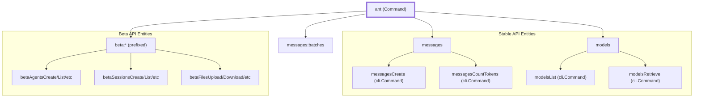
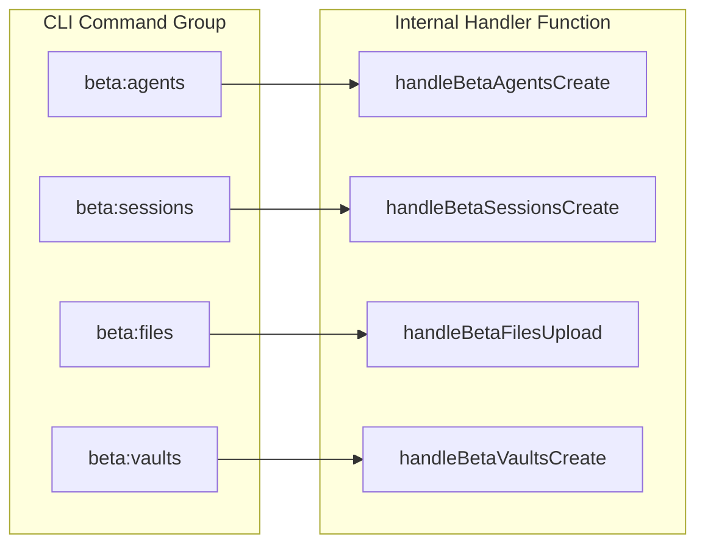

<!-- source: DeepWiki mcp.deepwiki.com · repo anthropics/anthropic-cli · page 2 Command Reference · fetched 2026-10-26 -->

# Command Reference

Relevant source files

The following files were used as context for generating this wiki page:

- [cmd/ant/main.go](cmd/ant/main.go)
- [pkg/cmd/betamessage.go](pkg/cmd/betamessage.go)
- [pkg/cmd/betamessagebatch.go](pkg/cmd/betamessagebatch.go)
- [pkg/cmd/betamodel.go](pkg/cmd/betamodel.go)
- [pkg/cmd/cmd.go](pkg/cmd/cmd.go)
- [pkg/cmd/message.go](pkg/cmd/message.go)
- [pkg/cmd/messagebatch.go](pkg/cmd/messagebatch.go)
- [pkg/cmd/model.go](pkg/cmd/model.go)

The Anthropic CLI (`ant`) provides a structured command-line interface to the Claude Developer Platform. Commands are organized hierarchically by API resource group, mirroring the structure of the Anthropic API. The CLI uses the `urfave/cli` framework to manage this command tree and provide features like suggestions and flag parsing [pkg/cmd/cmd.go:27-30]().

### Command Structure Overview

The CLI entrypoint in `cmd/ant/main.go` executes the root `Command` defined in `pkg/cmd/cmd.go` [cmd/ant/main.go:20-33](). Commands are grouped into two primary categories: **Stable API Resources** and **Beta API Resources** [pkg/cmd/cmd.go:85-272]().

#### Global Flags
All commands support a set of global flags for configuration and output formatting:
*   `--api-key`: API key for authentication (can also use `ANTHROPIC_API_KEY` env var) [pkg/cmd/cmd.go:76-79]().
*   `--format`: Output format (`auto`, `json`, `jsonl`, `pretty`, `yaml`, `raw`, `explore`) [pkg/cmd/cmd.go:46-56]().
*   `--transform`: GJSON path for filtering/transforming response data [pkg/cmd/cmd.go:68-71]().
*   `--debug`: Enables detailed request/response logging [pkg/cmd/cmd.go:34-37]().

### Command Hierarchy Diagram

This diagram maps the CLI command structure to the underlying implementation variables in the `cmd` package.

**CLI Command Tree to Code Entities**

**Sources:** [pkg/cmd/cmd.go:85-272](), [pkg/cmd/message.go:18](), [pkg/cmd/model.go:18-38]()

---

### Stable API Commands

The stable commands represent the core, production-ready features of the Anthropic API. These include primary interaction methods with Claude and administrative resource lookups.

| Resource Group | Primary Commands | Implementation File |
| :--- | :--- | :--- |
| `messages` | `create`, `count-tokens` | `pkg/cmd/message.go` |
| `messages:batches` | `create`, `retrieve`, `list`, `cancel`, `results` | `pkg/cmd/messagebatch.go` |
| `models` | `list`, `retrieve` | `pkg/cmd/model.go` |
| `completions` | `create` (Legacy) | `pkg/cmd/completion.go` |

These commands use standard `requestflag.Flag` definitions to map CLI inputs directly to API request bodies, query parameters, or headers [pkg/cmd/message.go:23-33]().

For detailed documentation on flags, streaming, and token counting, see **[Stable API Commands](#2.1)**.

---

### Beta API Commands

Beta commands provide access to upcoming features and specialized resources. These commands are prefixed with `beta:` and often require specific `anthropic-beta` headers, which the CLI handles via the `--beta` flag [pkg/cmd/betamessagebatch.go:29-33]().

**Beta Resource Mapping**

**Sources:** [pkg/cmd/cmd.go:157-261](), [pkg/cmd/betamessagebatch.go:171]()

The Beta suite includes advanced capabilities such as:
*   **Agents & Skills:** CRUD operations for agentic workflows [pkg/cmd/cmd.go:157-175]().
*   **Sessions & Events:** Real-time interaction management [pkg/cmd/cmd.go:190-211]().
*   **Files & Vaults:** Management of documents and credentials for model context [pkg/cmd/cmd.go:225-261]().

For detailed documentation on beta headers and specific resource flags, see **[Beta API Commands](#2.2)**.

---

### Execution Pipeline

When a command is executed, it follows a standard lifecycle:
1.  **Initialization:** The `main` function calls `app.Run` [cmd/ant/main.go:33]().
2.  **Flag Processing:** `flagOptions` parses the context and handles file embedding (e.g., `@file.json`) [pkg/cmd/betamessagebatch.go:181-187]().
3.  **API Call:** The command handler invokes the relevant method from the `anthropic-sdk-go` [pkg/cmd/messagebatch.go:164]().
4.  **Output:** The response is passed to `ShowJSON` or `ShowJSONIterator` for rendering based on the global `--format` flag [pkg/cmd/messagebatch.go:172]().

**Sources:** [cmd/ant/main.go:19-60](), [pkg/cmd/messagebatch.go:141-173](), [pkg/cmd/cmd.go:21-84]()

---

