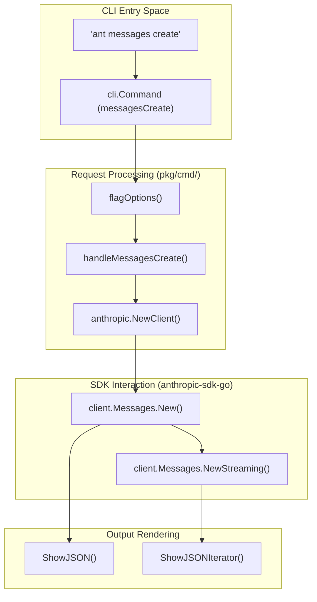
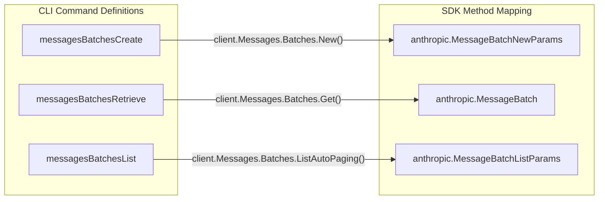

<!-- source: DeepWiki mcp.deepwiki.com · repo anthropics/anthropic-cli · page 2.1 Stable API Commands · fetched 2026-10-26 -->

# Stable API Commands

Relevant source files

The following files were used as context for generating this wiki page:

- [pkg/cmd/betamessage.go](pkg/cmd/betamessage.go)
- [pkg/cmd/betamessagebatch.go](pkg/cmd/betamessagebatch.go)
- [pkg/cmd/betamodel.go](pkg/cmd/betamodel.go)
- [pkg/cmd/betamodel_test.go](pkg/cmd/betamodel_test.go)
- [pkg/cmd/completion.go](pkg/cmd/completion.go)
- [pkg/cmd/completion_test.go](pkg/cmd/completion_test.go)
- [pkg/cmd/message.go](pkg/cmd/message.go)
- [pkg/cmd/message_test.go](pkg/cmd/message_test.go)
- [pkg/cmd/messagebatch.go](pkg/cmd/messagebatch.go)
- [pkg/cmd/messagebatch_test.go](pkg/cmd/messagebatch_test.go)
- [pkg/cmd/model.go](pkg/cmd/model.go)
- [pkg/cmd/model_test.go](pkg/cmd/model_test.go)

This page documents the stable (non-beta) resource commands in the Anthropic CLI. These commands interface with the core Anthropic API for generating messages, counting tokens, managing batches, and retrieving model information.

## Overview of Command Structure

Stable commands are implemented using the `urfave/cli` framework and are typically enhanced with `requestflag.WithInnerFlags` to support dotted flag syntax (e.g., `--message.role`). Every command follows a standard execution pipeline:
1. **Flag Parsing**: `requestflag.Flag[T]` types map CLI inputs to API request paths (`BodyPath`, `QueryPath`, or `HeaderPath`).
2. **Action Handler**: A `handle...` function (e.g., `handleMessagesCreate`) initializes the SDK client.
3. **SDK Call**: The command invokes the corresponding method in the `anthropic-sdk-go` library.
4. **Rendering**: Results are passed to `ShowJSON` or `ShowJSONIterator` for output formatting and display.

### Data Flow: CLI to API
The following diagram illustrates how a command like `messages create` moves from a CLI invocation to an SDK call.

**CLI Request Pipeline**

Sources: [pkg/cmd/message.go:18-133](), [pkg/cmd/message.go:135-177]()

---

## Messages API

The `messages` group provides tools for interacting with Claude via structured conversational turns.

### `messages create`
Sends a list of input messages to the model to generate a response.

*   **Required Flags**:
    *   `--model`: The model identifier (e.g., `claude-3-5-sonnet-20241022`) [pkg/cmd/message.go:35-40]().
    *   `--max-tokens`: Maximum tokens to generate [pkg/cmd/message.go:23-28]().
    *   `--message`: A JSON/YAML array of message objects with `role` and `content` [pkg/cmd/message.go:29-34]().
*   **Streaming**: Enabled via `--stream`. When true, the CLI uses `client.Messages.NewStreaming` and renders the output via `ShowJSONIterator` [pkg/cmd/message.go:159-165]().
*   **Dotted Flags**: Supports `--message.role` and `--message.content` for granular control [pkg/cmd/message_test.go:51-52]().

### `messages count-tokens`
Calculates the number of tokens in a set of messages without generating a completion.

*   **Required Flags**: `--model`, `--message` [pkg/cmd/message.go:234-245]().
*   **Implementation**: Calls `client.Messages.CountTokens(ctx, params, options...)` [pkg/cmd/message.go:275]().

Sources: [pkg/cmd/message.go:18-100](), [pkg/cmd/message.go:230-285](), [pkg/cmd/message_test.go:12-72]()

---

## Message Batches API

The `messages:batches` group allows for asynchronous processing of large volumes of message requests.

| Command | Action | Implementation Function |
| :--- | :--- | :--- |
| `create` | Start a new batch | `handleMessagesBatchesCreate` |
| `retrieve` | Check batch status | `handleMessagesBatchesRetrieve` |
| `list` | List all batches | `handleMessagesBatchesList` |
| `cancel` | Stop a batch | `handleMessagesBatchesCancel` |
| `delete` | Remove a batch | `handleMessagesBatchesDelete` |
| `results` | Download `.jsonl` results | `handleMessagesBatchesResults` |

### Batch Creation Workflow
The `create` command requires a `--request` flag, which takes a list of message creation parameters. It utilizes `InnerFlag` definitions to allow setting `request.custom-id` and `request.params` individually [pkg/cmd/messagebatch.go:33-44]().

**Batch Command Entity Mapping**

Sources: [pkg/cmd/messagebatch.go:18-139](), [pkg/cmd/messagebatch.go:141-173]()

---

## Models API

The `models` group provides information about the available Anthropic models.

### `models list`
Lists all available models. By default, it uses auto-paging to fetch all results unless `--max-items` or `--limit` is specified [pkg/cmd/model.go:148-156]().

### `models retrieve`
Retrieves detailed information about a specific model using its ID.
*   **Required Flag**: `--model-id` [pkg/cmd/model.go:23-27]().
*   **Positional Argument**: The CLI also accepts the model ID as a positional argument if the flag is omitted [pkg/cmd/model.go:76-79]().

Sources: [pkg/cmd/model.go:18-71](), [pkg/cmd/model.go:115-158]()

---

## Completions API (Legacy)

The `completions create` command provides access to the legacy Text Completions API.

*   **Required Flags**:
    *   `--prompt`: Must be formatted with `\n\nHuman:` and `\n\nAssistant:` [pkg/cmd/completion.go:35-40]().
    *   `--model`: The model identifier [pkg/cmd/completion.go:29-34]().
    *   `--max-tokens-to-sample`: Maximum tokens to generate [pkg/cmd/completion.go:23-28]().
*   **Behavior**: Similar to the Messages API, it supports both standard and streaming (`--stream`) output [pkg/cmd/completion.go:115-132]().

Sources: [pkg/cmd/completion.go:18-90](), [pkg/cmd/completion.go:92-133]()

---

## Global Behavior and Flags

### Input Methods
All stable commands support three methods of data input via the `flagOptions` pipeline:
1.  **Command Line Flags**: Standard `--flag value`.
2.  **Piping (Stdin)**: Commands like `messages create` can ingest YAML or JSON directly from stdin [pkg/cmd/message_test.go:74-160]().
3.  **File Embedding**: Flags can use the `@path/to/file` syntax to load content from local files.

### Output Control
The CLI provides several global flags (defined in the root command but consumed here) that affect how these commands render:
*   `--format`: Supports `json`, `jsonl`, `pretty`, `table`, and `raw`.
*   `--transform`: Accepts a GJSON path to filter or reshape the response before display.

Sources: [pkg/cmd/message.go:132-133](), [pkg/cmd/messagebatch.go:171-172](), [pkg/cmd/model.go:110-112]()

---

