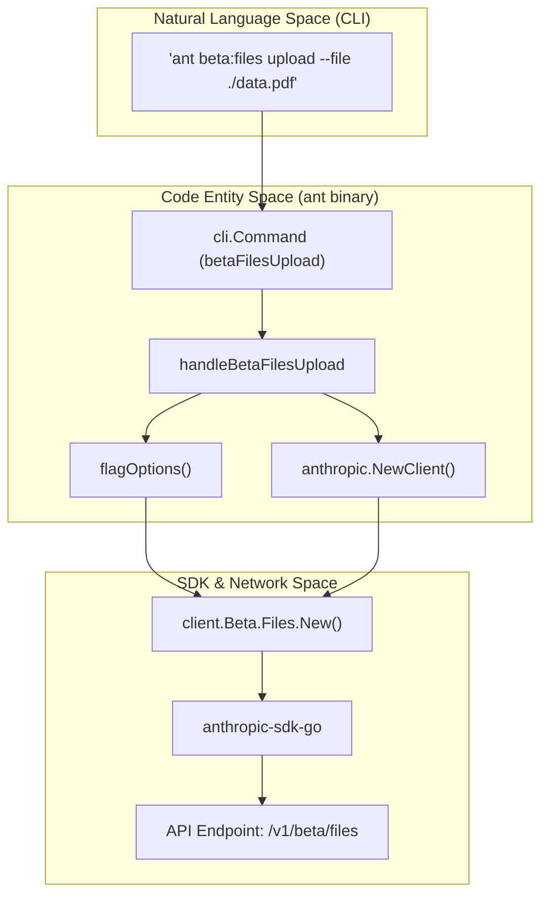
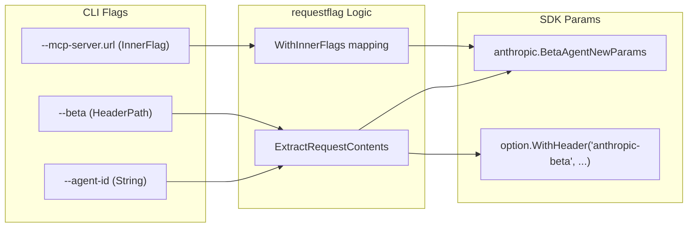

<!-- source: DeepWiki mcp.deepwiki.com · repo anthropics/anthropic-cli · page 2.2 Beta API Commands · fetched 2026-10-26 -->

# Beta API Commands

Relevant source files

The following files were used as context for generating this wiki page:

- [pkg/cmd/betaagent.go](pkg/cmd/betaagent.go)
- [pkg/cmd/betaagent_test.go](pkg/cmd/betaagent_test.go)
- [pkg/cmd/betaagentversion.go](pkg/cmd/betaagentversion.go)
- [pkg/cmd/betaagentversion_test.go](pkg/cmd/betaagentversion_test.go)
- [pkg/cmd/betaenvironment.go](pkg/cmd/betaenvironment.go)
- [pkg/cmd/betaenvironment_test.go](pkg/cmd/betaenvironment_test.go)
- [pkg/cmd/betafile.go](pkg/cmd/betafile.go)
- [pkg/cmd/betafile_test.go](pkg/cmd/betafile_test.go)
- [pkg/cmd/betamessage_test.go](pkg/cmd/betamessage_test.go)
- [pkg/cmd/betamessagebatch_test.go](pkg/cmd/betamessagebatch_test.go)
- [pkg/cmd/betasession.go](pkg/cmd/betasession.go)
- [pkg/cmd/betasession_test.go](pkg/cmd/betasession_test.go)
- [pkg/cmd/betasessionevent.go](pkg/cmd/betasessionevent.go)
- [pkg/cmd/betasessionevent_test.go](pkg/cmd/betasessionevent_test.go)
- [pkg/cmd/betasessionresource.go](pkg/cmd/betasessionresource.go)
- [pkg/cmd/betasessionresource_test.go](pkg/cmd/betasessionresource_test.go)
- [pkg/cmd/betaskill.go](pkg/cmd/betaskill.go)
- [pkg/cmd/betaskill_test.go](pkg/cmd/betaskill_test.go)
- [pkg/cmd/betaskillversion.go](pkg/cmd/betaskillversion.go)
- [pkg/cmd/betaskillversion_test.go](pkg/cmd/betaskillversion_test.go)
- [pkg/cmd/betavault.go](pkg/cmd/betavault.go)
- [pkg/cmd/betavault_test.go](pkg/cmd/betavault_test.go)
- [pkg/cmd/betavaultcredential.go](pkg/cmd/betavaultcredential.go)
- [pkg/cmd/betavaultcredential_test.go](pkg/cmd/betavaultcredential_test.go)

The Anthropic CLI (`ant`) provides comprehensive support for Beta API features through the `beta:*` command namespace. These commands allow developers to interact with experimental resources such as Agents, Sessions, Skills, and Files.

All beta commands require the `anthropic-beta` header, which is managed via the `--beta` flag.

## The Beta Header Flag

Every beta command includes a `--beta` flag. This flag maps directly to the `anthropic-beta` HTTP header required by the Anthropic API to opt-in to specific beta features.

| Flag | Header Path | Data Type | Description |
| :--- | :--- | :--- | :--- |
| `--beta` | `anthropic-beta` | `[]string` | Specifies the beta version(s) to use for the request. |

**Sources:** [pkg/cmd/betamessage_test.go:41-41](), [pkg/cmd/betafile.go:44-48]()

---

## Core Beta Resources

### Messages and Batches
The `beta:messages` and `beta:messages:batches` commands provide access to experimental message creation and bulk processing.

*   **`beta:messages create`**: Creates a message using beta features like `thinking` (adaptive/summarized), `context-management`, and `mcp-server` configurations [pkg/cmd/betamessage_test.go:12-42]().
*   **`beta:messages:batches`**: Supports `create`, `retrieve`, `list`, `delete`, `cancel`, and `results` for asynchronous bulk processing [pkg/cmd/betamessagebatch_test.go:12-21]().

### Agents and Versions
The Agents API allows for the creation and management of autonomous entities. The CLI implements full CRUD operations, archiving, and versioning.

*   **Commands**: `create`, `retrieve`, `update`, `list`, `archive`.
*   **Agent Versions**: Managed via `beta:agents:versions` (e.g., `list`, `retrieve`).
*   **Inner Flags**: The `create` and `update` commands use `requestflag.WithInnerFlags` to allow dotted notation for complex objects like `--mcp-server.url` [pkg/cmd/betaagent.go:18-91]().

**Sources:** [pkg/cmd/betaagent.go:18-115](), [pkg/cmd/betaagent_test.go:12-28]()

### Sessions and Environments
Sessions represent active instances of Agents running within specific container configurations (Environments).

*   **`beta:sessions`**: CRUD operations plus `archive`. Sessions can mount `resources` (files/repos) and use `vault-id` for credentials [pkg/cmd/betasession.go:18-63]().
*   **`beta:sessions:events`**: Retrieve the event log for a specific session.
*   **`beta:sessions:resources`**: List or retrieve resources mounted in a session.
*   **`beta:environments`**: Define the container configuration (image, compute, etc.) used by sessions.

**Sources:** [pkg/cmd/betasession.go:18-63](), [pkg/cmd/betasession_test.go:11-48]()

### Skills and Versions
Skills are reusable toolsets or capabilities that can be attached to Agents.

*   **`beta:skills`**: `create`, `retrieve`, `list`, `delete`.
*   **`beta:skills:versions`**: CRUD for specific skill versions.
*   **Multipart Uploads**: Creating skills involves uploading files (including a required `SKILL.md`). The CLI uses `MultipartFormEncoded` for these requests [pkg/cmd/betaskill.go:129-135]().

**Sources:** [pkg/cmd/betaskill.go:18-42](), [pkg/cmd/betaskillversion.go:18-42]()

### Files and Vaults
*   **`beta:files`**: Supports `upload`, `download`, `list`, `delete`, and `retrieve-metadata`. Uploads use the `FileInput` flag property to stream data from the local filesystem [pkg/cmd/betafile.go:123-143]().
*   **`beta:vaults`**: Manage secure storage for credentials.
*   **`beta:vaults:credentials`**: CRUD for credentials stored within a vault.

---

## Data Flow and Implementation

The following diagram illustrates how a Beta command (e.g., `beta:files upload`) flows from the CLI through the SDK to the API.

### Command Execution Pipeline
"This diagram maps the CLI command structure to the underlying SDK calls and the data transformation layers."

**Sources:** [pkg/cmd/betafile.go:123-143](), [pkg/cmd/betafile.go:145-161]()

### Parameter Mapping and Serialization
"This diagram shows how complex nested flags are associated with SDK parameter structures."

**Sources:** [pkg/cmd/betaagent.go:18-91](), [internal/requestflag/requestflag.go:1-100]()

---

## Technical Details

### Flag Handling
Beta commands utilize the `internal/requestflag` package to route values to the correct part of the HTTP request:
*   **`BodyPath`**: Fields serialized into the JSON or Multipart request body (e.g., `model`, `name`).
*   **`QueryPath`**: Fields appended to the URL as query parameters (e.g., `limit`, `after_id`).
*   **`HeaderPath`**: Fields added to HTTP headers (specifically `anthropic-beta`).

**Sources:** [pkg/cmd/betafile.go:23-48](), [pkg/cmd/betaagent.go:23-68]()

### Paging and Output
List commands (e.g., `beta:files list`) use `client.Beta.Files.ListAutoPaging` to handle multi-page results. The CLI provides a `--max-items` flag to control how many total records are fetched before stopping iteration [pkg/cmd/betafile.go:178-187]().

Output is rendered via `ShowJSON` or `ShowJSONIterator`, supporting formats like `json`, `table` (via the TUI explorer), and `raw` [pkg/cmd/betafile.go:186-187]().

### File Uploads
Commands like `beta:files upload` and `beta:skills create` set `FileInput: true` on their flags. This triggers the `flagOptions` pipeline to read the specified path and prepare it for `MultipartFormEncoded` transmission [pkg/cmd/betafile.go:133-133](), [pkg/cmd/betaskill.go:133-133]().

**Sources:** [pkg/cmd/betafile.go:145-188](), [pkg/cmd/betaskill.go:119-151]()

---

