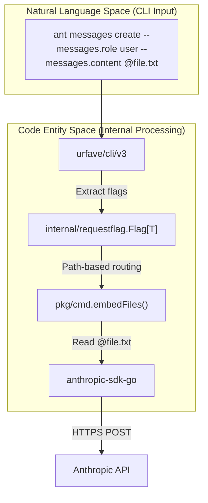
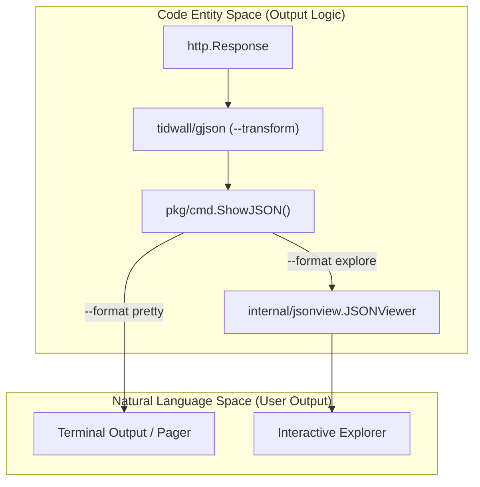

<!-- source: DeepWiki mcp.deepwiki.com · repo anthropics/anthropic-cli · page 3 Core Architecture · fetched 2026-10-26 -->

# Core Architecture

Relevant source files

The following files were used as context for generating this wiki page:

- [cmd/ant/main.go](cmd/ant/main.go)
- [pkg/cmd/cmd.go](pkg/cmd/cmd.go)
- [pkg/cmd/cmdutil.go](pkg/cmd/cmdutil.go)
- [pkg/cmd/flagoptions.go](pkg/cmd/flagoptions.go)
- [pkg/cmd/flagoptions_test.go](pkg/cmd/flagoptions_test.go)

This page explains the high-level design and execution flow of the Anthropic CLI (`ant`). The CLI is built using the `urfave/cli/v3` framework and acts as a specialized wrapper around the Anthropic Go SDK, adding advanced flag parsing, file embedding, and interactive output capabilities.

## High-Level Execution Flow

The CLI operates as a pipeline that transforms command-line arguments into structured API requests, executes those requests via the SDK, and then pipes the response through a rendering engine.

### Request Pipeline: Flags to API Call

The request pipeline is responsible for gathering input from multiple sources (CLI flags, environment variables, and local files) and constructing a valid SDK request object.

1.  **Command Discovery**: `urfave/cli` traverses the command tree defined in `pkg/cmd/cmd.go` [pkg/cmd/cmd.go:85-272]() to identify the target action.
2.  **Flag Extraction**: The `internal/requestflag` system extracts values from the `cli.Context`. It handles both simple flags and complex "dotted" flags (e.g., `--messages.role`) [internal/requestflag/requestflag.go]().
3.  **Stdin & File Embedding**: If a flag value starts with `@`, or if data is piped via `stdin`, the `flagOptions` pipeline in `pkg/cmd/flagoptions.go` [pkg/cmd/flagoptions.go:79-89]() reads the content from the local filesystem or the pipe.
4.  **SDK Invocation**: The extracted and embedded data is passed to the Anthropic Go SDK. Global options like `api-key` and `base-url` are applied via `getDefaultRequestOptions` [pkg/cmd/cmdutil.go:41-62]().

### Output Pipeline: API Response to User

Once the API returns data, the output pipeline determines how to display it based on the `--format` flag and the environment (TTY vs. Pipe).

1.  **Format Selection**: The CLI supports multiple formats: `json`, `jsonl`, `pretty`, `yaml`, `raw`, and `explore` [pkg/cmd/cmdutil.go:30]().
2.  **Transformation**: If the `--transform` flag is provided, the response is filtered using GJSON syntax [pkg/cmd/cmdutil.go:71]().
3.  **Rendering**:
    *   **Static**: `ShowJSON` renders formatted text to the terminal [pkg/cmd/cmdutil.go:235]().
    *   **Interactive**: The `explore` format launches a `bubbletea`-based TUI [internal/jsonview/jsonview.go]().
    *   **Binary**: Files (like PDF/Image exports) are saved to disk or written to stdout based on `Content-Disposition` [pkg/cmd/cmdutil.go:202-221]().

## System Component Mapping

The following diagram maps high-level CLI concepts to their specific implementations in the codebase.

### Request Transformation Flow
Title: Request Flag and File Embedding Architecture

Sources: [pkg/cmd/cmd.go:27-84](), [internal/requestflag/requestflag.go:1-50](), [pkg/cmd/flagoptions.go:79-89]()

### Output Rendering Flow
Title: Response Processing and Rendering Pipeline

Sources: [pkg/cmd/cmdutil.go:235-250](), [cmd/ant/main.go:41-50](), [internal/jsonview/jsonview.go:1-30]()

## Subsystem Overviews

### 1. Request Flag System
The CLI uses a custom generic flag system to handle the complex nesting required by the Anthropic API. It maps CLI flags directly to JSON body paths, query parameters, or headers.
*   **Key Concept**: `requestflag.Flag[T]` allows defining where a value should be "routed" in the final API request.
*   **For details, see [Request Flag System](#3.1).**

### 2. Flag Options and File Embedding
This system handles the "heavy lifting" of data ingestion. It supports reading from `stdin`, sniffing for UTF-8 vs. binary content, and recursively traversing data structures to replace file paths with their actual contents.
*   **Key Concept**: The `@` prefix syntax and `onceStdinReader` to prevent multiple reads of the same stream.
*   **For details, see [Flag Options and File Embedding](#3.2).**

### 3. Output Rendering and Paging
The CLI automatically detects if it is running in a terminal. It provides smart defaults, such as colorized output and automatic activation of a pager (like `less`) for long responses.
*   **Key Concept**: `ShowJSON` and `streamOutputOSSpecific` handle the differences between Unix and Windows terminal streams.
*   **For details, see [Output Rendering and Paging](#3.3).**

### 4. Interactive JSON Explorer (TUI)
When the `--format explore` flag is used, the CLI enters a Terminal User Interface (TUI) mode. This allows users to navigate large JSON responses, expand/collapse nodes, and view raw content.
*   **Key Concept**: A `bubbletea` application that uses a navigation stack of `TableView` and `TextView`.
*   **For details, see [Interactive JSON Explorer (TUI)](#3.4).**

## Core Utilities
The CLI relies on several shared utilities for consistent behavior:
*   **Validation**: `ValidateBaseURL` ensures API overrides are well-formed [pkg/cmd/cmdutil.go:34-39]().
*   **Middleware**: `debugMiddlewareOption` provides `httputil.DumpRequest` logging when `--debug` is enabled [pkg/cmd/cmdutil.go:64-83]().
*   **Binary Handling**: `writeBinaryResponse` manages file downloads and content-type sniffing [pkg/cmd/cmdutil.go:202]().

Sources: [pkg/cmd/cmd.go](), [pkg/cmd/cmdutil.go](), [pkg/cmd/flagoptions.go](), [cmd/ant/main.go]()

---

