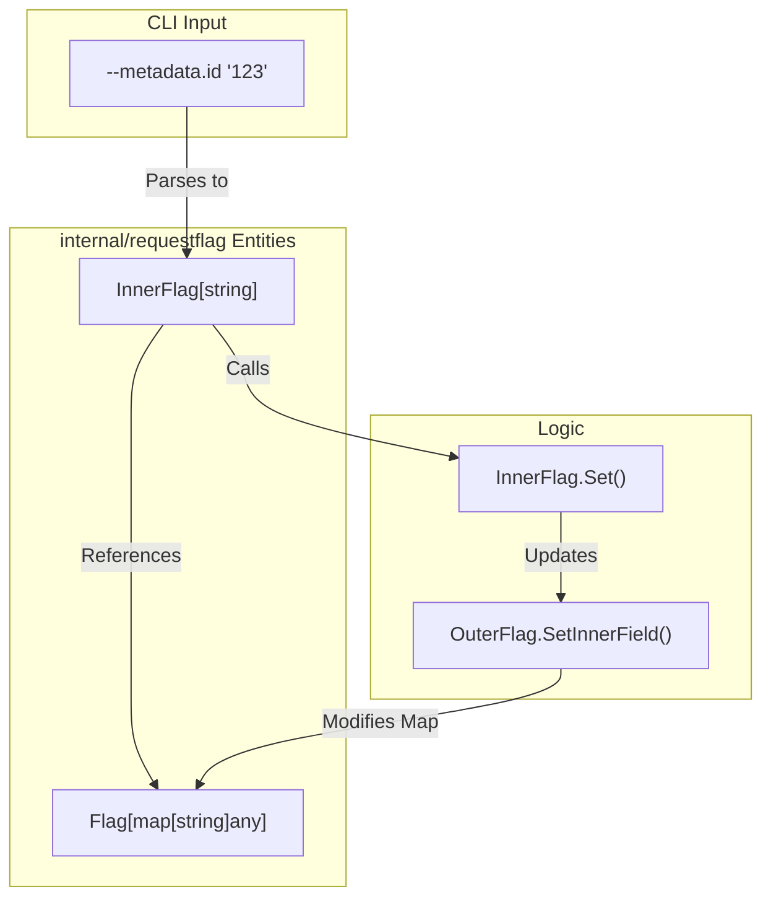
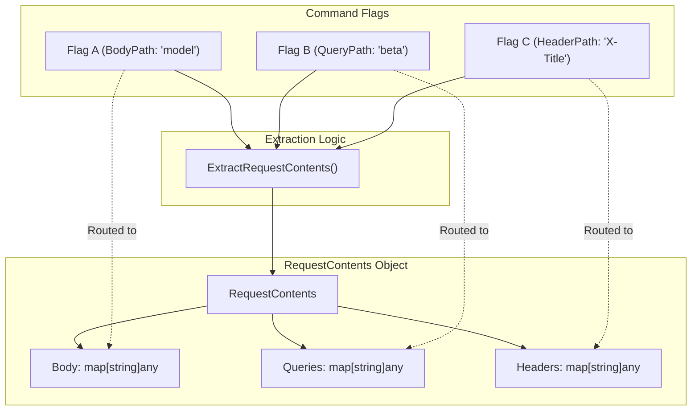

<!-- source: DeepWiki mcp.deepwiki.com · repo anthropics/anthropic-cli · page 3.1 Request Flag System · fetched 2026-10-26 -->

# Request Flag System

Relevant source files

The following files were used as context for generating this wiki page:

- [internal/requestflag/innerflag.go](internal/requestflag/innerflag.go)
- [internal/requestflag/innerflag_test.go](internal/requestflag/innerflag_test.go)
- [internal/requestflag/requestflag.go](internal/requestflag/requestflag.go)
- [internal/requestflag/requestflag_test.go](internal/requestflag/requestflag_test.go)

The Request Flag System, located in `internal/requestflag`, provides a generic, type-safe framework for mapping CLI flags directly to HTTP request components (Body, Query, and Headers). It extends the `urfave/cli` library to handle complex API requirements such as nested object fields via dotted flags (e.g., `--message.role`) and specialized data types like ISO-8601 dates and times.

## Core Components

### The Generic `Flag[T]` Type
The `Flag[T]` struct is the primary building block for command-line arguments in the Anthropic CLI. It supports a wide range of types including primitives, maps, and custom time types [internal/requestflag/requestflag.go:18-22]().

Beyond standard CLI metadata (Name, Usage, Aliases), `Flag[T]` includes routing fields that determine where the value is placed in the outgoing API request:
*   `QueryPath`: Maps the flag to a URL query parameter [internal/requestflag/requestflag.go:35]().
*   `HeaderPath`: Maps the flag to an HTTP header [internal/requestflag/requestflag.go:36]().
*   `BodyPath`: Maps the flag to a key in the JSON request body [internal/requestflag/requestflag.go:37]().
*   `BodyRoot`: If true, the flag's value constitutes the entire request body rather than a single field [internal/requestflag/requestflag.go:38]().

### Specialized Types
The system includes custom types to ensure CLI inputs match API expectations:
*   `DateValue`: Parses various date formats (ISO, US, British) into `YYYY-MM-DD` [internal/requestflag/requestflag_test.go:13-74]().
*   `DateTimeValue`: Handles RFC3339 and other timestamp formats [internal/requestflag/requestflag_test.go:76-144]().
*   `TimeValue`: Manages clock times (e.g., `14:30:45`) [internal/requestflag/requestflag_test.go:146-207]().

**Sources:** [internal/requestflag/requestflag.go:18-56](), [internal/requestflag/requestflag_test.go:13-207]()

## Nested Flags with `InnerFlag[T]`

The CLI supports setting fields within a parent map flag using a dotted notation (e.g., `--metadata.user_id`). This is implemented via `InnerFlag[T]`.

*   **`InnerFlag[T]`**: Represents a sub-field. It holds a reference to an `OuterFlag` and the specific `InnerField` name it targets [internal/requestflag/innerflag.go:14-27]().
*   **`WithInnerFlags`**: A wiring function that injects these sub-flags into a `cli.Command`. It iterates through existing flags and appends associated `InnerFlag` instances, ensuring the `OuterFlag` reference is correctly linked [internal/requestflag/innerflag.go:182-227]().
*   **Data Flow**: When an `InnerFlag` is set via the CLI, it calls `SetInnerField` on the `OuterFlag` (which must implement the `SettableInnerField` interface), updating the underlying map [internal/requestflag/innerflag.go:54-71]().

### Flag Interaction Diagram
This diagram illustrates how a dotted CLI flag maps to the internal `InnerFlag` and `OuterFlag` entities.

"Natural Language / CLI Space" to "Code Entity Space"

**Sources:** [internal/requestflag/innerflag.go:14-27](), [internal/requestflag/innerflag.go:54-71](), [internal/requestflag/innerflag.go:182-227]()

## Request Extraction and Routing

The transition from parsed flags to an HTTP request structure is handled by `ExtractRequestContents`.

### `ExtractRequestContents`
This function iterates through all flags in a command. If a flag implements the `InRequest` interface (providing a path), its value is placed into the `RequestContents` struct [internal/requestflag/requestflag.go:98-105]().

1.  **Queries**: Populated if `GetQueryPath()` returns a string [internal/requestflag/requestflag.go:113-115]().
2.  **Headers**: Populated if `GetHeaderPath()` returns a string [internal/requestflag/requestflag.go:116-118]().
3.  **Body**: 
    *   If `IsBodyRoot()` is true, the value becomes the entire `Body` [internal/requestflag/requestflag.go:119-121]().
    *   Otherwise, if `GetBodyPath()` is set, the value is added to a `bodyMap` [internal/requestflag/requestflag.go:122-123]().

### `GetMissingRequiredFlags`
This utility checks for missing mandatory parameters. It is "stdin-aware," meaning it won't flag a missing required body parameter if the body is being provided via standard input (e.g., via a pipe) [internal/requestflag/requestflag.go:129-161]().

### Routing Logic Flow
"Natural Language / CLI Space" to "Code Entity Space"

**Sources:** [internal/requestflag/requestflag.go:91-127](), [internal/requestflag/requestflag.go:129-161]()

## Implementation Details

### Generic Value Handling
The system uses an internal `cliValue[T]` wrapper to bridge the generic `Flag[T]` with the `urfave/cli.Value` interface [internal/requestflag/requestflag.go:55](). It handles:
*   **Parsing**: Uses `parseCLIArg[T]` which leverages YAML unmarshaling for complex types (maps/slices) and standard `strconv` for primitives [internal/requestflag/requestflag.go:15848-15860]().
*   **Validation**: Executes a custom `Validator` function if provided during flag definition [internal/requestflag/requestflag.go:228-232]().
*   **Slice Resetting**: When a slice flag is set for the first time, it clears the default values to prevent appending CLI arguments to the defaults [internal/requestflag/requestflag.go:213-220]().

### Interface Compliance
The system strictly implements `urfave/cli` interfaces to ensure compatibility with the command-tree runner:
| Interface | Purpose |
| :--- | :--- |
| `cli.Flag` | Base flag interface [internal/requestflag/requestflag.go:164]() |
| `cli.CategorizableFlag` | Allows grouping flags in help output [internal/requestflag/requestflag.go:59]() |
| `cli.DocGenerationFlag` | Provides metadata for help/man page generation [internal/requestflag/innerflag.go:91]() |
| `InRequest` | Custom interface for HTTP routing [internal/requestflag/requestflag.go:62-68]() |

**Sources:** [internal/requestflag/requestflag.go:55-68](), [internal/requestflag/requestflag.go:164-233](), [internal/requestflag/innerflag.go:91]()

---

