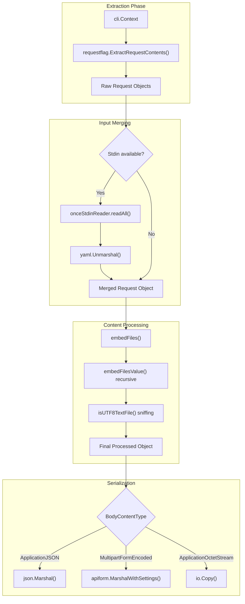
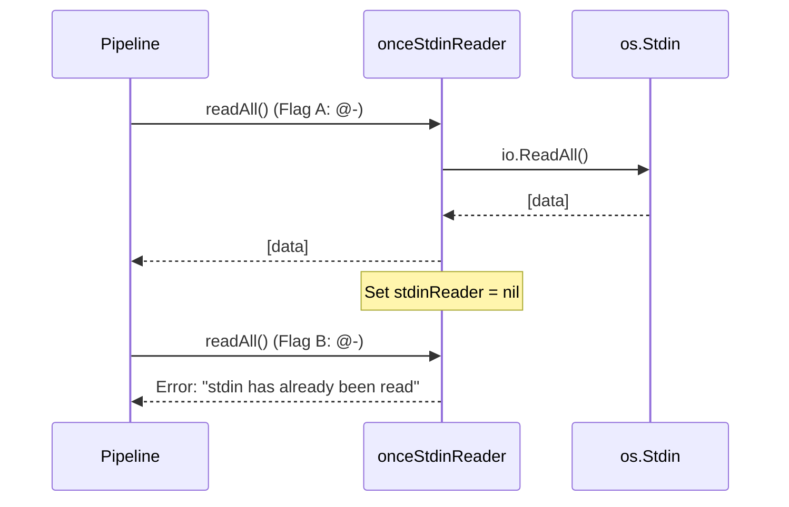

<!-- source: DeepWiki mcp.deepwiki.com · repo anthropics/anthropic-cli · page 3.2 Flag Options and File Embedding · fetched 2026-10-26 -->

# Flag Options and File Embedding

Relevant source files

The following files were used as context for generating this wiki page:

- [internal/apiform/encoder.go](internal/apiform/encoder.go)
- [internal/apiform/form.go](internal/apiform/form.go)
- [internal/apiform/form_test.go](internal/apiform/form_test.go)
- [internal/apiquery/encoder.go](internal/apiquery/encoder.go)
- [internal/apiquery/query.go](internal/apiquery/query.go)
- [internal/apiquery/query_test.go](internal/apiquery/query_test.go)
- [pkg/cmd/flagoptions.go](pkg/cmd/flagoptions.go)
- [pkg/cmd/flagoptions_test.go](pkg/cmd/flagoptions_test.go)

The `ant` CLI provides a sophisticated flag processing pipeline that extends standard command-line arguments with capabilities for file embedding, stdin merging, and content-type sniffing. This logic is primarily encapsulated in `pkg/cmd/flagoptions.go` and is responsible for transforming raw CLI input into structured data suitable for the Anthropic API.

## The Flag Options Pipeline

The `flagOptions` function serves as the central orchestration point for preparing a request's data. It follows a multi-stage pipeline to ensure that flags, positional arguments, and piped input (stdin) are correctly merged and validated.

### Data Flow Overview

1.  **Extraction**: Extracting raw values from the `urfave/cli` context using `requestflag.ExtractRequestContents` [[pkg/cmd/flagoptions.go:348-350]]().
2.  **Stdin Merging**: If the request body is empty and stdin is provided, the CLI attempts to parse stdin as JSON or YAML to populate the request [[pkg/cmd/flagoptions.go:362-385]]().
3.  **Validation**: Checking for missing required flags [[pkg/cmd/flagoptions.go:393-396]]().
4.  **File Embedding**: Recursively traversing the request object to replace file paths (prefixed with `@`) with actual file content [[pkg/cmd/flagoptions.go:406-408]]().
5.  **Serialization**: Converting the final object into the appropriate wire format (JSON, Multipart, or Octet-Stream) [[pkg/cmd/flagoptions.go:421-444]]().

### Pipeline Execution Diagram

This diagram maps the logical stages of the pipeline to the internal functions and types that execute them.

"Flag Options Execution Pipeline"

Sources: [pkg/cmd/flagoptions.go:334-450](), [pkg/cmd/flagoptions.go:79-89](), [pkg/cmd/flagoptions.go:92-231]()

---

## File Embedding and Prefix Semantics

The CLI supports embedding local file content into any string flag using specific prefixes. This is handled by `embedFilesValue`, which uses reflection to traverse maps, slices, and structs [[pkg/cmd/flagoptions.go:92-135]]().

### Prefix Behavior Matrix

| Prefix | Behavior | Use Case |
| :--- | :--- | :--- |
| `@` | Sniffs content. If UTF-8, embeds as string. If binary, encodes as Base64 [[pkg/cmd/flagoptions.go:197-231]](). | General purpose file embedding. |
| `@file://` | Always embeds as a raw string literal, regardless of content [[pkg/cmd/flagoptions.go:181-196]](). | Forcing text mode for files with unusual characters. |
| `@data://` | Always encodes the file content as a Base64 string [[pkg/cmd/flagoptions.go:166-180]](). | Explicitly sending binary data to text fields. |
| `\@` | Escapes the `@` symbol; the literal string (minus `\`) is sent [[pkg/cmd/flagoptions.go:160-163]](). | Sending a string that starts with `@` (e.g., a username). |

### Content Sniffing
The function `isUTF8TextFile` determines if a file should be treated as text or binary. It checks for the presence of valid UTF-8 sequences and the absence of control characters or binary headers [[pkg/cmd/flagoptions.go:264-282]]().

Sources: [pkg/cmd/flagoptions.go:159-231](), [pkg/cmd/flagoptions.go:264-282](), [pkg/cmd/flagoptions_test.go:15-36]()

---

## Stdin Management and Conflict Resolution

To prevent multiple flags from competing for the same `stdin` stream, the CLI uses a `onceStdinReader` struct.

### `onceStdinReader`
This utility ensures that `os.Stdin` is read exactly once. If a second attempt is made to read from it (e.g., two different flags both use `@-`), the CLI returns an error [[pkg/cmd/flagoptions.go:46-61]]().

*   **Stdin Paths**: The following strings are recognized as stdin: `-`, `/dev/fd/0`, and `/dev/stdin` [[pkg/cmd/flagoptions.go:71-77]]().
*   **Conflict Detection**: If `stdinReader` is `nil` in the `read()` call, it indicates the stream has already been consumed [[pkg/cmd/flagoptions.go:55-57]]().

"Stdin Conflict Resolution"

Sources: [pkg/cmd/flagoptions.go:46-70](), [pkg/cmd/flagoptions_test.go:249-285]()

---

## Serialization and Content Types

The `BodyContentType` enum defines how the final payload is formatted before being sent to the API [[pkg/cmd/flagoptions.go:27-34]]().

### Supported Content Types

1.  **ApplicationJSON**: The standard format for most Message and Model requests. Uses `json.Marshal` [[pkg/cmd/flagoptions.go:422-426]]().
2.  **MultipartFormEncoded**: Used for file uploads (e.g., `beta:files`). It utilizes the `internal/apiform` package to handle nested structures and file streams [[pkg/cmd/flagoptions.go:427-438]]().
3.  **ApplicationOctetStream**: Used for direct binary uploads where the entire body is the file content [[pkg/cmd/flagoptions.go:439-444]]().

### Internal Serialization Helpers
*   **`internal/apiform`**: Handles `multipart/form-data` encoding. It supports various array formats like `FormatRepeat` and `FormatIndicesDots` [[internal/apiform/form.go:9-20]]().
*   **`internal/apiquery`**: Handles URL query parameter encoding, supporting nested maps and slices [[internal/apiquery/query.go:34-53]]().

Sources: [pkg/cmd/flagoptions.go:27-34](), [pkg/cmd/flagoptions.go:421-444](), [internal/apiform/encoder.go:16-41](), [internal/apiquery/encoder.go:19-43]()

---

