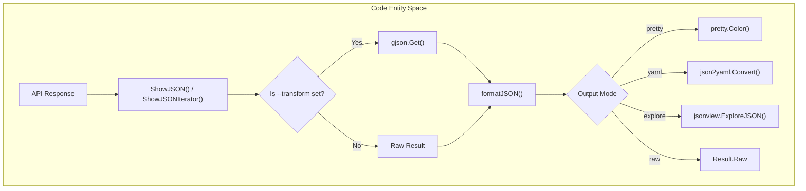
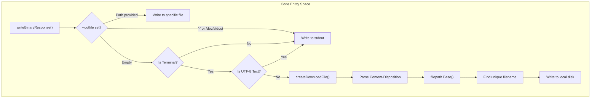

<!-- source: DeepWiki mcp.deepwiki.com · repo anthropics/anthropic-cli · page 3.3 Output Rendering and Paging · fetched 2026-10-26 -->

# Output Rendering and Paging

Relevant source files

The following files were used as context for generating this wiki page:

- [pkg/cmd/cmdutil.go](pkg/cmd/cmdutil.go)
- [pkg/cmd/cmdutil_test.go](pkg/cmd/cmdutil_test.go)
- [pkg/cmd/cmdutil_unix.go](pkg/cmd/cmdutil_unix.go)
- [pkg/cmd/cmdutil_windows.go](pkg/cmd/cmdutil_windows.go)

The Anthropic CLI provides a robust output rendering pipeline that handles data transformation, multi-format serialization, interactive exploration, and smart paging. This system ensures that API responses are readable whether they are being piped to another process, viewed in a terminal, or saved as binary files.

### Output Format Modes

The CLI supports several output modes defined in the `OutputFormats` slice [pkg/cmd/cmdutil.go:30-30](). Users select these via the `--output` flag.

| Mode | Description | Implementation |
| :--- | :--- | :--- |
| `auto` | Default mode. Uses `pretty` for terminals and `json` for pipes. | [pkg/cmd/cmdutil.go:338-344]() |
| `pretty` | Colorized, indented JSON with syntax highlighting. | [pkg/cmd/cmdutil.go:351-352]() |
| `json` | Standard minified or formatted JSON. | [pkg/cmd/cmdutil.go:348-349]() |
| `jsonl` | JSON Lines format, useful for streaming long lists. | [pkg/cmd/cmdutil.go:354-355]() |
| `yaml` | Converts JSON response to YAML format. | [pkg/cmd/cmdutil.go:357-358]() |
| `raw` | Prints the raw value (strips quotes for strings). | [pkg/cmd/cmdutil.go:360-361]() |
| `explore` | Launches the interactive TUI JSON explorer. | [pkg/cmd/cmdutil.go:332-336]() |

**Sources:** [pkg/cmd/cmdutil.go:30-30](), [pkg/cmd/cmdutil.go:330-363]()

---

### JSON Rendering and Transformation Pipeline

The core rendering logic resides in `ShowJSON` and `ShowJSONIterator`. These functions take raw API data and pass it through a transformation and formatting pipeline.

#### GJSON Transformation
If the `--transform` flag is provided, the CLI uses the `gjson` library to query or reshape the JSON before rendering [pkg/cmd/cmdutil.go:346-346](). This allows users to extract specific fields (e.g., `ant messages create --transform "content.0.text"`) [pkg/cmd/cmdutil_test.go:156-163]().

#### Data Flow Diagram: JSON Rendering
This diagram shows the path from a raw API response to the user's display.

**Sources:** [pkg/cmd/cmdutil.go:321-363](), [pkg/cmd/cmdutil_test.go:153-192]()

---

### Paging and Streaming

The CLI automatically invokes a pager (defaults to `less`) when output is sent to a terminal and exceeds certain thresholds.

#### Threshold-Based Activation
For static content, the CLI uses `ShowJSON` which determines if paging is necessary based on the terminal height. For streaming list data (e.g., `models list`), `ShowJSONIterator` is used to stream results into the pager as they arrive from the API.

#### OS-Specific Stream Helpers
The implementation of `streamOutput` varies by operating system to optimize buffer handling:

1.  **Unix (`cmdutil_unix.go`)**: Uses `unix.Socketpair` with `SOCK_STREAM` [pkg/cmd/cmdutil_unix.go:66-69](). It sets small buffer sizes (`SO_SNDBUF` / `SO_RCVBUF` set to 128 bytes) [pkg/cmd/cmdutil_unix.go:81-88](). This ensures that the CLI doesn't over-fetch paginated API data if the user only views the first few lines in the pager.
2.  **Windows (`cmdutil_windows.go`)**: Falls back to `streamToPagerWithPipe` using standard `os.Pipe` as socket pairs are not available [pkg/cmd/cmdutil_windows.go:31-35]().
3.  **Fallback**: Both systems can use `streamToPagerWithPipe` which executes the command in `$PAGER` and connects its `Stdin` to a pipe [pkg/cmd/cmdutil.go:141-188]().

#### Piped Data Detection
The function `isInputPiped` handles a common issue where environments (like Cursor or CI) connect a pipe to `Stdin` even when no data is present.
- **Unix**: Uses `unix.Poll` with a 10ms timeout to check for `POLLIN` [pkg/cmd/cmdutil_unix.go:21-23]().
- **Windows**: Uses `kernel32.dll`'s `PeekNamedPipe` to check available bytes [pkg/cmd/cmdutil_windows.go:16-29]().

**Sources:** [pkg/cmd/cmdutil.go:125-139](), [pkg/cmd/cmdutil_unix.go:15-63](), [pkg/cmd/cmdutil_windows.go:16-35]()

---

### Binary Responses and Downloads

For API endpoints that return binary data (like `files retrieve`), the CLI uses `writeBinaryResponse` to handle the output [pkg/cmd/cmdutil.go:199-236]().

#### Content-Disposition Parsing
If a file is being downloaded and no specific `--outfile` is provided, the CLI:
1.  Checks the `Content-Disposition` header for a `filename` parameter [pkg/cmd/cmdutil.go:238-245]().
2.  Sanitizes the filename to prevent directory traversal (e.g., removing `../`) [pkg/cmd/cmdutil.go:253-253]().
3.  If the file already exists, it appends a numeric suffix (e.g., `image (1).png`) to ensure uniqueness [pkg/cmd/cmdutil.go:259-270]().

#### Logic Flow: Binary Output

**Sources:** [pkg/cmd/cmdutil.go:199-236](), [pkg/cmd/cmdutil.go:238-274](), [pkg/cmd/cmdutil_test.go:62-112]()

---

### Key Functions Summary

| Function | File | Purpose |
| :--- | :--- | :--- |
| `ShowJSON` | `pkg/cmd/cmdutil.go` | Main entry point for rendering static JSON objects. |
| `ShowJSONIterator` | `pkg/cmd/cmdutil.go` | Renders streams of JSON objects (for list endpoints). |
| `formatJSON` | `pkg/cmd/cmdutil.go` | Applies `gjson` transforms and handles specific format logic (YAML, Raw, etc). |
| `streamOutput` | `pkg/cmd/cmdutil.go` | Orchestrates the connection between output generation and the system pager. |
| `writeBinaryResponse` | `pkg/cmd/cmdutil.go` | Handles non-JSON responses, determining whether to print or save to disk. |
| `isInputPiped` | `pkg/cmd/cmdutil.go` | Detects if data is actually being piped into the CLI across OS platforms. |

**Sources:** [pkg/cmd/cmdutil.go:89-114](), [pkg/cmd/cmdutil.go:125-139](), [pkg/cmd/cmdutil.go:199-236](), [pkg/cmd/cmdutil.go:321-363]()

---

