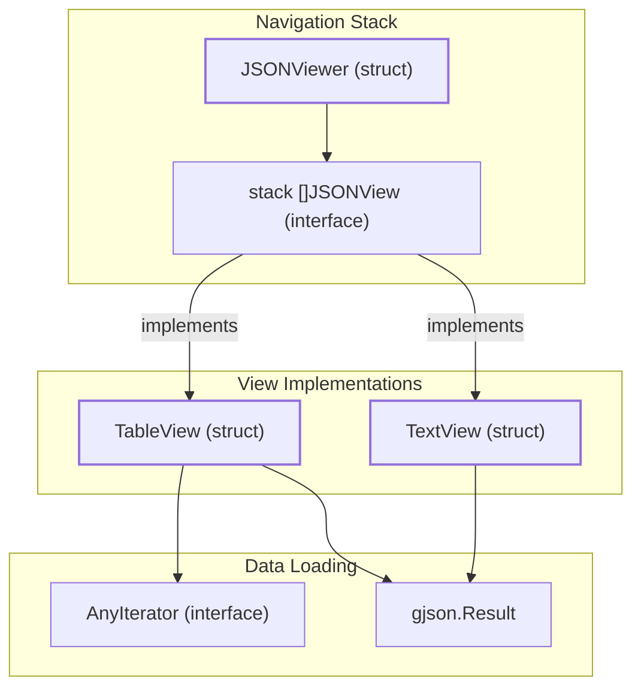
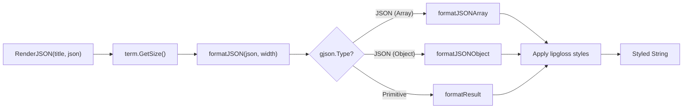

<!-- source: DeepWiki mcp.deepwiki.com · repo anthropics/anthropic-cli · page 3.4 Interactive JSON Explorer (TUI) · fetched 2026-10-26 -->

# Interactive JSON Explorer (TUI)

Relevant source files

The following files were used as context for generating this wiki page:

- [internal/jsonview/explorer.go](internal/jsonview/explorer.go)
- [internal/jsonview/explorer_test.go](internal/jsonview/explorer_test.go)
- [internal/jsonview/staticdisplay.go](internal/jsonview/staticdisplay.go)

The Interactive JSON Explorer is a Terminal User Interface (TUI) built using the `bubbletea` framework. It allows users to navigate complex, nested JSON structures and paginated API streams using a stack-based navigation system. It supports two primary modes: an interactive explorer and a static, colorized renderer.

## Architecture and Data Flow

The explorer is centered around the `JSONViewer` model, which manages a stack of views (`JSONView`). As a user drills down into objects or arrays, new views are pushed onto the stack; navigating back pops them.

### Code Entity Mapping: Explorer Components

The following diagram maps the logical TUI components to their respective Go structs and interfaces in `internal/jsonview`.

**Sources:**
- [internal/jsonview/explorer.go:104-110]() (JSONView interface)
- [internal/jsonview/explorer.go:112-122]() (TableView struct)
- [internal/jsonview/explorer.go:257-262]() (TextView struct)
- [internal/jsonview/explorer.go:420-428]() (JSONViewer struct)

## Core Entrypoints

The explorer provides two main entrypoints depending on whether the data is a static blob or a stream of items.

| Function | Purpose | Data Source |
| :--- | :--- | :--- |
| `ExploreJSON` | Opens the TUI for a single `gjson.Result`. | Static JSON |
| `ExploreJSONStream` | Opens the TUI for an iterator that yields items. | `AnyIterator` |

### Streaming Data Loading
When using `ExploreJSONStream`, the `TableView` utilizes an `AnyIterator` [internal/jsonview/explorer.go:414-418](). As the user scrolls to the bottom of the current table, the `loadMoreData` function [internal/jsonview/explorer.go:147-195]() is triggered. This function:
1. Calls `iterator.Next()` to fetch the next item.
2. Marshals the item to JSON and parses it into a `gjson.Result`.
3. Appends the new data to `tv.rowData`.
4. Updates the `table.Model` rows and triggers a column resize.

**Sources:**
- [internal/jsonview/explorer.go:132-144]() (Triggering load)
- [internal/jsonview/explorer.go:557-568]() (ExploreJSONStream definition)

## Navigation and Views

The `JSONViewer` manages the active view and handles global keybindings defined in `keyMap` [internal/jsonview/explorer.go:47-55]().

### TableView
Used for JSON Arrays and Objects.
- **Dynamic Column Widths**: The `updateColumnWidths` algorithm [internal/jsonview/explorer.go:204-255]() calculates the maximum width of content in each column. If the total exceeds available terminal width, it calculates a "fair share" and shrinks columns proportionally to fit the screen.
- **Formatting**: Values are formatted via `formatValue` [internal/jsonview/explorer.go:343-376](), which applies color coding based on type (Array: Red, Object: Blue, String: Magenta).

### TextView
Used for leaf nodes (strings, numbers, booleans).
- Wraps a `viewport.Model` [internal/jsonview/explorer.go:260]() to allow scrolling through long text content.
- Uses `wordwrap` to ensure text fits the terminal width [internal/jsonview/explorer.go:278]().

### Navigation Logic
The `navigateForward` [internal/jsonview/explorer.go:463-514]() and `navigateBack` [internal/jsonview/explorer.go:516-523]() functions manage the stack:
- **Forward**: If the selected item is a container (Array/Object), a new `TableView` is pushed. If it is a primitive, a `TextView` is pushed.
- **Back**: Pops the top element from the stack, returning the user to the previous level.

**Sources:**
- [internal/jsonview/explorer.go:65-94]() (Keybindings)
- [internal/jsonview/explorer.go:463-514]() (Navigation logic)

## Static Rendering

For non-interactive output (e.g., when the output is piped or the user prefers a static view), `staticdisplay.go` provides formatting logic.

### Implementation Flow: Static Display
The `RenderJSON` function is the primary entrypoint for static, colorized output.

### Key Formatting Functions
- `formatJSON`: The high-level dispatcher [internal/jsonview/staticdisplay.go:31-36]().
- `formatJSONArray`: Handles indexed lists with bullet styles and indentation [internal/jsonview/staticdisplay.go:71-96]().
- `formatJSONObject`: Iterates through keys using the `@keys` GJSON modifier and aligns values [internal/jsonview/staticdisplay.go:98-120]().
- `formatResult`: Applies specific colors: `numberValueStyle` (Orange), `boolValueStyle` (Pink), and `nullValueStyle` (Gray/Italic) [internal/jsonview/staticdisplay.go:38-65]().

**Sources:**
- [internal/jsonview/staticdisplay.go:18-29]() (Styles)
- [internal/jsonview/staticdisplay.go:126-135]() (RenderJSON)

## Features

### Raw Mode Toggle
Users can toggle "Raw Mode" by pressing `r` [internal/jsonview/explorer.go:86-89](). When enabled, the viewer displays the underlying JSON source instead of formatted/truncated previews. This state is passed through the `Update` and `View` methods of the active `JSONView`.

### Print and Exit
Pressing `p` [internal/jsonview/explorer.go:82-85]() triggers the `PrintValue` action. This sets a `print` flag on the `JSONViewer`, which signals the CLI to output the currently focused JSON node to `stdout` after the TUI exits.

**Sources:**
- [internal/jsonview/explorer.go:434-453]() (Update logic for Print/Raw)
- [internal/jsonview/explorer.go:525-542]() (TUI Execution loop)

---

