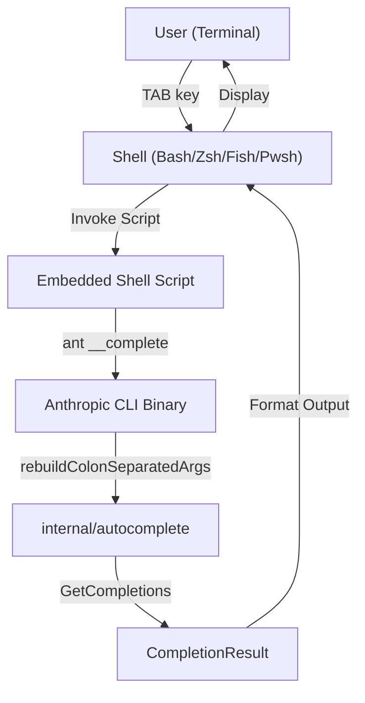
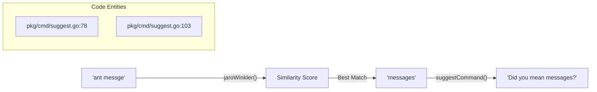

<!-- source: DeepWiki mcp.deepwiki.com · repo anthropics/anthropic-cli · page 4 Shell Completion and Suggestions · fetched 2026-10-26 -->

# Shell Completion and Suggestions

Relevant source files

The following files were used as context for generating this wiki page:

- [internal/autocomplete/autocomplete.go](internal/autocomplete/autocomplete.go)
- [internal/autocomplete/autocomplete_test.go](internal/autocomplete/autocomplete_test.go)
- [pkg/cmd/completion.go](pkg/cmd/completion.go)
- [pkg/cmd/suggest.go](pkg/cmd/suggest.go)

The Anthropic CLI provides a robust completion system to enhance the developer experience in the terminal. This system includes dynamic shell completion for commands and flags, as well as an intelligent suggestion engine for correcting typos in command names.

The completion logic is decoupled from the main command execution, utilizing a hidden `__complete` command to bridge the gap between the user's shell (Bash, Zsh, Fish, or PowerShell) and the Go-based completion engine.

### System Architecture

The completion flow begins when a user hits `TAB` in their terminal. The shell-specific script captures the current command line and invokes the `ant __complete` command. The Go engine then parses the partial input and returns a list of matching commands or flags.

#### Completion Workflow

**Sources:** [internal/autocomplete/autocomplete.go:1-12](), [internal/autocomplete/autocomplete.go:184-212]()

### Autocomplete Engine

The core logic resides in the `internal/autocomplete` package. It is responsible for traversing the `urfave/cli/v3` command tree to find matches for the user's current input. 

Key features of the engine include:
*   **Command and Flag Discovery**: Automatically identifies visible commands and flags, including aliases [internal/autocomplete/autocomplete.go:131-182]().
*   **Colon-Separated Commands**: Special handling for commands like `messages:batches`. The engine can collapse these into groups or expand them based on whether the user has already typed a colon [internal/autocomplete/autocomplete.go:188-209]().
*   **Behavior Control**: The engine returns a `ShellCompletionBehavior` (Default, File, or NoComplete) to tell the shell whether it should proceed with standard file completion or suppress further completion [internal/autocomplete/autocomplete.go:87-93]().

For details on the logic and the `__complete` command, see [Autocomplete Engine](#4.1).

### Shell Completion Scripts

To enable completion, the CLI must "hook" into the user's shell. The CLI embeds specific scripts for Bash, Zsh, Fish, and PowerShell using Go's `embed` directive [internal/autocomplete/autocomplete.go:25-27]().

Users can generate these scripts using the `@completion` command:
*   `ant @completion zsh`
*   `ant @completion bash`

These scripts are also pre-generated during the build process via GoReleaser and bundled with system packages (like Homebrew) to provide out-of-the-box completion.

For details on the scripts and installation, see [Shell Completion Scripts](#4.2).

### Typo Suggestions

When a user enters a command that does not exist, the CLI attempts to find the closest match using the Jaro-Winkler distance algorithm [pkg/cmd/suggest.go:78-99](). This provides a "Did you mean..." message, improving the interactive experience.

#### Suggestion Logic Mapping

**Sources:** [pkg/cmd/suggest.go:103-122](), [pkg/cmd/suggest.go:124-126]()

The suggestion feature is globally enabled by overriding the `cli.SuggestCommand` function in the `init()` block of `pkg/cmd/suggest.go` [pkg/cmd/suggest.go:124-126](). Individual commands can also opt-in or out using the `Suggest` field in the `cli.Command` struct [pkg/cmd/completion.go:21]().

**Sources:**
* [internal/autocomplete/autocomplete.go:1-212]()
* [pkg/cmd/suggest.go:1-127]()
* [pkg/cmd/completion.go:18-21]()

---

