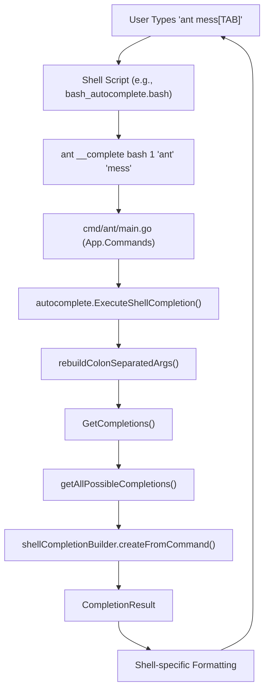
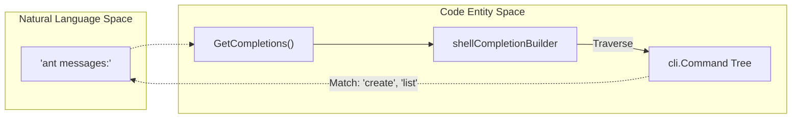
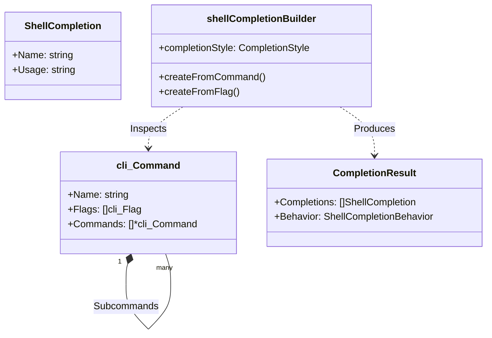

<!-- source: DeepWiki mcp.deepwiki.com · repo anthropics/anthropic-cli · page 4.1 Autocomplete Engine · fetched 2026-10-26 -->

# Autocomplete Engine

Relevant source files

The following files were used as context for generating this wiki page:

- [internal/autocomplete/autocomplete.go](internal/autocomplete/autocomplete.go)
- [internal/autocomplete/autocomplete_test.go](internal/autocomplete/autocomplete_test.go)

The Autocomplete Engine provides the logic and infrastructure for shell completion across Bash, Zsh, Fish, and PowerShell. It allows the `ant` CLI to suggest subcommands, flags, and handle complex colon-separated command structures (e.g., `messages:batches`) while respecting shell-specific completion behaviors.

## Core Completion Logic

The engine is primarily contained within `internal/autocomplete/autocomplete.go`. It bridges the `urfave/cli/v3` command tree with shell-specific requirements.

### Key Functions

| Function | Purpose |
| :--- | :--- |
| `GetCompletions` | The primary entry point for calculating suggestions. It filters raw completions to handle colon-separated grouping [internal/autocomplete/autocomplete.go:184-212](). |
| `ExecuteShellCompletion` | Parses the `__complete` command arguments, invokes `GetCompletions`, and formats the output for the requesting shell [internal/autocomplete/autocomplete.go:315-357](). |
| `OutputCompletionScript` | Renders the embedded shell scripts used to initialize completion in a user's shell [internal/autocomplete/autocomplete.go:49-76](). |
| `rebuildColonSeparatedArgs` | A pre-processing helper that joins arguments split by shells (like Bash) back into single colon-separated strings [internal/autocomplete/autocomplete.go:275-300](). |

### Data Flow: Request to Suggestion

The following diagram illustrates how a user's tab-press in a shell travels through the CLI to return completion candidates.

**Completion Request Flow**

Sources: [internal/autocomplete/autocomplete.go:184-212](), [internal/autocomplete/autocomplete.go:315-357](), [internal/autocomplete/autocomplete.go:275-300]()

## Colon-Separated Command Handling

The Anthropic CLI uses colons to group related commands (e.g., `beta:messages:batches`). Because shells often treat colons as word breakers, the engine implements specific logic to handle these cases.

### Argument Rebuilding
When a shell passes arguments to the hidden `__complete` command, it may have split `messages:batches` into `messages`, `:`, and `batches`. `rebuildColonSeparatedArgs` iterates through the slice and joins these fragments back together so the command tree can be traversed correctly [internal/autocomplete/autocomplete.go:275-300]().

### Grouping and Filtering
`GetCompletions` applies a filtering layer:
1. If the user has not yet typed a colon, it collapses all commands sharing a prefix into a single group (e.g., `messages:create` and `messages:list` appear simply as `messages`) [internal/autocomplete/autocomplete.go:188-209]().
2. Once a colon is typed, it expands to show the sub-commands [internal/autocomplete/autocomplete.go:235-248]().

**Command Space Mapping**

Sources: [internal/autocomplete/autocomplete.go:127-131](), [internal/autocomplete/autocomplete.go:184-212]()

## Completion Behaviors

The engine uses the `ShellCompletionBehavior` enum to signal to the shell how to handle the result [internal/autocomplete/autocomplete.go:89-93]().

| Enum Value | Description |
| :--- | :--- |
| `ShellCompletionBehaviorDefault` | Standard behavior; suggest commands or flags [internal/autocomplete/autocomplete.go:90](). |
| `ShellCompletionBehaviorFile` | Triggered when a flag has `TakesFile: true`. Tells the shell to use local file completion [internal/autocomplete/autocomplete.go:91](). |
| `ShellCompletionBehaviorNoComplete` | Triggered when the engine determines no valid completions exist (e.g., inside a string value) [internal/autocomplete/autocomplete.go:92](). |

### Implementation Detail: Flag Context
The engine determines behavior by looking at the preceding argument. If the previous argument was a flag like `--file` (which `TakesFile`), it returns `ShellCompletionBehaviorFile` [internal/autocomplete/autocomplete.go:250-264]().

## The `__complete` Command

The completion engine is wired into the main application via a hidden command named `__complete`. This command is not visible in standard help output but is invoked by the scripts generated by `OutputCompletionScript`.

*   **Wiring**: The command is defined and added to the `cli.App` in the entrypoint.
*   **Execution**: It calls `ExecuteShellCompletion`, passing the current command context and the target shell type [internal/autocomplete/autocomplete.go:315-320]().

**Entity Association**

Sources: [internal/autocomplete/autocomplete.go:78-81](), [internal/autocomplete/autocomplete.go:95-98](), [internal/autocomplete/autocomplete.go:127-131]()

## Shell Scripts Integration

The engine uses `go:embed` to include raw shell script templates for each supported shell [internal/autocomplete/autocomplete.go:26-27](). When `ant completion <shell>` is run, the engine:
1. Loads the template (e.g., `bash_autocomplete.bash`).
2. Replaces the placeholder `__APPNAME__` with the actual binary name [internal/autocomplete/autocomplete.go:30-45]().
3. Writes the script to the command's writer [internal/autocomplete/autocomplete.go:70-73]().

Sources: `internal/autocomplete/autocomplete.go` [1-357](), `internal/autocomplete/autocomplete_test.go` [1-236]()

---

