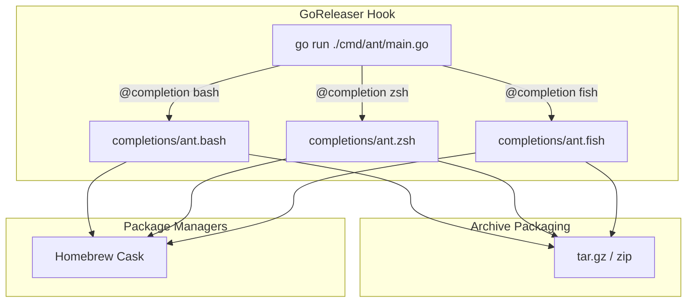
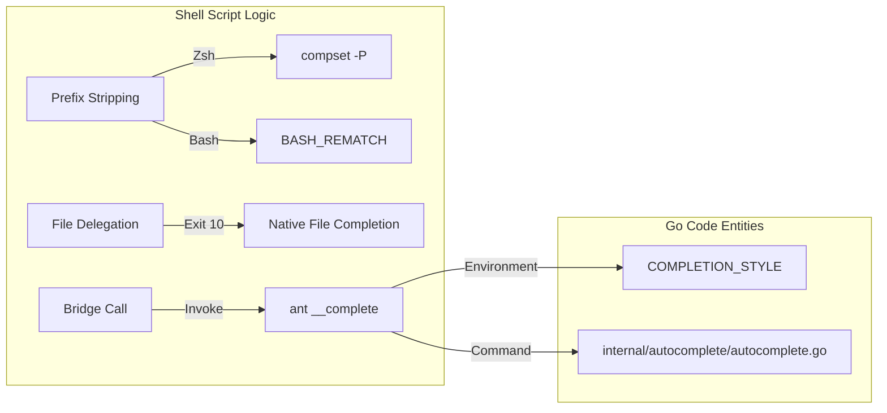

<!-- source: DeepWiki mcp.deepwiki.com · repo anthropics/anthropic-cli · page 4.2 Shell Completion Scripts · fetched 2026-10-26 -->

# Shell Completion Scripts

Relevant source files

The following files were used as context for generating this wiki page:

- [.goreleaser.yml](.goreleaser.yml)
- [README.md](README.md)
- [internal/autocomplete/shellscripts/bash_autocomplete.bash](internal/autocomplete/shellscripts/bash_autocomplete.bash)
- [internal/autocomplete/shellscripts/fish_autocomplete.fish](internal/autocomplete/shellscripts/fish_autocomplete.fish)
- [internal/autocomplete/shellscripts/pwsh_autocomplete.ps1](internal/autocomplete/shellscripts/pwsh_autocomplete.ps1)
- [internal/autocomplete/shellscripts/zsh_autocomplete.zsh](internal/autocomplete/shellscripts/zsh_autocomplete.zsh)

The Anthropic CLI (`ant`) provides integrated shell completion for Bash, Zsh, Fish, and PowerShell. This functionality is implemented through a hybrid approach: embedded shell-specific scripts that bridge the shell's completion engine with the CLI's internal completion logic via a hidden `__complete` command.

## Architecture and Embedding

The shell completion scripts are located in `internal/autocomplete/shellscripts/` and are embedded into the Go binary using the `go:embed` directive. This allows the CLI to distribute completion logic without requiring external files to be present on the user's filesystem at runtime.

### Data Flow: Shell to CLI

The completion process follows a standard pattern across all supported shells:
1. The user presses `Tab`.
2. The shell-specific completion function is triggered.
3. The function captures the current command line and cursor position.
4. The function calls `ant __complete` with the current arguments.
5. The CLI returns a list of suggestions or an exit code indicating a specific behavior (e.g., file completion).
6. The shell function renders these suggestions to the user.

### Natural Language to Code Entity Space: Completion Logic

| System Concept | Code Entity | File Path |
| :--- | :--- | :--- |
| **Bash Script** | `____APPNAME___bash_autocomplete` | [internal/autocomplete/shellscripts/bash_autocomplete.bash:3-57]() |
| **Zsh Script** | `____APPNAME___zsh_autocomplete` | [internal/autocomplete/shellscripts/zsh_autocomplete.zsh:4-46]() |
| **Fish Script** | `____APPNAME___fish_autocomplete` | [internal/autocomplete/shellscripts/fish_autocomplete.fish:3-48]() |
| **PowerShell Script** | `Register-ArgumentCompleter` | [internal/autocomplete/shellscripts/pwsh_autocomplete.ps1:1-97]() |
| **Bridge Command** | `__complete` | [internal/autocomplete/shellscripts/bash_autocomplete.bash:9]() |
| **Protocol Sniffing** | `@file://` and `@data://` regex | [internal/autocomplete/shellscripts/bash_autocomplete.bash:28-44]() |

**Sources:** [internal/autocomplete/shellscripts/bash_autocomplete.bash:1-60](), [internal/autocomplete/shellscripts/zsh_autocomplete.zsh:1-47](), [internal/autocomplete/shellscripts/fish_autocomplete.fish:1-52](), [internal/autocomplete/shellscripts/pwsh_autocomplete.ps1:1-98]()

## Protocol and Exit Codes

The interaction between the shell scripts and the `ant __complete` command is governed by specific exit codes that signal how the shell should proceed.

| Exit Code | Meaning | Shell Action |
| :--- | :--- | :--- |
| `0` | Success | Display the newline-separated strings returned by the CLI. |
| `10` | File Completion | Delegate to the shell's native file completion (e.g., `compgen -f` or `_files`). |
| `11` | No Completion | Suppress suggestions. |

### Special Handling for `@` Prefixes

The scripts contain custom logic to handle the CLI's file embedding syntax (`@`, `@file://`, `@data://`). When these prefixes are detected, the scripts intercept the completion request and force local file completion while preserving the prefix.

**Sources:** [internal/autocomplete/shellscripts/bash_autocomplete.bash:49-53](), [internal/autocomplete/shellscripts/zsh_autocomplete.zsh:31-45](), [internal/autocomplete/shellscripts/fish_autocomplete.fish:34-47](), [internal/autocomplete/shellscripts/pwsh_autocomplete.ps1:67-95]()

## Build-Time Generation (GoReleaser)

While the scripts are embedded for dynamic use via the `@completion` command, they are also pre-generated during the build process to be included in distribution packages (like Homebrew, DEB, or RPM).

The `.goreleaser.yml` file defines `before` hooks that execute the CLI to output these scripts into a `completions/` directory.

### Build-Time Data Flow

"Build Process Flow"

**Sources:** [.goreleaser.yml:4-10](), [.goreleaser.yml:91-94]()

## Implementation Details by Shell

### Bash
Uses `COMP_WORDS` and `COMP_CWORD` to determine context. It handles colon-splitting (common in Bash) to ensure that `@file://` is treated as a single token [internal/autocomplete/shellscripts/bash_autocomplete.bash:16-22](). It uses `mapfile` and `compgen` to populate `COMPREPLY` [internal/autocomplete/shellscripts/bash_autocomplete.bash:47-52]().

### Zsh
Uses `compdef` to register the completion function [internal/autocomplete/shellscripts/zsh_autocomplete.zsh:2](). It utilizes `compset -P` to strip prefixes like `@` or `@file://` before calling `_files`, allowing Zsh to complete the path correctly while maintaining the prefix in the final command line [internal/autocomplete/shellscripts/zsh_autocomplete.zsh:21-27]().

### Fish
Utilizes `commandline` to extract tokens [internal/autocomplete/shellscripts/fish_autocomplete.fish:4-5](). It uses Fish's `string match` for regex-based protocol detection [internal/autocomplete/shellscripts/fish_autocomplete.fish:19-27]() and calls `__fish_complete_path` for file suggestions [internal/autocomplete/shellscripts/fish_autocomplete.fish:30-37]().

### PowerShell
Uses `Register-ArgumentCompleter` with a `ScriptBlock` [internal/autocomplete/shellscripts/pwsh_autocomplete.ps1:1](). It manually parses the `commandAst` to extract arguments [internal/autocomplete/shellscripts/pwsh_autocomplete.ps1:4-10]() and returns `[System.Management.Automation.CompletionResult]` objects [internal/autocomplete/shellscripts/pwsh_autocomplete.ps1:59-65]().

### Natural Language to Code Entity Space: Script Features

"Script Feature Mapping"

**Sources:** [internal/autocomplete/shellscripts/bash_autocomplete.bash:9](), [internal/autocomplete/shellscripts/zsh_autocomplete.zsh:10](), [internal/autocomplete/shellscripts/fish_autocomplete.fish:10](), [internal/autocomplete/shellscripts/pwsh_autocomplete.ps1:19-20]()

---

