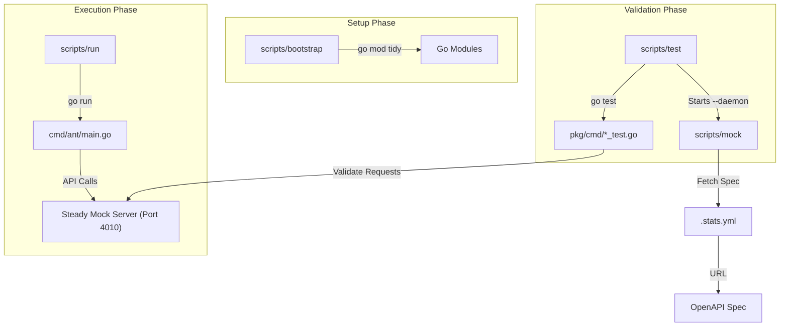
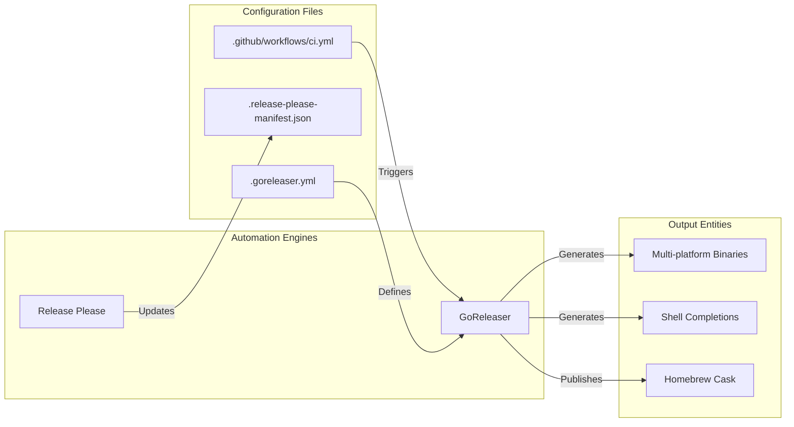

<!-- source: DeepWiki mcp.deepwiki.com · repo anthropics/anthropic-cli · page 5 Developer Tooling and CI/CD · fetched 2026-10-26 -->

# Developer Tooling and CI/CD

Relevant source files

The following files were used as context for generating this wiki page:

- [.github/workflows/ci.yml](.github/workflows/ci.yml)
- [scripts/bootstrap](scripts/bootstrap)
- [scripts/build](scripts/build)
- [scripts/mock](scripts/mock)
- [scripts/test](scripts/test)

This section provides an overview of the automation, scripts, and pipelines that support the development, testing, and release of the Anthropic CLI. The repository uses a combination of local Bash scripts and GitHub Actions workflows to ensure code quality and cross-platform compatibility.

## Local Development Scripts

The project provides a suite of scripts in the `scripts/` directory to standardize common development tasks. These scripts handle environment configuration, dependency management, and the lifecycle of the mock API server used for testing.

Key features of the local tooling include:
*   **Dependency Management**: The `bootstrap` script manages Go dependencies and optional Homebrew `Brewfile` installations [scripts/bootstrap:1-23]().
*   **Module Configuration**: Scripts consistently export `GOPRIVATE` to ensure the Go toolchain bypasses public proxies for internal SDK repositories [scripts/build:8-8](), [scripts/test:8-8]().
*   **Mock Server Integration**: The `mock` script manages the **Steady** mock server, which validates CLI requests against the OpenAPI spec defined in `.stats.yml` [scripts/mock:1-52]().
*   **Cross-Platform Validation**: The `test` script includes a check to ensure the codebase compiles on Windows by running `go test -c` with `GOOS=windows` [scripts/test:61-64]().

For a detailed breakdown of each script and the mock server configuration, see **[Local Development Scripts](#5.1)**.

### Development Workflow Diagram

The following diagram illustrates the relationship between local scripts and the core CLI binary during development.

**Local Development Lifecycle**

Sources: [scripts/bootstrap:21-22](), [scripts/mock:11-12](), [scripts/test:31-37](), [scripts/test:59-62]()

---

## CI/CD and Release Pipeline

The Anthropic CLI uses GitHub Actions for continuous integration and a structured release process managed by **GoReleaser** and **Release Please**.

### Continuous Integration (CI)
The primary CI workflow (`ci.yml`) triggers on pushes and pull requests to validate code changes [ .github/workflows/ci.yml:1-12](). It executes three main jobs:
1.  **Lint**: Runs `scripts/lint` to ensure code style compliance [ .github/workflows/ci.yml:21-44]().
2.  **Build**: Uses GoReleaser in `--snapshot` mode to verify that the CLI can be compiled for all target architectures (macOS, Linux, Windows) [ .github/workflows/ci.yml:68-75]().
3.  **Test**: Executes the full test suite using `scripts/test`, including the mock server integration [ .github/workflows/ci.yml:143-165]().

### Release Management
The release pipeline is automated to handle versioning and multi-platform distribution:
*   **Versioning**: Managed via `.release-please-manifest.json`, which tracks the current version and automates changelog generation.
*   **Artifacts**: GoReleaser produces binaries for multiple platforms, generates shell completion scripts, and creates man pages.
*   **Distribution**: Supports Homebrew cask updates and OIDC-based artifact uploads to secure storage [ .github/workflows/ci.yml:76-93]().

For details on the release configuration and workflow files, see **[CI/CD and Release Pipeline](#5.2)**.

### Code Entity to CI Mapping

This diagram maps specific files and tools to their roles in the CI/CD pipeline.

**CI/CD Pipeline Architecture**

Sources: [ .github/workflows/ci.yml:68-75](), [ .github/workflows/ci.yml:95-142]()

---

## Related Pages
*   **[Local Development Scripts](#5.1)**: Deep dive into the `scripts/` directory and local environment setup.
*   **[CI/CD and Release Pipeline](#5.2)**: Detailed documentation of GitHub Actions, GoReleaser settings, and the versioning strategy.
*   **[Testing Infrastructure](#6)**: Details on how the `scripts/test` and `scripts/mock` tools interact with the Go testing package.

---

