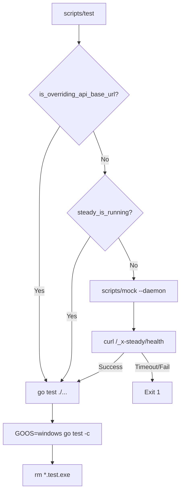
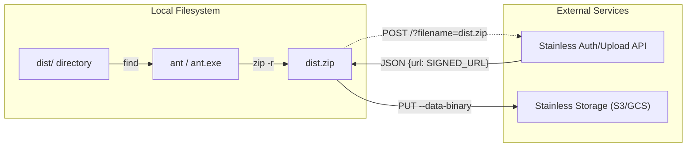

<!-- source: DeepWiki mcp.deepwiki.com · repo anthropics/anthropic-cli · page 5.1 Local Development Scripts · fetched 2026-10-26 -->

# Local Development Scripts

Relevant source files

The following files were used as context for generating this wiki page:

- [.github/actions/setup-go/action.yml](.github/actions/setup-go/action.yml)
- [scripts/bootstrap](scripts/bootstrap)
- [scripts/build](scripts/build)
- [scripts/format](scripts/format)
- [scripts/link](scripts/link)
- [scripts/lint](scripts/lint)
- [scripts/mock](scripts/mock)
- [scripts/run](scripts/run)
- [scripts/test](scripts/test)
- [scripts/unlink](scripts/unlink)
- [scripts/utils/upload-artifact.sh](scripts/utils/upload-artifact.sh)

This page documents the developer tooling located in the `scripts/` directory. These scripts provide a consistent interface for building, testing, and managing the Anthropic CLI (`ant`) development environment.

## Overview and Configuration

Most scripts in the repository share a common configuration for Go module resolution. To ensure that the CLI can fetch internal or pre-release versions of the Anthropic SDKs directly from GitHub without being blocked by the public Go Proxy, the `GOPRIVATE` environment variable is exported in nearly every script [scripts/run:8-8](), [scripts/test:8-8](), [scripts/build:8-8]().

### Private Module Configuration
The following modules are marked as private:
* `github.com/anthropics/anthropic-sdk-go`
* `github.com/stainless-sdks/anthropic-go`

Sources: [scripts/run:8-8](), [scripts/test:8-8](), [scripts/build:8-8](), [scripts/lint:8-8]().

---

## Core Development Lifecycle

### bootstrap
Initializes the development environment. On macOS, it checks for a `Brewfile` and offers to run `brew bundle` to install system dependencies [scripts/bootstrap:7-20](). It then runs `go mod tidy -e` to resolve Go dependencies [scripts/bootstrap:21-22]().

### build
Compiles the `ant` binary from the entry point at `cmd/ant` [scripts/build:11-11]().

### run
A wrapper around `go run ./cmd/ant "$@"` that allows developers to execute the CLI directly from source with the correct `GOPRIVATE` settings [scripts/run:10-10]().

### format and lint
* **`format`**: Executes `gofmt -s -w .` to simplify and rewrite Go source code according to standard formatting [scripts/format:8-8]().
* **`lint`**: Performs a `go build ./...` to check for compilation errors across the entire package tree [scripts/lint:11-11]().

Sources: [scripts/bootstrap:1-23](), [scripts/build:1-12](), [scripts/run:1-10](), [scripts/format:1-9](), [scripts/lint:1-12]().

---

## Testing Infrastructure and Mocking

The testing suite relies on the **Steady** mock server to simulate the Anthropic API.

### Mock Server Lifecycle (`scripts/mock`)
The `mock` script manages the Steady server (running on port 4010). It retrieves the OpenAPI spec URL from `.stats.yml` [scripts/mock:11-11]() and starts the server using `npm exec --package=@stdy/cli`.

When invoked with the `--daemon` flag:
1. It starts the server in the background and redirects output to `.stdy.log` [scripts/mock:27-27]().
2. It polls the health endpoint `http://127.0.0.1:4010/_x-steady/health` for up to 30 seconds [scripts/mock:32-47]().
3. It fails if the server process dies or times out [scripts/mock:33-44]().

### Test Execution (`scripts/test`)
The `test` script orchestrates the full test suite.

**Logic Flow:**
1. **API Override**: Checks if `TEST_API_BASE_URL` is set. If so, it skips the mock server startup and runs tests against that URL [scripts/test:27-31]().
2. **Mock Auto-start**: If no override exists and Steady is not running, it calls `./scripts/mock --daemon` and sets a `trap` to kill the process on exit [scripts/test:31-37]().
3. **Execution**: Runs `go test ./...` [scripts/test:59-59]().
4. **Windows Cross-Compilation**: Runs a cross-compilation check using `GOOS=windows go test -c` to ensure Windows compatibility, then cleans up the resulting `.exe` files [scripts/test:61-64]().

### Test Environment Flow
Title: Test Setup and Mock Server Integration

Sources: [scripts/test:15-65](), [scripts/mock:1-53]().

---

## SDK Linking Utilities

These scripts facilitate local development when changes are required in both the CLI and the underlying Go SDK.

*   **`link`**: Updates `go.mod` to replace the remote SDK dependency with a local file system path (defaults to `../anthropic-go`) [scripts/link:10-13]().
*   **`unlink`**: Removes the `replace` directive from `go.mod`, reverting the CLI to use the remote version of the SDK [scripts/unlink:8-8]().

Sources: [scripts/link:1-14](), [scripts/unlink:1-9]().

---

## Artifact Management

### upload-artifact.sh
Used primarily in CI pipelines to package and upload pre-release binaries.

**Implementation Details:**
1. **Binary Discovery**: Uses `find` to locate `ant` and `ant.exe` binaries for `amd64` and `arm64` architectures within the `dist/` directory [scripts/utils/upload-artifact.sh:8-16]().
2. **macOS Quarantine**: For macOS builds, it generates a `README.txt` containing instructions to run `xattr -d com.apple.quarantine` [scripts/utils/upload-artifact.sh:25-29]().
3. **Packaging**: Zips the discovered binaries into `dist.zip` [scripts/utils/upload-artifact.sh:36-36]().
4. **Upload Pipeline**: 
    * Requests a signed upload URL from a backend service [scripts/utils/upload-artifact.sh:38-42]().
    * Performs a `PUT` request to upload the ZIP file to the signed URL [scripts/utils/upload-artifact.sh:49-51]().

### Artifact Upload Data Flow
Title: Artifact Packaging and Upload Data Flow

Sources: [scripts/utils/upload-artifact.sh:1-60]().

---

