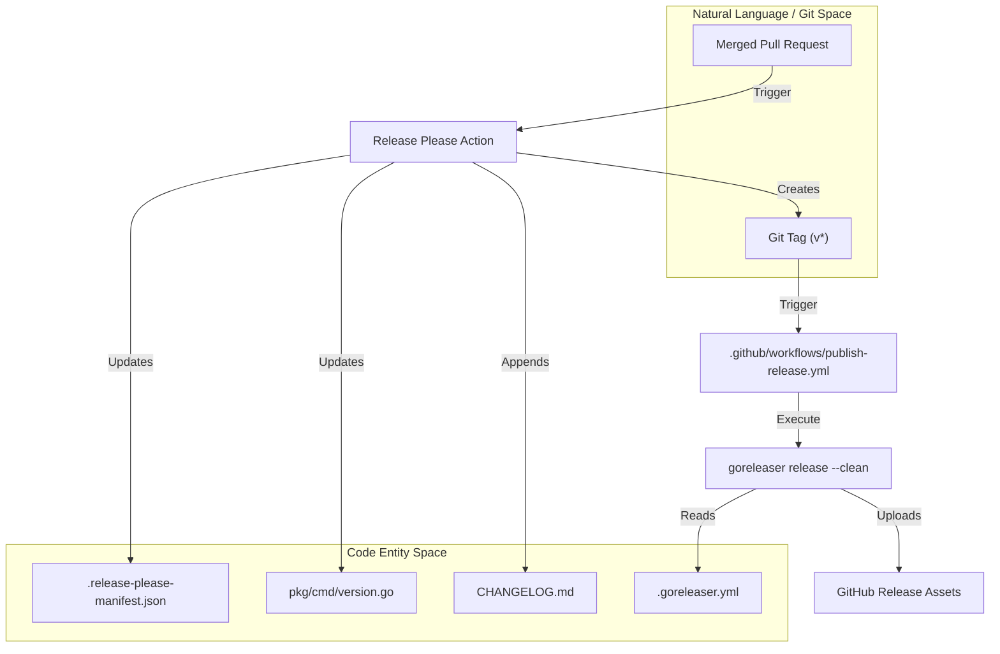
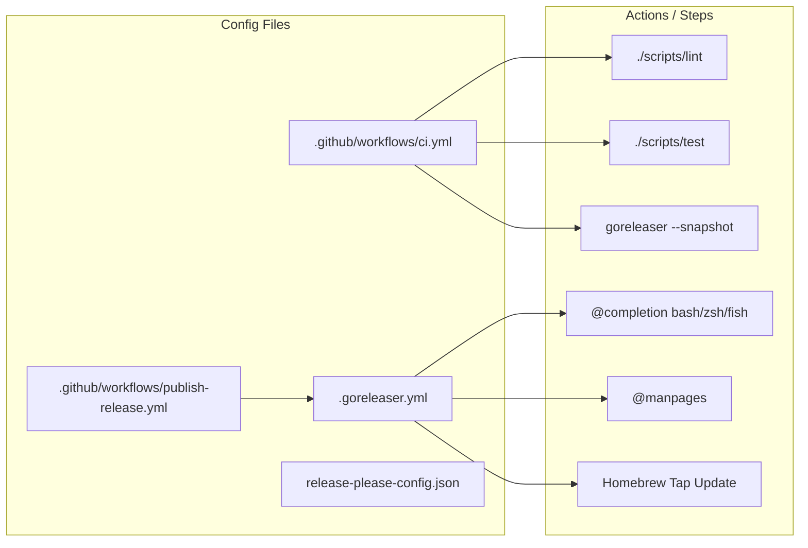

<!-- source: DeepWiki mcp.deepwiki.com · repo anthropics/anthropic-cli · page 5.2 CI/CD and Release Pipeline · fetched 2026-10-26 -->

# CI/CD and Release Pipeline

Relevant source files

The following files were used as context for generating this wiki page:

- [.github/CODEOWNERS](.github/CODEOWNERS)
- [.github/workflows/ci.yml](.github/workflows/ci.yml)
- [.github/workflows/claude-code-review.yml](.github/workflows/claude-code-review.yml)
- [.github/workflows/claude.yml](.github/workflows/claude.yml)
- [.github/workflows/publish-release.yml](.github/workflows/publish-release.yml)
- [.github/workflows/release-doctor.yml](.github/workflows/release-doctor.yml)
- [.gitignore](.gitignore)
- [.goreleaser.yml](.goreleaser.yml)
- [.release-please-manifest.json](.release-please-manifest.json)
- [CHANGELOG.md](CHANGELOG.md)
- [README.md](README.md)
- [bin/check-release-environment](bin/check-release-environment)
- [pkg/cmd/version.go](pkg/cmd/version.go)
- [release-please-config.json](release-please-config.json)

This page documents the automated workflows and release infrastructure for the Anthropic CLI (`ant`). The pipeline handles continuous integration (linting, building, testing), version management via Release Please, and multi-platform distribution using GoReleaser.

## Continuous Integration (CI)

The primary CI lifecycle is defined in `.github/workflows/ci.yml`. It triggers on pushes to all branches (excluding specific internal and generated branches) and on pull requests `[.github/workflows/ci.yml:2-15]()`.

### Job Structure
The CI workflow consists of three parallel jobs:

1.  **Lint**: Executes the `./scripts/lint` command after bootstrapping the environment `[.github/workflows/ci.yml:21-44]()`.
2.  **Build**: Verifies that the project compiles across supported platforms. It uses `goreleaser` in `--snapshot` mode to simulate a release without publishing `[.github/workflows/ci.yml:45-75]()`.
3.  **Test**: Executes the full test suite via `./scripts/test` `[.github/workflows/ci.yml:143-165]()`.

### Artifact Uploads and OIDC
For internal builds within the `stainless-sdks` organization, the CI pipeline performs an OIDC-authenticated upload of build artifacts:
*   It retrieves a GitHub OIDC token using `actions/github-script@v8` `[.github/workflows/ci.yml:76-84]()`.
*   It invokes `./scripts/utils/upload-artifact.sh` to push the tarball to a private package repository `[.github/workflows/ci.yml:85-94]()`.
*   Platform-specific binaries (e.g., `cdp-darwin-arm64`, `cdp-windows-amd64`) are uploaded as GitHub Action artifacts for 90 days `[.github/workflows/ci.yml:95-142]()`.

**Sources:**
- `[.github/workflows/ci.yml:1-165]()`
- `[scripts/utils/upload-artifact.sh]()`

---

## Release Automation

The project uses **Release Please** to automate versioning and changelog generation.

### Versioning Logic
Release Please tracks the current version in two primary locations:
*   `.release-please-manifest.json`: Stores the current version string (e.g., `"1.1.0"`) `[.release-please-manifest.json:1-3]()`.
*   `pkg/cmd/version.go`: Contains a `Version` constant tagged with `// x-release-please-version` for automated updates `[pkg/cmd/version.go:5-5]()`.

### Release Workflow Data Flow

The following diagram illustrates the transition from a merged Pull Request to a published GitHub Release.

**Release Pipeline Flow**

**Sources:**
- `[.release-please-manifest.json:1-3]()`
- `[pkg/cmd/version.go:1-6]()`
- `[CHANGELOG.md:1-23]()`
- `[.github/workflows/publish-release.yml:1-32]()`

---

## GoReleaser Configuration

The `.goreleaser.yml` file defines how the `ant` binary is built, packaged, and distributed.

### Build Targets
GoReleaser targets three major operating systems with multiple architectures:
*   **macOS**: `amd64`, `arm64` `[.goreleaser.yml:13-21]()`.
*   **Linux**: `386`, `arm`, `amd64`, `arm64` (CGO disabled) `[.goreleaser.yml:22-32]()`.
*   **Windows**: `386`, `amd64`, `arm64` `[.goreleaser.yml:33-41]()`.

### Pre-build Hooks
Before compilation, GoReleaser runs hooks to generate auxiliary files using the `ant` binary itself:
*   **Completions**: Generates `bash`, `zsh`, and `fish` scripts via the `@completion` hidden command `[.goreleaser.yml:5-9]()`.
*   **Man Pages**: Generates manual pages via the `@manpages` command `[.goreleaser.yml:10-10]()`.

### Distribution Channels
*   **Archives**: Packages binaries with completions and man pages into `.tar.gz` (Linux) or `.zip` (macOS/Windows) `[.goreleaser.yml:42-64]()`.
*   **Linux Packages (nfpms)**: Generates `apk`, `deb`, `rpm`, and `archlinux` packages `[.goreleaser.yml:68-80]()`.
*   **Homebrew**: Updates the `anthropics/homebrew-tap` repository with a new cask definition, including references to completion scripts and man pages `[.goreleaser.yml:81-97]()`.

**Sources:**
- `[.goreleaser.yml:1-97]()`

---

## Release Health and Environment

### Release Doctor
The `.github/workflows/release-doctor.yml` workflow runs on pushes to `main` or manual dispatch `[.github/workflows/release-doctor.yml:1-7]()`. It executes `./bin/check-release-environment` within the `production-release` environment to ensure secrets (like `STAINLESS_API_KEY`) are valid before a release is attempted `[.github/workflows/release-doctor.yml:15-23]()`.

### Code Review Automation
The repository employs Claude-based automation for maintenance:
*   **Claude Code Review**: Triggered on PRs to provide feedback on code quality and security `[.github/workflows/claude-code-review.yml:1-58]()`.
*   **Claude Code**: Allows developers to interact with Claude directly in issues or PR comments by tagging `@claude` `[.github/workflows/claude.yml:1-51]()`.

**Sources:**
- `[.github/workflows/release-doctor.yml:1-23]()`
- `[.github/workflows/claude-code-review.yml:1-58]()`
- `[.github/workflows/claude.yml:1-51]()`

## Pipeline Entity Map

This diagram maps the CI/CD configuration files to the specific actions they perform during the release lifecycle.

**Pipeline Mapping**

**Sources:**
- `[.github/workflows/ci.yml:43-43]()`
- `[.github/workflows/ci.yml:164-164]()`
- `[.github/workflows/ci.yml:72-72]()`
- `[.goreleaser.yml:7-10]()`
- `[.goreleaser.yml:81-86]()`

---

