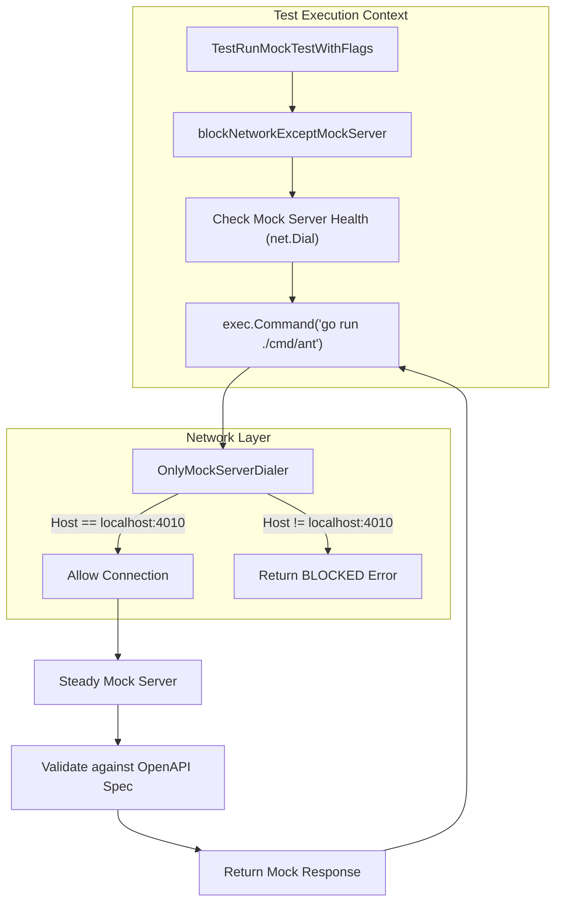
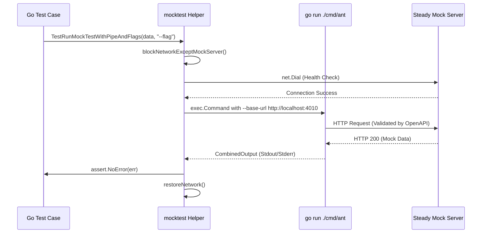

<!-- source: DeepWiki mcp.deepwiki.com · repo anthropics/anthropic-cli · page 6.1 Mock Server Test Helpers · fetched 2026-10-26 -->

# Mock Server Test Helpers

Relevant source files

The following files were used as context for generating this wiki page:

- [internal/binaryparam/binary_param.go](internal/binaryparam/binary_param.go)
- [internal/binaryparam/binary_param_test.go](internal/binaryparam/binary_param_test.go)
- [internal/debugmiddleware/debug_middleware.go](internal/debugmiddleware/debug_middleware.go)
- [internal/debugmiddleware/debug_middleware_test.go](internal/debugmiddleware/debug_middleware_test.go)
- [internal/mocktest/mocktest.go](internal/mocktest/mocktest.go)
- [scripts/mock](scripts/mock)
- [scripts/test](scripts/test)

The Anthropic CLI utilizes a robust testing infrastructure centered around the **Steady mock server**. This infrastructure allows developers to run the CLI against a local API that validates requests against the OpenAPI specification without incurring costs or requiring real API keys. The `internal/mocktest` package provides the core helpers to facilitate these integration tests by managing network isolation and command execution.

### Mock Server Lifecycle

The mock server is a [Steady](https://github.com/stainless-sdks/steady) instance that runs on `http://localhost:4010` [internal/mocktest/mocktest.go:25](). It is typically started via the `scripts/test` wrapper or manually via `scripts/mock`.

#### Initialization and Configuration
The package initializes the target mock URL by checking the `TEST_API_BASE_URL` environment variable. If not set, it defaults to the local Steady instance [internal/mocktest/mocktest.go:24-31]().

| Variable | Description | Default |
| :--- | :--- | :--- |
| `TEST_API_BASE_URL` | Overrides the target for mock tests (e.g., for testing against a remote staging environment). | `http://localhost:4010` |

#### Startup Logic
The `scripts/mock` script automates the retrieval of the OpenAPI spec from `.stats.yml` and starts the server [scripts/mock:11-27](). It includes a health-check loop that waits up to 30 seconds for the `/_x-steady/health` endpoint to return success before allowing tests to proceed [scripts/mock:29-47]().

**Sources:** [internal/mocktest/mocktest.go:22-31](), [scripts/mock:7-52](), [scripts/test:15-56]()

---

### Network Isolation

To ensure tests are truly hermetic and do not accidentally leak requests to the live Anthropic API, the `mocktest` package implements strict network blocking.

#### OnlyMockServerDialer
The `OnlyMockServerDialer` is a custom dialer that intercepts all network connection attempts. It compares the target `address` with the configured `mockServerURL.Host` [internal/mocktest/mocktest.go:34-42]().
*   **Allowed:** Connections where the host matches the mock server.
*   **Blocked:** Any other host results in a `BLOCKED` error [internal/mocktest/mocktest.go:41]().

#### Global Interception
The `blockNetworkExceptMockServer` function replaces the `http.DefaultClient.Transport` and `http.DefaultTransport` with a restricted transport using the `OnlyMockServerDialer` [internal/mocktest/mocktest.go:44-52](). This ensures that even third-party libraries using the default Go HTTP transport are restricted.

**Mock Test Execution Flow**

**Sources:** [internal/mocktest/mocktest.go:33-56](), [internal/mocktest/mocktest.go:71-76]()

---

### Key Test Helpers

The package provides two primary functions for executing CLI commands within a test context. Both functions automatically handle network blocking and restoration.

#### TestRunMockTestWithFlags
`TestRunMockTestWithFlags(t *testing.T, args ...string)`
A wrapper around `TestRunMockTestWithPipeAndFlags` that passes `nil` for stdin [internal/mocktest/mocktest.go:60-62](). Use this for commands that only rely on CLI flags.

#### TestRunMockTestWithPipeAndFlags
`TestRunMockTestWithPipeAndFlags(t *testing.T, pipeData []byte, args ...string)`
The core execution engine for integration tests. It performs the following steps:
1.  **Network Lock:** Calls `blockNetworkExceptMockServer` [internal/mocktest/mocktest.go:67]().
2.  **Binary Resolution:** Locates the CLI entry point at `../../cmd/ant` relative to the caller [internal/mocktest/mocktest.go:79-82]().
3.  **Command Construction:** Prepends `run <project_path> --base-url <mock_url>` to the provided arguments [internal/mocktest/mocktest.go:84]().
4.  **Execution:** Runs the command via `go run` and attaches `pipeData` to `cmd.Stdin` [internal/mocktest/mocktest.go:88-90]().
5.  **Validation:** Asserts that the command exited with code 0 and logs the output [internal/mocktest/mocktest.go:91-94]().

#### TestFile
`TestFile(t *testing.T, contents string) string`
A utility to create temporary files for testing flags that require file paths (e.g., `--file @/path/to/file`). It creates a file in a temporary directory and returns the absolute path [internal/mocktest/mocktest.go:96-101]().

**Sources:** [internal/mocktest/mocktest.go:60-101]()

---

### Data Flow: Integration Test Execution

The following diagram illustrates how a test case interacts with the helpers to invoke the CLI binary against the mock server.

**Integration Test Data Flow**

**Sources:** [internal/mocktest/mocktest.go:64-94](), [scripts/test:15-17]()

---

### Binary Parameter Helpers

While not strictly part of the network mock, `internal/binaryparam` provides utilities used by commands to handle file inputs, which are frequently tested using the `TestFile` helper.

#### FileOrStdin
`FileOrStdin(stdin io.ReadCloser, path string) (io.ReadCloser, bool, error)`
This function resolves a path string to a readable stream. It recognizes the following as `stdin`:
*   Empty string `""`
*   The dash glyph `"-"`
*   Unix special files `/dev/fd/0` or `/dev/stdin` [internal/binaryparam/binary_param.go:16-22]().

If the path is a standard file system path, it opens the file using `os.Open` [internal/binaryparam/binary_param.go:24-27]().

**Sources:** [internal/binaryparam/binary_param.go:10-30](), [internal/binaryparam/binary_param_test.go:11-59]()

---

