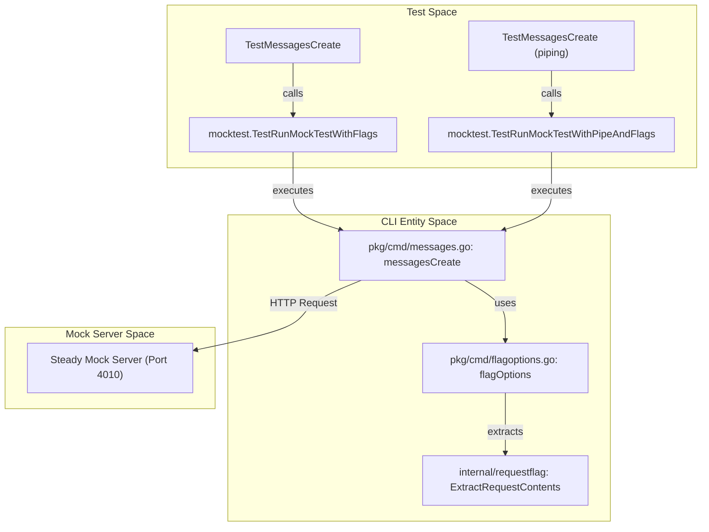
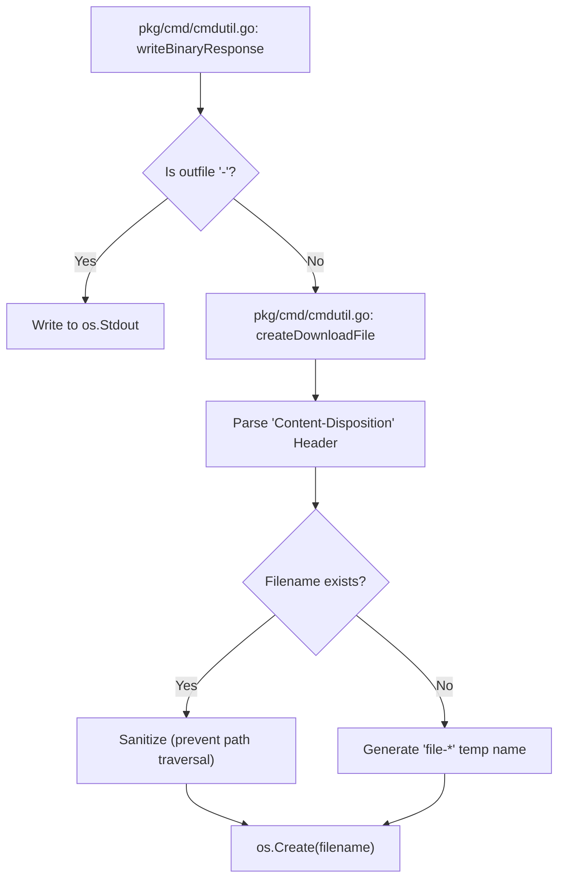

<!-- source: DeepWiki mcp.deepwiki.com · repo anthropics/anthropic-cli · page 6.2 Command-Level Tests · fetched 2026-10-26 -->

# Command-Level Tests

Relevant source files

The following files were used as context for generating this wiki page:

- [pkg/cmd/betafile_test.go](pkg/cmd/betafile_test.go)
- [pkg/cmd/betamessage_test.go](pkg/cmd/betamessage_test.go)
- [pkg/cmd/betamessagebatch_test.go](pkg/cmd/betamessagebatch_test.go)
- [pkg/cmd/betamodel_test.go](pkg/cmd/betamodel_test.go)
- [pkg/cmd/betaskill_test.go](pkg/cmd/betaskill_test.go)
- [pkg/cmd/betaskillversion_test.go](pkg/cmd/betaskillversion_test.go)
- [pkg/cmd/cmdutil_test.go](pkg/cmd/cmdutil_test.go)
- [pkg/cmd/completion_test.go](pkg/cmd/completion_test.go)
- [pkg/cmd/flagoptions.go](pkg/cmd/flagoptions.go)
- [pkg/cmd/flagoptions_test.go](pkg/cmd/flagoptions_test.go)
- [pkg/cmd/message_test.go](pkg/cmd/message_test.go)
- [pkg/cmd/messagebatch_test.go](pkg/cmd/messagebatch_test.go)
- [pkg/cmd/model_test.go](pkg/cmd/model_test.go)

This page documents the testing infrastructure for individual CLI commands and their supporting utilities. These tests ensure that the command-line interface correctly parses flags, handles file embeddings, processes stdin, and interacts with the Anthropic API via the request pipeline.

## Overview of Command Tests

The `pkg/cmd/` directory contains per-resource test files (e.g., `message_test.go`, `betamessage_test.go`) that validate the end-to-end flow of specific CLI commands. Most of these files are generated by Stainless but include hand-written cases for complex behaviors like stdin piping and inner flag validation.

### Test Patterns

Command tests typically follow three primary patterns to verify CLI behavior:

1.  **Regular Flags**: Validates standard top-level flag parsing [pkg/cmd/message_test.go:13-38]().
2.  **Inner Flags**: Validates dotted-notation flags (e.g., `--message.role`) and ensures they are correctly wired in the command definition using `requestflag.CheckInnerFlags` [pkg/cmd/message_test.go:40-72]().
3.  **Piping Data**: Validates the ability to pipe YAML/JSON structures directly into the command via `stdin` [pkg/cmd/message_test.go:74-161]().

### Code Entity Association: Test Execution Flow

The following diagram illustrates how a command test (e.g., `TestMessagesCreate`) triggers the CLI logic and interacts with the mock infrastructure.

Title: Command Test Execution Flow

Sources: [pkg/cmd/message_test.go:12-161](), [internal/mocktest/mocktest.go:1-50](), [pkg/cmd/flagoptions.go:1-100]()

---

## Flag Options and File Embedding Tests

`flagoptions_test.go` validates the logic in `flagoptions.go`, which is responsible for the recursive transformation of CLI inputs before they are sent to the API.

### Key Test Areas
*   **UTF-8 Sniffing**: `TestIsUTF8TextFile` checks if a byte slice is valid UTF-8 text or binary data [pkg/cmd/flagoptions_test.go:15-36](). This determines whether a file referenced with `@` is sent as a string or Base64-encoded.
*   **File Embedding Styles**: `TestEmbedFiles` verifies the `@`, `@file://`, and `@data://` prefixes [pkg/cmd/flagoptions_test.go:38-247]().
*   **Stdin Management**: `TestEmbedFilesStdin` ensures that the `onceStdinReader` correctly prevents multiple parameters from consuming `stdin` [pkg/cmd/flagoptions_test.go:249-282]().

### Embedding Prefix Logic
| Prefix | Behavior | Test Case |
| :--- | :--- | :--- |
| `@path` | Sniffs content; string if text, Base64 if binary | `base64 encoding` [pkg/cmd/flagoptions_test.go:140-150]() |
| `@file://path` | Always treats as string literal | `map[string]any with file references` [pkg/cmd/flagoptions_test.go:62-74]() |
| `@data://path` | Always Base64 encodes | `base64 encoding` [pkg/cmd/flagoptions_test.go:140-150]() |
| `\@path` | Escapes the `@` to use literal string | `escaping` [pkg/cmd/flagoptions_test.go:180-194]() |

Sources: [pkg/cmd/flagoptions_test.go:15-282](), [pkg/cmd/flagoptions.go:165-231]()

---

## Utility Tests (`cmdutil_test.go`)

The `cmdutil_test.go` file covers shared infrastructure for output handling, binary downloads, and URL validation.

### Output and Paging
*   **Stream Output**: `TestStreamOutput` validates that the CLI can pipe output to a system pager (defaulting to `cat` in tests) [pkg/cmd/cmdutil_test.go:16-25]().
*   **JSON Transformation**: `TestFormatJSON` verifies the `--transform` flag using `gjson` paths to extract specific fields from the API response [pkg/cmd/cmdutil_test.go:153-192]().

### Binary Response Handling
Tests for `writeBinaryResponse` and `createDownloadFile` ensure that binary data (like exported files or model outputs) is saved correctly [pkg/cmd/cmdutil_test.go:27-112]().

Title: Binary Download Logic

Sources: [pkg/cmd/cmdutil_test.go:27-112](), [pkg/cmd/cmdutil.go:400-450]()

---

## Beta Resource Tests

Beta commands often have unique requirements, such as mandatory `--beta` headers or complex multipart uploads.

*   **Beta Messages**: `betamessage_test.go` mirrors the standard messages test but includes the `--beta` flag and beta-specific parameters like `thinking` [pkg/cmd/betamessage_test.go:12-87]().
*   **File Uploads**: `betafile_test.go` validates the `beta:files upload` command, specifically checking the `multipart/form-data` path [pkg/cmd/betafile_test.go:65-89]().
*   **Skills & Versions**: `betaskill_test.go` and `betaskillversion_test.go` handle resource-specific CRUD operations, often skipping complex array multipart tests that are known limitations of the current CLI serialization [pkg/cmd/betaskill_test.go:14-23]().

### Resource-Specific Test Files
| File | Focus | Key Function |
| :--- | :--- | :--- |
| `betamessage_test.go` | Beta Messages API | `TestBetaMessagesCreate` [pkg/cmd/betamessage_test.go:12]() |
| `betafile_test.go` | File Upload/Download | `TestBetaFilesUpload` [pkg/cmd/betafile_test.go:65]() |
| `betamessagebatch_test.go` | Bulk processing | `TestBetaMessagesBatchesCreate` [pkg/cmd/betamessagebatch_test.go:12]() |
| `model_test.go` | Model Metadata | `TestModelsRetrieve` [pkg/cmd/model_test.go:11]() |

Sources: [pkg/cmd/betamessage_test.go:1-100](), [pkg/cmd/betafile_test.go:1-89](), [pkg/cmd/betaskill_test.go:1-81]()

---

