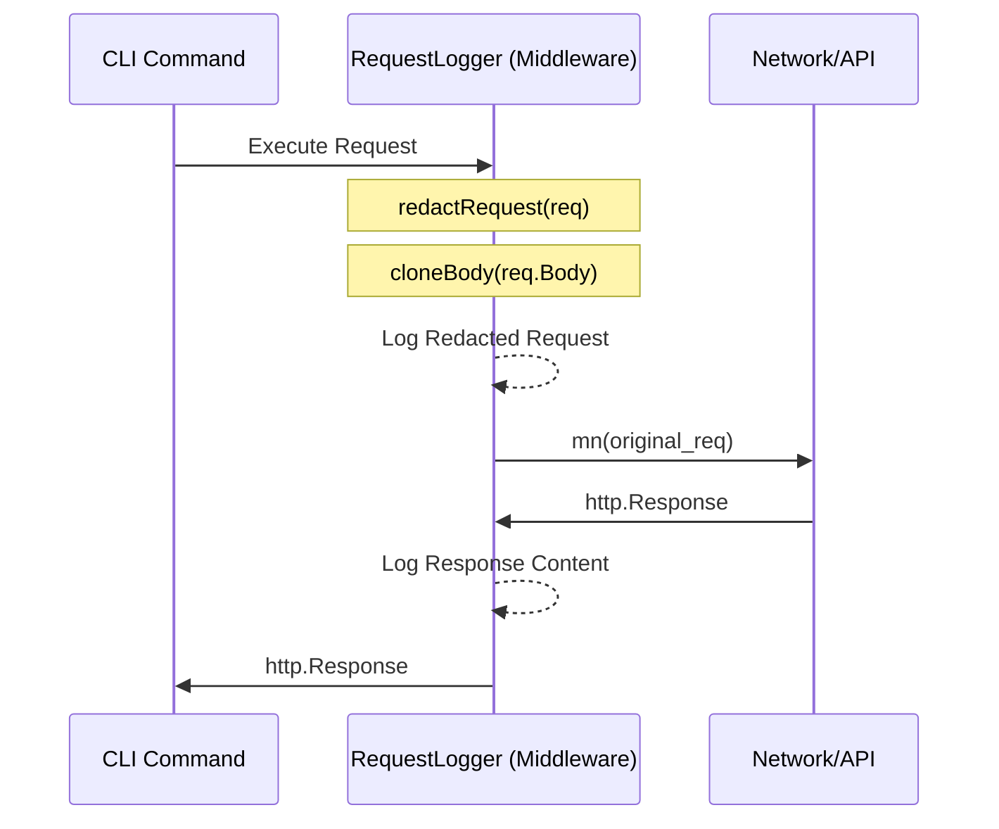
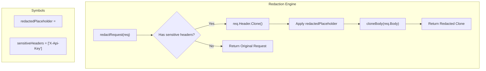

<!-- source: DeepWiki mcp.deepwiki.com · repo anthropics/anthropic-cli · page 7 Debug Middleware · fetched 2026-10-26 -->

# Debug Middleware

<details>
<summary>Relevant source files</summary>

The following files were used as context for generating this wiki page:

- [internal/debugmiddleware/debug_middleware.go](internal/debugmiddleware/debug_middleware.go)
- [internal/debugmiddleware/debug_middleware_test.go](internal/debugmiddleware/debug_middleware_test.go)
- [pkg/cmd/cmdutil.go](pkg/cmd/cmdutil.go)

</details>


The Debug Middleware provides a mechanism for inspecting the raw HTTP traffic between the Anthropic CLI and the Anthropic API. It is primarily used for troubleshooting and development, allowing users to see the exact request payloads and response headers while ensuring that sensitive credentials are not leaked into the logs.

## RequestLogger Middleware

The core component is the `RequestLogger` struct, which implements a middleware pattern compatible with the Anthropic Go SDK. It intercepts the request-response lifecycle to log content to a configured logger (defaulting to the standard Go `log` package).

### Data Flow and Interception
When the `--debug` flag is active, the CLI injects this middleware into the SDK's request pipeline. The middleware performs the following sequence:
1.  **Redaction**: Clones the request and scrubs sensitive headers.
2.  **Request Logging**: Dumps the redacted request to the debug output.
3.  **Execution**: Passes the original (unmutated) request to the next handler in the chain.
4.  **Response Logging**: Dumps the resulting response content before returning it to the caller.

### Implementation Diagram
The following diagram illustrates how `RequestLogger` sits between the CLI command logic and the network.

**HTTP Request/Response Interception**

Sources: [internal/debugmiddleware/debug_middleware.go:42-63](), [internal/debugmiddleware/debug_middleware.go:69-111]()

## Sensitive Data Redaction

To prevent API keys and session tokens from appearing in terminal output or log files, the middleware performs targeted redaction on specific headers.

| Header | Redaction Logic |
| :--- | :--- |
| `X-Api-Key` | Entire value replaced with `<REDACTED>`. |
| `Authorization` | If it contains a space (e.g., `Bearer <token>`), the prefix is kept and the token is replaced. Otherwise, the whole value is redacted. |

### Redaction Logic Entities
The redaction process ensures that the original request sent to the API remains untouched while the logged version is safe.


Sources: [internal/debugmiddleware/debug_middleware.go:20-26](), [internal/debugmiddleware/debug_middleware.go:69-100]()

## Body Handling

Logging HTTP bodies is destructive because `io.ReadCloser` can typically only be read once. To support non-destructive logging, the middleware uses `cloneBody`.

### `cloneBody` Function
This utility function [internal/debugmiddleware/debug_middleware.go:116-129]() splits an existing `io.ReadCloser` into two independent streams:
1.  It reads the entire body into a `bytes.Buffer`.
2.  It closes the original body.
3.  It returns two new `io.NopCloser` readers—one for the logger and one for the actual API request.

This ensures that even if the logger consumes the stream to print the JSON payload, the SDK still has a fresh stream to send over the wire.

## Enabling Debug Output

The debug middleware is wired into the CLI through the global `--debug` flag.

### Wiring in `cmdutil.go`
In `pkg/cmd/cmdutil.go`, a simplified `debugMiddlewareOption` is defined using `httputil.DumpRequest` and `httputil.DumpResponse`.

```go
var debugMiddlewareOption = option.WithMiddleware(
	func(r *http.Request, mn option.MiddlewareNext) (*http.Response, error) {
		logger := log.Default()
		if reqBytes, err := httputil.DumpRequest(r, true); err == nil {
			logger.Printf("Request Content:\n%s\n", reqBytes)
		}
		// ... execution and response logging ...
	},
)
```
Sources: [pkg/cmd/cmdutil.go:64-83]()

### Development Usage
During development, debug logging can be enabled by appending `--debug` to any command:
```bash
ant messages create --debug --max-tokens 10 --messages '[{"role": "user", "content": "Hi"}]'
```
This will output the raw HTTP headers and JSON body directly to `stderr`.

## Testing the Middleware

The middleware is verified in `internal/debugmiddleware/debug_middleware_test.go` to ensure:
*   **Non-mutation**: The original request headers and body passed to the API are never changed by the redaction process [internal/debugmiddleware/debug_middleware_test.go:38-44]().
*   **Partial Redaction**: The `Authorization` header correctly preserves prefixes like `Bearer ` while hiding the secret [internal/debugmiddleware/debug_middleware_test.go:75-92]().
*   **Body Persistence**: The request body remains readable by the subsequent handlers even after the logger has "consumed" it [internal/debugmiddleware/debug_middleware_test.go:171-200]().

Sources: [internal/debugmiddleware/debug_middleware_test.go:15-201]()

---

