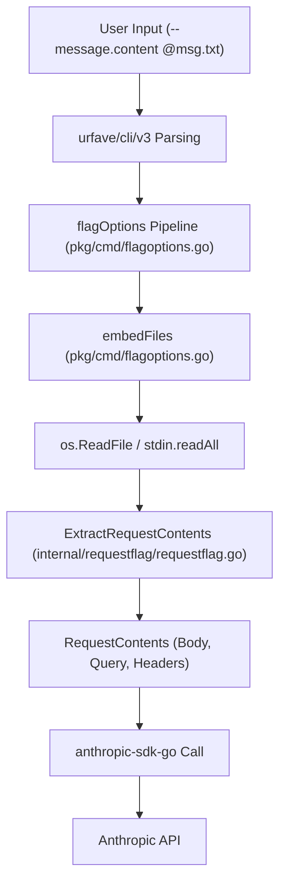
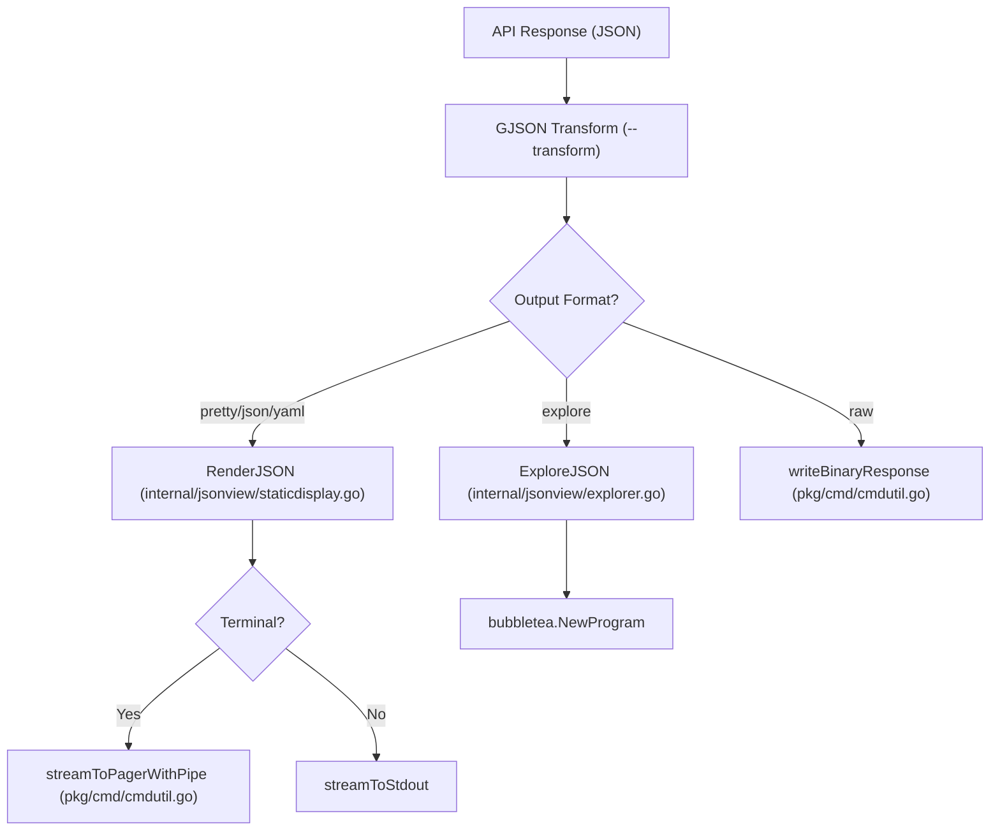

<!-- source: DeepWiki mcp.deepwiki.com · repo anthropics/anthropic-cli · page 9 Glossary · fetched 2026-10-26 -->

# Glossary

Relevant source files

The following files were used as context for generating this wiki page:

- [.release-please-manifest.json](.release-please-manifest.json)
- [.stats.yml](.stats.yml)
- [CHANGELOG.md](CHANGELOG.md)
- [cmd/ant/main.go](cmd/ant/main.go)
- [go.mod](go.mod)
- [internal/autocomplete/autocomplete.go](internal/autocomplete/autocomplete.go)
- [internal/binaryparam/binary_param.go](internal/binaryparam/binary_param.go)
- [internal/binaryparam/binary_param_test.go](internal/binaryparam/binary_param_test.go)
- [internal/debugmiddleware/debug_middleware.go](internal/debugmiddleware/debug_middleware.go)
- [internal/jsonview/explorer.go](internal/jsonview/explorer.go)
- [internal/jsonview/explorer_test.go](internal/jsonview/explorer_test.go)
- [internal/jsonview/staticdisplay.go](internal/jsonview/staticdisplay.go)
- [internal/mocktest/mocktest.go](internal/mocktest/mocktest.go)
- [internal/requestflag/innerflag.go](internal/requestflag/innerflag.go)
- [internal/requestflag/requestflag.go](internal/requestflag/requestflag.go)
- [pkg/cmd/cmd.go](pkg/cmd/cmd.go)
- [pkg/cmd/cmdutil.go](pkg/cmd/cmdutil.go)
- [pkg/cmd/flagoptions.go](pkg/cmd/flagoptions.go)
- [pkg/cmd/flagoptions_test.go](pkg/cmd/flagoptions_test.go)
- [pkg/cmd/version.go](pkg/cmd/version.go)
- [scripts/mock](scripts/mock)
- [scripts/test](scripts/test)

This glossary defines technical terms, abbreviations, and domain-specific concepts used within the `anthropic-cli` codebase. It serves as a reference for onboarding engineers to understand the mapping between CLI behavior and the underlying implementation.

## Core Concepts

### Request Flag System
The mechanism used to map CLI flags directly to API request structures. Unlike standard CLI flags, these carry metadata about their destination in the HTTP request (Body, Query, or Header).

*   **`Flag[T]`**: A generic wrapper around `urfave/cli` flags that adds `BodyPath`, `QueryPath`, and `HeaderPath` fields [internal/requestflag/requestflag.go:18-38]().
*   **`InRequest`**: An interface implemented by flags that can be serialized into an API request [internal/requestflag/requestflag.go:62-68]().
*   **`ExtractRequestContents`**: The function that iterates over all set flags in a command and organizes them into a `RequestContents` struct containing `Queries`, `Headers`, and `Body` [internal/requestflag/requestflag.go:98-127]().

### File Embedding
A feature allowing users to pass file contents as flag values using special prefixes.

*   **`@` Prefix**: The default prefix to trigger file reading. If the file is UTF-8, it is read as a string; otherwise, it is Base64 encoded [pkg/cmd/flagoptions.go:197-231]().
*   **`@data://`**: Explicitly forces the file to be Base64 encoded, regardless of content type [pkg/cmd/flagoptions.go:166-180]().
*   **`@file://`**: Explicitly forces the file to be read as a raw string literal [pkg/cmd/flagoptions.go:181-196]().
*   **`isUTF8TextFile`**: A helper that sniffs the first 512 bytes of a file to determine if it should be treated as text or binary [pkg/cmd/cmdutil.go:235-247]().

### JSON Explorer (TUI)
The interactive terminal user interface used when `--format explore` is passed. It allows navigating nested JSON structures using a stack-based view system.

*   **`JSONViewer`**: The main `bubbletea` model that manages the navigation stack and help menu [internal/jsonview/explorer.go:37-45]().
*   **`TableView`**: A view mode for JSON arrays, rendering data in a grid [internal/jsonview/explorer.go:195-202]().
*   **`TextView`**: A view mode for large string values or leaf nodes [internal/jsonview/explorer.go:420-425]().

## Technical Terms & Abbreviations

| Term | Definition | Code Pointer |
| :--- | :--- | :--- |
| **GJSON** | A syntax used for the `--transform` flag to query and filter JSON output. | [pkg/cmd/cmdutil.go:25]() |
| **Steady** | The mock server used for integration tests, running against the OpenAPI spec. | [scripts/test:15-17]() |
| **Stainless** | The platform used to generate the CLI and SDK from OpenAPI specifications. | [pkg/cmd/cmd.go:1]() |
| **JSONL** | JSON Lines format, where each line is a valid JSON object. Supported via `--format jsonl`. | [pkg/cmd/cmdutil.go:30]() |
| **`ant`** | The binary name and root command for the Anthropic CLI. | [pkg/cmd/cmd.go:28]() |

## Data Flow Diagrams

### Request Pipeline: From Flag to API
This diagram shows how a user-provided flag is transformed into an HTTP request payload.

**Sources:** [pkg/cmd/flagoptions.go:79-89](), [internal/requestflag/requestflag.go:98-127]()

### Output Pipeline: From API to Terminal
This diagram illustrates how API responses are handled, transformed, and rendered to the user.

**Sources:** [pkg/cmd/cmdutil.go:141-188](), [internal/jsonview/explorer.go:47-65](), [internal/jsonview/staticdisplay.go:17-30]()

## Testing Infrastructure Concepts

*   **`TEST_API_BASE_URL`**: Environment variable used to redirect CLI requests to the local Steady mock server during tests [scripts/test:27-29]().
*   **`OnlyMockServerDialer`**: A custom dialer used in tests to ensure the CLI only communicates with the local mock server, preventing accidental external API calls [internal/mocktest/mocktest.go:101-115]().
*   **`onceStdinReader`**: A safety wrapper that ensures `stdin` is only consumed once during a single execution, preventing conflicts between file embedding and root body parameters [pkg/cmd/flagoptions.go:46-61]().

**Sources:**
- [pkg/cmd/cmd.go:21-274]()
- [pkg/cmd/cmdutil.go:1-247]()
- [pkg/cmd/flagoptions.go:1-231]()
- [internal/requestflag/requestflag.go:1-161]()
- [internal/jsonview/explorer.go:37-425]()
- [scripts/test:1-65]()
- [scripts/mock:1-53]()