# Page: Overview

# Overview

<details>
<summary>Relevant source files</summary>

The following files were used as context for generating this wiki page:

- [.goreleaser.yml](.goreleaser.yml)
- [.release-please-manifest.json](.release-please-manifest.json)
- [CHANGELOG.md](CHANGELOG.md)
- [README.md](README.md)
- [cmd/ant/main.go](cmd/ant/main.go)
- [go.mod](go.mod)
- [pkg/cmd/cmd.go](pkg/cmd/cmd.go)
- [pkg/cmd/version.go](pkg/cmd/version.go)

</details>


The Anthropic CLI (`ant`) is the official command-line interface for the [Claude Developer Platform](https://platform.claude.com/docs/en/api). It provides a resource-based interface to interact with Anthropic's LLM services, including message creation, model management, and beta features like Agents and Sessions [README.md:1-5]().

The CLI is built in Go and leverages the `urfave/cli/v3` framework for command routing and `anthropic-sdk-go` for API communication [go.mod:6-18]().

### High-Level Architecture

The application is structured as a tree of commands where each "resource" (e.g., `messages`, `models`) is a sub-command containing specific actions (e.g., `create`, `list`) [pkg/cmd/cmd.go:85-132]().

**System Component Mapping**

The following diagram maps high-level CLI concepts to their corresponding implementation entities in the codebase.

| Concept | Code Entity | File Path |
| :--- | :--- | :--- |
| **Entrypoint** | `func main()` | [cmd/ant/main.go:19-60]() |
| **Command Tree** | `var Command` | [pkg/cmd/cmd.go:27-84]() |
| **API Client** | `anthropic-sdk-go` | [go.mod:6]() |
| **Output Handler** | `func ShowJSON` | [cmd/ant/main.go:46]() |
| **Version Info** | `const Version` | [pkg/cmd/version.go:5]() |

**Request Execution Flow**

This diagram illustrates how a command like `ant messages create` flows from the user's terminal through the system entities.

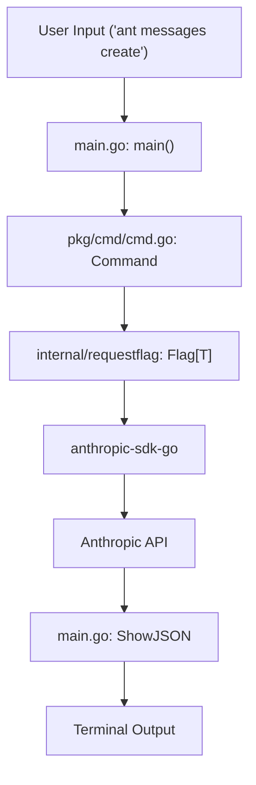

Sources: [cmd/ant/main.go:19-60](), [pkg/cmd/cmd.go:21-33](), [pkg/cmd/cmd.go:76-84](), [go.mod:6-18]()

### Key Concepts

#### Resource-Based Commands
The CLI organizes functionality by API resource. Commands follow the pattern `ant [resource] <command> [flags...]` [README.md:48-52]().
*   **Stable Resources:** `messages`, `models`, `completions` [pkg/cmd/cmd.go:86-124]().
*   **Beta Resources:** Prefixed with `beta:`, such as `beta:agents`, `beta:sessions`, and `beta:vaults` [pkg/cmd/cmd.go:126-272]().

#### Data Transformation and Formatting
The CLI supports multiple output formats (JSON, YAML, Table, etc.) via the `--format` flag [pkg/cmd/cmd.go:46-56](). It also integrates `gjson` to allow users to filter or transform API responses directly from the command line using the `--transform` flag [pkg/cmd/cmd.go:68-71]().

#### File Embedding
A powerful feature of `ant` is the ability to reference local files using the `@` symbol. This allows passing images or large text blocks into JSON payloads without manual encoding [README.md:84-109]().

### Wiki Navigation

This wiki is organized to help you understand the CLI from installation to deep internal mechanics.

*   **[Getting Started](#1.1)**: Quick-start guide covering installation via Homebrew or Go, and configuring the `ANTHROPIC_API_KEY` [README.md:7-35]().
*   **[Project Layout](#1.2)**: A guide to the repository structure, distinguishing between the `cmd/` entrypoints and the `pkg/cmd/` implementation logic.
*   **Command Reference**: Detailed documentation of every available command, including required flags and example usage.
*   **Core Architecture**: Deep dives into the request pipeline, flag system, and the TUI-based JSON explorer.
*   **Developer Tooling**: Documentation on the `scripts/` directory used for local development and the CI/CD release pipeline [README.md:37-45](), [.goreleaser.yml:1-11]().

Sources: [README.md:46-83](), [pkg/cmd/cmd.go:46-71](), [pkg/cmd/cmd.go:85-155](), [go.mod:15-18]()

---

# Page: Getting Started

# Getting Started

<details>
<summary>Relevant source files</summary>

The following files were used as context for generating this wiki page:

- [.github/actions/setup-go/action.yml](.github/actions/setup-go/action.yml)
- [.goreleaser.yml](.goreleaser.yml)
- [.release-please-manifest.json](.release-please-manifest.json)
- [CHANGELOG.md](CHANGELOG.md)
- [README.md](README.md)
- [pkg/cmd/version.go](pkg/cmd/version.go)
- [scripts/bootstrap](scripts/bootstrap)
- [scripts/build](scripts/build)
- [scripts/lint](scripts/lint)
- [scripts/run](scripts/run)

</details>


This page provides a technical overview of how to install, configure, and begin developing with the Anthropic CLI (`ant`). The CLI is a Go-based tool designed to interface with the Claude Developer Platform API.

## Installation Methods

The CLI is distributed as a compiled binary named `ant`. It can be installed via package managers or built from source using the Go toolchain.

### Homebrew (macOS/Linux)
The CLI is available via a custom Homebrew tap. The formula is managed through the `.goreleaser.yml` configuration, which handles the creation of the Homebrew cask and associated completion scripts [[.goreleaser.yml:81-97]]().

```sh
brew install anthropics/tap/ant
```

### Go Install
For developers with a Go environment (version 1.22 or later), the CLI can be installed directly from the repository [[README.md:15-20]]().

```sh
go install 'github.com/anthropics/anthropic-cli/cmd/ant@latest'
```

After installation, ensure your `GOPATH/bin` is in your system `PATH` to execute the `ant` binary [[README.md:28-33]]().

## Environment Variables and Configuration

The CLI relies on environment variables for authentication and behavior modification. These variables are mapped to global flags during command execution.

| Environment Variable | Description | Default |
| :--- | :--- | :--- |
| `ANTHROPIC_API_KEY` | The primary API key for authenticating requests [[README.md:68]](). | `null` |
| `ANTHROPIC_AUTH_TOKEN` | An alternative authentication token [[README.md:69]](). | `null` |
| `GOPRIVATE` | Used during development to bypass the public Go proxy for internal SDKs [[scripts/run:8]](). | - |

## Global Flags

The following flags are available globally across all `ant` commands [[README.md:71-83]]():

*   `--api-key`: Sets the API key (overrides `ANTHROPIC_API_KEY`).
*   `--base-url`: Overrides the default API endpoint (useful for testing against a mock server).
*   `--debug`: Enables verbose logging, including redacted HTTP request/response details.
*   `--format`: Specifies output rendering (e.g., `json`, `pretty`, `yaml`, `explore`).
*   `--transform`: Applies a [GJSON](https://github.com/tidwall/gjson) path to filter or reshape the JSON response.
*   `--version` / `-v`: Displays the current version, defined in `pkg/cmd/version.go` [[pkg/cmd/version.go:5]]().

## Local Development Workflow

For contributors, the repository provides a set of scripts to manage the development lifecycle without requiring a global installation.

### The `scripts/run` Wrapper
The `scripts/run` utility is the primary entry point for local execution. It automatically configures the `GOPRIVATE` environment variable to ensure internal SDK modules (like `anthropic-sdk-go`) are resolved correctly from the source rather than the Go proxy [[scripts/run:8-10]]().

**Implementation Flow: Local Execution**

The following diagram illustrates the path from a local script execution to the CLI entry point.

Title: Local Development Execution Flow
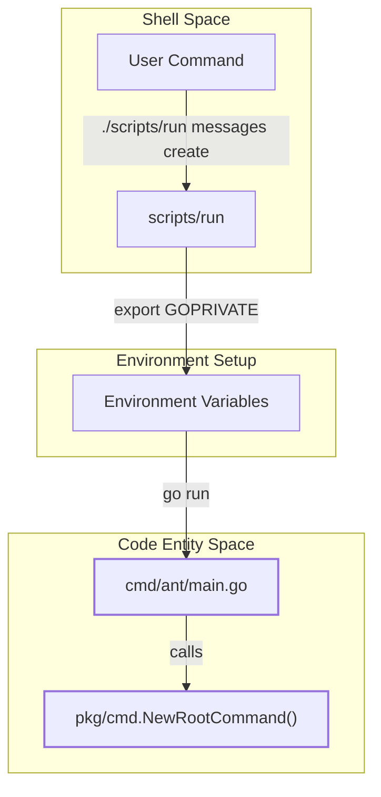
Sources: [[scripts/run:1-10]](), [[.goreleaser.yml:17]]()

### Developer Scripts
*   `./scripts/bootstrap`: Initializes the environment, handles `brew bundle`, and runs `go mod tidy` [[scripts/bootstrap:1-23]]().
*   `./scripts/build`: Compiles the `ant` binary to the local directory [[scripts/build:1-11]]().
*   `./scripts/lint`: Runs `go build ./...` to check for compilation errors across the workspace [[scripts/lint:1-11]]().

## Quick Start Example

The CLI uses a resource-based command structure: `ant [resource] <command> [flags...]` [[README.md:51]]().

### Creating a Message
To send a prompt to a model, use the `messages create` command. You can pass complex objects as JSON strings or use the `@` prefix to load content from a file [[README.md:55-60]]().

```sh
ant messages create \
  --max-tokens 1024 \
  --message '{content: [{text: "Hello, Claude", type: "text"}], role: "user"}' \
  --model claude-3-5-sonnet-latest
```

### File Embedding Logic
The CLI supports a special `@` syntax for flags. When a flag value starts with `@`, the `flagOptions` pipeline attempts to read the file at the specified path [[README.md:86-90]]().

**Data Flow: File Flag Resolution**

Title: Flag Value to File Content Resolution
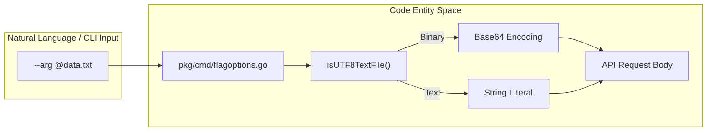
Sources: [[README.md:112-118]](), [[pkg/cmd/flagoptions.go]]()

For explicit control over encoding, use:
*   `@file://path/to/file`: Forces string/text encoding [[README.md:116]]().
*   `@data://path/to/file`: Forces base64 encoding for binary data [[README.md:116]]().

Sources: [[README.md:1-123]](), [[scripts/run:1-10]](), [[pkg/cmd/version.go:1-6]](), [[.goreleaser.yml:1-97]]()

---

# Page: Project Layout

# Project Layout

<details>
<summary>Relevant source files</summary>

The following files were used as context for generating this wiki page:

- [.stats.yml](.stats.yml)
- [cmd/ant/main.go](cmd/ant/main.go)
- [go.mod](go.mod)
- [pkg/cmd/cmd.go](pkg/cmd/cmd.go)

</details>


This page describes the directory structure and organization of the Anthropic CLI (`ant`) repository. The project is structured to separate the generated API command surface from hand-written core logic, utilities, and developer tooling.

## Directory Structure Overview

The repository follows standard Go project layouts with specific directories dedicated to the `urfave/cli` implementation and internal shared logic.

| Directory | Purpose | Key Contents |
| :--- | :--- | :--- |
| `cmd/ant/` | Main entrypoint | `main.go` |
| `pkg/cmd/` | Command definitions | API resource commands, `cmd.go`, `cmdutil.go` |
| `internal/` | Private shared logic | `requestflag`, `autocomplete`, `jsonview`, `mocktest` |
| `scripts/` | Developer tooling | Build, test, and linting scripts |

### Component Interaction Diagram
The following diagram illustrates how different parts of the repository interact to fulfill a CLI request.

"CLI Request Pipeline"
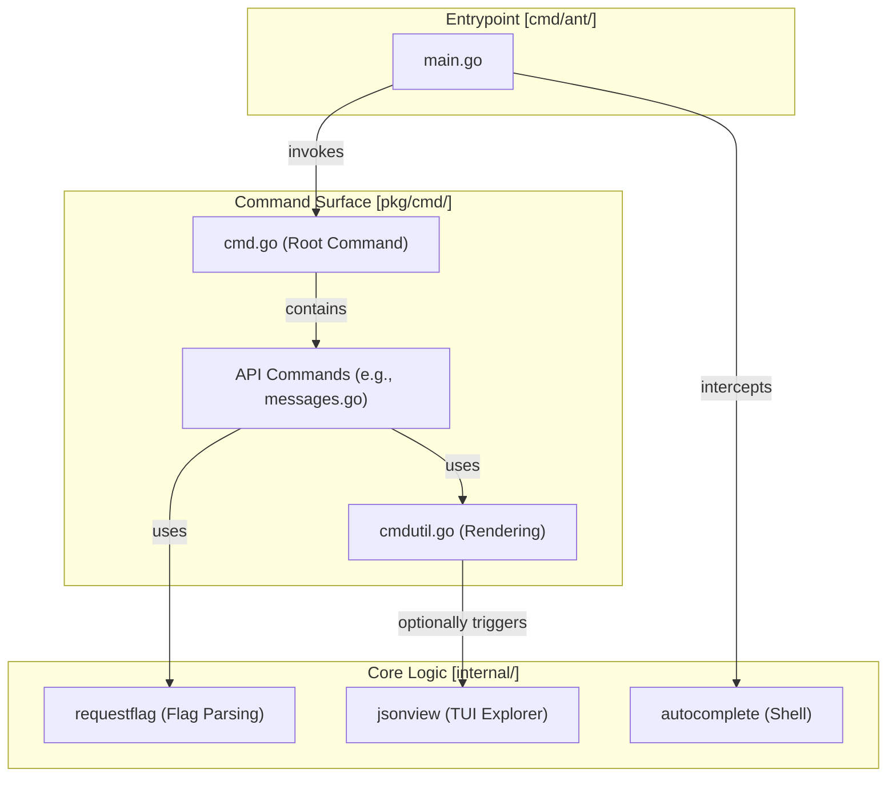
**Sources:** [cmd/ant/main.go:19-33](), [pkg/cmd/cmd.go:26-85](), [internal/requestflag/request_flag.go:1-20]()

---

## cmd/ant/ (Entrypoint)

The `cmd/ant/` directory contains the `main` package and the primary entrypoint for the application.

*   **`main.go`**: Responsible for initializing the `urfave/cli` application, handling environment-level overrides (like `ANTHROPIC_BASE_URL`), and managing the global error handling strategy. It differentiates between standard Go errors and `anthropic.Error` types to provide formatted JSON error output when available [cmd/ant/main.go:19-60]().

**Sources:** [cmd/ant/main.go:19-60]()

---

## pkg/cmd/ (Command Implementations)

This directory contains the bulk of the CLI's functional logic. It is a mix of hand-written utilities and files generated from the OpenAPI specification.

*   **`cmd.go`**: Defines the root `ant` command and wires together the hierarchical tree of subcommands (e.g., `messages`, `beta:models`) [pkg/cmd/cmd.go:26-272]().
*   **API Resource Files**: Files like `messages.go` or `betamessage.go` (referenced in `cmd.go`) contain the specific `cli.Command` definitions for API endpoints.
*   **`cmdutil.go`**: Contains shared helpers for the command-line interface, including JSON rendering (`ShowJSON`), output formatting logic, and binary file download handling.
*   **`flagoptions.go`**: Implements the logic for the `flagOptions` pipeline, which handles file embedding (`@filename`) and stdin merging for request bodies.

**Sources:** [pkg/cmd/cmd.go:26-272](), [cmd/ant/main.go:13-16]()

---

## internal/ (Private Utilities)

The `internal/` directory contains packages that are not intended for use by external projects but provide critical shared functionality within the CLI.

*   **`requestflag/`**: Implements a generic flag system that maps CLI flags directly to API request structures, supporting nested paths (e.g., `--message.role`) [pkg/cmd/cmd.go:16-16]().
*   **`jsonview/`**: A `bubbletea`-based TUI for interactive exploration of JSON responses when the `explore` format is used.
*   **`autocomplete/`**: Manages shell completion logic for Bash, Zsh, Fish, and PowerShell, including the generation of completion scripts [pkg/cmd/cmd.go:15-15]().
*   **`mocktest/`**: Provides infrastructure for integration testing against a mock API server.
*   **`debugmiddleware/`**: Implements HTTP middleware for logging requests and responses when the `--debug` flag is active.

**Sources:** [pkg/cmd/cmd.go:15-16](), [internal/requestflag/request_flag.go:1-20]()

---

## Generated vs. Hand-written Files

The project uses [Stainless](https://www.stainlessapi.com/) to generate the API client and command structures from an OpenAPI specification.

*   **Generated Files**: Typically contain a header: `// File generated from our OpenAPI spec by Stainless`. These include the core command definitions in `pkg/cmd/` and the entrypoint in `cmd/ant/main.go` [cmd/ant/main.go:1-1](), [pkg/cmd/cmd.go:1-1]().
*   **Hand-written Files**: Files like `pkg/cmd/cmdutil.go`, `pkg/cmd/flagoptions.go`, and the entire `internal/` directory are hand-maintained to provide the CLI's unique user experience (TUI, file embedding, etc.).
*   **`.stats.yml`**: Tracks the state of the OpenAPI generation, including the spec URL and the number of configured endpoints [stats.yml:1-4]().

"Code Entity Mapping: Generated vs Hand-written"
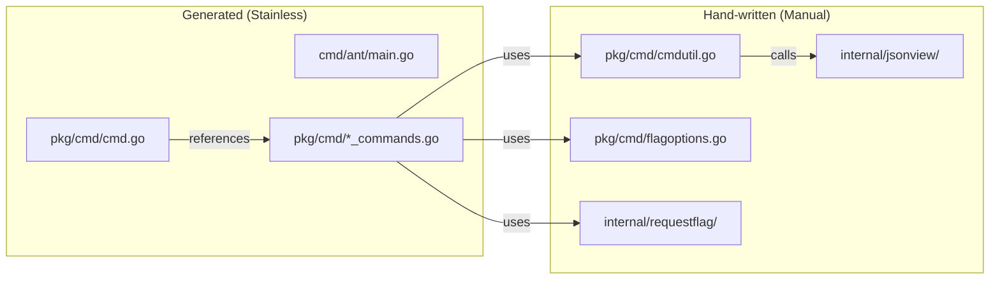
**Sources:** [.stats.yml:1-4](), [cmd/ant/main.go:1-1](), [pkg/cmd/cmd.go:1-1]()

---

## scripts/ (Developer Tooling)

The `scripts/` directory contains automation for the development lifecycle.

*   **`run`**: A wrapper to run the CLI locally using `go run ./cmd/ant`.
*   **`bootstrap`**: Sets up the local development environment.
*   **`test` / `mock`**: Runs the test suite, often involving the `mocktest` internal package and a mock server.
*   **`build`**: Compiles the binary for the local platform.

**Sources:** [go.mod:1-20]() (Module dependencies used by scripts)

---

# Page: Command Reference

# Command Reference

<details>
<summary>Relevant source files</summary>

The following files were used as context for generating this wiki page:

- [cmd/ant/main.go](cmd/ant/main.go)
- [pkg/cmd/betamessage.go](pkg/cmd/betamessage.go)
- [pkg/cmd/betamessagebatch.go](pkg/cmd/betamessagebatch.go)
- [pkg/cmd/betamodel.go](pkg/cmd/betamodel.go)
- [pkg/cmd/cmd.go](pkg/cmd/cmd.go)
- [pkg/cmd/message.go](pkg/cmd/message.go)
- [pkg/cmd/messagebatch.go](pkg/cmd/messagebatch.go)
- [pkg/cmd/model.go](pkg/cmd/model.go)

</details>


The Anthropic CLI (`ant`) provides a structured command-line interface to the Claude Developer Platform. Commands are organized hierarchically by API resource group, mirroring the structure of the Anthropic API. The CLI uses the `urfave/cli` framework to manage this command tree and provide features like suggestions and flag parsing [pkg/cmd/cmd.go:27-30]().

### Command Structure Overview

The CLI entrypoint in `cmd/ant/main.go` executes the root `Command` defined in `pkg/cmd/cmd.go` [cmd/ant/main.go:20-33](). Commands are grouped into two primary categories: **Stable API Resources** and **Beta API Resources** [pkg/cmd/cmd.go:85-272]().

#### Global Flags
All commands support a set of global flags for configuration and output formatting:
*   `--api-key`: API key for authentication (can also use `ANTHROPIC_API_KEY` env var) [pkg/cmd/cmd.go:76-79]().
*   `--format`: Output format (`auto`, `json`, `jsonl`, `pretty`, `yaml`, `raw`, `explore`) [pkg/cmd/cmd.go:46-56]().
*   `--transform`: GJSON path for filtering/transforming response data [pkg/cmd/cmd.go:68-71]().
*   `--debug`: Enables detailed request/response logging [pkg/cmd/cmd.go:34-37]().

### Command Hierarchy Diagram

This diagram maps the CLI command structure to the underlying implementation variables in the `cmd` package.

**CLI Command Tree to Code Entities**
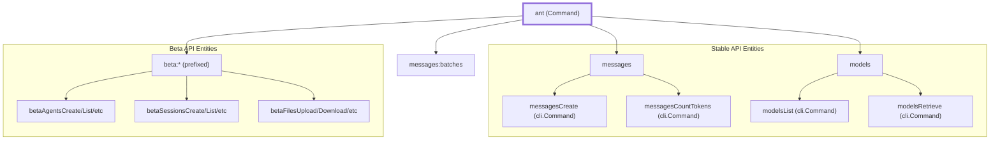
**Sources:** [pkg/cmd/cmd.go:85-272](), [pkg/cmd/message.go:18](), [pkg/cmd/model.go:18-38]()

---

### Stable API Commands

The stable commands represent the core, production-ready features of the Anthropic API. These include primary interaction methods with Claude and administrative resource lookups.

| Resource Group | Primary Commands | Implementation File |
| :--- | :--- | :--- |
| `messages` | `create`, `count-tokens` | `pkg/cmd/message.go` |
| `messages:batches` | `create`, `retrieve`, `list`, `cancel`, `results` | `pkg/cmd/messagebatch.go` |
| `models` | `list`, `retrieve` | `pkg/cmd/model.go` |
| `completions` | `create` (Legacy) | `pkg/cmd/completion.go` |

These commands use standard `requestflag.Flag` definitions to map CLI inputs directly to API request bodies, query parameters, or headers [pkg/cmd/message.go:23-33]().

For detailed documentation on flags, streaming, and token counting, see **[Stable API Commands](#2.1)**.

---

### Beta API Commands

Beta commands provide access to upcoming features and specialized resources. These commands are prefixed with `beta:` and often require specific `anthropic-beta` headers, which the CLI handles via the `--beta` flag [pkg/cmd/betamessagebatch.go:29-33]().

**Beta Resource Mapping**
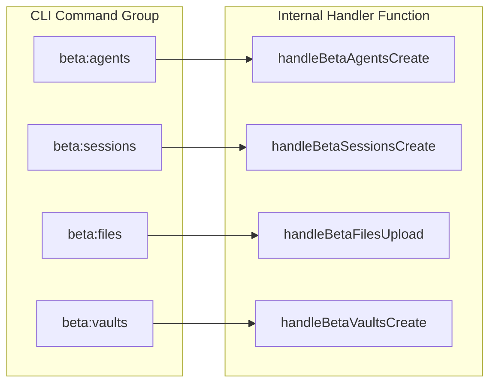
**Sources:** [pkg/cmd/cmd.go:157-261](), [pkg/cmd/betamessagebatch.go:171]()

The Beta suite includes advanced capabilities such as:
*   **Agents & Skills:** CRUD operations for agentic workflows [pkg/cmd/cmd.go:157-175]().
*   **Sessions & Events:** Real-time interaction management [pkg/cmd/cmd.go:190-211]().
*   **Files & Vaults:** Management of documents and credentials for model context [pkg/cmd/cmd.go:225-261]().

For detailed documentation on beta headers and specific resource flags, see **[Beta API Commands](#2.2)**.

---

### Execution Pipeline

When a command is executed, it follows a standard lifecycle:
1.  **Initialization:** The `main` function calls `app.Run` [cmd/ant/main.go:33]().
2.  **Flag Processing:** `flagOptions` parses the context and handles file embedding (e.g., `@file.json`) [pkg/cmd/betamessagebatch.go:181-187]().
3.  **API Call:** The command handler invokes the relevant method from the `anthropic-sdk-go` [pkg/cmd/messagebatch.go:164]().
4.  **Output:** The response is passed to `ShowJSON` or `ShowJSONIterator` for rendering based on the global `--format` flag [pkg/cmd/messagebatch.go:172]().

**Sources:** [cmd/ant/main.go:19-60](), [pkg/cmd/messagebatch.go:141-173](), [pkg/cmd/cmd.go:21-84]()

---

# Page: Stable API Commands

# Stable API Commands

<details>
<summary>Relevant source files</summary>

The following files were used as context for generating this wiki page:

- [pkg/cmd/betamessage.go](pkg/cmd/betamessage.go)
- [pkg/cmd/betamessagebatch.go](pkg/cmd/betamessagebatch.go)
- [pkg/cmd/betamodel.go](pkg/cmd/betamodel.go)
- [pkg/cmd/betamodel_test.go](pkg/cmd/betamodel_test.go)
- [pkg/cmd/completion.go](pkg/cmd/completion.go)
- [pkg/cmd/completion_test.go](pkg/cmd/completion_test.go)
- [pkg/cmd/message.go](pkg/cmd/message.go)
- [pkg/cmd/message_test.go](pkg/cmd/message_test.go)
- [pkg/cmd/messagebatch.go](pkg/cmd/messagebatch.go)
- [pkg/cmd/messagebatch_test.go](pkg/cmd/messagebatch_test.go)
- [pkg/cmd/model.go](pkg/cmd/model.go)
- [pkg/cmd/model_test.go](pkg/cmd/model_test.go)

</details>


This page documents the stable (non-beta) resource commands in the Anthropic CLI. These commands interface with the core Anthropic API for generating messages, counting tokens, managing batches, and retrieving model information.

## Overview of Command Structure

Stable commands are implemented using the `urfave/cli` framework and are typically enhanced with `requestflag.WithInnerFlags` to support dotted flag syntax (e.g., `--message.role`). Every command follows a standard execution pipeline:
1. **Flag Parsing**: `requestflag.Flag[T]` types map CLI inputs to API request paths (`BodyPath`, `QueryPath`, or `HeaderPath`).
2. **Action Handler**: A `handle...` function (e.g., `handleMessagesCreate`) initializes the SDK client.
3. **SDK Call**: The command invokes the corresponding method in the `anthropic-sdk-go` library.
4. **Rendering**: Results are passed to `ShowJSON` or `ShowJSONIterator` for output formatting and display.

### Data Flow: CLI to API
The following diagram illustrates how a command like `messages create` moves from a CLI invocation to an SDK call.

**CLI Request Pipeline**
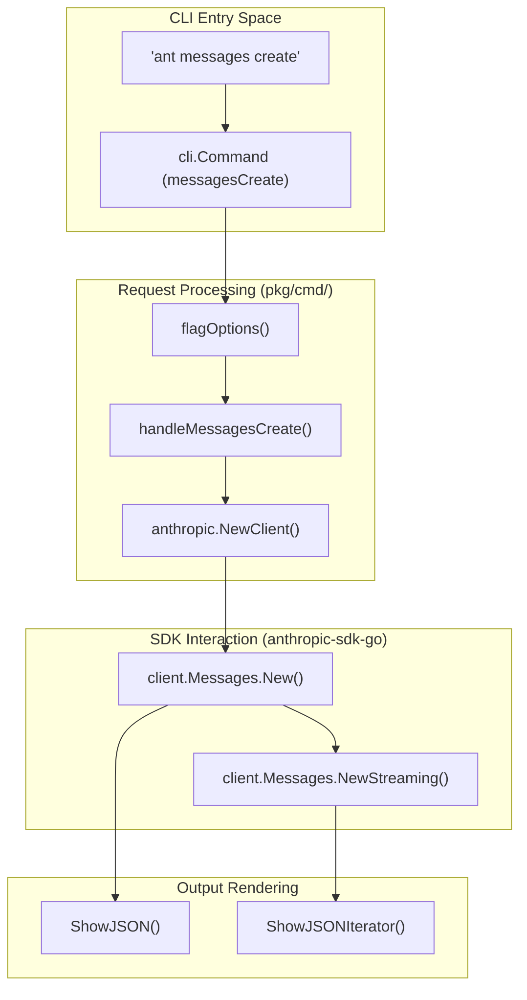
Sources: [pkg/cmd/message.go:18-133](), [pkg/cmd/message.go:135-177]()

---

## Messages API

The `messages` group provides tools for interacting with Claude via structured conversational turns.

### `messages create`
Sends a list of input messages to the model to generate a response.

*   **Required Flags**:
    *   `--model`: The model identifier (e.g., `claude-3-5-sonnet-20241022`) [pkg/cmd/message.go:35-40]().
    *   `--max-tokens`: Maximum tokens to generate [pkg/cmd/message.go:23-28]().
    *   `--message`: A JSON/YAML array of message objects with `role` and `content` [pkg/cmd/message.go:29-34]().
*   **Streaming**: Enabled via `--stream`. When true, the CLI uses `client.Messages.NewStreaming` and renders the output via `ShowJSONIterator` [pkg/cmd/message.go:159-165]().
*   **Dotted Flags**: Supports `--message.role` and `--message.content` for granular control [pkg/cmd/message_test.go:51-52]().

### `messages count-tokens`
Calculates the number of tokens in a set of messages without generating a completion.

*   **Required Flags**: `--model`, `--message` [pkg/cmd/message.go:234-245]().
*   **Implementation**: Calls `client.Messages.CountTokens(ctx, params, options...)` [pkg/cmd/message.go:275]().

Sources: [pkg/cmd/message.go:18-100](), [pkg/cmd/message.go:230-285](), [pkg/cmd/message_test.go:12-72]()

---

## Message Batches API

The `messages:batches` group allows for asynchronous processing of large volumes of message requests.

| Command | Action | Implementation Function |
| :--- | :--- | :--- |
| `create` | Start a new batch | `handleMessagesBatchesCreate` |
| `retrieve` | Check batch status | `handleMessagesBatchesRetrieve` |
| `list` | List all batches | `handleMessagesBatchesList` |
| `cancel` | Stop a batch | `handleMessagesBatchesCancel` |
| `delete` | Remove a batch | `handleMessagesBatchesDelete` |
| `results` | Download `.jsonl` results | `handleMessagesBatchesResults` |

### Batch Creation Workflow
The `create` command requires a `--request` flag, which takes a list of message creation parameters. It utilizes `InnerFlag` definitions to allow setting `request.custom-id` and `request.params` individually [pkg/cmd/messagebatch.go:33-44]().

**Batch Command Entity Mapping**
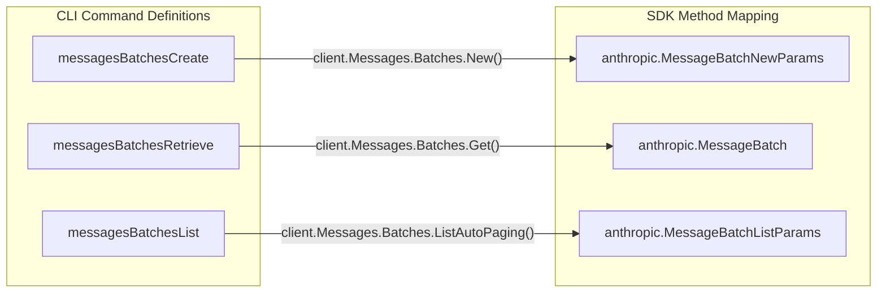
Sources: [pkg/cmd/messagebatch.go:18-139](), [pkg/cmd/messagebatch.go:141-173]()

---

## Models API

The `models` group provides information about the available Anthropic models.

### `models list`
Lists all available models. By default, it uses auto-paging to fetch all results unless `--max-items` or `--limit` is specified [pkg/cmd/model.go:148-156]().

### `models retrieve`
Retrieves detailed information about a specific model using its ID.
*   **Required Flag**: `--model-id` [pkg/cmd/model.go:23-27]().
*   **Positional Argument**: The CLI also accepts the model ID as a positional argument if the flag is omitted [pkg/cmd/model.go:76-79]().

Sources: [pkg/cmd/model.go:18-71](), [pkg/cmd/model.go:115-158]()

---

## Completions API (Legacy)

The `completions create` command provides access to the legacy Text Completions API.

*   **Required Flags**:
    *   `--prompt`: Must be formatted with `\n\nHuman:` and `\n\nAssistant:` [pkg/cmd/completion.go:35-40]().
    *   `--model`: The model identifier [pkg/cmd/completion.go:29-34]().
    *   `--max-tokens-to-sample`: Maximum tokens to generate [pkg/cmd/completion.go:23-28]().
*   **Behavior**: Similar to the Messages API, it supports both standard and streaming (`--stream`) output [pkg/cmd/completion.go:115-132]().

Sources: [pkg/cmd/completion.go:18-90](), [pkg/cmd/completion.go:92-133]()

---

## Global Behavior and Flags

### Input Methods
All stable commands support three methods of data input via the `flagOptions` pipeline:
1.  **Command Line Flags**: Standard `--flag value`.
2.  **Piping (Stdin)**: Commands like `messages create` can ingest YAML or JSON directly from stdin [pkg/cmd/message_test.go:74-160]().
3.  **File Embedding**: Flags can use the `@path/to/file` syntax to load content from local files.

### Output Control
The CLI provides several global flags (defined in the root command but consumed here) that affect how these commands render:
*   `--format`: Supports `json`, `jsonl`, `pretty`, `table`, and `raw`.
*   `--transform`: Accepts a GJSON path to filter or reshape the response before display.

Sources: [pkg/cmd/message.go:132-133](), [pkg/cmd/messagebatch.go:171-172](), [pkg/cmd/model.go:110-112]()

---

# Page: Beta API Commands

# Beta API Commands

<details>
<summary>Relevant source files</summary>

The following files were used as context for generating this wiki page:

- [pkg/cmd/betaagent.go](pkg/cmd/betaagent.go)
- [pkg/cmd/betaagent_test.go](pkg/cmd/betaagent_test.go)
- [pkg/cmd/betaagentversion.go](pkg/cmd/betaagentversion.go)
- [pkg/cmd/betaagentversion_test.go](pkg/cmd/betaagentversion_test.go)
- [pkg/cmd/betaenvironment.go](pkg/cmd/betaenvironment.go)
- [pkg/cmd/betaenvironment_test.go](pkg/cmd/betaenvironment_test.go)
- [pkg/cmd/betafile.go](pkg/cmd/betafile.go)
- [pkg/cmd/betafile_test.go](pkg/cmd/betafile_test.go)
- [pkg/cmd/betamessage_test.go](pkg/cmd/betamessage_test.go)
- [pkg/cmd/betamessagebatch_test.go](pkg/cmd/betamessagebatch_test.go)
- [pkg/cmd/betasession.go](pkg/cmd/betasession.go)
- [pkg/cmd/betasession_test.go](pkg/cmd/betasession_test.go)
- [pkg/cmd/betasessionevent.go](pkg/cmd/betasessionevent.go)
- [pkg/cmd/betasessionevent_test.go](pkg/cmd/betasessionevent_test.go)
- [pkg/cmd/betasessionresource.go](pkg/cmd/betasessionresource.go)
- [pkg/cmd/betasessionresource_test.go](pkg/cmd/betasessionresource_test.go)
- [pkg/cmd/betaskill.go](pkg/cmd/betaskill.go)
- [pkg/cmd/betaskill_test.go](pkg/cmd/betaskill_test.go)
- [pkg/cmd/betaskillversion.go](pkg/cmd/betaskillversion.go)
- [pkg/cmd/betaskillversion_test.go](pkg/cmd/betaskillversion_test.go)
- [pkg/cmd/betavault.go](pkg/cmd/betavault.go)
- [pkg/cmd/betavault_test.go](pkg/cmd/betavault_test.go)
- [pkg/cmd/betavaultcredential.go](pkg/cmd/betavaultcredential.go)
- [pkg/cmd/betavaultcredential_test.go](pkg/cmd/betavaultcredential_test.go)

</details>


The Anthropic CLI (`ant`) provides comprehensive support for Beta API features through the `beta:*` command namespace. These commands allow developers to interact with experimental resources such as Agents, Sessions, Skills, and Files.

All beta commands require the `anthropic-beta` header, which is managed via the `--beta` flag.

## The Beta Header Flag

Every beta command includes a `--beta` flag. This flag maps directly to the `anthropic-beta` HTTP header required by the Anthropic API to opt-in to specific beta features.

| Flag | Header Path | Data Type | Description |
| :--- | :--- | :--- | :--- |
| `--beta` | `anthropic-beta` | `[]string` | Specifies the beta version(s) to use for the request. |

**Sources:** [pkg/cmd/betamessage_test.go:41-41](), [pkg/cmd/betafile.go:44-48]()

---

## Core Beta Resources

### Messages and Batches
The `beta:messages` and `beta:messages:batches` commands provide access to experimental message creation and bulk processing.

*   **`beta:messages create`**: Creates a message using beta features like `thinking` (adaptive/summarized), `context-management`, and `mcp-server` configurations [pkg/cmd/betamessage_test.go:12-42]().
*   **`beta:messages:batches`**: Supports `create`, `retrieve`, `list`, `delete`, `cancel`, and `results` for asynchronous bulk processing [pkg/cmd/betamessagebatch_test.go:12-21]().

### Agents and Versions
The Agents API allows for the creation and management of autonomous entities. The CLI implements full CRUD operations, archiving, and versioning.

*   **Commands**: `create`, `retrieve`, `update`, `list`, `archive`.
*   **Agent Versions**: Managed via `beta:agents:versions` (e.g., `list`, `retrieve`).
*   **Inner Flags**: The `create` and `update` commands use `requestflag.WithInnerFlags` to allow dotted notation for complex objects like `--mcp-server.url` [pkg/cmd/betaagent.go:18-91]().

**Sources:** [pkg/cmd/betaagent.go:18-115](), [pkg/cmd/betaagent_test.go:12-28]()

### Sessions and Environments
Sessions represent active instances of Agents running within specific container configurations (Environments).

*   **`beta:sessions`**: CRUD operations plus `archive`. Sessions can mount `resources` (files/repos) and use `vault-id` for credentials [pkg/cmd/betasession.go:18-63]().
*   **`beta:sessions:events`**: Retrieve the event log for a specific session.
*   **`beta:sessions:resources`**: List or retrieve resources mounted in a session.
*   **`beta:environments`**: Define the container configuration (image, compute, etc.) used by sessions.

**Sources:** [pkg/cmd/betasession.go:18-63](), [pkg/cmd/betasession_test.go:11-48]()

### Skills and Versions
Skills are reusable toolsets or capabilities that can be attached to Agents.

*   **`beta:skills`**: `create`, `retrieve`, `list`, `delete`.
*   **`beta:skills:versions`**: CRUD for specific skill versions.
*   **Multipart Uploads**: Creating skills involves uploading files (including a required `SKILL.md`). The CLI uses `MultipartFormEncoded` for these requests [pkg/cmd/betaskill.go:129-135]().

**Sources:** [pkg/cmd/betaskill.go:18-42](), [pkg/cmd/betaskillversion.go:18-42]()

### Files and Vaults
*   **`beta:files`**: Supports `upload`, `download`, `list`, `delete`, and `retrieve-metadata`. Uploads use the `FileInput` flag property to stream data from the local filesystem [pkg/cmd/betafile.go:123-143]().
*   **`beta:vaults`**: Manage secure storage for credentials.
*   **`beta:vaults:credentials`**: CRUD for credentials stored within a vault.

---

## Data Flow and Implementation

The following diagram illustrates how a Beta command (e.g., `beta:files upload`) flows from the CLI through the SDK to the API.

### Command Execution Pipeline
"This diagram maps the CLI command structure to the underlying SDK calls and the data transformation layers."

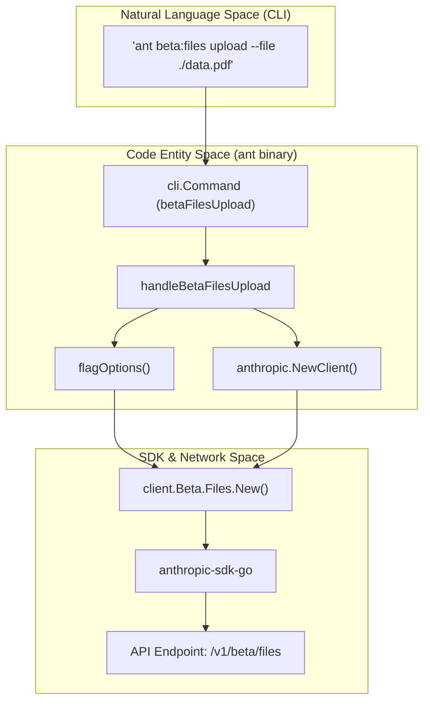
**Sources:** [pkg/cmd/betafile.go:123-143](), [pkg/cmd/betafile.go:145-161]()

### Parameter Mapping and Serialization
"This diagram shows how complex nested flags are associated with SDK parameter structures."

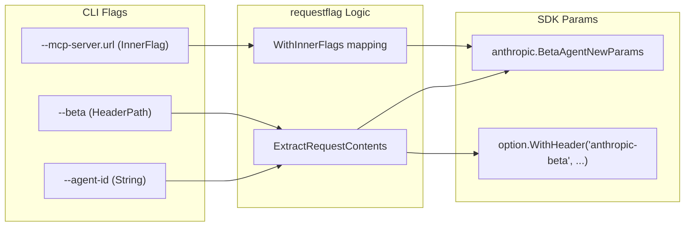
**Sources:** [pkg/cmd/betaagent.go:18-91](), [internal/requestflag/requestflag.go:1-100]()

---

## Technical Details

### Flag Handling
Beta commands utilize the `internal/requestflag` package to route values to the correct part of the HTTP request:
*   **`BodyPath`**: Fields serialized into the JSON or Multipart request body (e.g., `model`, `name`).
*   **`QueryPath`**: Fields appended to the URL as query parameters (e.g., `limit`, `after_id`).
*   **`HeaderPath`**: Fields added to HTTP headers (specifically `anthropic-beta`).

**Sources:** [pkg/cmd/betafile.go:23-48](), [pkg/cmd/betaagent.go:23-68]()

### Paging and Output
List commands (e.g., `beta:files list`) use `client.Beta.Files.ListAutoPaging` to handle multi-page results. The CLI provides a `--max-items` flag to control how many total records are fetched before stopping iteration [pkg/cmd/betafile.go:178-187]().

Output is rendered via `ShowJSON` or `ShowJSONIterator`, supporting formats like `json`, `table` (via the TUI explorer), and `raw` [pkg/cmd/betafile.go:186-187]().

### File Uploads
Commands like `beta:files upload` and `beta:skills create` set `FileInput: true` on their flags. This triggers the `flagOptions` pipeline to read the specified path and prepare it for `MultipartFormEncoded` transmission [pkg/cmd/betafile.go:133-133](), [pkg/cmd/betaskill.go:133-133]().

**Sources:** [pkg/cmd/betafile.go:145-188](), [pkg/cmd/betaskill.go:119-151]()

---

# Page: Core Architecture

# Core Architecture

<details>
<summary>Relevant source files</summary>

The following files were used as context for generating this wiki page:

- [cmd/ant/main.go](cmd/ant/main.go)
- [pkg/cmd/cmd.go](pkg/cmd/cmd.go)
- [pkg/cmd/cmdutil.go](pkg/cmd/cmdutil.go)
- [pkg/cmd/flagoptions.go](pkg/cmd/flagoptions.go)
- [pkg/cmd/flagoptions_test.go](pkg/cmd/flagoptions_test.go)

</details>


This page explains the high-level design and execution flow of the Anthropic CLI (`ant`). The CLI is built using the `urfave/cli/v3` framework and acts as a specialized wrapper around the Anthropic Go SDK, adding advanced flag parsing, file embedding, and interactive output capabilities.

## High-Level Execution Flow

The CLI operates as a pipeline that transforms command-line arguments into structured API requests, executes those requests via the SDK, and then pipes the response through a rendering engine.

### Request Pipeline: Flags to API Call

The request pipeline is responsible for gathering input from multiple sources (CLI flags, environment variables, and local files) and constructing a valid SDK request object.

1.  **Command Discovery**: `urfave/cli` traverses the command tree defined in `pkg/cmd/cmd.go` [pkg/cmd/cmd.go:85-272]() to identify the target action.
2.  **Flag Extraction**: The `internal/requestflag` system extracts values from the `cli.Context`. It handles both simple flags and complex "dotted" flags (e.g., `--messages.role`) [internal/requestflag/requestflag.go]().
3.  **Stdin & File Embedding**: If a flag value starts with `@`, or if data is piped via `stdin`, the `flagOptions` pipeline in `pkg/cmd/flagoptions.go` [pkg/cmd/flagoptions.go:79-89]() reads the content from the local filesystem or the pipe.
4.  **SDK Invocation**: The extracted and embedded data is passed to the Anthropic Go SDK. Global options like `api-key` and `base-url` are applied via `getDefaultRequestOptions` [pkg/cmd/cmdutil.go:41-62]().

### Output Pipeline: API Response to User

Once the API returns data, the output pipeline determines how to display it based on the `--format` flag and the environment (TTY vs. Pipe).

1.  **Format Selection**: The CLI supports multiple formats: `json`, `jsonl`, `pretty`, `yaml`, `raw`, and `explore` [pkg/cmd/cmdutil.go:30]().
2.  **Transformation**: If the `--transform` flag is provided, the response is filtered using GJSON syntax [pkg/cmd/cmdutil.go:71]().
3.  **Rendering**:
    *   **Static**: `ShowJSON` renders formatted text to the terminal [pkg/cmd/cmdutil.go:235]().
    *   **Interactive**: The `explore` format launches a `bubbletea`-based TUI [internal/jsonview/jsonview.go]().
    *   **Binary**: Files (like PDF/Image exports) are saved to disk or written to stdout based on `Content-Disposition` [pkg/cmd/cmdutil.go:202-221]().

## System Component Mapping

The following diagram maps high-level CLI concepts to their specific implementations in the codebase.

### Request Transformation Flow
Title: Request Flag and File Embedding Architecture
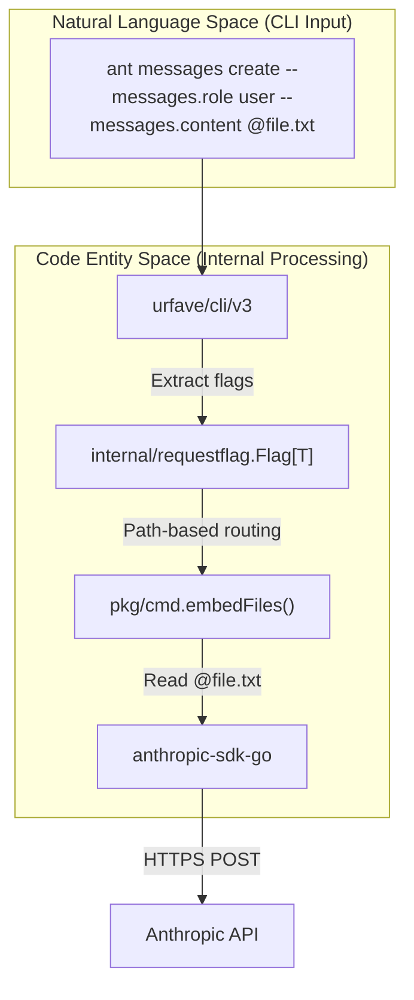
Sources: [pkg/cmd/cmd.go:27-84](), [internal/requestflag/requestflag.go:1-50](), [pkg/cmd/flagoptions.go:79-89]()

### Output Rendering Flow
Title: Response Processing and Rendering Pipeline
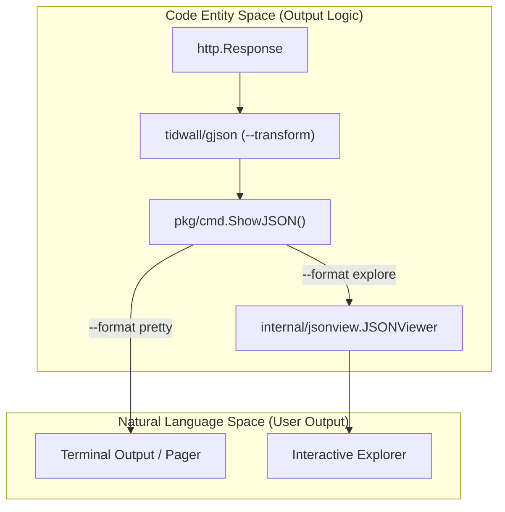
Sources: [pkg/cmd/cmdutil.go:235-250](), [cmd/ant/main.go:41-50](), [internal/jsonview/jsonview.go:1-30]()

## Subsystem Overviews

### 1. Request Flag System
The CLI uses a custom generic flag system to handle the complex nesting required by the Anthropic API. It maps CLI flags directly to JSON body paths, query parameters, or headers.
*   **Key Concept**: `requestflag.Flag[T]` allows defining where a value should be "routed" in the final API request.
*   **For details, see [Request Flag System](#3.1).**

### 2. Flag Options and File Embedding
This system handles the "heavy lifting" of data ingestion. It supports reading from `stdin`, sniffing for UTF-8 vs. binary content, and recursively traversing data structures to replace file paths with their actual contents.
*   **Key Concept**: The `@` prefix syntax and `onceStdinReader` to prevent multiple reads of the same stream.
*   **For details, see [Flag Options and File Embedding](#3.2).**

### 3. Output Rendering and Paging
The CLI automatically detects if it is running in a terminal. It provides smart defaults, such as colorized output and automatic activation of a pager (like `less`) for long responses.
*   **Key Concept**: `ShowJSON` and `streamOutputOSSpecific` handle the differences between Unix and Windows terminal streams.
*   **For details, see [Output Rendering and Paging](#3.3).**

### 4. Interactive JSON Explorer (TUI)
When the `--format explore` flag is used, the CLI enters a Terminal User Interface (TUI) mode. This allows users to navigate large JSON responses, expand/collapse nodes, and view raw content.
*   **Key Concept**: A `bubbletea` application that uses a navigation stack of `TableView` and `TextView`.
*   **For details, see [Interactive JSON Explorer (TUI)](#3.4).**

## Core Utilities
The CLI relies on several shared utilities for consistent behavior:
*   **Validation**: `ValidateBaseURL` ensures API overrides are well-formed [pkg/cmd/cmdutil.go:34-39]().
*   **Middleware**: `debugMiddlewareOption` provides `httputil.DumpRequest` logging when `--debug` is enabled [pkg/cmd/cmdutil.go:64-83]().
*   **Binary Handling**: `writeBinaryResponse` manages file downloads and content-type sniffing [pkg/cmd/cmdutil.go:202]().

Sources: [pkg/cmd/cmd.go](), [pkg/cmd/cmdutil.go](), [pkg/cmd/flagoptions.go](), [cmd/ant/main.go]()

---

# Page: Request Flag System

# Request Flag System

<details>
<summary>Relevant source files</summary>

The following files were used as context for generating this wiki page:

- [internal/requestflag/innerflag.go](internal/requestflag/innerflag.go)
- [internal/requestflag/innerflag_test.go](internal/requestflag/innerflag_test.go)
- [internal/requestflag/requestflag.go](internal/requestflag/requestflag.go)
- [internal/requestflag/requestflag_test.go](internal/requestflag/requestflag_test.go)

</details>


The Request Flag System, located in `internal/requestflag`, provides a generic, type-safe framework for mapping CLI flags directly to HTTP request components (Body, Query, and Headers). It extends the `urfave/cli` library to handle complex API requirements such as nested object fields via dotted flags (e.g., `--message.role`) and specialized data types like ISO-8601 dates and times.

## Core Components

### The Generic `Flag[T]` Type
The `Flag[T]` struct is the primary building block for command-line arguments in the Anthropic CLI. It supports a wide range of types including primitives, maps, and custom time types [internal/requestflag/requestflag.go:18-22]().

Beyond standard CLI metadata (Name, Usage, Aliases), `Flag[T]` includes routing fields that determine where the value is placed in the outgoing API request:
*   `QueryPath`: Maps the flag to a URL query parameter [internal/requestflag/requestflag.go:35]().
*   `HeaderPath`: Maps the flag to an HTTP header [internal/requestflag/requestflag.go:36]().
*   `BodyPath`: Maps the flag to a key in the JSON request body [internal/requestflag/requestflag.go:37]().
*   `BodyRoot`: If true, the flag's value constitutes the entire request body rather than a single field [internal/requestflag/requestflag.go:38]().

### Specialized Types
The system includes custom types to ensure CLI inputs match API expectations:
*   `DateValue`: Parses various date formats (ISO, US, British) into `YYYY-MM-DD` [internal/requestflag/requestflag_test.go:13-74]().
*   `DateTimeValue`: Handles RFC3339 and other timestamp formats [internal/requestflag/requestflag_test.go:76-144]().
*   `TimeValue`: Manages clock times (e.g., `14:30:45`) [internal/requestflag/requestflag_test.go:146-207]().

**Sources:** [internal/requestflag/requestflag.go:18-56](), [internal/requestflag/requestflag_test.go:13-207]()

## Nested Flags with `InnerFlag[T]`

The CLI supports setting fields within a parent map flag using a dotted notation (e.g., `--metadata.user_id`). This is implemented via `InnerFlag[T]`.

*   **`InnerFlag[T]`**: Represents a sub-field. It holds a reference to an `OuterFlag` and the specific `InnerField` name it targets [internal/requestflag/innerflag.go:14-27]().
*   **`WithInnerFlags`**: A wiring function that injects these sub-flags into a `cli.Command`. It iterates through existing flags and appends associated `InnerFlag` instances, ensuring the `OuterFlag` reference is correctly linked [internal/requestflag/innerflag.go:182-227]().
*   **Data Flow**: When an `InnerFlag` is set via the CLI, it calls `SetInnerField` on the `OuterFlag` (which must implement the `SettableInnerField` interface), updating the underlying map [internal/requestflag/innerflag.go:54-71]().

### Flag Interaction Diagram
This diagram illustrates how a dotted CLI flag maps to the internal `InnerFlag` and `OuterFlag` entities.

"Natural Language / CLI Space" to "Code Entity Space"
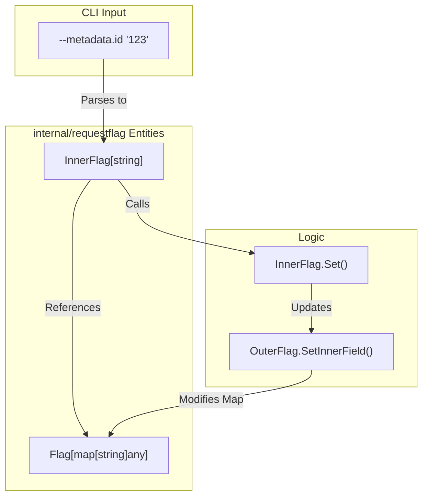
**Sources:** [internal/requestflag/innerflag.go:14-27](), [internal/requestflag/innerflag.go:54-71](), [internal/requestflag/innerflag.go:182-227]()

## Request Extraction and Routing

The transition from parsed flags to an HTTP request structure is handled by `ExtractRequestContents`.

### `ExtractRequestContents`
This function iterates through all flags in a command. If a flag implements the `InRequest` interface (providing a path), its value is placed into the `RequestContents` struct [internal/requestflag/requestflag.go:98-105]().

1.  **Queries**: Populated if `GetQueryPath()` returns a string [internal/requestflag/requestflag.go:113-115]().
2.  **Headers**: Populated if `GetHeaderPath()` returns a string [internal/requestflag/requestflag.go:116-118]().
3.  **Body**: 
    *   If `IsBodyRoot()` is true, the value becomes the entire `Body` [internal/requestflag/requestflag.go:119-121]().
    *   Otherwise, if `GetBodyPath()` is set, the value is added to a `bodyMap` [internal/requestflag/requestflag.go:122-123]().

### `GetMissingRequiredFlags`
This utility checks for missing mandatory parameters. It is "stdin-aware," meaning it won't flag a missing required body parameter if the body is being provided via standard input (e.g., via a pipe) [internal/requestflag/requestflag.go:129-161]().

### Routing Logic Flow
"Natural Language / CLI Space" to "Code Entity Space"
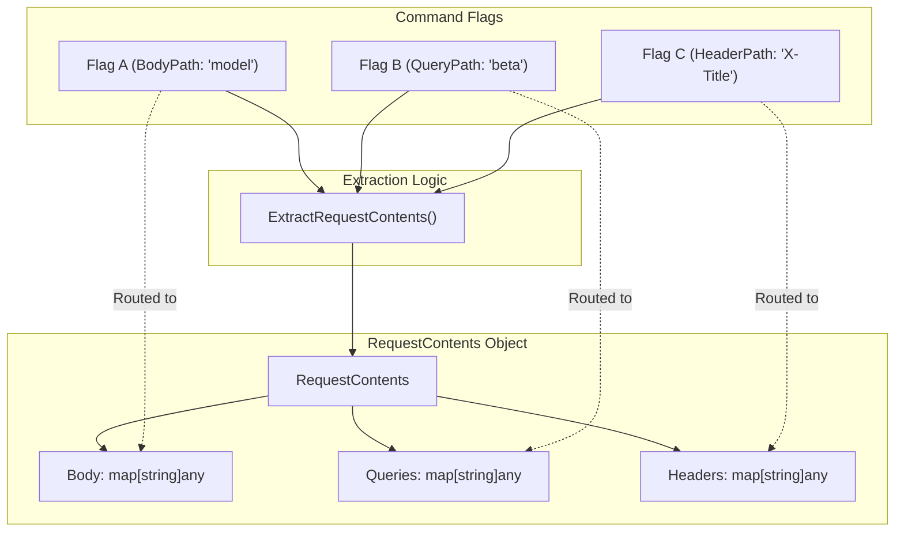

**Sources:** [internal/requestflag/requestflag.go:91-127](), [internal/requestflag/requestflag.go:129-161]()

## Implementation Details

### Generic Value Handling
The system uses an internal `cliValue[T]` wrapper to bridge the generic `Flag[T]` with the `urfave/cli.Value` interface [internal/requestflag/requestflag.go:55](). It handles:
*   **Parsing**: Uses `parseCLIArg[T]` which leverages YAML unmarshaling for complex types (maps/slices) and standard `strconv` for primitives [internal/requestflag/requestflag.go:15848-15860]().
*   **Validation**: Executes a custom `Validator` function if provided during flag definition [internal/requestflag/requestflag.go:228-232]().
*   **Slice Resetting**: When a slice flag is set for the first time, it clears the default values to prevent appending CLI arguments to the defaults [internal/requestflag/requestflag.go:213-220]().

### Interface Compliance
The system strictly implements `urfave/cli` interfaces to ensure compatibility with the command-tree runner:
| Interface | Purpose |
| :--- | :--- |
| `cli.Flag` | Base flag interface [internal/requestflag/requestflag.go:164]() |
| `cli.CategorizableFlag` | Allows grouping flags in help output [internal/requestflag/requestflag.go:59]() |
| `cli.DocGenerationFlag` | Provides metadata for help/man page generation [internal/requestflag/innerflag.go:91]() |
| `InRequest` | Custom interface for HTTP routing [internal/requestflag/requestflag.go:62-68]() |

**Sources:** [internal/requestflag/requestflag.go:55-68](), [internal/requestflag/requestflag.go:164-233](), [internal/requestflag/innerflag.go:91]()

---

# Page: Flag Options and File Embedding

# Flag Options and File Embedding

<details>
<summary>Relevant source files</summary>

The following files were used as context for generating this wiki page:

- [internal/apiform/encoder.go](internal/apiform/encoder.go)
- [internal/apiform/form.go](internal/apiform/form.go)
- [internal/apiform/form_test.go](internal/apiform/form_test.go)
- [internal/apiquery/encoder.go](internal/apiquery/encoder.go)
- [internal/apiquery/query.go](internal/apiquery/query.go)
- [internal/apiquery/query_test.go](internal/apiquery/query_test.go)
- [pkg/cmd/flagoptions.go](pkg/cmd/flagoptions.go)
- [pkg/cmd/flagoptions_test.go](pkg/cmd/flagoptions_test.go)

</details>


The `ant` CLI provides a sophisticated flag processing pipeline that extends standard command-line arguments with capabilities for file embedding, stdin merging, and content-type sniffing. This logic is primarily encapsulated in `pkg/cmd/flagoptions.go` and is responsible for transforming raw CLI input into structured data suitable for the Anthropic API.

## The Flag Options Pipeline

The `flagOptions` function serves as the central orchestration point for preparing a request's data. It follows a multi-stage pipeline to ensure that flags, positional arguments, and piped input (stdin) are correctly merged and validated.

### Data Flow Overview

1.  **Extraction**: Extracting raw values from the `urfave/cli` context using `requestflag.ExtractRequestContents` [[pkg/cmd/flagoptions.go:348-350]]().
2.  **Stdin Merging**: If the request body is empty and stdin is provided, the CLI attempts to parse stdin as JSON or YAML to populate the request [[pkg/cmd/flagoptions.go:362-385]]().
3.  **Validation**: Checking for missing required flags [[pkg/cmd/flagoptions.go:393-396]]().
4.  **File Embedding**: Recursively traversing the request object to replace file paths (prefixed with `@`) with actual file content [[pkg/cmd/flagoptions.go:406-408]]().
5.  **Serialization**: Converting the final object into the appropriate wire format (JSON, Multipart, or Octet-Stream) [[pkg/cmd/flagoptions.go:421-444]]().

### Pipeline Execution Diagram

This diagram maps the logical stages of the pipeline to the internal functions and types that execute them.

"Flag Options Execution Pipeline"
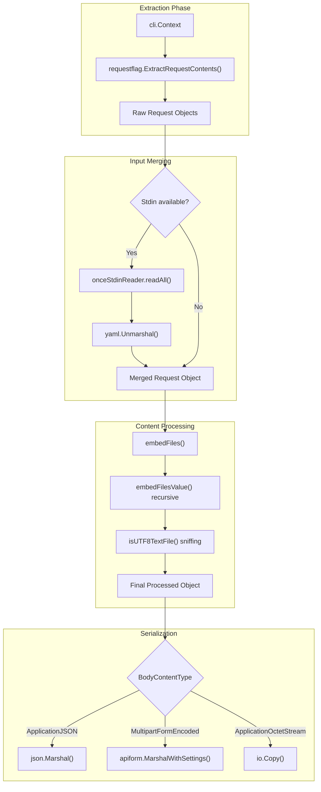
Sources: [pkg/cmd/flagoptions.go:334-450](), [pkg/cmd/flagoptions.go:79-89](), [pkg/cmd/flagoptions.go:92-231]()

---

## File Embedding and Prefix Semantics

The CLI supports embedding local file content into any string flag using specific prefixes. This is handled by `embedFilesValue`, which uses reflection to traverse maps, slices, and structs [[pkg/cmd/flagoptions.go:92-135]]().

### Prefix Behavior Matrix

| Prefix | Behavior | Use Case |
| :--- | :--- | :--- |
| `@` | Sniffs content. If UTF-8, embeds as string. If binary, encodes as Base64 [[pkg/cmd/flagoptions.go:197-231]](). | General purpose file embedding. |
| `@file://` | Always embeds as a raw string literal, regardless of content [[pkg/cmd/flagoptions.go:181-196]](). | Forcing text mode for files with unusual characters. |
| `@data://` | Always encodes the file content as a Base64 string [[pkg/cmd/flagoptions.go:166-180]](). | Explicitly sending binary data to text fields. |
| `\@` | Escapes the `@` symbol; the literal string (minus `\`) is sent [[pkg/cmd/flagoptions.go:160-163]](). | Sending a string that starts with `@` (e.g., a username). |

### Content Sniffing
The function `isUTF8TextFile` determines if a file should be treated as text or binary. It checks for the presence of valid UTF-8 sequences and the absence of control characters or binary headers [[pkg/cmd/flagoptions.go:264-282]]().

Sources: [pkg/cmd/flagoptions.go:159-231](), [pkg/cmd/flagoptions.go:264-282](), [pkg/cmd/flagoptions_test.go:15-36]()

---

## Stdin Management and Conflict Resolution

To prevent multiple flags from competing for the same `stdin` stream, the CLI uses a `onceStdinReader` struct.

### `onceStdinReader`
This utility ensures that `os.Stdin` is read exactly once. If a second attempt is made to read from it (e.g., two different flags both use `@-`), the CLI returns an error [[pkg/cmd/flagoptions.go:46-61]]().

*   **Stdin Paths**: The following strings are recognized as stdin: `-`, `/dev/fd/0`, and `/dev/stdin` [[pkg/cmd/flagoptions.go:71-77]]().
*   **Conflict Detection**: If `stdinReader` is `nil` in the `read()` call, it indicates the stream has already been consumed [[pkg/cmd/flagoptions.go:55-57]]().

"Stdin Conflict Resolution"
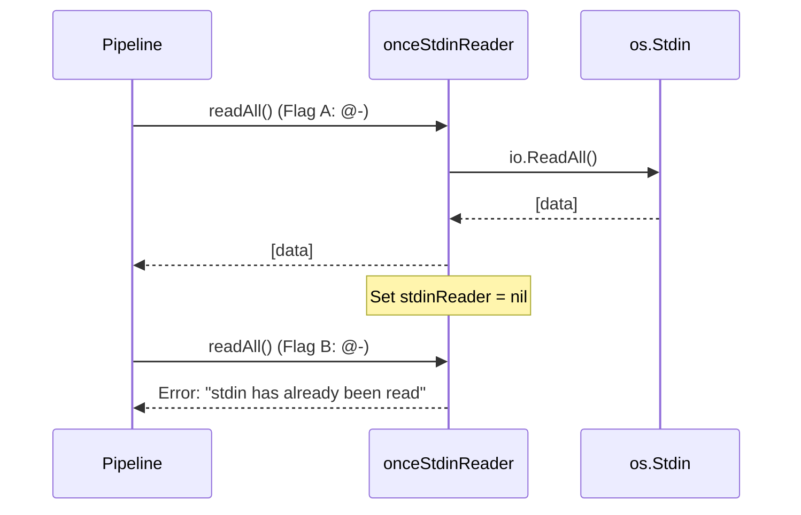
Sources: [pkg/cmd/flagoptions.go:46-70](), [pkg/cmd/flagoptions_test.go:249-285]()

---

## Serialization and Content Types

The `BodyContentType` enum defines how the final payload is formatted before being sent to the API [[pkg/cmd/flagoptions.go:27-34]]().

### Supported Content Types

1.  **ApplicationJSON**: The standard format for most Message and Model requests. Uses `json.Marshal` [[pkg/cmd/flagoptions.go:422-426]]().
2.  **MultipartFormEncoded**: Used for file uploads (e.g., `beta:files`). It utilizes the `internal/apiform` package to handle nested structures and file streams [[pkg/cmd/flagoptions.go:427-438]]().
3.  **ApplicationOctetStream**: Used for direct binary uploads where the entire body is the file content [[pkg/cmd/flagoptions.go:439-444]]().

### Internal Serialization Helpers
*   **`internal/apiform`**: Handles `multipart/form-data` encoding. It supports various array formats like `FormatRepeat` and `FormatIndicesDots` [[internal/apiform/form.go:9-20]]().
*   **`internal/apiquery`**: Handles URL query parameter encoding, supporting nested maps and slices [[internal/apiquery/query.go:34-53]]().

Sources: [pkg/cmd/flagoptions.go:27-34](), [pkg/cmd/flagoptions.go:421-444](), [internal/apiform/encoder.go:16-41](), [internal/apiquery/encoder.go:19-43]()

---

# Page: Output Rendering and Paging

# Output Rendering and Paging

<details>
<summary>Relevant source files</summary>

The following files were used as context for generating this wiki page:

- [pkg/cmd/cmdutil.go](pkg/cmd/cmdutil.go)
- [pkg/cmd/cmdutil_test.go](pkg/cmd/cmdutil_test.go)
- [pkg/cmd/cmdutil_unix.go](pkg/cmd/cmdutil_unix.go)
- [pkg/cmd/cmdutil_windows.go](pkg/cmd/cmdutil_windows.go)

</details>


The Anthropic CLI provides a robust output rendering pipeline that handles data transformation, multi-format serialization, interactive exploration, and smart paging. This system ensures that API responses are readable whether they are being piped to another process, viewed in a terminal, or saved as binary files.

### Output Format Modes

The CLI supports several output modes defined in the `OutputFormats` slice [pkg/cmd/cmdutil.go:30-30](). Users select these via the `--output` flag.

| Mode | Description | Implementation |
| :--- | :--- | :--- |
| `auto` | Default mode. Uses `pretty` for terminals and `json` for pipes. | [pkg/cmd/cmdutil.go:338-344]() |
| `pretty` | Colorized, indented JSON with syntax highlighting. | [pkg/cmd/cmdutil.go:351-352]() |
| `json` | Standard minified or formatted JSON. | [pkg/cmd/cmdutil.go:348-349]() |
| `jsonl` | JSON Lines format, useful for streaming long lists. | [pkg/cmd/cmdutil.go:354-355]() |
| `yaml` | Converts JSON response to YAML format. | [pkg/cmd/cmdutil.go:357-358]() |
| `raw` | Prints the raw value (strips quotes for strings). | [pkg/cmd/cmdutil.go:360-361]() |
| `explore` | Launches the interactive TUI JSON explorer. | [pkg/cmd/cmdutil.go:332-336]() |

**Sources:** [pkg/cmd/cmdutil.go:30-30](), [pkg/cmd/cmdutil.go:330-363]()

---

### JSON Rendering and Transformation Pipeline

The core rendering logic resides in `ShowJSON` and `ShowJSONIterator`. These functions take raw API data and pass it through a transformation and formatting pipeline.

#### GJSON Transformation
If the `--transform` flag is provided, the CLI uses the `gjson` library to query or reshape the JSON before rendering [pkg/cmd/cmdutil.go:346-346](). This allows users to extract specific fields (e.g., `ant messages create --transform "content.0.text"`) [pkg/cmd/cmdutil_test.go:156-163]().

#### Data Flow Diagram: JSON Rendering
This diagram shows the path from a raw API response to the user's display.

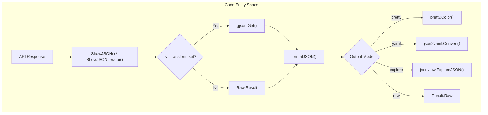
**Sources:** [pkg/cmd/cmdutil.go:321-363](), [pkg/cmd/cmdutil_test.go:153-192]()

---

### Paging and Streaming

The CLI automatically invokes a pager (defaults to `less`) when output is sent to a terminal and exceeds certain thresholds.

#### Threshold-Based Activation
For static content, the CLI uses `ShowJSON` which determines if paging is necessary based on the terminal height. For streaming list data (e.g., `models list`), `ShowJSONIterator` is used to stream results into the pager as they arrive from the API.

#### OS-Specific Stream Helpers
The implementation of `streamOutput` varies by operating system to optimize buffer handling:

1.  **Unix (`cmdutil_unix.go`)**: Uses `unix.Socketpair` with `SOCK_STREAM` [pkg/cmd/cmdutil_unix.go:66-69](). It sets small buffer sizes (`SO_SNDBUF` / `SO_RCVBUF` set to 128 bytes) [pkg/cmd/cmdutil_unix.go:81-88](). This ensures that the CLI doesn't over-fetch paginated API data if the user only views the first few lines in the pager.
2.  **Windows (`cmdutil_windows.go`)**: Falls back to `streamToPagerWithPipe` using standard `os.Pipe` as socket pairs are not available [pkg/cmd/cmdutil_windows.go:31-35]().
3.  **Fallback**: Both systems can use `streamToPagerWithPipe` which executes the command in `$PAGER` and connects its `Stdin` to a pipe [pkg/cmd/cmdutil.go:141-188]().

#### Piped Data Detection
The function `isInputPiped` handles a common issue where environments (like Cursor or CI) connect a pipe to `Stdin` even when no data is present.
- **Unix**: Uses `unix.Poll` with a 10ms timeout to check for `POLLIN` [pkg/cmd/cmdutil_unix.go:21-23]().
- **Windows**: Uses `kernel32.dll`'s `PeekNamedPipe` to check available bytes [pkg/cmd/cmdutil_windows.go:16-29]().

**Sources:** [pkg/cmd/cmdutil.go:125-139](), [pkg/cmd/cmdutil_unix.go:15-63](), [pkg/cmd/cmdutil_windows.go:16-35]()

---

### Binary Responses and Downloads

For API endpoints that return binary data (like `files retrieve`), the CLI uses `writeBinaryResponse` to handle the output [pkg/cmd/cmdutil.go:199-236]().

#### Content-Disposition Parsing
If a file is being downloaded and no specific `--outfile` is provided, the CLI:
1.  Checks the `Content-Disposition` header for a `filename` parameter [pkg/cmd/cmdutil.go:238-245]().
2.  Sanitizes the filename to prevent directory traversal (e.g., removing `../`) [pkg/cmd/cmdutil.go:253-253]().
3.  If the file already exists, it appends a numeric suffix (e.g., `image (1).png`) to ensure uniqueness [pkg/cmd/cmdutil.go:259-270]().

#### Logic Flow: Binary Output
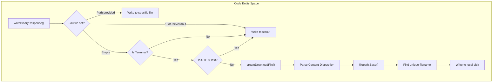
**Sources:** [pkg/cmd/cmdutil.go:199-236](), [pkg/cmd/cmdutil.go:238-274](), [pkg/cmd/cmdutil_test.go:62-112]()

---

### Key Functions Summary

| Function | File | Purpose |
| :--- | :--- | :--- |
| `ShowJSON` | `pkg/cmd/cmdutil.go` | Main entry point for rendering static JSON objects. |
| `ShowJSONIterator` | `pkg/cmd/cmdutil.go` | Renders streams of JSON objects (for list endpoints). |
| `formatJSON` | `pkg/cmd/cmdutil.go` | Applies `gjson` transforms and handles specific format logic (YAML, Raw, etc). |
| `streamOutput` | `pkg/cmd/cmdutil.go` | Orchestrates the connection between output generation and the system pager. |
| `writeBinaryResponse` | `pkg/cmd/cmdutil.go` | Handles non-JSON responses, determining whether to print or save to disk. |
| `isInputPiped` | `pkg/cmd/cmdutil.go` | Detects if data is actually being piped into the CLI across OS platforms. |

**Sources:** [pkg/cmd/cmdutil.go:89-114](), [pkg/cmd/cmdutil.go:125-139](), [pkg/cmd/cmdutil.go:199-236](), [pkg/cmd/cmdutil.go:321-363]()

---

# Page: Interactive JSON Explorer (TUI)

# Interactive JSON Explorer (TUI)

<details>
<summary>Relevant source files</summary>

The following files were used as context for generating this wiki page:

- [internal/jsonview/explorer.go](internal/jsonview/explorer.go)
- [internal/jsonview/explorer_test.go](internal/jsonview/explorer_test.go)
- [internal/jsonview/staticdisplay.go](internal/jsonview/staticdisplay.go)

</details>


The Interactive JSON Explorer is a Terminal User Interface (TUI) built using the `bubbletea` framework. It allows users to navigate complex, nested JSON structures and paginated API streams using a stack-based navigation system. It supports two primary modes: an interactive explorer and a static, colorized renderer.

## Architecture and Data Flow

The explorer is centered around the `JSONViewer` model, which manages a stack of views (`JSONView`). As a user drills down into objects or arrays, new views are pushed onto the stack; navigating back pops them.

### Code Entity Mapping: Explorer Components

The following diagram maps the logical TUI components to their respective Go structs and interfaces in `internal/jsonview`.

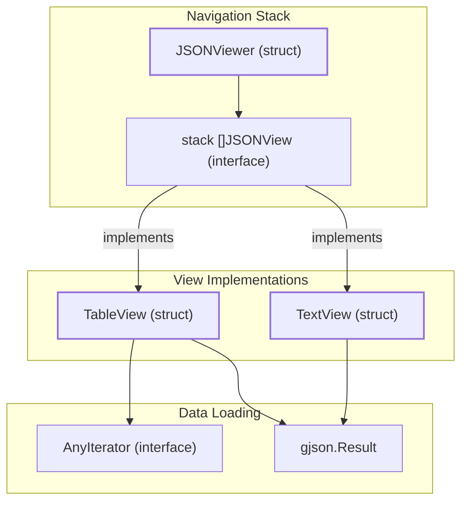

**Sources:**
- [internal/jsonview/explorer.go:104-110]() (JSONView interface)
- [internal/jsonview/explorer.go:112-122]() (TableView struct)
- [internal/jsonview/explorer.go:257-262]() (TextView struct)
- [internal/jsonview/explorer.go:420-428]() (JSONViewer struct)

## Core Entrypoints

The explorer provides two main entrypoints depending on whether the data is a static blob or a stream of items.

| Function | Purpose | Data Source |
| :--- | :--- | :--- |
| `ExploreJSON` | Opens the TUI for a single `gjson.Result`. | Static JSON |
| `ExploreJSONStream` | Opens the TUI for an iterator that yields items. | `AnyIterator` |

### Streaming Data Loading
When using `ExploreJSONStream`, the `TableView` utilizes an `AnyIterator` [internal/jsonview/explorer.go:414-418](). As the user scrolls to the bottom of the current table, the `loadMoreData` function [internal/jsonview/explorer.go:147-195]() is triggered. This function:
1. Calls `iterator.Next()` to fetch the next item.
2. Marshals the item to JSON and parses it into a `gjson.Result`.
3. Appends the new data to `tv.rowData`.
4. Updates the `table.Model` rows and triggers a column resize.

**Sources:**
- [internal/jsonview/explorer.go:132-144]() (Triggering load)
- [internal/jsonview/explorer.go:557-568]() (ExploreJSONStream definition)

## Navigation and Views

The `JSONViewer` manages the active view and handles global keybindings defined in `keyMap` [internal/jsonview/explorer.go:47-55]().

### TableView
Used for JSON Arrays and Objects.
- **Dynamic Column Widths**: The `updateColumnWidths` algorithm [internal/jsonview/explorer.go:204-255]() calculates the maximum width of content in each column. If the total exceeds available terminal width, it calculates a "fair share" and shrinks columns proportionally to fit the screen.
- **Formatting**: Values are formatted via `formatValue` [internal/jsonview/explorer.go:343-376](), which applies color coding based on type (Array: Red, Object: Blue, String: Magenta).

### TextView
Used for leaf nodes (strings, numbers, booleans).
- Wraps a `viewport.Model` [internal/jsonview/explorer.go:260]() to allow scrolling through long text content.
- Uses `wordwrap` to ensure text fits the terminal width [internal/jsonview/explorer.go:278]().

### Navigation Logic
The `navigateForward` [internal/jsonview/explorer.go:463-514]() and `navigateBack` [internal/jsonview/explorer.go:516-523]() functions manage the stack:
- **Forward**: If the selected item is a container (Array/Object), a new `TableView` is pushed. If it is a primitive, a `TextView` is pushed.
- **Back**: Pops the top element from the stack, returning the user to the previous level.

**Sources:**
- [internal/jsonview/explorer.go:65-94]() (Keybindings)
- [internal/jsonview/explorer.go:463-514]() (Navigation logic)

## Static Rendering

For non-interactive output (e.g., when the output is piped or the user prefers a static view), `staticdisplay.go` provides formatting logic.

### Implementation Flow: Static Display
The `RenderJSON` function is the primary entrypoint for static, colorized output.

```mermaid
graph LR
    Start["RenderJSON(title, json)"] --> GetSize["term.GetSize()"]
    GetSize --> Format["formatJSON(json, width)"]
    Format --> TypeCheck{"gjson.Type?"}
    
    TypeCheck -- "JSON (Array)" --> FArray["formatJSONArray"]
    TypeCheck -- "JSON (Object)" --> FObject["formatJSONObject"]
    TypeCheck -- "Primitive" --> FResult["formatResult"]
    
    FArray --> Style["Apply lipgloss styles"]
    FObject --> Style
    FResult --> Style
    Style --> Return["Styled String"]
```

### Key Formatting Functions
- `formatJSON`: The high-level dispatcher [internal/jsonview/staticdisplay.go:31-36]().
- `formatJSONArray`: Handles indexed lists with bullet styles and indentation [internal/jsonview/staticdisplay.go:71-96]().
- `formatJSONObject`: Iterates through keys using the `@keys` GJSON modifier and aligns values [internal/jsonview/staticdisplay.go:98-120]().
- `formatResult`: Applies specific colors: `numberValueStyle` (Orange), `boolValueStyle` (Pink), and `nullValueStyle` (Gray/Italic) [internal/jsonview/staticdisplay.go:38-65]().

**Sources:**
- [internal/jsonview/staticdisplay.go:18-29]() (Styles)
- [internal/jsonview/staticdisplay.go:126-135]() (RenderJSON)

## Features

### Raw Mode Toggle
Users can toggle "Raw Mode" by pressing `r` [internal/jsonview/explorer.go:86-89](). When enabled, the viewer displays the underlying JSON source instead of formatted/truncated previews. This state is passed through the `Update` and `View` methods of the active `JSONView`.

### Print and Exit
Pressing `p` [internal/jsonview/explorer.go:82-85]() triggers the `PrintValue` action. This sets a `print` flag on the `JSONViewer`, which signals the CLI to output the currently focused JSON node to `stdout` after the TUI exits.

**Sources:**
- [internal/jsonview/explorer.go:434-453]() (Update logic for Print/Raw)
- [internal/jsonview/explorer.go:525-542]() (TUI Execution loop)

---

# Page: Shell Completion and Suggestions

# Shell Completion and Suggestions

<details>
<summary>Relevant source files</summary>

The following files were used as context for generating this wiki page:

- [internal/autocomplete/autocomplete.go](internal/autocomplete/autocomplete.go)
- [internal/autocomplete/autocomplete_test.go](internal/autocomplete/autocomplete_test.go)
- [pkg/cmd/completion.go](pkg/cmd/completion.go)
- [pkg/cmd/suggest.go](pkg/cmd/suggest.go)

</details>


The Anthropic CLI provides a robust completion system to enhance the developer experience in the terminal. This system includes dynamic shell completion for commands and flags, as well as an intelligent suggestion engine for correcting typos in command names.

The completion logic is decoupled from the main command execution, utilizing a hidden `__complete` command to bridge the gap between the user's shell (Bash, Zsh, Fish, or PowerShell) and the Go-based completion engine.

### System Architecture

The completion flow begins when a user hits `TAB` in their terminal. The shell-specific script captures the current command line and invokes the `ant __complete` command. The Go engine then parses the partial input and returns a list of matching commands or flags.

#### Completion Workflow
```mermaid
graph TD
    User["User (Terminal)"] -- "TAB key" --> Shell["Shell (Bash/Zsh/Fish/Pwsh)"]
    Shell -- "Invoke Script" --> Script["Embedded Shell Script"]
    Script -- "ant __complete <args>" --> CLI["Anthropic CLI Binary"]
    CLI -- "rebuildColonSeparatedArgs" --> Engine["internal/autocomplete"]
    Engine -- "GetCompletions" --> Result["CompletionResult"]
    Result -- "Format Output" --> Shell
    Shell -- "Display" --> User
```
**Sources:** [internal/autocomplete/autocomplete.go:1-12](), [internal/autocomplete/autocomplete.go:184-212]()

### Autocomplete Engine

The core logic resides in the `internal/autocomplete` package. It is responsible for traversing the `urfave/cli/v3` command tree to find matches for the user's current input. 

Key features of the engine include:
*   **Command and Flag Discovery**: Automatically identifies visible commands and flags, including aliases [internal/autocomplete/autocomplete.go:131-182]().
*   **Colon-Separated Commands**: Special handling for commands like `messages:batches`. The engine can collapse these into groups or expand them based on whether the user has already typed a colon [internal/autocomplete/autocomplete.go:188-209]().
*   **Behavior Control**: The engine returns a `ShellCompletionBehavior` (Default, File, or NoComplete) to tell the shell whether it should proceed with standard file completion or suppress further completion [internal/autocomplete/autocomplete.go:87-93]().

For details on the logic and the `__complete` command, see [Autocomplete Engine](#4.1).

### Shell Completion Scripts

To enable completion, the CLI must "hook" into the user's shell. The CLI embeds specific scripts for Bash, Zsh, Fish, and PowerShell using Go's `embed` directive [internal/autocomplete/autocomplete.go:25-27]().

Users can generate these scripts using the `@completion` command:
*   `ant @completion zsh`
*   `ant @completion bash`

These scripts are also pre-generated during the build process via GoReleaser and bundled with system packages (like Homebrew) to provide out-of-the-box completion.

For details on the scripts and installation, see [Shell Completion Scripts](#4.2).

### Typo Suggestions

When a user enters a command that does not exist, the CLI attempts to find the closest match using the Jaro-Winkler distance algorithm [pkg/cmd/suggest.go:78-99](). This provides a "Did you mean..." message, improving the interactive experience.

#### Suggestion Logic Mapping
```mermaid
graph LR
    Input["'ant messge'"] -- "jaroWinkler()" --> Calc["Similarity Score"]
    Calc -- "Best Match" --> Match["'messages'"]
    Match -- "suggestCommand()" --> Output["'Did you mean messages?'"]

    subgraph "Code Entities"
        jaroWinkler["pkg/cmd/suggest.go:78"]
        suggestCommand["pkg/cmd/suggest.go:103"]
    end
```
**Sources:** [pkg/cmd/suggest.go:103-122](), [pkg/cmd/suggest.go:124-126]()

The suggestion feature is globally enabled by overriding the `cli.SuggestCommand` function in the `init()` block of `pkg/cmd/suggest.go` [pkg/cmd/suggest.go:124-126](). Individual commands can also opt-in or out using the `Suggest` field in the `cli.Command` struct [pkg/cmd/completion.go:21]().

**Sources:**
* [internal/autocomplete/autocomplete.go:1-212]()
* [pkg/cmd/suggest.go:1-127]()
* [pkg/cmd/completion.go:18-21]()

---

# Page: Autocomplete Engine

# Autocomplete Engine

<details>
<summary>Relevant source files</summary>

The following files were used as context for generating this wiki page:

- [internal/autocomplete/autocomplete.go](internal/autocomplete/autocomplete.go)
- [internal/autocomplete/autocomplete_test.go](internal/autocomplete/autocomplete_test.go)

</details>


The Autocomplete Engine provides the logic and infrastructure for shell completion across Bash, Zsh, Fish, and PowerShell. It allows the `ant` CLI to suggest subcommands, flags, and handle complex colon-separated command structures (e.g., `messages:batches`) while respecting shell-specific completion behaviors.

## Core Completion Logic

The engine is primarily contained within `internal/autocomplete/autocomplete.go`. It bridges the `urfave/cli/v3` command tree with shell-specific requirements.

### Key Functions

| Function | Purpose |
| :--- | :--- |
| `GetCompletions` | The primary entry point for calculating suggestions. It filters raw completions to handle colon-separated grouping [internal/autocomplete/autocomplete.go:184-212](). |
| `ExecuteShellCompletion` | Parses the `__complete` command arguments, invokes `GetCompletions`, and formats the output for the requesting shell [internal/autocomplete/autocomplete.go:315-357](). |
| `OutputCompletionScript` | Renders the embedded shell scripts used to initialize completion in a user's shell [internal/autocomplete/autocomplete.go:49-76](). |
| `rebuildColonSeparatedArgs` | A pre-processing helper that joins arguments split by shells (like Bash) back into single colon-separated strings [internal/autocomplete/autocomplete.go:275-300](). |

### Data Flow: Request to Suggestion

The following diagram illustrates how a user's tab-press in a shell travels through the CLI to return completion candidates.

**Completion Request Flow**
```mermaid
graph TD
    User["User Types 'ant mess[TAB]'"] --> Shell["Shell Script (e.g., bash_autocomplete.bash)"]
    Shell --> HiddenCmd["ant __complete bash 1 'ant' 'mess'"]
    HiddenCmd --> CmdGo["cmd/ant/main.go (App.Commands)"]
    CmdGo --> Execute["autocomplete.ExecuteShellCompletion()"]
    Execute --> Rebuild["rebuildColonSeparatedArgs()"]
    Rebuild --> GetComp["GetCompletions()"]
    GetComp --> AllComp["getAllPossibleCompletions()"]
    AllComp --> Builder["shellCompletionBuilder.createFromCommand()"]
    Builder --> Result["CompletionResult"]
    Result --> Format["Shell-specific Formatting"]
    Format --> User
```
Sources: [internal/autocomplete/autocomplete.go:184-212](), [internal/autocomplete/autocomplete.go:315-357](), [internal/autocomplete/autocomplete.go:275-300]()

## Colon-Separated Command Handling

The Anthropic CLI uses colons to group related commands (e.g., `beta:messages:batches`). Because shells often treat colons as word breakers, the engine implements specific logic to handle these cases.

### Argument Rebuilding
When a shell passes arguments to the hidden `__complete` command, it may have split `messages:batches` into `messages`, `:`, and `batches`. `rebuildColonSeparatedArgs` iterates through the slice and joins these fragments back together so the command tree can be traversed correctly [internal/autocomplete/autocomplete.go:275-300]().

### Grouping and Filtering
`GetCompletions` applies a filtering layer:
1. If the user has not yet typed a colon, it collapses all commands sharing a prefix into a single group (e.g., `messages:create` and `messages:list` appear simply as `messages`) [internal/autocomplete/autocomplete.go:188-209]().
2. Once a colon is typed, it expands to show the sub-commands [internal/autocomplete/autocomplete.go:235-248]().

**Command Space Mapping**
```mermaid
graph LR
    subgraph "Natural Language Space"
        Input["'ant messages:'"]
    end

    subgraph "Code Entity Space"
        direction TB
        GetComp["GetCompletions()"]
        Builder["shellCompletionBuilder"]
        CmdTree["cli.Command Tree"]
        
        GetComp --> Builder
        Builder -->|Traverse| CmdTree
    end

    Input -.-> GetComp
    CmdTree -.->|"Match: 'create', 'list'"| Input
```
Sources: [internal/autocomplete/autocomplete.go:127-131](), [internal/autocomplete/autocomplete.go:184-212]()

## Completion Behaviors

The engine uses the `ShellCompletionBehavior` enum to signal to the shell how to handle the result [internal/autocomplete/autocomplete.go:89-93]().

| Enum Value | Description |
| :--- | :--- |
| `ShellCompletionBehaviorDefault` | Standard behavior; suggest commands or flags [internal/autocomplete/autocomplete.go:90](). |
| `ShellCompletionBehaviorFile` | Triggered when a flag has `TakesFile: true`. Tells the shell to use local file completion [internal/autocomplete/autocomplete.go:91](). |
| `ShellCompletionBehaviorNoComplete` | Triggered when the engine determines no valid completions exist (e.g., inside a string value) [internal/autocomplete/autocomplete.go:92](). |

### Implementation Detail: Flag Context
The engine determines behavior by looking at the preceding argument. If the previous argument was a flag like `--file` (which `TakesFile`), it returns `ShellCompletionBehaviorFile` [internal/autocomplete/autocomplete.go:250-264]().

## The `__complete` Command

The completion engine is wired into the main application via a hidden command named `__complete`. This command is not visible in standard help output but is invoked by the scripts generated by `OutputCompletionScript`.

*   **Wiring**: The command is defined and added to the `cli.App` in the entrypoint.
*   **Execution**: It calls `ExecuteShellCompletion`, passing the current command context and the target shell type [internal/autocomplete/autocomplete.go:315-320]().

**Entity Association**
```mermaid
classDiagram
    class cli_Command {
        +Name: string
        +Flags: []cli_Flag
        +Commands: []*cli_Command
    }
    class ShellCompletion {
        +Name: string
        +Usage: string
    }
    class CompletionResult {
        +Completions: []ShellCompletion
        +Behavior: ShellCompletionBehavior
    }
    class shellCompletionBuilder {
        +completionStyle: CompletionStyle
        +createFromCommand()
        +createFromFlag()
    }

    cli_Command "1" *-- "many" cli_Command : Subcommands
    shellCompletionBuilder ..> cli_Command : Inspects
    shellCompletionBuilder ..> CompletionResult : Produces
```
Sources: [internal/autocomplete/autocomplete.go:78-81](), [internal/autocomplete/autocomplete.go:95-98](), [internal/autocomplete/autocomplete.go:127-131]()

## Shell Scripts Integration

The engine uses `go:embed` to include raw shell script templates for each supported shell [internal/autocomplete/autocomplete.go:26-27](). When `ant completion <shell>` is run, the engine:
1. Loads the template (e.g., `bash_autocomplete.bash`).
2. Replaces the placeholder `__APPNAME__` with the actual binary name [internal/autocomplete/autocomplete.go:30-45]().
3. Writes the script to the command's writer [internal/autocomplete/autocomplete.go:70-73]().

Sources: `internal/autocomplete/autocomplete.go` [1-357](), `internal/autocomplete/autocomplete_test.go` [1-236]()

---

# Page: Shell Completion Scripts

# Shell Completion Scripts

<details>
<summary>Relevant source files</summary>

The following files were used as context for generating this wiki page:

- [.goreleaser.yml](.goreleaser.yml)
- [README.md](README.md)
- [internal/autocomplete/shellscripts/bash_autocomplete.bash](internal/autocomplete/shellscripts/bash_autocomplete.bash)
- [internal/autocomplete/shellscripts/fish_autocomplete.fish](internal/autocomplete/shellscripts/fish_autocomplete.fish)
- [internal/autocomplete/shellscripts/pwsh_autocomplete.ps1](internal/autocomplete/shellscripts/pwsh_autocomplete.ps1)
- [internal/autocomplete/shellscripts/zsh_autocomplete.zsh](internal/autocomplete/shellscripts/zsh_autocomplete.zsh)

</details>


The Anthropic CLI (`ant`) provides integrated shell completion for Bash, Zsh, Fish, and PowerShell. This functionality is implemented through a hybrid approach: embedded shell-specific scripts that bridge the shell's completion engine with the CLI's internal completion logic via a hidden `__complete` command.

## Architecture and Embedding

The shell completion scripts are located in `internal/autocomplete/shellscripts/` and are embedded into the Go binary using the `go:embed` directive. This allows the CLI to distribute completion logic without requiring external files to be present on the user's filesystem at runtime.

### Data Flow: Shell to CLI

The completion process follows a standard pattern across all supported shells:
1. The user presses `Tab`.
2. The shell-specific completion function is triggered.
3. The function captures the current command line and cursor position.
4. The function calls `ant __complete` with the current arguments.
5. The CLI returns a list of suggestions or an exit code indicating a specific behavior (e.g., file completion).
6. The shell function renders these suggestions to the user.

### Natural Language to Code Entity Space: Completion Logic

| System Concept | Code Entity | File Path |
| :--- | :--- | :--- |
| **Bash Script** | `____APPNAME___bash_autocomplete` | [internal/autocomplete/shellscripts/bash_autocomplete.bash:3-57]() |
| **Zsh Script** | `____APPNAME___zsh_autocomplete` | [internal/autocomplete/shellscripts/zsh_autocomplete.zsh:4-46]() |
| **Fish Script** | `____APPNAME___fish_autocomplete` | [internal/autocomplete/shellscripts/fish_autocomplete.fish:3-48]() |
| **PowerShell Script** | `Register-ArgumentCompleter` | [internal/autocomplete/shellscripts/pwsh_autocomplete.ps1:1-97]() |
| **Bridge Command** | `__complete` | [internal/autocomplete/shellscripts/bash_autocomplete.bash:9]() |
| **Protocol Sniffing** | `@file://` and `@data://` regex | [internal/autocomplete/shellscripts/bash_autocomplete.bash:28-44]() |

**Sources:** [internal/autocomplete/shellscripts/bash_autocomplete.bash:1-60](), [internal/autocomplete/shellscripts/zsh_autocomplete.zsh:1-47](), [internal/autocomplete/shellscripts/fish_autocomplete.fish:1-52](), [internal/autocomplete/shellscripts/pwsh_autocomplete.ps1:1-98]()

## Protocol and Exit Codes

The interaction between the shell scripts and the `ant __complete` command is governed by specific exit codes that signal how the shell should proceed.

| Exit Code | Meaning | Shell Action |
| :--- | :--- | :--- |
| `0` | Success | Display the newline-separated strings returned by the CLI. |
| `10` | File Completion | Delegate to the shell's native file completion (e.g., `compgen -f` or `_files`). |
| `11` | No Completion | Suppress suggestions. |

### Special Handling for `@` Prefixes

The scripts contain custom logic to handle the CLI's file embedding syntax (`@`, `@file://`, `@data://`). When these prefixes are detected, the scripts intercept the completion request and force local file completion while preserving the prefix.

**Sources:** [internal/autocomplete/shellscripts/bash_autocomplete.bash:49-53](), [internal/autocomplete/shellscripts/zsh_autocomplete.zsh:31-45](), [internal/autocomplete/shellscripts/fish_autocomplete.fish:34-47](), [internal/autocomplete/shellscripts/pwsh_autocomplete.ps1:67-95]()

## Build-Time Generation (GoReleaser)

While the scripts are embedded for dynamic use via the `@completion` command, they are also pre-generated during the build process to be included in distribution packages (like Homebrew, DEB, or RPM).

The `.goreleaser.yml` file defines `before` hooks that execute the CLI to output these scripts into a `completions/` directory.

### Build-Time Data Flow

"Build Process Flow"
```mermaid
graph TD
    subgraph "GoReleaser Hook"
        A["go run ./cmd/ant/main.go"] -- "@completion bash" --> B["completions/ant.bash"]
        A -- "@completion zsh" --> C["completions/ant.zsh"]
        A -- "@completion fish" --> D["completions/ant.fish"]
    end
    
    subgraph "Archive Packaging"
        B --> E["tar.gz / zip"]
        C --> E
        D --> E
    end
    
    subgraph "Package Managers"
        B --> F["Homebrew Cask"]
        C --> F
        D --> F
    end
```

**Sources:** [.goreleaser.yml:4-10](), [.goreleaser.yml:91-94]()

## Implementation Details by Shell

### Bash
Uses `COMP_WORDS` and `COMP_CWORD` to determine context. It handles colon-splitting (common in Bash) to ensure that `@file://` is treated as a single token [internal/autocomplete/shellscripts/bash_autocomplete.bash:16-22](). It uses `mapfile` and `compgen` to populate `COMPREPLY` [internal/autocomplete/shellscripts/bash_autocomplete.bash:47-52]().

### Zsh
Uses `compdef` to register the completion function [internal/autocomplete/shellscripts/zsh_autocomplete.zsh:2](). It utilizes `compset -P` to strip prefixes like `@` or `@file://` before calling `_files`, allowing Zsh to complete the path correctly while maintaining the prefix in the final command line [internal/autocomplete/shellscripts/zsh_autocomplete.zsh:21-27]().

### Fish
Utilizes `commandline` to extract tokens [internal/autocomplete/shellscripts/fish_autocomplete.fish:4-5](). It uses Fish's `string match` for regex-based protocol detection [internal/autocomplete/shellscripts/fish_autocomplete.fish:19-27]() and calls `__fish_complete_path` for file suggestions [internal/autocomplete/shellscripts/fish_autocomplete.fish:30-37]().

### PowerShell
Uses `Register-ArgumentCompleter` with a `ScriptBlock` [internal/autocomplete/shellscripts/pwsh_autocomplete.ps1:1](). It manually parses the `commandAst` to extract arguments [internal/autocomplete/shellscripts/pwsh_autocomplete.ps1:4-10]() and returns `[System.Management.Automation.CompletionResult]` objects [internal/autocomplete/shellscripts/pwsh_autocomplete.ps1:59-65]().

### Natural Language to Code Entity Space: Script Features

"Script Feature Mapping"
```mermaid
graph LR
    subgraph "Shell Script Logic"
        F1["Prefix Stripping"] -- "Zsh" --> ZS["compset -P"]
        F1 -- "Bash" --> BS["BASH_REMATCH"]
        
        F2["File Delegation"] -- "Exit 10" --> FD["Native File Completion"]
        
        F3["Bridge Call"] -- "Invoke" --> BC["ant __complete"]
    end

    subgraph "Go Code Entities"
        BC -- "Environment" --> CS["COMPLETION_STYLE"]
        BC -- "Command" --> AC["internal/autocomplete/autocomplete.go"]
    end
```

**Sources:** [internal/autocomplete/shellscripts/bash_autocomplete.bash:9](), [internal/autocomplete/shellscripts/zsh_autocomplete.zsh:10](), [internal/autocomplete/shellscripts/fish_autocomplete.fish:10](), [internal/autocomplete/shellscripts/pwsh_autocomplete.ps1:19-20]()

---

# Page: Developer Tooling and CI/CD

# Developer Tooling and CI/CD

<details>
<summary>Relevant source files</summary>

The following files were used as context for generating this wiki page:

- [.github/workflows/ci.yml](.github/workflows/ci.yml)
- [scripts/bootstrap](scripts/bootstrap)
- [scripts/build](scripts/build)
- [scripts/mock](scripts/mock)
- [scripts/test](scripts/test)

</details>


This section provides an overview of the automation, scripts, and pipelines that support the development, testing, and release of the Anthropic CLI. The repository uses a combination of local Bash scripts and GitHub Actions workflows to ensure code quality and cross-platform compatibility.

## Local Development Scripts

The project provides a suite of scripts in the `scripts/` directory to standardize common development tasks. These scripts handle environment configuration, dependency management, and the lifecycle of the mock API server used for testing.

Key features of the local tooling include:
*   **Dependency Management**: The `bootstrap` script manages Go dependencies and optional Homebrew `Brewfile` installations [scripts/bootstrap:1-23]().
*   **Module Configuration**: Scripts consistently export `GOPRIVATE` to ensure the Go toolchain bypasses public proxies for internal SDK repositories [scripts/build:8-8](), [scripts/test:8-8]().
*   **Mock Server Integration**: The `mock` script manages the **Steady** mock server, which validates CLI requests against the OpenAPI spec defined in `.stats.yml` [scripts/mock:1-52]().
*   **Cross-Platform Validation**: The `test` script includes a check to ensure the codebase compiles on Windows by running `go test -c` with `GOOS=windows` [scripts/test:61-64]().

For a detailed breakdown of each script and the mock server configuration, see **[Local Development Scripts](#5.1)**.

### Development Workflow Diagram

The following diagram illustrates the relationship between local scripts and the core CLI binary during development.

**Local Development Lifecycle**
```mermaid
graph TD
    subgraph "Setup Phase"
        B["scripts/bootstrap"] -->|"go mod tidy"| Vendor["Go Modules"]
    end

    subgraph "Execution Phase"
        R["scripts/run"] -->|"go run"| CMD["cmd/ant/main.go"]
        CMD -->|"API Calls"| MOCK["Steady Mock Server (Port 4010)"]
    end

    subgraph "Validation Phase"
        T["scripts/test"] -->|"Starts --daemon"| MS["scripts/mock"]
        T -->|"go test"| PKG["pkg/cmd/*_test.go"]
        PKG -->|"Validate Requests"| MOCK
    end

    MS -->|"Fetch Spec"| Stats[".stats.yml"]
    Stats -->|"URL"| OpenAPI["OpenAPI Spec"]
```
Sources: [scripts/bootstrap:21-22](), [scripts/mock:11-12](), [scripts/test:31-37](), [scripts/test:59-62]()

---

## CI/CD and Release Pipeline

The Anthropic CLI uses GitHub Actions for continuous integration and a structured release process managed by **GoReleaser** and **Release Please**.

### Continuous Integration (CI)
The primary CI workflow (`ci.yml`) triggers on pushes and pull requests to validate code changes [ .github/workflows/ci.yml:1-12](). It executes three main jobs:
1.  **Lint**: Runs `scripts/lint` to ensure code style compliance [ .github/workflows/ci.yml:21-44]().
2.  **Build**: Uses GoReleaser in `--snapshot` mode to verify that the CLI can be compiled for all target architectures (macOS, Linux, Windows) [ .github/workflows/ci.yml:68-75]().
3.  **Test**: Executes the full test suite using `scripts/test`, including the mock server integration [ .github/workflows/ci.yml:143-165]().

### Release Management
The release pipeline is automated to handle versioning and multi-platform distribution:
*   **Versioning**: Managed via `.release-please-manifest.json`, which tracks the current version and automates changelog generation.
*   **Artifacts**: GoReleaser produces binaries for multiple platforms, generates shell completion scripts, and creates man pages.
*   **Distribution**: Supports Homebrew cask updates and OIDC-based artifact uploads to secure storage [ .github/workflows/ci.yml:76-93]().

For details on the release configuration and workflow files, see **[CI/CD and Release Pipeline](#5.2)**.

### Code Entity to CI Mapping

This diagram maps specific files and tools to their roles in the CI/CD pipeline.

**CI/CD Pipeline Architecture**
```mermaid
graph LR
    subgraph "Automation Engines"
        RP["Release Please"]
        GR["GoReleaser"]
    end

    subgraph "Configuration Files"
        GConf[".goreleaser.yml"]
        RPM[".release-please-manifest.json"]
        CIW[".github/workflows/ci.yml"]
    end

    subgraph "Output Entities"
        Bin["Multi-platform Binaries"]
        Comp["Shell Completions"]
        Brew["Homebrew Cask"]
    end

    CIW -->|"Triggers"| GR
    RP -->|"Updates"| RPM
    GConf -->|"Defines"| GR
    GR -->|"Generates"| Bin
    GR -->|"Generates"| Comp
    GR -->|"Publishes"| Brew
```
Sources: [ .github/workflows/ci.yml:68-75](), [ .github/workflows/ci.yml:95-142]()

---

## Related Pages
*   **[Local Development Scripts](#5.1)**: Deep dive into the `scripts/` directory and local environment setup.
*   **[CI/CD and Release Pipeline](#5.2)**: Detailed documentation of GitHub Actions, GoReleaser settings, and the versioning strategy.
*   **[Testing Infrastructure](#6)**: Details on how the `scripts/test` and `scripts/mock` tools interact with the Go testing package.

---

# Page: Local Development Scripts

# Local Development Scripts

<details>
<summary>Relevant source files</summary>

The following files were used as context for generating this wiki page:

- [.github/actions/setup-go/action.yml](.github/actions/setup-go/action.yml)
- [scripts/bootstrap](scripts/bootstrap)
- [scripts/build](scripts/build)
- [scripts/format](scripts/format)
- [scripts/link](scripts/link)
- [scripts/lint](scripts/lint)
- [scripts/mock](scripts/mock)
- [scripts/run](scripts/run)
- [scripts/test](scripts/test)
- [scripts/unlink](scripts/unlink)
- [scripts/utils/upload-artifact.sh](scripts/utils/upload-artifact.sh)

</details>


This page documents the developer tooling located in the `scripts/` directory. These scripts provide a consistent interface for building, testing, and managing the Anthropic CLI (`ant`) development environment.

## Overview and Configuration

Most scripts in the repository share a common configuration for Go module resolution. To ensure that the CLI can fetch internal or pre-release versions of the Anthropic SDKs directly from GitHub without being blocked by the public Go Proxy, the `GOPRIVATE` environment variable is exported in nearly every script [scripts/run:8-8](), [scripts/test:8-8](), [scripts/build:8-8]().

### Private Module Configuration
The following modules are marked as private:
* `github.com/anthropics/anthropic-sdk-go`
* `github.com/stainless-sdks/anthropic-go`

Sources: [scripts/run:8-8](), [scripts/test:8-8](), [scripts/build:8-8](), [scripts/lint:8-8]().

---

## Core Development Lifecycle

### bootstrap
Initializes the development environment. On macOS, it checks for a `Brewfile` and offers to run `brew bundle` to install system dependencies [scripts/bootstrap:7-20](). It then runs `go mod tidy -e` to resolve Go dependencies [scripts/bootstrap:21-22]().

### build
Compiles the `ant` binary from the entry point at `cmd/ant` [scripts/build:11-11]().

### run
A wrapper around `go run ./cmd/ant "$@"` that allows developers to execute the CLI directly from source with the correct `GOPRIVATE` settings [scripts/run:10-10]().

### format and lint
* **`format`**: Executes `gofmt -s -w .` to simplify and rewrite Go source code according to standard formatting [scripts/format:8-8]().
* **`lint`**: Performs a `go build ./...` to check for compilation errors across the entire package tree [scripts/lint:11-11]().

Sources: [scripts/bootstrap:1-23](), [scripts/build:1-12](), [scripts/run:1-10](), [scripts/format:1-9](), [scripts/lint:1-12]().

---

## Testing Infrastructure and Mocking

The testing suite relies on the **Steady** mock server to simulate the Anthropic API.

### Mock Server Lifecycle (`scripts/mock`)
The `mock` script manages the Steady server (running on port 4010). It retrieves the OpenAPI spec URL from `.stats.yml` [scripts/mock:11-11]() and starts the server using `npm exec --package=@stdy/cli`.

When invoked with the `--daemon` flag:
1. It starts the server in the background and redirects output to `.stdy.log` [scripts/mock:27-27]().
2. It polls the health endpoint `http://127.0.0.1:4010/_x-steady/health` for up to 30 seconds [scripts/mock:32-47]().
3. It fails if the server process dies or times out [scripts/mock:33-44]().

### Test Execution (`scripts/test`)
The `test` script orchestrates the full test suite.

**Logic Flow:**
1. **API Override**: Checks if `TEST_API_BASE_URL` is set. If so, it skips the mock server startup and runs tests against that URL [scripts/test:27-31]().
2. **Mock Auto-start**: If no override exists and Steady is not running, it calls `./scripts/mock --daemon` and sets a `trap` to kill the process on exit [scripts/test:31-37]().
3. **Execution**: Runs `go test ./...` [scripts/test:59-59]().
4. **Windows Cross-Compilation**: Runs a cross-compilation check using `GOOS=windows go test -c` to ensure Windows compatibility, then cleans up the resulting `.exe` files [scripts/test:61-64]().

### Test Environment Flow
Title: Test Setup and Mock Server Integration
```mermaid
graph TD
    Start["scripts/test"] --> CheckEnv{"is_overriding_api_base_url?"}
    CheckEnv -- "Yes" --> RunGoTest["go test ./..."]
    CheckEnv -- "No" --> CheckSteady{"steady_is_running?"}
    
    CheckSteady -- "Yes" --> RunGoTest
    CheckSteady -- "No" --> StartMock["scripts/mock --daemon"]
    
    StartMock --> PollHealth["curl /_x-steady/health"]
    PollHealth -- "Success" --> RunGoTest
    PollHealth -- "Timeout/Fail" --> ExitFail["Exit 1"]
    
    RunGoTest --> WinCheck["GOOS=windows go test -c"]
    WinCheck --> Cleanup["rm *.test.exe"]
```
Sources: [scripts/test:15-65](), [scripts/mock:1-53]().

---

## SDK Linking Utilities

These scripts facilitate local development when changes are required in both the CLI and the underlying Go SDK.

*   **`link`**: Updates `go.mod` to replace the remote SDK dependency with a local file system path (defaults to `../anthropic-go`) [scripts/link:10-13]().
*   **`unlink`**: Removes the `replace` directive from `go.mod`, reverting the CLI to use the remote version of the SDK [scripts/unlink:8-8]().

Sources: [scripts/link:1-14](), [scripts/unlink:1-9]().

---

## Artifact Management

### upload-artifact.sh
Used primarily in CI pipelines to package and upload pre-release binaries.

**Implementation Details:**
1. **Binary Discovery**: Uses `find` to locate `ant` and `ant.exe` binaries for `amd64` and `arm64` architectures within the `dist/` directory [scripts/utils/upload-artifact.sh:8-16]().
2. **macOS Quarantine**: For macOS builds, it generates a `README.txt` containing instructions to run `xattr -d com.apple.quarantine` [scripts/utils/upload-artifact.sh:25-29]().
3. **Packaging**: Zips the discovered binaries into `dist.zip` [scripts/utils/upload-artifact.sh:36-36]().
4. **Upload Pipeline**: 
    * Requests a signed upload URL from a backend service [scripts/utils/upload-artifact.sh:38-42]().
    * Performs a `PUT` request to upload the ZIP file to the signed URL [scripts/utils/upload-artifact.sh:49-51]().

### Artifact Upload Data Flow
Title: Artifact Packaging and Upload Data Flow
```mermaid
graph LR
    subgraph "Local Filesystem"
        DIST["dist/ directory"]
        BIN["ant / ant.exe"]
        ZIP["dist.zip"]
    end

    subgraph "External Services"
        AUTH_SRV["Stainless Auth/Upload API"]
        STORAGE["Stainless Storage (S3/GCS)"]
    end

    DIST -->|"find"| BIN
    BIN -->|"zip -r"| ZIP
    ZIP -.->|"POST /?filename=dist.zip"| AUTH_SRV
    AUTH_SRV -- "JSON {url: SIGNED_URL}" --> ZIP
    ZIP -->|"PUT --data-binary"| STORAGE
```
Sources: [scripts/utils/upload-artifact.sh:1-60]().

---

# Page: CI/CD and Release Pipeline

# CI/CD and Release Pipeline

<details>
<summary>Relevant source files</summary>

The following files were used as context for generating this wiki page:

- [.github/CODEOWNERS](.github/CODEOWNERS)
- [.github/workflows/ci.yml](.github/workflows/ci.yml)
- [.github/workflows/claude-code-review.yml](.github/workflows/claude-code-review.yml)
- [.github/workflows/claude.yml](.github/workflows/claude.yml)
- [.github/workflows/publish-release.yml](.github/workflows/publish-release.yml)
- [.github/workflows/release-doctor.yml](.github/workflows/release-doctor.yml)
- [.gitignore](.gitignore)
- [.goreleaser.yml](.goreleaser.yml)
- [.release-please-manifest.json](.release-please-manifest.json)
- [CHANGELOG.md](CHANGELOG.md)
- [README.md](README.md)
- [bin/check-release-environment](bin/check-release-environment)
- [pkg/cmd/version.go](pkg/cmd/version.go)
- [release-please-config.json](release-please-config.json)

</details>


This page documents the automated workflows and release infrastructure for the Anthropic CLI (`ant`). The pipeline handles continuous integration (linting, building, testing), version management via Release Please, and multi-platform distribution using GoReleaser.

## Continuous Integration (CI)

The primary CI lifecycle is defined in `.github/workflows/ci.yml`. It triggers on pushes to all branches (excluding specific internal and generated branches) and on pull requests `[.github/workflows/ci.yml:2-15]()`.

### Job Structure
The CI workflow consists of three parallel jobs:

1.  **Lint**: Executes the `./scripts/lint` command after bootstrapping the environment `[.github/workflows/ci.yml:21-44]()`.
2.  **Build**: Verifies that the project compiles across supported platforms. It uses `goreleaser` in `--snapshot` mode to simulate a release without publishing `[.github/workflows/ci.yml:45-75]()`.
3.  **Test**: Executes the full test suite via `./scripts/test` `[.github/workflows/ci.yml:143-165]()`.

### Artifact Uploads and OIDC
For internal builds within the `stainless-sdks` organization, the CI pipeline performs an OIDC-authenticated upload of build artifacts:
*   It retrieves a GitHub OIDC token using `actions/github-script@v8` `[.github/workflows/ci.yml:76-84]()`.
*   It invokes `./scripts/utils/upload-artifact.sh` to push the tarball to a private package repository `[.github/workflows/ci.yml:85-94]()`.
*   Platform-specific binaries (e.g., `cdp-darwin-arm64`, `cdp-windows-amd64`) are uploaded as GitHub Action artifacts for 90 days `[.github/workflows/ci.yml:95-142]()`.

**Sources:**
- `[.github/workflows/ci.yml:1-165]()`
- `[scripts/utils/upload-artifact.sh]()`

---

## Release Automation

The project uses **Release Please** to automate versioning and changelog generation.

### Versioning Logic
Release Please tracks the current version in two primary locations:
*   `.release-please-manifest.json`: Stores the current version string (e.g., `"1.1.0"`) `[.release-please-manifest.json:1-3]()`.
*   `pkg/cmd/version.go`: Contains a `Version` constant tagged with `// x-release-please-version` for automated updates `[pkg/cmd/version.go:5-5]()`.

### Release Workflow Data Flow

The following diagram illustrates the transition from a merged Pull Request to a published GitHub Release.

**Release Pipeline Flow**
```mermaid
graph TD
    subgraph "Natural Language / Git Space"
        PR["Merged Pull Request"]
        TAG["Git Tag (v*)"]
    end

    subgraph "Code Entity Space"
        RP[".release-please-manifest.json"]
        VGO["pkg/cmd/version.go"]
        CL["CHANGELOG.md"]
        GR[".goreleaser.yml"]
    end

    PR -->|Trigger| RP_Action["Release Please Action"]
    RP_Action -->|Updates| RP
    RP_Action -->|Updates| VGO
    RP_Action -->|Appends| CL
    RP_Action -->|Creates| TAG
    
    TAG -->|Trigger| PUB_WF[".github/workflows/publish-release.yml"]
    PUB_WF -->|Execute| GOR_CMD["goreleaser release --clean"]
    GOR_CMD -->|Reads| GR
    GOR_CMD -->|Uploads| GH_REL["GitHub Release Assets"]
```

**Sources:**
- `[.release-please-manifest.json:1-3]()`
- `[pkg/cmd/version.go:1-6]()`
- `[CHANGELOG.md:1-23]()`
- `[.github/workflows/publish-release.yml:1-32]()`

---

## GoReleaser Configuration

The `.goreleaser.yml` file defines how the `ant` binary is built, packaged, and distributed.

### Build Targets
GoReleaser targets three major operating systems with multiple architectures:
*   **macOS**: `amd64`, `arm64` `[.goreleaser.yml:13-21]()`.
*   **Linux**: `386`, `arm`, `amd64`, `arm64` (CGO disabled) `[.goreleaser.yml:22-32]()`.
*   **Windows**: `386`, `amd64`, `arm64` `[.goreleaser.yml:33-41]()`.

### Pre-build Hooks
Before compilation, GoReleaser runs hooks to generate auxiliary files using the `ant` binary itself:
*   **Completions**: Generates `bash`, `zsh`, and `fish` scripts via the `@completion` hidden command `[.goreleaser.yml:5-9]()`.
*   **Man Pages**: Generates manual pages via the `@manpages` command `[.goreleaser.yml:10-10]()`.

### Distribution Channels
*   **Archives**: Packages binaries with completions and man pages into `.tar.gz` (Linux) or `.zip` (macOS/Windows) `[.goreleaser.yml:42-64]()`.
*   **Linux Packages (nfpms)**: Generates `apk`, `deb`, `rpm`, and `archlinux` packages `[.goreleaser.yml:68-80]()`.
*   **Homebrew**: Updates the `anthropics/homebrew-tap` repository with a new cask definition, including references to completion scripts and man pages `[.goreleaser.yml:81-97]()`.

**Sources:**
- `[.goreleaser.yml:1-97]()`

---

## Release Health and Environment

### Release Doctor
The `.github/workflows/release-doctor.yml` workflow runs on pushes to `main` or manual dispatch `[.github/workflows/release-doctor.yml:1-7]()`. It executes `./bin/check-release-environment` within the `production-release` environment to ensure secrets (like `STAINLESS_API_KEY`) are valid before a release is attempted `[.github/workflows/release-doctor.yml:15-23]()`.

### Code Review Automation
The repository employs Claude-based automation for maintenance:
*   **Claude Code Review**: Triggered on PRs to provide feedback on code quality and security `[.github/workflows/claude-code-review.yml:1-58]()`.
*   **Claude Code**: Allows developers to interact with Claude directly in issues or PR comments by tagging `@claude` `[.github/workflows/claude.yml:1-51]()`.

**Sources:**
- `[.github/workflows/release-doctor.yml:1-23]()`
- `[.github/workflows/claude-code-review.yml:1-58]()`
- `[.github/workflows/claude.yml:1-51]()`

## Pipeline Entity Map

This diagram maps the CI/CD configuration files to the specific actions they perform during the release lifecycle.

**Pipeline Mapping**
```mermaid
graph LR
    subgraph "Config Files"
        CI_YML[".github/workflows/ci.yml"]
        PUB_YML[".github/workflows/publish-release.yml"]
        GR_YML[".goreleaser.yml"]
        RP_CFG["release-please-config.json"]
    end

    subgraph "Actions / Steps"
        LINT["./scripts/lint"]
        TEST["./scripts/test"]
        SNAP["goreleaser --snapshot"]
        GEN_COMP["@completion bash/zsh/fish"]
        GEN_MAN["@manpages"]
        BREW["Homebrew Tap Update"]
    end

    CI_YML --> LINT
    CI_YML --> TEST
    CI_YML --> SNAP
    
    PUB_YML --> GR_YML
    GR_YML --> GEN_COMP
    GR_YML --> GEN_MAN
    GR_YML --> BREW
```

**Sources:**
- `[.github/workflows/ci.yml:43-43]()`
- `[.github/workflows/ci.yml:164-164]()`
- `[.github/workflows/ci.yml:72-72]()`
- `[.goreleaser.yml:7-10]()`
- `[.goreleaser.yml:81-86]()`

---

# Page: Testing Infrastructure

# Testing Infrastructure

<details>
<summary>Relevant source files</summary>

The following files were used as context for generating this wiki page:

- [.stats.yml](.stats.yml)
- [internal/binaryparam/binary_param.go](internal/binaryparam/binary_param.go)
- [internal/binaryparam/binary_param_test.go](internal/binaryparam/binary_param_test.go)
- [internal/mocktest/mocktest.go](internal/mocktest/mocktest.go)
- [scripts/mock](scripts/mock)
- [scripts/test](scripts/test)

</details>


The Anthropic CLI testing infrastructure is designed to ensure reliability across a wide range of API commands and edge cases. The suite combines unit tests for internal logic with high-fidelity integration tests that execute the CLI against a mock server. This approach validates the entire request-response lifecycle, including flag parsing, file embedding, and output rendering.

## High-Level Testing Strategy

The testing architecture is built on three primary pillars:

1.  **Integration Tests with Steady**: The CLI uses a mock server (Steady) that runs against the same OpenAPI specification used to generate the CLI's request structures. This ensures the CLI is always tested against the expected API contract.
2.  **Network Isolation**: Tests are executed in a restricted environment where network access is blocked for all hosts except the local mock server.
3.  **Cross-Platform Validation**: The test suite includes specific checks for Windows compatibility by attempting to compile test binaries for `GOOS=windows`.

### Testing Lifecycle Diagram

The following diagram illustrates how a test case interacts with the CLI binary and the mock server environment.

**CLI Integration Test Flow**
```mermaid
graph TD
    subgraph "Go Test Runner"
        A["TestRunMockTestWithFlags"] --> B["blockNetworkExceptMockServer()"]
        B --> C["exec.Command('go run ./cmd/ant')"]
    end

    subgraph "CLI Process (ant)"
        C --> D["Flag Parsing"]
        D --> E["internal/requestflag"]
        E --> F["HTTP Client"]
    end

    subgraph "Mock Environment"
        F --> G["Steady Mock Server (Port 4010)"]
        G -- "OpenAPI Responses" --> F
    end

    F -- "Blocked if not 4010" --> H["External Internet"]

    Sources: [internal/mocktest/mocktest.go:60-94](), [scripts/test:15-56]()
```

## Mock Server Integration

The integration suite relies on the **Steady** mock server. Before running tests, the `scripts/test` runner checks for a running instance of Steady or starts one automatically using `scripts/mock`.

*   **Endpoint Validation**: Steady validates that the CLI sends correctly formatted query parameters, headers, and body objects according to the OpenAPI spec.
*   **Base URL Override**: While the default is `http://localhost:4010`, the `TEST_API_BASE_URL` environment variable can be used to point the test suite at a different target, such as a staging environment.
*   **Daemon Mode**: The `scripts/mock` script can start the server as a background process, waiting for the `/_x-steady/health` endpoint to return success before proceeding.

For details on the helper functions used to invoke these tests, see [Mock Server Test Helpers](#6.1).

**Sources:** [scripts/test:15-37](), [scripts/mock:23-47](), [.stats.yml:1-4]()

## Network Isolation and Security

To prevent accidental real API calls during testing, the `internal/mocktest` package implements a custom dialer. The `OnlyMockServerDialer` intercepts all connection attempts and blocks any that do not target the `mockServerURL`.

| Component | Responsibility |
| :--- | :--- |
| `OnlyMockServerDialer` | Checks if `address == mockServerURL.Host`. Returns error if not. |
| `blockNetworkExceptMockServer` | Replaces `http.DefaultTransport` with the restricted dialer. |
| `restoreNetwork` | Reverts the global HTTP transport to its original state. |

**Sources:** [internal/mocktest/mocktest.go:33-56]()

## Unit Testing Patterns

In addition to integration tests, the codebase contains standard Go unit tests for internal utilities. These focus on logic that does not require a full API round-trip, such as:

*   **Path Handling**: Validating that `-` or `/dev/stdin` correctly maps to standard input.
*   **JSON Transformation**: Testing the GJSON `--transform` logic in `cmdutil`.
*   **Flag Merging**: Ensuring that file contents are correctly embedded into JSON request bodies.

For details on per-command test files and utility tests, see [Command-Level Tests](#6.2).

**Code Entity Mapping**
```mermaid
graph LR
    subgraph "Code Entity Space"
        BP["internal/binaryparam"]
        MT["internal/mocktest"]
        ST["scripts/test"]
    end

    subgraph "Natural Language Space"
        BP -- "implements" --> "Stdin vs File logic"
        MT -- "implements" --> "Network Isolation"
        ST -- "implements" --> "Test Runner & Mock Lifecycle"
    end

    Sources: [internal/binaryparam/binary_param.go:1-30](), [internal/mocktest/mocktest.go:1-102](), [scripts/test:1-65]()
```

## Developer Workflow

Developers typically run the full suite using the provided bash script:

```bash
./scripts/test
```

This script performs the following sequence:
1.  Sets `GOPRIVATE` to ensure internal SDKs are handled correctly.
2.  Ensures the Steady mock server is running on port 4010.
3.  Executes `go test ./...`.
4.  Cross-compiles tests for Windows (`GOOS=windows`) to catch platform-specific compilation errors.

**Sources:** [scripts/test:1-65]()

---

# Page: Mock Server Test Helpers

# Mock Server Test Helpers

<details>
<summary>Relevant source files</summary>

The following files were used as context for generating this wiki page:

- [internal/binaryparam/binary_param.go](internal/binaryparam/binary_param.go)
- [internal/binaryparam/binary_param_test.go](internal/binaryparam/binary_param_test.go)
- [internal/debugmiddleware/debug_middleware.go](internal/debugmiddleware/debug_middleware.go)
- [internal/debugmiddleware/debug_middleware_test.go](internal/debugmiddleware/debug_middleware_test.go)
- [internal/mocktest/mocktest.go](internal/mocktest/mocktest.go)
- [scripts/mock](scripts/mock)
- [scripts/test](scripts/test)

</details>


The Anthropic CLI utilizes a robust testing infrastructure centered around the **Steady mock server**. This infrastructure allows developers to run the CLI against a local API that validates requests against the OpenAPI specification without incurring costs or requiring real API keys. The `internal/mocktest` package provides the core helpers to facilitate these integration tests by managing network isolation and command execution.

### Mock Server Lifecycle

The mock server is a [Steady](https://github.com/stainless-sdks/steady) instance that runs on `http://localhost:4010` [internal/mocktest/mocktest.go:25](). It is typically started via the `scripts/test` wrapper or manually via `scripts/mock`.

#### Initialization and Configuration
The package initializes the target mock URL by checking the `TEST_API_BASE_URL` environment variable. If not set, it defaults to the local Steady instance [internal/mocktest/mocktest.go:24-31]().

| Variable | Description | Default |
| :--- | :--- | :--- |
| `TEST_API_BASE_URL` | Overrides the target for mock tests (e.g., for testing against a remote staging environment). | `http://localhost:4010` |

#### Startup Logic
The `scripts/mock` script automates the retrieval of the OpenAPI spec from `.stats.yml` and starts the server [scripts/mock:11-27](). It includes a health-check loop that waits up to 30 seconds for the `/_x-steady/health` endpoint to return success before allowing tests to proceed [scripts/mock:29-47]().

**Sources:** [internal/mocktest/mocktest.go:22-31](), [scripts/mock:7-52](), [scripts/test:15-56]()

---

### Network Isolation

To ensure tests are truly hermetic and do not accidentally leak requests to the live Anthropic API, the `mocktest` package implements strict network blocking.

#### OnlyMockServerDialer
The `OnlyMockServerDialer` is a custom dialer that intercepts all network connection attempts. It compares the target `address` with the configured `mockServerURL.Host` [internal/mocktest/mocktest.go:34-42]().
*   **Allowed:** Connections where the host matches the mock server.
*   **Blocked:** Any other host results in a `BLOCKED` error [internal/mocktest/mocktest.go:41]().

#### Global Interception
The `blockNetworkExceptMockServer` function replaces the `http.DefaultClient.Transport` and `http.DefaultTransport` with a restricted transport using the `OnlyMockServerDialer` [internal/mocktest/mocktest.go:44-52](). This ensures that even third-party libraries using the default Go HTTP transport are restricted.

**Mock Test Execution Flow**
```mermaid
graph TD
    subgraph "Test Execution Context"
        A["TestRunMockTestWithFlags"] --> B["blockNetworkExceptMockServer"]
        B --> C["Check Mock Server Health (net.Dial)"]
        C --> D["exec.Command('go run ./cmd/ant')"]
    end

    subgraph "Network Layer"
        D --> E["OnlyMockServerDialer"]
        E -- "Host == localhost:4010" --> F["Allow Connection"]
        E -- "Host != localhost:4010" --> G["Return BLOCKED Error"]
    end

    F --> H["Steady Mock Server"]
    H --> I["Validate against OpenAPI Spec"]
    I --> J["Return Mock Response"]
    J --> D
```
**Sources:** [internal/mocktest/mocktest.go:33-56](), [internal/mocktest/mocktest.go:71-76]()

---

### Key Test Helpers

The package provides two primary functions for executing CLI commands within a test context. Both functions automatically handle network blocking and restoration.

#### TestRunMockTestWithFlags
`TestRunMockTestWithFlags(t *testing.T, args ...string)`
A wrapper around `TestRunMockTestWithPipeAndFlags` that passes `nil` for stdin [internal/mocktest/mocktest.go:60-62](). Use this for commands that only rely on CLI flags.

#### TestRunMockTestWithPipeAndFlags
`TestRunMockTestWithPipeAndFlags(t *testing.T, pipeData []byte, args ...string)`
The core execution engine for integration tests. It performs the following steps:
1.  **Network Lock:** Calls `blockNetworkExceptMockServer` [internal/mocktest/mocktest.go:67]().
2.  **Binary Resolution:** Locates the CLI entry point at `../../cmd/ant` relative to the caller [internal/mocktest/mocktest.go:79-82]().
3.  **Command Construction:** Prepends `run <project_path> --base-url <mock_url>` to the provided arguments [internal/mocktest/mocktest.go:84]().
4.  **Execution:** Runs the command via `go run` and attaches `pipeData` to `cmd.Stdin` [internal/mocktest/mocktest.go:88-90]().
5.  **Validation:** Asserts that the command exited with code 0 and logs the output [internal/mocktest/mocktest.go:91-94]().

#### TestFile
`TestFile(t *testing.T, contents string) string`
A utility to create temporary files for testing flags that require file paths (e.g., `--file @/path/to/file`). It creates a file in a temporary directory and returns the absolute path [internal/mocktest/mocktest.go:96-101]().

**Sources:** [internal/mocktest/mocktest.go:60-101]()

---

### Data Flow: Integration Test Execution

The following diagram illustrates how a test case interacts with the helpers to invoke the CLI binary against the mock server.

**Integration Test Data Flow**
```mermaid
sequenceDiagram
    participant T as Go Test Case
    participant H as mocktest Helper
    participant B as go run ./cmd/ant
    participant M as Steady Mock Server

    T->>H: TestRunMockTestWithPipeAndFlags(data, "--flag")
    H->>H: blockNetworkExceptMockServer()
    H->>M: net.Dial (Health Check)
    M-->>H: Connection Success
    H->>B: exec.Command with --base-url http://localhost:4010
    B->>M: HTTP Request (Validated by OpenAPI)
    M-->>B: HTTP 200 (Mock Data)
    B-->>H: CombinedOutput (Stdout/Stderr)
    H->>T: assert.NoError(err)
    H->>H: restoreNetwork()
```

**Sources:** [internal/mocktest/mocktest.go:64-94](), [scripts/test:15-17]()

---

### Binary Parameter Helpers

While not strictly part of the network mock, `internal/binaryparam` provides utilities used by commands to handle file inputs, which are frequently tested using the `TestFile` helper.

#### FileOrStdin
`FileOrStdin(stdin io.ReadCloser, path string) (io.ReadCloser, bool, error)`
This function resolves a path string to a readable stream. It recognizes the following as `stdin`:
*   Empty string `""`
*   The dash glyph `"-"`
*   Unix special files `/dev/fd/0` or `/dev/stdin` [internal/binaryparam/binary_param.go:16-22]().

If the path is a standard file system path, it opens the file using `os.Open` [internal/binaryparam/binary_param.go:24-27]().

**Sources:** [internal/binaryparam/binary_param.go:10-30](), [internal/binaryparam/binary_param_test.go:11-59]()

---

# Page: Command-Level Tests

# Command-Level Tests

<details>
<summary>Relevant source files</summary>

The following files were used as context for generating this wiki page:

- [pkg/cmd/betafile_test.go](pkg/cmd/betafile_test.go)
- [pkg/cmd/betamessage_test.go](pkg/cmd/betamessage_test.go)
- [pkg/cmd/betamessagebatch_test.go](pkg/cmd/betamessagebatch_test.go)
- [pkg/cmd/betamodel_test.go](pkg/cmd/betamodel_test.go)
- [pkg/cmd/betaskill_test.go](pkg/cmd/betaskill_test.go)
- [pkg/cmd/betaskillversion_test.go](pkg/cmd/betaskillversion_test.go)
- [pkg/cmd/cmdutil_test.go](pkg/cmd/cmdutil_test.go)
- [pkg/cmd/completion_test.go](pkg/cmd/completion_test.go)
- [pkg/cmd/flagoptions.go](pkg/cmd/flagoptions.go)
- [pkg/cmd/flagoptions_test.go](pkg/cmd/flagoptions_test.go)
- [pkg/cmd/message_test.go](pkg/cmd/message_test.go)
- [pkg/cmd/messagebatch_test.go](pkg/cmd/messagebatch_test.go)
- [pkg/cmd/model_test.go](pkg/cmd/model_test.go)

</details>


This page documents the testing infrastructure for individual CLI commands and their supporting utilities. These tests ensure that the command-line interface correctly parses flags, handles file embeddings, processes stdin, and interacts with the Anthropic API via the request pipeline.

## Overview of Command Tests

The `pkg/cmd/` directory contains per-resource test files (e.g., `message_test.go`, `betamessage_test.go`) that validate the end-to-end flow of specific CLI commands. Most of these files are generated by Stainless but include hand-written cases for complex behaviors like stdin piping and inner flag validation.

### Test Patterns

Command tests typically follow three primary patterns to verify CLI behavior:

1.  **Regular Flags**: Validates standard top-level flag parsing [pkg/cmd/message_test.go:13-38]().
2.  **Inner Flags**: Validates dotted-notation flags (e.g., `--message.role`) and ensures they are correctly wired in the command definition using `requestflag.CheckInnerFlags` [pkg/cmd/message_test.go:40-72]().
3.  **Piping Data**: Validates the ability to pipe YAML/JSON structures directly into the command via `stdin` [pkg/cmd/message_test.go:74-161]().

### Code Entity Association: Test Execution Flow

The following diagram illustrates how a command test (e.g., `TestMessagesCreate`) triggers the CLI logic and interacts with the mock infrastructure.

Title: Command Test Execution Flow
```mermaid
graph TD
    subgraph "Test Space"
        A["TestMessagesCreate"] -- "calls" --> B["mocktest.TestRunMockTestWithFlags"]
        C["TestMessagesCreate (piping)"] -- "calls" --> D["mocktest.TestRunMockTestWithPipeAndFlags"]
    end

    subgraph "CLI Entity Space"
        B -- "executes" --> E["pkg/cmd/messages.go: messagesCreate"]
        D -- "executes" --> E
        E -- "uses" --> F["pkg/cmd/flagoptions.go: flagOptions"]
        F -- "extracts" --> G["internal/requestflag: ExtractRequestContents"]
    end

    subgraph "Mock Server Space"
        E -- "HTTP Request" --> H["Steady Mock Server (Port 4010)"]
    end
```
Sources: [pkg/cmd/message_test.go:12-161](), [internal/mocktest/mocktest.go:1-50](), [pkg/cmd/flagoptions.go:1-100]()

---

## Flag Options and File Embedding Tests

`flagoptions_test.go` validates the logic in `flagoptions.go`, which is responsible for the recursive transformation of CLI inputs before they are sent to the API.

### Key Test Areas
*   **UTF-8 Sniffing**: `TestIsUTF8TextFile` checks if a byte slice is valid UTF-8 text or binary data [pkg/cmd/flagoptions_test.go:15-36](). This determines whether a file referenced with `@` is sent as a string or Base64-encoded.
*   **File Embedding Styles**: `TestEmbedFiles` verifies the `@`, `@file://`, and `@data://` prefixes [pkg/cmd/flagoptions_test.go:38-247]().
*   **Stdin Management**: `TestEmbedFilesStdin` ensures that the `onceStdinReader` correctly prevents multiple parameters from consuming `stdin` [pkg/cmd/flagoptions_test.go:249-282]().

### Embedding Prefix Logic
| Prefix | Behavior | Test Case |
| :--- | :--- | :--- |
| `@path` | Sniffs content; string if text, Base64 if binary | `base64 encoding` [pkg/cmd/flagoptions_test.go:140-150]() |
| `@file://path` | Always treats as string literal | `map[string]any with file references` [pkg/cmd/flagoptions_test.go:62-74]() |
| `@data://path` | Always Base64 encodes | `base64 encoding` [pkg/cmd/flagoptions_test.go:140-150]() |
| `\@path` | Escapes the `@` to use literal string | `escaping` [pkg/cmd/flagoptions_test.go:180-194]() |

Sources: [pkg/cmd/flagoptions_test.go:15-282](), [pkg/cmd/flagoptions.go:165-231]()

---

## Utility Tests (`cmdutil_test.go`)

The `cmdutil_test.go` file covers shared infrastructure for output handling, binary downloads, and URL validation.

### Output and Paging
*   **Stream Output**: `TestStreamOutput` validates that the CLI can pipe output to a system pager (defaulting to `cat` in tests) [pkg/cmd/cmdutil_test.go:16-25]().
*   **JSON Transformation**: `TestFormatJSON` verifies the `--transform` flag using `gjson` paths to extract specific fields from the API response [pkg/cmd/cmdutil_test.go:153-192]().

### Binary Response Handling
Tests for `writeBinaryResponse` and `createDownloadFile` ensure that binary data (like exported files or model outputs) is saved correctly [pkg/cmd/cmdutil_test.go:27-112]().

Title: Binary Download Logic
```mermaid
graph TD
    A["pkg/cmd/cmdutil.go: writeBinaryResponse"] --> B{"Is outfile '-'?"}
    B -- "Yes" --> C["Write to os.Stdout"]
    B -- "No" --> D["pkg/cmd/cmdutil.go: createDownloadFile"]
    
    D --> E["Parse 'Content-Disposition' Header"]
    E --> F{"Filename exists?"}
    F -- "Yes" --> G["Sanitize (prevent path traversal)"]
    F -- "No" --> H["Generate 'file-*' temp name"]
    G --> I["os.Create(filename)"]
    H --> I
```
Sources: [pkg/cmd/cmdutil_test.go:27-112](), [pkg/cmd/cmdutil.go:400-450]()

---

## Beta Resource Tests

Beta commands often have unique requirements, such as mandatory `--beta` headers or complex multipart uploads.

*   **Beta Messages**: `betamessage_test.go` mirrors the standard messages test but includes the `--beta` flag and beta-specific parameters like `thinking` [pkg/cmd/betamessage_test.go:12-87]().
*   **File Uploads**: `betafile_test.go` validates the `beta:files upload` command, specifically checking the `multipart/form-data` path [pkg/cmd/betafile_test.go:65-89]().
*   **Skills & Versions**: `betaskill_test.go` and `betaskillversion_test.go` handle resource-specific CRUD operations, often skipping complex array multipart tests that are known limitations of the current CLI serialization [pkg/cmd/betaskill_test.go:14-23]().

### Resource-Specific Test Files
| File | Focus | Key Function |
| :--- | :--- | :--- |
| `betamessage_test.go` | Beta Messages API | `TestBetaMessagesCreate` [pkg/cmd/betamessage_test.go:12]() |
| `betafile_test.go` | File Upload/Download | `TestBetaFilesUpload` [pkg/cmd/betafile_test.go:65]() |
| `betamessagebatch_test.go` | Bulk processing | `TestBetaMessagesBatchesCreate` [pkg/cmd/betamessagebatch_test.go:12]() |
| `model_test.go` | Model Metadata | `TestModelsRetrieve` [pkg/cmd/model_test.go:11]() |

Sources: [pkg/cmd/betamessage_test.go:1-100](), [pkg/cmd/betafile_test.go:1-89](), [pkg/cmd/betaskill_test.go:1-81]()

---

# Page: Debug Middleware

# Debug Middleware

<details>
<summary>Relevant source files</summary>

The following files were used as context for generating this wiki page:

- [internal/debugmiddleware/debug_middleware.go](internal/debugmiddleware/debug_middleware.go)
- [internal/debugmiddleware/debug_middleware_test.go](internal/debugmiddleware/debug_middleware_test.go)
- [pkg/cmd/cmdutil.go](pkg/cmd/cmdutil.go)

</details>


The Debug Middleware provides a mechanism for inspecting the raw HTTP traffic between the Anthropic CLI and the Anthropic API. It is primarily used for troubleshooting and development, allowing users to see the exact request payloads and response headers while ensuring that sensitive credentials are not leaked into the logs.

## RequestLogger Middleware

The core component is the `RequestLogger` struct, which implements a middleware pattern compatible with the Anthropic Go SDK. It intercepts the request-response lifecycle to log content to a configured logger (defaulting to the standard Go `log` package).

### Data Flow and Interception
When the `--debug` flag is active, the CLI injects this middleware into the SDK's request pipeline. The middleware performs the following sequence:
1.  **Redaction**: Clones the request and scrubs sensitive headers.
2.  **Request Logging**: Dumps the redacted request to the debug output.
3.  **Execution**: Passes the original (unmutated) request to the next handler in the chain.
4.  **Response Logging**: Dumps the resulting response content before returning it to the caller.

### Implementation Diagram
The following diagram illustrates how `RequestLogger` sits between the CLI command logic and the network.

**HTTP Request/Response Interception**
```mermaid
sequenceDiagram
    participant C as CLI Command
    participant M as RequestLogger (Middleware)
    participant N as Network/API

    C->>M: Execute Request
    Note over M: redactRequest(req)
    Note over M: cloneBody(req.Body)
    M-->>M: Log Redacted Request
    M->>N: mn(original_req)
    N->>M: http.Response
    M-->>M: Log Response Content
    M->>C: http.Response
```
Sources: [internal/debugmiddleware/debug_middleware.go:42-63](), [internal/debugmiddleware/debug_middleware.go:69-111]()

## Sensitive Data Redaction

To prevent API keys and session tokens from appearing in terminal output or log files, the middleware performs targeted redaction on specific headers.

| Header | Redaction Logic |
| :--- | :--- |
| `X-Api-Key` | Entire value replaced with `<REDACTED>`. |
| `Authorization` | If it contains a space (e.g., `Bearer <token>`), the prefix is kept and the token is replaced. Otherwise, the whole value is redacted. |

### Redaction Logic Entities
The redaction process ensures that the original request sent to the API remains untouched while the logged version is safe.

```mermaid
graph TD
    subgraph "Redaction Engine"
        A["redactRequest(req)"] --> B{"Has sensitive headers?"}
        B -- "Yes" --> C["req.Header.Clone()"]
        C --> D["Apply redactedPlaceholder"]
        D --> E["cloneBody(req.Body)"]
        E --> F["Return Redacted Clone"]
        B -- "No" --> G["Return Original Request"]
    end

    subgraph "Symbols"
        redactedPlaceholder["redactedPlaceholder = <REDACTED>"]
        sensitiveHeaders["sensitiveHeaders = ['X-Api-Key']"]
    end
```
Sources: [internal/debugmiddleware/debug_middleware.go:20-26](), [internal/debugmiddleware/debug_middleware.go:69-100]()

## Body Handling

Logging HTTP bodies is destructive because `io.ReadCloser` can typically only be read once. To support non-destructive logging, the middleware uses `cloneBody`.

### `cloneBody` Function
This utility function [internal/debugmiddleware/debug_middleware.go:116-129]() splits an existing `io.ReadCloser` into two independent streams:
1.  It reads the entire body into a `bytes.Buffer`.
2.  It closes the original body.
3.  It returns two new `io.NopCloser` readers—one for the logger and one for the actual API request.

This ensures that even if the logger consumes the stream to print the JSON payload, the SDK still has a fresh stream to send over the wire.

## Enabling Debug Output

The debug middleware is wired into the CLI through the global `--debug` flag.

### Wiring in `cmdutil.go`
In `pkg/cmd/cmdutil.go`, a simplified `debugMiddlewareOption` is defined using `httputil.DumpRequest` and `httputil.DumpResponse`.

```go
var debugMiddlewareOption = option.WithMiddleware(
	func(r *http.Request, mn option.MiddlewareNext) (*http.Response, error) {
		logger := log.Default()
		if reqBytes, err := httputil.DumpRequest(r, true); err == nil {
			logger.Printf("Request Content:\n%s\n", reqBytes)
		}
		// ... execution and response logging ...
	},
)
```
Sources: [pkg/cmd/cmdutil.go:64-83]()

### Development Usage
During development, debug logging can be enabled by appending `--debug` to any command:
```bash
ant messages create --debug --max-tokens 10 --messages '[{"role": "user", "content": "Hi"}]'
```
This will output the raw HTTP headers and JSON body directly to `stderr`.

## Testing the Middleware

The middleware is verified in `internal/debugmiddleware/debug_middleware_test.go` to ensure:
*   **Non-mutation**: The original request headers and body passed to the API are never changed by the redaction process [internal/debugmiddleware/debug_middleware_test.go:38-44]().
*   **Partial Redaction**: The `Authorization` header correctly preserves prefixes like `Bearer ` while hiding the secret [internal/debugmiddleware/debug_middleware_test.go:75-92]().
*   **Body Persistence**: The request body remains readable by the subsequent handlers even after the logger has "consumed" it [internal/debugmiddleware/debug_middleware_test.go:171-200]().

Sources: [internal/debugmiddleware/debug_middleware_test.go:15-201]()

---

# Page: SDK Generation and Versioning

# SDK Generation and Versioning

<details>
<summary>Relevant source files</summary>

The following files were used as context for generating this wiki page:

- [.release-please-manifest.json](.release-please-manifest.json)
- [.stats.yml](.stats.yml)
- [CHANGELOG.md](CHANGELOG.md)
- [go.mod](go.mod)
- [go.sum](go.sum)
- [pkg/cmd/version.go](pkg/cmd/version.go)

</details>


The Anthropic CLI (`ant`) is primarily a generated tool. It leverages the **Stainless** engine to transform an OpenAPI specification into a functional Go CLI. This approach ensures that the CLI remains in lockstep with the Anthropic API while minimizing manual maintenance of boilerplate request/response logic.

## Stainless Generation Workflow

The core of the CLI's command structure is derived from the Anthropic OpenAPI specification. Stainless processes this specification and applies a configuration layer to produce the Go source code found in `pkg/cmd/`.

### Generation Metadata (`.stats.yml`)

The `.stats.yml` file serves as the "fingerprint" for the current state of the generated code. It tracks exactly which version of the API spec and configuration were used.

| Field | Description |
| :--- | :--- |
| `configured_endpoints` | The total number of API endpoints mapped to CLI commands. |
| `openapi_spec_url` | The permanent Google Storage URL for the specific YAML spec used. |
| `openapi_spec_hash` | An MD5/SHA hash of the OpenAPI specification file. |
| `config_hash` | A hash of the Stainless configuration used to tune the generation. |

**Sources:**
- [`.stats.yml:1-4`]()

### Generated vs. Hand-written Files

Most files in the repository contain a header indicating they are generated.

*   **Generated Files:** These include almost all resource-specific commands in `pkg/cmd/` (e.g., `message.go`, `model.go`) and the `Version` constant in `pkg/cmd/version.go`. These files should not be edited manually as changes will be overwritten.
*   **Hand-written Files:** Logic that cannot be expressed in OpenAPI—such as the TUI JSON explorer (`internal/jsonview`), complex flag merging (`pkg/cmd/flagoptions.go`), and custom output formatting (`pkg/cmd/cmdutil.go`)—is maintained manually.

**Sources:**
- [`pkg/cmd/version.go:1-1`]()

## Versioning Mechanism

The CLI follows Semantic Versioning (SemVer). The version state is synchronized across several files to ensure consistent reporting via the `--version` flag and proper release tagging.

### The Version Constant

The source of truth for the binary's version at runtime is the `Version` constant.

```go
package cmd

const Version = "1.1.0" // x-release-please-version
```

The comment `// x-release-please-version` is a sentinel used by the Release Please automation to locate and update the string during the release process.

**Sources:**
- [`pkg/cmd/version.go:5-5`]()

### Dependency Management

The CLI depends on the `anthropic-sdk-go`, which is also a Stainless-generated artifact. The version of the SDK used is managed in `go.mod`.

**Sources:**
- [`go.mod:6-6`]()
- [`go.sum:1-2`]()

## Release Automation

The project uses **Release Please** and **GoReleaser** to automate the delivery of new versions.

### Release Please

Release Please parses the git log for [Conventional Commits](https://www.conventionalcommits.org/) and automatically maintains:
1.  **`CHANGELOG.md`**: Summarizes features, fixes, and chores.
2.  **`.release-please-manifest.json`**: Tracks the current version of the root package.
3.  **`pkg/cmd/version.go`**: Updates the `Version` constant.

When a "Release PR" is merged, Release Please creates a GitHub Tag (e.g., `v1.1.0`).

### Code Entity to Release Flow

The following diagram illustrates how a change in the OpenAPI spec eventually manifests as a tagged release in the code entities.

**Diagram: Generation and Release Data Flow**
```mermaid
graph TD
    subgraph "Natural Language Space (Metadata)"
        A["OpenAPI Spec URL"] -- "Defines" --> B["Endpoints & Schemas"]
        C["Conventional Commits"] -- "Triggers" --> D["Release Please"]
    end

    subgraph "Code Entity Space"
        B -- "Stainless Generator" --> E["pkg/cmd/*.go (Generated)"]
        D -- "Updates" --> F["pkg/cmd/version.go: Version"]
        D -- "Updates" --> G[".release-please-manifest.json"]
        D -- "Appends" --> H["CHANGELOG.md"]
        
        F -- "Used by" --> I["urfave/cli App Instance"]
        I -- "Outputs" --> J["ant --version"]
    end
    
    style E stroke-dasharray: 5 5
```

**Sources:**
- [`.stats.yml:2-2`]()
- [`pkg/cmd/version.go:5-5`]()
- [`.release-please-manifest.json:1-3`]()
- [`CHANGELOG.md:1-23`]()

### Release Manifest and Changelog

The `.release-please-manifest.json` file acts as the internal registry for the versioning bot, while `CHANGELOG.md` provides the human-readable history.

**Diagram: Version Synchronization**
```mermaid
graph LR
    subgraph "Manifests"
        M[".release-please-manifest.json"]
    end

    subgraph "Source Code"
        V["pkg/cmd/version.go"]
    end

    subgraph "Documentation"
        C["CHANGELOG.md"]
    end

    M -- "Syncs version to" --> V
    M -- "Triggers entry in" --> C
```

**Sources:**
- [`.release-please-manifest.json:1-3`]()
- [`pkg/cmd/version.go:5-5`]()
- [`CHANGELOG.md:3-16`]()

---

# Page: Glossary

# Glossary

<details>
<summary>Relevant source files</summary>

The following files were used as context for generating this wiki page:

- [.release-please-manifest.json](.release-please-manifest.json)
- [.stats.yml](.stats.yml)
- [CHANGELOG.md](CHANGELOG.md)
- [cmd/ant/main.go](cmd/ant/main.go)
- [go.mod](go.mod)
- [internal/autocomplete/autocomplete.go](internal/autocomplete/autocomplete.go)
- [internal/binaryparam/binary_param.go](internal/binaryparam/binary_param.go)
- [internal/binaryparam/binary_param_test.go](internal/binaryparam/binary_param_test.go)
- [internal/debugmiddleware/debug_middleware.go](internal/debugmiddleware/debug_middleware.go)
- [internal/jsonview/explorer.go](internal/jsonview/explorer.go)
- [internal/jsonview/explorer_test.go](internal/jsonview/explorer_test.go)
- [internal/jsonview/staticdisplay.go](internal/jsonview/staticdisplay.go)
- [internal/mocktest/mocktest.go](internal/mocktest/mocktest.go)
- [internal/requestflag/innerflag.go](internal/requestflag/innerflag.go)
- [internal/requestflag/requestflag.go](internal/requestflag/requestflag.go)
- [pkg/cmd/cmd.go](pkg/cmd/cmd.go)
- [pkg/cmd/cmdutil.go](pkg/cmd/cmdutil.go)
- [pkg/cmd/flagoptions.go](pkg/cmd/flagoptions.go)
- [pkg/cmd/flagoptions_test.go](pkg/cmd/flagoptions_test.go)
- [pkg/cmd/version.go](pkg/cmd/version.go)
- [scripts/mock](scripts/mock)
- [scripts/test](scripts/test)

</details>


This glossary defines technical terms, abbreviations, and domain-specific concepts used within the `anthropic-cli` codebase. It serves as a reference for onboarding engineers to understand the mapping between CLI behavior and the underlying implementation.

## Core Concepts

### Request Flag System
The mechanism used to map CLI flags directly to API request structures. Unlike standard CLI flags, these carry metadata about their destination in the HTTP request (Body, Query, or Header).

*   **`Flag[T]`**: A generic wrapper around `urfave/cli` flags that adds `BodyPath`, `QueryPath`, and `HeaderPath` fields [internal/requestflag/requestflag.go:18-38]().
*   **`InRequest`**: An interface implemented by flags that can be serialized into an API request [internal/requestflag/requestflag.go:62-68]().
*   **`ExtractRequestContents`**: The function that iterates over all set flags in a command and organizes them into a `RequestContents` struct containing `Queries`, `Headers`, and `Body` [internal/requestflag/requestflag.go:98-127]().

### File Embedding
A feature allowing users to pass file contents as flag values using special prefixes.

*   **`@` Prefix**: The default prefix to trigger file reading. If the file is UTF-8, it is read as a string; otherwise, it is Base64 encoded [pkg/cmd/flagoptions.go:197-231]().
*   **`@data://`**: Explicitly forces the file to be Base64 encoded, regardless of content type [pkg/cmd/flagoptions.go:166-180]().
*   **`@file://`**: Explicitly forces the file to be read as a raw string literal [pkg/cmd/flagoptions.go:181-196]().
*   **`isUTF8TextFile`**: A helper that sniffs the first 512 bytes of a file to determine if it should be treated as text or binary [pkg/cmd/cmdutil.go:235-247]().

### JSON Explorer (TUI)
The interactive terminal user interface used when `--format explore` is passed. It allows navigating nested JSON structures using a stack-based view system.

*   **`JSONViewer`**: The main `bubbletea` model that manages the navigation stack and help menu [internal/jsonview/explorer.go:37-45]().
*   **`TableView`**: A view mode for JSON arrays, rendering data in a grid [internal/jsonview/explorer.go:195-202]().
*   **`TextView`**: A view mode for large string values or leaf nodes [internal/jsonview/explorer.go:420-425]().

## Technical Terms & Abbreviations

| Term | Definition | Code Pointer |
| :--- | :--- | :--- |
| **GJSON** | A syntax used for the `--transform` flag to query and filter JSON output. | [pkg/cmd/cmdutil.go:25]() |
| **Steady** | The mock server used for integration tests, running against the OpenAPI spec. | [scripts/test:15-17]() |
| **Stainless** | The platform used to generate the CLI and SDK from OpenAPI specifications. | [pkg/cmd/cmd.go:1]() |
| **JSONL** | JSON Lines format, where each line is a valid JSON object. Supported via `--format jsonl`. | [pkg/cmd/cmdutil.go:30]() |
| **`ant`** | The binary name and root command for the Anthropic CLI. | [pkg/cmd/cmd.go:28]() |

## Data Flow Diagrams

### Request Pipeline: From Flag to API
This diagram shows how a user-provided flag is transformed into an HTTP request payload.

```mermaid
graph TD
    User["User Input (--message.content @msg.txt)"] --> Parse["urfave/cli/v3 Parsing"]
    Parse --> FlagOpt["flagOptions Pipeline (pkg/cmd/flagoptions.go)"]
    FlagOpt --> Embed["embedFiles (pkg/cmd/flagoptions.go)"]
    Embed --> ReadFile["os.ReadFile / stdin.readAll"]
    ReadFile --> Extract["ExtractRequestContents (internal/requestflag/requestflag.go)"]
    Extract --> ReqCont["RequestContents (Body, Query, Headers)"]
    ReqCont --> SDK["anthropic-sdk-go Call"]
    SDK --> API["Anthropic API"]
```
**Sources:** [pkg/cmd/flagoptions.go:79-89](), [internal/requestflag/requestflag.go:98-127]()

### Output Pipeline: From API to Terminal
This diagram illustrates how API responses are handled, transformed, and rendered to the user.

```mermaid
graph TD
    API_Resp["API Response (JSON)"] --> Transform["GJSON Transform (--transform)"]
    Transform --> FormatCheck{"Output Format?"}
    
    FormatCheck -- "pretty/json/yaml" --> Static["RenderJSON (internal/jsonview/staticdisplay.go)"]
    FormatCheck -- "explore" --> TUI["ExploreJSON (internal/jsonview/explorer.go)"]
    FormatCheck -- "raw" --> Raw["writeBinaryResponse (pkg/cmd/cmdutil.go)"]
    
    Static --> Pager{"Terminal?"}
    TUI --> BubbleTea["bubbletea.NewProgram"]
    
    Pager -- "Yes" --> Less["streamToPagerWithPipe (pkg/cmd/cmdutil.go)"]
    Pager -- "No" --> Stdout["streamToStdout"]
```
**Sources:** [pkg/cmd/cmdutil.go:141-188](), [internal/jsonview/explorer.go:47-65](), [internal/jsonview/staticdisplay.go:17-30]()

## Testing Infrastructure Concepts

*   **`TEST_API_BASE_URL`**: Environment variable used to redirect CLI requests to the local Steady mock server during tests [scripts/test:27-29]().
*   **`OnlyMockServerDialer`**: A custom dialer used in tests to ensure the CLI only communicates with the local mock server, preventing accidental external API calls [internal/mocktest/mocktest.go:101-115]().
*   **`onceStdinReader`**: A safety wrapper that ensures `stdin` is only consumed once during a single execution, preventing conflicts between file embedding and root body parameters [pkg/cmd/flagoptions.go:46-61]().

**Sources:**
- [pkg/cmd/cmd.go:21-274]()
- [pkg/cmd/cmdutil.go:1-247]()
- [pkg/cmd/flagoptions.go:1-231]()
- [internal/requestflag/requestflag.go:1-161]()
- [internal/jsonview/explorer.go:37-425]()
- [scripts/test:1-65]()
- [scripts/mock:1-53]()