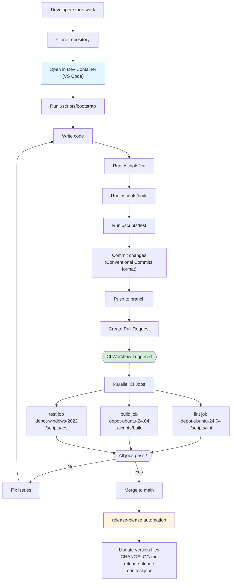
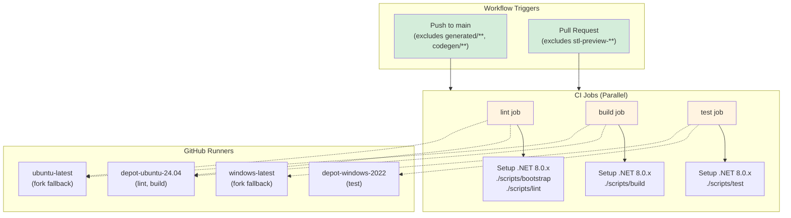
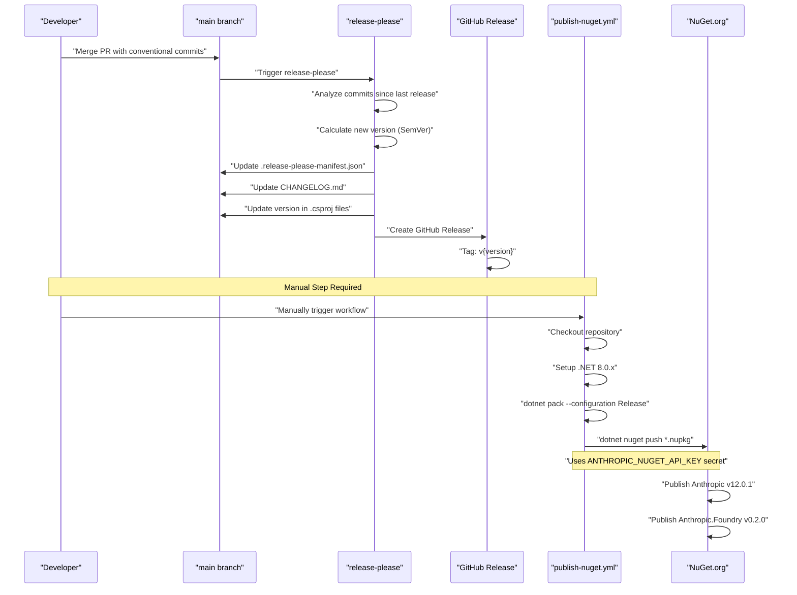

<!-- source: DeepWiki mcp.deepwiki.com · repo anthropics/anthropic-sdk-csharp · page 10 Development Guide · fetched 2026-10-26 -->

# Development Guide

Relevant source files

The following files were used as context for generating this wiki page:

- [.csharpierignore](.csharpierignore)
- [.editorconfig](.editorconfig)
- [.github/workflows/ci.yml](.github/workflows/ci.yml)
- [.github/workflows/publish-nuget.yml](.github/workflows/publish-nuget.yml)
- [src/Anthropic.Tests/Anthropic.Tests.csproj](src/Anthropic.Tests/Anthropic.Tests.csproj)
- [src/Anthropic.Tests/Models/Beta/AnthropicBetaTest.cs](src/Anthropic.Tests/Models/Beta/AnthropicBetaTest.cs)
- [src/Anthropic.Tests/Models/Beta/Files/DeletedFileTest.cs](src/Anthropic.Tests/Models/Beta/Files/DeletedFileTest.cs)
- [src/Anthropic.Tests/Models/Beta/Messages/Batches/BetaMessageBatchTest.cs](src/Anthropic.Tests/Models/Beta/Messages/Batches/BetaMessageBatchTest.cs)
- [src/Anthropic.Tests/Models/Beta/Messages/BetaBase64ImageSourceTest.cs](src/Anthropic.Tests/Models/Beta/Messages/BetaBase64ImageSourceTest.cs)
- [src/Anthropic.Tests/Models/Beta/Messages/BetaBashCodeExecutionToolResultErrorParamTest.cs](src/Anthropic.Tests/Models/Beta/Messages/BetaBashCodeExecutionToolResultErrorParamTest.cs)
- [src/Anthropic.Tests/Models/Beta/Messages/BetaBashCodeExecutionToolResultErrorTest.cs](src/Anthropic.Tests/Models/Beta/Messages/BetaBashCodeExecutionToolResultErrorTest.cs)
- [src/Anthropic.Tests/Models/Beta/Messages/BetaCacheControlEphemeralTest.cs](src/Anthropic.Tests/Models/Beta/Messages/BetaCacheControlEphemeralTest.cs)

This document provides an overview of the development infrastructure and workflows for contributors working on the Anthropic C# SDK itself. It covers the repository structure, development environment setup, build and test processes, CI/CD pipeline, and release automation.

For information about using the SDK in your applications, see [Getting Started](#2). For details about specific development tasks, see:
- [Development Environment](#10.1) - Setting up dev containers and VS Code
- [Building and Testing](#10.2) - Running builds and tests locally
- [CI/CD Pipeline](#10.3) - Understanding the automated workflows
- [Release Process](#10.4) - How releases are managed and published

## Repository Organization

The repository is structured as a multi-project solution with two primary NuGet packages, comprehensive test suites, and example applications.

```mermaid
graph TB
    Root["Repository Root"]
    
    Root --> Src["src/"]
    Root --> Examples["examples/"]
    Root --> Scripts["scripts/"]
    Root --> DevContainer[".devcontainer/"]
    Root --> GitHub[".github/workflows/"]
    Root --> Config["Configuration Files"]
    
    Src --> AnthropicProj["Anthropic/Anthropic.csproj"]
    Src --> FoundryProj["Anthropic.Foundry/Anthropic.Foundry.csproj"]
    Src --> TestsProj["Anthropic.Tests/Anthropic.Tests.csproj"]
    
    Examples --> ExamplesSln["Anthropic.Examples.sln"]
    Examples --> MessagesEx["MessagesExample/"]
    Examples --> StreamingEx["MessagesStreamingExample/"]
    Examples --> ThinkingEx["ThinkingExample/"]
    Examples --> ChatClientEx["ChatClientExample/"]
    
    Scripts --> Bootstrap["bootstrap"]
    Scripts --> Build["build"]
    Scripts --> Lint["lint"]
    Scripts --> Test["test"]
    
    GitHub --> CiYml["ci.yml"]
    GitHub --> PublishYml["publish-nuget.yml"]
    GitHub --> ReleaseYml["release-please.yml"]
    
    DevContainer --> DevJson["devcontainer.json"]
    
    Config --> EditorConfig[".editorconfig"]
    Config --> Sln["Anthropic.sln"]
    Config --> Manifest[".release-please-manifest.json"]
    Config --> VSCodeExt[".vscode/extensions.json"]
    
    style AnthropicProj fill:#e1f5ff
    style FoundryProj fill:#e1f5ff
    style TestsProj fill:#fff4e1
    style CiYml fill:#d4edda
    style PublishYml fill:#d4edda
```

**Sources:** [Anthropic.sln:1-70](), [examples/Anthropic.Examples.sln:1-91](), [.devcontainer/devcontainer.json:1-16](), [.github/workflows/ci.yml:1-67](), [.github/workflows/publish-nuget.yml:1-31]()

### Project Structure

| Directory/File | Purpose |
|---------------|---------|
| `src/Anthropic/` | Core SDK package implementation |
| `src/Anthropic.Foundry/` | Azure Foundry authentication extension |
| `src/Anthropic.Tests/` | Unit and integration test suite |
| `examples/` | Example applications demonstrating SDK usage |
| `scripts/` | Build automation scripts (bootstrap, build, lint, test) |
| `.devcontainer/` | VS Code dev container configuration |
| `.github/workflows/` | GitHub Actions CI/CD workflows |
| `.editorconfig` | Code style and formatting rules |
| `Anthropic.sln` | Main solution file containing SDK and tests |

**Sources:** [Anthropic.sln:6-13](), [examples/Anthropic.Examples.sln:6-15]()

## Development Workflow

The standard development workflow follows a pull request model with automated quality gates. All changes must pass linting, building, and testing before merge.

**Sources:** [.github/workflows/ci.yml:1-67](), [.devcontainer/devcontainer.json:1-16]()

### Development Environment

The repository includes a preconfigured dev container that provides a consistent development environment with .NET 8.0 and 9.0 support. The dev container automatically installs recommended VS Code extensions on startup.

**Dev Container Configuration:**
- Base image: `mcr.microsoft.com/devcontainers/dotnet:1-9.0-noble`
- .NET versions: 8.0.x and 9.0.x (via features)
- Node.js: Included for Prism mock server
- Auto-installs VS Code extensions from [.vscode/extensions.json:1-10]()

**Recommended VS Code Extensions:**
- `ms-dotnettools.csharp` - C# language support
- `editorconfig.editorconfig` - EditorConfig support
- `github.vscode-github-actions` - GitHub Actions integration
- `ms-dotnettools.vscode-dotnet-runtime` - .NET runtime management
- `ms-dotnettools.csdevkit` - C# Dev Kit

**Sources:** [.devcontainer/devcontainer.json:1-16](), [.vscode/extensions.json:1-10]()

## Code Standards and Quality

The repository enforces code style and quality through `.editorconfig` and automated linting. All code must conform to these standards before merge.

### EditorConfig Rules

The `.editorconfig` file defines code formatting standards:

| Setting | Value | Scope |
|---------|-------|-------|
| Indentation style | Spaces | All files |
| Indent size | 4 spaces | C# files |
| Indent size | 2 spaces | XML files |
| End of line | CRLF | C# files |
| Final newline | Required | C# files |

**Diagnostic Suppressions:**
- `CA1510` - ArgumentNullException throw helper not required
- `IDE0060` - Unused parameters (for resources with no methods)
- `IDE1006` - Naming convention exceptions
- `IDE0290` - Primary constructors not preferred
- `IDE0057`, `CA1866`, `CA1847`, `CA2263` - .NET Standard 2.0 compatibility

**Sources:** [.editorconfig:1-34]()

### Build Scripts

The repository includes shell scripts for common development tasks:

| Script | Purpose | Platform |
|--------|---------|----------|
| `./scripts/bootstrap` | Install dependencies and setup environment | Linux/macOS |
| `./scripts/build` | Build all projects in Release configuration | Linux/macOS |
| `./scripts/lint` | Run code style and quality checks | Linux/macOS |
| `./scripts/test` | Execute test suite across all target frameworks | Linux/macOS |

**Sources:** [.github/workflows/ci.yml:30-34](), [.github/workflows/ci.yml:49-50](), [.github/workflows/ci.yml:65-66]()

## CI/CD Pipeline Architecture

The CI pipeline consists of three parallel jobs that run on every push and pull request (except for generated branches). The pipeline uses specialized depot runners for faster execution.

**Sources:** [.github/workflows/ci.yml:1-67]()

### CI Job Details

**Lint Job:**
- Runner: `depot-ubuntu-24.04` (or `ubuntu-latest` for forks)
- Timeout: 10 minutes
- Steps:
  1. Checkout repository via `actions/checkout@v4`
  2. Setup .NET 8.0.x via `actions/setup-dotnet@v3`
  3. Run `./scripts/bootstrap`
  4. Run `./scripts/lint`

**Build Job:**
- Runner: `depot-ubuntu-24.04` (or `ubuntu-latest` for forks)
- Timeout: 10 minutes
- Steps:
  1. Checkout repository via `actions/checkout@v4`
  2. Setup .NET 8.0.x via `actions/setup-dotnet@v3`
  3. Run `./scripts/build`

**Test Job:**
- Runner: `depot-windows-2022` (or `windows-latest` for forks)
- Timeout: 10 minutes
- Steps:
  1. Checkout repository via `actions/checkout@v4`
  2. Setup .NET 8.0.x via `actions/setup-dotnet@v5`
  3. Run `./scripts/test`

**Branch Exclusions:**
- `generated`, `codegen/**`, `integrated/**` - Excluded from push triggers
- `stl-preview-head/**`, `stl-preview-base/**` - Excluded from all triggers

**Sources:** [.github/workflows/ci.yml:2-14](), [.github/workflows/ci.yml:16-67]()

## Release and Publication

The repository uses `release-please` for automated version management and NuGet publication. Releases are created automatically based on conventional commit messages, but NuGet publication requires manual triggering.

**Sources:** [.github/workflows/publish-nuget.yml:1-31]()

### NuGet Publishing Workflow

The `publish-nuget.yml` workflow is a manual workflow that publishes packages to NuGet.org:

**Trigger:** `workflow_dispatch` (manual trigger only)

**Steps:**
1. Checkout repository via `actions/checkout@v4`
2. Setup .NET 8.0.x via `actions/setup-dotnet@v5`
3. Build and pack: `dotnet pack --configuration Release --output artifacts/packages`
4. Publish: `dotnet nuget push artifacts/packages/*.nupkg --source https://api.nuget.org/v3/index.json --api-key $NUGET_API_KEY`

**Secrets Required:**
- `ANTHROPIC_NUGET_API_KEY` (primary)
- `NUGET_API_KEY` (fallback)

**Sources:** [.github/workflows/publish-nuget.yml:1-31]()

## Multi-Framework Support

The SDK supports multiple .NET target frameworks, requiring testing across different runtime versions to ensure compatibility.

| Target Framework | .NET Version | Support Status |
|-----------------|--------------|----------------|
| `netstandard2.0` | .NET Standard 2.0 | Full support |
| `net8.0` | .NET 8.0 | Full support |
| `net9.0` | .NET 9.0 | Full support |

The dev container includes both .NET 8.0 and 9.0 to facilitate multi-framework development and testing. The CI pipeline runs tests on Windows to ensure compatibility across all target frameworks.

**Sources:** [.devcontainer/devcontainer.json:11-14](), [.github/workflows/ci.yml:52-66]()

## Solution Files

The repository contains two solution files for different purposes:

**Anthropic.sln** - Main development solution:
- `Anthropic` project (Core SDK)
- `Anthropic.Foundry` project (Azure extension)
- `Anthropic.Tests` project (Test suite)

**examples/Anthropic.Examples.sln** - Examples solution:
- `MessagesExample` - Basic message creation
- `MessagesStreamingExample` - Streaming responses
- `ThinkingExample` - Extended thinking feature
- `ThinkingStreamingExample` - Streaming with thinking
- `ChatClientExample` - IChatClient integration

Both solutions support multiple build configurations: Debug/Release with Any CPU/x64/x86 platforms.

**Sources:** [Anthropic.sln:1-70](), [examples/Anthropic.Examples.sln:1-91]()

## Getting Started as a Contributor

To begin contributing to the SDK:

1. **Fork and clone** the repository
2. **Open in VS Code** and reopen in the dev container when prompted
3. **Run bootstrap** to install dependencies: `./scripts/bootstrap`
4. **Make changes** following the code standards in `.editorconfig`
5. **Test locally** using the build scripts:
   - `./scripts/lint` - Check code style
   - `./scripts/build` - Build all projects
   - `./scripts/test` - Run test suite
6. **Commit** using conventional commit format (e.g., `feat:`, `fix:`, `docs:`)
7. **Create a pull request** - CI will automatically run all quality checks
8. **Address feedback** and wait for approval

For detailed information about specific development tasks, see the child pages of this guide:
- [Development Environment](#10.1)
- [Building and Testing](#10.2)
- [CI/CD Pipeline](#10.3)
- [Release Process](#10.4)

**Sources:** [.github/workflows/ci.yml:1-67](), [.devcontainer/devcontainer.json:1-16](), [.editorconfig:1-34]()

---

