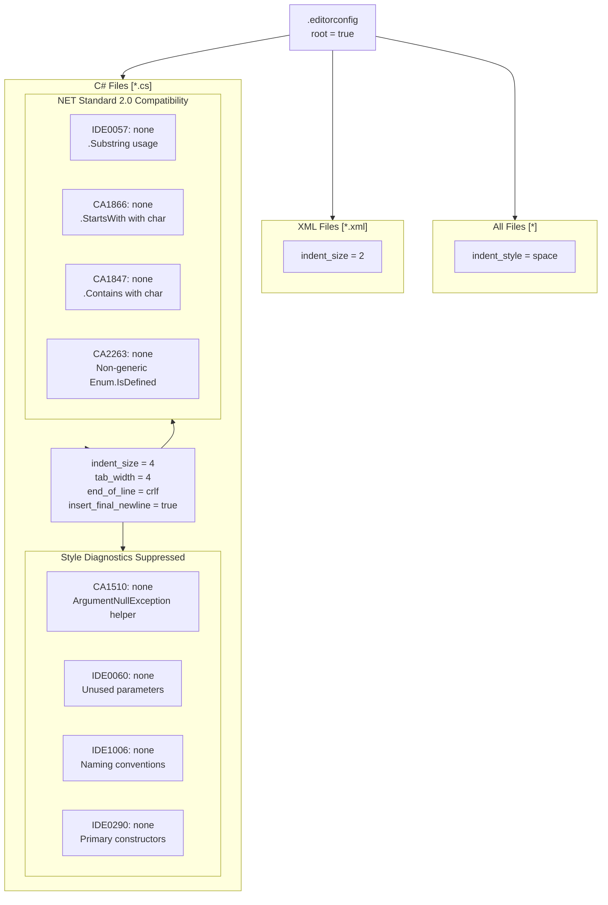
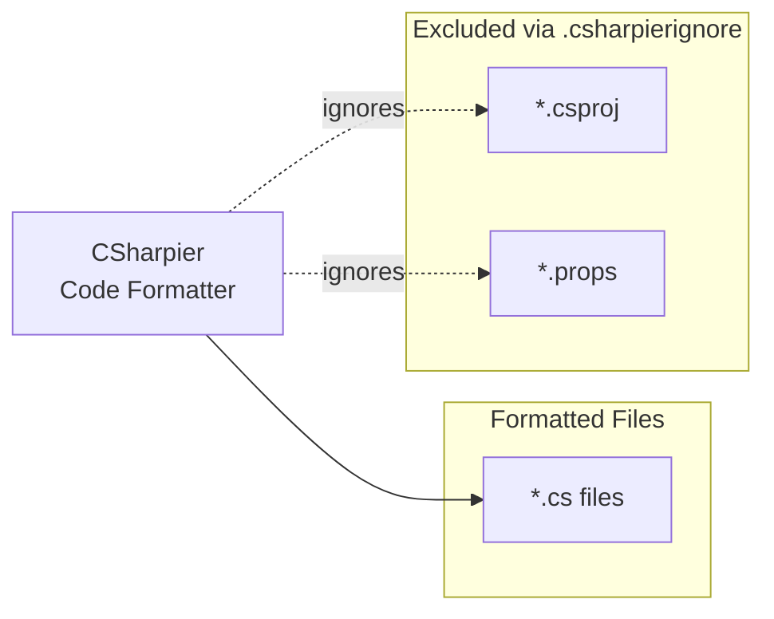
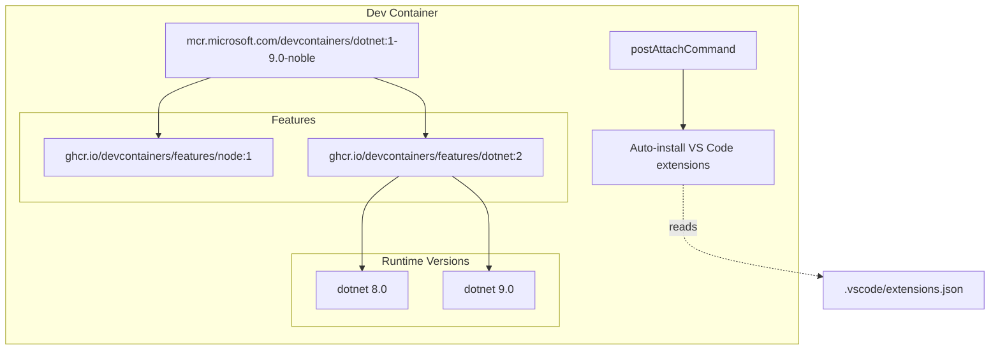
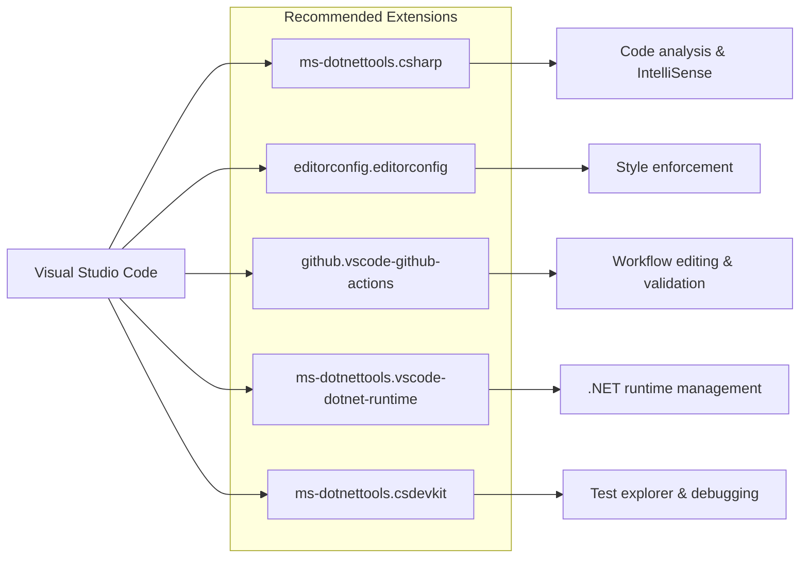
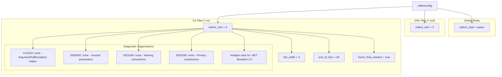
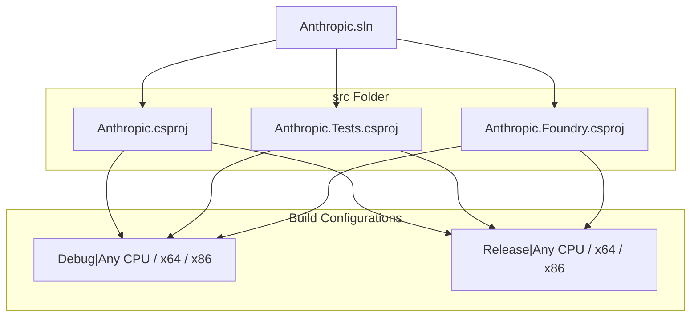
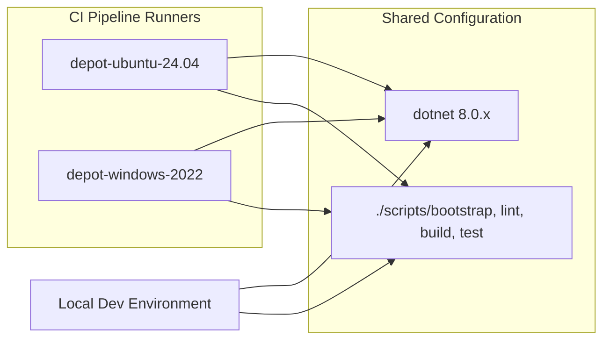

<!-- source: DeepWiki mcp.deepwiki.com · repo anthropics/anthropic-sdk-csharp · page 10.1 Development Environment · fetched 2026-10-26 -->

# Development Environment

<details>
<summary>Relevant source files</summary>

The following files were used as context for generating this wiki page:

- [.csharpierignore](.csharpierignore)
- [.editorconfig](.editorconfig)
- [.github/workflows/ci.yml](.github/workflows/ci.yml)
- [.github/workflows/publish-nuget.yml](.github/workflows/publish-nuget.yml)
- [src/Anthropic.Tests/Anthropic.Tests.csproj](src/Anthropic.Tests/Anthropic.Tests.csproj)
- [src/Anthropic.Tests/Models/Beta/AnthropicBetaTest.cs](src/Anthropic.Tests/Models/Beta/AnthropicBetaTest.cs)
- [src/Anthropic.Tests/Models/Beta/Files/DeletedFileTest.cs](src/Anthropic.Tests/Models/Beta/Files/DeletedFileTest.cs)
- [src/Anthropic.Tests/Models/Beta/Messages/Batches/BetaMessageBatchTest.cs](src/Anthropic.Tests/Models/Beta/Messages/Batches/BetaMessageBatchTest.cs)
- [src/Anthropic.Tests/Models/Beta/Messages/BetaBase64ImageSourceTest.cs](src/Anthropic.Tests/Models/Beta/Messages/BetaBase64ImageSourceTest.cs)
- [src/Anthropic.Tests/Models/Beta/Messages/BetaBashCodeExecutionToolResultErrorParamTest.cs](src/Anthropic.Tests/Models/Beta/Messages/BetaBashCodeExecutionToolResultErrorParamTest.cs)
- [src/Anthropic.Tests/Models/Beta/Messages/BetaBashCodeExecutionToolResultErrorTest.cs](src/Anthropic.Tests/Models/Beta/Messages/BetaBashCodeExecutionToolResultErrorTest.cs)
- [src/Anthropic.Tests/Models/Beta/Messages/BetaCacheControlEphemeralTest.cs](src/Anthropic.Tests/Models/Beta/Messages/BetaCacheControlEphemeralTest.cs)

</details>


This document describes the local development environment setup for the Anthropic C# SDK repository. It covers development container configuration, Visual Studio Code extensions, and code style enforcement through `.editorconfig`. For information about building and testing the SDK, see [Building and Testing](#10.2). For CI/CD pipeline details, see [CI/CD Pipeline](#10.3).

---

## Prerequisites

The SDK requires the following tools for local development:

| Requirement | Version | Purpose |
|------------|---------|---------|
| .NET SDK | 8.0.x | Primary development and build toolchain |
| Docker | Latest | Optional - for dev container support |
| Visual Studio Code | Latest | Recommended IDE with extension support |
| Visual Studio 2022 | Latest | Alternative IDE with full C# support |

The SDK targets multiple frameworks ([src/Anthropic.Tests/Anthropic.Tests.csproj:9]()):
- **net8.0** - .NET 8.0 runtime (tests SDK's net8.0 DLL)
- **net472** - .NET Framework 4.7.2 (tests SDK's netstandard2.0 DLL)

Both target frameworks ensure the SDK functions correctly across modern .NET and legacy .NET Framework environments.

Sources: [src/Anthropic.Tests/Anthropic.Tests.csproj:1-26](), [.github/workflows/ci.yml:26-28]()
</thinking>

<old_str>
</old_str>
<new_str>
## EditorConfig Settings

Code style is enforced through [.editorconfig:1-34](), which applies automatically in Visual Studio, Visual Studio Code (via the EditorConfig extension), and other compatible editors.



**EditorConfig Rule Organization**

Sources: [.editorconfig:1-34]()

### File-Specific Rules

The configuration applies different rules based on file type:

#### Global Rules ([.editorconfig:4-5]())
All files use space-based indentation.

#### XML Files ([.editorconfig:8-9]())
Project files and other XML use 2-space indents for compact structure representation.

#### C# Source Files ([.editorconfig:12-34]())

**Basic Formatting**
- Indent size: 4 spaces ([.editorconfig:17]())
- Tab width: 4 characters ([.editorconfig:18]())
- Line endings: CRLF (Windows-style) ([.editorconfig:21]())
- Final newline: Required ([.editorconfig:22]())

### Diagnostic Suppressions

The SDK suppresses specific .NET code analyzers to support its design patterns and multi-framework targets.

#### Style Suppressions

These diagnostics are disabled to accommodate SDK-specific patterns:

| Diagnostic | Line | Reason |
|-----------|------|--------|
| `CA1510` | [.editorconfig:24]() | SDK does not use ArgumentNullException throw helpers |
| `IDE0060` | [.editorconfig:25]() | Some resources have no methods but retain parameters |
| `IDE1006` | [.editorconfig:26]() | API compatibility requires non-conventional C# names |
| `IDE0290` | [.editorconfig:27]() | Primary constructors are not used in generated code |

#### .NET Standard 2.0 Compatibility Suppressions

These diagnostics are disabled to maintain compatibility with .NET Standard 2.0, which lacks modern API overloads:

| Diagnostic | Line | Purpose | Modern Alternative |
|-----------|------|---------|-------------------|
| `IDE0057` | [.editorconfig:30]() | Allow `.Substring(...)` usage | Range operator `[..]` |
| `CA1866` | [.editorconfig:31]() | Allow `.StartsWith(string)` with single char | `.StartsWith(char)` |
| `CA1847` | [.editorconfig:32]() | Allow `.Contains(string)` with single char | `.Contains(char)` |
| `CA2263` | [.editorconfig:33]() | Allow non-generic `Enum.IsDefined(...)` | Generic overload |

The .NET Standard 2.0 suppressions ([.editorconfig:29-33]()) enable the SDK to compile for netstandard2.0 while using modern .NET 8.0 development tools.

Sources: [.editorconfig:1-34]()

---

## Code Formatting with CSharpier

The repository uses CSharpier for automatic code formatting. CSharpier is an opinionated C# code formatter that ensures consistent style across the codebase.



**CSharpier Formatting Scope**

Sources: [.csharpierignore:1-3]()

### Formatting Exclusions

The [.csharpierignore:1-3]() file specifies which files should not be formatted:

```
*.csproj
*.props
```

These exclusions prevent CSharpier from modifying XML-based project files and MSBuild property files, which have their own formatting conventions managed by Visual Studio and other project tools.

### Running CSharpier

CSharpier runs automatically in the CI pipeline via `./scripts/lint` ([.github/workflows/ci.yml:34]()). For local development:

```bash
# Check formatting (no changes)
dotnet csharpier . --check

# Apply formatting
dotnet csharpier .
```

The formatter respects EditorConfig settings where possible, ensuring consistency between automatic formatting and manual editor behavior.

Sources: [.csharpierignore:1-3](), [.github/workflows/ci.yml:33-34]()

---

## Development Container Configuration

The repository provides a standardized development environment using Visual Studio Code Dev Containers. This ensures consistent tooling and dependencies across all development machines.

### Container Specification



**Dev Container Setup Flow**

Sources: [.devcontainer/devcontainer.json:1-16]()

The dev container is defined in [.devcontainer/devcontainer.json:1-16]() with the following characteristics:

| Property | Value | Description |
|----------|-------|-------------|
| `name` | `"C# (.NET)"` | Container display name |
| `image` | `mcr.microsoft.com/devcontainers/dotnet:1-9.0-noble` | Base image with .NET 9.0 on Ubuntu Noble |
| `workspaceFolder` | `/workspaces/${localWorkspaceFolderBasename}` | Mounted workspace location |
| `postAttachCommand` | Extension auto-install script | Automatically installs recommended extensions |

### Installed Features

The container includes two key features:

1. **Node.js Feature** ([.devcontainer/devcontainer.json:10]())
   - Required for the Prism mock server used in testing
   - Provides npm and Node.js runtime

2. **Additional .NET Versions** ([.devcontainer/devcontainer.json:11-14]())
   - Primary version: 9.0 (from base image)
   - Additional version: 8.0
   - Enables multi-targeting and cross-version testing

### Extension Auto-Installation

The dev container automatically installs VS Code extensions on attach using a post-attach command ([.devcontainer/devcontainer.json:6]()):

```bash
cat .vscode/extensions.json | jq -r .recommendations[] | xargs -n 1 code --install-extension
```

This command parses [.vscode/extensions.json:1-11]() and installs all recommended extensions, ensuring a consistent development experience.

Sources: [.devcontainer/devcontainer.json:1-16]()

---

## Visual Studio Code Extensions

The repository specifies a set of recommended extensions for optimal development experience:



**VS Code Extension Dependencies**

Sources: [.vscode/extensions.json:1-11]()

### Extension Details

| Extension ID | Purpose | Key Features |
|-------------|---------|--------------|
| `ms-dotnettools.csharp` | C# language support | IntelliSense, syntax highlighting, debugging |
| `editorconfig.editorconfig` | EditorConfig support | Automatic code style enforcement |
| `github.vscode-github-actions` | GitHub Actions integration | Workflow validation and editing |
| `ms-dotnettools.vscode-dotnet-runtime` | .NET runtime management | Automatic SDK acquisition |
| `ms-dotnettools.csdevkit` | C# Dev Kit | Test explorer, solution view, enhanced debugging |

The configuration explicitly defines no unwanted recommendations ([.vscode/extensions.json:9]()), allowing all suggested extensions to be installed.

Sources: [.vscode/extensions.json:1-11]()

---

## Code Style Enforcement

Code style is enforced through [.editorconfig:1-34](), which applies automatically in compatible editors including Visual Studio Code (via the EditorConfig extension) and Visual Studio.



**EditorConfig Rule Hierarchy**

Sources: [.editorconfig:1-34]()

### Style Rules

#### All Files
- **Indentation**: Space-based indentation ([.editorconfig:5]())

#### XML Files
- **Indent Size**: 2 spaces ([.editorconfig:9]())

#### C# Files
- **Indent Size**: 4 spaces ([.editorconfig:17]())
- **Tab Width**: 4 characters ([.editorconfig:18]())
- **Line Ending**: CRLF (Windows-style) ([.editorconfig:21]())
- **Final Newline**: Required ([.editorconfig:22]())

### Diagnostic Suppressions

The configuration suppresses specific .NET analyzers to accommodate the SDK's design patterns and .NET Standard 2.0 compatibility:

| Diagnostic | Severity | Reason |
|-----------|----------|--------|
| `CA1510` | `none` | ArgumentNullException throw helper not used |
| `IDE0060` | `none` | Resources with no methods but retained parameters |
| `IDE1006` | `none` | Names may not follow C# conventions (API compatibility) |
| `IDE0290` | `none` | Primary constructors not preferred |
| `IDE0057` | `none` | `.Substring(...)` used for .NET Standard 2.0 |
| `CA1866` | `none` | `.StartsWith(...)` with single character for compatibility |
| `CA1847` | `none` | `.Contains(...)` with single character for compatibility |
| `CA2263` | `none` | Non-generic `Enum.IsDefined(...)` for compatibility |

The .NET Standard 2.0-related suppressions ([.editorconfig:29-33]()) allow the SDK to maintain compatibility with older frameworks while using modern development tools.

Sources: [.editorconfig:1-34]()

---

## Solution Structure

The repository contains two Visual Studio solution files that organize the codebase:

### Main SDK Solution



**Main Solution Project Structure**

Sources: [Anthropic.sln:1-70]()

The main solution ([Anthropic.sln:1-70]()) contains three projects organized within a `src` folder:

1. **Anthropic** ([Anthropic.sln:6]())
   - Core SDK implementation
   - Project GUID: `{5816A0C1-3BA1-454E-8D08-85B23DEF309D}`

2. **Anthropic.Tests** ([Anthropic.sln:8]())
   - Unit and integration tests
   - Project GUID: `{0732C8A6-7313-4C33-AE2E-FFAA82EFB481}`

3. **Anthropic.Foundry** ([Anthropic.sln:12]())
   - Azure Foundry client extension
   - Project GUID: `{DD0E539D-6D5F-45EB-A807-01BE0A443604}`

All projects support three build configurations across three platform targets:
- Debug|Any CPU, Debug|x64, Debug|x86
- Release|Any CPU, Release|x64, Release|x86

### Examples Solution

The examples solution ([examples/Anthropic.Examples.sln:1-91]()) contains five demonstration projects:

| Project | Purpose |
|---------|---------|
| `MessagesExample` | Basic message creation |
| `MessagesStreamingExample` | Streaming message responses |
| `ThinkingExample` | Non-streaming thinking feature |
| `ThinkingStreamingExample` | Streaming thinking responses |
| `ChatClientExample` | Microsoft.Extensions.AI integration |

Each example project is configured with the same build configurations and platform targets as the main solution.

Sources: [Anthropic.sln:1-70](), [examples/Anthropic.Examples.sln:1-91]()

---

## CI Environment Compatibility

The development environment is designed to match the CI pipeline configuration to ensure local builds behave identically to automated builds:



**Development and CI Environment Alignment**

Sources: [.github/workflows/ci.yml:1-67]()

The CI pipeline ([.github/workflows/ci.yml:1-67]()) runs three parallel jobs:

1. **Lint Job** ([.github/workflows/ci.yml:16-34]())
   - Runs on Ubuntu 24.04
   - Uses .NET 8.0.x
   - Executes `./scripts/bootstrap` and `./scripts/lint`

2. **Build Job** ([.github/workflows/ci.yml:35-50]())
   - Runs on Ubuntu 24.04
   - Uses .NET 8.0.x
   - Executes `./scripts/build`

3. **Test Job** ([.github/workflows/ci.yml:52-66]())
   - Runs on Windows Server 2022
   - Uses .NET 8.0.x
   - Executes `./scripts/test`

The dev container's .NET 8.0 installation ([.devcontainer/devcontainer.json:12]()) ensures local development matches the CI environment's runtime version, while .NET 9.0 support enables testing future compatibility.

Sources: [.github/workflows/ci.yml:1-67](), [.devcontainer/devcontainer.json:1-16]()

---

## Getting Started

To set up the development environment:

1. **Clone the repository**
   ```bash
   git clone https://github.com/anthropics/anthropic-sdk-csharp.git
   cd anthropic-sdk-csharp
   ```

2. **Open in VS Code**
   - Open the repository folder in Visual Studio Code
   - When prompted, click "Reopen in Container" to use the dev container
   - Alternatively, use Command Palette: "Dev Containers: Reopen in Container"

3. **Wait for container initialization**
   - The dev container will build and start automatically
   - Extensions will be installed via the post-attach command
   - All .NET SDKs and Node.js will be available

4. **Verify setup**
   - Open a terminal in VS Code
   - Run `dotnet --list-sdks` to confirm both .NET 8.0 and 9.0 are installed
   - Run `node --version` to confirm Node.js is available

5. **Build the solution**
   - See [Building and Testing](#10.2) for detailed build instructions

The `.editorconfig` rules will automatically apply when editing files in VS Code (via the EditorConfig extension) or Visual Studio, ensuring consistent code formatting across all contributions.

Sources: [.devcontainer/devcontainer.json:1-16](), [.vscode/extensions.json:1-11](), [.editorconfig:1-34]()

---

